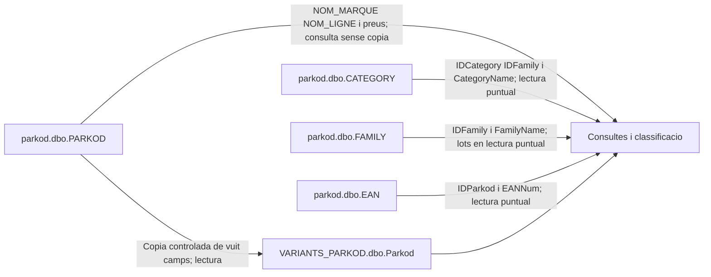

# Gestionnaire de Variantes — Model de dades

Actualització: 2026-11-03. Acords consolidats fins a D367 de [DECISIONS.md](DECISIONS.md). Les darreres decisions de càrrega/conciliació prevalen sobre les formulacions anteriors; adaptacions pendents diferenciades a §6.40.

## 1. Estat i lectura del document

Aquest document acompanya el [funcional Parkod](Parkod.md) i el [registre de decisions](DECISIONS.md). Recull el diagrama, els camps, les relacions i els arguments tractats amb l'usuari.

**No és DDL executable ni una estructura desplegada.** El document distingeix camps/claus de disseny aprovats, regles confirmades i controls SQL/proves pendents. L'etapa 0 continua oberta.

- **Ubicació confirmada:** base exclusiva `VARIANTS_PARKOD`, esquema `dbo`, a la instància existent SQL Server 2017 Express sobre Windows Server 2019. Catorze taules, camps, claus i regles comercials preservats. La base de treball `parkod` només admet lectures controlades del projecte (§1.1/§5); no s'hi crea cap esquema ni objecte.
- **Grup i pertinença confirmats:** es conserven ProductGroup i ProductGroupId. La PK del grup és `(BrandCode, CategoryCode, ProductGroupId)`; ProductGroupId és INT positiu, NOT NULL, generat automàticament des d'1 dins de cada parella marca–categoria, no global. ProductGroup i ProductVariant tenen LineCode NOT NULL, heretat de Parkod.CLIGNE; una FK composta amb LineCode impedeix barrejar línies en un grup. L'anterior cas NULL–NULL queda substituït per la constatació i decisió sobre la font actual.
- **Marca i unicitat confirmades:** VariantType incorpora BrandCode nullable per a qualsevol Type, estructurat o `open_type`. NULL significa global; una marca informada limita l'ús als seus grups. Type + Characteristics és únic globalment, sense incloure BrandCode. El canvi ordinari de BrandCode es bloqueja si hi ha assignacions, incloses les dels SKU retirats.
- **Representació confirmada (D156–D159/D170):** els tipus estructurats poden ser numèrics o textuals. VariantType.ValueKind NVARCHAR(7) NOT NULL declara `numeric` o `text`, homogeni per VariantTypeId; `open_type` exigeix `text`. Cada VariantTypeValue informa exactament un dels camps NumericValue/TextValue. No es replica ValueKind al valor ni s'afegeix a la unicitat. El canvi ordinari queda bloquejat amb qualsevol valor de catàleg o associació aprovada, també de fase 2 sense codi.
- **Principal confirmat:** ProductGroup incorpora PrimaryVariantTypeId, comú per a qualsevol ús. Només compten les associacions ProductGroupVariantType amb IsValidated=1 i ParkodVariantCode no nul: 0 → NULL, 1 → aquell tipus, més d'1 → selecció tècnica. No es compten SKU ni valors.
- **Associacions i rèpliques confirmades:** ProductGroupVariantType conté ProductGroupId, BrandCode, CategoryCode i VariantTypeId, amb PK en aquest ordre; no replica Type ni Characteristics. ProductVariantValue incorpora BrandCode i CategoryCode per referenciar el grup complet, sense canviar la seva PK `(ProductVariantId, VariantTypeId)`. Es conserven VariantTypeValue.Type, ProductVariantValue.VariantTypeId i ProductVariantValue.ProductGroupId per als controls de forma, unicitat i habilitació al grup.
- **Textos confirmats:** normalització automàtica dels blancs de TextValue, Characteristics, ProductGroupName i Type abans de validar i desar: qualsevol seqüència de blancs, incloent tabulacions, salts de línia i espais especials, es converteix en un únic espai ordinari U+0020, amb trim als extrems. S'admeten i es conserven accents i majúscules; la comparació és CI_AI. TextValue no nul és únic dins del seu VariantTypeId, però pot repetir-se entre tipus diferents. La collation s'ha de declarar als camps nous afectats, sense alterar la configuració general de parkod ni les columnes legacy.
- **Textos i codis confirmats:** tots els camps textuals nous són NVARCHAR; els codis són BrandCode, CategoryCode i LineCode, no BrandId, CategoryId o LineId. No es canvien els tipus ni les dades legacy. El nou grup hereta marca, categoria i línia del primer SKU que el crea quan no té un grup comercial corresponent.
- **Confirmat posteriorment:** IDs de catàleg INT IDENTITY(1,1), comptador local ProductGroupCounter, longituds de text i collation concretades, funció de blancs i CHECK binari/longitud, `SourceIsPresent`, nom inicial i escriptura protegida amb `sp_getapplock`. Les FK compostes i claus candidates indicades a la secció 4 han rebut confirmació de disseny; el DDL i les proves encara no existeixen.
- **Camps posteriors confirmats:** EstimatedRiskPercent/IsValidated als quatre àmbits; OriginalSourcesJson/OriginalProposalJson a ProductGroupVariantType i ProductVariantValue; ParkodVariantCode NVARCHAR(3) NULL, immutable un cop assignat al final de fase 3. L'aprovació de fase 2 permet IsValidated=1 amb codi NULL, sense habilitació final.
- **Taules tècniques confirmades:** ParkodVariantCodeRegistry, ParkodVariantCodeBlock, EvaluationAuditEvent, AppAccount, AppSession amb reserva opcional i SynchronizationStatus global de cinc camps. No s'han aprovat taules de versions de classificació, snapshots, propostes de pertinença o estats per marca.
- **Operativa confirmada:** conciliació completa o per diverses marques, controls de completesa externs, recàrrega coordinada amb batch, correu urgent agrupat i lectura inicial SNAPSHOT dels programes Parkod. Els dos indicadors globals no són vetos del generador de fitxers.
- **JSON i revisió confirmats (D143–D155/D159–D169):** contractes de fonts, propostes, resultats, claus i snapshots a §3.11; autoritat dels originals i context esperat per operació a §6.8. SQL compara l'estat revisat, no les correccions del formulari. La creació conjunta de grup/associacions/trasllats conserva valors i exigeix decisions explícites (§6.9).
- **Catàlegs i substitució confirmats (D171–D193):** claus d'auditoria sense context anterior a §3.11.3; reutilització/altes automàtiques i manuals a §6.10; substitució expressa A → B, retirades individuals auditades, JSON transitoris, dos procediments, SNAPSHOT de context, resposta post-COMMIT i resultat incert a §6.11. No noves taules ni columnes.
- **Desplegament/autenticació confirmats (D194–D200):** RDS/RemoteApp amb compte Windows propi i instància d'app per usuari, compte funcional propi, connexió directa i model intern de confiança; Argon2id en Python, token de 32 bytes i dos procediments de login a §6.13. No servei central ni autenticació Windows automàtica. SQL conserva els controls compartits; dependències comentades en anglès i inventariades a §6.12.
- **Catàleg manual i editorial confirmat (D201–D217):** finestra permanent de conjunt, preparació independent de tipus globals/valors, altes i auditories atòmiques, confirmació humana editorial, contextos SNAPSHOT reduïts, bloqueig per tipus, signatures/respostes i reversió editorial a §6.14. No noves columnes ni extensió de l'alta independent a tipus exclusius.
- **Fonts i entorn confirmats (D223–D232):** `parkod` local poblada i `VARIANTS_PARKOD` existent sense taules a `.\SQLEXPRESS`, SQL Server 2019 Express de proves. Producció continua en 2017 Express; l'usuari confirma l'estructura font com a referència i French_CI_AS a totes les columnes textuals de producció. Inventari/equivalències a §5, diagnòstics previs de lectura a §5.5. DESIGN1/DESIGN2 passen a NVARCHAR(18), code1 a NVARCHAR(13) NOT NULL; només s'ajusten aquests detalls físics, sense taules ni camps nous.
- **Precisió recent dels contractes (D233–D240):** tasques Windows en seqüència recàrrega → conciliació nocturna, ja acordades (§6.7); signatures completes A → B validades (§6.11.2); recuperació manual de resultats incerts només per administradors (§6.11.6), no comprovació automàtica. Entrada existent/nova de valor SKU i resposta de candidata en dos conjunts aprovades (§6.10.1–6.10.2), amb gramàtica D236 de ValuesJson reutilitzada expressament a NewValueJson. No canvia code1 ni originals històrics.
- **Candidates existents (D241–D248):** sis signatures i contractes de candidates a §6.15, preservats; quatre blocs grup–tipus D246 i set propietats SKU–valor D248 íntegrament confirmats. D243 només confirmava Parkod, no s'amplia retroactivament. Els altres circuits es concreten expressament a §6.16–6.24, no per extrapolació.
- **Contractes addicionals (D249–D284):** vint signatures de disseny per consulta administrativa, finalització, trasllats, creació/rebutjos, alta manual de tipus, principal i valors SKU. Absència/candidata/validada tenen circuits diferenciats; nous valors de catàleg només en confirmar, amb atomicitat/auditoria. Cap nova entitat/camp/PK/FK ni SQL desplegat; etapa 0 oberta.
- **Rebutjos conjunts i correccions de fase 2 (D285–D294):** quatre signatures addicionals a §6.25–6.26 i el lector GetGroupVariantTypeProposalCorrectionContext ara confirmat expressament per D294. D293 n'aprovava només el context, no s'amplia retroactivament. Cap assignació SKU s'elimina per fer admissible una candidata.
- **Substitució d'associació ja aprovada de fase 2 (D295–D296):** confirmador i lector de §6.27 per A 1/codi NULL i B candidata 0/codi NULL, totes dues sense assignacions al grup. Retirada expressa d'A/aprovació de B atòmiques, sense fase 3. Contractes preservats, amb l'adaptació d'activitat de grup D326–D330.
- **Sessions, comptes i abast de catàlegs (D297–D320):** cicle de sessió/reserva i tancament administratiu auditat, comptes/bootstrap/recuperació, BrandCode/ValueKind, signatura de NormalizeWhitespace i edició descriptiva del nom a §6.28–6.32. AppAccount.IsActive i ProductGroup.IsActive són independents. Cap servei central, compte de reserva o recuperació nova del tancament forçat.
- **Nou camp ProductGroup.IsActive (D321–D330):** BIT NOT NULL DEFAULT(1), únic camp físic nou d'aquesta consolidació. Catorze taules/99 camps; grup complet de nou camps, sense canviar PK/FK ni replicar el camp. Desactivació administrativa només amb zero SKU i cap reserva vigent, per marca/marca–categoria/totalitat i amb transacció/auditoria per grup (§6.33). Fora de l'operativa ordinària però amb referències/controls històrics conservats, sense DELETE ni reactivació aprovada. Adaptació completa de contractes a §6.34.
- **Validació sense trasllat (D331–D337):** dos lectors i dos confirmadors per validar grup existent o pertinença actual, decisions independents; grup actiu buit, grup provisional i SKU retirat segons cada contracte (§6.36–6.37). Risc conservat, no-op només després de tots els controls.
- **Correcció de línia (D338–D347, actualitzada per D361–D363):** dues vies explícites, destí existent o grup propi nou d'un únic SKU, signatures confirmades a §6.38. L'app corregeix classificació a partir de la còpia; no modifica Parkod, no rellegeix CLIGNE original ni genera codis. Contextos/respostes aprovats abans del canvi de frontera es distingeixen de la seva adaptació pendent.
- **Càrrega externa versus conciliació (D361–D367):** només el procés extern carrega `parkod.dbo.PARKOD` → `VARIANTS_PARKOD.dbo.Parkod`, conserva històric i manté SourceIsPresent. L'app llegeix aquesta còpia i concilia ProductVariant/grups; còpia de nou camps de només lectura per a l'app. CLIGNE reflecteix l'última càrrega, LineCode la classificació vigent. GUI possible durant càrrega; conciliació sense sessions vigents i amb entrada coherent/disponible (§6.35).
- **Cicle batch i balanç (D348–D359):** abast JSON complet/multimarques, manual/scheduled, Begin/Complete/FailReconciliation i SESSION_CONTEXT petit temporal, sense HASH d'abast o RunId (§6.39). COMMIT per operació, no rollback global. Fórmules anteriors que feien escriure la còpia per l'app substituïdes; cobertura amb SKU sense variant pendent de precisar (§6.39.6).
- **Interfície preservada i ampliada:** capítol 8 «Interficie  App - motor SQL», tres fases de classificació a §8.4.1 i inventari de 76 signatures de procediment confirmades de disseny, amb estat d'adaptació per contracte; NormalizeWhitespace interna separada. Model 14 taules/99 camps, PK/FK/tipus intactes; implementació, DDL, integració i proves pendents.
- **Pendent:** completar evidència de metadades/permisos i impacte, controls executables JSON, detalls SQL de procediments/bloquejos, índexs/CHECK/FK, integracions i proves de les regles confirmades. Els casos no concretats es distingeixen a §7; no es consideren tots els procediments ni tots els formats possibles tancats. La FK SKU/còpia de quatre camps continua retirada. No avançar a l'etapa 1 abans de validar l'etapa 0.

Els vuit camps copiats conserven noms, tipus i nul·litat font acceptats (D230–D231), amb French_CI_AS al destí segons la producció confirmada (D232); no hereten SQL_Latin1 de la còpia de proves. `docs/parkod.sql` és una referència antiga discrepant, no el contracte de còpia. Fonts a `parkod.dbo`, objectes del projecte a `VARIANTS_PARKOD.dbo`; totes dues bases locals ja identificades a la mateixa instància de proves. L'equivalència estructural de la còpia amb producció és confirmació de l'usuari, no verificació directa de producció. En aquest document, `dbo.<objecte del projecte>` és abreviatura dins de **VARIANTS_PARKOD**, mai autorització per crear-lo a parkod. Cap script SQL de referència modificat ni objecte del model desplegat.

### 1.1 Frontera permanent: cap intervenció a `parkod`

**D218–D222 substitueixen l'antiga ubicació de D01/D65; D361–D367 precisen el límit de càrrega.** El projecte no executa a `parkod` cap escriptura, DDL, manteniment, objecte, permís o canvi de configuració. Tampoc implementa la càrrega de la còpia local. Per a aquell flux l'únic origen és `parkod.dbo.PARKOD`, consumit pel procés extern; no hi ha CSV, base intermèdia o recàrrega prèvia de l'original obligatoris afegits pel projecte. Les lectures auxiliars controlades ja autoritzades de §5 es conserven, sense ampliar-ne fonts ni permisos. Diagnòstics previs només de lectura, no autorització per executar scripts. Qualsevol necessitat d'alterar l'original exigeix redisseny.

Totes les escriptures, FK, procediments, comptes, sessions, bloquejos lògics, auditoria i SynchronizationStatus són a **VARIANTS_PARKOD.dbo**. Les FK inclouen la còpia local de PARKOD i no travessen bases. Fer servir dbo no implica concedir db_owner al compte de l'app. Els programes legacy continuen operant l'original fora del projecte; aquesta regla no posa la base sencera en READ_ONLY.

| Element | `parkod` original, observat i no modificable pel projecte | `VARIANTS_PARKOD`, configuració aprovada pendent d'aplicar/provar |
|---|---|---|
| Motor/instància | SQL Server 2017 Express 14.x, mateixa instància de destí | SQL Server 2017 Express, sense migració prevista |
| Compatibilitat | 100 | 140; permet OPENJSON, que exigeix almenys 130 |
| Collation general | French_CI_AS | French_CI_AS |
| ALLOW_SNAPSHOT_ISOLATION | OFF | ON, per transaccions explicitament SNAPSHOT |
| READ_COMMITTED_SNAPSHOT | No contrastat; cap canvi autoritzat | OFF |

L'usuari ha aportat resultats de consultes de metadades: versió 14.0.2110.2 i, a parkod, 80,25 MiB de dades assignats/41,44 MiB ocupats. Són una observació puntual, no una previsió de creixement ni una prova de rendiment. Express 2017 limita les dades a 10 GB per base; les dues bases comparteixen recursos del servidor. No es promet impacte nul de les lectures: controls d'abast, bloquejos ordinaris i càrrega s'han de provar sense NOLOCK ni bloqueig deliberat de taules senceres.

La collation Latin1_General_100_CI_AI_SC es manté als quatre textos nous acordats i la rèplica Type; LoginName conserva la seva unicitat CI_AI ja aprovada (§3.12). L'usuari confirma ara French_CI_AS general i a totes les columnes textuals de producció. Els vuit camps de còpia i els codis relacionats a VARIANTS_PARKOD es defineixen amb French_CI_AS (D232). La coincidència s'ha de garantir a cada costat de les FK textuals, encara amb codis ASCII. Les comparacions amb la font local SQL_Latin1 poden requerir COLLATE explícit, sense modificar-la; copiar NVARCHAR no normalitza ni canvia la grafia.

**Separació de proves i producció (D229):** la taula anterior és el destí aprovat i l'observació històrica de producció, no la configuració local actual. A `.\SQLEXPRESS`/2019 les dues bases s'han observat a compatibilitat 150, SQL_Latin1_General_CP1_CI_AS, SNAPSHOT OFF i RCSI OFF; VARIANTS_PARKOD existeix sense taules (§5.5). Cap canvi d'opcions executat. El disseny i el futur T-SQL continuen limitats a SQL Server 2017; proves en 2019 no acrediten per si soles compatibilitat/rendiment en 2017.

**Integracions encara pendents:** SNAPSHOT només a VARIANTS_PARKOD. La conciliació i les correccions de línia consumeixen la còpia local; les relectures originals de CLIGNE de l'antic disseny queden substituïdes per revalidació local. Noms/EAN/fonts auxiliars i generador conserven els seus protocols de lectura autoritzada pendents, sense SNAPSHOT a l'original ni coherència conjunta presumpta. La integració amb el carregador extern s'acota al contracte de disponibilitat/coordinació de §6.35/§6.7; no implica implementar-lo, copiar mestres o afegir permisos entre bases.

**Correspondència de codis (sense reanomenar la còpia):** `CMARQ → BrandCode`, `CCATEG → CategoryCode`, `CPROD → ProductCode`; CLIGNE inicialitza LineCode en alta/correcció confirmada, però la càrrega externa no el sobreescriu a ProductVariant. CLIGNE/LineCode poden diferir fins a revisió. A la còpia de proves, noms de marca/línia a `PARKOD.NOM_MARQUE`/`NOM_LIGNE`, categoria a `CATEGORY.CategoryName` i família a `FAMILY.FamilyName` segons §5.3; aquestes consultes auxiliars no són etapes de càrrega ni noves columnes/FK.

## 2. Diagrama entitat–relació

Totes les entitats del diagrama són a **VARIANTS_PARKOD.dbo**, inclosa Parkod, que és la còpia, no la font original. `PK` identifica una clau primària i `FK` una clau forana; diverses columnes marcades poden formar una sola clau composta. Es representen acords de disseny, no DDL validat ni desplegat.

**Abast del diagrama:** catorze taules/99 camps fins a D367, els mateixos del tall D330. D321 afegia només ProductGroup.IsActive; ValueKind només al tipus, longituds D231 conservades. Cap nou tipus/camp/PK/FK. Canvia la responsabilitat de càrrega/presència i la relació entre CLIGNE d'entrada i LineCode classificat, no les claus. Activitat/habilitació/caducitat/JSON/principal no imposats només per fletxes. Comptador amb ús transaccional, no FK; cap FK entre bases o de quatre camps vers còpia.

```mermaid
erDiagram
    Parkod ||--o| ProductVariant : "identifica el SKU"
    ProductGroup ||--o{ ProductVariant : "mateixa marca categoria i linia"
    ProductGroup ||--o{ ProductGroupVariantType : "utilitza"
    ProductGroupVariantType |o--o| ProductGroup : "es principal del mateix grup"
    VariantType ||--o{ ProductGroupVariantType : "pot compartir-se"
    VariantType ||--o{ VariantTypeValue : "defineix valors"
    ProductVariant ||--o{ ProductVariantValue : "te assignacions"
    VariantTypeValue ||--o{ ProductVariantValue : "es assignat"
    ProductGroupVariantType ||--o{ ProductVariantValue : "associacio revisada per preparar valors"
    ProductGroupCounter ||--o{ ProductGroup : "numera per marca categoria via procediment"
    ProductGroup ||--o{ ParkodVariantCodeRegistry : "conserva reserves del grup"
    VariantType ||--o{ ParkodVariantCodeRegistry : "conserva reserves del tipus"
    ParkodVariantCodeRegistry |o--o| ProductGroupVariantType : "reserva el codi final"
    AppAccount ||--o| AppSession : "una sessio activa"
    AppAccount |o--o{ EvaluationAuditEvent : "autor huma opcional"
    ProductGroup |o--o| AppSession : "reserva opcional exclusiva"

    Parkod {
        nvarchar CMARQ PK "3 caracters"
        nvarchar CCATEG PK "2 caracters"
        nvarchar CPROD PK "3 caracters"
        nvarchar CLIGNE "2 caracters; NOT NULL"
        nvarchar DESIGN1 "18 caracters; NOT NULL"
        nvarchar DESIGN2 "18 caracters; NULL"
        nvarchar code1 "13 caracters; NOT NULL; quantitat original"
        nvarchar code2 "1 caracter; NULL; unitat original"
        bit SourceIsPresent "NOT NULL; DEFAULT 1"
    }

    ProductGroup {
        int ProductGroupId PK, FK "positiu; des d 1 per marca-categoria"
        nvarchar ProductGroupName "150; nullable; blancs normalitzats; CI_AI"
        nvarchar BrandCode PK, FK "CMARQ; 3 caracters; NOT NULL"
        nvarchar CategoryCode PK, FK "CCATEG; 2 caracters; NOT NULL"
        nvarchar LineCode FK "CLIGNE; 2 caracters; NOT NULL; heretat del primer SKU"
        int PrimaryVariantTypeId FK "NULL amb 0 habilitacions finals"
        decimal EstimatedRiskPercent "DECIMAL(5,2); NULL si no estimable"
        bit IsValidated "NOT NULL; DEFAULT 0"
        bit IsActive "NOT NULL; DEFAULT 1; inactiu nomes sense SKU ni reserva vigent"
    }

    ProductVariant {
        bigint ProductVariantId PK "IDENTITY(1,1)"
        int ProductGroupId FK "NOT NULL; grup amb marca i categoria"
        nvarchar BrandCode FK "CMARQ; 3 caracters; NOT NULL"
        nvarchar CategoryCode FK "CCATEG; 2 caracters; NOT NULL"
        nvarchar ProductCode FK "CPROD; 3 caracters; NOT NULL"
        nvarchar LineCode FK "classificacio; 2 caracters; NOT NULL; FK al grup; CLIGNE en alta/correccio"
        decimal EstimatedRiskPercent "DECIMAL(5,2); risc de pertinenca; nullable"
        bit IsValidated "NOT NULL; DEFAULT 0; pertinenca"
    }

    VariantType {
        int VariantTypeId PK "IDENTITY(1,1); U2 amb Type"
        nvarchar Type "20; NOT NULL; CI_AI; U1 amb Characteristics; U2 amb VariantTypeId"
        nvarchar Characteristics "80; NOT NULL; CI_AI; U1 amb Type"
        nvarchar BrandCode "nullable; NULL global"
        nvarchar ValueKind "7; NOT NULL; numeric o text; no replicat"
    }

    VariantTypeValue {
        int VariantTypeValueId PK "IDENTITY(1,1)"
        int VariantTypeId FK
        nvarchar Type FK "20; NOT NULL; CI_AI; replica conservada"
        decimal NumericValue "DECIMAL(18,3); nullable"
        nvarchar TextValue "80; CI_AI; nullable; unic per tipus si no NULL"
    }

    ProductGroupVariantType {
        int ProductGroupId PK, FK
        nvarchar BrandCode PK, FK "3 caracters; NOT NULL; marca del grup"
        nvarchar CategoryCode PK, FK "2 caracters; NOT NULL; categoria del grup"
        int VariantTypeId PK, FK
        nvarchar ParkodVariantCode FK "3; nullable; assignat al final de fase 3"
        decimal EstimatedRiskPercent "DECIMAL(5,2); nullable"
        bit IsValidated "NOT NULL; DEFAULT 0; aprovacio de fase 2"
        nvarchar OriginalSourcesJson "MAX; nullable"
        nvarchar OriginalProposalJson "MAX; nullable"
    }

    ProductVariantValue {
        bigint ProductVariantId PK, FK
        int VariantTypeId PK, FK
        int ProductGroupId FK "NOT NULL; replica conservada; FK proposada"
        nvarchar BrandCode FK "3 caracters; NOT NULL; replica del grup real"
        nvarchar CategoryCode FK "2 caracters; NOT NULL; replica del grup real"
        int VariantTypeValueId FK
        decimal EstimatedRiskPercent "DECIMAL(5,2); nullable"
        bit IsValidated "NOT NULL; DEFAULT 0"
        nvarchar OriginalSourcesJson "MAX; nullable"
        nvarchar OriginalProposalJson "MAX; nullable"
    }

    ProductGroupCounter {
        nvarchar BrandCode PK "3 caracters; NOT NULL"
        nvarchar CategoryCode PK "2 caracters; NOT NULL"
        int LastAllocatedId "NOT NULL; inicial 0"
    }

    ParkodVariantCodeRegistry {
        nvarchar BrandCode PK, FK "3; NOT NULL"
        nvarchar CategoryCode PK, FK "2; NOT NULL"
        nvarchar ParkodVariantCode PK "3; NOT NULL; permanent"
        int ProductGroupId FK "NOT NULL"
        int VariantTypeId FK "NOT NULL"
    }

    ParkodVariantCodeBlock {
        int BlockOrder PK "NOT NULL; des d 1; immutable"
        nvarchar FirstCode "3; NOT NULL; prefix unic"
    }

    EvaluationAuditEvent {
        bigint EvaluationAuditEventId PK "IDENTITY(1,1)"
        uniqueidentifier OperationId "NOT NULL"
        datetime2 OccurredAtUtc "3; NOT NULL; SYSUTCDATETIME"
        nvarchar EventKind "32; NOT NULL"
        nvarchar ActionName "64; NOT NULL; controlat"
        nvarchar DecisionOutcome "16; nullable"
        nvarchar ActorKind "16; NOT NULL"
        int ActorAppAccountId FK "nullable"
        nvarchar ActorProcessName "128; nullable"
        nvarchar TargetScope "32; NOT NULL"
        nvarchar TargetKeyJson "MAX; NOT NULL"
        decimal OriginalEstimatedRiskPercent "DECIMAL(5,2); nullable"
        nvarchar OriginalSourcesJson "MAX; nullable"
        nvarchar OriginalProposalJson "MAX; nullable"
        nvarchar DecisionResultJson "MAX; nullable"
        nvarchar BeforeStateJson "MAX; nullable"
        nvarchar AfterStateJson "MAX; nullable"
    }

    AppAccount {
        int AppAccountId PK "IDENTITY(1,1)"
        nvarchar LoginName "80; NOT NULL; unic CI_AI"
        nvarchar PasswordHash "255; NOT NULL; Argon2id"
        bit IsActive "NOT NULL; DEFAULT 0"
        bit IsAdmin "NOT NULL; DEFAULT 0"
    }

    AppSession {
        uniqueidentifier AppSessionId PK
        int AppAccountId FK "NOT NULL; UNIQUE"
        varbinary SessionTokenHash "32; NOT NULL; UNIQUE; SHA-256"
        datetime2 LastActivityAtUtc "3; NOT NULL; SYSUTCDATETIME"
        nvarchar ReservedBrandCode FK "3; nullable"
        nvarchar ReservedCategoryCode FK "2; nullable"
        int ReservedProductGroupId FK "nullable"
    }

    SynchronizationStatus {
        tinyint SynchronizationStatusId PK "unica fila; valor 1"
        datetime2 ParkodLastCompletedAtUtc "3; nullable"
        bit ParkodRefreshSucceeded "NOT NULL; DEFAULT 0"
        datetime2 VariantsLastCompletedAtUtc "3; nullable; nomes batch complet"
        bit VariantsReconciliationSucceeded "NOT NULL; DEFAULT 0; nomes batch complet"
    }
```



La correspondència Parkod–variant és 1:1 per als SKU vàlids incorporats. El `0..1` és també un estat normal d'entrada: la càrrega externa pot haver creat una còpia encara sense ProductVariant. L'alta de l'app crea variant, grup propi i auditories atòmicament, però no la còpia. Cobertura final amb entrades rebutjades pendent de §6.39.6; no igualtat de recomptes inicials imposada. Comptador: ús transaccional, no FK; cap altra relació física afegida.

**Claus de VariantType en el diagrama:** `PK (VariantTypeId)`; `U1 = UNIQUE (Type, Characteristics)` és la unicitat funcional global sobre text normalitzat amb `Latin1_General_100_CI_AI_SC`, sense BrandCode ni ValueKind; `U2 = UNIQUE (VariantTypeId, Type)` és una clau candidata tècnica per a la FK de `VariantTypeValue(VariantTypeId, Type)`. U1/U2 identifiquen **parelles** de columnes, no la unicitat individual de Type o Characteristics. Són acords de disseny, encara sense DDL desplegat.

L'ordre acordat de les PK és `(BrandCode, CategoryCode, ProductGroupId)` per a ProductGroup i `(ProductGroupId, BrandCode, CategoryCode, VariantTypeId)` per a ProductGroupVariantType; les marques PK del diagrama indiquen els components, no l'ordre dels índexs. ProductGroupId sol no identifica el grup. LineCode no entra en cap d'aquestes PK; la igualtat de línia es comprova amb una FK composta cap a una clau candidata que sí l'inclou.

La relació de principal és un subconjunt de les associacions habilitades: cada grup selecciona `0..1` associació i cada associació només pot ser principal del seu propi grup. El `0..1` del diagrama no implica opcionalitat general: amb un o més tipus habilitats, el principal és obligatori. La mateixa VariantType pot ser principal de molts grups a través d'associacions diferents; PrimaryVariantTypeId no és únic entre grups.

### Fonts de la còpia de proves, sense persistència local excepte vuit camps de PARKOD



Aquests accessos són només de lectura, sense FK, vista ni cap altre objecte nou a l'origen. BRAND/LINE es conserven a la còpia de proves, però no són dependències necessàries per als noms de marca/línia. L'inventari canònic i la separació respecte de producció són a §5; cal verificar els permisos de lectura ja disponibles i l'impacte, sense concedir permisos ni configurar parkod des del projecte.

## 3. Diccionari de taules i camps

### 3.1 `dbo.Parkod`

**Finalitat:** còpia de treball a `VARIANTS_PARKOD.dbo.Parkod` de `parkod.dbo.PARKOD`, amb clau única, que permet ancorar les FK internes sense afectar les aplicacions antigues.

| Camp | Tipus de referència | Nul·litat | Funció i argument |
|---|---|---|---|
| `CMARQ` | NVARCHAR(3) | No | Marca i primer component de la PK. Tres caràcters exactes. |
| `CCATEG` | NVARCHAR(2) | No | Categoria i segon component de la PK. Dos caràcters exactes. |
| `CPROD` | NVARCHAR(3) | No | Producte i tercer component de la PK. Tres caràcters exactes. |
| `CLIGNE` | NVARCHAR(2) | No | Últim codi de línia carregat externament; pot diferir de ProductVariant.LineCode pendent de revisió. |
| `DESIGN1` | NVARCHAR(18) | No | Denominació original del SKU; metadades acceptades D231. |
| `DESIGN2` | NVARCHAR(18) | Sí | Denominació complementària original; metadades acceptades D231. |
| `code1` | NVARCHAR(13) | No | Quantitat original com a text; mai truncar ni convertir en copiar. NOT NULL no implica quantitat vàlida. |
| `code2` | NVARCHAR(1) | Sí | Unitat original com a text; els NULL es rebutgen en processar. |
| `SourceIsPresent` | BIT NOT NULL DEFAULT(1), confirmat | No | Mantingut només pel procés extern: 1 present segons la càrrega, 0 absència contrastada globalment o per marques completes. No expressa antiguitat, qualitat o validació; l'app no el modifica. |

La PK és `(CMARQ, CCATEG, CPROD)` i la FK des de ProductVariant utilitza només aquests tres camps. La U1/FK de quatre camps amb CLIGNE continua **retirada**. D363 permet expressament la diferència temporal entre línia d'entrada i classificació; no és orfandat o error de FK. Igualtat amb la CLIGNE local revisada exigida a l'alta i al final de la correcció de línia, no invariant universal de totes les files. La FK variant–grup amb LineCode es manté sempre. SKU derivat per concatenació textual exacta A–Z/0–9, zeros preservats, sense comparacions permissives d'accents.

Còpia acumulativa de totes les referències admeses, antigues i actuals: no DELETE, buidatge/recreació o pèrdua de l'última fila per desaparició del flux. El procés extern manté presència amb lectura completa/fiable global o de les marques seleccionades, mai absència inferida d'un incremental. La comprovació periòdica d'integritat de producció i la seva càrrega són externes; l'app no executa el control de duplicats originals ni modifica cap dels nou camps de còpia. `PRIX_ACHAT`, `PRIX_VENTE`, `DECCONT`, `LIBELLE_COURT`, `NUM_UPD`, `CSSCATEG`, noms i mestres no s'hi afegeixen. Fonts de noms auxiliars i metadades D231/D232 preservades. Canvis futurs de contracte es revisen amb avís d'impacte, sense truncament/adaptació silenciosa.

### 3.2 `dbo.ProductGroup`

**Finalitat:** identificar i anomenar el producte comercial que agrupa els SKU.

| Camp | Tipus/estat | Funció i argument |
|---|---|---|
| `ProductGroupId` | INT NOT NULL, positiu; part de la PK composta, confirmat | Identificador local dins de BrandCode + CategoryCode, des d'1; comptador i bloqueig aprovats, DDL pendent. |
| `ProductGroupName` | NVARCHAR(150) NULL COLLATE Latin1_General_100_CI_AI_SC | Nom comercial visible, no únic. Informat inicialment amb noms/codis i editable; blancs normalitzats, cap buit informat. |
| `BrandCode` | NVARCHAR(3) NOT NULL; part de la PK composta, confirmat | Identificador CMARQ de la marca, heretat del primer SKU; tots els membres comparteixen la marca. |
| `CategoryCode` | NVARCHAR(2) NOT NULL; part de la PK composta, confirmat | Codi CCATEG, heretat del primer SKU; tots els membres comparteixen la categoria. |
| `LineCode` | NVARCHAR(2) NOT NULL, confirmat | Heretat de CLIGNE del primer SKU; una FK composta impedeix membres d'una altra línia. No forma part de la PK. |
| `PrimaryVariantTypeId` | INT NULL | VariantType principal per a qualsevol ús, no un SKU ni un valor. Ha de correspondre a una associació del mateix grup a ProductGroupVariantType; FK composta confirmada conceptualment. |
| `EstimatedRiskPercent` | DECIMAL(5,2) NULL | Risc inicial/vigent de creació/configuració, 0–100; NULL si no estimable. |
| `IsValidated` | BIT NOT NULL DEFAULT(0) | Validació tècnica del grup, independent de les pertinences dels SKU. |
| `IsActive` | BIT NOT NULL DEFAULT(1), confirmat D321 | Activitat operativa del grup, independent de IsValidated/risc. Només administració pot passar 1 → 0 amb zero SKU assignats i cap reserva vigent; consulta històrica conservada. |

El nom visible de marca es consulta a `PARKOD.NOM_MARQUE` de la còpia de proves, no en una columna nova de marca ni en una còpia de BRAND. CMARQ continua sent el codi funcional de marca; `BRAND.IDBrand` n'és l'equivalent documental. La disponibilitat i coherència de les denominacions s'han de contrastar sense seleccionar noms arbitraris si hi ha anomalies (§5).

Els camps de risc/validació estan confirmats per D107. Un grup propi provisional comença IsValidated=0 i risc sustentat o NULL; la PK i el nom no autoritzen ús als clients. DDL/proves pendents.

PK confirmada: `(BrandCode, CategoryCode, ProductGroupId)`. ProductGroupId és un enter positiu, no global ni equivalent a ProductVariant.ProductCode, que continua representant CPROD del SKU. Es conserven els noms ProductGroup, ProductGroupId i ProductGroupName; es retiren únicament les denominacions Product/ProductId que s'havien proposat, no els altres canvis acordats.

Quan el primer SKU a assignar no troba el grup comercial al qual pertany, es crea un grup propi amb BrandCode, CategoryCode i LineCode heretats d'aquell ProductVariant. La font actual informa sempre CLIGNE; no s'inventa una línia quan l'origen sigui invàlid. No hi ha un grup genèric compartit. Compartir marca, categoria i línia és necessari, però no identifica per si sol el producte comercial ni autoritza agrupar arbitràriament SKU; poden existir diversos grups amb els mateixos codis.

Els noms poden repetir-se, fins i tot dins d'una marca i categoria; la PK completa distingeix les identitats. La importació repetida no crea nous grups per al mateix SKU. Els grups buits es conserven per auditoria i reversibilitat.

**Activitat confirmada D321–D330:** tots els grups nous, també els propis provisionals de conciliació, es creen IsActive=1. Buit significa cap ProductVariant referenciant la identitat completa marca–categoria–grup, sense excloure retirats o pertinences pendents. Quedar buit no modifica IsValidated ni risc: un provisional pot continuar a 0 i un validat a 1. La retirada operativa és desactivació lògica, mai eliminació física. IsActive=0 exigeix zero SKU i cap reserva de sessió vigent; no es mouen/esborren SKU o s'expulsen sessions per aconseguir-ho. Una reserva caducada pot conservar-se físicament fins a la neteja per demanda (§6.34.4).

Un grup inactiu no es mostra ni s'utilitza en cerques, selectors, propostes, destinacions, reserves o modificacions ordinàries, també si l'actor és administrador o aporta una clau coneguda. SQL ho comprova transaccionalment, inclosos els no-op. L'operativa filtra **IsActive=1**, no IsValidated=1 ni «té SKU»: un grup actiu buit segueix operatiu fins a desactivació expressa. Cap reactivació automàtica per conciliació ni contracte de reactivació aprovat. Administració consulta els inactius per les vies explícites de §6.33–6.34.

Es conserven principal, associacions, codis, identificadors i auditoria. Les associacions històriques continuen comptant per compatibilitat de marca i bloqueig de ValueKind; no s'ignoren FK ni es reciclen comptadors/codis. Desactivar redueix el soroll operatiu, no l'emmagatzematge; persisteixen fila/índexs/dependències dins del límit d'Express. No es manté una transacció o bloqueig SQL obert pel fet que un grup sigui buit/inactiu. Contractes de nom/desactivació a §6.32–6.33 i matriu d'impacte a §6.34.6.

La numeració comença a 1 per BrandCode + CategoryCode, **no** per línia. Dos grups de línies diferents dins de la mateixa marca–categoria obtenen números diferents. `dbo.ProductGroupCounter` i `sp_getapplock` per marca–categoria estan aprovats a VARIANTS_PARKOD per assignar-los atòmicament amb la creació; vegeu la secció 6. El DDL concret i les proves resten pendents.

#### Compatibilitat de marca, categoria i línia

Cada ProductVariant té un únic grup de la mateixa marca, categoria i línia informada. ProductGroup i ProductVariant tenen LineCode NOT NULL; els NULL antics del model general no s'admeten en aquest contracte de la font actual. NULL no és un comodí ni és equivalent a una cadena buida.

| ProductGroup.LineCode | ProductVariant.LineCode | Compatible, amb marca i categoria iguals |
|---|---|---|
| NULL | NULL | No; no s'admeten NULL |
| NULL | Informat | No |
| Informat | NULL | No |
| Informat | Mateix codi | Sí |
| Informat | Codi diferent | No |

La clau primària del grup no inclou LineCode. La clau candidata `UNIQUE (BrandCode, CategoryCode, ProductGroupId, LineCode)` i la FK de quatre camps impedeixen barrejar línies classificades, també sense valors. La FK de tres camps preserva l'existència del SKU a la còpia. D363 substitueix l'exigència universal d'igualtat còpia–variant: es manté la classificació mentre la CLIGNE d'entrada ha canviat, i es revalida la còpia local en una correcció expressa (§6.3/§6.38). No relectura original ni escriptura de còpia per l'app.

#### Tipus principal del grup

El principal és una propietat comuna del grup, independent d'eCommerce, connectors o destinacions. Pot ser estructurat o `open_type`, global o exclusiu d'una marca, sempre que estigui habilitat al mateix grup i respecti BrandCode.

| Nombre de VariantType habilitats a ProductGroupVariantType | PrimaryVariantTypeId requerit |
|---|---|
| 0 | NULL; no hi ha cap tipus a seleccionar. |
| 1 | Obligatori i igual a l'únic VariantTypeId habilitat. No hi ha una tria alternativa. |
| Més d'1 | Obligatori; el personal tècnic selecciona un dels tipus habilitats. |

Només compten les associacions amb **IsValidated=1 i ParkodVariantCode IS NOT NULL**. Les candidates i les aprovades a fase 2 encara sense codi no alteren el principal. El recompte no és un recompte de SKU ni valors; la completesa dels valors es comprova abans de donar el codi final. Grups d'un sol SKU i grups buits conservats segueixen la mateixa regla segons les habilitacions que mantinguin.

El recompte és per VariantTypeId: Size/letter i Size/cms compten com dos tipus si tots dos estan finalment habilitats, encara que comparteixin el text Type=Size.

Si el principal obligatori falta o no és vàlid, es bloqueja l'exportació del grup i es rebutgen els canvis ordinaris que deixin un estat final invàlid. Es permeten les operacions correctives necessàries per definir-lo, amb revalidació atòmica en una transacció curta. Afegir o retirar tipus, canviar el principal o traslladar SKU requereix revalidar la regla. Amb més d'un tipus no s'escull arbitràriament el primer ni se substitueix silenciosament una decisió tècnica vàlida.

El principal no elimina altres tipus, valors o SKU, ni els fusiona. Un grup amb diversos SKU però sense tipus definits continua pendent de classificació: un principal NULL coherent amb zero tipus no autoritza l'exportació. Un principal vàlid tampoc garanteix, per si sol, que tots els SKU tinguin valor o que els valors diferenciïn tots els SKU en una destinació limitada a una sola característica; els controls específics d'exportació s'hauran de concretar al connector, sense alterar la classificació interna.

La columna admet NULL físicament per al cas de zero habilitacions finals, però és obligatòria quan n'hi ha una o més. Les associacions candidates o aprovades sense codi no imposen un principal. Un NOT NULL incondicional no serveix i la FK composta confirmada només comprova la pertinença al grup, no la validesa final, el recompte ni l'elecció tècnica. La materialització SQL i el control transaccional continuen pendents; no s'afegeixen camps d'estat o marques IsPrimary.

### 3.3 `dbo.ProductVariant`

**Finalitat:** donar a cada SKU una identitat independent del seu Parkod i relacionar-lo amb el grup actual.

| Camp | Tipus/estat | Funció i argument |
|---|---|---|
| `ProductVariantId` | BIGINT IDENTITY(1,1), PK confirmada | Codi propi de variant. La PK impedeix duplicats i SQL Server el genera per a múltiples usuaris. |
| `ProductGroupId` | INT NOT NULL; FK composta proposada | Grup actual dins de BrandCode + CategoryCode; no determina la identitat de la variant. |
| `BrandCode` | NVARCHAR(3) NOT NULL; FK composta proposada | Component CMARQ del SKU i de la referència al grup; ha de coincidir amb la marca del grup. |
| `CategoryCode` | NVARCHAR(2) NOT NULL; FK composta proposada | Component CCATEG del SKU i de la referència al grup; ha de coincidir amb la categoria del grup. |
| `ProductCode` | NVARCHAR(3) NOT NULL; FK composta proposada | Component CPROD del SKU, independent de ProductGroupId. |
| `LineCode` | NVARCHAR(2) NOT NULL, confirmat | Línia de classificació, inicialitzada de CLIGNE local i canviada només per correcció confirmada. Pot diferir de la còpia actual; sempre igual a la del grup. |
| `EstimatedRiskPercent` | DECIMAL(5,2) NULL | Risc de la pertinença SKU→grup actual, rang 0–100. |
| `IsValidated` | BIT NOT NULL DEFAULT(0) | Decisió tècnica individual de pertinença. |

La combinació `(BrandCode, CategoryCode, ProductCode)` és única i referencia la PK de `VARIANTS_PARKOD.dbo.Parkod`. D363 conserva aquesta FK de tres camps, no afegeix `ParkodVariantLink` ni UNIQUE amb CLIGNE. La coherència variant–grup és permanent; la igualtat amb CLIGNE local correspon a l'alta/correcció expressa. Els controls ordinaris afectats per un desajust d'entrada requereixen el contrast transversal de §6.40.

Cada pertinença té els camps físics de D107, independents dels de ProductVariantValue. Una aprovació conjunta conserva una decisió per SKU. Una proposta automàtica de trasllat no canvia ProductGroupId abans de validar; el SKU nou manté grup propi provisional i el rebuig no el deixa orfe.

La referència al grup utilitza `(BrandCode, CategoryCode, ProductGroupId, LineCode)` cap a la clau candidata, no ProductGroupId sol. LineCode no forma part de la identitat SKU ni de la PK del grup; és obligatori i part de la comprovació de pertinença. Cap valor CLIGNE es transforma per encaixar un grup.

La identitat es conserva en trasllats de grup o canvi només de CLIGNE. Una recodificació que canvia CPROD o CCATEG crea un ProductVariant nou i grup propi provisional, sense herència automàtica; l'antic es conserva i no es retira si encara és a l'origen. EAN/descripció no són ordres de recodificació. BIGINT supera les `36^8` combinacions teòriques de l'alfabet general; comença per 1, amb salts acceptats, sense reciclatge ni MAX+1.

### 3.4 `dbo.VariantType`

**Finalitat:** definir què varia i amb quina unitat o denominació comercial.

| Camp | Tipus/estat | Funció i argument |
|---|---|---|
| `VariantTypeId` | INT IDENTITY(1,1) NOT NULL, PK | Identificador de l'única definició d'una parella Type + Characteristics. |
| `Type` | NVARCHAR(20) NOT NULL COLLATE Latin1_General_100_CI_AI_SC | Naturalesa de la característica: `volume`, `weight`, `Size`, `%alcool` o `open_type`. Ja no determina tot sol la representació numèrica/textual. Parella única amb Characteristics. |
| `Characteristics` | NVARCHAR(80) NOT NULL COLLATE Latin1_General_100_CI_AI_SC | Unitat, escala o denominació comercial; `unitless` només per a magnituds adimensionals confirmades. |
| `BrandCode` | NVARCHAR(3) NULL, compatible amb CMARQ; camp i nul·litat confirmats | NULL: tipus global. CMARQ informat: exclusiu d'aquella marca. Independent de Type; no forma part de la unicitat i no té FK a cap mestre font. |
| `ValueKind` | NVARCHAR(7) NOT NULL, confirmat | `numeric` o `text`; representació única per a tots els valors del mateix VariantTypeId. `open_type` exigeix `text`. No forma part de cap nova clau ni es replica a VariantTypeValue. |

Exemples: `volume/ml` amb ValueKind=`numeric`, `weight/gr`, `weight/oz`, `Size/letter` amb ValueKind=`text`, `Size/cms` amb ValueKind=`numeric`, `open_type/color SpringViews` amb ValueKind=`text`. Els noms i unitats es conserven, sense conversió.

- `(Type, Characteristics)` és una clau única global per a tots els tipus, estructurats i `open_type`, després de normalitzar els blancs i amb comparació CI_AI. La restricció acordada és `UNIQUE (Type, Characteristics)`; BrandCode no s'hi inclou i VariantTypeId continua sent la PK.
- Una parella existeix en una sola fila de VariantType. No es permet una segona definició amb un altre ID, sigui amb el mateix BrandCode, amb una altra marca o amb NULL.
- BrandCode és opcional per a qualsevol Type. Type determina la naturalesa de la característica; ValueKind, la representació dels valors; BrandCode, l'abast d'ús.
- Amb BrandCode NULL, el tipus és global i es pot associar a grups de qualsevol marca. L'ús actual per una sola marca no el converteix en exclusiu.
- Amb BrandCode informat, el tipus només es pot associar a grups d'aquella marca. Això també és possible per als tipus estructurats.
- La mateixa definició es reutilitza mitjançant ProductGroupVariantType: `VariantType.BrandCode IS NULL` o `VariantType.BrandCode = ProductGroup.BrandCode`.
- TextValue té una unicitat pròpia a VariantTypeValue: no es pot repetir dins del mateix VariantTypeId després de normalitzar els blancs i segons CI_AI, però sí entre VariantTypeId diferents. Reutilitzar un valor en diversos SKU no crea files noves al catàleg.
- Les unitats no es converteixen; unitats diferents identifiquen tipus diferents. No s'ha de confondre ounce de pes amb fluid ounce de volum.
- Canviar una definició compartida pot afectar diversos grups: requereix control i auditoria, no una modificació silenciosa del significat.

La fila única de VariantType conté el seu abast de marca; no cal un registre addicional de propietat de configuracions. El camp BrandCode està aprovat, però la materialització SQL de la compatibilitat amb els grups i del bloqueig de canvis continua pendent.

#### Representació homogènia i canvis de ValueKind

L'homogeneïtat és per **VariantTypeId**, no pel text de Type sol ni per ProductGroup. Un grup pot associar-se a `Size/letter` (M, L, XL, XXL textuals) i `Size/cms` (33, 34, 35 numèrics) mitjançant dos VariantType diferents. Cada SKU pot tenir un valor de cadascun; no se'n dedueixen equivalències, ordre comercial ni conversions. Una etiqueta numèrica textual no es converteix automàticament a NumericValue.

La parella Type + Characteristics continua sent única globalment: ValueKind no permet duplicar la mateixa parella amb una altra representació, marca o ID. `open_type` continua exclusivament textual, però ja no és l'únic Type que pot utilitzar TextValue. No s'ha aprovat cap valor per defecte ni extensió de la collation CI_AI a ValueKind.

**Bloqueig ordinari confirmat (D158/D170):** rebutjar un canvi de ValueKind si existeix **qualsevol VariantTypeValue del tipus, encara no assignat a cap SKU, o qualsevol ProductGroupVariantType del tipus amb IsValidated=1**. N'hi ha prou amb una de les dues condicions. El control abasta tots els grups que comparteixen el tipus, inclosos els aprovats a fase 2 amb codi NULL i encara sense valors. No es desvaliden associacions ni s'eliminen dades per permetre el canvi. Sense aquests usos continuen exigits la resta de controls, l'auditoria i `open_type → text`; no es reescriuen els originals de candidates.

Comprovació i canvi han de ser atòmics respecte de la creació de valors i l'aprovació de fase 2, amb la coordinació per tipus prevista a §6.2. La materialització, les curses i els permisos s'han de provar. La via administrativa excepcional de BrandCode (D142) **no s'estén a ValueKind**.

#### Casos de marca i reutilització

| Cas | Permès? | Motiu |
|---|---|---|
| `volume/ml` estructurat amb BrandCode NULL utilitzat per grups ABC i XYZ. | Sí | La definició és global. |
| `weight/gr` estructurat amb BrandCode ABC associat a un grup XYZ. | No | L'abast exclusiu també s'aplica als estructurats. |
| `open_type/color SpringViews`, ID 101, amb BrandCode NULL, utilitzat per ABC i XYZ. | Sí | Un `open_type` també pot ser global. |
| `open_type/color SummerViews`, ID 205, amb BrandCode ABC, utilitzat per dos grups ABC. | Sí | Reutilització d'una mateixa definició dins del seu abast. |
| El tipus 205 associat a un grup XYZ. | No | El grup és incompatible amb BrandCode ABC. |
| Crear un altre ID amb `open_type/color SpringViews`, amb ABC, XYZ o NULL, existint el 101. | No | La definició global no es duplica ni es privatitza amb una altra fila. |
| Crear un altre ID amb `open_type/color SummerViews`, amb ABC, XYZ o NULL, existint el 205. | No | La parella tampoc es repeteix dins d'una mateixa marca. |
| Repetir l'associació del mateix tipus al mateix grup. | No | Ho impedeix la PK de ProductGroupVariantType. |

#### Canvis de BrandCode

Un canvi de BrandCode és un canvi major d'abast, independent del Type. La unicitat global evita duplicar la definició, però no bloqueja per si sola l'edició d'aquest camp.

| Situació | Canvi ordinari de BrandCode | Condició |
|---|---|---|
| Sense assignacions ni associacions a grups. | Permès | No hi ha usos que es puguin tornar incompatibles. |
| Sense assignacions, amb associacions a grups compatibles amb el nou abast. | Permès | Revalidar totes les associacions ProductGroupVariantType. |
| Sense assignacions, amb alguna associació incompatible. | Bloquejat | No eliminar ni alterar associacions silenciosament. |
| Amb alguna assignació a ProductVariantValue. | Bloquejat | El tipus ja s'utilitza en un SKU. |
| Amb assignacions només a SKU retirats conservats. | Bloquejat | Els usos preservats també compten. |

Per exemple, NULL → ABC sense assignacions es rebutja si el tipus està associat a un grup XYZ. La comprovació i el canvi són atòmics, en transacció curta, segurs davant assignacions/associacions concurrents.

**Via excepcional confirmada (D142):** un canvi de VariantType.BrandCode amb assignacions existents s'executa fora de la GUI mitjançant un procediment protegit accessible només a una identitat SQL d'administració autoritzada, mai al compte ordinari de variants. Requereix anàlisi d'impacte i autorització prèvies. Comprova que totes les associacions grup–tipus continuen compatibles; qualsevol incompatibilitat rebutja el canvi. No elimina associacions o valors ni modifica codis per forçar la compatibilitat. El canvi i l'auditoria abans/després es confirmen en una mateixa transacció curta. El bloqueig ordinari, inclosos usos retirats, continua vigent. La via està acordada; procediment SQL, permisos efectius i proves encara pendents.

### 3.5 `dbo.VariantTypeValue`

**Finalitat:** contenir els valors disponibles de cada tipus.

| Camp | Tipus/estat | Funció i argument |
|---|---|---|
| `VariantTypeValueId` | INT IDENTITY(1,1) NOT NULL, PK | Identificador del valor. |
| `VariantTypeId` | INT NOT NULL, FK | Definició a la qual pertany el valor. |
| `Type` | NVARCHAR(20) NOT NULL COLLATE Latin1_General_100_CI_AI_SC | Rèplica controlada del pare; no declara independentment la representació ni substitueix ValueKind. |
| `NumericValue` | DECIMAL(18,3), nullable | Valor exacte si ValueKind=`numeric`; únic dins del tipus quan no és NULL. |
| `TextValue` | NVARCHAR(80) NULL COLLATE Latin1_General_100_CI_AI_SC | Valor si ValueKind=`text`, estructurat o `open_type`; únic dins del tipus quan no és NULL. |

Regles:

- Es conserva Type i la FK composta proposada `(VariantTypeId, Type)`. No és una naturalesa independent editable. L'antiga deducció `Type <> open_type → numèric` queda substituïda: la rèplica no basta per garantir l'homogeneïtat respecte de ValueKind.
- Cada fila informa **exactament un** dels camps NumericValue/TextValue: rebutjar tots dos informats o tots dos NULL. Un CHECK local controla aquesta exclusió i la regla `open_type → text`; els procediments protegits comproven la correspondència amb VariantType.ValueKind sota coordinació per tipus. No s'aprova una rèplica ValueKind, FK nova ni trigger per aquest canvi.
- ValueKind=`numeric`: NumericValue obligatori i TextValue NULL. ValueKind=`text`: TextValue obligatori, normalitzat i no buit, i NumericValue NULL. La mateixa regla s'aplica a tots els valors del VariantTypeId.
- Unicitat de `(VariantTypeId, TextValue)` només quan `TextValue IS NOT NULL`, després de normalitzar els blancs i segons CI_AI. No poden existir dues files del mateix tipus amb textos equivalents en aquesta comparació. Els NULL dels valors numèrics queden fora d'aquesta unicitat.
- Unicitat de `(VariantTypeId, NumericValue)` per als valors numèrics presents.
- Rebuig, sense arrodoniment silenciós, de valors que requereixin més de tres decimals o surtin del rang. Els zeros decimals finals no requereixen més precisió: `50.0000` es pot representar exactament, però `50.0001` no. DECIMAL(18,3) admet quinze dígits enters i tres decimals.
- `50`, `50.0` i `50.000` representen el mateix número dins del mateix tipus. No cal conservar el format original d'aquest número.
- `weight/gr/50` i `weight/oz/50` són entrades independents: no hi ha conversió.
- A la pantalla es poden eliminar zeros decimals finals.
- Diversos SKU poden reutilitzar el mateix VariantTypeValueId a ProductVariantValue; això no duplica TextValue a VariantTypeValue ni modifica la identitat de les variants.

La unicitat global afecta VariantType `(Type, Characteristics)`; la de TextValue es limita al seu VariantTypeId. VariantTypeValue és el catàleg de valors, no una taula de variants SKU. Un valor només s'assigna a través del seu tipus, a grups compatibles amb el seu abast: qualsevol marca si BrandCode és NULL, o només la marca informada. El mateix text pot existir en tipus diferents, però no en dues files del mateix tipus.

Les edicions sobre la mateixa fila de `VariantType.Type`, `VariantType.Characteristics` i `VariantTypeValue.TextValue` només poden ser **editorials sense canvi de significat**. Normalitzar/comprovar unicitat, preservar validacions i avaluar usos compartits amb auditoria. Canvi semàntic del tipus: nova VariantType/associació/codi i revalidació dels valors SKU; canvi semàntic només del valor: nou VariantTypeValue del mateix tipus i reassignació/revalidació, mai reescriure sentit d'una fila compartida. Confirmació humana, contextos i procediments editorials/reversió ja acordats a §6.14; seqüència SQL i cascada editorial D101 encara per implementar/provar, inclosa propagació exacta amb CI_AI.

El número no evita duplicats per naturalesa: ho fa la restricció d'unicitat. S'utilitza DECIMAL, no FLOAT, perquè cal igualtat numèrica exacta.

### 3.6 `dbo.ProductGroupVariantType`

**Finalitat:** reutilitzar una mateixa definició en grups compatibles amb el seu abast, tant per als tipus estructurats com per als `open_type`.

| Camp | Tipus/estat | Funció i argument |
|---|---|---|
| `ProductGroupId` | INT NOT NULL; FK, part de la PK composta | Identificador local del grup que utilitza el tipus. |
| `BrandCode` | NVARCHAR(3) NOT NULL; FK, part de la PK composta | Marca del grup, no una definició independent de l'abast del tipus. |
| `CategoryCode` | NVARCHAR(2) NOT NULL; FK, part de la PK composta | Categoria del grup; completa la identitat juntament amb BrandCode i ProductGroupId. |
| `VariantTypeId` | INT NOT NULL, FK, part de la PK composta | Definició utilitzada. |
| `ParkodVariantCode` | NVARCHAR(3) NULL | Codi extern immutable assignat al final de fase 3, després dels valors requerits validats; únic per marca–categoria incloent reserves històriques. No és PK. |
| `EstimatedRiskPercent` | DECIMAL(5,2) NULL | Risc de l'associació, 0–100; NULL si no estimable. |
| `IsValidated` | BIT NOT NULL DEFAULT(0) | Aprovació tècnica de fase 2; no és habilitació final sense codi. |
| `OriginalSourcesJson` | NVARCHAR(MAX) NULL | Evidències/fonts originals de la candidata i del risc; JSON vàlid si informat. |
| `OriginalProposalJson` | NVARCHAR(MAX) NULL | Proposta automàtica original abans de la correcció humana; JSON vàlid si informat. |

PK confirmada, en aquest ordre: `(ProductGroupId, BrandCode, CategoryCode, VariantTypeId)`.

La unicitat global de `(Type, Characteristics)` a VariantType, juntament amb aquesta PK, ja impedeix repetir la mateixa configuració dins d'un grup. No cal una unicitat local filtrada per `open_type` per aconseguir-ho.

La identitat i PK es mantenen. BrandCode/CategoryCode identifiquen el grup, no l'abast del tipus. Type/Characteristics es consulten a VariantType, sense rèplica ni nova clau candidata de textos. Els camps posteriors estan aprovats, no desplegats.

La FK proposada `(BrandCode, CategoryCode, ProductGroupId)` referencia la PK de ProductGroup. Una associació és vàlida si `VariantType.BrandCode IS NULL` o coincideix amb `ProductGroup.BrandCode`; el BrandCode de l'associació sempre és el de la identitat del grup, fins i tot quan el tipus és global. Les columnes i FK proposades no garanteixen encara aquesta comprovació condicional d'abast. La materialització SQL queda pendent.

PrimaryVariantTypeId selecciona una d'aquestes associacions, no una definició aliena al grup. Retirar l'associació seleccionada requereix deixar un principal coherent amb les associacions resultants dins de la mateixa operació atòmica; no s'esborren assignacions silenciosament ni s'aplica una cascada per evitar el conflicte. La substitució completa de §6.11 permet retirar relacions SKU–valor només amb decisió explícita i auditoria individual, preservant catàlegs i historial.

L'associació grup–tipus de §3.6 pot passar pels estats següents:

| Estat | IsValidated | ParkodVariantCode | Compta per al principal i la lectura Parkod? |
|---|---|---|---|
| Candidata de fase 2 | 0 | NULL | No |
| Aprovada a fase 2, valors en preparació | 1 | NULL | No |
| Completa al final de fase 3 | 1 | Assignat | Sí, sense substituir els altres controls per SKU |

Les candidates automàtiques són files persistents visibles amb risc i evidències. En rebutjar una candidata no validada, sense codi ni ProductVariantValue, s'elimina només aquesta fila i s'audita en la mateixa transacció; grup i VariantType es conserven. Les dues columnes JSON preserven originals fins a decidir i es copien a auditoria, també en rebutjos. No són esborranys manuals. La retirada d'una associació habilitada segueix els controls de referències/principal i conserva la reserva permanent del codi.

Crear/reutilitzar el tipus abans de persistir la candidata segueix §6.10. Corregir VariantTypeId implica una associació diferent: els casos d'A/B candidata, aprovada o amb assignacions i les seves auditories estan concretats a §6.11, no són una edició silenciosa de la PK. Dos tipus complementaris poden conservar-se i aprovar-se tots dos.

### 3.7 `dbo.ProductVariantValue`

**Finalitat:** assignar un valor de tipus a un SKU sense afegir columnes per cada atribut.

| Camp | Tipus/estat | Funció i argument |
|---|---|---|
| `ProductVariantId` | FK, part de la PK composta | Variant que rep el valor. |
| `VariantTypeId` | Conservació confirmada; FK composta, part de la PK | Tot i ser derivable del valor, es manté per limitar una assignació per tipus i SKU; ha de coincidir amb el VariantTypeId del valor referenciat. |
| `ProductGroupId` | INT NOT NULL; rèplica tècnica conservada per acord | Identificador local del grup actual real de la variant; requereix BrandCode i CategoryCode per identificar-lo. |
| `BrandCode` | NVARCHAR(3) NOT NULL; rèplica confirmada | Marca del SKU i del grup real; component de les FK compostes de coherència i habilitació. |
| `CategoryCode` | NVARCHAR(2) NOT NULL; rèplica confirmada | Categoria del SKU i del grup real; component de les FK compostes de coherència i habilitació. |
| `VariantTypeValueId` | FK composta | Valor concret, que ha de pertànyer al tipus indicat. |
| `EstimatedRiskPercent` | DECIMAL(5,2) NULL | Risc propi de la proposta d'assignació per SKU, rang 0–100. |
| `IsValidated` | BIT NOT NULL DEFAULT(0) | Validació humana d'aquesta assignació individual. |
| `OriginalSourcesJson` | NVARCHAR(MAX) NULL | Fonts/evidències originals del valor i del risc, JSON vàlid si informat. |
| `OriginalProposalJson` | NVARCHAR(MAX) NULL | Assignació automàtica original abans de correcció humana, JSON vàlid si informat. |

PK: `(ProductVariantId, VariantTypeId)`.

Els quatre camps addicionals estan aprovats per D107/D137. La seva informació pertany a l'assignació SKU–tipus, no al catàleg compartit ni a l'associació grup–tipus. Els controls de forma, coherència i unicitat continuen obligatoris.

Les FK comproven grup real, associació existent i valor del mateix tipus. El procediment exigeix aprovació de fase 2 abans de crear candidates de valor, però permet codi encara NULL per preparar la fase 3. Exigir codi final abans de preparar valors crearia una dependència impossible; la lectura Parkod sí exigeix habilitació final. Una variant pot tenir valors de dues unitats perquè són VariantType diferents.

La conservació de VariantTypeId i ProductGroupId, i la incorporació de BrandCode i CategoryCode, estan confirmades. VariantTypeId forma part de la PK `(ProductVariantId, VariantTypeId)` i de la FK composta amb el valor. Una clau només de ProductVariantId + VariantTypeValueId permetria assignar dos valors diferents del mateix tipus al mateix SKU i no equival a la regla acordada.

ProductGroupId, BrandCode i CategoryCode combinen les FK proposades `(ProductVariantId, ProductGroupId, BrandCode, CategoryCode)` cap al grup real del SKU i `(ProductGroupId, BrandCode, CategoryCode, VariantTypeId)` cap al tipus habilitat. No són una segona pertinença a grup independent ni representen l'abast de VariantType.BrandCode. Els trasllats han de mantenir-ne la coherència dins de l'operació atòmica, fins i tot si dos grups d'àmbits diferents comparteixen el mateix ProductGroupId.

Les rèpliques conservades no s'omplen automàticament per una FK: l'operació les ha de proporcionar coherentment i SQL les haurà de verificar. **Dues excepcions confirmades:** ProductVariantValue → ProductVariant amb `ON UPDATE CASCADE` manté les tres rèpliques de grup en trasllats; VariantTypeValue(VariantTypeId, Type) → VariantType(VariantTypeId, Type) amb `ON UPDATE CASCADE` manté la rèplica Type en una correcció editorial. No es propaguen esborrats ni canvis semàntics. Claus candidates i proves del DDL pendents.

En rebutjar un valor pendent IsValidated=0, només s'elimina la fila ProductVariantValue d'aquell SKU/tipus. Primer es preserven proposta, fonts, risc i decisió a EvaluationAuditEvent, en la mateixa transacció que l'eliminació; si alguna operació falla, rollback complet. ProductVariant i VariantTypeValue es conserven. Un valor obligatori absent impedeix completar una associació nova i donar-li codi. Les correccions reassignen a un valor correcte existent o nou, sense canviar el significat d'una fila compartida; una assignació ja validada no es reemplaça abans de confirmació explícita.

La retirada funcional explícita dins d'una substitució completa de tipus (§6.11) també pot afectar una assignació validada o d'un SKU retirat, amb auditoria individual i catàleg conservat. No s'assimila automàticament a rejected ni autoritza esborrats per SourceIsPresent=0. El moment d'alta d'un valor nou automàtic/manual es defineix a §6.10.

### 3.8 Textos nous: normalització dels blancs, comparació i unicitat

- **Camps afectats:** VariantType.Type, VariantType.Characteristics, ProductGroup.ProductGroupName i VariantTypeValue.TextValue. La mateixa regla s'aplica a VariantTypeValue.Type, rèplica conservada del Type del pare.
- **Normalització automàtica confirmada:** abans de validar i enregistrar, es converteix qualsevol seqüència d'un o més caràcters blancs en un únic espai ordinari U+0020. Inclou espais ordinaris, tabulacions, salts de línia i espais especials Unicode, com els espais no separables. Un blanc especial aïllat també es converteix, no només les seqüències repetides.
- Després de la conversió es fa trim dels extrems. El text desat no conté blancs inicials/finals, dos blancs consecutius, tabulacions, salts de línia ni espais especials: qualsevol separació interior queda representada per un únic U+0020. Es conserva la separació entre paraules, no es concatenen en eliminar els blancs.
- L'ordre és normalitzar blancs i fer trim, validar el resultat —inclosa la unicitat segons CI_AI— i desar aquell mateix text normalitzat. S'aplica a les insercions i edicions, tant interactives com batch, sense rebutjar una entrada només perquè contenia blancs que es poden normalitzar. Si el resultat provoca un duplicat prohibit, es rebutja l'operació; no es fusionen files ni es canvien IDs automàticament.
- Els quatre camps admeten accents i majúscules, que no es modifiquen amb la normalització dels blancs. La collation CI_AI és insensible a majúscules/minúscules i accents en la comparació, no en l'emmagatzematge: `Écru` i `ECRU` es comparen com a iguals, però es conserva la grafia de les lletres desada.
- La collation explícita acordada és `Latin1_General_100_CI_AI_SC` en els cinc camps (comptant la rèplica Type); no s'estén a codis ni camps originals. VariantType.Type i VariantTypeValue.Type comparteixen collation.
- No es modifica la collation general de la base existent parkod, les columnes originals ni els camps legacy de la còpia PARKOD amb aquest acord. Les regles del SKU `A–Z` i `0–9` continuen exigint validació exacta; CI_AI no autoritza codis amb accents.
- ProductGroupName no adquireix cap restricció d'unicitat. La parella `(Type, Characteristics)` sí que és una clau única global i `(VariantTypeId, TextValue)` és única només per als textos no nuls.
- Aquestes garanties s'han de materialitzar també a SQL. S'ha autoritzat `dbo.NormalizeWhitespace` a VARIANTS_PARKOD (NULL roman NULL) per als camins oficials interactiu/batch abans de validar longitud, buit i unicitat; sense truncament previ. CHECKs SQL compararan bytes exactes **i longitud** amb el resultat normalitzat, no igualtat CI_AI. Unicitats filtrades `(VariantTypeId, TextValue) WHERE TextValue IS NOT NULL` i `(VariantTypeId, NumericValue) WHERE NumericValue IS NOT NULL`: materialització i proves pendents. Excloure els NULL numèrics evita impedir múltiples valors textuals; una collation no compacta blancs.

En els exemples següents, `\t` indica una tabulació, `\r\n` un salt de línia, `\u00A0` un espai no separable i `\u202F` un espai no separable estret; representen els caràcters reals, no les barres i lletres literals.

| Entrada en qualsevol dels camps afectats | Text normalitzat abans de validar i desar |
|---|---|
| `"  Eau  de   parfum  "` | `"Eau de parfum"` |
| `"ÉCRU\t \r\nclair"` | `"ÉCRU clair"` |
| `"Écru\u00A0\u202Fclair"` | `"Écru clair"` |
| `"Écru\u00A0clair"` | `"Écru clair"`; un únic blanc especial també es converteix. |

| Cas, després de normalitzar els blancs i segons CI_AI | Resultat requerit |
|---|---|
| Crear una segona VariantType amb la mateixa parella Type + Characteristics, encara que variïn majúscules, accents o BrandCode. | Rebutjar; reutilitzar la definició existent quan sigui compatible. |
| Crear una segona parella Type + Characteristics que només difereixi en blancs interiors, tabulacions o salts de línia. | Rebutjar si la normalització produeix la parella existent. |
| Crear `Écru` i `ECRU` com dues files de VariantTypeValue del mateix VariantTypeId. | Rebutjar la segona fila; els textos són equivalents per a la unicitat. |
| Crear `"Écru  clair"` i `"Écru clair"` com dues files de VariantTypeValue del mateix VariantTypeId. | Rebutjar la segona fila; totes dues produeixen el mateix text normalitzat. |
| Crear `Écru` en dos VariantTypeId diferents. | Permès; cada valor pertany al seu propi tipus. |
| Assignar el mateix VariantTypeValueId a diversos SKU. | Permès; és reutilització del valor, no duplicació del catàleg. |
| Diversos valors numèrics amb TextValue NULL. | Permès per la unicitat textual; NumericValue continua sent únic per tipus. |
| Diversos valors textuals estructurats amb NumericValue NULL. | Permès per la unicitat numèrica filtrada; TextValue continua sent únic per tipus. |
| Dos grups amb el mateix ProductGroupName. | Permès; el nom no identifica el grup. |

S'entén per blancs exactament Unicode `White_Space` (no U+200B ni U+FEFF). Es rebutja el resultat buit dels camps obligatoris Type i Characteristics i de qualsevol TextValue informat, estructurat o `open_type`; ProductGroupName pot ser NULL, però si és informat no pot normalitzar-se a buit. No convertir automàticament buit a NULL. La grafia es conserva; Type estructurat continua obert a noms de característica, sense enum tancat. Els CHECKs de text normalitzat han de comparar bytes i longitud, no CI_AI. Aquest acord no amplia la normalització a ValueKind.

### 3.9 Indicadors de risc i validació confirmats

| Àmbit de la decisió | Risc previ i validació binària | Unitat de revisió |
|---|---|---|
| ProductGroup | Propis de la creació/configuració del grup. | Grup complet, diferent de la pertinença dels seus SKU. |
| ProductVariant → ProductGroup | Propis de cada SKU i la seva pertinença comercial. | Una decisió per SKU, fins i tot si es confirma un lot. |
| ProductGroupVariantType | Propis de cada associació grup–tipus. | Una proposta per parella; no s'hereta la validació d'altres grups que usen el mateix VariantType. |
| ProductVariantValue | Propis de cada assignació tipus/valor a un SKU. | No són atributs del VariantTypeValue de catàleg compartit. |

Als quatre àmbits hi ha **EstimatedRiskPercent DECIMAL(5,2) NULL**, rang 0–100, i **IsValidated BIT NOT NULL DEFAULT(0)**. El risc i la validació no són un únic camp: 0% no valida; NULL és no estimable. A ProductVariant corresponen a la pertinença al grup actual. Per a l'associació grup–tipus la validesa final també exigeix codi no nul (§3.6).

L'alta batch d'un SKU vàlid ja carregat a la còpia crea **variant, grup propi i auditories atòmicament**, sense escriure la còpia externa. Grup actiu, grup/pertinença IsValidated=0, risc sustentat o NULL; no aprovació comercial implícita ni recreació d'un SKU ja incorporat, també històric. Recalcular no sobreescriu decisions vigents. No fórmules predictives o camps de fase/publicació nous; validacions manuals sense trasllat a §6.36–6.37.

### 3.10 Codi final, registre permanent i blocs

ParkodVariantCode NVARCHAR(3) NULL identifica una **habilitació grup–tipus**, no un grup, SKU ni nova PK. S'assigna al final de fase 3 quan els valors requerits dels SKU presents pertinents estan validats. Reserva nova, assignació i coherència del principal es confirmen atòmicament. Sense codi disponible es rebutja la finalització sense assignació parcial, amb GUI francesa/log anglès. Un cop assignat és immutable; retirar/recrear la mateixa parella grup–tipus consumeix un codi nou. La regla d'assignació anticipada de D93 queda substituïda per D133.

`dbo.ParkodVariantCodeRegistry` conserva el codi i l'habilitació sense mantenir falsament el tipus actiu. La PK de tres camps, la candidata de cinc camps i les FK al grup/tipus estan aprovades; la FK de l'associació apunta al registre, no a l'inrevés. La retirada es rebutja amb valors referenciats o principal invàlid; la reserva roman per sempre.

`dbo.ParkodVariantCodeBlock` és global, de lectura per l'app i append-only externament a VARIANTS_PARKOD. Cada marca–categoria consumeix independentment fins a xZZ i després el bloc següent. Els codis són ASCII `0–9`, `A–N`, `P–Z` (48–57, 65–78, 80–90). Parkod prohibeix també O en els quatre codis originals, però l'app no hi afegeix una comprovació específica ni altera la font. L'equip Parkod comprova CPROD abans d'afegir blocs; conflictes amb blocs reservats generen incidència urgent (§6.7).

#### `dbo.ParkodVariantCodeRegistry`

| Camp | Tipus confirmat | Funció |
|---|---|---|
| BrandCode | NVARCHAR(3) NOT NULL | Marca de reserva; part de PK i FK al grup. |
| CategoryCode | NVARCHAR(2) NOT NULL | Categoria de reserva; part de PK i FK al grup. |
| ParkodVariantCode | NVARCHAR(3) NOT NULL | Codi permanent; part de PK. |
| ProductGroupId | INT NOT NULL | Grup local, conservat després de retirada. |
| VariantTypeId | INT NOT NULL | Tipus, conservat després de retirada. |

PK `(BrandCode, CategoryCode, ParkodVariantCode)`, clau candidata dels cinc camps per a la FK d'identitat completa des de ProductGroupVariantType. FK al grup complet i a VariantType, sense DELETE CASCADE. L'app reserva mitjançant procediment protegit i sp_getapplock exclusiu per marca–categoria; sense DML directe ni reciclatge. Ordre físic d'índexs, controls i DDL pendents.

#### `dbo.ParkodVariantCodeBlock`

| Camp | Tipus confirmat | Funció |
|---|---|---|
| BlockOrder | INT NOT NULL, PK | Ordre des d'1, immutable; afegir només al final. |
| FirstCode | NVARCHAR(3) NOT NULL | Primer codi assignable; prefix únic per bloc. |

Files inicials `(1,'V70')`, `(2,'Z00')`. Sense límit final configurable: cada bloc acaba a xZZ. Sense següent bloc, finalització rebutjada atòmicament. No s'inventen camps auxiliars de prefix ni comptador de codis.

### 3.11 `dbo.EvaluationAuditEvent`

Taula única append-only. Camps i contractes JSON següents confirmats; controls SQL, procediments executables i proves pendents:

| Camp | Tipus confirmat | Significat |
|---|---|---|
| EvaluationAuditEventId | BIGINT IDENTITY(1,1), PK | Identitat estable de l'esdeveniment. |
| OperationId | UNIQUEIDENTIFIER NOT NULL | Generat pel procediment SQL per operació atòmica; agrupa les seves entrades, no tot un batch de transaccions independents. |
| OccurredAtUtc | DATETIME2(3) NOT NULL DEFAULT SYSUTCDATETIME() | Moment segons SQL Server. |
| EventKind | NVARCHAR(32) NOT NULL | proposal_decision o confirmed_change. |
| ActionName | NVARCHAR(64) NOT NULL | proposal_review, create, update, retire, password_reset; assignat pel procediment. |
| DecisionOutcome | NVARCHAR(16) NULL | accepted, rejected, corrected per propostes; NULL per canvis sense proposta. |
| ActorKind | NVARCHAR(16) NOT NULL | user o process; decisions de proposta exigeixen user. |
| ActorAppAccountId | INT NULL, FK a AppAccount | Informat només per autor user. |
| ActorProcessName | NVARCHAR(128) NULL | Informat només per autor process, nom tècnic controlat. |
| TargetScope | NVARCHAR(32) NOT NULL | Àmbit acordat segons taula inferior. |
| TargetKeyJson | NVARCHAR(MAX) NOT NULL | Clau estable o SKU/context si una proposta rebutjada no ha creat fila. |
| OriginalEstimatedRiskPercent | DECIMAL(5,2) NULL | Risc presentat, rang 0–100; NULL si no estimable o sense proposta. |
| OriginalSourcesJson | NVARCHAR(MAX) NULL | Fonts/evidències originals; array segons §3.11.1. SQL NULL significa no registrat/no aplicable; [] significa absència expressa de fonts. |
| OriginalProposalJson | NVARCHAR(MAX) NULL | Proposta original, també en rebutjos/correccions. |
| DecisionResultJson | NVARCHAR(MAX) NULL | Resultat acceptat/corregit; NULL en rebuig. |
| BeforeStateJson | NVARCHAR(MAX) NULL | Snapshot complet anterior, amb exclusions de secrets. |
| AfterStateJson | NVARCHAR(MAX) NULL | Snapshot complet posterior, amb exclusions de secrets. |

| TargetScope | Identitat/context de referència |
|---|---|
| product_group | BrandCode, CategoryCode, ProductGroupId; context especial si el grup rebutjat no s'ha creat. |
| group_membership | ProductVariantId i grup complet anterior a la decisió; ProductGroupId JSON null només sense pertinença anterior. |
| group_variant_type | ProductGroupId, BrandCode, CategoryCode, VariantTypeId. |
| variant_value | ProductVariantId, VariantTypeId, VariantTypeValueId anterior com a context; JSON null només sense assignació anterior, no nova PK. |
| variant_type | VariantTypeId. |
| variant_type_value | VariantTypeValueId. |
| parkod_copy | CMARQ, CCATEG, CPROD. |
| app_account | AppAccountId. |
| app_session | AppSessionId de la sessió destinatària; exclusivament tancament administratiu forçat D302. |

Sense fila/ID creat, una proposta rebutjada identifica el context aprovat a §3.11.3, sense inventar IDs ni utilitzar noms com a claus. SQL exigeix JSON vàlid i el procediment comprova contingut, autor, àmbit, acció i resultat. No hi ha FK des de TargetKeyJson que impedeixi traçar candidates eliminades. Aquestes propietats JSON no canvien PK, FK ni nul·litat de columnes.

Una entrada per objecte afectat i decisió individual, OperationId compartit per confirmació conjunta. Cada altra confirmació rep un ID nou; un batch amb transaccions independents no comparteix un únic OperationId global. Snapshots de tota la fila variants amb noms del model: alta només posterior, eliminació només anterior; rebuig sense canvi, cap snapshot. Rebutjar i eliminar una candidata produeix una sola entrada `proposal_decision / proposal_review / rejected` amb BeforeStateJson complet i AfterStateJson/DecisionResultJson SQL NULL, abans del DELETE i en la mateixa transacció; no una entrada addicional d'eliminació. Dades i auditoria sempre atòmiques. No contrasenyes, PasswordHash, tokens, altres secrets ni dades EAN gestionades fora de l'app. Excepció exclusiva: confirmed_change/password_reset permet ambdós snapshots NULL, mantenint compte, actor, moment i acció. No lectures, inicis/finals batch, errors sense canvi, SKU intactes sense nova decisió expressa de proposta o edicions descartades. D280 concreta una decisió de proposta amb fila intacta a §6.23.3, no una lectura rutinària. Sense purga automàtica; reversió com a nova operació revalidada/auditada.

#### 3.11.1 Fonts originals

OriginalSourcesJson és una llista amb la forma següent. Exemple fictici d'una lectura de la còpia:

```json
[
  {
    "source": "VARIANTS_PARKOD.dbo.Parkod",
    "records": [
      {
        "source_identifier": {"CMARQ": "ABC", "CCATEG": "01", "CPROD": "001"},
        "raw_value": {"CLIGNE": "01", "code1": "50", "code2": "L"}
      }
    ]
  }
]
```

- `source` identifica la taula realment consultada: `parkod.dbo.PARKOD` si s'ha llegit l'original, `VARIANTS_PARKOD.dbo.Parkod` si s'ha llegit la còpia. No atribuir una lectura de la còpia a l'original, encara que totes dues siguin dbo.
- `records` conserva els registres utilitzats; `source_identifier` els identifica segons la font i `raw_value` conserva les dades observades amb els seus noms originals. Les claus de dades depenen de la font; no són columnes noves del model.
- `[]` expressa que no s'han utilitzat fonts. SQL NULL significa informació no registrada o no aplicable; no són equivalents.
- No s'afegeixen automàticament propietats de recursos externs encara no definits, ni es reconstrueixen les evidències consultant la versió actual de la font en confirmar.

#### 3.11.2 Propostes originals i resultats

Els objectes tenen les propietats previstes següents, amb els noms exactes. Els textos de catàleg són evidència històrica de la proposta, no rèpliques físiques noves. L'original no s'actualitza amb les correccions manuals ni amb els identificadors generats després.

| Cas | Propietats de OriginalProposalJson | Condicions confirmades |
|---|---|---|
| Grup–tipus | BrandCode, CategoryCode, ProductGroupId, LineCode, VariantTypeId, Type, Characteristics, ValueKind, ProductVariants | LineCode superior és el destí proposat; ProductVariants conté objectes amb ProductVariantId i LineCode original de cada SKU. ID de grup real si existeix; JSON null només dins de la creació conjunta d'un grup nou. |
| SKU–valor | ProductVariantId, BrandCode, CategoryCode, ProductGroupId, VariantTypeId, VariantTypeValueId, Type, Characteristics, ValueKind, NumericValue, TextValue | NumericValue/TextValue respecten ValueKind; un és JSON null. Aquest format no autoritza inventar IDs de tipus/valors encara no creats. |
| Pertinença a grup existent | ProductVariantId, BrandCode, CategoryCode, ProductGroupId, LineCode | Identifica el destí proposat, no el grup anterior. |
| Pertinença a grup nou | ProductVariantId, BrandCode, CategoryCode, ProductGroupId, LineCode; ProductGroupName si proposat | ProductGroupId és JSON null; el nom només és descriptiu i no identifica el grup. No es crea ni es trasllada abans de validar. |
| Creació de grup | BrandCode, CategoryCode, ProductGroupId, LineCode, ProductGroupName, ProductVariantIds | ProductGroupId és JSON null; ProductVariantIds conté almenys un ID de SKU real, sense repeticions. |

**Les dues línies de context de la proposta grup–tipus (D166):** LineCode superior és la línia del grup proposat. Cada `ProductVariants[].LineCode` és el `ProductVariant.LineCode` que tenia el SKU en preparar l'original, **no** un possible CLIGNE nou de parkod.dbo.PARKOD. La llista contextual no substitueix les decisions individuals de pertinença. En una correcció tècnica de línia, actual i destí poden diferir durant la proposta, mai a l'estat final confirmat. No s'amplien per aquest acord els JSON de pertinença o creació amb noves propietats ProductVariants.

Exemple fictici de grup–tipus dins d'una creació amb correcció tècnica de línia; no és autorització per barrejar línies:

```json
{
  "BrandCode": "ABC",
  "CategoryCode": "01",
  "ProductGroupId": null,
  "LineCode": "02",
  "VariantTypeId": 101,
  "Type": "Size",
  "Characteristics": "letter",
  "ValueKind": "text",
  "ProductVariants": [
    {"ProductVariantId": 1001, "LineCode": "01"},
    {"ProductVariantId": 1002, "LineCode": "01"}
  ]
}
```

DecisionResultJson reutilitza l'estructura corresponent amb el contingut final aprovat; SQL NULL en rebuig. En crear el grup inclou l'ID real i els membres aprovats. En grup–tipus inclou també el LineCode de destí final i ProductVariants amb els membres aprovats i les seves línies finals. Els originals conserven els valors previs.

ProductVariantIds representa un conjunt: rebutjar repeticions, no deduplicar; l'ordre és irrellevant i reordenar-lo no és una correcció. Una proposta/confirmació de creació exigeix almenys un membre; si no se n'aprova cap, no es crea grup i la creació és rebutjada, no corregida amb zero membres. Això no impedeix conservar grups existents buits.

Assignar l'ID real no és una correcció del grup ni de les associacions confirmades amb ell. Modificar l'agrupació proposada sí que ho és. Executar un canvi de línia que ja estava proposat i s'aprova tal qual és una acceptació, encara que la línia final difereixi del context original per SKU. Per això no es classifica accepted/corrected comparant mecànicament tots els bytes de proposta i resultat. Tampoc es compara amb l'estat SQL anterior: una proposta nova de valor 302 sobre una assignació vigent 301 és accepted si s'aprova 302 sense corregir la proposta.

#### 3.11.3 Claus d'auditoria

| TargetScope / cas | Propietats exactes de TargetKeyJson |
|---|---|
| product_group existent o creat | BrandCode, CategoryCode, ProductGroupId |
| product_group rebutjat abans de crear | BrandCode, CategoryCode, LineCode de destí proposat, ProductGroupId: null, ProductVariantIds originals |
| group_membership amb pertinença anterior | ProductVariantId, BrandCode, CategoryCode, ProductGroupId del grup **anterior** |
| group_membership en alta inicial, sense pertinença anterior (D172) | ProductVariantId real, BrandCode, CategoryCode, ProductGroupId: null |
| group_variant_type amb grup existent o creat | ProductGroupId, BrandCode, CategoryCode, VariantTypeId |
| group_variant_type rebutjat abans de crear el grup | ProductGroupId: null, BrandCode, CategoryCode, LineCode de destí proposat, ProductVariantIds originals, VariantTypeId |
| variant_value amb assignació anterior | ProductVariantId, VariantTypeId, VariantTypeValueId **anterior** a la decisió |
| variant_value sense assignació anterior (D171) | ProductVariantId real, VariantTypeId real, VariantTypeValueId: null |
| variant_type | VariantTypeId |
| variant_type_value | VariantTypeValueId |
| parkod_copy | CMARQ, CCATEG, CPROD |
| app_account | AppAccountId |
| app_session — tancament administratiu forçat | AppSessionId |

VariantTypeValueId és context anterior de variant_value; no esdevé part de la PK SQL `(ProductVariantId, VariantTypeId)`. Destins proposats/finals d'una pertinença van als JSON de proposta/resultat, no substitueixen el grup anterior de TargetKeyJson. Per a associacions confirmades amb un grup nou, la clau usa l'ID real encara que l'original conservi JSON null; OperationId vincula les entrades conjuntes.

**Absència de context anterior (D171–D172):** una candidata SKU–valor existent, encara no validada, aporta el seu VariantTypeValueId anterior real; no s'utilitza null perquè sigui pendent. En l'alta inicial d'una ProductVariant, SQL obté ProductVariantId real abans de generar l'auditoria de pertinença: ProductGroupId null a la clau significa que no hi havia pertinença anterior, mentre que AfterStateJson conté la fila completa amb el grup propi real. En ambdues altes BeforeStateJson és SQL NULL i AfterStateJson complet. Cap d'aquests null autoritza IDs/FK SQL nuls ni una variant sense grup. No s'extrapolen a catàlegs sense ID creat.

Les excepcions de grup no creat només identifiquen un context, no una nova clau física ni un grup pel nom. Un rebuig explícit d'una associació sense grup creat té ambdós snapshots i resultat SQL NULL, perquè no existia fila. Rebutjar el grup no genera rebutjos automàtics dels tipus no decidits individualment. Un error tècnic no es registra com a rebuig humà.

#### 3.11.4 Coherència d'esdeveniments i snapshots

| Cas | EventKind / ActionName / DecisionOutcome | Originals i resultat | Snapshots |
|---|---|---|---|
| Acceptar o corregir proposta | proposal_decision / proposal_review / accepted o corrected | OriginalProposalJson i DecisionResultJson obligatoris; risc/fonts originals poden ser NULL segons el cas. | Del canvi real produït. |
| Rebutjar sense modificar dades | proposal_decision / proposal_review / rejected | Original obligatori; resultat SQL NULL. | Tots dos SQL NULL; estat validat vigent preservat. |
| Rebutjar i eliminar candidata admissible | proposal_decision / proposal_review / rejected, una sola entrada | Original obligatori, fonts/risc preservats; resultat SQL NULL. | Before complet; After SQL NULL. Auditoria abans del DELETE, mateixa transacció. |
| Corregir A candidata admissible cap a una altra associació B (§6.11) | proposal_decision / proposal_review / corrected per A | Originals d'A preservats; resultat amb B aprovada. | Before d'A complet; After SQL NULL perquè s'elimina A. Auditories de B segons si és nova, candidata o ja aprovada. |
| Retirada funcional expressa d'associació/assignació (§6.11) | confirmed_change / retire / DecisionOutcome NULL | Camps de proposta de l'esdeveniment SQL NULL; risc/originals de la fila preservats dins de Before. | Before complet; After SQL NULL, abans del DELETE i mateixa transacció. No rebuig de predicció implícit. |
| Canvi confirmat sense proposta prèvia | confirmed_change / acció controlada / DecisionOutcome NULL | Risc/fonts originals, proposta i resultat SQL NULL. | Documenten el canvi; només password_reset admet tots dos SQL NULL. |

Eliminar per rebuig només és admissible per a una candidata grup–tipus IsValidated=0, codi NULL i sense ProductVariantValue, o una assignació SKU–valor IsValidated=0. Una associació aprovada a fase 2, encara sense codi, ja no entra en aquest circuit de candidata rebutjable. Catàlegs, SKU i grups no s'eliminen. Una proposta nova sobre estat validat rebutjada conserva l'estat vigent.

**Precisió expressament confirmada D280:** si es revisa una proposta nova sobre assignació validada però el valor final és l'actual, registrar la decisió accepted/corrected amb originals/risc nous i resultat a l'esdeveniment, sense UPDATE de la fila ni dels seus originals/risc; ambdós snapshots SQL NULL perquè cap fila canviada. No és confirmed_change sense canvi ni una ampliació de password_reset. Un no-op manual sense proposta, en canvi, no genera auditoria i retorna OperationId SQL NULL només als circuits que ho autoritzen explícitament (§6.22–6.23).

Els snapshots contenen tots els camps auditables reals de la fila, amb els noms del model i camps NULL explícits, excloent secrets. Per exemple, VariantType inclou ara ValueKind. Quan es documenten altes/eliminacions, SQL NULL per al snapshot corresponent significa absència de fila; un camp JSON null significa que la fila existeix i té aquell camp nul. Això no converteix els dos snapshots NULL d'un rebuig sense canvi en una afirmació que la fila no existeixi: en aquell cas no es registra cap snapshot. Les columnes JSON s'inclouen com a objectes/arrays imbricats, no com a strings escapats. Es preserva el contingut, no necessàriament indentació o espais de formatació.

#### 3.11.5 Validació i autoritat de generació

- Cap objecte JSON, ni interior, admet propietats duplicades, encara que els valors siguin idèntics. No escollir primer/últim ni reparar silenciosament.
- TargetKeyJson, OriginalProposalJson i DecisionResultJson només admeten propietats previstes per al cas, amb noms exactes sensibles a majúscules; desconegudes o mal escrites es rebutgen. Això no converteix els camps originals de raw_value en un esquema global fix.
- Els procediments SQL generen TargetKeyJson, snapshots i DecisionResultJson a partir de files/context verificats i del resultat real. La GUI no imposa aquests JSON com a text lliure. SQL genera també OperationId per operació atòmica.
- Per a candidates persistents pendents, els originals/risc autoritatius es rellegeixen de la fila SQL sota bloqueig i es contrasta que sigui el context revisat. Per a propostes no persistents, els conserva el backend separadament de les correccions manuals.
- En una proposta nova sobre una fila ja validada, els JSON guardats poden correspondre a una decisió antiga: no s'utilitzen com a originals de la proposta nova ni se sobreescriu l'estat vigent abans de confirmar. El backend conserva separadament els originals nous fins a decidir.
- SQL valida estructura, referències i coherència, però no pot demostrar tot sol què es va mostrar al tècnic ni quina resposta externa va observar el backend. Si es perd el context temporal, cal nova revisió; no es reconstrueix silenciosament per confirmar. No s'afegeixen taules de propostes, versions o snapshots persistents per aquest acord.

Els contractes d'aquests casos estan confirmats. Les validacions executables, les signatures exactes i els casos addicionals encara no detallats resten a §7; ISJSON sol no garanteix aquests controls. Els dos noms/responsabilitats de procediment de substitució sí que estan confirmats a §6.11.2.

**D302/D329:** ForceCloseAppSession genera una sola confirmed_change/retire amb ActorKind=user/administrador vigent, TargetScope=app_session i TargetKeyJson amb exactament AppSessionId. BeforeStateJson és la sessió completa excepte SessionTokenHash: AppSessionId, AppAccountId, LastActivityAtUtc, ReservedBrandCode, ReservedCategoryCode, ReservedProductGroupId; After SQL NULL perquè s'elimina la fila. DecisionOutcome i camps de risc/fonts/proposta/resultat SQL NULL. Cap token/hash/PasswordHash als snapshots. Logout/renovació/reserves rutinàries no adopten aquest àmbit; restablir contrasenya conserva només password_reset, sense entrada app_session addicional.

**D321/D329:** desactivar un grup genera confirmed_change/update de product_group amb clau completa inalterada, Before/After de nou camps i IsActive 1 → 0. After és un objecte existent, mai SQL NULL. Els altres camps de la fila queden intactes; risc/fonts/proposta/resultat de l'esdeveniment i DecisionOutcome SQL NULL. Un OperationId nou per grup realment desactivat, no UUID global del lot. No auditoria per resultats sense canvi. Els snapshots nous de grup complet inclouen IsActive; originals i snapshots anteriors no es reescriuen ni es completen artificialment (§6.34.1).

### 3.12 `dbo.AppAccount`

| Camp | Tipus confirmat | Significat |
|---|---|---|
| AppAccountId | INT IDENTITY(1,1), PK | Identitat pròpia de l'app. |
| LoginName | NVARCHAR(80) NOT NULL, UNIQUE | Blancs Unicode normalitzats i comparació CI_AI, també entre desactivats. |
| PasswordHash | NVARCHAR(255) NOT NULL | Hash autodescriptiu Argon2id, no contrasenya reversible. |
| IsActive | BIT NOT NULL DEFAULT(0) | Permet login; desactivar no expulsa sessió oberta. |
| IsAdmin | BIT NOT NULL DEFAULT(0) | Permisos administratius vigents; també té permisos de tècnic. |

Retirar IsAdmin elimina permisos administratius immediatament, amb sessió conservada com a tècnic; IsAdminAtLogin descartat. Rebutjar atòmicament desactivar/retirar IsAdmin a l'últim administrador actiu. Només administrador restableix contrasenyes, sense canvi propi per tècnic. Qualsevol restabliment revoca sessió/reserva i descarta edicions no validades, sense tocar decisions confirmades; auditoria password_reset sense secrets.

Bootstrap fora GUI només amb AppAccount buit i identitat SQL d'administració autoritzada, mai compte ordinari variants: crea primer compte actiu/administrador sense contrasenya predeterminada, hash Argon2id, alta i auditoria process/bootstrap atòmiques. Recuperació excepcional fora GUI amb identitat SQL d'administració autoritzada: restableix administrador existent, revoca sessió/reserva, no modifica IsActive/IsAdmin ni crea comptes; auditoria process/admin_recovery/password_reset. Cap compte/contrasenya permanent de reserva. Permisos concrets, procediments i proves pendents.

### 3.13 `dbo.AppSession`

| Camp | Tipus confirmat | Significat |
|---|---|---|
| AppSessionId | UNIQUEIDENTIFIER, PK | Identitat de sessió. |
| AppAccountId | INT NOT NULL, FK/UNIQUE | Una sola sessió per compte. |
| SessionTokenHash | VARBINARY(32) NOT NULL, UNIQUE | SHA-256 d'un token aleatori; no token en clar. |
| LastActivityAtUtc | DATETIME2(3) NOT NULL DEFAULT SYSUTCDATETIME() | Última interacció real de l'usuari. |
| ReservedBrandCode | NVARCHAR(3) NULL | Marca del grup reservat. |
| ReservedCategoryCode | NVARCHAR(2) NULL | Categoria del grup reservat. |
| ReservedProductGroupId | INT NULL | Grup local reservat. |

Reserva: els tres camps NULL o tots informats, FK al grup complet, índex únic filtrat per impedir dues reserves del mateix grup. Una sola pantalla/grup per usuari, sense transacció oberta durant formulari. Consultes/generador Parkod no bloquejats. Neteja per demanda en login, reserva, inici batch o acció de sessió; caducitat global configurable fora GUI, 30 minuts per defecte. Només interacció real renova activitat, no heartbeat ni auditoria de clics. Segon login rebutjat sense expulsar; expiració/logout/restabliment alliberen reserva i descarten edicions pendents.

### 3.14 `dbo.SynchronizationStatus`

| Camp | Tipus confirmat | Significat |
|---|---|---|
| SynchronizationStatusId | TINYINT, PK restringida a 1 | Una sola fila global. |
| ParkodLastCompletedAtUtc | DATETIME2(3) NULL | Final de l'última càrrega externa correcta de la còpia, global o parcial per marques; no data de recàrrega de producció. Conservada en fallada. |
| ParkodRefreshSucceeded | BIT NOT NULL DEFAULT(0) | Disponibilitat de la còpia: procés extern posa 0 abans de carregar, 1 després de publicar-la correctament; 0 si falla. |
| VariantsLastCompletedAtUtc | DATETIME2(3) NULL | Final de l'última conciliació completa acabada; no parcials. |
| VariantsReconciliationSucceeded | BIT NOT NULL DEFAULT(0) | 0 abans de modificacions del batch complet; 1 en acabar lectura/processament complets. |

Només cinc camps, sense versions/estats per marca. D364: procés extern manté només els dos camps Parkod en relació amb **la còpia**, amb data nova també després d'una càrrega parcial correcta, perquè la completa programada no ometi novetats. L'app manté només els dos variants i només en conciliació completa. No desenvolupa el carregador o una recàrrega d'original. Parcials de l'app i omissions no alteren estat global variants. Completa amb incidències individuals controlades pot acabar 1; infraestructura/lectura incompleta no. SMTP fallit no rebaixa l'èxit de dades ja confirmat. Integració/autoritzacions de cada identitat encara pendents (§6.7/§6.39).

Omissió programada per font ja conciliada només si ambdós indicadors són 1 i VariantsLastCompletedAtUtc és posterior a ParkodLastCompletedAtUtc. Manual explícit pot repetir; parcials no declaren tota la base al dia. Estat fiable per conciliar no equival a elegibilitat comercial: cap indicador 0 és veto global del generador Parkod, que anota el fet al seu log i aplica controls per SKU.

## 4. Relacions i materialització proposada

| Relació | Cardinalitat funcional | Argument |
|---|---|---|
| Parkod → ProductVariant | 1:1 per als SKU incorporats; 0..1 durant el processament | Un SKU no es duplica; la identitat de variant és independent. |
| ProductGroup → ProductVariant | 1:N, permetent grups buits | Cada variant té un únic grup de la seva marca, categoria i línia informada igual. |
| ProductGroup ↔ VariantType | N:M | Una mateixa definició s'utilitza en qualsevol marca si BrandCode és NULL, o només en la marca informada; el criteri és independent de Type. |
| ProductGroupVariantType ↔ ProductGroup, com a principal | 0..1:0..1, només dins del mateix grup | El grup selecciona una associació pròpia; la selecció és obligatòria amb un o més tipus habilitats. No depèn del nombre de SKU. |
| VariantType → VariantTypeValue | 1:N, permetent un catàleg inicialment buit | Cada valor pertany a una definició i respecta el seu ValueKind homogeni. |
| ProductVariant → ProductVariantValue | 1:N, permetent SKU sense assignacions | Com a màxim un valor per tipus i SKU. |
| VariantTypeValue → ProductVariantValue | 1:N | Reutilització dels valors del catàleg. |
| ProductGroupVariantType → ProductVariantValue | 1:N | Preparació possible amb associació de fase 2 aprovada sense codi; ús Parkod només amb habilitació final. |

La següent disposició de FK i claus candidates ha rebut **confirmació conceptual**, no és DDL executable. Continua incompleta respecte dels controls condicionals de marca, ValueKind, selecció humana i recompte del principal:

| Taula filla | Camps FK | Taula pare / camps referenciats |
|---|---|---|
| ProductGroup | ProductGroupId, BrandCode, CategoryCode, PrimaryVariantTypeId | ProductGroupVariantType / ProductGroupId, BrandCode, CategoryCode, VariantTypeId |
| ProductVariant | BrandCode, CategoryCode, ProductCode | Parkod / CMARQ, CCATEG, CPROD (PK de la còpia; línia d'entrada revalidada en alta/correcció, no FK CLIGNE) |
| ProductVariant | BrandCode, CategoryCode, ProductGroupId, LineCode | ProductGroup / BrandCode, CategoryCode, ProductGroupId, LineCode |
| VariantTypeValue | VariantTypeId, Type | VariantType / VariantTypeId, Type (`ON UPDATE CASCADE` només per correccions editorials de Type; cap cascada DELETE) |
| ProductGroupVariantType | BrandCode, CategoryCode, ProductGroupId | ProductGroup / BrandCode, CategoryCode, ProductGroupId |
| ProductGroupVariantType | VariantTypeId | VariantType / VariantTypeId |
| ProductVariantValue | ProductVariantId, ProductGroupId, BrandCode, CategoryCode | ProductVariant / ProductVariantId, ProductGroupId, BrandCode, CategoryCode (`ON UPDATE CASCADE` limitat a aquesta FK; sense cascada DELETE) |
| ProductVariantValue | ProductGroupId, BrandCode, CategoryCode, VariantTypeId | ProductGroupVariantType / ProductGroupId, BrandCode, CategoryCode, VariantTypeId |
| ProductVariantValue | VariantTypeValueId, VariantTypeId | VariantTypeValue / VariantTypeValueId, VariantTypeId |
| ProductGroupVariantType | BrandCode, CategoryCode, ParkodVariantCode, ProductGroupId, VariantTypeId | ParkodVariantCodeRegistry / clau candidata dels cinc camps (codi nullable durant preparació) |
| ParkodVariantCodeRegistry | BrandCode, CategoryCode, ProductGroupId | ProductGroup / PK completa |
| ParkodVariantCodeRegistry | VariantTypeId | VariantType / PK |
| AppSession | AppAccountId | AppAccount / PK |
| AppSession | ReservedBrandCode, ReservedCategoryCode, ReservedProductGroupId | ProductGroup / PK completa; reserva opcional tota NULL o informada |
| EvaluationAuditEvent | ActorAppAccountId | AppAccount / PK; autor user, NULL per process |

Claus candidates `UNIQUE` confirmades: `(BrandCode, CategoryCode, ProductGroupId, LineCode)` a ProductGroup, `(ProductVariantId, ProductGroupId, BrandCode, CategoryCode)` a ProductVariant, `(VariantTypeId, Type)` a VariantType i `(VariantTypeValueId, VariantTypeId)` a VariantTypeValue. La clau redundant `(CMARQ, CCATEG, CPROD, CLIGNE)` a la còpia Parkod s'ha **retirat**, igual que la FK que la referenciava; la PK de tres camps continua sent l'àncora del SKU. Les referències a l'associació utilitzen la seva PK completa; LineCode és NOT NULL i no s'afegeix a ProductGroupVariantType ni ProductVariantValue.

La FK al grup comprova sempre la igualtat de LineCode classificat; la de còpia comprova existència del SKU. CLIGNE externa pot diferir legítimament fins a revisió D363; no filtre universal ni FK de quatre camps amb còpia. Es conserven **dues excepcions `ON UPDATE CASCADE`**: rèpliques de grup a ProductVariantValue i rèplica editorial Type a VariantTypeValue. Cap DELETE CASCADE, pèrdua de valors o canvi d'IDs. Trasllats revaliden habilitacions/principal; la correcció de línia revalida l'entrada local (§6.38). SQL Server 2017/permisos/seqüències pendents de prova.

D321/D326 no afegeixen IsActive a cap PK/FK ni a les seves rèpliques. La regla «grup inactiu sense SKU ni reserva vigent» i la prohibició de noves incorporacions/reserves es comproven a les vies SQL protegides sota coordinació compartida; aquestes FK, que continuen iguals, no imposen per si soles l'activitat. Registre permanent, associacions i reserves caducades poden referenciar la fila conservada inactiva. No DELETE CASCADE, nou índex o mecanisme de bloqueig concret aprovat implícitament per afegir el camp.

Per al principal s'utilitzaria la PK completa de ProductGroupVariantType; una FK només a VariantType o només amb ProductGroupId no garantiria el tipus habilitat al grup correcte. L'enllaç de retorn amb ProductGroup introdueix una dependència circular d'inserció/manteniment que s'ha de validar: per exemple, crear el grup sense tipus ni principal, habilitar els tipus i fixar el principal en una operació curta amb comprovació de l'estat final. No s'han de mantenir transaccions obertes mentre el tècnic edita un formulari.

Les regles a materialitzar inclouen els acords següents; el disseny físic concret continua sent una proposta:

- Unicitat del Parkod dins de ProductVariant.
- PK del grup `(BrandCode, CategoryCode, ProductGroupId)`, ProductGroupId INT positiu i numeració automàtica des d'1 per parella, segura en concurrència.
- Mateixa marca, categoria i línia no nul·la del grup per a tots els membres; LineCode heretat del SKU creador i FK composta al grup.
- ProductVariant.LineCode inicialitzat de CLIGNE local, sense reparar dades; còpia només lectura, desajust posterior admès pendent de revisió. FK de tres camps a còpia i revalidació local en correcció, sense modificar la línia del grup per encaixar un SKU.
- Unicitat global de `(Type, Characteristics)` per a tots els VariantType, després de normalitzar els blancs i segons CI_AI, sense incloure BrandCode.
- Normalització automàtica dels blancs, trim i persistència dels quatre camps textuals acordats, inclosa la rèplica Type, amb collation CI_AI explícita als camps nous afectats i sense canviar el model legacy.
- PK `(ProductGroupId, BrandCode, CategoryCode, VariantTypeId)` de ProductGroupVariantType que impedeix repetir l'associació grup–tipus; amb la unicitat global no cal un índex local filtrat per als `open_type`.
- Unicitat de ParkodVariantCode per marca–categoria incloent reserves retirades; format ASCII exacte, codi immutable, blocs append-only i reserva/assignació final de fase 3 atòmiques. Només IsValidated=1 amb codi no nul habilita tipus/principal. Una FK al tipus sola no ho comprova.
- Principal pertanyent a una associació del mateix grup identificat per la seva PK completa, compatible amb la marca; el recompte també utilitza aquella identitat completa.
- Zero tipus: principal NULL; un tipus: aquell mateix ID; més d'un: selecció tècnica obligatòria. No es compten SKU ni assignacions de valors.
- Bloqueig d'exportació i de canvis que deixin un estat final invàlid si falta el principal obligatori; correccions i revalidació atòmiques, segures davant canvis concurrents d'associacions.
- Compatibilitat de marca: BrandCode del tipus nul o igual al del grup, tant per als estructurats com per als `open_type`; procediments protegits i bloquejos per tipus aprovats, implementació pendent.
- Bloqueig ordinari del canvi de BrandCode si hi ha assignacions, incloses les dels SKU retirats; sense assignacions, revalidació atòmica de totes les associacions sota bloqueig exclusiu per tipus. Proves pendents.
- Unicitat de `(VariantTypeId, NumericValue)` només per als números no nuls, sense impedir múltiples textos d'un tipus.
- Unicitat de `(VariantTypeId, TextValue)` per als textos no nuls, després de normalitzar els blancs i segons CI_AI; reutilització del mateix valor per diversos SKU permesa.
- Exactament un camp NumericValue/TextValue informat; correspondència amb ValueKind del pare i homogeneïtat per VariantTypeId mitjançant procediments protegits. `open_type → text`; Type no basta per deduir la representació dels estructurats.
- Bloqueig ordinari de ValueKind amb qualsevol valor de catàleg o associació IsValidated=1 de qualsevol grup, encara sense codi; comprovació/canvi atòmics respecte d'altes de valors i aprovacions de fase 2, sense invalidacions automàtiques.
- PK composta que limita una assignació per tipus i SKU.

No es creen FK a taules originals ni esborrats en cascada. Els trasllats de grup han de revalidar marca, categoria i línia del SKU i del destí, preparar/revalidar les associacions, el principal i l'abast de marca de tots els tipus, i mantenir les rèpliques i totes les FK amb una operació transaccional, sense fusionar conflictes automàticament ni canviar IDs. No es canvia BrandCode, CategoryCode, LineCode ni Characteristics silenciosament per permetre una associació incorrecta. El detall de les operacions, controls de línia, marca i principal, bloqueig de canvis i accions FK queda pendent del DDL i de la segona iteració d'anàlisi d'impacte.

## 5. Fonts consultables i equivalències de la còpia de proves

**Inventari tancat D221, actualitzat per D223–D232.** La base `parkod` local és una **còpia de producció per a proves**, no la base de treball original. PARKOD, CATEGORY, FAMILY, EAN, BRAND i LINE són els noms font adoptats; CATEGOR, FAMILLE, GENCOD, MARQUE i LIGNE es conserven com a correspondències històriques, no com a dependències addicionals. L'usuari confirma l'estructura de la còpia com a referència de producció, excepte la collation local aclarida separadament: producció French_CI_AS, proves SQL_Latin1_General_CP1_CI_AS. Font poblada i VARIANTS_PARKOD sense taules són a la mateixa instància local .\SQLEXPRESS/2019; destí de producció 2017 preservat. Diagnòstics previs a §5.5, no verificació directa de producció ni desplegament del model.

A totes les files s'aplica la frontera de §1.1: producció intocable, fonts només en lectura controlada/autoritzada i cap execució dels scripts de càrrega en aquesta tasca. Abast, permisos i impacte resten per provar; qualsevol altra font funcional requereix validació prèvia. Les consultes de metadades no amplien les fonts comercials.

| Font de la còpia de proves | Camps rellevants | Modalitat permesa | Finalitat i límit |
|---|---|---|---|
| `parkod.dbo.PARKOD` | CMARQ, CCATEG, CPROD, CLIGNE, DESIGN1, DESIGN2, code1, code2; NOM_MARQUE, NOM_LIGNE; preus consultables | Única font de la càrrega **externa** dels vuit camps; app només consultes auxiliars autoritzades | Còpia i SourceIsPresent mantinguts fora del projecte. L'app concilia des de la còpia, sense lector original de conciliació/CLIGNE. Noms/preus consultables, no copiats. |
| `parkod.dbo.CATEGORY` | IDCategory, IDFamily, CategoryName | Consulta puntual, sense còpia | `PARKOD.CCATEG = CATEGORY.IDCategory`; nom de categoria i navegació per família. PK i unions sense mancances observades en proves (§5.5), no garantia de càrregues futures. |
| `parkod.dbo.FAMILY` | IDFamily, FamilyName | Consulta puntual, sense còpia | `CATEGORY.IDFamily = FAMILY.IDFamily`; només navegació i lots marca–família, no identitat comercial del grup. |
| `parkod.dbo.EAN` | IDParkod, EANNum | Consulta puntual, sense còpia | `EAN.IDParkod = PARKOD.CMARQ + PARKOD.CCATEG + PARKOD.CPROD`; EAN d'ajuda, sense gestió de vigència/històric ni unicitat suposada d'EANNum. |
| `parkod.dbo.BRAND` | IDBrand, BrandName | Mestre conservat; correspondència de referència | Equivalent de MARQUE; no necessari per obtenir la denominació, disponible a PARKOD.NOM_MARQUE. Cap nova dependència automàtica ni còpia. |
| `parkod.dbo.LINE` | IDLine, IDBrand, LineCode, LineName | Mestre conservat; correspondència de referència | Equivalent de LIGNE; no necessari per obtenir el nom, disponible a PARKOD.NOM_LIGNE. IDLine és compost, no el codi local LineCode. |

Les dependències funcionals de lectura necessàries són **PARKOD, CATEGORY, FAMILY i EAN**. BRAND/LINE es conserven a la font de proves, però no es consulten automàticament com a alternativa als noms directes de PARKOD. Cap mestre ni EAN es copia, ni rep FK des del model nou. DEPARTEM i la resta de fonts no aprovades continuen excloses. `docs/EAN.sql` és la referència legacy de GENCOD; `data/EAN.sql` descriu EAN de proves. Cap d'aquests scripts prova el desplegament físic ni s'executa o modifica aquí.

**País exclòs (D228):** IDCountry no es filtra, agrupa, copia ni utilitza per identificar/classificar productes; el producte és independent del país. No s'introdueix tampoc un filtre de país equivalent amb CODE_PAYS. Aquesta exclusió no demostra que IDCategory, IDFamily o altres codis siguin claus globals úniques: cal contrastar les files i relacions sense país. Una correspondència ambigua exigeix incidència/revisió, mai triar la primera fila, fusionar dades ni inventar una regla de desambiguació. No es declaren PK, tipus, nul·litats o collations de font a partir dels XML/CSV o dels scripts preparatoris.

Els JOIN documentals no creen FK a l'origen. Nom absent permet codi/fallback acordat, no inventar denominacions; error d'accés/ambigüitat no són nom absent. Clau SKU `(CMARQ, CCATEG, CPROD)`, sense país. D360: integritat/duplicats originals són responsabilitat externa; no convertir observacions diagnòstiques en escàner periòdic del projecte. PK de còpia i unicitat de variant intactes.

### 5.1 Nom inicial del grup

En crear un grup propi per a un SKU, `ProductGroupName` s'informa una sola vegada amb `PARKOD.NOM_MARQUE + '_' + PARKOD.NOM_LIGNE + '_' + CATEGORY.CategoryName + '_' + ProductGroupId` (guions baixos literals). Marca i línia es prenen del SKU creador; categoria es consulta per `CATEGORY.IDCategory = PARKOD.CCATEG`. Això substitueix només l'origen dels noms de D77 per a la còpia de proves, no l'ordre ni les regles de generació. Si falta la fila o el nom és NULL, buit o només blancs, s'utilitza respectivament CMARQ, CLIGNE o CCATEG; no es busca un nom a BRAND/LINE ni es tria un altre SKU arbitràriament. Si el resultat normalitzat supera NVARCHAR(150), s'usa `CMARQ_CLIGNE_CCATEG_ProductGroupId`. No s'aplica truncament ni es rebutja un SKU només per nom absent; la sincronització no sobreescriu el nom editable. Una indisponibilitat de font o correspondència ambigua no és un nom absent. Cap columna de denominació s'afegeix a la còpia; només el nom de grup resultant ja aprovat es desa.

### 5.2 Quantitats i unitats originals

`code1` (quantitat) i `code2` (unitat) es copien com a text original sense corregir; la interpretació estructurada és una operació separada. `code1` només admet dígits ASCII, amb punt decimal opcional i dígits als dos costats (`50`, `0.04`, `50.0000`); no s'accepten signes, comes, blancs, notació científica, valor absent, precisió o rang no representables exactament a DECIMAL(18,3). Zeros decimals sobrants no alteren el valor; `50.0001` es rebutja. No utilitzar FLOAT, truncament ni arrodoniment. Quantitat > 0 per als codis admesos i enter per U; això no imposa positivitat global a tots els valors del catàleg.

`code2` és exactament `L → volume/ml`, `G → weight/gr`, `U → count/unit` (L indica mil·lilitres, G grams i U peces comercials); `unitless` només per a mesures adimensionals confirmades. Es rebutgen NULL, buit i codis no aprovats, inclosa `l` minúscula, sense substituir-los per U/1. La regla funcional de defecte U/1 no repara dades històriques incorrectes. Un inventari anterior incloïa 77.777 files, 122 unitats NULL i 11 codis informats prohibits, amb 115 quantitats zero observades; són comptes històrics, no el perfil de la nova exportació de 78.220 files (§5.4), ni totals sumables sense mesurar-ne el solapament. Cal auditar comptes U fraccionaris i impacte per SKU. L'app registra l'error de tractament i preserva classificacions anteriors, però no repara/restaura la còpia externa ni dedueix absències.

### 5.3 Taula documental d'equivalències origen → VARIANTS_PARKOD

**És documentació, no una nova taula SQL, vista, sinònim o migració de noms.** Només recull els camps font utilitzats i les correspondències dels mestres conservats ja acordades. Totes les destinacions internes s'entenen dins de `VARIANTS_PARKOD.dbo`; «sense columna» significa consulta/derivació, no persistència addicional.

| Origen de proves | Referència anterior | Destinació o ús intern | Modalitat | Regla |
|---|---|---|---|---|
| `PARKOD.CMARQ` | Mateix camp | `Parkod.CMARQ → ProductVariant.BrandCode`; BrandCode del grup heretat del primer SKU | Còpia literal + correspondència | Codi textual de marca de 3 caràcters; no BrandId. |
| `PARKOD.CCATEG` | Mateix camp | `Parkod.CCATEG → ProductVariant.CategoryCode`; CategoryCode del grup heretat del primer SKU | Còpia literal + correspondència | Codi textual de categoria de 2 caràcters; no CategoryId. |
| `PARKOD.CPROD` | Mateix camp | `Parkod.CPROD → ProductVariant.ProductCode` | Còpia literal + correspondència | Component SKU de 3 caràcters, no ProductGroupId. |
| `PARKOD.CLIGNE` | Mateix camp | `Parkod.CLIGNE` d'entrada; inicialitza/corregeix LineCode després de decisió, no sincronització automàtica | Càrrega externa literal + classificació | Codi de 2 caràcters; desajust posterior còpia–variant admès D363; no IDLine compost. |
| `PARKOD.DESIGN1` | Mateix camp | `Parkod.DESIGN1` | Còpia literal | Text original, sense normalització ni truncament de còpia. |
| `PARKOD.DESIGN2` | Mateix camp | `Parkod.DESIGN2` | Còpia literal | Text original i NULL preservats. |
| `PARKOD.code1` | Mateix camp | `Parkod.code1` | Còpia literal | Quantitat textual; interpretació separada segons §5.2. |
| `PARKOD.code2` | Mateix camp | `Parkod.code2` | Còpia literal | Unitat textual; cap reparació automàtica. |
| `PARKOD.NOM_MARQUE` | Nom abans consultat a MARQUE.NOMMARQ | Sense columna pròpia; marca visible i component del nom inicial | Consulta; derivació del nom de grup | Dada del SKU, sense còpia de denominació ni dependència de BRAND. |
| `PARKOD.NOM_LIGNE` | Nom abans consultat a LIGNE.LIBLIGNE | Sense columna pròpia; línia visible i component del nom inicial | Consulta; derivació del nom de grup | Dada del SKU; fallback CLIGNE segons §5.1, sense dependència de LINE. |
| `PARKOD.PRIX_ACHAT`, `PARKOD.PRIX_VENTE` | Mateixos camps | Sense columna | Consulta sense persistència | Preus només consultables; no ampliar la còpia. |
| `CATEGORY.IDCategory` | `CATEGOR.CCATEG` | Correspondència amb `Parkod.CCATEG` / CategoryCode | Consulta sense persistència | Unió per CCATEG, sense país; PK observada a §5.5, no inferida de l'XML. |
| `CATEGORY.IDFamily` | `CATEGOR.CFAM` | Sense columna; enllaç amb FAMILY.IDFamily | Consulta sense persistència | Només navegació/lots, cap FamilyCode nou. |
| `CATEGORY.CategoryName` | `CATEGOR.LIBCATEG` | Sense columna pròpia; categoria visible i component del nom inicial | Consulta; derivació del nom de grup | No es copia el mestre; fallback CCATEG segons §5.1. |
| `FAMILY.IDFamily` | `FAMILLE.CFAM` | Sense columna; família de navegació | Consulta sense persistència | Unió amb CATEGORY.IDFamily, no amb un grup comercial. |
| `FAMILY.FamilyName` | `FAMILLE.LIBFAM` | Sense columna; denominació de família | Consulta sense persistència | Només navegació/lots marca–família. |
| `EAN.IDParkod` | `GENCOD.PARKOD` | Sense columna; SKU derivat de BrandCode + CategoryCode + ProductCode | Correspondència + derivació | Vuit caràcters 3+2+3; mai ProductVariantId. |
| `EAN.EANNum` | `GENCOD.GENCOD` | Sense columna; ajuda a identificar variants | Consulta sense persistència | Ni EAN únic suposat, ni nova gestió de vigència/històric. |
| `BRAND.IDBrand` | `MARQUE.CMARQ` | Correspondència de referència amb CMARQ / BrandCode | Correspondència de mestre conservat | Cap nou identificador intern ni dependència necessària. |
| `BRAND.BrandName` | `MARQUE.NOMMARQ` | Sense columna; denominació de referència | Correspondència de mestre conservat | El nom utilitzat prové de PARKOD.NOM_MARQUE, no d'un fallback automàtic. |
| `LINE.IDBrand` | `LIGNE.CMARQ` | Correspondència de referència amb CMARQ / BrandCode | Correspondència de mestre conservat | Component de marca d'IDLine. |
| `LINE.LineCode` | `LIGNE.CLIGNE` | Correspondència de referència amb CLIGNE / LineCode | Correspondència de mestre conservat | Codi local de 2 caràcters quan informat; no IDLine complet. |
| `LINE.LineName` | `LIGNE.LIBLIGNE` | Sense columna; denominació de referència | Correspondència de mestre conservat | El nom utilitzat prové de PARKOD.NOM_LIGNE. |
| `LINE.IDLine` | Parella `LIGNE.(CMARQ, CLIGNE)` | Sense columna; identitat marca–línia derivada | Correspondència + derivació | IDBrand + LineCode = BrandCode + LineCode; 3+2 quan la línia està informada. |

**Fórmules confirmades (D227):** `IDParkod = BrandCode + CategoryCode + ProductCode = PARKOD.CMARQ + PARKOD.CCATEG + PARKOD.CPROD`; `IDLine = IDBrand + LineCode = BrandCode + LineCode = PARKOD.CMARQ + PARKOD.CLIGNE`. Són concatenacions **textuals**, sense separadors ni conversió numèrica, preservant zeros inicials. Un SKU vàlid té exactament 8 caràcters (3+2+3); la identitat marca–línia informada en té 5 (3+2). Ni IDParkod ni IDLine s'afegeixen com a columnes noves. IDLine no substitueix LineCode ni la identitat completa del grup; IDParkod no substitueix el BIGINT ProductVariantId.

**Propis de l'app, sense equivalent font:** SourceIsPresent, ProductVariantId, ProductGroupId i la resta de configuració/validació del grup; catàlegs VariantType/VariantTypeValue, associacions/assignacions, comptadors, registre/blocs de codis, auditoria, comptes/sessions i SynchronizationStatus. Els codis heretats o rèpliques controlades no són noves fonts independents. La taula anterior no constitueix una ordre d'importació de catàlegs ni d'assignació automàtica de BrandCode als tipus; el model intern conserva els noms i les claus, amb 14 taules i 99 camps després d'afegir ProductGroup.IsActive local (D321).

D363 precisa les equivalències de línia anteriors: a la font/còpia l'identificador marca–línia es deriva de CMARQ+CLIGNE; en la classificació de BrandCode+LineCode. La mateixa fórmula 3+2 no fa iguals dos valors de context diferent quan hi ha discrepància pendent. No columna nova, conversió numèrica o ús d'IDLine com a LineCode.

### 5.4 Evidència disponible i límits de validació

- `data/parkod.CSV`: 28 camps i 78.220 files/SKU únics en el perfil revisat; cap SKU duplicat o mal format ni fila amb nombre de camps incorrecte. NOM_MARQUE sempre informat i NOM_LIGNE buit en 12 files, sense noms múltiples observats per marca/parella marca–línia en aquesta exportació. Són observacions del fitxer, no garanties de totes les càrregues ni nul·litats SQL. Els altres camps exportats no s'incorporen automàticament al model.
- Les longituds màximes observades i els tipus suggerits a `data/Parkod_bulk_load.png` no acrediten tipus, longituds, nul·litats, collations, PK o índexs desplegats. XML de CATEGORY/FAMILY contenen IDCountry absent dels scripts de creació; no inferir-ne les claus globals sense verificar-les en lectura.
- A `data/Line.XML`, els 22.403 registres revisats compleixen IDLine = IDBrand + LineCode, però hi ha línies buides i identificadors més curts. No canvia el contracte NOT NULL de ProductVariant.LineCode/ProductGroup.LineCode ni autoritza inventar/completar codis invàlids; cal contrastar els enllaços efectivament utilitzats.
- Els scripts `data/*.sql` contenen càrregues i escriptures sobre parkod: són referència llegida, no executada ni modificada. D229–D232 i §5.5 resolen ubicació local, existència del destí buit i contracte font acceptat; això no desplega el model ni acredita permisos del futur compte d'app, integracions o proves de domini. Les observacions SQL prèvies es distingeixen dels perfils de fitxer.

### 5.5 Diagnòstics previs de només lectura i confirmacions d'entorn

**Evidència de la conversa consolidada el 2026-10-23; no consultes executades en aquesta actualització documental.** Connexió Windows a `.\SQLEXPRESS` amb accés observat a totes dues bases. Motor retornat: 15.0.2200.2, Express Edition (64-bit), RTM. parkod ONLINE amb 9 taules visibles; VARIANTS_PARKOD ONLINE amb 0 taules visibles, d'acord amb la confirmació expressa de l'usuari que no hi ha taules. Totes dues: compatibilitat 150, collation SQL_Latin1_General_CP1_CI_AS, SNAPSHOT OFF, READ_COMMITTED_SNAPSHOT OFF. La identitat de diagnòstic disposava de VIEW DEFINITION a parkod i SELECT a les sis fonts inventariades; no prova permisos del futur compte tècnic limitat ni autoritza concessions.

Els vuit camps de PARKOD s'han contrastat amb les definicions de §3.1 i acceptat per l'usuari, inclosos els tres ajustos D231. A la font de proves, les columnes textuals consultades tenen SQL_Latin1_General_CP1_CI_AS. Metadades rellevants dels altres enllaços llegits, **només de font, no nous camps interns**:

| Font i camp | Tipus SQL observat | Nul·litat |
|---|---|---|
| CATEGORY.IDCategory | VARCHAR(2) | NOT NULL |
| CATEGORY.IDFamily | VARCHAR(2) | NULL |
| CATEGORY.CategoryName | NVARCHAR(20) | NULL |
| FAMILY.IDFamily | VARCHAR(2) | NOT NULL |
| FAMILY.FamilyName | NVARCHAR(20) | NULL |
| EAN.IDParkod | VARCHAR(8) | NULL |
| EAN.EANNum | VARCHAR(13) | NULL |

CATEGORY, FAMILY, BRAND i LINE tenen PK declarades observades; PARKOD i EAN sense índexs declarats en la consulta de catàleg. La clau única de la còpia Parkod és una restricció pròpia aprovada, no una PK que el projecte afegeixi a la font. El detall complet dels camps consultables no transcrit aquí, i en especial la configuració dels futurs accessos de l'app, continua pendent de verificació executable abans del DDL.

| Comprovació sobre les dades locals | Resultat observat |
|---|---|
| Files PARKOD / claus SKU diferents | 78.220 / 78.220 |
| Claus SKU duplicades / files amb forma SKU invàlida | 0 / 0 |
| CLIGNE sense longitud exacta de dos caràcters | 0 |
| Files PARKOD sense CATEGORY corresponent | 0 |
| Categories sense família informada/corresponent | 0 sobre 106 categories; FAMILY amb 11 files al recompte de metadades |
| Files EAN | 588.261 |
| EAN.IDParkod NULL / amb format SKU incorrecte | 0 / 14 |
| EANNum NULL o buit després de trim ordinari | 1 |
| Files EAN sense correspondència amb PARKOD actual | 502.035 |

Unions sense país. La consulta de correspondència EAN ha utilitzat la igualtat textual ordinària de la font local, no una prova separada d'identitat binària. Els comptes són puntuals i poden superposar-se; no se sumen com a anomalies independents. No s'infereix vigència, historial, correcció d'EAN o retirada de SKU. Les lectures no formaven un SNAPSHOT comú ni acrediten el futur protocol de recàrrega/completesa; format vàlid no és classificació humanament validada. Cap font o configuració modificada.

**Producció:** 2017 Express i French_CI_AS general/a totes les columnes textuals confirmats per l'usuari, que accepta l'estructura de la còpia com a contracte font. No s'han rellegit metadades de producció. Es manté French_CI_AS al destí, sense convertir parkod local, i no s'utilitzen característiques exclusives de 2019. Resta configurar/provar el destí i contrastar rendiment/compatibilitat 2017 amb les autoritzacions corresponents.

## 6. Càrrega externa, conciliació i preservació

**Frontera vigent D361–D367:** la càrrega és externa, de `parkod.dbo.PARKOD` a la còpia acumulativa `VARIANTS_PARKOD.dbo.Parkod`. L'app no implementa aquest procés, no hi escriu i no infereix absències a l'original. La conciliació és el segon procés: llegeix la còpia ja disponible i incorpora/revisa ProductVariant i les dades pròpies, globalment o per una/diverses marques. Glossari i propietat de dades a §6.35.

- Una conciliació simultània; completa i parcial exigeixen absència de sessions vigents, mateixos controls SQL i transaccions curtes. No bloqueig deliberat de taules senceres o transacció oberta durant formularis/tot el batch.
- Càrrega externa compatible amb usuaris, però no amb conciliació. Contextos afectats per canvis d'entrada exigeixen revisió; confirmació estable durant càrrega pendent de contrast (§6.40).
- Idempotència: SKU ja incorporat conserva ProductVariantId i classificació. Referència nova admissible a la còpia genera variant, grup propi actiu/provisional i auditories atòmicament, sense crear/modificar la còpia o fusionar comercialment SKU.
- Errors individuals coneguts: rollback només de l'operació, log anglès i continuar quan sigui segur. Infraestructura/lectura incompleta: aturada, sense èxit fictici ni rollback dels COMMIT previs. Resposta perduda manté incertesa, sense reenviament automàtic.
- Duplicats originals/comprovació periòdica de producció i absències són responsabilitat externa. Còpia amb PK de tres camps; no lector original amb SourceSkuOccurrenceCount ni càrrega de fitxers implementats per l'app.
- SourceIsPresent és llegit, mai calculat/modificat per l'app. Completesa global/per marques, història, reaparició i protecció d'origen buit són contracte extern, no passos SQL de conciliació.
- CPROD en bloc reservat continua sent incidència d'admissió: no crear la variant nova ni perdre l'existent. La còpia externa no s'elimina per quadrar recomptes. Cobertura final amb rebutjos pendent (§6.39.6).
- Preservar grups buits, variants retirades, valors, decisions i historial. Absència o recodificació no autoritzen DELETE, reciclatge o fusió per EAN/descripció.

Nous/actualitzats/intactes/rebutjats-pendents són resultats de l'app. Retirades/restabliment de presència són dades rebudes, no actuacions del batch. Unitats i fórmules antigues/vigents diferenciades a §6.39.6; no exigir igualtat inicial entre còpia carregada i variants.

D321/D330: cada nou grup propi és IsActive=1/IsValidated=0; no es reutilitza un grup inactiu pel nom/codis ni es reactiva en reapareixences o recàlculs. La conciliació manté l'exclusió global de sessions i no executa el lot administratiu de desactivació. La nova regla només afecta dades del projecte, sense tocar la còpia dels vuit camps ni la font original.

No es creen triggers DML a l'origen ni vistes indexades en aquesta primera versió. Una vista indexada requereix opcions SET compatibles, SCHEMABINDING i manteniment sincrònic que pot afectar les aplicacions antigues, i no pot ser destí de FK.

### 6.1 Comptador i numeració concurrent

`dbo.ProductGroupCounter` a VARIANTS_PARKOD és una taula tècnica aprovada amb PK `(BrandCode NVARCHAR(3), CategoryCode NVARCHAR(2))`, ambdós NOT NULL, i `LastAllocatedId INT NOT NULL` inicial 0. `ProductGroupId` comença a 1 per parella marca–categoria; **no** es reinicia per línia ni és IDENTITY global. El procediment de creació pren `sp_getapplock` exclusiu per parella, inicialitza la fila si falta, incrementa el comptador, genera el nom inicial i insereix el grup dins de la mateixa transacció curta. Un error desfà comptador i grup; no es consulta MAX+1. Les parelles diferents no comparteixen el recurs de bloqueig d'aplicació. Cal comprovar l'overflow d'INT i l'efecte d'errors/timeout abans del DDL definitiu.

### 6.2 Contracte de bloquejos i vies d'escriptura

Backend interactiu i batch comparteixen una identitat SQL tècnica nova i limitada, separada del carregador i del lector Parkod. El compte de l'app rep EXECUTE autoritzat, no DML directe ni escriptura a l'origen. Procediments d'usuari comproven token, sessió, caducitat i reserva; deriven l'actor d'AppSession, no d'un ID del client, i consulten IsAdmin vigent per a administració. Bootstrap, recuperació i canvi excepcional de marca requereixen permisos SQL administratius fora del compte ordinari. Restriccions SQL són defensa addicional. Bloquejos per mutació són Transaction en transaccions curtes; els de coordinació d'execució es mantenen per connexió dedicada (§6.7), sense transacció oberta de tota la durada del batch. Noms, esperes, propietat SQL efectiva i deadlocks resten per materialitzar/provar.

| Recurs lògic | Mode | Operació protegida | Abast |
|---|---|---|---|
| `VariantTypeId` | Compartit | Associar/aprovar un tipus, crear valors de catàleg, assignar-ne valor o seleccionar-lo com a principal; coordinar BrandCode i ValueKind amb els usos que es validen. | Tots els grups que comparteixen el tipus. |
| `VariantTypeId` | Exclusiu | Canvi ordinari de BrandCode amb els seus controls; canvi de ValueKind només sense valors de catàleg ni associacions aprovades; correccions editorials de tipus/valor i comparació del context (§6.14). | Totes les vies que alteren usos, associacions o dades del context respecten aquesta coordinació; no bloqueig durant el formulari ni reserva de tots els grups. |
| `(CMARQ, CCATEG, CPROD)` | Exclusiu | Incorporació/revisió, correcció de línia classificada i trasllat; revalidació local, sense escriptura de còpia. | Un SKU complet; no coordina per si sol el carregador extern. |
| `(BrandCode, CategoryCode, ProductGroupId)` | Exclusiu | Mutacions d'associacions/principal/composició i validació de l'estat final 0/1/més d'1. | Un grup comercial complet. |
| `(BrandCode, CategoryCode)` | Exclusiu | Assignació de ProductGroupId i inserció de ProductGroupCounter/ProductGroup. | Una parella marca–categoria. |

Ordre global: **tipus per ID → SKU per codi → comptadors marca–categoria → grups per clau completa**, cadascun ordenat. Planificar recursos abans d'adquirir; si en cal un d'anterior nou, rollback i reinici, mai fora d'ordre. Revalidar sota bloqueig. Mutacions/principal compten només habilitacions finals IsValidated=1 amb codi: 0 → NULL, 1 → únic tipus, més d'1 → decisió tècnica explícita, sense substituir una elecció vàlida. La FK del principal apunta a la PK completa de l'associació, però el procediment comprova també l'habilitació. No s'esborren assignacions per evitar conflictes.

**Límit abans del DDL:** ordre i garanties pendents de tests de concurrència/timeout/deadlock. D363 substitueix les relectures originals: la correcció contrasta i protegeix la fila **local** de Parkod dins de l'operació; si canvia el context, error/nova revisió. L'app no hi escriu. Cal provar confirmació estable davant d'un carregador extern compatible amb GUI; no suposar que respecta els applocks de SKU. Coordinació càrrega/conciliació a §6.7; lectures auxiliars originals separades i autoritzades. No coherència instantània, locks de formulari o canvis a l'original.

### 6.3 CLIGNE carregada i línia de classificació

D363 substitueix la conservació de còpia antiga de D64/D71: el procés extern publica la darrera CLIGNE a la còpia local, mentre ProductVariant.LineCode i el seu grup es conserven fins a revisió tècnica. Diferència intencional, sense estat físic nou. L'app la registra al log anglès, no corregeix la còpia ni rellegeix CLIGNE original. Consumeix SourceIsPresent tal com publicat, també 0; no dedueix absències.

§6.38 concreta dues vies manuals: grup existent actiu de mateixa marca/categoria i nova línia, o grup propi nou actiu del SKU explícit. Pertinença comercial humana, totes les assignacions preservades i habilitacions/principals compatibles; cap habilitació mancant creada silenciosament al destí existent. Al nou grup, aprovacions expresses necessàries, codis/principal NULL. Identitat SKU conservada, nova pertinença validada/risc NULL; altres validacions/riscs intactes. Correcció, rèpliques i auditories atòmiques, sense escriptura de Parkod o producció.

FK variant–grup sempre coherent amb la línia classificada; no recuperar FK de quatre camps a la còpia. Final de correcció amb la CLIGNE **local revisada**, protegida/revalidada dins de transacció curta, o rollback conegut només de l'intent. Canvi posterior produeix una nova discrepància, no reclassificació automàtica. Proves/permisos i adaptació detallada de contextos/controls ordinaris oberts (§6.40). El generador conserva l'última classificació validada d'un SKU present i elegible pendent de correcció; cap exportador nou.

### 6.4 Lots de revisió i risc orientatiu

Tota proposta de classificació requereix **revisió humana abans de ser definitiva**; cap percentatge, inclòs 0% estimat, autoritza aprovació automàtica. La conciliació crea variant/grup propi inicial a partir de còpia **ja carregada externament**, sense aprovar classificació. Pertinença decidida **per SKU**, també en confirmació conjunta; grup/SKU amb risc/validació independents. Files ja validades intactes no requereixen nova revisió diària. Pantalla mostra tots els SKU i permet corregir/excloure'ls individualment. Menys de 40 variants és dada empírica d'ergonomia, **no** límit funcional.

La creació segueix tres fases amb validació humana per grup: **(1)** grup/configuració i cada pertinença SKU; **(2)** associacions grup–tipus amb candidates persistents i aprovació IsValidated; **(3)** valors per SKU només per associacions aprovades, seguida d'assignació final atòmica del codi i principal coherent. Un grup pot avançar sense esperar totes les marques. La IA pot proposar, mai confirmar; desenvolupament amb fonts externes/IA en etapes posteriors, després d'etapa 0. Cada assignació té risc/validació propis, sense herència. La pantalla mostra tots els SKU/valors pertinents i permet correccions individuals. Associacions amb codi NULL, incloses IsValidated=1, no són habilitacions Parkod.

Per calibrar estimacions es registra **tota proposta amb decisió definitiva**: acceptada, rebutjada o corregida, amb risc original i totes les fonts utilitzades; la correcció conserva la proposta inicial i el resultat aprovat. Quan intervenen diverses fonts, es calcula per combinació sense atribuir arbitràriament l'error a una de sola. Es pot observar `rebutjades o corregides / total de propostes decidides`, per àmbit i combinació, amb denominador i nombre de casos visibles. Aquest quocient posterior no és el risc previ ni substitueix la revisió. Sense dades suficients: «risc no estimable»; **0% calculat és admissible, però no prova correcció ni valida**. Camps i contractes JSON dels casos de §3.11 aprovats; fórmula predictiva, fonts externes concretes, calibratge, controls executables i implementació pendents.

El botó «Validar» confirma decisions individuals quan pertoqui. Tancar sense validar descarta edicions manuals, no recuperables. Això no elimina candidates automàtiques persistents grup–tipus/SKU–valor amb risc i JSON originals. Propostes no persistents, inclosa pertinença a grup candidat, poden recalcular-se en reobrir; el SKU manté grup provisional fins a validar. L'auditoria conserva decisions i canvis confirmats, no esborranys de pantalla.

Els tècnics poden preparar lots per marca–categoria o **marca–família**, a partir de `PARKOD.CCATEG = CATEGORY.IDCategory` i `CATEGORY.IDFamily = FAMILY.IDFamily`, per començar i acabar feina en sessions acotades; diverses persones poden treballar en marques diferents. Família és un filtre de navegació, no PK de grup, àmbit de numeració o atribut nou de ProductGroup; IDCountry no intervé. Cap transacció de SQL no roman oberta mentre es revisa un lot; es revalida abans de desar. La futura pantalla del grup, identificat per `(BrandCode, CategoryCode, ProductGroupId)`, mostra **tots** els SKU calculats d'aquell grup, amb els seus codis i DESIGN1/DESIGN2, el nom del grup, la marca (CMARQ + PARKOD.NOM_MARQUE), la categoria (CCATEG + CATEGORY.CategoryName), la família (CATEGORY.IDFamily + FAMILY.FamilyName) i la línia (CLIGNE + PARKOD.NOM_LIGNE). Els noms directes es consulten pels SKU corresponents; el nom inicial segueix el SKU creador (§5.1), sense seleccionar arbitràriament un nom comú davant discrepàncies. Si falta una denominació es mostra el codi i la incidència, sense rebutjar un SKU només per això. BRAND/LINE no són necessàries per obtenir aquests noms. La GUI i missatges externs seran en francès, els logs tècnics en anglès.

### 6.5 Lectura externa de l'estat validat

La **primera** exportació d'un ProductGroup exigeix: creació/configuració validada, almenys un SKU present i aprovat, principal informat i vàlid, totes les associacions ProductGroupVariantType habilitades validades i un VariantTypeValue **assignat i validat per cadascun dels tipus habilitats** a cada SKU incorporat que s'exporti. Validar el tipus és independent d'acabar-ne els valors; només el principal no basta. Si el grup és buit o tots els seus SKU són retirats, es conserva però no s'exporta. `SourceIsPresent=0` exclou el SKU de la sortida i del control de valors; no exigeix valors per a SKU que ja no existeixen.

D330 explicita també ProductGroup.IsActive=1 en la lectura de variants del generador existent. No és un veto global nou de SynchronizationStatus, ni autoritza implementar un exportador/vista nous o modificar ara SQL legacy/font. Integració i proves pendents; grup actiu no significa grup validat o exportable.

Un SKU **desconegut** o candidat encara no incorporat no fa incomplet un grup anteriorment exportable: es continuen exportant els membres presents i ja validats, sense el candidat, mentre no n'estiguin aprovades la pertinença i les assignacions necessàries. Un SKU classificat que continua present però té un canvi de CLIGNE a l'origen pendent de revisió **continua exportant-se amb la darrera classificació validada de la còpia**. La consulta no fa servir directament les novetats de l'origen ni edicions manuals encara no confirmades. Una modificació no validada després de la primera aprovació no reemplaça l'estat anterior exportable.

El generador manual existent de Parkod treballa principalment amb l'original i llegirà `VARIANTS_PARKOD.dbo` per ParkodVariantCode, Type, Characteristics i NumericValue/TextValue. No replica assignacions a `parkod.dbo.PARKOD` ni és un procés nou de l'app. Lectura inicial coherent de les dades **de VARIANTS_PARKOD** en SNAPSHOT curt, tancat abans de generar/enviar fitxers; ALLOW_SNAPSHOT_ISOLATION ON només a la nova base. Les lectures originals queden fora d'aquest SNAPSHOT: protocol concret pendent, sense canviar parkod ni prometre coherència conjunta entre bases. No NOLOCK ni taula de snapshots. Només habilitacions IsValidated=1 amb codi i SKU elegibles. Pot coincidir amb recàrrega, conciliació o validació; cap indicador global 0 és veto, però el generador ho registra al seu log. Estat coherent de variants no vol dir font completament conciliada; controls originals i adaptació del lector extern pendents de validar.

Amb ValueKind, el lector ha de respectar la representació i el camp informat; no deduir forma numèrica només de Type diferent d'open_type. Aquesta adaptació encara no s'ha desenvolupat/provat i no redefineix el format legacy ni afegeix un exportador.

### 6.6 Identitat, sessions, reserva i exclusió batch

La identitat funcional dels tècnics prové de **comptes propis de l'app**, gestionats per un administrador de l'app (creació, desactivació i permisos), no de comptes Windows; Linux és una possibilitat futura, no l'entorn obligatori actual. **Un sol inici de sessió actiu per compte**: un segon intent es rebutja, sense expulsar el primer. La sessió caduca als **30 minuts d'inactivitat per defecte**, valor parametritzable. Cada usuari pot editar una sola pantalla i un únic grup a la vegada; la sessió pot portar una **reserva opcional** d'aquell ProductGroup. Un altre tècnic pot consultar-lo, però no editar-lo; exportació permesa. Caducar o tancar la sessió allibera la reserva i descarta els canvis manuals no validats. No es manté cap transacció SQL oberta durant la pantalla.

AppAccount/AppSession i els camps/claus de §3.12–3.13 estan aprovats. Cal materialitzar i provar login/reserva/caducitat, permisos administratius vigents i cursa amb batch; la reserva de pantalla no substitueix controls transaccionals. Argon2id autentica contrasenya; SHA-256 protegeix token. Només interacció real renova activitat; neteja per demanda, sense heartbeat ni planificador propi.

**Desplegament RDS i tokens (D194):** una instal·lació al servidor, compte Windows propi per persona i una instància d'app a cada sessió RDS/RemoteApp. Després de Windows, el tècnic s'identifica amb AppAccount; no s'ha acordat autenticació automàtica Windows. La instància conserva el token només en memòria mentre la sessió de l'app és vigent; SQL només en conserva el hash. Token i hash s'exclouen de contextos, snapshots, auditoria i logs. AppSessionId sol és identificador, no prova d'autenticació.

**Model intern de confiança confirmat (D196–D200):** connexió directa als procediments, sense servei central. Python verifica Argon2id i SQL confia en aquesta verificació per emetre sessió; després verifica token i deriva l'actor de la sessió, mai d'un autor lliure del formulari. Finalitat principal: atribuir/auditar treball ordinari. S'accepta explícitament que no resisteix manipulació intencionada del programa o de la credencial SQL comuna; ni token ni hash esperat de contrasenya proven per si sols una autenticació honesta. No es presenta com una frontera de seguretat demostrada. Credencials/connexió s'han de protegir segons desplegament, sense reobrir com a pendent la decisió de confiança. Login/signatures exactes a §6.13; permisos efectius i proves encara pendents.

Desconnectar Remote Desktop no equival a logout de l'app ni prova rollback d'una operació en curs. Windows obert no renova activitat; batch consulta sessions de l'app, no tots els usuaris Windows. Token criptogràfic de **32 bytes exactes**, @AppSessionId UNIQUEIDENTIFIER i @SessionToken VARBINARY(MAX) confirmats; SQL comprova longitud abans de qualsevol conversió, desa només SHA-256. Token només en memòria de la instància i cap secret a traces, contextos o auditoria.

La conciliació global (normalment tasca del **Planificador de tasques de Windows**, o llançament manual) **no comença si existeix cap sessió d'usuari activa**, no només una sessió editant; durant el batch no s'obren sessions noves. Si s'omet per aquest motiu, finalitza amb codi **0** i un log tècnic en anglès que diu inequívocament que **no s'ha executat** i per què, diferent d'èxit després de processar i de fallada real. L'app no inclou planificador ni reintents propis. Les consultes/exportacions als clients no es bloquegen per aquesta exclusió; l'aïllament coherent d'exportació es concreta a §6.5.

### 6.7 Càrrega externa, dos batch seqüencials i coordinació

**Frontera D361–D367:** primer `.bat` extern carrega `parkod.dbo.PARKOD` → `VARIANTS_PARKOD.dbo.Parkod`; segon `.bat` executa la conciliació de l'app, còpia → ProductVariant/grups. Planificador de tasques de Windows, en seqüència després de final correcte, sense planificador/reintents interns. Només aquests dos costats per al flux de càrrega; cap CSV, intermediari o recàrrega d'original exigits pel projecte. La càrrega i el manteniment de producció són externs, no es desenvolupen ni executen aquí. Incorporació inicial per marques i completa programada desactivada fins acabar-la, com ja acordat. Conciliació no és validació comercial.

**Pauta operativa D233, terminologia corregida per D367:** completa nocturna diària després de càrrega externa correcta; no buidar/recrear taules ni perdre classificacions. Incidència extraordinària nocturna: intervenció manual, suspenent/aturant els procediments el temps necessari. No demanar estabilitat tècnica universal de tots els escriptors de producció ni afegir un vigilant nocturn. Tasca interrompuda incompleta, COMMIT anteriors conservats, no èxit fictici. L'horari no substitueix disponibilitat/coordinació reals de la còpia ni el control atòmic de sessions de conciliació.

**Acord ja pres, recordat en conversa:** tasques planificades **en seqüència, primer recàrrega i després conciliació**. No és una nova decisió pendent ni cal escollir un altre mecanisme d'orquestració. Detallar/provar senyals, permisos i coordinació per materialitzar aquest circuit no reobre D233 ni autoritza modificar el carregador/font legacy des del projecte.

El procés extern manté SourceIsPresent i només els dos camps Parkod de SynchronizationStatus: indicador 0 abans de modificar la còpia, 1/data nova després de publicar-la correctament, també en càrrega parcial; fallada 0/data anterior. La comprovació interna de la càrrega/producció és externa; no traslladar a l'app els antics controls CSV/font. Aquests senyals indiquen disponibilitat de còpia, no proves automàtiques de tots els escriptors originals. Contracte i permisos a integrar/provar, sense tocar producció.

Tres recursos lògics conservats a VARIANTS_PARKOD, noms/modes executables pendents: **batch exclusiu**, **global batch/login** i **càrrega de còpia/batch**. Sessions caducades netejades; sessió vigent o altre batch ometen conciliació amb codi 0/log NOT RUN. Durant conciliació no nous logins, cap expulsió/alliberament forçat. Connexió dedicada conserva coordinació, no transacció de tota la durada; perdre-la atura l'execució sense desfer COMMIT previs.

D365: publicador extern i conciliació s'exclouen amb la mateixa coordinació, adquirida abans de modificar/llegir la còpia i mantinguda durant cada execució, no locks de taula o transacció global. Senyals publicats abans d'alliberar. Cal participació externa efectiva, no garantia automàtica de sp_getapplock. **Criteri final D367:** activitat GUI possible durant càrrega externa; no veto global de login de tota la cadena. Operacions afectades per canvis d'entrada necessiten revisió/protecció SQL a concretar (§6.40), no locks durant formularis. Conciliació exigeix zero sessions vigents i còpia coherent/disponible/estable; no Single_User, control de Windows/RDS o canvi a producció. Generador independent.

Cada invocació té log anglès amb hora UTC, invocació/inici efectiu, abast/marques, completed/not_run/failed, durada, motius i balanç. Omissió no és èxit de processament; parcials no canvien estat global variants. Canvis reals de l'app auditats; errors sense canvi/intactes/inici/final només al log. Còpia no disponible/coherent, lectura incompleta o infraestructura fallida no són èxit. Incidències individuals controlades poden permetre completar amb avisos; no atribuir al batch retirades externes. Fórmules afectades pel canvi de frontera a §6.39.6.

CPROD en bloc reservat continua en **un únic correu urgent agrupat per execució**, amb deteccions disponibles també en interrupció. L'antic apartat de duplicats originals D122 no autoritza ara un escàner/notificació de producció per l'app: control i càrrega externs D360–D361. Compte/connexió disponibles, adreces/credencials protegides, missatge francès/logs anglesos, sense reintents interns. SMTP fallit no desfà dades ni rebaixa èxit ja confirmat: sortida no zero/log inequívoc, cap FailReconciliation automàtic.

### 6.8 Context revisat i confirmació concurrent

**Adaptació confirmada D326–D330:** les signatures anteriors conserven els paràmetres; grups actuals complets amb IsActive (nou camps), grups reduïts SKU–valor amb els cinc camps aprovats. Procediments ordinaris comproven grup operatiu actiu també abans de no-op; originals/històric no es reescriuen. Excepcions administratives, catàleg històric, alliberaments i matriu exacta a §6.34. No aplicar un filtre global a totes les referències de SQL.

#### 6.8.1 Tres estats diferents

El backend conserva separadament **l'estat SQL revisat**, **els originals de la proposta** (§3.11.5) i **les correccions del formulari**. En confirmar, SQL rellegeix les dades rellevants sota bloqueig i les compara amb l'estat revisat, no amb el resultat desitjat. Una assignació revisada M es pot corregir a XL si encara és M; si SQL troba L, cal rollback i nova revisió, no sobreescriure L silenciosament. No es reescriu un valor compartit de catàleg per canviar la talla: es modifica l'assignació.

Després de comprovar el context, SQL valida les correccions i l'estat final i confirma dades/auditoria en una transacció curta. No es manté una transacció durant el formulari, ni s'afegeixen rowversion, versions, taules de snapshots o de propostes. Si es perd el context del backend, cal tornar a revisar. Un conflicte no es registra com una decisió humana confirmada; els errors sense canvi corresponen al log tècnic.

**Comparació confirmada (D160):** identitats, codis, números, indicadors i NULL han de coincidir; els textos revisats es comparen exactament, distingint accents i majúscules, no amb la igualtat CI_AI d'unicitat. Una correcció editorial pot conservar aprovacions ja existents i, alhora, invalidar el context d'una revisió que encara estava oberta. JSON segons contingut i contracte, no indentació; membres segons conjunts, no ordre visual. Altes/baixes de files o relacions rellevants també es detecten. No es compara tota la base ni es reconstrueixen les fonts originals.

Els abasts següents són els contextos de disseny confirmats, no defineixen per si sols signatures ni representacions JSON exactes. D241–D247 concreten els procediments de candidates de §6.8.2–6.8.3 a §6.15; la resta continua segons l'estat de cada contracte. La materialització haurà d'explicitar lectures, absències, comparacions i bloquejos sense ampliar-los silenciosament.

#### 6.8.2 Candidata SKU–valor (D161)

| Dades | Context esperat |
|---|---|
| ProductVariantValue | Fila completa, inclosos valor, grup, risc, validació i originals JSON. |
| SKU | Identitat, grup actual complet, LineCode i validació de pertinença. |
| ProductGroup | Identitat completa, LineCode i IsValidated. |
| VariantType | Identitat, Type, Characteristics, BrandCode i ValueKind. |
| VariantTypeValue implicats | Identitat, tipus i contingut del valor revisat i del valor final seleccionat, si ja existeix. |
| ProductGroupVariantType | Existència, IsValidated i ParkodVariantCode. |
| VARIANTS_PARKOD.dbo.Parkod | CLIGNE i SourceIsPresent del SKU. |

No bloquejar la decisió individual per un canvi d'un altre SKU que no afecti aquestes dependències. Aquest cas no inclou encara finalització de fase 3 ni una correcció de línia. Una operació només variants no exigeix consultar parkod.dbo.PARKOD; es mantenen les regles de font fiable quan sí que en depèn.

Entrada de selecció/alta i resposta concretades per D239–D240 a §6.10.1–6.10.2. Noms/signatures de confirmació/lectura/rebuig i propietat Parkod confirmats per D241–D244; representació completa confirmada posteriorment per D248 a §6.15.3, sense ampliar aquest abast. Reutilitzacions expressament confirmades per a assignació validada/absent a §6.23–6.24.

#### 6.8.3 Candidata grup–tipus de fase 2 (D162)

| Dades | Context esperat |
|---|---|
| ProductGroupVariantType | Fila completa, inclosos risc, validació, codi i originals JSON. |
| ProductGroup | Fila completa. |
| VariantType | Identitat, Type, Characteristics, BrandCode i ValueKind. |
| Membres del grup | Conjunt de SKU, identitat, grup, línia, validació de pertinença, SourceIsPresent i CLIGNE de la còpia. |

Incorporar o traslladar un membre durant la revisió és un canvi de context; reordenar visualment no. No s'exigeix crear candidates de valor abans d'aprovar fase 2. El rebuig amb eliminació comprova també les condicions de §3.11.4. Canvis en altres grups del mateix tipus no invaliden la revisió si no afecten la definició compartida o aquest context.

D245–D247 concreten aprovació, lectura i rebuig a §6.15.5–6.15.7. D246 confirma expressament el JSON de quatre blocs i l'estructura reduïda de membres, sense confondre'l amb els quatre blocs editorials o el context de substitució.

#### 6.8.4 Trasllat a grup existent (D163)

| Dades | Context esperat |
|---|---|
| SKU traslladat i còpia | ProductVariant complet; CLIGNE i SourceIsPresent de VARIANTS_PARKOD.dbo.Parkod. |
| Grups actual i de destí | Files completes dels dos grups. |
| Membres dels dos grups | Conjunts de SKU, identitat, pertinença, línia, presència i validació. |
| Associacions dels dos grups | Conjunts complets, inclosos validació i codis, per a habilitacions i principals. |
| Assignacions del SKU traslladat | Totes les files ProductVariantValue, sense perdre'n cap. |
| Catàlegs implicats | Definicions dels tipus i valors referenciats, inclòs ValueKind. |

La decisió comercial es pren sobre aquella composició; un canvi en els membres exigeix revisió, no la seva reordenació. Després de comparar, revalidar marca–categoria–línia, associacions, assignacions i principals; trasllat i rèpliques atòmics. La proposta no persisteix el trasllat abans de validar. Crear un grup o corregir un canvi de línia de dbo requereix el context addicional corresponent.

Signatures, forma exacta i resposta del trasllat ordinari concretades per D257–D260 a §6.18; rebuig no persistent sense trasllat a §6.20.4. No són el circuit de correcció de CLIGNE.

#### 6.8.5 Creació de grup amb SKU ja incorporats (D168)

| Dades existents | Context esperat |
|---|---|
| SKU implicats i còpia | ProductVariant complets; CLIGNE i SourceIsPresent de la còpia. |
| Grups actuals dels SKU abans del trasllat | Files completes i composició, amb línia, presència i validació dels membres. |
| Associacions d'aquests grups actuals | Conjunts complets, inclosos validació i codis. |
| Assignacions dels SKU implicats | Totes les files ProductVariantValue que s'han de preservar. |
| Catàlegs implicats | Tipus i valors referenciats, inclòs ValueKind, de les assignacions conservades i les associacions proposades. |

Els «grups actuals dels SKU abans del trasllat» poden ser grups propis provisionals o comercials validats. Només es traslladen els SKU aprovats, no tots els membres d'aquests grups; la resta roman i els grups que quedin buits es conserven. Això és diferent de l'alta inicial batch d'un SKU nou, que encara no té grup anterior.

No existeix encara una fila de grup de destí per comparar: el backend conserva proposta/configuració i SQL les valida. **L'avanç del comptador ProductGroupCounter no és un conflicte de revisió:** l'ID no s'ha reservat durant la pantalla; SQL assigna el següent disponible sota coordinació i en la mateixa transacció. No és una proposta corregida per aquest sol fet. Un canvi d'altre context rellevant exigeix nova revisió abans de crear/traslladar. Correcció de línia pel circuit específic §6.38: només entrada local revisada, sense relectura original ni ampliació implícita d'aquest contracte ordinari.

D261–D268 concreten la creació ordinària amb creador explícit, context de cinc propietats i decisions individuals a §6.19. SourceGroups són els grups actuals, potencialment diferents, no grups declarats equivalents ni destinacions noves ja persistides.

#### 6.8.6 Finalització de fase 3 de classificació (D169)

| Dades | Context esperat |
|---|---|
| ProductGroup | Fila completa, inclòs PrimaryVariantTypeId. |
| Membres | Conjunt complet de SKU, pertinences, línies, presència i validacions. |
| Associacions grup–tipus | Conjunt complet, amb validació, codis i originals. |
| Assignacions SKU–valor | Les necessàries per completar els tipus que es finalitzen, inclosa qualsevol absència. |
| Catàlegs implicats | Definicions dels tipus i valors, inclòs ValueKind. |

Canvis del conjunt de SKU presents o d'altres dades rellevants exigeixen revisar abans de confirmar. Els retirats segueixen exclosos de l'exigència de valors. **No es congela el pròxim ParkodVariantCode durant la revisió:** registre/blocs es consulten i el codi disponible es reserva atòmicament en confirmar; que una altra operació hagi consumit un codi no és un conflicte de revisió.

Després de comparar el context, comprovar valors requerits i principal segons les habilitacions finals. Reserva, assignació de codi i ajust necessari del principal formen la mateixa transacció curta, sense substituir una selecció tècnica vàlida ni triar arbitràriament entre diversos tipus. Qualsevol error desfà aquesta finalització. No és l'etapa 3 de desenvolupament amb IA, sinó la fase 3 del circuit de classificació.

D253–D256 concreten el circuit individual de §6.17. D255 exigeix almenys un SKU present amb pertinença validada per donar **un codi nou**; no revoca habilitacions/codis conservats si després el grup queda buit o només amb retirats.

#### 6.8.7 Reversions pels circuits ordinaris: acord ja existent

Una reversió no editorial es fa com una **nova operació del circuit ordinari**, amb context actual, revisió, validació i auditoria noves. Recuperar el valor anterior d'un SKU és una nova correcció d'assignació; tornar un SKU al grup anterior és un nou trasllat subjecte a la compatibilitat i als controls vigents. Historial i canvis posteriors d'altres usuaris no es sobreescriuen. No hi ha ordre genèrica «Desfer OperationId» ni restauració automàtica de snapshots; l'auditoria és referència de revisió, no una instrucció executable.

L'usuari ha recordat que aquest criteri ja estava acordat: no es numera com a decisió funcional nova ni es torna a sotmetre a validació. La reversió editorial té els procediments específics de §6.14.9. Resten la materialització i proves dels circuits, no l'aprovació d'un «Desfer» nou. La restricció d'administrador de §6.11.6 és per investigar resultats incerts i no es trasllada automàticament a les correccions ordinàries.

### 6.9 Creació conjunta de grup, associacions i trasllats

**Circuit confirmat (D164):** un grup nou pot necessitar SKU que ja tenen ProductVariantValue. No es traslladen a un destí sense les associacions compatibles necessàries ni s'eliminen valors per fer-ho possible.

1. Durant la revisió, preparar el grup nou, els membres i les associacions necessàries per conservar les assignacions.
2. Aprovar explícitament les associacions del destí; no hereten la validació dels grups actuals dels SKU.
3. En confirmar, comparar els contextos esperats i crear el grup, incorporar les associacions aprovades i traslladar els SKU amb els valors en **una mateixa transacció curta**, amb auditoria individual i OperationId comú.
4. Revalidar línies, marca/categoria, assignacions, associacions i principals finals; si no es pot deixar un estat coherent, rollback complet, sense crear el grup ni traslladar cap SKU.

No es persisteix un grup preparatori buit ni es trasllada abans de validar. Això no impedeix passos intermedis dins la transacció ni conservar després grups existents buits. Les fases lògiques requereixen revisió explícita, no aprovació automàtica ni herència de decisions. No es traslladen ni reciclen codis Parkod dels grups anteriors; qualsevol codi nou continua subjecte a la finalització de fase 3. JSON de grup/associacions abans i després, membres i contextos de rebuig es defineixen a §3.11. Les seqüències SQL amb FK immediates, cascades, reserves de sessió i permisos encara s'han de materialitzar i provar.

### 6.10 Reutilització i moment d'alta dels catàlegs

**Acords D173–D176:** VariantType i VariantTypeValue són catàlegs compartits. Reutilitzar una definició compatible de Type + Characteristics i el valor existent del mateix tipus; no crear tipus/valors per cada SKU ni duplicar-los en reprocessar. Si la parella existent és incompatible amb BrandCode o ValueKind necessaris, revisar el conflicte, no duplicar-la ni canviar-ne silenciosament el significat. Crear catàleg no valida associacions ni assignacions; els catàlegs no tenen IsValidated/ParkodVariantCode.

| Situació | Moment d'alta si falta el catàleg | Persistència i atomicitat |
|---|---|---|
| Proposta automàtica de tipus sobre grup existent | Fase 2: crear VariantType i obtenir ID real abans de crear ProductGroupVariantType candidata. | Mateixa transacció curta; candidata encara IsValidated=0/codi NULL. |
| Proposta automàtica de valor | Fase 3, només després d'aprovar l'associació: crear VariantTypeValue i candidata ProductVariantValue. | Mateixa transacció curta; valor real referenciat, sense validació humana implícita. |
| Proposta automàtica per grup encara no creat | Reutilitzar o crear VariantType compatible prèviament, amb auditoria, en una transacció curta. | Proposta de grup/associacions al backend, amb tipus real i ProductGroupId JSON null; no grup, associació persistent ni trasllat anticipats. Confirmació conjunta segons §6.9. |
| Correcció manual que requereix valor nou del mateix tipus | Durant edició només al backend; crear en validar juntament amb la correcció de l'assignació. | Auditoria d'alta de catàleg i de proposta corregida, OperationId comú, una transacció curta. |
| Correcció manual que requereix tipus nou | Seleccionar explícitament l'existent compatible o preparar Type, Characteristics, BrandCode i ValueKind al backend; crear tipus/associació en validar. | Alta i auditoria atòmiques amb la decisió; substitució de candidata original segons §6.11. No correcció editorial del tipus anterior. |
| Preparació manual independent d'un tipus global amb els seus valors | Preparació en memòria, creació conjunta només en confirmar, BrandCode fixat a NULL. Admet tipus sense valors. | D202–D205, §6.14: totes les altes/auditories atòmiques, sense grup, assignació, validació ni codi implícits. |
| Valors nous en un tipus encara global | Confirmació d'un lot no buit contra context actual de catàleg revisat. | D207, §6.14: només files noves, totes o cap, sense substituir la llista sencera ni auditar intactes. |

Les altes tenen IDs reals, camps obligatoris normalitzats i no buits, abast/representació coherents i les unicitats del diccionari; VariantTypeValue.Type replica el pare i exactament un dels dos camps de valor està informat. No es replica ValueKind al fill. SQL comprova les regles i coordina les altes amb els canvis de representació/abast.

Si es rebutja una candidata automàtica, es conserva el catàleg. En grup nou, rebuig o rollback posterior de creació/trasllats no desfà una alta de catàleg prèvia ja confirmada ni genera rebutjos de tipus no decidits. Tampoc autoritza assignacions noves abans de fase 2.

Cancel·lar una edició manual no crea catàleg ni modifica l'assignació/associació; la candidata automàtica persistent es conserva. En validar una alta manual, si ha aparegut un duplicat o hi ha conflicte concurrent, rebutjar la confirmació i exigir nova revisió: no substituir silenciosament el nou valor/tipus per un altre ID. Els originals conserven la proposta anterior; el resultat i AfterStateJson incorporen els IDs reals aprovats. El valor/tipus anterior i els seus usos compartits es preserven.

La preparació manual independent de tipus **globals** i valors ja està aprovada (§6.14); no continua pendent com a concepte ni necessita una proposta automàtica prèvia. No s'extrapola a altes independents de tipus exclusius ni a propostes rebutjades amb ID de catàleg absent/inventat: aquests casos no detallats continuen a §7.

#### 6.10.1 Entrada transitòria de selecció o alta d'un valor SKU

**D239:** per indicar el valor desitjat en confirmar una correcció SKU–valor s'aproven aquests arguments, sense canviar el tipus al qual pertany l'assignació:

| Via | @SelectedVariantTypeValueId INT | @NewValueJson NVARCHAR(MAX) |
|---|---|---|
| Valor de catàleg existent del mateix tipus | ID real informat | SQL NULL |
| Valor nou del mateix tipus | SQL NULL | Objecte JSON informat |

Exactament una via: rebutjar totes dues informades o totes dues SQL NULL. NewValueJson és **un objecte**, no l'array ValuesJson: exactament `NumericValue` i `TextValue`, totes dues propietats obligatòries, una informada segons VariantType.ValueKind i l'altra JSON null. Sense IDs inventats ni rèpliques Type/ValueKind; noms exactes i duplicats/propietats desconegudes rebutjats segons controls JSON ja acordats. Exemple fictici d'un valor textual nou:

```json
{"NumericValue": null, "TextValue": "XL"}
```

S'aplica **expressament** la gramàtica decimal D236 de §6.14.2 a NumericValue de NewValueJson: número JSON sense cometes/+/coma/exponents, representació exacta DECIMAL(18,3), decimals posteriors a la tercera només zeros; zero/negatius no rebutjats per si sols. TextValue conserva normalització, límits, XOR segons el pare i unicitat de §3.5; no és correcció editorial d'un valor compartit existent.

Els dos arguments són transitoris: la nul·litat dels paràmetres no amplia cap columna, PK/FK, OriginalProposalJson o clau d'auditoria. El context SQL revisat continua separat del valor desitjat (§6.8.2), i els originals no es reescriuen. En la via nova, SQL genera l'ID real i crea el valor en confirmar; l'alta de catàleg, la confirmació de l'assignació i les auditories són atòmiques amb OperationId comú, segons el circuit ja acordat. No es duplica una assignació existent. Col·lisió concurrent exigeix revisió, no reutilització silenciosa. D241 confirma posteriorment nom/signatura/defaults de confirmació (§6.15.1); no aprova nous casos de proposta sense ID.

#### 6.10.2 Resposta de confirmació d'una candidata SKU–valor

**D240:** quan una candidata SKU–valor s'accepta o es corregeix, la confirmació retorna **dos conjunts**, exclusivament després del COMMIT:

| Ordre | Files | Contingut exacte |
|---|---|---|
| 1 | Una | OperationId UNIQUEIDENTIFIER i ProductVariantValue complet resultant: ProductVariantId, VariantTypeId, ProductGroupId, BrandCode, CategoryCode, VariantTypeValueId, EstimatedRiskPercent, IsValidated, OriginalSourcesJson, OriginalProposalJson. |
| 2 | Una | VariantTypeValue final complet, existent o nou: VariantTypeValueId, VariantTypeId, Type, NumericValue, TextValue. |

Tipus, nul·litat, grafia i camps segons §3.7/§3.5; no columnes de base noves. El segon conjunt retorna l'ID real i el contingut definitiu del valor, inclosa la normalització efectuada per SQL. Capturar tots dos resultats **dins de l'operació**, no rellegir-los després del COMMIT quan una altra sessió podria haver-los canviat. L'emissió d'èxit és sempre posterior al COMMIT; una resposta incompleta aplica el circuit manual de resultat incert de §6.11.6.

Aquesta resposta correspon a l'aprovació/correcció de candidata individual de §6.8.2: **no finalitza automàticament fase 3 ni assigna ParkodVariantCode**. No substitueix la resposta A → B de §6.11.6, no modifica els procediments editorials/globals i no s'extrapola al rebuig, als no-op o a altres circuits. Nom/signatura complets confirmats per D241 a §6.15.1; implementació/proves encara pendents.

### 6.11 Substitució expressa d'una associació grup–tipus A per B

**Acords D177–D193:** A i B són associacions de tipus diferents del mateix grup existent. La substitució requereix decisió humana expressa; no es dedueix de coexistència, noms semblants o selecció del principal. Si les dues propostes són bones i complementàries, conservar/aprovar totes dues amb les seves decisions, valors i codis propis; quan hi ha diverses habilitacions finals, selecció tècnica del principal.

#### 6.11.1 Casos i auditories de substitució

| Estat revisat | Tractament confirmat | Auditoria |
|---|---|---|
| A candidata IsValidated=0, codi NULL i sense assignacions; B encara no associada | Eliminar A i crear B aprovada a fase 2, codi NULL. B conserva risc i JSON originals d'A sense reescriure'ls amb el nou tipus. | A: proposal_decision/proposal_review/corrected, clau d'A, Before complet, After SQL NULL, resultat amb B. B: confirmed_change/create, Before SQL NULL i After complet, sense segona decisió de la mateixa proposta. Alta del tipus B si cal, auditada amb OperationId comú. |
| A candidata admissible; B del mateix grup ja aprovada i revisada explícitament | Eliminar A; conservar B intacta, amb risc/originals/codi existents. | Només decisió corrected d'A, Before complet, After SQL NULL, resultat B. No entrada per B intacta ni còpia d'originals sobre B. Si no tenia codi, continua sense codi. |
| A i B candidates IsValidated=0, codi NULL i sense assignacions | Revisar explícitament ambdós originals; eliminar A i aprovar B a fase 2 si s'accepta tal com estava proposada. | A corrected, Before complet/After SQL NULL/resultat B; B accepted, Before/After complets, originals propis. Dues decisions, OperationId comú. Sense aprovació explícita de B no hi ha substitució. |
| A aprovada a fase 2, codi NULL i sense assignacions; B candidata | Retirada expressa d'A i aprovació explícita de B; no rebuig de candidata A ni eliminació per la sola aprovació de B. | A confirmed_change/retire, Before complet/After SQL NULL; historial d'aprovació preservat. B proposal_decision/proposal_review/accepted si no corregida, originals propis; OperationId comú. B encara sense codi. |
| A amb qualsevol assignació | Preparar i aprovar B a fase 2, revisar-ne els valors propis; conservar A i assignacions fins a transició final. | No retirada anticipada ni còpia/conversió/validació automàtica d'A com a B. Transició final i auditories individuals segons apartats següents. |

L'auditoria precedeix cada eliminació i comparteix transacció amb els canvis. Catàlegs A/B i totes les auditories prèvies es conserven. En B nova, els IDs dels JSON originals d'A són evidència històrica: no s'exigeix que es reescriguin per coincidir amb la fila final B. Les claus i resultats generats per SQL identifiquen els objectes reals corresponents. En B existent no es fusionen ni sobreescriuen originals/riscos. Qualsevol canvi rellevant de B després de revisar-la exigeix nova revisió.

**Retirada d'assignacions d'A (D182):** decisió individual explícita per cada ProductVariantValue, encara que es confirmi un lot. Inclou pendents, validades i les de SKU SourceIsPresent=0; no s'eliminen pel sol fet d'estar retirats. Es retira la relació, no el VariantTypeValue compartit. Si alguna s'ha de conservar com a fila, bloquejar la retirada completa d'A. Sense DELETE CASCADE ni excepcions de FK.

- Retirada funcional: confirmed_change/retire, DecisionOutcome i camps de proposta de l'esdeveniment SQL NULL; Before complet amb risc/JSON originals de la fila, After SQL NULL.
- Rebuig exprés de proposta pendent: proposal_decision/proposal_review/rejected, original disponible, una sola entrada segons §3.11.4.
- No convertir automàticament retirada en rejected: una substitució funcional no prova que la proposta original fos errònia, ni reescriu una aprovació històrica.

**Transició final (D183):** revalidar context revisat, sessió/reserva, decisions sobre totes les assignacions d'A, aprovació de B i valors requerits validats. En una mateixa transacció curta coordinar finalització de B, codi, principal, retirades i auditoria individual amb OperationId comú:

1. B conserva el codi propi si ja en té, o en reserva/rep un de nou només amb les condicions de fase 3. Mai transferir/reciclar el d'A; la reserva d'A continua al registre permanent.
2. Calcular les habilitacions finals: un sol tipus → aquell ID; múltiples → conservar tria tècnica encara vàlida o exigir tria explícita entre els restants si A era principal. La seqüència SQL ha de deixar de referenciar A abans d'eliminar-la quan la FK l'apunti.
3. Retirar les assignacions d'A decidides individualment i l'associació A, amb auditories abans dels DELETE i comprovacions finals de coherència.
4. Qualsevol error amb rollback, inclòs esgotament de codis, desfà tota la transició: A es conserva; les preparacions de B ja confirmades abans no desapareixen. Les lectures SNAPSHOT observen estat coherent anterior o posterior, no substitució parcial.

És una seqüència funcional, no un script SQL provat ni una excepció a l'ordre de bloquejos de §6.2. La regla de rollback no permet afirmar que una operació s'hagi desfet si se n'ha perdut la resposta final (§6.11.6).

#### 6.11.2 Procediments i contingut d'entrada

| Nom confirmat | Responsabilitat |
|---|---|
| dbo.GetGroupVariantTypeReplacementContext | A VARIANTS_PARKOD, verificar sessió/reserva/àmbit, llegir context coherent amb SNAPSHOT curt i retornar-lo; tancar transacció abans de revisar. |
| dbo.ConfirmGroupVariantTypeReplacement | A VARIANTS_PARKOD, verificar sessió, rellegir/comparar context actual sota bloqueig, validar decisions i confirmar transició/auditoria atòmiques; resposta d'èxit només després del COMMIT. |

Només cobreixen substitució completa en un grup existent. La lectura no crea catàlegs/grups/candidates ni reserva codis. Cap dels dos executa trasllats de SKU, correccions de línia, canvis globals de catàlegs o exportacions. Preparació de B per circuits ja acordats; no substitueixen els contractes reduïts d'altres operacions.

El contracte de transició final rep A/B amb IDs reals i B preparada prèviament. Això no força una alta manual anticipada per obtenir-los: les altes/correccions conjuntes de §6.10 i els casos parcials de §6.11.1 mantenen els seus circuits atòmics. D291–D294 concreten la correcció de candidata a §6.26 i D295–D296 el cas A ja aprovada sense codi/assignacions amb B candidata a §6.27; els altres procediments encara no coberts continuen pendents.

Contingut confirmat d'entrada (D184), precisat per D234–D235. **Validat:** A = `@VariantTypeIdToReplace INT`, B = `@ReplacementVariantTypeId INT` als dos procediments; lectura per substitució concreta amb A/B ja seleccionats, sense retirar A ni aprovar B. A no ha de ser el principal. Es descarta el nom provisional `@RetiredVariantTypeId`.

| Contingut | Representació acordada |
|---|---|
| Sessió autenticada | @AppSessionId UNIQUEIDENTIFIER i @SessionToken VARBINARY(MAX), token de 32 bytes exactes, segons §6.13; l'ID sol no basta. |
| Grup complet, IDs reals d'A/B i eventual selecció nova del principal | Paràmetres SQL tipats segons camps existents. |
| Context SQL revisat | NVARCHAR(MAX), objecte JSON de §6.11.4. Separat d'originals i resultat desitjat. |
| Decisions individuals de totes les assignacions revisades d'A | NVARCHAR(MAX), array JSON de §6.11.3. |

Els JSON són peticions transitòries, no OriginalProposalJson/DecisionResultJson ni columnes, taules o versions noves. SQL valida estructura, propietats exactes/duplicades, tipus, identitats i referències. La llista d'A ha de coincidir exactament amb la revisada; alta/baixa/canvi rellevant exigeix rollback i nova revisió, no ampliació automàtica de la retirada. SQL genera codi quan pertoqui, OperationId, claus, snapshots i resultats des de les files reals verificades.

**Paràmetre del principal validat (D235):** `@SelectedPrimaryVariantTypeId INT = NULL`. NULL vol dir «sense selecció nova», mai esborrar el principal. Aplicació segons les habilitacions finals IsValidated=1/codi no nul:

| Estat final / entrada | Resultat |
|---|---|
| Un únic tipus habilitat, sense selecció nova o amb aquell ID | Aquell ID és principal obligatori. |
| Diversos tipus, NULL i principal actual encara vàlid | Conservar el principal actual. |
| Diversos tipus, NULL i principal actual absent o invàlid | Rebutjar i exigir selecció explícita; cap tria arbitrària. |
| ID informat i habilitat en l'estat final | Aplicar la selecció humana explícita. |
| ID informat no habilitat en l'estat final | Rebutjar tota la transició, sense canvis parcials. |

B no és principal automàticament pel fet de substituir A. En la substitució completa B queda habilitada, per tant el principal final no pot ser NULL encara que el paràmetre ho sigui.

**Signatures completes de disseny confirmades (D237):** aprovats expressament els detalls restants de la proposta de conversa: @BrandCode NVARCHAR(MAX), @CategoryCode NVARCHAR(MAX), @ProductGroupId INT als dos procediments; @ExpectedContextJson i @AssignmentDecisionsJson NVARCHAR(MAX) a la confirmació; resposta de lectura indicada més avall. Sessió (§6.13), entrades A/B i principal continuen segons els acords anteriors. No és DDL implementat ni aprovació de desplegament:

```text
dbo.GetGroupVariantTypeReplacementContext(
    @AppSessionId UNIQUEIDENTIFIER,
    @SessionToken VARBINARY(MAX),
    @BrandCode NVARCHAR(MAX),
    @CategoryCode NVARCHAR(MAX),
    @ProductGroupId INT,
    @VariantTypeIdToReplace INT,
    @ReplacementVariantTypeId INT
)

dbo.ConfirmGroupVariantTypeReplacement(
    @AppSessionId UNIQUEIDENTIFIER,
    @SessionToken VARBINARY(MAX),
    @BrandCode NVARCHAR(MAX),
    @CategoryCode NVARCHAR(MAX),
    @ProductGroupId INT,
    @VariantTypeIdToReplace INT,
    @ReplacementVariantTypeId INT,
    @ExpectedContextJson NVARCHAR(MAX),
    @AssignmentDecisionsJson NVARCHAR(MAX),
    @SelectedPrimaryVariantTypeId INT = NULL
)
```

**Resposta de lectura confirmada:** una fila `ContextJson NVARCHAR(MAX)` amb els set blocs de §6.11.4. Les entrades de codi MAX permeten validar longitud exacta 3/2 abans de convertir a NVARCHAR(3/2); una entrada invàlida es rebutja, no es retalla ni normalitza. No amplia columnes. Aquests detalls ja no estan pendents de validar; resten implementació/proves. La resposta de confirmació post-COMMIT de §6.11.6 ja està aprovada, no es reobre.

OPENJSON s'executarà a VARIANTS_PARKOD amb compatibilitat 140 aprovada; la base local existeix però està a 150 sense model. Cal autorització separada per aplicar/verificar la configuració i provar el parser compatible amb SQL Server 2017 Express. `parkod` original conserva configuració; la còpia de proves observada a 150 tampoc rep canvis. Controls executables JSON pendents.

#### 6.11.3 JSON de decisions sobre assignacions d'A

Exemple fictici:

```json
[
  {"ProductVariantId": 1001, "Decision": "retire"},
  {"ProductVariantId": 1002, "Decision": "reject"}
]
```

- Només aquestes dues propietats, obligatòries, amb noms exactes; Decision és exclusivament retire/reject.
- Una entrada per cada assignació d'A revisada, incloses les de SKU retirats. Cap ProductVariantId repetit, encara amb decisió idèntica; ordre irrellevant.
- VariantTypeId no es repeteix: A ja està identificada al paràmetre tipat. El valor anterior es contrasta amb el context i la fila SQL, no s'imposa amb aquest array.
- retire és retirada funcional expressa, pendent o validada. reject exigeix IsValidated=0 i proposta original disponible; si no és admissible, rebutjar la petició, no transformar-la en retire.
- [] només si A no té assignacions. No deduir decisions d'IsValidated o SourceIsPresent.

#### 6.11.4 JSON de context revisat de substitució

Aquest context complet s'utilitza per confirmar la substitució A → B, no per cada SKU del batch, una exportació, una alta simple de catàleg o una validació individual amb context més petit. Té exactament aquests set blocs obligatoris (D186–D189):

| Propietat | Forma i abast |
|---|---|
| ProductGroup | Objecte amb fila completa del grup, inclòs PrimaryVariantTypeId. |
| ProductVariants | Array de tots els membres reals, també retirats o amb pertinença pendent; estructura concreta inferior. |
| ProductGroupVariantTypes | Array de totes les associacions del grup, files completes amb codi, validació, risc i originals. |
| VariantTypes | Array amb files completes d'A, B i dels altres tipus que quedaran finalment habilitats, necessaris per comprovar el principal. |
| VariantTypeValues | Array amb files completes dels valors referenciats per les assignacions d'A i les requerides de B incloses en aquest context; cada ID una sola vegada. |
| RetiredTypeAssignments | Array amb totes les files completes ProductVariantValue d'A, incloses pendents, validades i de SKU retirats. |
| ReplacementTypeAssignments | Array amb una entrada per SKU que requereix valor de B: ProductVariantId i ProductVariantValue complet, o null si falta. |

**Membres — ProductVariants:** exactament les propietats de l'exemple fictici següent, totes obligatòries:

```json
{
  "ProductVariantId": 1001,
  "BrandCode": "ABC",
  "CategoryCode": "01",
  "ProductCode": "001",
  "ProductGroupId": 7,
  "LineCode": "01",
  "IsValidated": true,
  "Parkod": {
    "CLIGNE": "01",
    "SourceIsPresent": true
  }
}
```

Els camps exteriors provenen de ProductVariant; els dos interiors de VARIANTS_PARKOD.dbo.Parkod, identificada pels tres codis del SKU. No propietats addicionals ni membres duplicats. EstimatedRiskPercent de pertinença queda expressament fora: la substitució no la modifica ni reavalua, i el risc es conserva intacte a SQL. Una alta, baixa o canvi dels camps inclosos exigeix revisió; ordre irrellevant.

D363 distingeix dues dades: ProductVariant.LineCode = ProductGroup.LineCode és la classificació vigent; Parkod.CLIGNE és l'entrada externa més recent i pot diferir mentre s'espera revisió. El JSON conserva exactament tots dos camps, sense completar-los o sobreescriure'ls per aparent igualtat. No lectura original. El control ordinari afectat per discrepància s'ha de contrastar a §6.40; aquest text no autoritza corregir la línia dins d'una substitució de tipus.

**Assignació B absent — ReplacementTypeAssignments:** exemple fictici d'una entrada sense fila revisada:

```json
{
  "ProductVariantId": 1001,
  "ProductVariantValue": null
}
```

Si la fila existeix, incloure-la completa encara IsValidated=0; pendent no és absent. ProductVariantValue null és obligatori quan falta: ometre la propietat o enviar {} és invàlid. Una fila inclosa ha de correspondre al mateix SKU exterior i al tipus B identificat pel paràmetre. Cap SKU repetit; ordre irrellevant. Retirats exclosos de l'exigència de valors de B; l'abast dels requerits segueix les regles de fase 3/exportació, no s'amplia a SKU desconeguts o candidats no incorporats.

Registrar una absència no autoritza a finalitzar: qualsevol valor requerit absent o encara no validat rebutja la transició, sense completar-lo automàticament. El null indica absència de tota la fila, no permet IDs/FK nuls dins d'una assignació existent.

**Regles comunes de context:**

- Files completes amb tots els camps reals del diccionari; null explícit quan correspongui. No inventar rèpliques/propietats. Les columnes JSON s'inclouen com a objectes/arrays imbricats, no strings escapats; es distingeix SQL NULL de [].
- ValueKind és camp físic només de VariantType, encara que també consti dins de JSON originals històrics. No carregar altres grups ni tot el catàleg.
- Referències/identitats coherents i conjunts sense duplicats; comparar altes/baixes i contingut amb §6.8.1, sense dependre de l'ordre. No congelar pròxim codi disponible.
- Aquest és l'estat esperat del backend, no snapshots d'auditoria imposats per GUI. SQL genera l'auditoria des de les files actuals verificades. Cap propietat transitòria es converteix en camp SQL.

#### 6.11.5 Lectura inicial coherent i confirmació

**SNAPSHOT curt confirmat (D190):** verificar sessió i controls de reserva, obtenir tots els blocs d'un mateix estat de variants en una transacció SNAPSHOT curta i tancar-la abans de mostrar la revisió. El backend conserva aquest context separat de les edicions. No auditoria de lectura, transacció de formulari ni taules de versions/snapshots persistents.

En confirmar, nova transacció curta sobre estat actual sota els bloquejos acordats: comparar el context, validar decisions/estat final i confirmar. No reutilitzar l'antic SNAPSHOT per validar les escriptures. Configuració ALLOW_SNAPSHOT_ISOLATION, permisos i impacte s'han de provar; aquesta ampliació al context no modifica l'acord independent del generador Parkod.

#### 6.11.6 Resultat, errors i resposta d'èxit

| Situació | Tractament confirmat |
|---|---|
| Error abans del COMMIT amb rollback executat | Transició no confirmada; cap fila d'èxit. |
| COMMIT i resposta completa rebuda | Èxit confirmat. |
| Timeout, pèrdua de connexió o resposta incompleta sense resultat final fiable | Resultat potencialment desconegut; SQL podria haver confirmat abans de perdre la resposta. |

En resultat incert (D191), no repetir automàticament, afirmar rollback ni registrar rebuig humà. Informar de la incidència tècnica i impedir confirmar de nou amb context antic. És estat transitori de petició, no columna/estat persistent nou. La resposta perduda podria no haver lliurat OperationId; no es promet identificació unívoca garantida ni idempotència de reenviament.

**Recuperació manual confirmada (D238):** substitueix la proposta intermèdia de comprovació automàtica, que no és un circuit vigent:

1. L'usuari rep avís de resultat desconegut; l'app no reenvia l'operació ni intenta reconstruir-ne automàticament el resultat.
2. Només un **administrador de l'aplicació amb IsAdmin=1 vigent**, amb els controls de sessió existents, consulta l'auditoria per investigar-lo. Pot revisar operacions d'altres usuaris, no només les seves. No és la identitat SQL administrativa de bootstrap/recuperació de compte ni s'afegeix un model de permisos nou.
3. Consulta per OperationId si es coneix; en la substitució sense aquest ID, pel grup complet i A/B afectats. Contrasta les operacions registrades amb l'estat actual. Trobar simplement l'estat desitjat no basta per atribuir-lo inequívocament a aquella petició; si no s'aclareix, la incidència continua pendent de revisió tècnica.
4. **Absència de registre no prova rollback:** la petició original encara podria estar executant-se. La consulta no modifica classificacions, no desfà dades ni registra una decisió humana fictícia.

Circuit deliberadament simple: sense taules/camps/identificadors nous de petició, reconstrucció automàtica o garanties addicionals d'identificació. No aplicar la restricció admin a les correccions ordinàries ni a les reversions pels circuits normals (§6.8.7). Nom/signatura i dos conjunts de consulta confirmats posteriorment per D249–D252 a §6.16.2–6.16.3; execució, permisos i proves encara pendents.

**Resposta mínima d'èxit (D192):** una única fila, exclusivament després del COMMIT:

| Camp de resultat | Tipus | Contingut |
|---|---|---|
| OperationId | UNIQUEIDENTIFIER | Generat per SQL, comú a les auditories de la transició. |
| ParkodVariantCode | NVARCHAR(3) | Codi final de B, nou o existent conservat. |
| PrimaryVariantTypeId | INT | Principal final del grup; pot ser un altre tipus habilitat si la tria és vàlida. |

Tots tres han d'estar informats en aquesta substitució completa: B queda finalment habilitada i hi ha principal obligatori. No secrets ni tots els snapshots a la resposta. No columnes noves ni exportació Parkod. Una resposta incompleta segueix el circuit de resultat incert, no es considera èxit per haver rebut una part.

### 6.12 SQL estàndard i dependències de SQL Server

**Criteri D195:** SQL tan estàndard com sigui possible, sense prometre portabilitat ANSI/ISO completa ni substituir mecanismes aprovats. Python conserva GUI, flux de revisió i preparació de propostes/contextos; SQL conserva integritat, controls compartits de sessió/permisos/reserva, coordinació concurrent i confirmació atòmica de dades/auditoria. No traslladar garanties crítiques a Python només per fer aparentment portable el SQL.

Prioritzar operacions relacionals i restriccions declaratives, procediments acotats, transaccions curtes i responsabilitat clara de COMMIT/ROLLBACK i errors. Evitar SQL dinàmic, complexitat innecessària i duplicació dispersa de regles.

**Comentaris al punt d'ús, en anglès:** identificar cada instrucció/bloc o dependència de comportament específica de SQL Server, el motiu i la garantia que caldria preservar en substituir-la. No només paraules clau: també collations, tipus/sintaxi concrets, índexs i semàntica d'aïllament. Exemple orientatiu abans de l'ús acordat de sp_getapplock, no codi executable:

```sql
-- SQL Server-specific (T-SQL): application-level locking.
-- Purpose: serialize ProductGroupId allocation within one brand/category.
-- Portability: any replacement must preserve atomic allocation.
```

Inventari inicial de dependències de disseny, a contrastar amb els punts d'ús del futur DDL/procediments:

| Característica específica | Ús previst | Justificació i estat |
|---|---|---|
| sys.sp_getapplock i propietat de bloquejos d'aplicació SQL Server | Comptador local, coordinació de tipus/SKU/grup/codis i d'execucions (§6.1–6.2/6.7). | Atomicitat i exclusió entre instàncies; disseny acordat, recursos/modes executables i proves pendents. |
| SNAPSHOT de SQL Server / ALLOW_SNAPSHOT_ISOLATION | Dades de VARIANTS_PARKOD per generador (§6.5), substitució (§6.11.5), catàleg/editorials (§6.14), candidates (§6.15), lectors §6.16–6.27 i lectures administratives/contextos §6.28–6.34; dues columnes editorials D328 del mateix estat. | ON aprovat només a la nova base; READ_COMMITTED_SNAPSHOT OFF. Lectures curtes/tancades abans de revisar, confirmació en transacció actual nova (§8), cap transacció global del lot D322. No incloure original SNAPSHOT OFF ni noms font presumptament coherents; permisos/impacte/proves pendents. |
| Latin1_General_100_CI_AI_SC i controls SQL exactes de bytes/longitud | Textos normalitzats i rèplica Type (§3.8). | Unicitat CI_AI sense perdre grafia; controls no equivalents a igualtat CI_AI. No canviar collation general ni legacy. |
| Collations French_CI_AS / SQL_Latin1_General_CP1_CI_AS i COLLATE | French_CI_AS general/còpia/codis interns; comparacions amb font local diferent (§1.1/§5.5). | D232 manté producció; columnes textuals referenciades per FK han de coincidir en collation encara amb ASCII. Comparació entre bases pot requerir COLLATE explícit; no alterar font, no confondre collation amb normalització ni perdre grafia NVARCHAR. Implementació/impacte pendents. |
| Índexs únics filtrats de SQL Server | Unicitats de valors no NULL i reserva opcional completa d'AppSession. | Excloure els NULL segons regles acordades; DDL i proves pendents. |
| Sintaxi IDENTITY(1,1), tipus SQL Server UNIQUEIDENTIFIER/DATETIME2/BIT/NVARCHAR(MAX) i SYSUTCDATETIME() | Identitats, OperationId/sessions/temps UTC, indicadors inclòs ProductGroup.IsActive DEFAULT(1) i signatura Unicode de NormalizeWhitespace. | Conservar generació, precisió, nul·litat, defaults i text acordats; tipus ja utilitzats, no dependència de 2019 ni justificació per alterar camps. Documentar al futur punt d'ús la sintaxi/comportament i garantia equivalent, sense declarar-los portables. |
| ISJSON i OPENJSON | Contractes JSON persistents/transitoris i validació SQL a VARIANTS_PARKOD. | ISJSON sol no valida el contracte. OPENJSON disponible amb nivell 140 aprovat per la nova base (mínim 130); cap canvi a parkod/100. Parser, detecció de propietats duplicades i controls executables pendents. |
| Sintaxi de procediments, gestió d'errors i transaccions T-SQL | Procediments protegits, abast descrit a §8.5 i resposta post-COMMIT. | Dades/auditoria atòmiques, captura interna/retorn després del COMMIT efectiu de l'operació; un COMMIT intern no tanca una transacció real encara oberta. No aprova transaccions imbricades/ambientals noves ni wrappers durant formularis; patrons executables i proves pendents. |
| Noms de tres parts i permisos/lectures entre bases SQL Server | Fonts parkod.dbo en lectura; tots els objectes nous a VARIANTS_PARKOD.dbo. | Cap FK entre bases ni canvi de permisos/configuració a parkod. Accés existent i protocol d'aïllament s'han de provar; no aprovació implícita de TRUSTWORTHY, DB_CHAINING o altres mecanismes. |
| VARBINARY(MAX), DATALENGTH i SHA-256 SQL Server | @SessionToken de 32 bytes, longitud verificada abans de convertir; SessionTokenHash de 32 bytes. | No confondre token/hash; disseny confirmat, implementació/proves pendents. Cap secret a logs/contextos/auditoria. |
| SESSION_CONTEXT i sp_set_session_context de SQL Server (disponibles al destí 2017) | Cicle Begin/Complete/FailReconciliation: tipus de llançament, completa/parcial i recomptes inicials petits de la connexió dedicada (§6.39). | Dependència aprovada D356, sense taula/camp/RunId o HASH d'abast. Valors <=8 KB; no desar directament un JSON MAX llarg, cap secret. Neteja només en tancament segur; connexió perduda no implica rollback dels COMMIT anteriors. Controls de propietat de bloquejos independents, claus/tipus/neteja executables pendents. Comentar en anglès al punt d'ús; substitució ha de preservar vinculació al mateix inici admès sense transacció llarga. |
| Cascada FK ON UPDATE i comparació CI_AI versus bytes exactes | Rèpliques Type i grup (§4/§6.14). | Comprovar propagació exacta de majúscules/accents i auditoria de cada fila realment modificada; no confiar sense prova en una cascada sobre clau CI_AI. Rollback si no es garanteix. |

Aquest inventari no aprova noves dependències ni garanteix que qualsevol SQL sense marca sigui portable. Es mantindrà amb el codi; els arguments són a DECISIONS.md i la convenció permanent a AGENTS.md. Els scripts SQL legacy es preserven: no s'hi afegeixen comentaris ni canvis en aquesta consolidació.

### 6.13 Contractes de sessió i login confirmats

**D196–D200; ubicació de tots els procediments: VARIANTS_PARKOD.dbo.** Són contractes de disseny, no SQL implementat ni provat. No camps nous d'AppAccount/AppSession.

#### 6.13.1 Paràmetres comuns i límit de confiança

Els procediments autenticats reben `@AppSessionId UNIQUEIDENTIFIER` i `@SessionToken VARBINARY(MAX)`. Token criptogràfic de **32 bytes exactes**, conservat només en memòria de la instància; SQL comprova la longitud exacta abans de convertir i només desa SHA-256 a SessionTokenHash. Rebutjar longituds incorrectes, mai truncar/omplir silenciosament. SQL verifica sessió/token/caducitat, permisos vigents i reserva quan l'operació la requereix; actor derivat de la sessió, no paràmetre lliure d'autor. PasswordHash, hash esperat, token i hash de token no es registren en logs, auditoria, snapshots o contextos de revisió.

El login no té encara sessió: dos passos SQL amb verificació **Argon2id en Python entremig**, sense transacció oberta durant el càlcul. SQL confia en la verificació de l'app segons el model intern acceptat (§6.6). La coincidència del hash esperat detecta un restabliment concurrent; no és prova autònoma que el client hagi verificat una contrasenya. No servei central ni autenticació Windows automàtica. No prometre resistència a manipulació intencionada de l'app/credencial comuna.

#### 6.13.2 GetAppAccountAuthenticationData

`dbo.GetAppAccountAuthenticationData(@LoginName NVARCHAR(MAX))`

- Lectura inicial limitada d'AppAccount actiu, amb les regles de LoginName del diccionari; zero o una fila amb exactament `AppAccountId INT` i `PasswordHash NVARCHAR(255)`.
- Només EXECUTE autoritzat a l'app, no SELECT directe general a AppAccount. El hash és dada transitòria d'autenticació en memòria, no un context funcional ni una dada que es mostri a la GUI.
- L'app verifica Argon2id; si falla o no hi ha compte actiu, no sol·licita alta de sessió. La lectura inicial no reserva sessió ni exclou batch durant el càlcul.

#### 6.13.3 CreateAppSession

`dbo.CreateAppSession(@AppAccountId INT, @ExpectedPasswordHash NVARCHAR(MAX), @SessionToken VARBINARY(MAX))`

- SQL revalida atòmicament compte actiu i hash exacte encara vigent, neteja caducades, comprova sessió única i exclusió global amb batch. Revalidar hash/longitud sense truncament, no comparar secrets amb igualtat CI_AI.
- Token de 32 bytes verificat abans de convertir; persistir només SHA-256. SQL genera AppSessionId UNIQUEIDENTIFIER i desa l'activitat segons el diccionari. Segon login rebutjat sense expulsar la sessió vigent.
- Resposta d'èxit: una fila amb `AppSessionId UNIQUEIDENTIFIER`, només després del COMMIT. Cap ID d'èxit abans de confirmar ni hash/token retornat. Errors/resultat incert segueixen §6.11.6; no reenviament automàtic.

### 6.14 Catàleg permanent, preparació global i correccions editorials

**D201–D217; tots els procediments a VARIANTS_PARKOD.dbo.** Paràmetres de sessió de §6.13.1 obligatoris a totes les signatures següents. Les signatures no són DDL ni aprovació de desplegament; no taules/columnes noves.

#### 6.14.1 Finestra permanent i regles comunes

Consulta/edició del catàleg sempre disponible per tipus globals o exclusius, usats en un o múltiples grups, i valors encara no assignats. Mostrar definició, **tots** els valors, consulta d'usos i motius dels bloquejos ordinaris BrandCode/ValueKind. No bloquejar tota la finestra perquè hi hagi usos ni substituir la llista sencera en desar; cada operació té abast propi. No límit artificial de 40 valors.

Preparació independent anticipada aprovada **només per tipus globals i els seus valors**: BrandCode=NULL, sense associacions, assignacions, validacions o reserves de codis implícites. Durant preparació inicial tot és en memòria. Confirmar crea tipus/valors i una auditoria `confirmed_change/create` per fila, snapshots complets, OperationId comú, en una sola transacció curta; cancel·lació/error no deixa altes parcials. Els catàlegs no tenen IsValidated ni hereten aprovacions. No confondre aquest circuit amb les correccions/altes conjuntes de §6.10.

Entrades de text NVARCHAR(MAX): normalitzar abans de validar longitud/buit/unicitat i desar en les longituds del diccionari; cap truncament. L'entrada ampla no amplia les columnes. Rebutjar col·lisions normalitzades sense fusió, deduplicació ni reutilització silenciosa d'un altre ID. Auditoria SQL sobre files verificades i resposta capturada per l'operació, no relectura posterior vulnerable a canvis d'una altra sessió.

#### 6.14.2 ValuesJson per a valors nous

`@ValuesJson NVARCHAR(MAX)` és un array d'objectes amb **exactament** `NumericValue` i `TextValue`, totes dues propietats obligatòries, una sola informada segons ValueKind; l'altra JSON null. No IDs, Type, ValueKind ni altres rèpliques dins de cada entrada. Rebutjar propietats duplicades també als interiors, absències o tipus JSON incorrectes.

NumericValue és un número representable exactament en DECIMAL(18,3), sense FLOAT ni arrodoniment; TextValue és text normalitzat no buit. Unicitat dins del lot i respecte del catàleg segons §3.5; formats numèrics equivalents no creen files diferents. No s'aplica automàticament a tots els valors la positivitat específica de les quantitats font. Regles funcionals i gramàtica d'entrada confirmades; validació executable i proves de límits encara pendents.

**Gramàtica d'entrada confirmada (D236):** quan està informat, NumericValue és un número JSON, no una cadena; part entera obligatòria, punt decimal opcional amb dígits després i signe negatiu opcional, segons sintaxi numèrica JSON. Sense signe `+`, coma decimal ni notació científica. Valor exactament representable en DECIMAL(18,3): com a màxim 15 dígits enters i escala 3; si s'informen més de tres posicions decimals, totes les posteriors a la tercera han de ser zero. La comprovació ha d'evitar que una conversió arrodoneixi abans de detectar l'error. Zero i negatius no es rebutgen pel signe/zero per si sols; NumericValue JSON null continua sent obligatori per a ValueKind=text segons XOR.

| Token proposat per a NumericValue | Tractament confirmat |
|---|---|
| `50`, `50.125`, `50.0000` | Admesos si la resta del contracte és coherent; 50 i 50.0000 són el mateix valor. |
| `50.0001` | Rebutjat: no representable exactament a escala 3. |
| `"50"` | Rebutjat com a NumericValue: cadena, no número JSON. |
| `5e1` | Rebutjat: notació científica encara que sigui equivalent a 50. |
| `0`, `-2.5` | No rebutjats per positivitat global inexistent al catàleg. |

Abast inicial: ValuesJson de nous valors de catàleg de §6.14.3/§6.14.5. **D239 aprova expressament reutilitzar aquesta gramàtica per NumericValue de NewValueJson (§6.10.1)**; és un objecte individual, no un array. No reescriu originals/JSON històrics ni amplia automàticament altres contractes. `code1` segueix §5.2, sense signe i amb quantitats positives/unitats vàlides; TextValue pot ser `"50"` quan ValueKind=text. Gramàtica decidida, parser i proves executables encara pendents; ni canvis de precisió ni camps nous.

#### 6.14.3 CreateGlobalVariantTypeWithValues

`dbo.CreateGlobalVariantTypeWithValues(@AppSessionId UNIQUEIDENTIFIER, @SessionToken VARBINARY(MAX), @Type NVARCHAR(MAX), @Characteristics NVARCHAR(MAX), @ValueKind NVARCHAR(MAX), @ValuesJson NVARCHAR(MAX))`

Fixa BrandCode=NULL; rebutja parella Type + Characteristics ja existent, global **o exclusiva**, encara que ValueKind coincideixi. Comprova representació, `open_type → text`, normalització/unicitat i tots els valors; `[]` admès per crear un tipus buit. Tipus, tots els valors i auditories es creen atòmicament, amb OperationId comú.

Èxit només post-COMMIT, **dos conjunts**:

1. Una fila amb `OperationId UNIQUEIDENTIFIER` i VariantType complet: VariantTypeId, Type, Characteristics, BrandCode, ValueKind.
2. Totes les files VariantTypeValue creades: VariantTypeValueId, VariantTypeId, Type, NumericValue, TextValue; conjunt buit si entrada `[]`.

Resultats capturats dins de l'operació, no una consulta independent posterior. Qualsevol error desfà tot el lot.

#### 6.14.4 GetVariantTypeCatalog

`dbo.GetVariantTypeCatalog(@AppSessionId UNIQUEIDENTIFIER, @SessionToken VARBINARY(MAX), @VariantTypeId INT)`

Tipus global o exclusiu; error si inexistent. Lectura SNAPSHOT curta **només a VARIANTS_PARKOD**, tancada abans de revisar, sense reserva de grup ni auditoria de lectura. Una fila `CatalogJson NVARCHAR(MAX)` amb exactament:

- `VariantType`: fila completa del pare.
- `VariantTypeValues`: array de totes les files completes del catàleg, també no utilitzades; `[]` si buit.

No Usages en aquest contracte de dos blocs. No text SQL JSON escapant JSON imbricats, ni propietats duplicades/desconegudes; null explícit segons diccionari. La consulta d'usos i la revisió editorial tenen contextos específics següents.

#### 6.14.5 AddGlobalVariantTypeValues

`dbo.AddGlobalVariantTypeValues(@AppSessionId UNIQUEIDENTIFIER, @SessionToken VARBINARY(MAX), @VariantTypeId INT, @ExpectedCatalogJson NVARCHAR(MAX), @ValuesJson NVARCHAR(MAX))`

Tipus encara global (BrandCode NULL). ExpectedCatalogJson conté exactament VariantType complet i VariantTypeValues complets segons §6.14.4. Nova transacció curta amb coordinació per tipus, rellegir/contrastar estat actual abans d'afegir; context alterat exigeix nova revisió. Només valors nous, `[]` rebutjat. Validar lot/col·lisions i crear tots o cap; auditar només files noves, OperationId comú. Cap canvi a valors existents, associacions o assignacions.

Resposta de dos conjunts només post-COMMIT: primer OperationId i tipus complet verificat, segon **només valors nous**, amb els mateixos camps de §6.14.3. Resultat capturat, no relectura posterior.

#### 6.14.6 Revisió editorial: confirmació i contextos

Només redacció **sense canvi de significat**, amb decisió humana expressa:

> Je confirme que cette correction ne change pas la signification.

`@ConfirmsUnchangedMeaning BIT` ha de ser 1; NULL/0 rebutjats. No converteix una modificació semàntica/quantitativa en editorial ni autoritza canviar NumericValue. SQL comprova context, regles i unicitat, però no pot demostrar tot sol equivalència semàntica. IDs, assignacions, validacions, codis i JSON històrics es preserven.

| Procediment i signatura completa | Resposta; propietats exactes del ContextJson |
|---|---|
| `dbo.GetVariantTypeValueEditorialContext(@AppSessionId UNIQUEIDENTIFIER, @SessionToken VARBINARY(MAX), @VariantTypeValueId INT)` | VariantType complet, VariantTypeValue complet, Usages del valor concret. |
| `dbo.GetVariantTypeEditorialContext(@AppSessionId UNIQUEIDENTIFIER, @SessionToken VARBINARY(MAX), @VariantTypeId INT)` | D328: una fila amb ContextJson NVARCHAR(MAX) i InactiveProductGroupsJson NVARCHAR(MAX). ContextJson conserva exactament VariantType complet, VariantTypeValues complets (també no assignats), ProductGroupVariantTypes complets (candidates/aprovades, també de grups inactius), Usages de tot el tipus. |

Error si objecte inexistent. Tots els blocs d'un mateix estat SNAPSHOT curt, tancat abans del formulari; cap reserva de tots els grups ni auditoria de lectura. Arrays `[]` si absents. Dades de la còpia local, sense consulta dbo original obligatòria. Són contextos de **tres/quatre blocs**, diferents del catàleg de dos blocs i de substitució de set blocs.

**D328, resposta editorial de tipus ampliada expressament:** només GetVariantTypeEditorialContext passa a **dues columnes d'una mateixa fila**, no dos conjunts. InactiveProductGroupsJson és array amb exactament BrandCode, CategoryCode i ProductGroupId per cada grup IsActive=0 referenciat per les associacions d'aquell ContextJson; identitats completes úniques, [] si cap, mai SQL NULL/propietat omesa o detall de nom/permisos. Les dues columnes provenen del mateix SNAPSHOT. És metadata de presentació, no columna física, cinquè bloc del context o rèplica a ProductGroupVariantType.

La GUI ordinària no mostra aquests grups com a usos operatius/enllaços/destinacions. Pot explicar un bloqueig per ús històric conservat sense llistar-los. SQL conserva **totes** les associacions al context i als controls BrandCode/ValueKind. Tipus i valors compartits no desapareixen per tenir referències inactives. CorrectVariantTypeText i els confirmadors ordinaris §6.30 continuen rebent només el ContextJson de quatre blocs; la metadata no s'envia com a estat desitjat ni els autoritza a operar sobre grups inactius. GetVariantTypeBrandScopeChangeContext protegit (§6.30.1) manté una sola columna ContextJson amb la mateixa forma de quatre blocs. GetVariantTypeValueEditorialContext conserva una sola columna i tres blocs; no s'hi afegeix metadata, perquè un grup inactiu és necessàriament sense SKU. Resposta editorial incompleta: no inventar [], grup actiu o camps absents (§6.34.5).

**Usages compartit (D211):** array de tots els usos pendents/validats, també SKU retirats. Cada entrada té exactament:

- `ProductVariantValue`: fila completa del diccionari, amb originals JSON imbricats i null explícits.
- `ProductVariant`: objecte amb exactament `ProductVariantId`, `BrandCode`, `CategoryCode`, `ProductCode`, `ProductGroupId`, `Parkod`; aquest últim objecte conté **només SourceIsPresent**, de VARIANTS_PARKOD.dbo.Parkod.

ProductVariantValue i ProductVariant han de correspondre al mateix SKU/tipus/grup complet coherent. Filtre pel valor concret o per tot el tipus segons procediment; sense entrades null/incompletes ni duplicats de `(ProductVariantId, VariantTypeId)`, ordre irrellevant, `[]` si cap ús. Risc/validació de pertinença, LineCode, CLIGNE i noms de grup **no** s'afegeixen a aquest ProductVariant reduït; no confondre'l amb membres de substitució de §6.11.4.

#### 6.14.7 Coordinació, comparació i correcció de TextValue

Confirmació en **nova transacció curta sobre estat actual** sota bloqueig exclusiu per VariantTypeId, mai amb l'antic SNAPSHOT. Totes les vies que alteren usos/dades del context, inclosos trasllats, retirades, associacions, altes de valors i presència, han de respectar la coordinació compatible amb §6.2; ordre global de bloquejos preservat. Sense bloqueig durant el formulari ni reserva de tots els grups. Comparar propietats/conjunts/absències i textos exactes (§6.8.1), no només CI_AI; qualsevol canvi rellevant exigeix nova revisió.

`dbo.CorrectVariantTypeValueText(@AppSessionId UNIQUEIDENTIFIER, @SessionToken VARBINARY(MAX), @VariantTypeValueId INT, @ExpectedContextJson NVARCHAR(MAX), @TextValue NVARCHAR(MAX), @ConfirmsUnchangedMeaning BIT)`

ExpectedContextJson és el context del valor de §6.14.6. Exigeix tipus textual, confirmació=1 i context coincident; normalitza/comprova longitud/no buit/unicitat. Modifica **només TextValue**, mai NumericValue, IDs ni tipus pare. Una entrada confirmed_change/update amb Before/After complets i OperationId SQL, atòmica amb el canvi; no auditar SKU intactes.

Resposta: una fila només post-COMMIT amb `OperationId UNIQUEIDENTIFIER` i valor complet resultant (VariantTypeValueId, VariantTypeId, Type, NumericValue, TextValue). Si després de comprovar context i normalitzar no hi ha canvi exacte: cap UPDATE ni auditoria, `OperationId=NULL` a la resposta, valor complet verificat. Aquesta nul·litat és del resultat, no d'EvaluationAuditEvent.OperationId.

#### 6.14.8 Correcció del tipus i propagació exacta

`dbo.CorrectVariantTypeText(@AppSessionId UNIQUEIDENTIFIER, @SessionToken VARBINARY(MAX), @VariantTypeId INT, @ExpectedContextJson NVARCHAR(MAX), @Type NVARCHAR(MAX), @Characteristics NVARCHAR(MAX), @ConfirmsUnchangedMeaning BIT)`

ExpectedContextJson és el context de quatre blocs del tipus. Dos textos finals obligatoris: NULL **no** vol dir conservar. Confirmació=1, context actual coincident, normalització/longitud/no buit/unicitat. Modifica només Type/Characteristics i les rèpliques VariantTypeValue.Type que realment canviïn; cap canvi BrandCode/ValueKind/valors ni associacions/assignacions intactes.

Audita una entrada confirmed_change/update per **cada fila realment modificada**, inclosa cada rèplica Type, amb snapshots complets i OperationId comú. Propagar exactament majúscules/accents malgrat CI_AI; no suposar que la FK/cascada farà un canvi que la seva comparació considera equivalent. Garantia pendent de prova SQL Server 2017: si no es pot preservar propagació exacta i auditoria atòmica, rollback íntegre, no èxit parcial ni nova dependència implícita.

Resposta de **dos conjunts** només post-COMMIT:

1. Una fila OperationId UNIQUEIDENTIFIER i VariantType complet resultant.
2. Només VariantTypeValue realment modificats, complets; no tot el catàleg.

Sense canvi efectiu exacte després de normalitzar i contrastar context: cap UPDATE/auditoria, OperationId=NULL al primer conjunt i segon buit. Una correcció només de Characteristics no produeix auditories de rèpliques Type intactes. Resultats capturats dins de l'operació, no relectura posterior.

#### 6.14.9 Reversió editorial i resultat incert

Reutilitzar CorrectVariantTypeText o CorrectVariantTypeValueText, amb **context actual nou**, textos anteriors proposats, nova comprovació d'impacte/unicitat i nova confirmació humana. Si hi ha canvi, nova operació/auditoria/OperationId; historial antic intacte. No restaurar snapshots sencers, eliminar catàlegs, recuperar assignacions retirades o desfer classificacions amb aquest circuit editorial. Les reversions no editorials segueixen els circuits ordinaris de §6.8.7, criteri funcional ja acordat; no «Desfer OperationId» nou. Materialització/proves pendents.

Timeout/connexió perduda/resposta incompleta segueixen §6.11.6 també en aquests circuits: no reenviar automàticament, afirmar rollback ni registrar rebuig humà; invalidar context antic i recuperació manual d'estat/auditoria només per administrador segons D238, sense prometre idempotència no definida. Cancel·lar preparació manual abans de confirmar no crea files ni auditoria d'una decisió inexistent.

### 6.15 Contractes de revisió de candidates existents

**D241–D247; tots els procediments a VARIANTS_PARKOD.dbo.** Signatures de disseny, no DDL executable ni objectes desplegats. Paràmetres comuns de sessió/token i controls existents de §6.13.1; integritat, permisos/reserva quan correspongui, ordre de bloquejos i auditoria continuen en SQL. Confirmacions/rebutjos rellegeixen i contrasten context en una transacció curta sobre estat actual; no reutilitzen el SNAPSHOT de lectura. Errors/resultats incerts segueixen §6.11.6/D238, sense reenviament automàtic ni rebuig humà fictici. Cap secret dins dels JSON de context.

#### 6.15.1 ConfirmVariantValueProposal

**D241, signatura confirmada:**

```text
dbo.ConfirmVariantValueProposal(
    @AppSessionId UNIQUEIDENTIFIER,
    @SessionToken VARBINARY(MAX),
    @ProductVariantId BIGINT,
    @VariantTypeId INT,
    @ExpectedContextJson NVARCHAR(MAX),
    @SelectedVariantTypeValueId INT = NULL,
    @NewValueJson NVARCHAR(MAX) = NULL
)
```

Acceptar o corregir **una candidata pendent persistent** identificada per `(ProductVariantId, VariantTypeId)`, no rebutjar-la ni decidir una proposta nova sobre assignació ja validada. SQL obté el grup de l'assignació real i el contrasta amb el context revisat de §6.8.2 i els controls de sessió/reserva. Originals/risc autoritatius de la fila SQL segons §3.11.5; el context esperat no és el resultat desitjat.

Defaults NULL confirmats, però no són acceptació implícita: exactament una via D239 (§6.10.1), tots dos NULL invàlids. Alta de valor si cal, confirmació d'assignació i auditories atòmiques; no canvi de significat d'un valor de catàleg compartit. Resposta D240 de §6.10.2 intacta: dos conjunts d'una fila només post-COMMIT, capturats dins de l'operació. No fase 3/codi automàtics. Forma exacta completa del context aprovada posteriorment per D248 a §6.15.3, no per extrapolació d'aquesta signatura.

#### 6.15.2 GetVariantValueProposalContext

**D242, signatura i lectura confirmades:**

```text
dbo.GetVariantValueProposalContext(
    @AppSessionId UNIQUEIDENTIFIER,
    @SessionToken VARBINARY(MAX),
    @ProductVariantId BIGINT,
    @VariantTypeId INT,
    @SelectedVariantTypeValueId INT = NULL
)
```

Una fila `ContextJson NVARCHAR(MAX)` amb l'abast de §6.8.2 i la representació de §6.15.3 confirmada posteriorment per D248. Incloure sempre candidata pendent i valor original; si el seleccionat existent està informat, incloure'l també i exigir que sigui del mateix tipus. **NULL significa que no s'ha indicat un valor final existent addicional**, no elimina l'original ni crea un valor nou. El contingut desitjat d'un valor nou es conserva separat al backend per NewValueJson; no s'injecta a l'estat SQL revisat.

Error si candidata absent/ja validada o seleccionat incompatible. Sessió verificada, tots els blocs d'un **SNAPSHOT curt només de VARIANTS_PARKOD**, transacció tancada abans de revisar. No modifica assignacions, crea catàlegs, reserva codis ni audita lectura. No consulta parkod original. D242 n'aprovava nom/signatura/resposta/abast; D248 n'aprova després la representació íntegra, sense modificar-los.

#### 6.15.3 Context SKU–valor de set propietats confirmat

**Forma D243 intacta:** Parkod conté exactament CLIGNE/SourceIsPresent de la còpia local. **D363 actualitza el significat:** CLIGNE és la darrera línia carregada externament i pot diferir de LineCode classificat, no la línia antiga congelada. Cap nova propietat o FK amb CLIGNE. No lectura original o correcció silenciosa en decidir un valor; política de control ordinari amb desajust pendent §6.40, sense alterar la forma R5/set noms del context.

SourceIsPresent conserva la situació local de presència revisada, relacionada amb exportació i exigència de valors en finalitzar habilitacions; no forma part del valor del catàleg. **Un 0 no elimina l'assignació ni introdueix una prohibició nova de corregir SKU retirats.** Inclusió conservadora de dependències ja previstes a §6.8.2, no camps nous ni requisit per determinar la validesa del número/text. L'exclusió batch–sessions es manté; aquesta propietat no autoritza conciliació durant sessions actives.

**Representació completa confirmada D248:** aprovació expressa posterior a D243, no ampliació retroactiva de la resposta sobre Parkod. Totes les propietats són obligatòries, objectes excepte l'array VariantTypeValues, sense propietats addicionals o duplicats ni context parcial si falta una dada requerida:

| Propietat | Contingut confirmat |
|---|---|
| ProductVariantValue | Fila completa segons §3.7. |
| ProductVariant | ProductVariantId, BrandCode, CategoryCode, ProductCode, ProductGroupId, LineCode, IsValidated. |
| ProductGroup | BrandCode, CategoryCode, ProductGroupId, LineCode, IsValidated. |
| VariantType | Fila completa segons §3.4. |
| VariantTypeValues | Array de files completes segons §3.5: original i seleccionat existent si informat; mateix ID només una vegada, només original sense seleccionat. |
| ProductGroupVariantType | ProductGroupId, BrandCode, CategoryCode, VariantTypeId, IsValidated, ParkodVariantCode. |
| Parkod | CLIGNE i SourceIsPresent de la còpia local; aquesta propietat sí està confirmada per D243. |

JSON null explícit en camps nullable i originals JSON imbricats, no cadenes escapades; cap altre SKU del grup ni valor nou desitjat dins del context. És el context de candidata, no el JSON de substitució A → B malgrat tenir també set propietats. Reutilització expressament confirmada amb fila validada a §6.23 i fila absent a §6.24; les diferències d'estat/absència s'hi declaren, no són un context universal implícit.

#### 6.15.4 RejectVariantValueProposal

**D244, signatura i resposta confirmades:**

```text
dbo.RejectVariantValueProposal(
    @AppSessionId UNIQUEIDENTIFIER,
    @SessionToken VARBINARY(MAX),
    @ProductVariantId BIGINT,
    @VariantTypeId INT,
    @ExpectedContextJson NVARCHAR(MAX)
)
```

Context de lectura de candidata **sense valor final existent addicional**. Només IsValidated=0 amb proposta original disponible; context, sessió, permisos/reserva quan correspongui comprovats. Una única auditoria `proposal_decision / proposal_review / rejected`, originals/risc i Before complets preservats, After/DecisionResult SQL NULL; abans d'eliminar només la candidata, mateixa transacció (§3.11.4). SKU, catàleg de valor, tipus, grup i historial preservats.

Conflicte de context no elimina ni registra rebuig confirmat; nova revisió. Èxit: **una fila amb exactament OperationId UNIQUEIDENTIFIER, només després del COMMIT**. No assignació resultant perquè s'ha eliminat, ni dos conjunts D240. Aquesta via no retira una assignació validada ni rebutja una proposta nova no persistent sobre estat validat.

#### 6.15.5 ApproveGroupVariantTypeProposal

**D245, signatura i resposta confirmades:**

```text
dbo.ApproveGroupVariantTypeProposal(
    @AppSessionId UNIQUEIDENTIFIER,
    @SessionToken VARBINARY(MAX),
    @BrandCode NVARCHAR(MAX),
    @CategoryCode NVARCHAR(MAX),
    @ProductGroupId INT,
    @VariantTypeId INT,
    @ExpectedContextJson NVARCHAR(MAX)
)
```

Acceptar **la candidata existent tal com està proposada, sense canviar-ne el tipus**. Validar longitud exacta 3/2 abans de convertir els codis, sense truncament. Contrastar context de §6.8.3/§6.15.6 i controls de sessió/reserva corresponents; aprovar IsValidated=1 mantenint ParkodVariantCode=NULL. Conservar risc i originals, amb auditoria d'acceptació prevista a §3.11.4, atòmica amb la confirmació.

No crea valors SKU, assigna codis ni modifica el principal. Canviar VariantTypeId segueix el circuit de substitució que correspongui, no aquest procediment; no és una correcció editorial del catàleg. Èxit: **una fila OperationId UNIQUEIDENTIFIER + ProductGroupVariantType complet resultant** segons §3.6, capturada dins de l'operació i retornada només post-COMMIT. No extrapolar a no-op o associació ja aprovada.

#### 6.15.6 GetGroupVariantTypeProposalContext

**D246, signatura, lectura i estructura JSON confirmades:**

```text
dbo.GetGroupVariantTypeProposalContext(
    @AppSessionId UNIQUEIDENTIFIER,
    @SessionToken VARBINARY(MAX),
    @BrandCode NVARCHAR(MAX),
    @CategoryCode NVARCHAR(MAX),
    @ProductGroupId INT,
    @VariantTypeId INT
)
```

Validar longitud dels codis abans de convertir, sense truncament. Sessió comprovada, una fila `ContextJson NVARCHAR(MAX)` amb **exactament quatre propietats obligatòries**, dades del mateix SNAPSHOT curt només a VARIANTS_PARKOD, tancat abans de revisar:

| Propietat | Forma i contingut confirmats |
|---|---|
| ProductGroupVariantType | Objecte amb fila completa de la candidata, §3.6. |
| ProductGroup | Objecte amb fila completa del grup, §3.2. |
| VariantType | Objecte amb fila completa del tipus, §3.4. |
| ProductVariants | Array de tots els membres reals, amb la forma reduïda inferior. |

Cada membre té exactament ProductVariantId, BrandCode, CategoryCode, ProductCode, ProductGroupId, LineCode, IsValidated i un objecte Parkod amb exactament CLIGNE/SourceIsPresent de la còpia local. No risc de pertinença afegit ni lectura obligatòria de parkod original. Incloure retirats i pertinences pendents, sense duplicats; `[]` si grup buit. Camps nullable amb JSON null explícit, originals JSON imbricats; la proposta de pertinença no incorporada encara no és un membre real.

Error si candidata absent o ja aprovada. No modifica dades, crea valors ni reserva codis; lectura no auditada segons la regla general. El contracte és el de fase 2 de §6.8.3, no l'editorial de quatre blocs, la proposta completa SKU–valor de §6.15.3 ni la substitució de set blocs. La forma JSON d'aquest apartat sí està explícitament confirmada.

#### 6.15.7 RejectGroupVariantTypeProposal

**D247, signatura i resposta confirmades:**

```text
dbo.RejectGroupVariantTypeProposal(
    @AppSessionId UNIQUEIDENTIFIER,
    @SessionToken VARBINARY(MAX),
    @BrandCode NVARCHAR(MAX),
    @CategoryCode NVARCHAR(MAX),
    @ProductGroupId INT,
    @VariantTypeId INT,
    @ExpectedContextJson NVARCHAR(MAX)
)
```

Context de quatre blocs de §6.15.6, validació de longitud abans de convertir i controls existents de sessió/permisos/reserva. Només candidata IsValidated=0, ParkodVariantCode=NULL, proposta original disponible i cap ProductVariantValue que referenciï l'associació **amb identitat completa marca–categoria–grup–tipus**. Condicions/context rellegits i verificats atòmicament.

Una única auditoria de rebuig segons §3.11.4, seguida de l'eliminació només de l'associació en la mateixa transacció; originals/risc/Before complets preservats, After/resultat SQL NULL. Conservar grup, SKU, catàlegs i historial. Una associació ja aprovada a fase 2 no es pot rebutjar per aquesta via, encara que no tingui codi. Conflicte o condició invàlida no elimina ni registra rebuig confirmat.

Èxit: **una fila amb exactament OperationId UNIQUEIDENTIFIER, només després del COMMIT**. No fila d'associació resultant ni resposta d'aprovació D245 per extrapolació; no és retirada funcional de validats ni substitució A → B.

**D247 revisat inclòs el 2026-10-28:** signatura/condicions/resposta preservades. «Conflicte sense rebuig confirmat» significa conflicte detectat amb rollback d'aquest intent i log tècnic, no un error de connexió després d'un possible COMMIT; §6.16.1 i D238 mantenen el tractament incert. L'auditoria d'altres operacions confirmades no es desfà.

### 6.16 Convencions addicionals i consulta administrativa de resultat incert

#### 6.16.1 Abast i verificació retrospectiva

**D248–D284; vint signatures noves de disseny, no implementació.** Tots els objectes són a VARIANTS_PARKOD.dbo i utilitzen els arguments comuns de §6.13.1; token de longitud exacta abans de convertir, actor derivat de sessió, cap secret a contextos/logs/auditoria. Es mantenen integritat, permisos, reserva quan correspongui, coordinació de tipus/SKU/grup i atomicitat en SQL. Els vuit lectors addicionals fan SNAPSHOT curt només sobre aquesta base, tancat abans d'analitzar o editar. Les escriptures/auditories contrasten el context en una transacció actual nova, curta; mai durant un formulari ni reutilitzant el SNAPSHOT per escriure.

Totes les respostes d'escriptura s'emeten només després del COMMIT, capturades dins de l'operació; no relectura posterior. Un conflicte detectat i amb rollback no insereix una decisió humana definitiva d'aquell intent ni elimina dades per rebuig. Exemple: es revisa M, es vol rebutjar XL i una altra persona ha confirmat L; cal nova revisió, conservar L i la seva auditoria, log tècnic anglès, no una rejected fictícia basada en context caducat. Timeout/connexió perduda/resposta incompleta **no proven rollback** i segueixen D238: avís, context antic invalidat, cap reenviament automàtic i investigació manual admin.

Els noms de propietats/columnes de resposta són transitoris: no afegeixen camps físics. Full row significa tots els camps del diccionari auditable corresponent, amb null explícit i JSON imbricats dins de JSON; mai PasswordHash/token/secrets. Mateixes regles d'exactitud, conjunts, noms exactes i rebuig de propietats/IDs duplicats, sense truncament, deduplicació o reutilització silenciosa.

**Control D240–D247:** D240 conserva dos conjunts d'una fila amb exactament els camps §3.7/§3.5, captura interna i post-COMMIT, sense fase 3 implícita. Les sis signatures de §6.15 conserven ordre/tipus/defaults aprovats. D245 segueix aprovació 1/codi NULL; D246 quatre blocs exactes; D247 només candidata 0/codi NULL/sense assignacions/original, audit+DELETE atòmics i resposta només OperationId. D248 resol únicament l'antic pendent de forma SKU completa. Les reutilitzacions de respostes/entrades a continuació són expressament confirmades per a cada circuit, no extrapolacions de D240. D321/D326 afegeixen IsActive només als grups complets, no al ProductGroup reduït SKU de cinc camps; D328 amplia només la resposta editorial de tipus, no les seves signatures/contextos interns. Claus i contractes previs preservats amb aquestes adaptacions expresses.

#### 6.16.2 GetUncertainOperationContext

**D249–D252:**

```text
dbo.GetUncertainOperationContext(
    @AppSessionId UNIQUEIDENTIFIER,
    @SessionToken VARBINARY(MAX),
    @OperationId UNIQUEIDENTIFIER = NULL,
    @BrandCode NVARCHAR(MAX) = NULL,
    @CategoryCode NVARCHAR(MAX) = NULL,
    @ProductGroupId INT = NULL,
    @VariantTypeIdToReplace INT = NULL,
    @ReplacementVariantTypeId INT = NULL
)
```

Exactament una via: OperationId informat i els cinc arguments grup/A/B SQL NULL; o OperationId SQL NULL i grup complet/A/B tots informats, només per investigar una substitució sense ID. Codis de longitud 3/2 validats abans de convertir. Sessió verificada i **IsAdmin vigent**, també per operacions d'altres usuaris; no identitat SQL de bootstrap. No reserva el grup, modifica dades de negoci, reenvia o audita lectura. Auditoria i estat actual del mateix SNAPSHOT curt; absències explícites, sense exigir que A segueixi associada ni que l'estat sigui el previ a la transició. Un estat observat no identifica inequívocament la petició; si ambigu, incidència pendent. No ampliar el fallback grup/A/B a altres circuits ni prometre recuperar qualsevol resposta perduda sense OperationId.

#### 6.16.3 Dos conjunts administratius

Primer conjunt: files completes EvaluationAuditEvent (§3.11). Per ID conegut, totes les seves entrades; per grup/A/B, trobar OperationId amb una entrada TargetScope=group_variant_type de la identitat completa del grup i VariantTypeId igual a **A o B**, després recuperar totes les entrades de cada operació trobada, també d'altres àmbits. No exigir A i B tots dos auditats: B pot quedar intacta. Sense duplicats, ordre OccurredAtUtc/EvaluationAuditEventId per presentació; no tria automàtica de l'última operació. Buit no prova rollback/petició acabada.

Segon conjunt, exactament aquestes columnes:

| Columna | Tipus/contingut |
|---|---|
| TargetScope | NVARCHAR(32), àmbit existent de l'objecte. |
| ObjectKeyJson | NVARCHAR(MAX), clau primària real de l'objecte identificable, no el TargetKeyJson històric. |
| CurrentStateJson | NVARCHAR(MAX) NULL, fila actual auditable completa o SQL NULL si absent. |

Objectes identificables de les auditories retornades, una vegada per àmbit/clau real. En cerca grup/A/B, afegir també grup, definicions A/B i dues associacions, encara que no s'hagi trobat auditoria. Identificació per PK ja definida, no pel contingut desitjat ni restauració de snapshots:

| Àmbit | Clau real de consulta |
|---|---|
| product_group | BrandCode, CategoryCode, ProductGroupId. |
| group_membership | ProductVariantId; es consulta la pertinença actual encara que hagi canviat de grup. |
| group_variant_type | ProductGroupId, BrandCode, CategoryCode, VariantTypeId. |
| variant_value | ProductVariantId, VariantTypeId; no incloure el valor anterior com a condició de cerca. |
| variant_type | VariantTypeId. |
| variant_type_value | VariantTypeValueId. |
| parkod_copy | CMARQ, CCATEG, CPROD de la còpia local. |
| app_account | AppAccountId, només camps auditables, sense PasswordHash. |

D329: product_group continua identificat per la mateixa PK; CurrentStateJson és el grup complet de nou camps també amb IsActive=0. No retornar SQL NULL per estar inactiu, no filtrar-ne l'històric i no afegir IsActive a ObjectKeyJson/TargetKeyJson. El primer conjunt conserva els snapshots anteriors tal com es van enregistrar. D305 no amplia aquesta consulta ni el seu fallback per investigar ForceCloseAppSession: aquell cas continua fora de la recuperació GUI.

Un grup rebutjat abans de crear-se, sense ID real, no genera un objecte inventat: evidència només al primer conjunt. No modificar TargetKeyJson antic ni atribuir automàticament èxit/rollback a l'estat actual. Aquesta resposta no reconstrueix el formulari o el resultat perdut.

### 6.17 Finalització individual de fase 3

#### 6.17.1 Signatures de finalització i lectura

**D253–D254:**

```text
dbo.FinalizeGroupVariantType(
    @AppSessionId UNIQUEIDENTIFIER,
    @SessionToken VARBINARY(MAX),
    @BrandCode NVARCHAR(MAX),
    @CategoryCode NVARCHAR(MAX),
    @ProductGroupId INT,
    @VariantTypeId INT,
    @ExpectedContextJson NVARCHAR(MAX),
    @SelectedPrimaryVariantTypeId INT = NULL
)

dbo.GetGroupVariantTypeFinalizationContext(
    @AppSessionId UNIQUEIDENTIFIER,
    @SessionToken VARBINARY(MAX),
    @BrandCode NVARCHAR(MAX),
    @CategoryCode NVARCHAR(MAX),
    @ProductGroupId INT,
    @VariantTypeId INT
)
```

Associació existent IsValidated=1 i ParkodVariantCode=NULL, altrament error; codis validats a longitud 3/2 abans de convertir. Lector: una fila ContextJson NVARCHAR(MAX), controls de sessió/reserva i SNAPSHOT curt local, sense original/alta de valors/reserva de codis. Principal desitjat separat del context. Finalitzador: nova transacció actual, context/valors/compatibilitats/principal verificats, reserva+codi+principal+auditories atòmics. SelectedPrimary NULL significa sense nova selecció, no esborrar: un tipus final obliga aquell ID; múltiples conserven principal vàlid o exigeixen selecció, ID invàlid rebutja tot. No aprova valors pendents automàticament ni rep un codi escollit pel formulari.

#### 6.17.2 Context exacte i mínim per a codi nou

**D255–D256:** exactament sis propietats obligatòries:

| Propietat | Contingut |
|---|---|
| ProductGroup | Fila completa, inclòs principal actual. |
| ProductVariants | Tots els membres reals, també retirats/pertinences pendents, amb forma reduïda inferior. |
| ProductGroupVariantTypes | Totes les associacions actuals del grup, files completes. |
| VariantTypes | Tipus objectiu i altres actualment habilitats definitivament (1/codi informat), files completes sense IDs repetits. |
| RequiredTypeAssignments | Una entrada per membre SourceIsPresent=1 i pertinença IsValidated=1, per al tipus objectiu. |
| VariantTypeValues | Files completes dels valors referenciats per aquestes assignacions, una vegada per ID. |

Cada membre té exactament ProductVariantId, BrandCode, CategoryCode, ProductCode, ProductGroupId, LineCode, IsValidated i Parkod amb exactament CLIGNE/SourceIsPresent locals. Aquesta és també la forma reduïda expressament acordada per als membres dels contextos §6.18–6.21, no un afegit al diccionari.

Cada RequiredTypeAssignments té exactament ProductVariantId i ProductVariantValue: fila completa del mateix SKU/tipus o JSON null explícit si falta. Una pendent és fila existent, no absència; pendent/absent requerida impedeix finalitzar. Arrays sense duplicats/[] quan pertoqui, nullable explícits/originals imbricats, sense principal desitjat ni pròxim codi disponible.

Un lector pot retornar zero requerits per mostrar la situació, però **una nova assignació de codi exigeix almenys un SKU present amb pertinença validada**. Altrament, cap consum/reserva ni canvi de principal: associació continua 1/NULL. No revocar ni alterar codis/habilitacions assignats anteriorment si el grup després queda buit o només amb retirats. La regla no converteix aquests grups en exportables.

#### 6.17.3 Resposta de finalització

Una fila amb exactament OperationId UNIQUEIDENTIFIER, ParkodVariantCode NVARCHAR(3), PrimaryVariantTypeId INT, tots informats. Principal final del grup, no necessàriament el tipus acabat de finalitzar. Captura interna/post-COMMIT; resposta incompleta segons D238. Esgotament o invalidesa no deixa codi/principal parcial ni recicla codis.

### 6.18 Trasllat ordinari a grup existent

#### 6.18.1 GetGroupMembershipMoveContext

**D257:**

```text
dbo.GetGroupMembershipMoveContext(
    @AppSessionId UNIQUEIDENTIFIER,
    @SessionToken VARBINARY(MAX),
    @ProductVariantId BIGINT,
    @DestinationBrandCode NVARCHAR(MAX),
    @DestinationCategoryCode NVARCHAR(MAX),
    @DestinationProductGroupId INT
)
```

Grup origen derivat de pertinença actual, no imposat pel formulari. Codis 3/2 abans de convertir, controls sessió/reserva, una fila ContextJson NVARCHAR(MAX) d'un SNAPSHOT curt local. No trasllada/valida, crea grups/associacions o corregeix CLIGNE. Destí existent compatible; només context §6.8.4, no correcció tècnica de línia.

#### 6.18.2 Set propietats exactes del trasllat

**D258:**

| Propietat | Contingut |
|---|---|
| ProductVariant | Fila completa del SKU que es vol traslladar. |
| Parkod | Exactament CLIGNE/SourceIsPresent del mateix SKU, còpia local. |
| SourceGroup | Bloc del grup actual de tres propietats, definit inferiorment. |
| DestinationGroup | Mateixa forma per al grup de destí. |
| ProductVariantValues | Totes les assignacions del SKU, files completes pendents/validades. |
| VariantTypes | Files completes dels tipus referenciats per associacions dels dos grups o assignacions del SKU, IDs únics. |
| VariantTypeValues | Files completes dels valors referenciats per assignacions del SKU, IDs únics. |

SourceGroup/DestinationGroup contenen exactament ProductGroup (fila completa, inclòs principal), ProductVariants (tots els membres reals reduïts de §6.17.2) i ProductGroupVariantTypes (totes les associacions completes). Arrays sense duplicats/[] quan pertoqui, null explícit/originals imbricats; no valors d'altres SKU ni context parcial si falta SKU/grup. Tot és estat SQL revisat, no moviment anticipat ni configuració desitjada; no habilita associacions que faltin.

#### 6.18.3 ConfirmGroupMembershipMove

**D259:**

```text
dbo.ConfirmGroupMembershipMove(
    @AppSessionId UNIQUEIDENTIFIER,
    @SessionToken VARBINARY(MAX),
    @ProductVariantId BIGINT,
    @DestinationBrandCode NVARCHAR(MAX),
    @DestinationCategoryCode NVARCHAR(MAX),
    @DestinationProductGroupId INT,
    @ExpectedContextJson NVARCHAR(MAX),
    @OriginalProposalJson NVARCHAR(MAX) = NULL,
    @OriginalSourcesJson NVARCHAR(MAX) = NULL,
    @OriginalEstimatedRiskPercent DECIMAL(5,2) = NULL
)
```

Manual directe: tots tres originals SQL NULL, auditoria de pertinença confirmed_change/update, risc de la nova pertinença NULL, no risc antic ni 0. Amb proposta no persistent: OriginalProposalJson obligatori del backend (§3.11.2), fonts/risc nullable; SQL determina accepted/corrected. Originals separats de context/desitjat; si es corregeix el destí no es reescriu l'original. Pertinença confirmada IsValidated=1, risc presentat si proposta, estat anterior complet a auditoria. Conservar grups buits, totes les assignacions i catàlegs; revalidar marca/categoria/línia, associacions/principals, rèpliques actualitzades atòmicament. No grup/associació nous ni codis transferits/creats. Controls comuns de §6.16.1.

#### 6.18.4 Resposta del trasllat

**D260:** dos conjunts post-COMMIT, capturats dins de l'operació:

| Ordre | Files | Camps |
|---|---|---|
| 1 | Una | OperationId UNIQUEIDENTIFIER + ProductVariant complet: ProductVariantId, ProductGroupId, BrandCode, CategoryCode, ProductCode, LineCode, EstimatedRiskPercent, IsValidated. |
| 2 | Zero o més | ProductVariantValue completes del SKU amb rèpliques de grup actualitzades; segon buit si cap, no omès. |

Tipus/nul·litats segons diccionari; valors, risc, validacions i originals d'assignacions preservats. Cap resposta d'èxit amb rollback; incert segons D238. Rebuig separat a §6.20.4.

### 6.19 Creació ordinària conjunta de grup i decisions individuals

#### 6.19.1 Creador i GetProductGroupCreationContext

**D261–D262:** @CreatorProductVariantId BIGINT és explícit, membre seleccionat i finalment aprovat. No primer element d'array o ID mínim arbitrari; herència/fórmula/fonts del nom prèvies intactes. Paràmetre transitori, no nova columna ni propietat afegida als originals establerts.

```text
dbo.GetProductGroupCreationContext(
    @AppSessionId UNIQUEIDENTIFIER,
    @SessionToken VARBINARY(MAX),
    @CreatorProductVariantId BIGINT,
    @ProductVariantIdsJson NVARCHAR(MAX),
    @VariantTypeIdsJson NVARCHAR(MAX)
)
```

ProductVariantIdsJson: array no buit d'IDs reals BIGINT; VariantTypeIdsJson: array d'IDs de tipus existents INT ([] admès, cap herència implícita). Sense duplicats/ordre significatiu; creador inclòs, marca/categoria/línia derivades d'ell i resta de membres compatibles. Sessió/reserva, SNAPSHOT curt local, una fila ContextJson NVARCHAR(MAX). No grup/associació/trasllat/ID reservat/comptador consumit; nom/configuració/originals desitjats al backend. Tipus nous sense ID i correccions de CLIGNE no es resolen per aquesta signatura.

#### 6.19.2 Cinc propietats del context de creació

**D263:**

| Propietat | Contingut |
|---|---|
| ProductVariants | Seleccionats; cada entrada té exactament ProductVariant (fila completa) i Parkod (CLIGNE/SourceIsPresent locals). |
| SourceGroups | Grups actuals dels seleccionats, una entrada per identitat completa marca–categoria–grup, amb tres propietats inferiors. |
| ProductVariantValues | Totes les assignacions dels seleccionats, files completes incloses pendents i de retirats. |
| VariantTypes | Definicions completes referenciades per associacions dels grups actuals, assignacions seleccionades o VariantTypeIdsJson, IDs únics. |
| VariantTypeValues | Valors complets referenciats per assignacions seleccionades, IDs únics. |

SourceGroups: exactament ProductGroup complet, ProductVariants amb tots els membres reals reduïts de §6.17.2, ProductGroupVariantTypes amb totes les associacions completes. Tots els seleccionats, inclòs creador, han d'estar representats; sense context parcial, duplicats o valors de no seleccionats. Arrays [] quan poden ser buits; null explícit/originals imbricats. No fila de destí, ID futur o comptador congelat.

Els seleccionats poden provenir d'un o diversos grups provisionals o comercials: una incorporació inicial dona grup propi a cada SKU, abans d'identificar el grup comercial. No declara equivalents els grups d'origen sencers ni els fusiona; membres no aprovats romanen al lloc actual i grups buits es conserven. Un seleccionat apareix també dins la composició del seu grup actual: solapament deliberat de representació completa/reduïda, no duplicació SQL. Si ja hi ha un grup comercial correcte, no cal crear-ne un altre; el trasllat a existent té el seu circuit.

#### 6.19.3 Nom inicial i associacions aprovades

**D264:** @ProductGroupName NVARCHAR(MAX)=NULL demana generació inicial després d'assignar l'ID, amb creador explícit i fórmula/fallback §5.1. No desa nom NULL en aquesta alta, sense canviar nul·litat física ni edició posterior. Text informat: normalitzar abans de validar, rebutjar buit/>150, sense truncament o número afegit. Fallback compacte només per a generació automàtica. El protocol de lectura autoritzada dels noms font segueix pendent, no s'amplia SNAPSHOT a l'original.

**D265:** GroupVariantTypeDecisionsJson és array amb exactament quatre propietats obligatòries per entrada:

| Propietat | Forma |
|---|---|
| VariantTypeId | ID real de tipus existent. |
| OriginalProposalJson | Objecte original o JSON null per alta manual sense proposta. |
| OriginalSourcesJson | Array de fonts originals o JSON null segons contracte. |
| OriginalEstimatedRiskPercent | Número exactament representable DECIMAL(5,2), 0–100, o JSON null. |

Cada entrada aprova explícitament una associació nova 1/codi NULL, no hereta aprovació/codi/risc. Sense proposta, fonts/risc també null i risc de fila NULL; amb proposta, preservar originals/risc, inclòs ProductGroupId JSON null, no substituir-lo per ID generat. Tots els tipus per conservar assignacions dels SKU aprovats inclosos; si falta algun, rebutjar confirmació, no completar automàticament. [] només sense associacions necessàries. Omissió no és rebuig; sense IDs/propietats duplicats o addicionals ni JSON escapats. No catàleg nou ni substitució de tipus per aquesta entrada.

#### 6.19.4 Decisions de pertinença

**D266:** MembershipDecisionsJson és array amb exactament cinc propietats obligatòries per entrada:

| Propietat | Forma |
|---|---|
| ProductVariantId | ID real del SKU revisat. |
| Decision | Exclusivament approve o reject. |
| OriginalProposalJson | Objecte original de pertinença o JSON null per decisió manual sense proposta. |
| OriginalSourcesJson | Array de fonts originals o JSON null. |
| OriginalEstimatedRiskPercent | Número DECIMAL(5,2) exacte, 0–100, o JSON null. |

Una entrada per SKU del context revisat, sense IDs repetits. Approve incorpora al grup nou amb IsValidated=1: amb proposta, SQL determina accepted/corrected i conserva risc presentat; manual directe exigeix tres originals null, risc nou NULL i confirmed_change/update. Reject exigeix original i audita rebuig conservant íntegrament grup, pertinença, risc/validació i assignacions actuals. Rebuig no persistent sense canvi: ambdós snapshots i resultat SQL NULL, clau de pertinença del grup anterior real.

Una exclusió d'esborrany manual sense proposta no és reject: retirar de selecció i renovar context, no auditoria fictícia. Per confirmar alta, almenys un approve i creador aprovat; només aquests SKU es traslladen i determinen les associacions necessàries. Zero aprovats no crea grup ni una creació «corregida buida»; el circuit de rebuig corresponent és separat, concretat després a §6.25, sense rebutjos implícits. Originals mai reescrits amb ID de grup final.

#### 6.19.5 ConfirmProductGroupCreation

**D267:**

```text
dbo.ConfirmProductGroupCreation(
    @AppSessionId UNIQUEIDENTIFIER,
    @SessionToken VARBINARY(MAX),
    @CreatorProductVariantId BIGINT,
    @ExpectedContextJson NVARCHAR(MAX),
    @MembershipDecisionsJson NVARCHAR(MAX),
    @GroupVariantTypeDecisionsJson NVARCHAR(MAX),
    @ProductGroupName NVARCHAR(MAX) = NULL,
    @OriginalProposalJson NVARCHAR(MAX) = NULL,
    @OriginalSourcesJson NVARCHAR(MAX) = NULL,
    @OriginalEstimatedRiskPercent DECIMAL(5,2) = NULL
)
```

Els tres arguments Original finals són **només del grup**, no de membres/associacions: evidències/riscos individuals als arrays respectius. Grup manual: tots tres SQL NULL, risc nou NULL i confirmed_change/create. Grup amb proposta: original obligatori, fonts/risc nullable, accepted/corrected generat per SQL. IDs dels membres/tipus derivats dels arrays de decisions, no arguments redundants. Crear grup IsValidated=1, identitat/LineCode de creador i comptador per parella; associacions aprovades sense codi; trasllats/rèpliques preservant assignacions i rebutjos individuals explícits, en una transacció curta amb auditories individuals/OperationId comú. Error desfà tot. No catàlegs nous ni finalització de fase 3, per tant no exportable per si sol; amb zero habilitacions finals el principal és NULL. Grups d'origen no eliminats/codis no transferits.

#### 6.19.6 Quatre conjunts de resposta

**D268:** capturats dins de l'operació, retornats només post-COMMIT:

| Ordre | Files | Contingut |
|---|---|---|
| 1 | Una | OperationId UNIQUEIDENTIFIER + ProductGroup complet creat: ProductGroupId, ProductGroupName, BrandCode, CategoryCode, LineCode, PrimaryVariantTypeId, EstimatedRiskPercent, IsValidated, IsActive=1 (D321/D326). |
| 2 | Una o més | ProductVariant complets dels SKU aprovats i traslladats. |
| 3 | Zero o més | ProductGroupVariantType completes creades i aprovades. |
| 4 | Zero o més | ProductVariantValue completes dels traslladats amb rèpliques actualitzades. |

Una mateixa alta de grup pot associar un o més tipus existents, N tipus produeixen N files al tercer conjunt, no N grups ni operacions separades. Zero tipus només si no hi ha valors conservats que els exigeixin. Buits retornats, no omesos. Rebutjats no als conjunts 2/4 però amb decisió auditada al mateix OperationId; catàlegs no retornats perquè no canviats. Cap èxit amb rollback; resultat incert segons D238.

### 6.20 Rebutjos no persistents de grup i pertinença

#### 6.20.1 RejectProductGroupProposal

**D269:**

```text
dbo.RejectProductGroupProposal(
    @AppSessionId UNIQUEIDENTIFIER,
    @SessionToken VARBINARY(MAX),
    @ExpectedContextJson NVARCHAR(MAX),
    @OriginalProposalJson NVARCHAR(MAX),
    @OriginalSourcesJson NVARCHAR(MAX) = NULL,
    @OriginalEstimatedRiskPercent DECIMAL(5,2) = NULL
)
```

Només decisió del grup proposat encara no creat. Original obligatori amb ProductGroupId JSON null; context revisat dels SKU originals, no donar per suficient una selecció corregida que n'hagi exclòs algun. Controls de sessió/permisos/reserva i context actual; única proposal_decision/proposal_review/rejected, originals/risc preservats, resultat i ambdós snapshots SQL NULL. Clau product_group no creat de §3.11.3, sense inventar ID. No grups creats/eliminats, SKU traslladats, valors canviats, comptadors/codis consumits. No rebutjos individuals implícits de membres o tipus; contracte conjunt separat definit posteriorment a §6.25. Cancel·lar preparació manual sense proposta no invoca aquest procediment. Èxit: una fila exactament OperationId UNIQUEIDENTIFIER post-COMMIT; conflicte/rollback sense decisió confirmada.

#### 6.20.2 RejectNewGroupVariantTypeProposal

**D270:**

```text
dbo.RejectNewGroupVariantTypeProposal(
    @AppSessionId UNIQUEIDENTIFIER,
    @SessionToken VARBINARY(MAX),
    @VariantTypeId INT,
    @ExpectedContextJson NVARCHAR(MAX),
    @OriginalProposalJson NVARCHAR(MAX),
    @OriginalSourcesJson NVARCHAR(MAX) = NULL,
    @OriginalEstimatedRiskPercent DECIMAL(5,2) = NULL
)
```

Rebutjar només proposta d'associació amb grup nou, no tipus de catàleg. Original obligatori amb ProductGroupId JSON null i tipus real coincident; context de creació amb membres originals proposats i tipus implicat, controls actuals contrastats. Única rejected amb clau group_variant_type no creat de §3.11.3, originals/risc conservats i snapshots/resultat SQL NULL. No cap alta/eliminació/trasllat/consum de codis o comptadors; no rebuig del grup/altres propostes. Si el tipus continua necessari per preservar assignacions, creació posterior bloquejada fins resolució, no eliminació de valors. Una fila exactament OperationId UNIQUEIDENTIFIER post-COMMIT. No és RejectGroupVariantTypeProposal de candidata persistent ni cobreix catàlegs sense ID.

#### 6.20.3 RejectNewGroupMembershipProposal

**D271:**

```text
dbo.RejectNewGroupMembershipProposal(
    @AppSessionId UNIQUEIDENTIFIER,
    @SessionToken VARBINARY(MAX),
    @ProductVariantId BIGINT,
    @ExpectedContextJson NVARCHAR(MAX),
    @OriginalProposalJson NVARCHAR(MAX),
    @OriginalSourcesJson NVARCHAR(MAX) = NULL,
    @OriginalEstimatedRiskPercent DECIMAL(5,2) = NULL
)
```

Proposta no persistent, original obligatori amb mateix SKU/destí ProductGroupId JSON null; context de creació de cinc propietats amb SKU inclòs. Controls actuals abans d'una única rejected; originals/risc conservats i snapshots/resultat SQL NULL. SKU conserva grup/risc/validació/assignacions, mai esborra variant ni la deixa òrfena. Clau d'auditoria de pertinença identifica grup anterior real; null només destí a original, no PK/FK. No rebuig implícit de grup/tipus ni auditoria de descart manual. Una fila exactament OperationId UNIQUEIDENTIFIER post-COMMIT.

#### 6.20.4 RejectGroupMembershipMoveProposal

**D272:**

```text
dbo.RejectGroupMembershipMoveProposal(
    @AppSessionId UNIQUEIDENTIFIER,
    @SessionToken VARBINARY(MAX),
    @ProductVariantId BIGINT,
    @ExpectedContextJson NVARCHAR(MAX),
    @OriginalProposalJson NVARCHAR(MAX),
    @OriginalSourcesJson NVARCHAR(MAX) = NULL,
    @OriginalEstimatedRiskPercent DECIMAL(5,2) = NULL
)
```

Proposta no persistent amb mateix SKU i destí existent complet. Context de set propietats de GetGroupMembershipMoveContext per al destí **original**, no un altre introduït com a correcció manual. Controls actuals i una única rejected amb originals/risc i snapshots/resultat SQL NULL; clau de grup anterior real i original preservant destí rebutjat. Sense trasllat, eliminació, desvalidació o canvi del risc/assignacions vigents. Una fila exactament OperationId UNIQUEIDENTIFIER post-COMMIT; conflicte/rollback sense rebuig confirmat, incert segons §6.16.1. Èxit significa rebuig registrat: no associar tipus ni desfer trasllat confirmat. Cancel·lació manual sense proposta no és aquest circuit.

### 6.21 Alta manual múltiple de tipus a un grup existent

#### 6.21.1 AddGroupVariantTypes

**D273:**

```text
dbo.AddGroupVariantTypes(
    @AppSessionId UNIQUEIDENTIFIER,
    @SessionToken VARBINARY(MAX),
    @BrandCode NVARCHAR(MAX),
    @CategoryCode NVARCHAR(MAX),
    @ProductGroupId INT,
    @VariantTypeIdsJson NVARCHAR(MAX),
    @ExpectedContextJson NVARCHAR(MAX)
)
```

Manual directe sense proposta automàtica: grup existent i array no buit de tipus existents, compatibles globals/marca, sense duplicats; codis 3/2 abans de convertir. Qualsevol associació ja existent, també candidata, rebutja tot el lot/revisió: no ignorar ni aprovar silenciosament; candidates per ApproveGroupVariantTypeProposal. Cada nova associació IsValidated=1/codi NULL/risc NULL/originals NULL, una confirmed_change/create per fila i OperationId comú, totes o cap. No catàlegs nous, valors SKU, codis o principal modificats. Fase 2 no entra al recompte del principal: zero tipus finals manté NULL, amb finals conserva principal vàlid, sense deixar estat final invàlid. No són exportables les noves associacions només per aquesta aprovació.

#### 6.21.2 GetGroupVariantTypeAdditionsContext

**D274:**

```text
dbo.GetGroupVariantTypeAdditionsContext(
    @AppSessionId UNIQUEIDENTIFIER,
    @SessionToken VARBINARY(MAX),
    @BrandCode NVARCHAR(MAX),
    @CategoryCode NVARCHAR(MAX),
    @ProductGroupId INT,
    @VariantTypeIdsJson NVARCHAR(MAX)
)
```

Mateixes condicions de grup/tipus existents compatibles, llista no buida/sense duplicats/associacions absents i validació de codis; error si incomplertes. Sessió/reserva, SNAPSHOT curt local i una fila ContextJson NVARCHAR(MAX) amb exactament quatre propietats:

| Propietat | Contingut |
|---|---|
| ProductGroup | Fila completa del grup existent. |
| ProductVariants | Tots els membres reals reduïts §6.17.2, inclosos retirats/pertinences pendents; [] si buit. |
| ProductGroupVariantTypes | Totes les associacions actuals completes; [] si cap. |
| VariantTypes | Definicions seleccionades completes sense repetir IDs. |

Nullable explícits/originals imbricats, sense assignacions SKU o catàleg de valors; no escriptura/codi/auditoria de lectura. No és el lector de candidata singular D246 malgrat tenir també quatre blocs.

#### 6.21.3 Resposta de l'alta múltiple

**D275:** dos conjunts post-COMMIT capturats internament: primer una fila amb exactament OperationId UNIQUEIDENTIFIER; segon 1+ ProductGroupVariantType completes creades, una per tipus. Camps exactes del segon: ProductGroupId, BrandCode, CategoryCode, VariantTypeId, ParkodVariantCode, EstimatedRiskPercent, IsValidated, OriginalSourcesJson, OriginalProposalJson. Codi/risc/originals NULL i indicador 1. No èxit parcial o zero altes; cap grup/SKU/catàleg intacte retornat. Resposta incompleta segons D238. Donar el codi correspon a FinalizeGroupVariantType després de valors requerits/principal coherents, no a aquesta alta.

### 6.22 Selecció o correcció del principal existent

#### 6.22.1 GetProductGroupPrimaryVariantTypeContext

**D276:**

```text
dbo.GetProductGroupPrimaryVariantTypeContext(
    @AppSessionId UNIQUEIDENTIFIER,
    @SessionToken VARBINARY(MAX),
    @BrandCode NVARCHAR(MAX),
    @CategoryCode NVARCHAR(MAX),
    @ProductGroupId INT
)
```

Grup existent, codis 3/2 abans de convertir, controls sessió/reserva i SNAPSHOT curt local. Una fila ContextJson NVARCHAR(MAX) amb exactament tres propietats:

| Propietat | Contingut |
|---|---|
| ProductGroup | Fila completa, inclòs principal actual. |
| ProductGroupVariantTypes | Totes les associacions actuals completes. |
| VariantTypes | Definicions completes referenciades per les associacions, sense IDs duplicats. |

[] si cap associació, null explícit/originals imbricats. Sense SKU/valors, principal depèn d'habilitacions, també amb grup buit. Lectura permesa encara que principal falti o sigui invàlid per preparar correcció; no canvi/codi/auditoria de lectura. Selecció desitjada separada.

#### 6.22.2 SetProductGroupPrimaryVariantType

**D277:**

```text
dbo.SetProductGroupPrimaryVariantType(
    @AppSessionId UNIQUEIDENTIFIER,
    @SessionToken VARBINARY(MAX),
    @BrandCode NVARCHAR(MAX),
    @CategoryCode NVARCHAR(MAX),
    @ProductGroupId INT,
    @PrimaryVariantTypeId INT,
    @ExpectedContextJson NVARCHAR(MAX)
)
```

PrimaryVariantTypeId és argument obligatori **sense default**: SQL NULL només admissible amb zero habilitacions finals; amb una, aquell ID; amb diverses, un final compatible. Aquí NULL no significa conservar com el SelectedPrimary opcional de substitució/finalització. Verificar controls/codis/context i revalidar habilitacions/principal atòmicament; únic camp de negoci modificat ProductGroup.PrimaryVariantTypeId, risc/IsValidated intactes. Si canvi, una confirmed_change/update del grup, Before/After complets; sense associacions/codis/SKU/valors alterats.

Una fila OperationId + ProductGroup complet resultant, capturada dins de l'operació/post-COMMIT. Si després de **totes** les comprovacions és el mateix principal vàlid: cap UPDATE/auditoria, OperationId de resposta SQL NULL i grup intacte. Canvi real: UUID informat. Això no canvia EvaluationAuditEvent.OperationId NOT NULL: no existeix fila d'auditoria en no-op. Un context caducat o principal invàlid no es converteix en no-op correcte.

### 6.23 Correcció de valor d'una assignació ja validada

#### 6.23.1 GetVariantValueCorrectionContext

**D278:**

```text
dbo.GetVariantValueCorrectionContext(
    @AppSessionId UNIQUEIDENTIFIER,
    @SessionToken VARBINARY(MAX),
    @ProductVariantId BIGINT,
    @VariantTypeId INT,
    @SelectedVariantTypeValueId INT = NULL
)
```

Exigir assignació existent IsValidated=1; error absent/pendent, aquestes tenen altres circuits. Valor **actual** sempre inclòs, seleccionat addicional si informat i mateix tipus, sense repetir ID. NULL només sense seleccionat addicional; valor nou desitjat separat. Una fila ContextJson NVARCHAR(MAX), reutilització expressa i exacta de les set propietats/camps de §6.15.3 però fila validada. JSON històrics de fila no esdevenen originals nous. Sessió/reserva/SNAPSHOT curt local, cap escriptura/auditoria de lectura ni exigència de codi final o prohibició nova de retirats. Correcció d'assignació, no reescriptura de significat del catàleg compartit; reversions ordinàries ja acordades, no un nou Desfer.

#### 6.23.2 Risc i originals en canvi efectiu

**D279:** només quan realment canvia el valor assignat: amb proposta nova acceptada/corregida, EstimatedRiskPercent/OriginalSourcesJson/OriginalProposalJson de la fila passen a risc/originals nous del backend; manual directe sense proposta, tots tres SQL NULL, no antic risc ni 0 inventat. IsValidated=1 després de confirmació/comprovacions. BeforeStateJson complet preserva tots els antics, After complet reflecteix la nova fila; auditoria anterior append-only intacta. No reescriure originals nous amb correccions/IDs generats, ni modificar camps físics. No aplicar aquesta substitució de metadades automàticament al cas sense canvi.

#### 6.23.3 Mateix valor final que l'actual

**D280:** després de contrastar context i validar l'operació, si l'ID existent seleccionat és el mateix actual:

| Cas | Fila vigent | Auditoria i OperationId de resposta |
|---|---|---|
| Manual sense proposta | Intacta, inclosos risc i originals antics. | Cap UPDATE/auditoria; OperationId SQL NULL. |
| Proposta nova expressament revisada | També intacta, sense sobreescriure risc/originals de fila. | Una proposal_decision/proposal_review accepted o corrected segons correspongui, originals/risc nous i DecisionResultJson real; snapshots ambdós SQL NULL; UUID informat. |

En el segon cas hi ha una nova decisió humana real, no lectura/intacte rutinari auditat. SQL NULL dels snapshots significa cap fila modificada, no absència d'assignació; no és confirmed_change sense canvi ni amplia l'excepció password_reset. Els nous originals només a l'esdeveniment, no sobre la fila intacta. NewValueJson duplicant valor existent continua conflicte/revisió, no reutilització silenciosa ni no-op per contingut.

#### 6.23.4 ConfirmVariantValueCorrection i dos conjunts

**D281:**

```text
dbo.ConfirmVariantValueCorrection(
    @AppSessionId UNIQUEIDENTIFIER,
    @SessionToken VARBINARY(MAX),
    @ProductVariantId BIGINT,
    @VariantTypeId INT,
    @ExpectedContextJson NVARCHAR(MAX),
    @SelectedVariantTypeValueId INT = NULL,
    @NewValueJson NVARCHAR(MAX) = NULL,
    @OriginalProposalJson NVARCHAR(MAX) = NULL,
    @OriginalSourcesJson NVARCHAR(MAX) = NULL,
    @OriginalEstimatedRiskPercent DECIMAL(5,2) = NULL
)
```

Fila existent IsValidated=1 i grup real derivat, context/estat final verificats abans de canvis/no-op. **Exactament una via** ID existent del mateix tipus o NewValueJson: defaults no són acceptació implícita, tots dos NULL o informats invàlids. S'aplica expressament tot §6.10.1/D239/D236: objecte NumericValue/TextValue obligatoris, XOR segons ValueKind, normalització/unicitats/gramàtica decimal exacta, sense arrodonir, exponents o conversions d'unitats ni IDs inventats. No extrapolar a code1/TextValue legítim/història.

OriginalProposalJson SQL NULL significa manual directe, fonts/risc originals també NULL; amb proposta nova els originals del backend són obligatoris segons §3.11.2, no els antics de la fila. Canvi efectiu segons §6.23.2: manual confirmed_change/update o proposta accepted/corrected; valor nou de catàleg si cal amb ID real i auditoria create, correcció/auditories atòmiques amb OperationId comú. Mentre s'edita, nou valor només al backend; cancel·lar no crea cap fila. Col·lisió exigeix revisió i selecció de l'ID existent, mai reutilització silenciosa. Valor anterior compartit preservat; no tipus/grup/codi/principal canviats ni fase 3 implícita.

Dos conjunts d'una fila, capturats dins de l'operació/post-COMMIT: primer OperationId + ProductVariantValue complet resultant; segon VariantTypeValue final complet existent/nou. Mateixos camps/tipus de §6.10.2 expressament reutilitzats, però OperationId de resposta pot ser SQL NULL **només** en no-op manual. Amb decisió de proposta sense canvi és UUID i fila de negoci intacta amb metadades antigues; amb canvi, UUID i metadades segons nova decisió. Resposta incompleta segons D238.

#### 6.23.5 RejectVariantValueCorrectionProposal

**D282:**

```text
dbo.RejectVariantValueCorrectionProposal(
    @AppSessionId UNIQUEIDENTIFIER,
    @SessionToken VARBINARY(MAX),
    @ProductVariantId BIGINT,
    @VariantTypeId INT,
    @ExpectedContextJson NVARCHAR(MAX),
    @OriginalProposalJson NVARCHAR(MAX),
    @OriginalSourcesJson NVARCHAR(MAX) = NULL,
    @OriginalEstimatedRiskPercent DECIMAL(5,2) = NULL
)
```

Fila existent IsValidated=1; error absent/pendent. Original nou obligatori del backend amb format/IDs reals ja acordats, no històrics guardats. Context de GetVariantValueCorrectionContext sense seleccionat addicional, actual sempre inclòs; controls/context actuals abans d'auditar. Única proposal_decision/proposal_review/rejected amb nous originals/risc preservats, resultat i ambdós snapshots SQL NULL. Assignació/risc/validació/originals vigents intactes, cap catàleg creat/eliminat. Clau usa VariantTypeValueId actual real de la fila, no proposat/null; no DELETE com a candidata pendent de §6.15.4. Cancel·lació manual no és aquesta decisió. Una fila exactament OperationId UNIQUEIDENTIFIER post-COMMIT; conflicte versus incert segons §6.16.1.

### 6.24 Primera assignació manual de valor SKU

#### 6.24.1 GetNewVariantValueAssignmentContext

**D283:**

```text
dbo.GetNewVariantValueAssignmentContext(
    @AppSessionId UNIQUEIDENTIFIER,
    @SessionToken VARBINARY(MAX),
    @ProductVariantId BIGINT,
    @VariantTypeId INT,
    @SelectedVariantTypeValueId INT = NULL
)
```

SKU/tipus existents, associació del grup real aprovada i compatible (pot tenir codi NULL). Exigir absència de ProductVariantValue per parella SKU–tipus; error si pendent o validada existent. Seleccionat existent opcional del mateix tipus. Sessió/reserva i SNAPSHOT curt local, sense escriptures/auditoria de lectura; una fila ContextJson NVARCHAR(MAX). Mateixos set noms/camps §6.15.3 expressament reutilitzats, amb dues diferències exactes: ProductVariantValue és JSON null obligatori (no omès/{}), VariantTypeValues només seleccionat existent o [] si no indicat. Resta de blocs intacta; valor nou desitjat separat al backend, no al context.

És una absència revisada, no IDs/FK nuls dins de fila SQL ni autorització d'upsert. Si una altra operació crea la fila abans de confirmar, nova revisió sense sobreescriure-la. El lector no crea el valor de catàleg; [] no impedeix preparar un valor nou per confirmar.

#### 6.24.2 ConfirmNewVariantValueAssignment i resposta

**D284:**

```text
dbo.ConfirmNewVariantValueAssignment(
    @AppSessionId UNIQUEIDENTIFIER,
    @SessionToken VARBINARY(MAX),
    @ProductVariantId BIGINT,
    @VariantTypeId INT,
    @ExpectedContextJson NVARCHAR(MAX),
    @SelectedVariantTypeValueId INT = NULL,
    @NewValueJson NVARCHAR(MAX) = NULL
)
```

Primera alta manual directa sense proposta: fila encara absent, associació aprovada/compatible, context actual contrastat. Exactament ID existent del mateix tipus **o** NewValueJson, tots dos NULL o informats invàlids; reutilització expressa completa de §6.10.1/D239/D236, inclosa gramàtica decimal exacta, normalització i duplicats. Pot crear el VariantTypeValue nou en aquesta mateixa actuació, no cal alta a priori; Type sí existent. Cancel·lar formulari no crea res, alta concurrent de valor o assignació exigeix revisió/selecció explícita, sense reutilització/sobreescriptura silenciosa.

Crear ProductVariantValue amb IsValidated=1, risc/originals SQL NULL, grup real i valor amb ID real. Una confirmed_change/create per alta real, valor de catàleg si cal + assignació + auditories atòmics amb OperationId comú. Before SQL NULL/After complet de l'assignació, clau amb VariantTypeValueId JSON null només per absència anterior (§3.11.3), After/filera real amb FK no nul·la; no extrapolar null a ID de catàleg nou, que té identificador real. No modifica pertinença/associació/codi/principal ni finalitza fase 3.

Dos conjunts d'una fila, capturats internament/post-COMMIT: OperationId UNIQUEIDENTIFIER informat + ProductVariantValue complet creat; després VariantTypeValue final complet existent/nou (mateixos camps de §6.10.2, reutilització expressa). Sempre alta real i UUID, mai no-op. Fila pendent pels procediments de candidates; fila validada per correcció; no dues assignacions del mateix tipus/SKU ni correcció automàtica si l'absència ja no és vigent. Que el valor de catàleg sigui existent o nou és independent d'aquests tres estats de l'assignació.

### 6.25 Rebuig conjunt de propostes d'un grup encara no creat

#### 6.25.1 Abast, signatura i resposta de rebuig

**D285–D286 confirmats.** Una mateixa revisió pot confirmar conjuntament només els rebutjos marcats expressament: grup nou, pertinences i/o associacions grup–tipus proposades. Cada decisió conserva originals/risc propis, una auditoria per decisió i un OperationId comú. Tot o res, sense crear grups o associacions ni modificar classificacions vigents. No rebuig implícit del grup o dels fills, ni auditoria de descart d'esborrany manual. Aquest circuit cobreix el cas sense membres aprovats sense convertir-lo en una creació buida; no aprova membres ni tipus.

```text
dbo.RejectProductGroupCreationProposals(
    @AppSessionId UNIQUEIDENTIFIER,
    @SessionToken VARBINARY(MAX),
    @ExpectedContextJson NVARCHAR(MAX),
    @MembershipRejectionsJson NVARCHAR(MAX),
    @GroupVariantTypeRejectionsJson NVARCHAR(MAX),
    @GroupRejectionJson NVARCHAR(MAX) = NULL
)
```

Els dos arrays són obligatoris, [] admès per l'àmbit sense rebutjos; GroupRejectionJson SQL NULL vol dir que no es rebutja el grup. **Almenys una decisió entre les tres entrades**, sense èxit buit o no-op. Controls de sessió/permisos/reserves aplicables i context actual contrastat en una transacció nova curta, segons §6.16.1. Originals no persistents autoritatius del backend, separats del context SQL; mai reconstruïts a partir de les fonts actuals.

Per cada decisió expressa, una proposal_decision/proposal_review/rejected amb originals/risc propis, DecisionResultJson/BeforeStateJson/AfterStateJson SQL NULL. Claus canòniques §3.11.3: grup/associació nous amb context original i ProductGroupId JSON null; pertinença amb ProductVariantId i grup anterior real. Ometre una proposta no és rebutjar-la. No consum de comptador/codi, trasllats, eliminació de candidates persistents o de catàlegs. Auditories atòmiques amb UUID comú; conflicte detectat desfà tot el lot, sense decisions parcials ni rejected humana fictícia.

Èxit: **una única fila amb exactament OperationId UNIQUEIDENTIFIER informat**, capturada dins de l'operació i emesa només post-COMMIT. Timeout/connexió perduda segueixen D238, no rollback presumptiu ni reenviament automàtic. Els quatre rebutjos individuals de §6.20 es conserven; no comparteixen un OperationId entre crides independents per aquest sol fet.

#### 6.25.2 Tres entrades JSON de rebuig

**D287 confirmat:** propietats exactes i obligatòries en cada objecte:

| Entrada | Forma | Propietats exactes |
|---|---|---|
| GroupRejectionJson | SQL NULL si no es rebutja el grup; altrament objecte JSON. | OriginalProposalJson, OriginalSourcesJson, OriginalEstimatedRiskPercent. |
| MembershipRejectionsJson | Array, [] si cap rebuig exprés de pertinença. | ProductVariantId, OriginalProposalJson, OriginalSourcesJson, OriginalEstimatedRiskPercent. |
| GroupVariantTypeRejectionsJson | Array, [] si cap rebuig exprés d'associació. | VariantTypeId, OriginalProposalJson, OriginalSourcesJson, OriginalEstimatedRiskPercent. |

- OriginalProposalJson és **objecte obligatori no nul** segons §3.11.2, no una cadena JSON escapada ni un esborrany manual.
- OriginalSourcesJson és array de §3.11.1 o JSON null; [] i null conserven significats diferents.
- OriginalEstimatedRiskPercent és número JSON exactament representable en DECIMAL(5,2), entre 0 i 100, o JSON null, sense arrodoniment.
- ProductVariantId/VariantTypeId són IDs reals coincidents amb els originals; ProductGroupId del destí no creat continua JSON null dins de l'original. No inventar IDs de catàleg ni ampliar aquesta excepció.
- Sense propietats addicionals/repetides, IDs repetits dins de cada array o propietat Decision: totes les entrades són rebutjos expressos. La reiteració contextual d'un SKU entre originals independents no és una segona decisió de pertinença.
- Metadades individuals, no heretades de les del grup, ni originals reescrits amb una selecció corregida. Cap taula/columna o nul·litat física nova.

#### 6.25.3 Context conjunt de cinc propietats

**D288 confirmat:** mateixa forma de cinc propietats que §6.19.2, amb abast específic de rebuig, no les precondicions d'aprovació d'una creació:

| Propietat | Contingut |
|---|---|
| ProductVariants | SKU implicats; cada entrada té exactament ProductVariant complet i Parkod amb CLIGNE/SourceIsPresent locals. |
| SourceGroups | Grups actuals d'aquests SKU: ProductGroup complet, ProductVariants amb tots els membres reduïts §6.17.2 i ProductGroupVariantTypes completes. |
| ProductVariantValues | Totes les assignacions dels SKU implicats, pendents/validades i de retirats incloses. |
| VariantTypes | Definicions completes dels tipus rebutjats i dels referenciats per associacions dels grups actuals o assignacions incloses. |
| VariantTypeValues | Files completes referenciades per les assignacions incloses. |

SKU implicats = unió dels ProductVariantIds originals del grup si es rebutja, dels ProductVariantId amb rebuig de pertinença i dels ProductVariants originals de les propostes grup–tipus rebutjades. No limitar-se a una selecció manual corregida que exclogui membres originals. Una referència compartida entre originals apareix una vegada al conjunt corresponent; això no autoritza deduplicar entrades de decisió invàlides. SourceGroups una vegada per identitat completa, tipus/valors una vegada per ID; [] on poden ser buits, nullable explícits/originals imbricats, sense valors de SKU no implicats ni context parcial.

Tot l'estat actual en un SNAPSHOT curt només de VARIANTS_PARKOD, sense fonts originals/ID futur/comptador congelat. **No exigir creador aprovat ni que l'agrupació proposada sigui acceptable per crear-se:** s'està rebutjant, no aprovant. Els originals de rebuig d'entrada no s'injecten al context SQL; originals històrics de les files completes sí s'hi conserven com a estat actual.

#### 6.25.4 GetProductGroupCreationRejectionContext

**D289, signatura/resposta confirmades:**

```text
dbo.GetProductGroupCreationRejectionContext(
    @AppSessionId UNIQUEIDENTIFIER,
    @SessionToken VARBINARY(MAX),
    @MembershipRejectionsJson NVARCHAR(MAX),
    @GroupVariantTypeRejectionsJson NVARCHAR(MAX),
    @GroupRejectionJson NVARCHAR(MAX) = NULL
)
```

Validar D287/almenys una decisió, derivar SKU/tipus dels originals sense arrays redundants o argument creador. Controls de sessió/permisos/reserves aplicables; una fila **ContextJson NVARCHAR(MAX)** amb exactament §6.25.3, tots els blocs del mateix SNAPSHOT curt local i transacció tancada abans de revisar. Fila requerida absent o format invàlid: error, mai context parcial. No canvi de negoci, associacions/catàlegs creats, identificadors/codis consumits o auditoria de lectura. La confirmació posterior contrasta estat actual nou, no escriu sobre aquest SNAPSHOT.

### 6.26 Correcció d'una candidata de fase 2 canviant el tipus

#### 6.26.1 Abast i NewVariantTypeJson

**D290 confirmat, concretant D176–D177:** primer circuit limitat a candidata grup–tipus A d'un grup existent, substituïda expressament per un tipus B nou. NewVariantTypeJson NVARCHAR(MAX) és objecte amb exactament quatre propietats obligatòries:

| Propietat | Contingut |
|---|---|
| Type | Text, normalitzat/no buit, límit 20 i comparació d'unicitat acordats. |
| Characteristics | Text, normalitzat/no buit, límit 80 acordat. |
| ValueKind | Text numeric o text, sense default; open_type exigeix text. |
| BrandCode | JSON null per global o marca del grup per exclusiu compatible. |

Sense ID, risc, validació, codi o valors inicials de catàleg dins d'aquest objecte; sense propietats addicionals/repetides. La parella normalitzada Type + Characteristics continua única globalment, sense BrandCode/ValueKind a la clau. Definició només en memòria mentre s'edita; SQL crea ID real en confirmar. Col·lisió concurrent exigeix revisió, no reutilització silenciosa d'un altre tipus. No amplia altres circuits automàtics/manuals, l'alta independent exclusiva o originals sense ID no definits.

**A admissible en els dos correctors:** associació existent del grup complet, IsValidated=0/ParkodVariantCode NULL, cap ProductVariantValue que la referenciï i original disponible. Compartir Type o codis no implica substitució; selecció expressa A → B. A aprovada o amb assignacions requereix el circuit corresponent de §6.11, no aquest de candidata. Les assignacions d'A en altres grups no s'eliminen ni impedeixen per si soles corregir aquesta associació admissible.

#### 6.26.2 CorrectGroupVariantTypeProposalWithNewType

**D291, signatura/context/resposta confirmats:**

```text
dbo.CorrectGroupVariantTypeProposalWithNewType(
    @AppSessionId UNIQUEIDENTIFIER,
    @SessionToken VARBINARY(MAX),
    @BrandCode NVARCHAR(MAX),
    @CategoryCode NVARCHAR(MAX),
    @ProductGroupId INT,
    @VariantTypeIdToReplace INT,
    @ExpectedContextJson NVARCHAR(MAX),
    @NewVariantTypeJson NVARCHAR(MAX)
)
```

Codis MAX validats a longitud 3/2 abans de convertir, controls de sessió/permisos/reserva i context actual contrastat. **Reutilització expressa dels quatre blocs GetGroupVariantTypeProposalContext de §6.15.6 per A**, no el context de cinc propietats del cas B existent. B nova desitjada separada al backend, no ID futur dins del context.

Una transacció curta crea VariantType B amb ID real, elimina només l'associació candidata A i crea associació B IsValidated=1/codi NULL, conservant risc i JSON originals d'A sense reescriure'ls. D177: auditoria d'alta del tipus B confirmed_change/create; una decisió corrected d'A amb Before complet/After SQL NULL/resultat B; alta d'associació B confirmed_change/create amb After complet, no una segona decisió sobre la mateixa proposta. OperationId comú per als tres esdeveniments. Catàleg A/usos/historial preservats. Cap valor SKU, codi nou o principal canviat; coherència final revalidada sense reparar-la silenciosament.

Dos conjunts d'una fila, capturats internament/post-COMMIT: **OperationId informat + ProductGroupVariantType B complet**, després **VariantType B complet amb ID real nou**. Sempre canvi real/UUID; no no-op. Col·lisió/context caducat: rollback/nova revisió, sense reutilització silenciosa. Qualsevol alta parcial d'aquest intent es desfà; un COMMIT aliè/anterior no.

#### 6.26.3 CorrectGroupVariantTypeProposalWithExistingType

**D292, signatura i resposta confirmades:**

```text
dbo.CorrectGroupVariantTypeProposalWithExistingType(
    @AppSessionId UNIQUEIDENTIFIER,
    @SessionToken VARBINARY(MAX),
    @BrandCode NVARCHAR(MAX),
    @CategoryCode NVARCHAR(MAX),
    @ProductGroupId INT,
    @VariantTypeIdToReplace INT,
    @ReplacementVariantTypeId INT,
    @ExpectedContextJson NVARCHAR(MAX)
)
```

A admissible de §6.26.1; B de catàleg existent, diferent i compatible amb el grup. No convertir A=B en no-op o aprovació implícita d'A. Mateixos controls/codis 3/2/context actual; context exacte de §6.26.4. Efectes expressament segons D177–D179:

| Estat de l'associació B al grup | Canvi i auditoria |
|---|---|
| Absent | Crear B aprovada a fase 2/codi NULL amb risc/originals d'A; A corrected/eliminada i B confirmed_change/create. |
| Candidata pendent admissible | Revisar expressament ambdós originals; A corrected/eliminada i B aprovada segons D179, accepted si s'accepta tal com estava proposada. Originals/risc de B propis, no barrejats amb A. |
| Ja aprovada | B completament intacta, també codi/risc/originals; només A corrected/eliminada auditada, sense entrada per B intacta. |

No catàleg creat/modificat, assignació SKU, codi nou o canvi de principal. Conservar catàleg A/usos/historial; validar coherència final. En una única transacció actual curta, una decisió corrected d'A i, només quan correspon, auditoria de canvi real de B, OperationId comú. Resposta en **dos conjunts d'una fila**: OperationId informat + ProductGroupVariantType B complet resultant, després VariantType B complet existent; incloure B intacta a resposta no n'autoritza auditoria fictícia. Captura interna/post-COMMIT, no relectura posterior; sempre correcció efectiva d'A, no no-op.

#### 6.26.4 Context A/B de cinc propietats i preservació dels SKU

**D293 confirmat després de l'aclariment sobre assignacions:**

| Propietat | Contingut |
|---|---|
| ProductGroup | Fila completa del grup existent, inclòs principal actual. |
| ProductVariants | Tots els membres reals reduïts §6.17.2, amb Parkod CLIGNE/SourceIsPresent locals. |
| VariantTypes | Definicions completes d'A i B, una vegada per ID. |
| GroupVariantTypeToReplace | Fila completa de l'associació candidata A. |
| ReplacementGroupVariantType | Fila completa de l'associació B o JSON null explícit si encara no està associada al grup. |

A/B han d'existir al catàleg i ser diferents; l'absència admesa és només associació B, mai el tipus B. B pendent és fila completa amb els seus originals, no null/{} o propietat omesa. Membres retirats/pertinences pendents inclosos, [] si grup buit. Null explícit als camps nullable/JSON originals imbricats, sense duplicats o propietats addicionals. Sense assignacions SKU, valors de catàleg o associacions d'altres tipus: no es modifiquen en aquest circuit; SQL comprova igualment que A no tingui assignacions i revalida principal final sense canviar-lo. Mateix SNAPSHOT curt només nova base, després confirmació en transacció actual nova. No és la substitució completa de set blocs §6.11, ni el context conjunt de rebuig malgrat tenir també cinc propietats.

**Aclariment confirmat en conversa:** si qualsevol SKU del grup revisat té assignació a A, pendent/validada o d'un SKU retirat, la correcció de candidata no és admissible. No eliminar ni traslladar assignacions per fer-la possible. Rebuig tècnic amb rollback conegut conserva per aquest intent **totes les assignacions a A, també les del ProductGroup revisat**, l'associació A, B preexistent, catàlegs i historial; cap canvi parcial ni rejected humana fictícia. Altres operacions confirmades conserven els seus canvis. Resultat de connexió incert segueix D238, no aquesta garantia de rollback conegut. Si es vol substituir A amb assignacions, preparar B preservant A i utilitzar §6.11 amb decisions individuals de retirada; no canvi automàtic de tipus/valors dels SKU.

#### 6.26.5 GetGroupVariantTypeProposalCorrectionContext

**D294, nom/signatura/resposta confirmats expressament després del tall D293.** D293 aprovava les cinc propietats; la petició anterior de documentació no n'era una confirmació implícita. La proposta conservada esdevé ara contracte de disseny confirmat, no procediment desplegat:

```text
dbo.GetGroupVariantTypeProposalCorrectionContext(
    @AppSessionId UNIQUEIDENTIFIER,
    @SessionToken VARBINARY(MAX),
    @BrandCode NVARCHAR(MAX),
    @CategoryCode NVARCHAR(MAX),
    @ProductGroupId INT,
    @VariantTypeIdToReplace INT,
    @ReplacementVariantTypeId INT
)
```

Controls de sessió/permisos/reserves, codis 3/2 abans de convertir, A candidata admissible sense assignacions al grup i B existent/diferent/compatible. Resposta: **una fila ContextJson NVARCHAR(MAX)** amb exactament §6.26.4, del mateix SNAPSHOT curt local i transacció tancada abans de revisar. Associació B absent com JSON null; error sense context parcial si falta fila requerida/condició invàlida. No canvis de negoci, altes de catàleg/associacions, reserva de codis ni auditoria de lectura. Aplicable només a B existent; B nova manté el lector D246 de §6.26.2. D294 no modifica la signatura proposada, ni l'estén a A ja aprovada: aquest altre lector és a §6.27.3. Implementació/permisos/proves pendents.

### 6.27 Substitució expressa d'A aprovada a fase 2 per B candidata

#### 6.27.1 Abast i ConfirmGroupVariantTypePhase2Replacement

**D295 confirmat, concretant el principi D180 ja acordat.** Grup existent i tipus A/B reals, diferents i compatibles: A és associació IsValidated=1/ParkodVariantCode NULL; B és candidata IsValidated=0/ParkodVariantCode NULL amb original disponible. Totes dues del mateix grup complet i **cap de les dues amb ProductVariantValue al grup**, encara pendent/validada o d'un SKU retirat. No s'exigeix que els catàlegs siguin buits: valors no assignats i usos en altres grups es conserven. No és la correcció d'A candidata de §6.26 ni la substitució completa amb retirades/valors/codi de §6.11.

```text
dbo.ConfirmGroupVariantTypePhase2Replacement(
    @AppSessionId UNIQUEIDENTIFIER,
    @SessionToken VARBINARY(MAX),
    @BrandCode NVARCHAR(MAX),
    @CategoryCode NVARCHAR(MAX),
    @ProductGroupId INT,
    @VariantTypeIdToReplace INT,
    @ReplacementVariantTypeId INT,
    @ExpectedContextJson NVARCHAR(MAX)
)
```

Codis MAX validats a longitud 3/2 abans de convertir, sessió/token/permisos/reserva aplicables verificats. Comparar el context §6.27.2 en **nova transacció actual curta**, amb coordinació existent de tipus/SKU/grup, no escriure sobre el SNAPSHOT de revisió. Revalidar admissibilitat, compatibilitat i principal final sense modificar-lo: aquestes dues associacions sense codi no canvien el recompte d'habilitacions finals. Cap SelectedPrimary, NewVariantTypeJson o decisions de retirada SKU en aquesta signatura.

Operació humana expressa, tota o cap:

| Objecte | Canvi | Auditoria segons D180/§3.11 |
|---|---|---|
| Associació A ja aprovada | Retirar només ProductGroupVariantType A; catàleg A/usos/historial conservats. | confirmed_change/retire, Before complet amb antics risc/originals, After SQL NULL. DecisionOutcome i camps de proposta/resultat de l'esdeveniment SQL NULL; no rejected de candidata ni reescriptura de l'aprovació antiga. |
| Associació candidata B | Aprovar explícitament B segons revisió dels seus originals, IsValidated=1/codi NULL; conservar risc/originals propis, no copiar els d'A ni posar risc a zero. | proposal_decision/proposal_review, accepted si s'accepta tal com proposada, originals/risc de B i resultat generat per SQL, Before/After complets. |

Auditories i canvis atòmics amb un mateix OperationId generat per SQL. **No es modifiquen assignacions SKU, catàlegs, pertinences, codis o principal**, ni es creen associacions noves: B candidata ja existeix. Si apareixen assignacions d'A o B al grup, canvia el context o falla qualsevol control, error/rollback conegut sense retirada/aprovació parcials, sense rejected humana fictícia i sense tocar les assignacions. COMMIT anteriors/aliens preservats; resposta perduda segueix resultat incert D238, no rollback assumit. No eliminar valors per fer passar el procediment ni convertir-lo automàticament en el circuit complet.

**Resposta D295:** dos conjunts d'una fila, capturats dins de l'operació i emesos només post-COMMIT efectiu:

| Ordre | Camps |
|---|---|
| 1 | OperationId UNIQUEIDENTIFIER informat + ProductGroupVariantType B complet resultant segons §3.6. |
| 2 | VariantType B complet existent segons §3.4. |

Cap no-op autoritzat: la retirada expressa d'A i aprovació de B són canvis reals, UUID informat. El segon conjunt retorna el catàleg verificat, no una alta/modificació del tipus B ni una auditoria fictícia. Respostes incompletes segons §8.6.

#### 6.27.2 Context de cinc propietats per A aprovada/B candidata

**D296 confirmat:** reutilització expressa de la forma D293, però amb admissibilitat diferent. Mateixos cinc noms exactes, no un context universal d'A/B:

| Propietat | Contingut |
|---|---|
| ProductGroup | Fila completa del grup existent, inclòs principal actual. |
| ProductVariants | Tots els membres reals reduïts §6.17.2, amb Parkod CLIGNE/SourceIsPresent locals. |
| VariantTypes | Definicions completes d'A i B, diferents i compatibles, una vegada per ID. |
| GroupVariantTypeToReplace | Associació A completa, IsValidated=1/codi NULL. |
| ReplacementGroupVariantType | Associació B completa, IsValidated=0/codi NULL, amb original disponible. |

**B associació obligatòria: no pot ser JSON null, absent o ja aprovada en aquest circuit.** A/B han d'estar al mateix grup; les dues sense assignacions SKU al grup. El context no inclou assignacions/valors de catàleg, però SQL comprova igualment aquella absència, també en confirmar. Membres retirats/pertinences pendents inclosos, [] si grup buit; null explícit als camps nullable i originals imbricats, sense duplicats/propietats addicionals. No afegir valors d'altres SKU ni llegir la font original. Cinc blocs del mateix SNAPSHOT curt només de VARIANTS_PARKOD, tancat abans de revisar. La lectura no retira A ni aprova B.

#### 6.27.3 GetGroupVariantTypePhase2ReplacementContext

**D296, signatura/context/resposta confirmats:**

```text
dbo.GetGroupVariantTypePhase2ReplacementContext(
    @AppSessionId UNIQUEIDENTIFIER,
    @SessionToken VARBINARY(MAX),
    @BrandCode NVARCHAR(MAX),
    @CategoryCode NVARCHAR(MAX),
    @ProductGroupId INT,
    @VariantTypeIdToReplace INT,
    @ReplacementVariantTypeId INT
)
```

Controls de sessió/permisos/reserves i codis 3/2 abans de convertir; exigir els estats d'A/B i absència d'assignacions de §6.27.1–6.27.2. **Una fila ContextJson NVARCHAR(MAX)** amb exactament les cinc propietats de §6.27.2, en un mateix SNAPSHOT curt local tancat abans de revisar. Condició invàlida o fila requerida absent: error, no context parcial. Sense canvi de negoci, reserva de codis o auditoria de lectura. No ampliar el lector D294, que exigeix A candidata; aquí A ja està aprovada. Confirmar després amb D295 requereix nova transacció actual/context contrastat. Disseny confirmat, no SQL desplegat ni etapa 0 tancada.

### 6.28 Cicle de sessió, reserva i tancament administratiu

#### 6.28.1 Regles comunes de D297–D306

Tots els objectes són a VARIANTS_PARKOD.dbo, contractes de disseny pendents de SQL/permisos/proves. Sessió/token obligatoris de §6.13.1: 32 bytes exactes abans de convertir, només SHA-256 a SQL, secrets exclosos de contextos/logs/auditoria. Cap identitat lliure d'autor aportada pel client. IsAdmin, quan s'exigeix, és el vigent; un AppAccount desactivat pot conservar sessió i permisos vigents segons D112. No confondre AppAccount.IsActive amb ProductGroup.IsActive.

Operacions de sessió en transaccions curtes, coordinades amb ús de sessió/reserves i inici batch. Respostes capturades dins de l'operació i emeses només després del COMMIT efectiu; cap transacció durant formularis. Cap contrasenya/hash/token a les respostes següents. Sessions/reserves rutinàries no generen EvaluationAuditEvent ni retornen OperationId; el tancament administratiu forçat és l'excepció D302. Errors de sessió/longitud/token: cap èxit fictici. Timeout o resposta incompleta: no assumir rollback ni reenviar automàticament.

Els dos procediments de reserva/alliberament reutilitzen exactament una fila amb aquests cinc camps:

| Camp de resposta | Tipus |
|---|---|
| AppSessionId | UNIQUEIDENTIFIER informat |
| ReservedBrandCode | NVARCHAR(3) NULL |
| ReservedCategoryCode | NVARCHAR(2) NULL |
| ReservedProductGroupId | INT NULL |
| LastActivityAtUtc | DATETIME2(3) informat |

Reserva: els tres camps informats. Alliberament: tots tres SQL NULL. Una acció expressa de reserva/alliberament renova activitat; no convertir crides automàtiques o clics tècnics en heartbeat. La reserva és lògica, no congela dades ni impedeix consulta/exportació. ProductGroup.IsActive es comprova segons §6.34: reservar exigeix grup actiu; alliberar/revocar/netejar no exigeix grup actiu.

#### 6.28.2 CloseAppSession — D297

```text
dbo.CloseAppSession(
    @AppSessionId UNIQUEIDENTIFIER,
    @SessionToken VARBINARY(MAX)
)
```

Arguments obligatoris sense defaults. Sessió existent/vigent i token verificats; no exigeix administrador ni compte encara actiu. Elimina només aquella AppSession, alliberant-ne la reserva atòmicament. No busca una sessió nova pel compte, no tanca altres sessions ni desfà operacions ja confirmades. Coordinar amb operacions en curs/inici batch sense KILL o rollback remot. L'app descarta edicions manuals no validades i deixa d'utilitzar el token; candidates automàtiques persistents, dades confirmades i historial intactes. Desconnexió RDS no equival a aquesta crida.

Resposta: una fila AppSessionId UNIQUEIDENTIFIER de la sessió eliminada, capturada dins de l'operació/post-COMMIT. Sense auditoria/OperationId. Sessió absent/caducada o token incorrecte: error genèric de sessió no vàlida, no presentar-ho com a tancament confirmat per aquesta crida; neteja per demanda independent ja acordada. Resposta perduda: tancament no confirmat, no reenviament o rollback presumptiu.

#### 6.28.3 RenewAppSession — D298

```text
dbo.RenewAppSession(
    @AppSessionId UNIQUEIDENTIFIER,
    @SessionToken VARBINARY(MAX)
)
```

Arguments obligatoris sense defaults. Només per interacció real, mai temporitzador/heartbeat/activitat automàtica. SQL comprova sessió no caducada/token i actualitza únicament LastActivityAtUtc amb hora UTC SQL; client no aporta data/durada. Conserva reserva i compte/permisos. No ressuscita sessions caducades, revocades o afectades per restabliment concurrent; no exigeix IsAdmin o IsActive=1 del compte si la sessió segueix vigent.

Resposta: una fila amb exactament AppSessionId UNIQUEIDENTIFIER i LastActivityAtUtc DATETIME2(3), informats, captura interna/post-COMMIT. Sense OperationId/auditoria. Absent/caducada/token incorrecte: error genèric; resultat incert sense reenviament automàtic.

#### 6.28.4 ReserveProductGroup — D299

```text
dbo.ReserveProductGroup(
    @AppSessionId UNIQUEIDENTIFIER,
    @SessionToken VARBINARY(MAX),
    @BrandCode NVARCHAR(MAX),
    @CategoryCode NVARCHAR(MAX),
    @ProductGroupId INT
)
```

Arguments obligatoris sense defaults. Sessió/token vigents; codis exactament 3/2 abans de convertir i ID positiu. Grup existent **actiu**; pot tenir IsValidated=0, reservar no l'aprova. Neteja per demanda de caducades segons el mecanisme acordat. Comprovació/reserva coordinades amb desactivació i altres reserves:

| Estat | Resultat |
|---|---|
| Sessió sense reserva i grup disponible | Reservar grup. |
| Mateixa sessió ja reserva aquest grup | Conservar reserva. |
| Sessió reserva un altre grup | Error, cal alliberament explícit; no canvi silenciós. |
| Altra sessió vigent reserva el grup | Error, no prendre/expulsar reserva aliena. |

Renova LastActivityAtUtc per acció real i retorna els cinc camps de §6.28.1, tots informats. No IsAdmin requerit, validació de negoci/codis/auditoria de clics o OperationId. No manté locks de formulari. Resultat incert sense reenviament.

#### 6.28.5 ReleaseProductGroup — D300

```text
dbo.ReleaseProductGroup(
    @AppSessionId UNIQUEIDENTIFIER,
    @SessionToken VARBINARY(MAX),
    @BrandCode NVARCHAR(MAX),
    @CategoryCode NVARCHAR(MAX),
    @ProductGroupId INT
)
```

Arguments obligatoris sense defaults. Sessió/token vigents, codis 3/2 abans de convertir, ID positiu i grup existent. **No exigir ProductGroup.IsActive=1 per alliberar**. Indicar grup evita que una petició antiga alliberi una reserva actual d'un grup diferent; no és un mecanisme de versions/idempotència.

| Reserva actual | Resultat |
|---|---|
| Coincideix amb el grup | Posar els tres camps de reserva a SQL NULL. |
| Cap reserva | Conservar absència sense error. |
| Un altre grup | Error; conservar reserva actual. |

En els dos casos d'èxit, renovar LastActivityAtUtc per acció expressa i retornar exactament §6.28.1 amb els tres Reserved* SQL NULL. Sense OperationId/auditoria. No és logout: sessió/token continuen vigents i encara impedeixen conciliació batch. No confirma edicions manuals; sortir sense validar les descarta sense eliminar candidates persistents/decisions/historial. La resposta és l'estat capturat d'aquesta operació, no una promesa d'immutabilitat posterior. Errors sense alliberament parcial; resultat incert segons regles comunes.

#### 6.28.6 GetAppSessionForcedClosureContext — D301–D303

```text
dbo.GetAppSessionForcedClosureContext(
    @AppSessionId UNIQUEIDENTIFIER,
    @SessionToken VARBINARY(MAX),
    @TargetAppSessionId UNIQUEIDENTIFIER
)
```

Arguments obligatoris sense defaults. Els dos primers són de l'administrador; mai es demana el token de l'afectat. Sessió/token/IsAdmin vigent; destinatària existent, no caducada i diferent de la pròpia (sortida pròpia per CloseAppSession). Compte destinatari pot estar desactivat. Una fila ContextJson NVARCHAR(MAX) amb exactament:

| Propietat | Camps exactes, tots obligatoris |
|---|---|
| AppAccount | AppAccountId, LoginName, IsActive, IsAdmin del destinatari. |
| AppSession | AppSessionId, AppAccountId, LastActivityAtUtc, ReservedBrandCode, ReservedCategoryCode, ReservedProductGroupId del destinatari. |

Reserva absent amb JSON null explícit; compte/sessió corresponents i sense PasswordHash/SessionTokenHash/token. Un mateix SNAPSHOT curt local tancat abans de revisió. No tancament, reserva, renovació de l'activitat observada o auditoria de lectura. Fila absent/caducada: error sense context parcial ni sessió substituta del mateix compte. Canvi detectat d'activitat/reserva/context exigeix revisió nova al confirmador.

#### 6.28.7 ForceCloseAppSession — D304

```text
dbo.ForceCloseAppSession(
    @AppSessionId UNIQUEIDENTIFIER,
    @SessionToken VARBINARY(MAX),
    @TargetAppSessionId UNIQUEIDENTIFIER,
    @ExpectedContextJson NVARCHAR(MAX)
)
```

Arguments obligatoris sense defaults. Nova transacció curta actual: revalidar sessió/token/IsAdmin de l'administrador, destinatària existent/vigent/diferent de la pròpia i context exacte D303, amb identitats coincidents. Compte destinatari desactivat o sense reserva admès. Canvis detectats d'activitat, reserva o compte exigeixen revisió. Una auditoria D302 (§3.11) i eliminació exclusivament de la sessió destinatària/alliberament de la seva reserva, tot atòmic. No modificar contrasenyes, permisos, classificacions, candidates persistents, decisions confirmades o reserva d'un altre usuari; no transferir-la a l'administrador.

Coordinació amb usos de sessió en curs, sense cancel·lar transaccions alienes. Una operació pot completar-se abans del tancament; després SQL rebutja l'ús de la sessió revocada. La finestra remota pot seguir visible: no es tanca Windows/RDS ni s'esborra remotament la memòria; a la següent crida l'app detecta revocació i descarta les edicions manuals pendents. No desfà COMMIT anteriors.

Resposta: una fila amb exactament OperationId UNIQUEIDENTIFIER informat i AppSessionId UNIQUEIDENTIFIER informat **de la sessió eliminada**, captura interna/post-COMMIT. Absent/caducada/context canviat/permís insuficient: error sense auditoria fictícia o cerca d'una sessió nova del compte. Error amb rollback conegut desfà només eliminació/auditoria d'aquest intent. Resposta incerta segons §6.28.9.

#### 6.28.8 GetAppSessionsForForcedClosure — D306

```text
dbo.GetAppSessionsForForcedClosure(
    @AppSessionId UNIQUEIDENTIFIER,
    @SessionToken VARBINARY(MAX)
)
```

Arguments obligatoris sense defaults. Sessió/token/IsAdmin vigent. Un conjunt amb les **altres** sessions no caducades, amb reserva o sense, incloent comptes desactivats; exclou pròpia sessió. Exactament aquests nou camps: AppSessionId UNIQUEIDENTIFIER, AppAccountId INT, LoginName NVARCHAR(80), IsActive BIT, IsAdmin BIT (els dos del compte), LastActivityAtUtc DATETIME2(3), ReservedBrandCode NVARCHAR(3) NULL, ReservedCategoryCode NVARCHAR(2) NULL, ReservedProductGroupId INT NULL. Reserva tota informada o tota NULL. Zero files si no hi ha altres sessions vigents.

SNAPSHOT curt local, sense modificació/renovació dels observats/auditoria/OperationId ni secrets. Seleccionar fila no autoritza tancament: després llegir D303 i confirmar D304. Llistat de preparació ordinària administrativa, no recuperació de peticions incertes.

#### 6.28.9 Incidències de tancament forçat — D305

Es descarta l'ampliació proposada de GetUncertainOperationContext a app_session i qualsevol lector específic GUI de recuperació de ForceCloseAppSession. Investigació d'aquest cas fora de l'app, amb accés SQL administratiu autoritzat/auditoria. App avisa de resultat incert, sense reenviament o rollback presumptiu. **GetUncertainOperationContext continua vigent per als usos prèviament aprovats**, no es retira ni se n'amplia el fallback. D302 continua auditant el tancament forçat. La idea de tancar totes les sessions/verificar inconsistències com a manteniment no aprova un procediment massiu, reparació automàtica o execució SQL nous; requeriria definir i autoritzar aquell manteniment separadament, només al destí del projecte.

### 6.29 Administració ordinària de comptes i vies SQL excepcionals

#### 6.29.1 GetAppAccounts — D307

```text
dbo.GetAppAccounts(
    @AppSessionId UNIQUEIDENTIFIER,
    @SessionToken VARBINARY(MAX)
)
```

Arguments obligatoris sense defaults. Sessió/token/IsAdmin vigent; tots els comptes actius/desactivats, també propi, sense canvis de compte/permisos/contrasenya/sessió/reserva. Un conjunt ordenat per LoginName, una fila per compte amb exactament AppAccountId INT, LoginName NVARCHAR(80), IsActive BIT i IsAdmin BIT, tots informats. SNAPSHOT curt local; cap PasswordHash/token/dada de sessió, reserva, auditoria o OperationId. Selecció no substitueix controls actuals de confirmació. Aquests **quatre camps auditables** es reutilitzen expressament a continuació; ProductGroup.IsActive no els amplia.

#### 6.29.2 CreateAppAccount — D308

```text
dbo.CreateAppAccount(
    @AppSessionId UNIQUEIDENTIFIER,
    @SessionToken VARBINARY(MAX),
    @LoginName NVARCHAR(MAX),
    @PasswordHash NVARCHAR(MAX),
    @IsActive BIT,
    @IsAdmin BIT
)
```

Tots obligatoris, sense defaults/SQL NULL. Alta ordinària per sessió/token/IsAdmin vigent, no bootstrap. LoginName: blancs normalitzats, no buit, <=80, únic CI_AI també entre desactivats; no upsert/reutilització/correcció silenciosa d'un altre compte. AppAccountId generat per IDENTITY existent. Dos indicadors explícits, sense alterar defaults físics 0.

Hash autodescriptiu Argon2id generat en Python abans de cridar, sense transacció durant càlcul. SQL valida representació/longitud admeses <=255 abans de convertir, sense truncar/normalitzar/canviar grafia del hash. No contrasenya en clar a SQL ni secrets a logs/contextos/auditoria. Detalls executables de comprovació de format pendents, no verificació de contrasenya per SQL ni dependència nova aprovada.

Alta i una auditoria confirmed_change/create de app_account atòmiques: clau AppAccountId real, actor usuari derivat de sessió, Before SQL NULL/After quatre camps auditables sense PasswordHash; DecisionOutcome/risc/fonts/proposta/resultat SQL NULL, OperationId SQL informat. No segon password_reset per la contrasenya inicial. No crea AppSession ni login automàtic.

Resposta: una fila OperationId UNIQUEIDENTIFIER + AppAccountId INT, LoginName NVARCHAR(80), IsActive BIT, IsAdmin BIT, tots informats, captura interna/post-COMMIT. Duplicat/error amb rollback no deixa alta/auditoria parcials; resultat incert sense reenviament automàtic.

#### 6.29.3 SetAppAccountAccess — D309

```text
dbo.SetAppAccountAccess(
    @AppSessionId UNIQUEIDENTIFIER,
    @SessionToken VARBINARY(MAX),
    @TargetAppAccountId INT,
    @ExpectedContextJson NVARCHAR(MAX),
    @IsActive BIT,
    @IsAdmin BIT
)
```

Obligatoris sense defaults/SQL NULL. ExpectedContextJson té exactament AppAccount amb els quatre camps de la fila seleccionada de GetAppAccounts, conservats tal com revisats i separats dels indicadors desitjats. ID ha de coincidir amb TargetAppAccountId real positiu; propietats obligatòries/exactes, cap addicional/duplicada, comparació de text exacta de §6.8.1, no només CI_AI. No nou lector redundant ni hash al context.

Sessió/token/IsAdmin vigent, compte existent i context contrastat en transacció curta actual. Modifica només IsActive/IsAdmin. Protecció atòmica de l'últim administrador actiu respecte de canvis concurrents, no recompte antic de pantalla. Es permet modificar el propi compte amb aquesta protecció. Desactivar impedeix nous logins però no revoca sessió/reserva; retirar IsAdmin elimina permisos administratius immediatament, no expulsa sessió. No canvis LoginName/contrasenya.

Canvi efectiu: una confirmed_change/update de app_account, Before/After quatre camps complets auditables, actor de sessió, clau real/OperationId SQL; camps de proposta/risc/resultat/DecisionOutcome SQL NULL. Resposta amb exactament els cinc camps/tipus de §6.29.2. Mateixos indicadors després de controls/context: cap UPDATE/auditoria, compte intacte, OperationId de resposta SQL NULL. Context canviat no és no-op; aquesta nul·litat no altera EvaluationAuditEvent.OperationId NOT NULL.

#### 6.29.4 ResetAppAccountPassword — D310–D311

```text
dbo.ResetAppAccountPassword(
    @AppSessionId UNIQUEIDENTIFIER,
    @SessionToken VARBINARY(MAX),
    @TargetAppAccountId INT,
    @ExpectedContextJson NVARCHAR(MAX),
    @NewPasswordHash NVARCHAR(MAX)
)
```

Obligatoris sense defaults/SQL NULL. Sessió/token/IsAdmin vigent; compte existent, també desactivat. Reutilitza expressament l'AppAccount de quatre camps de §6.29.3, ID coincident i context exacte. Hash nou segons §6.29.2, generat abans de la crida, sense contrasenya en clar ni hash al context. No exigeix hash/contrasenya anteriors.

Una transacció curta contrasta context, estableix hash nou, elimina la sessió existent del compte si n'hi ha/allibera reserva i audita. No modifica LoginName/IsActive/IsAdmin ni dades de negoci/candidates. **Administrador pot restablir la pròpia contrasenya**: actor verificat/capturat abans de revocar-ne també sessió/reserva; ha de tornar a entrar si el compte és actiu. No és canvi propi per tècnic ordinari. Revocar no tanca Windows/RDS ni desfà COMMIT; la següent crida del destinatari detecta sessió invàlida i descarta edicions manuals, sense reutilitzar context antic.

D310: el context no inclou hash i no promet detectar un altre restabliment que només l'hagi canviat. Si dos restabliments expressos superen els controls, SQL els serialitza, cadascun auditat i **l'últim hash confirmat és el vigent**. No és reenviament/idempotència. Cada restabliment acceptat revoca la sessió existent encara que el hash aportat coincideixi amb l'actual; no no-op que ometi aquella revocació.

Una sola confirmed_change/password_reset de app_account, clau real, actor administrador de sessió, Before/After SQL NULL segons l'excepció aprovada; DecisionOutcome i camps de risc/fonts/proposta/resultat SQL NULL, cap secret. Sense auditoria app_session addicional. Hash/revocació/auditoria atòmics. Resposta: una fila exactament OperationId UNIQUEIDENTIFIER i AppAccountId INT, informats, captura interna/post-COMMIT. Errors/incertesa segons regles vigents, sense nou fallback ni reenviament.

#### 6.29.5 BootstrapAppAccount — D312

```text
dbo.BootstrapAppAccount(
    @LoginName NVARCHAR(MAX),
    @PasswordHash NVARCHAR(MAX)
)
```

Obligatoris sense defaults/SQL NULL. **Fora GUI, només identitat SQL administrativa autoritzada**, mai compte tècnic ordinari; no rep AppSession/token perquè encara no existeix compte. Només AppAccount completament buida, inclosos desactivats: comprovar buit/inserir atòmicament perquè dues crides concurrents no creïn dos inicials. Mateixes validacions de nom/hash de §6.29.2, hash generat fora SQL sense scripts/logs de secrets. Genera AppAccountId i fixa IsActive=1/IsAdmin=1, sense contrasenya predeterminada/compte de reserva. No recupera un compte existent ni crea sessió; després login normal.

Una confirmed_change/create de app_account amb ActorKind=process/ActorProcessName=bootstrap/ActorAppAccountId SQL NULL, clau real, Before NULL/After quatre camps sense PasswordHash; camps de proposta/risc/resultat/DecisionOutcome NULL, OperationId SQL. No password_reset addicional inicial. Resposta exactament els cinc camps/tipus de §6.29.2, indicadors 1, captura interna/post-COMMIT. Alta/auditoria totes o cap; resultat incert sense reenviament o rollback presumptiu, investigació autoritzada sense procediment de recuperació nou implícit.

#### 6.29.6 RecoverAppAdministratorPassword — D313

```text
dbo.RecoverAppAdministratorPassword(
    @TargetAppAccountId INT,
    @NewPasswordHash NVARCHAR(MAX)
)
```

Obligatoris sense defaults/SQL NULL, ID positiu. Fora GUI i només identitat SQL administrativa autoritzada, no compte ordinari ni sessió de l'app. Destinatari existent amb IsAdmin=1 actual; no recupera un tècnic promovent-lo ni crea comptes. Hash segons §6.29.2, sense contrasenya anterior/compte de reserva ni login automàtic. No canvia LoginName/IsActive/IsAdmin: administrador desactivat continua sense poder iniciar sessió.

Transacció curta estableix hash, revoca sessió existent/reserva si n'hi ha i audita, respectant coordinació amb login/altres restabliments. D310 reutilitzat expressament: operacions admissibles serialitzades, cadascuna auditada, últim hash confirmat vigent. Una confirmed_change/password_reset de app_account, ActorKind=process/ActorProcessName=admin_recovery/ActorAppAccountId SQL NULL, clau real, Before/After SQL NULL, camps de proposta/risc/resultat/DecisionOutcome NULL i cap secret/app_session addicional. Resposta exactament OperationId UNIQUEIDENTIFIER + AppAccountId INT informats, captura interna/post-COMMIT. Atomicitat/error/incertesa segons §6.29.4, sense reenviament automàtic o nou fallback GUI.

### 6.30 Canvi d'abast de marca i de representació del tipus

#### 6.30.1 GetVariantTypeBrandScopeChangeContext — D314

```text
dbo.GetVariantTypeBrandScopeChangeContext(
    @VariantTypeId INT
)
```

ID positiu obligatori, sense default. Només identitat SQL administrativa autoritzada fora GUI, mai compte ordinari; sense AppSession/token. Tipus existent. Una fila amb **únicament ContextJson NVARCHAR(MAX)** que reutilitza expressament els quatre blocs de §6.14.6: VariantType complet, VariantTypeValues complets també no assignats, ProductGroupVariantTypes completes candidates/aprovades i Usages exactes D211, pendents/validats/retirats inclosos. D328 no hi afegeix la columna de presentació del lector ordinari. Arrays []/null explícit/originals imbricats, sense context parcial. SNAPSHOT curt només nova base, tancat abans de revisar; no canvi, reserva, auditoria o lectura original.

Aquest lector prepara impacte de D142, no autoritza el canvi. L'acord D142 situa el **canvi excepcional** fora GUI pel risc sobre abast compartit i pel nivell SQL d'autorització; no prohibeix que el catàleg GUI ordinari mostri definició/usos actius. La lectura protegida conserva també les associacions de grups inactius necessàries per als controls.

#### 6.30.2 ChangeVariantTypeBrandScope — D315

```text
dbo.ChangeVariantTypeBrandScope(
    @VariantTypeId INT,
    @ExpectedContextJson NVARCHAR(MAX),
    @NewBrandCode NVARCHAR(MAX)
)
```

Arguments obligatoris sense defaults; SQL NULL admès **només NewBrandCode**, amb significat global. Via D142 per tipus amb assignacions existents, també pendents/de SKU retirats; sense assignacions correspon circuit ordinari. Només identitat SQL administrativa autoritzada, fora GUI, amb impacte/autorització previs; ser IsAdmin de l'app o haver llegit el context no és suficient. ExpectedContextJson és exactament D314. Marca informada: CMARQ vàlid de tres caràcters abans de convertir, sense truncar/corregir silenciosament.

Nova transacció curta actual sota coordinació exclusiva per tipus/ordre global: rellegir/contrastar context i totes les associacions. NULL global és compatible amb marques diverses; marca informada exigeix tots els grups d'aquella marca, **també els inactius**. Incompatibilitat rebutja, no eliminar associacions/valors o canviar codis per encaixar. Només VariantType.BrandCode canvia, no Type/Characteristics/ValueKind, IDs, pertinences, assignacions, validacions, principal, codis o originals històrics. No reserva de tots els grups o transacció durant impacte.

Canvi: una confirmed_change/update de variant_type, clau VariantTypeId, Before/After complets dels cinc camps, ActorKind=process/ActorProcessName=variant_type_brand_scope_change/ActorAppAccountId SQL NULL. Camps de proposta/risc/resultat/DecisionOutcome NULL, OperationId SQL informat. Resposta una fila OperationId UNIQUEIDENTIFIER + VariantType complet, captura interna/post-COMMIT. Mateixa marca després de **tots** els controls: cap UPDATE/auditoria, tipus intacte, OperationId resposta NULL. Context canviat no és no-op. Error/rollback conegut sense parcial ni desfer COMMIT anteriors; incert sense reenviament/rollback presumptiu.

#### 6.30.3 SetUnassignedVariantTypeBrandScope — D316

```text
dbo.SetUnassignedVariantTypeBrandScope(
    @AppSessionId UNIQUEIDENTIFIER,
    @SessionToken VARBINARY(MAX),
    @VariantTypeId INT,
    @ExpectedContextJson NVARCHAR(MAX),
    @NewBrandCode NVARCHAR(MAX)
)
```

Obligatoris sense defaults; SQL NULL només NewBrandCode/global. Tècnic ordinari amb sessió/token vigents, sense IsAdmin requerit. Tipus existent; ExpectedContextJson reutilitza exactament els quatre blocs de GetVariantTypeEditorialContext, **no** InactiveProductGroupsJson de presentació. Cap ProductVariantValue del tipus enlloc, encara pendent o de retirat. Valors de catàleg encara no assignats no bloquegen BrandCode: no confondre amb ValueKind. Marca CMARQ vàlida de tres caràcters abans de convertir.

Transacció curta/coordinació exclusiva per tipus: contrastar context i totes les associacions, actives o històriques inactives, segons compatibilitat de §6.30.2. Modifica només BrandCode. Si apareixen assignacions després de revisar, error/nova revisió; no salt automàtic a la via excepcional. Sense desvalidació/eliminació/codis/principal/originals canviats.

Canvi: una confirmed_change/update de variant_type amb actor usuari de sessió, Before/After complets, clau/OperationId SQL, camps de proposta/risc/resultat/DecisionOutcome NULL. Resposta una fila OperationId + VariantType complet, captura interna/post-COMMIT. Mateixa marca després de tots els controls de context/elegibilitat: cap UPDATE/auditoria, OperationId resposta NULL. Incert/error segons regles comunes.

#### 6.30.4 SetVariantTypeValueKind — D317

```text
dbo.SetVariantTypeValueKind(
    @AppSessionId UNIQUEIDENTIFIER,
    @SessionToken VARBINARY(MAX),
    @VariantTypeId INT,
    @ExpectedContextJson NVARCHAR(MAX),
    @NewValueKind NVARCHAR(MAX)
)
```

Obligatoris sense defaults/SQL NULL; sessió/token de tècnic ordinari, sense IsAdmin requerit. Tipus existent, context exacte de quatre blocs del lector editorial ordinari, sense la columna de presentació. numeric/text validats abans de convertir a NVARCHAR(7); open_type exigeix text. Cap default, normalització de blancs o collation específica de ValueKind aprovat.

Després de contrastar context i validar valor admès, **si ja coincideix**: no-op sense UPDATE/auditoria, OperationId resposta NULL i tipus intacte, encara que hi hagi usos. No canvi de representació ni excepció al bloqueig. Context caducat/valor invàlid no són no-op.

Si hi ha canvi efectiu, rebutjar amb qualsevol VariantTypeValue (encara no assignat) **o** qualsevol ProductGroupVariantType.IsValidated=1, en qualsevol grup també inactiu, fase 2 sense codi/valors inclosa. Comprovació/canvi atòmics respecte d'altes de catàleg/aprovacions, amb coordinació exclusiva per tipus. Només ValueKind canvia; no conversions, eliminació de catàleg, desvalidació/retirada d'associacions o reescriptura d'originals de candidates. D142 no és aplicable.

Canvi: una confirmed_change/update de variant_type, actor usuari verificat, Before/After cinc camps, clau/OperationId SQL informat i camps de proposta/risc/resultat/DecisionOutcome NULL. Resposta una fila OperationId UNIQUEIDENTIFIER + VariantType complet, captura interna/post-COMMIT. Errors/incertesa segons regles comunes, cap reenviament automàtic.

### 6.31 NormalizeWhitespace: signatura interna — D318

```text
dbo.NormalizeWhitespace(
    @Value NVARCHAR(MAX)
) RETURNS NVARCHAR(MAX)
```

Argument sense default, SQL NULL admès/retorna SQL NULL. Funció interna de controls SQL d'etapa 0, no procediment App–SQL, algoritme d'agrupació, sessió, auditoria o OperationId. Comportament D48 preservat: exactament Unicode White_Space, cada seqüència a U+0020 i trim dels extrems; un blanc especial aïllat també es converteix. U+200B/U+FEFF no són blancs i es conserven. Resta de grafia exacta, accents/majúscules/puntuació/unitats intactes, sense truncar/conversió d'unitats; idempotent. Només blancs retorna cadena buida, no NULL.

La funció no decideix obligatorietat, límits o unicitat: controls corresponents després de normalitzar i abans de desar, amb comparació per bytes exactes/longitud. Camps aprovats de §3.8, rèplica Type i LoginName de §3.12; no ampliar a ValueKind/codis/còpia Parkod/legacy. NVARCHAR(MAX) no amplia les longituds dels camps de destí. Signatura/comportament confirmats, DDL/implementació/proves compatibles 2017 pendents.

### 6.32 Edició descriptiva del nom del grup — D319–D320

```text
dbo.SetProductGroupName(
    @AppSessionId UNIQUEIDENTIFIER,
    @SessionToken VARBINARY(MAX),
    @BrandCode NVARCHAR(MAX),
    @CategoryCode NVARCHAR(MAX),
    @ProductGroupId INT,
    @ExpectedContextJson NVARCHAR(MAX),
    @ProductGroupName NVARCHAR(MAX)
)
```

Obligatoris sense defaults; SQL NULL admès només ProductGroupName, amb significat **nom sense informar**, mai regeneració automàtica. NULL de creació §6.19.3 conserva el seu significat diferent. No nou lector: reutilització expressa només del bloc ProductGroup complet de GetProductGroupPrimaryVariantTypeContext D276, conservat tal com revisat, separat del nom desitjat. ExpectedContextJson té exactament ProductGroup amb els nou camps actuals D326, claus coincidents, nullable explícits; no els altres dos blocs del lector, propietats addicionals/duplicades o estat desitjat injectat.

Sessió/token de tècnic ordinari; codis 3/2 abans de convertir, ID positiu, grup existent **actiu**. Reserva vigent d'altri bloqueja; si la sessió reserva un altre grup, alliberament explícit abans, sense canvi silenciós. Reserva continua opcional. Nova transacció curta contrastant context, amb controls d'integritat vigents: no reparar/canviar principal o esquivar un estat final invàlid.

Nom informat normalitzat amb §6.31, no buit i <=150, sense truncament, unicitat o número afegit. Sense consulta de fonts o generació automàtica en aquesta edició. Modifica només ProductGroupName: conserva identitat, línia, composició, tipus/valors/codis/principal, EstimatedRiskPercent i IsValidated. Provisional continua provisional, validat continua validat. No és aprovació de proposta comercial/reagrupació.

Canvi: una confirmed_change/update de product_group, clau completa/actor usuari de sessió, Before/After nou camps, camps de proposta/risc/resultat/DecisionOutcome NULL i OperationId SQL informat. Resposta una fila OperationId UNIQUEIDENTIFIER + ProductGroup complet, captura interna/post-COMMIT. Mateix nom exacte després de normalitzar i tots els controls: cap UPDATE/auditoria i OperationId resposta NULL; majúscules/accents diferents són canvi real malgrat CI_AI. Context canviat o grup inactiu no són no-op. Error/incert segons regles vigents.

### 6.33 Desactivació administrativa de grups buits

#### 6.33.1 Camp, abast i límits — D321–D322

ProductGroup.IsActive de §3.2 és BIT NOT NULL DEFAULT(1), independent de risc/IsValidated i sense rèpliques, noves PK/FK o estats per marca. **No s'elimina físicament cap grup.** Només administrador de l'app amb sessió/token i IsAdmin vigent desactiva, per marca, marca–categoria o totalitat. Buit significa zero ProductVariant de la PK completa, inclosos retirats i pertinences pendents; no «zero presents». No moure/esborrar SKU per fer-lo elegible.

Sense reserva de sessió vigent, també pròpia; no alliberar-la/expulsar ningú en silenci. No buscar un altre grup o reactivar automàticament. Referències, associacions, principal, codis, risc, validació i historial conservats; controls de marca/ValueKind històrics intactes. Desactivat fora de l'operativa ordinària, consultable només pel circuit administratiu/històric; cap contracte de reactivació aprovat. No estalvi de dades ni garantia de rendiment nul: fila/índexs/dependències persisteixen.

Una transacció curta per grup amb actualització/auditoria atòmiques, sense transacció global del lot o bloqueig deliberat de taules. Grups no elegibles queden intactes amb motiu, no una rejected humana. COMMIT anteriors/aliens mai desfets per error posterior. L'app conserva el conjunt revisat de candidats per executar-lo, sense nova taula/versionat/ID de petició o UUID global del lot.

#### 6.33.2 GetEmptyProductGroupDeactivationCandidates — D323

```text
dbo.GetEmptyProductGroupDeactivationCandidates(
    @AppSessionId UNIQUEIDENTIFIER,
    @SessionToken VARBINARY(MAX),
    @BrandCode NVARCHAR(MAX) = NULL,
    @CategoryCode NVARCHAR(MAX) = NULL
)
```

Sessió/token obligatoris, IsAdmin vigent. Filtres opcionals amb exactament aquestes combinacions:

| BrandCode | CategoryCode | Abast |
|---|---|---|
| SQL NULL | SQL NULL | Totalitat de ProductGroup del projecte. |
| Informat | SQL NULL | Marca. |
| Informat | Informat | Marca–categoria. |

Categoria sense marca: error; codis informats 3/2 abans de convertir, buit no significa totalitat. Selecció només IsActive=1 i cap ProductVariant, sense excloure retirats/pendents. Inclou també els reservats perquè s'entengui el bloqueig, però no els allibera.

Un conjunt de files ordenat BrandCode/CategoryCode/ProductGroupId, amb **nou camps complets de ProductGroup + HasActiveReservation BIT calculat informat**, que indica reserva de sessió no caducada. Cap columna física nova per aquest indicador, identitat de compte/token/hash retornats o propietat afegida a ProductGroup. Zero files si cap candidat. SNAPSHOT curt local, tancat abans de revisió; sense canvi/reserva/auditoria/OperationId.

No congela l'estat ni amplia el lot amb candidats apareguts després. Cada fila revisada proporciona el ProductGroup de nou camps per D324, sense incloure HasActiveReservation al seu objecte: l'indicador és de presentació i SQL comprova la reserva actual en executar.

#### 6.33.3 DeactivateEmptyProductGroup — D324/D330

```text
dbo.DeactivateEmptyProductGroup(
    @AppSessionId UNIQUEIDENTIFIER,
    @SessionToken VARBINARY(MAX),
    @BrandCode NVARCHAR(MAX),
    @CategoryCode NVARCHAR(MAX),
    @ProductGroupId INT,
    @ExpectedContextJson NVARCHAR(MAX)
)
```

Obligatoris sense defaults/SQL NULL. ExpectedContextJson té exactament ProductGroup amb nou camps de D323, claus coincidents, nullable explícits i sense propietats addicionals/duplicades. HasActiveReservation queda fora del bloc i no és una versió del context. Sessió/token/IsAdmin actuals a cada crida, codis 3/2 abans de convertir i ID positiu.

**Ordre D330, no resultat nou afegit:**

| Pas | Comprovació/resultat |
|---|---|
| 1 | Autenticació, permisos, arguments i estructura del context; error si fallen. |
| 2 | Grup existent; error si falta. |
| 3 | Si ja IsActive=0: already_inactive. |
| 4 | Si context canviat: context_changed. |
| 5 | Si qualsevol ProductVariant assignada: not_empty. |
| 6 | Si reserva de sessió vigent, també pròpia: reserved. |
| 7 | Altrament, canviar només IsActive 1 → 0 i auditar: deactivated. |

Nova transacció curta/coordinació amb incorporacions, trasllats i reserves perquè no hi hagi interval desprotegit entre comprovació i canvi. Els altres camps, associacions, codis i historial intactes; no desvalidació, eliminació, alliberament o transferència. Tots els resultats controlats es capturen dins de l'operació i s'emeten després del COMMIT efectiu.

**Resposta exacta d'una fila:**

| Camp | Tipus |
|---|---|
| OperationId | UNIQUEIDENTIFIER NULL, informat només per deactivated. |
| BrandCode | NVARCHAR(3) informat |
| CategoryCode | NVARCHAR(2) informat |
| ProductGroupId | INT informat |
| ResultCode | NVARCHAR(32) informat |

ResultCode només deactivated, not_empty, reserved, already_inactive o context_changed. Els quatre sense canvi no fan UPDATE ni auditoria i retornen OperationId SQL NULL; already_inactive no atribueix aquella desactivació a aquesta crida ni és èxit de mutació amb context antic. Grup/context invàlids, manca de permís o error tècnic no són un codi controlat fictici.

Només deactivated: una confirmed_change/update de product_group amb actor administrador verificat, TargetKeyJson marca–categoria–grup, Before/After nou camps (IsActive 1/0), OperationId SQL nou per aquest grup. Camps de proposta/risc/resultat/DecisionOutcome NULL, no auditar associacions o SKU intactes; no alterar EvaluationAuditEvent.OperationId NOT NULL.

Error amb rollback conegut no deixa canvi/auditoria parcials d'aquest intent. Timeout o resposta perduda/incompleta: resultat incert d'aquell grup i aturada del lot, cap reenviament/rollback presumptiu ni decisió humana fictícia. Conservar COMMIT anteriors, sense convertir incertesa en not_empty/reserved o altra omissió coneguda.

#### 6.33.4 GetInactiveProductGroups — D325

```text
dbo.GetInactiveProductGroups(
    @AppSessionId UNIQUEIDENTIFIER,
    @SessionToken VARBINARY(MAX),
    @BrandCode NVARCHAR(MAX) = NULL,
    @CategoryCode NVARCHAR(MAX) = NULL
)
```

Sessió/token/IsAdmin vigent. Mateixes tres combinacions d'abast i errors de codis de D323. Un conjunt amb exactament els nou camps complets de ProductGroup IsActive=0, sense filtre IsValidated, ordenat BrandCode/CategoryCode/ProductGroupId; zero files si cap. SNAPSHOT curt local tancat abans de mostrar, sense modificació/reserva/auditoria/OperationId.

Consulta administrativa/històrica, no opció perquè un tècnic inclogui inactius als selectors normals. No reactiva ni autoritza ús ordinari. Estat actual no atribueix la desactivació a una petició concreta ni substitueix auditoria/criteris de resultat incert. Sense lector de recuperació addicional o garantia d'idempotència.

#### 6.33.5 Orquestració i informe del lot

L'app consulta D323, conserva/revisa el conjunt i executa crides individuals D324, sense afegir-hi grups nous després. Resultats controlats permeten continuar, errors no controlats de permisos/sessió/arguments/infraestructura aturen; timeout/resposta perduda també aturen amb resultat incert. Resum dels desactivats/no desactivats i motius, distingint no processats o resultat incert d'un resultat SQL conegut. OperationId de cada canvi només, cap UUID global nou. No transacció durant revisió ni COMMIT global que desfaci els anteriors. Activitat de sessió no renovada artificialment per les crides automàtiques del lot.

És un lot administratiu interactiu, **no** conciliació batch ni nou planificador/reintent intern. No requereix expulsar tots els tècnics; altres grups poden seguir en ús, amb coordinació curta pels afectats. Sessió admin activa continua excloent la conciliació batch com qualsevol sessió. Si es retira IsAdmin o caduca sessió, la següent crida falla i el lot s'atura amb els COMMIT anteriors conservats. Logs tècnics anglesos i missatges GUI francesos; materialització/rendiment/permisos i proves pendents.

### 6.34 Adaptació transversal de ProductGroup.IsActive — D326–D330

#### 6.34.1 Formats confirmats — D326

| Element | Canvi confirmat |
|---|---|
| Grup actual complet | Nou camps de §3.2; afegir IsActive també a SourceGroup.ProductGroup, DestinationGroup.ProductGroup i SourceGroups de creació/rebuig. No canviar nombre/noms dels blocs. |
| Grup reduït SKU–valor | Conservar exactament els cinc camps §6.15.3: BrandCode, CategoryCode, ProductGroupId, LineCode, IsValidated. Activitat comprovada a SQL, sense ampliar aquest JSON. |
| Altres taules/claus | No rèplica d'IsActive a ProductVariant/ProductGroupVariantType/ProductVariantValue ni canvi de PK/FK/TargetKeyJson/ObjectKeyJson. AppAccount.IsActive independent i intacte. |
| Originals/històric | No injectar IsActive als formats originals aprovats, snapshots antics o JSON de fonts. Snapshots nous de grup complet sí tenen nou camps. |
| Context actual antic de vuit camps | Error/lectura nova, no completar assumint IsActive=1. No confondre'l amb un snapshot històric immutable. |
| Signatures ordinàries | Sense paràmetre nou IsActive; les creacions el fixen a 1 i la desactivació només per circuit administratiu. |

#### 6.34.2 Operativa ordinària — D327

Cerques/lectures/selectors ordinaris exigeixen IsActive=1 al **grup objecte de l'acció**, també per clau coneguda o administrador que utilitzi el procediment ordinari. No exigir IsValidated=1 o tenir membres; actiu buit continua operatiu. Aprovacions/correccions/trasllats/incorporacions/associacions/finalitzacions/principal/nom i reserva revaliden activitat dins de transacció/coordinació juntament amb controls existents, també abans de no-op.

Si el grup s'ha desactivat mentre un formulari/proposta era obert, error de grup inactiu sense canvi/auditoria d'aquell intent. No reactivar, redirigir a un altre grup, reutilitzar revisió antiga o generar rejected humana automàtica. Tornar a consultar opcions actives. Propostes no persistents amb aquell destí perden revisió sense reescriure originals. Candidates persistents del grup es conserven i no s'aproven/corregeixen/rebutgen per vies ordinàries mentre inactiu. No grup existent/IsActive inventats en propostes de grup nou encara sense fila; els grups actuals revisats conserven el seu context corresponent.

No aplicar aquest filtre indiscriminadament a referències històriques de catàleg, auditoria o alliberament de sessió: són casos diferents, no grups de destinació utilitzables.

#### 6.34.3 Catàlegs compartits — D328

Aplicació exacta a §6.14.6 i §6.30: context editorial de tipus segueix quatre blocs amb totes les associacions, i el lector ordinari retorna a més InactiveProductGroupsJson de presentació en la mateixa fila/SNAPSHOT. No nova taula/camp físic/cinquè bloc o paràmetre als confirmadors. Aquests només reben ContextJson. Lector SQL protegit conserva només ContextJson; context de valor continua tres blocs.

La GUI no mostra grups inactius com a usos operatius, destinacions o enllaços; pot explicar bloqueig per ús històric sense llistar-los. No amagar tipus/valors compartits ni ignorar associacions inactives per compatibilitat BrandCode o bloqueig de ValueKind. Els controls SQL consulten estat actual i tots els usos pertinents; la metadata no és autorització ni reserva.

#### 6.34.4 Administració, alliberaments i auditoria — D329

GetInactiveProductGroups consulta nou camps sense activar/operar. GetUncertainOperationContext manté paràmetres/permisos/vies, grup actual amb IsActive=0 com objecte de nou camps, no SQL NULL; claus reals inalterades. Històric original retornat intacte i D305 preservat, cap fallback nou.

CloseAppSession, ReleaseProductGroup, ForceCloseAppSession, ResetAppAccountPassword i RecoverAppAdministratorPassword **no exigeixen grup actiu per alliberar/revocar**, conservant tots els altres controls. Tampoc filtrar per grup actiu la neteja de sessions caducades, inclosos login/inici de conciliació. Una reserva caducada pot seguir físicament fins a la neteja per demanda i no equival a reserva vigent. Això no permet reservar, reutilitzar o reactivar un grup inactiu.

Auditoria de desactivació D324: un confirmed_change/update per grup, Before/After nou camps 1/0, altres camps intactes, no After SQL NULL ni UUID global. Resultats sense desactivació sense auditoria/OperationId. Errors sense canvi al log tècnic, no decisions humanes fictícies. No reescriure snapshots/originals anteriors ni introduir restauració/reactivació automàtiques. Cap contracte de reactivació aprovat.

#### 6.34.5 Concurrència, integracions i respostes — D330

Exigir conjuntament «IsActive=0 implica zero ProductVariant» i «cap nova reserva vigent sobre inactiu». Desactivació, trasllats, incorporacions i reserves comparteixen coordinació per fer comprovació/canvi atòmics, respectant ordre global tipus → SKU → comptador → grup, esperes finites/transaccions curtes. No locks de formulari ni taules senceres deliberadament. Recursos/modes executables, índexs/permisos/deadlocks i proves continuen pendents: no garantia de concurrència ja demostrada.

Ordre de resultats D324 exactament §6.33.3; resultats controlats continuen, error no controlat/incertesa aturen §6.33.5. Cap ampliació automàtica del conjunt, reenviament, sessió mantinguda per heartbeat, rollback global o expulsió de tots els tècnics. Aquest lot no canvia l'exclusió global batch/sessions.

| Integració | Adaptació confirmada, no autorització d'execució |
|---|---|
| Conciliació inicial/completa/parcial | Grup nou actiu/no reutilització-reactivació d'inactius. D361–D363: només entrada local, sense escriure vuit camps o presència; càrrega/absències externes. |
| Correcció tècnica de línia | Destí existent actiu o nou actiu; D363 revalida només la CLIGNE de còpia, sense escriptura de còpia o relectura original. Altres garanties de classificació conservades, detall §6.38/§6.40. |
| Descoberta/selectors | Només grups actius com candidats; IsValidated i presència no substitueixen IsActive. |
| Generador Parkod existent | Exclusió explícita d'inactius a la lectura de variants, sense exportador nou/intervenció original o veto global de SynchronizationStatus. |
| ProductGroupCounter/registre de codis | No reduir/reiniciar/reciclar després de desactivar; referències internes conservades. |
| SynchronizationStatus | Cinc camps/tipus i cap estat de desactivació; D364 redefineix els dos Parkod com publicació externa de còpia, data també parcial. No atribuir-li una invariància antiga de significat d'origen. |

Client exigeix respostes completes: no inventar IsActive=1/camps o [] per metadata absent. Lector editorial D328 exigeix dues columnes coherents del mateix SNAPSHOT. Mutació amb resposta perduda/incompleta segueix resultat incert, no èxit per haver rebut només una part. Contextos, signatures i matriu són disseny; DDL, permisos, integracions, dades humanament validades i proves continuen pendents.

#### 6.34.6 Matriu consolidada de contractes afectats

Revisió de **65 procediments: 44 del tall D296 + 21 de D297–D325**, més NormalizeWhitespace interna separada. No canvis de nom/ordre/tipus/defaults als paràmetres ja confirmats per causa d'IsActive. G9 = grup complet nou; R5 = grup reduït SKU–valor de cinc camps. Control operatiu d'activitat al grup objecte de l'acció, no exclusió de referències històriques.

| Contracte(s) operatius amb grup complet — 27 | Context/lectura i resposta adaptats |
|---|---|
| GetGroupVariantTypeProposalContext | G9 dins dels quatre blocs. |
| ApproveGroupVariantTypeProposal, RejectGroupVariantTypeProposal | Consumir G9; respostes d'associació/OperationId intactes. |
| GetGroupVariantTypeReplacementContext, ConfirmGroupVariantTypeReplacement | G9 dins dels set blocs; resposta final de tres camps intacta. |
| GetGroupVariantTypeFinalizationContext, FinalizeGroupVariantType | G9 dins dels sis blocs; resposta final de tres camps intacta. |
| GetGroupMembershipMoveContext, ConfirmGroupMembershipMove | Origen/destí G9, comprovació activa de grups operatius; respostes SKU/assignacions intactes. |
| GetProductGroupCreationContext, ConfirmProductGroupCreation | SourceGroups G9; grup creat/primer conjunt G9 amb IsActive=1. Resta de conjunts intactes. |
| RejectProductGroupProposal, RejectNewGroupVariantTypeProposal, RejectNewGroupMembershipProposal | Estat actual dels grups existents del context actualitzat; no inventar fila de destí nou ni reescriure originals. Respostes intactes. |
| RejectGroupMembershipMoveProposal | Context de destí original G9; desactivació caduca revisió, no rejected automàtica. |
| GetGroupVariantTypeAdditionsContext, AddGroupVariantTypes | G9 dins del context de quatre blocs; respostes d'alta intactes. |
| GetProductGroupPrimaryVariantTypeContext, SetProductGroupPrimaryVariantType | G9 en context i resposta del setter. Lector segueix permetent revisar principal invàlid d'un grup actiu. |
| GetProductGroupCreationRejectionContext, RejectProductGroupCreationProposals | SourceGroups G9, originals/rebutjos/respostes intactes. |
| CorrectGroupVariantTypeProposalWithNewType | Context de candidata amb G9, dos conjunts associació/tipus intactes. |
| CorrectGroupVariantTypeProposalWithExistingType, GetGroupVariantTypeProposalCorrectionContext | G9 dins dels cinc blocs A/B; respostes intactes. |
| GetGroupVariantTypePhase2ReplacementContext, ConfirmGroupVariantTypePhase2Replacement | G9 dins dels cinc blocs; respostes d'associació/tipus intactes. |
| SetProductGroupName | Consumeix i retorna G9, reutilitzant el bloc D276. |

| Altres grups de contractes | Adaptació exacta |
|---|---|
| GetUncertainOperationContext — 1 | CurrentStateJson G9 també inactiu, mai NULL per inactivitat; historial/permisos/signatura/fallback intactes. |
| GetVariantValueProposalContext, ConfirmVariantValueProposal, RejectVariantValueProposal, GetVariantValueCorrectionContext, ConfirmVariantValueCorrection, RejectVariantValueCorrectionProposal, GetNewVariantValueAssignmentContext, ConfirmNewVariantValueAssignment — 8 | R5/respostes intactes; activitat del grup real comprovada a SQL. Retirat no implica grup buit. |
| ReserveProductGroup — 1 | Nou control actiu/coordinat; cap canvi de resposta o signatura. |
| GetVariantTypeEditorialContext — 1 | Única resposta prèvia ampliada: dues columnes ContextJson/InactiveProductGroupsJson, context intern de quatre blocs intacte. |
| CorrectVariantTypeText, GetVariantTypeBrandScopeChangeContext, ChangeVariantTypeBrandScope, SetUnassignedVariantTypeBrandScope, SetVariantTypeValueKind — 5 | No paràmetres/metadata nous als confirmadors o lector protegit; conservar referències/compatibilitat i bloquejos històrics. |
| GetEmptyProductGroupDeactivationCandidates, DeactivateEmptyProductGroup, GetInactiveProductGroups — 3 | Ja definits amb G9/IsActive; elegibilitat, metadata de reserva, codis de resultat i ordre segons §6.33. |
| CloseAppSession, ReleaseProductGroup, ForceCloseAppSession, ResetAppAccountPassword, RecoverAppAdministratorPassword — 5 | No bloquejar alliberament/revocació per grup inactiu, cap camp de grup nou als seus contextos/respostes. Neteja comuna també sense aquest filtre. |

| Sense canvi directe de contracte per IsActive — 14 | Noms |
|---|---|
| Autenticació | GetAppAccountAuthenticationData, CreateAppSession; verificar neteja de caducades sense filtre de grup. |
| Comptes | GetAppAccounts, CreateAppAccount, SetAppAccountAccess, BootstrapAppAccount. AppAccount.IsActive no canvia. |
| Sessions | RenewAppSession, GetAppSessionForcedClosureContext, GetAppSessionsForForcedClosure. |
| Catàleg independent/editorial de valor | CreateGlobalVariantTypeWithValues, GetVariantTypeCatalog, AddGlobalVariantTypeValues, GetVariantTypeValueEditorialContext, CorrectVariantTypeValueText. |

NormalizeWhitespace no canvia per activitat. Altres circuits funcionals encara sense signatures completes —conciliació, descoberta, correcció CLIGNE, lectura externa— s'adapten només com a §6.34.5, sense inventar noms/paràmetres. Reactivació fora d'abast. La nova especificació exigeix contrast complet de les etapes: aquí només etapa 0 documental; etapes 1–4 no implementades/validades, no s'afirma cap prova de programari superada.

### 6.35 Glossari vigent i contracte de la còpia externa

#### 6.35.1 Dos processos, dues responsabilitats

| Terme vigent | Entrada → sortida | Responsabilitat |
|---|---|---|
| Càrrega/recàrrega externa de la còpia | parkod.dbo.PARKOD → VARIANTS_PARKOD.dbo.Parkod | Procés extern, fora del desenvolupament/manteniment de l'app. Vuit camps originals + SourceIsPresent. |
| Conciliació | VARIANTS_PARKOD.dbo.Parkod → ProductVariant, grups i altres dades pròpies autoritzades | App batch, sense escriure els nou camps de còpia ni consultar l'original per aquest flux. |
| Correcció tècnica de línia | CLIGNE local revisada → LineCode/classificació del SKU | Decisió humana protegida; no recàrrega o reparació de la còpia (§6.38). |

Per carregar la còpia només hi ha la taula de producció PARKOD a parkod com a origen. No afegir CSV, transferències, bases intermèdies o una recàrrega obligatòria de producció. Els CSV/XML/SQL de §5.4–5.5 són evidències històriques de proves, no passos exigits en execució. Aquesta frontera **no elimina** consultes auxiliars ja autoritzades de noms/CATEGORY/FAMILY/EAN ni integra el generador extern dins l'app. Cap actuació a producció, nou planificador o servei central.

#### 6.35.2 Històric, presència i controls externs

Còpia acumulativa amb PK `(CMARQ, CCATEG, CPROD)`: referències antigues i actuals preservades, igual que ProductVariant, classificacions i auditoria. No DELETE o recreació de taules per igualar recomptes. L'absència d'una fila al flux recent no és absència de l'original. Un SKU antic encara present a la font continua present, independentment d'antiguitat o validació.

SourceIsPresent pertany exclusivament al procés extern. Contracte: presència/absència determinades per lectura completa i fiable global, o només dins de les marques completes carregades; incremental/incomplet no prova absència. Registre observat però rebutjat no es considera desaparegut. Proteccions històriques d'inidentificables/duplicats no es transformen en algoritmes del projecte: el control d'integritat de producció és extern. L'app conserva la PK de còpia i les FK/unicitats pròpies, no implementa SourceSkuOccurrenceCount o comprovació periòdica d'originals.

D351 va confirmar reaparició amb canvi de CLIGNE: no ID o classificació nous automàtics, presència restablerta només amb lectura fiable. D362–D363 actualitzen qui ho fa i què es conserva: l'extern publica SourceIsPresent=1 i la CLIGNE carregada; l'app conserva **ProductVariant i decisions**, no congela l'antiga CLIGNE a la còpia. SourceIsPresent=0 no impedeix per si sol les correccions manuals aprovades, però exclou el SKU del generador.

D352: origen global buit amb referències encara presents no ha de causar retirada massiva automàtica ni èxit fictici. Amb la nova frontera, és condició del contracte extern; l'app no reconsulta producció per implementar-la. Una marca completament absent amb lectura fiable de la seva marca segueix el tractament d'absències acordat. No llindars arbitraris o mecanisme automàtic d'override aprovats.

#### 6.35.3 CLIGNE versus LineCode

CLIGNE = últim valor carregat externament. ProductVariant.LineCode = línia de classificació vigent, inicialment procedent de la còpia i conservada fins a correcció expressa. ProductGroup.LineCode = línia del creador del grup; en el nou grup tècnic és la línia final revisada del mateix SKU. Sempre ProductVariant.LineCode = línia del seu grup, mai diversos grups actuals per SKU.

Un canvi de CLIGNE no trasllada, desvalida o modifica risc/valors silenciosament. L'última classificació validada continua llegible per Parkod si compleix elegibilitat/presència/principal/valors/activitat. No afegir camp de desajust/Phase, altra PK/FK o font per resoldre'l. Política de mutacions ordinàries davant d'un desajust i adaptació completa de controls pendents de §6.40, sense presumir ni bloqueig universal ni permissió universal.

#### 6.35.4 Disponibilitat, usuaris i seqüència

Camp ParkodRefreshSucceeded i data ParkodLastCompletedAtUtc només del publicador extern: 0 durant càrrega/fallada, 1/data nova després de càrrega correcta, global **o parcial**. Data de darrera publicació correcta, no data de còpia completa de tot l'original. Així una càrrega parcial invalida l'omissió programada indeguda per dates. Tipus/defaults/cinc camps globals intactes; cap versió, hash o estat per marca.

Dos `.bat` seqüencials al Planificador de tasques de Windows, primer càrrega externa i després conciliació amb final correcte anterior verificat. No únic coordinador/planificador nou dins de l'app. No reobrir aquesta orquestració. De nit habitualment; excepcions gestionades manualment aturant/suspenent tasques, sense presumpció de rollback o garantia universal sobre escriptors legacy.

**Criteri final, posterior al tall intermedi D366:** càrrega externa compatible amb activitat GUI a VARIANTS_PARKOD, sense exclusió global de sessions/logins de tota la cadena. Controls de context, integritat i disponibilitat quan pertoqui; implementació de confirmació estable amb còpia canviant pendent, no autorització d'ometre'ls. Conciliació sí exigeix zero AppSession vigents, globals també en parcial, i entrada coherent/disponible; no activitat GUI durant conciliació. Sessió caducada als 30 minuts configurables és lògicament invàlida i no bloqueja el batch, encara que la finestra RDS/fila SQL continuï fins a neteja per demanda. Sense heartbeat o expulsió automàtica.

#### 6.35.5 Cooperació de càrrega i conciliació

Ambdós processos s'exclouen amb la coordinació lògica de §6.7 a la nova base, mantinguda per connexió dedicada durant cada procés, no una transacció llarga. Càrrega: obtenir abans de tocar còpia, publicar estat inicial/final i alliberar. Conciliació: obtenir, comprovar disponibilitat després d'obtenir-la i mantenir fins al tancament. Si el publicador no respecta el protocol, no afirmar que el SQL d'app l'exclou automàticament. Noms/modes/permisos i prova de cooperació pendents; cap objecte al servidor de producció original per solucionar-ho.

### 6.36 Validació manual d'un grup existent

#### 6.36.1 GetProductGroupValidationContext — D331–D333

```text
dbo.GetProductGroupValidationContext(
    @AppSessionId UNIQUEIDENTIFIER,
    @SessionToken VARBINARY(MAX),
    @BrandCode NVARCHAR(MAX),
    @CategoryCode NVARCHAR(MAX),
    @ProductGroupId INT
)
```

Tots obligatoris sense defaults/SQL NULL; sessió/token vigents, 32 bytes abans de convertir, codis 3/2 abans de convertir, ID positiu. Tècnic ordinari, grup existent actiu, IsValidated 0 o 1, controls de reserva. Una fila ContextJson NVARCHAR(MAX), mateix SNAPSHOT curt local tancat abans de revisar, sense auditoria/OperationId/reserva creada. No consulta original.

| Propietat exacta | Contingut |
|---|---|
| ProductGroup | Grup complet de nou camps, incloent risc/validació/activitat/principal. |
| ProductVariants | Tots els membres reals, pendents i retirats, amb la forma reduïda inferior; [] si buit. |
| ProductGroupVariantTypes | Totes les associacions actuals completes. |
| VariantTypes | Definicions completes referenciades per les associacions, IDs únics. |

Membre exactament ProductVariantId, BrandCode, CategoryCode, ProductCode, ProductGroupId, LineCode, IsValidated i Parkod amb exactament CLIGNE/SourceIsPresent locals; reutilització expressa D246, no risc de pertinença afegit. Arrays sense duplicats, [] si absents, nullable explícits/originals JSON imbricats. Sense assignacions/valors ni configuració desitjada al context. Tipus/associacions permeten revisar principal, sense exigir fases 2–3 completes.

#### 6.36.2 ConfirmProductGroupValidation — D334

```text
dbo.ConfirmProductGroupValidation(
    @AppSessionId UNIQUEIDENTIFIER,
    @SessionToken VARBINARY(MAX),
    @BrandCode NVARCHAR(MAX),
    @CategoryCode NVARCHAR(MAX),
    @ProductGroupId INT,
    @ExpectedContextJson NVARCHAR(MAX)
)
```

Arguments obligatoris sense defaults/SQL NULL; mateixos controls del lector i context exacte de quatre blocs. D363 s'aplica sense canviar paràmetres. Transacció curta actual: verificar activitat/reserva/context/composició, integritat i principal sense reparar-lo, i canviar només ProductGroup.IsValidated 0→1. **Grup actiu buit admès**, sense mínim de SKU, membres validats, tipus finalitzats o valors complets. Risc/nom/relacions intactes; cap pertinença/tipus/valor validat automàticament, cap codi/exportabilitat.

Una confirmed_change/update de product_group, actor de sessió, clau completa, Before/After G9; DecisionOutcome i OriginalEstimatedRiskPercent/OriginalSourcesJson/OriginalProposalJson/DecisionResultJson SQL NULL. Risc de fila conservat als snapshots. Resposta d'una fila **OperationId UNIQUEIDENTIFIER NULL + ProductGroup complet G9**, capturada dins de l'operació/post-COMMIT. Si revisat ja 1 i controls superats: no UPDATE/auditoria, UUID NULL. Canvi concurrent de 0 a 1 és context canviat, no no-op amb context antic. Errors/incertesa segons regles comunes, sense reenvio o rebuig humà fictici.

### 6.37 Validació de pertinença actual sense trasllat

#### 6.37.1 GetGroupMembershipValidationContext — D335–D336

```text
dbo.GetGroupMembershipValidationContext(
    @AppSessionId UNIQUEIDENTIFIER,
    @SessionToken VARBINARY(MAX),
    @ProductVariantId BIGINT
)
```

Obligatoris sense defaults/SQL NULL, ID positiu, tècnic amb sessió/token/reserves verificats. Grup actual derivat del SKU, existent actiu, no aportat pel client. Fila pendent o validada admesa; grup IsValidated=0 admès i SourceIsPresent=0 no és veto de retirada. SNAPSHOT curt local, una fila ContextJson NVARCHAR(MAX), sense canvi/reserva/auditoria/OperationId.

| Propietat exacta | Contingut |
|---|---|
| ProductVariant | Fila completa de vuit camps del SKU objecte, risc inclòs. |
| ProductGroup | Grup actual complet G9. |
| ProductVariants | Tots els membres reduïts de §6.36.1, inclòs exactament un cop l'objecte, retirats/pendents. |
| ProductGroupVariantTypes | Totes les associacions actuals completes. |
| VariantTypes | Definicions completes referenciades, IDs únics. |

Reutilització expressa dels quatre blocs del lector de grup afegint ProductVariant complet. Còpia local dins de cada membre, sense Parkod superior addicional, assignacions o valors de catàleg. Mateixes regles []/null/imbricació. Objecte/grup absent o inactiu: error sense grup alternatiu.

#### 6.37.2 ConfirmGroupMembershipValidation — D337

```text
dbo.ConfirmGroupMembershipValidation(
    @AppSessionId UNIQUEIDENTIFIER,
    @SessionToken VARBINARY(MAX),
    @ProductVariantId BIGINT,
    @ExpectedContextJson NVARCHAR(MAX)
)
```

Obligatoris sense defaults/SQL NULL. Via manual sense originals de proposta. Nova transacció curta, mateixos controls, context cinc contrastat i compatibilitat de marca/categoria/línia classificada amb grup/principal. Només ProductVariant.IsValidated 0→1, **risc anterior conservat**, no trasllat o correcció de LineCode. Grup provisional i retirat admissibles, sense exigir valors complets o fases 2–3; altres validacions intactes. El desajust CLIGNE/LineCode de D363 no s'arregla aquí; política ordinària d'aquest cas pendent de §6.40.

Una group_membership/confirmed_change/update, actor verificat, clau exactament ProductVariantId/BrandCode/CategoryCode/ProductGroupId actuals reals, Before/After vuit camps. Camps de proposta/risc de decisió/resultat i DecisionOutcome SQL NULL; risc de fila dins snapshots. Cap auditoria de grup/assignacions intactes. Resposta una fila **OperationId UNIQUEIDENTIFIER NULL + ProductVariant complet**, captura interna/post-COMMIT. Revisat ja 1 i controls superats: no UPDATE/auditoria, UUID NULL; canvi després de lectura és conflicte. Mai nova fila/ID/grup/codi. Errors/incertesa com §6.36.2.

### 6.38 Correcció tècnica de línia: destí existent o grup propi nou

#### 6.38.1 Abast vigent i acords substituïts

D338–D347 van confirmar quatre signatures i els contractes següents amb una lectura original i correcció de còpia. D361–D363 **substitueixen expressament** aquella part: font de CLIGNE només còpia local, cap relectura original, cap escriptura de còpia/SourceIsPresent per l'app. Correcció humana d'una nova línia de classificació, no trasllat ordinari §6.18 ni agrupació comercial automàtica. Un canvi efectiu de LineCode respecte de l'entrada local és necessari; no no-op, ni fer servir aquest circuit per crear/traslladar a un grup de la mateixa línia sense correcció. Context canviat exigeix revisió, mai èxit atribuït a una crida antiga.

Marca/categoria/ProductCode/ProductVariantId conservats. ProductVariant queda en únic grup de la nova línia, IsValidated=1/risc SQL NULL; no conservar risc d'una pertinença anterior com a estimació de la nova. Altres validacions/riscs/originals de grups i assignacions intactes; grup origen conservat encara buit. No canviar línia de grup existent per encaixar el SKU. SourceIsPresent=0 no és per si mateix un veto; no exporta aquell SKU. Disponibilitat de còpia i confirmació estable a coordinar amb carregador; no confondre presència del SKU amb ParkodRefreshSucceeded.

**Estat de formats:** signatures, entrades manuals i conjunts de resposta confirmats; els noms/continguts previs de context queden registrats per traçabilitat, però no s'han de continuar consumint amb lectura original. La reducció local proposada a continuació deriva del nou abast, **pendent de validació exacta del JSON**, sense afirmar que l'usuari va aprovar de nou nombres de blocs després de D363. Cap implementació abans del contrast transversal §6.40.

#### 6.38.2 Lector amb destí existent — D343

```text
dbo.GetVariantLineCorrectionToExistingGroupContext(
    @AppSessionId UNIQUEIDENTIFIER,
    @SessionToken VARBINARY(MAX),
    @ProductVariantId BIGINT,
    @DestinationBrandCode NVARCHAR(MAX),
    @DestinationCategoryCode NVARCHAR(MAX),
    @DestinationProductGroupId INT
)
```

Obligatoris sense defaults/SQL NULL; tècnic ordinari, sessió/token, codis 3/2 abans de convertir, IDs positius i reserves. Origen derivat del SKU. Dos grups existents actius; destí mateixa marca/categoria i línia **local** revisada, pertinença comercial expressa. Sense crear associacions, reserves o codis en llegir. Una fila ContextJson NVARCHAR(MAX), SNAPSHOT curt local tancat abans del formulari, no auditoria/OperationId.

| Bloc de lectura | Contracte vigent / adaptació de forma |
|---|---|
| ProductVariant | Fila completa SKU. |
| Parkod | CLIGNE/SourceIsPresent locals revisats, no dades de classificació desitjades. |
| SourceGroup | Exactament ProductGroup G9, tots els ProductVariants reduïts §6.15.6, totes les ProductGroupVariantTypes completes. |
| DestinationGroup | Mateixa forma del grup existent seleccionat. |
| ProductVariantValues | Totes les assignacions del SKU, pendents/validades completes. |
| VariantTypes | Tots els tipus referenciats per associacions dels dos grups o assignacions, complets/IDs únics. |
| VariantTypeValues | Valors referenciats per les assignacions del SKU, complets/IDs únics. |

Reutilització local dels set blocs D258. El context **abans** de D363 tenia vuit blocs: els set anteriors + SourceParkod amb CMARQ/CCATEG/CPROD/CLIGNE de l'original, lectures separades sense SNAPSHOT comú. Aquesta lectura original està retirada. Proposta d'adaptació: només els set blocs locals, no un SourceParkod fictici/còpia duplicada. Arrays [] quan absents, nullable explícits/originals imbricats; membres retirats/pendents inclosos. Falta confirmar exactament aquesta forma revisada, no la signatura.

#### 6.38.3 Confirmador amb destí existent — D344

```text
dbo.ConfirmVariantLineCorrectionToExistingGroup(
    @AppSessionId UNIQUEIDENTIFIER,
    @SessionToken VARBINARY(MAX),
    @ProductVariantId BIGINT,
    @DestinationBrandCode NVARCHAR(MAX),
    @DestinationCategoryCode NVARCHAR(MAX),
    @DestinationProductGroupId INT,
    @ExpectedContextJson NVARCHAR(MAX)
)
```

Obligatoris sense defaults/SQL NULL. Context del lector, entrada local autoritativa; no @NewLineCode arbitrària. Transacció curta/coordinació: revalidar entrada/context/reserves/grups actius, identitats, línies classificades finals, totes les assignacions i habilitacions compatibles/principals. Si manca habilitació necessària al destí, error: preparar-la prèviament i revisar de nou, no crear-la silenciosament. Només LineCode/pertinença/validació/risc del SKU i rèpliques de grup necessàries canvien; sense grup nou, catàleg, codi o principal canviats. Entrada canviada: rollback conegut de l'intent/revisió, no reenviament o rebuig humà fictici.

**Auditoria vigent:** una group_membership/confirmed_change/update amb clau del grup **anterior** real i Before/After ProductVariant complet, més una variant_value/confirmed_change/update per cada assignació realment modificada en rèpliques. Clau d'assignació canònica amb IDs anteriors reals, snapshots complets de deu camps. Valors/validació/risc/originals d'assignació intactes. Actor user verificat/OperationId SQL comú; camps de proposta de l'esdeveniment i DecisionOutcome NULL. No auditoria de grup/catàleg intactes. L'entrada parkod_copy/update confirmada abans **no s'executa** amb D363: cap fila de còpia modificada, ni auditoria fictícia. Històric anterior intacte.

| Conjunt post-COMMIT | Files | Resposta confirmada, captura interna |
|---|---|---|
| 1 | Una | OperationId UNIQUEIDENTIFIER informat + ProductVariant complet resultant. |
| 2 | Zero o més | Totes les ProductVariantValue completes del SKU amb rèpliques actualitzades; [] de files real si cap. |
| 3 | Una | Parkod completa, vuit camps originals + SourceIsPresent; amb el nou abast és **estat d'entrada llegit**, no fila actualitzada per l'app. |

Resposta no implica exportabilitat, UUID sempre informat en canvi efectiu; no no-op. Pèrdua/incompletesa segons D238, no assumir rollback o reenviar.

#### 6.38.4 Grup propi nou: aprovacions i lector — D345–D346

Un únic SKU existent és creador explícit; no mínim d'array, fusió de tota una línia o límit de la creació conjunta §6.19. Altres membres d'origen intactes. Grup nou amb nou número per marca–categoria, mateixa marca/categoria, línia final de CLIGNE local; IsActive=1/IsValidated=1/risc NULL. Nom manual/automàtic segons §6.38.5. Només associacions dels tipus amb assignació al SKU, cadascuna aprovada expressament: IsValidated=1/codi/risc/originals NULL. Cap tipus/valor nou, codi transferit o herència d'aprovació. Zero finals → principal NULL, fase 3 posterior.

```text
dbo.GetVariantLineCorrectionToNewGroupContext(
    @AppSessionId UNIQUEIDENTIFIER,
    @SessionToken VARBINARY(MAX),
    @ProductVariantId BIGINT
)
```

Obligatoris sense defaults/SQL NULL; IDs/sessió/token/reserves comprovats, origen existent actiu, còpia local amb nova línia. Una fila ContextJson d'un SNAPSHOT curt local, sense creació/número reservat/auditoria. SourceIsPresent=0 admès, sense confondre presència amb disponibilitat de còpia. Abans del canvi de frontera, set blocs aprovats: ProductVariant, Parkod, SourceParkod original, SourceGroup, ProductVariantValues, VariantTypes, VariantTypeValues. SourceParkod original ara retirat.

**Proposta local de sis blocs pendent de forma exacta:** els del lector §6.38.2 menys DestinationGroup; sense fila de grup futur, ID futur o còpia fictícia. Tipus del context inclouen els de totes les associacions d'origen per revisar principal, però això no els associa tots al nou grup. Nom/aprovacions desitjats al backend separats de l'estat revisat. Cap lectura original per CLIGNE; fonts auxiliars de nom amb protocol propi pendent.

#### 6.38.5 Confirmador amb grup propi nou — D347

```text
dbo.ConfirmVariantLineCorrectionToNewGroup(
    @AppSessionId UNIQUEIDENTIFIER,
    @SessionToken VARBINARY(MAX),
    @ProductVariantId BIGINT,
    @ExpectedContextJson NVARCHAR(MAX),
    @ApprovedVariantTypeIdsJson NVARCHAR(MAX),
    @ProductGroupName NVARCHAR(MAX) = NULL
)
```

Obligatoris sense defaults/SQL NULL excepte el nom. ApprovedVariantTypeIdsJson és array d'IDs INT reals existents, sense duplicats/ordre significatiu; **exactament** els tipus de ProductVariantValue del SKU, [] obligatori si cap. Omissió/tipus extra/duplicat: error sense completar/ignorar. Cada entrada representa aprovació humana, no còpia automàtica de l'origen.

Nom NULL demana generació inicial segons fórmula/fallback aprovats amb nou ID/creador/línia final; text informat normalitzat, no buit/<=150, sense unicitat, truncament o número afegit. No alta amb nom NULL en aquesta creació. Protocol de noms auxiliars i coherència amb la línia local revisada pendents: error d'accés/ambigüitat no són fallback de nom absent; no ampliar fonts o copiar denominacions.

Transacció curta: controls de lector/context/revalidació local, tipus → SKU → comptador → grups. Crear grup/aprovacions necessàries, traslladar el mateix SKU amb LineCode final/IsValidated=1/risc NULL, cascada limitada de rèpliques. No escriure còpia/SourceIsPresent; altres validacions i dades conservades. Principals i FK revalidats, cap codi o finalització fase 3/no-op. Cap grup buit preparatori persistent. Si canvia entrada/context o falla un control, només rollback d'aquest intent; COMMIT anteriors conservats, incertesa sense reenviament.

Auditoria: product_group/create (Before NULL/After G9), una group_variant_type/create per associació (Before NULL/After complet), group_membership/update (Before/After vuit camps, clau anterior) i variant_value/update per rèplica realment canviada (deu camps). Totes confirmed_change/actor user verificat, UUID SQL comú, DecisionOutcome/camps de proposta d'esdeveniment NULL. No parkod_copy amb la frontera vigent; originalment s'havia previst abans de D363. No auditar altres membres/grups/catàlegs intactes.

| Conjunt post-COMMIT | Files | Resposta confirmada, captura interna |
|---|---|---|
| 1 | Una | OperationId UNIQUEIDENTIFIER informat + grup nou complet G9. |
| 2 | Una | ProductVariant complet resultant. |
| 3 | Zero o més | Associacions completes creades. |
| 4 | Zero o més | Assignacions completes amb rèpliques actualitzades. |
| 5 | Una | Parkod completa de nou camps, llegida i no modificada per l'app. |

Conjunts buits retornats, no omesos. Els nou camps de Parkod són CMARQ, CCATEG, CPROD, CLIGNE, DESIGN1, DESIGN2, code1, code2, SourceIsPresent; no nova columna. Captura de resposta coherent amb l'entrada protegida a provar. Ni codi/principal nou no nul o exportabilitat per si sola.

### 6.39 Abast, balanç i cicle SQL de conciliació

#### 6.39.1 Entrada de l'abast i tipus de llançament — D353–D354

BrandCodesJson NVARCHAR(MAX)=NULL: **SQL NULL** significa completa. En parcial, array no buit de codis textuals de tres caràcters A–Z/0–9, zeros preservats, sense duplicats i ordre irrellevant. []/cadena buida/JSON null/objecte/estructura incorrecta són error, mai ampliació a completa. Marca històrica local sense files actuals admissible; cap filtre nou per categoria/línia/país o consulta obligatòria al mestre BRAND. No ampliar marques després d'iniciar. Abast transitori, no columna/estat per marca.

InvocationKind NVARCHAR(MAX) obligatori, sense default/SQL NULL, només manual o scheduled. Es declara expressament, no es dedueix de Windows/RDS o d'un clic al Planificador. Manual permet repetir sense omissió per dates; no salta controls de sessions, disponibilitat, coordinació, integritat o abast. Scheduled només omet una **completa** per dates si els dos indicadors són 1 i VariantsLastCompletedAtUtc és posterior a ParkodLastCompletedAtUtc. Dates globals no justifiquen ometre parcials. No @Force per saltar garanties.

#### 6.39.2 BeginReconciliation — D355–D356

```text
dbo.BeginReconciliation(
    @InvocationKind NVARCHAR(MAX),
    @BrandCodesJson NVARCHAR(MAX) = NULL
)
```

Identitat SQL tècnica limitada ja acordada per batch/interactiu, EXECUTE autoritzat, no sessió/token d'app o compte SQL nou implícits. Validar arguments, coordinar altre batch i login, netejar caducades; qualsevol sessió d'app vigent també administrativa impedeix iniciar, sense expulsió/alliberament forçat. Obtenir coordinació de càrrega de còpia/batch i comprovar ParkodRefreshSucceeded després d'obtenir-la. Còpia no disponible, arguments/permisos/infraestructura incorrectes són errors, no omissions fictícies. Ocupació confirmada per altre batch diferenciada d'un error/timeout tècnic.

Una fila amb exactament ResultCode NVARCHAR(32):

| Valor | Significat |
|---|---|
| started | Inici admès, no execució acabada. |
| not_run_active_session | Sessió vigent, no executat. |
| not_run_other_batch | Altra conciliació en curs, no executat. |
| not_run_up_to_date | Completa scheduled ja conciliada segons dates/indicadors. |

Els tres not_run_*: sortida batch 0/log NOT RUN, sense canviar SynchronizationStatus i alliberant els bloquejos adquirits per la crida. Neteja ordinària de caducades no es converteix en auditoria de negoci. started: completa posa VariantsReconciliationSucceeded=0/data anterior conservada, parcial no toca camps globals variants. Resposta només després de COMMIT efectiu de l'inici. Sense auditoria/OperationId, nova taula/RunId o transacció oberta de tot el batch.

**SESSION_CONTEXT aprovat:** petites metadades de la mateixa connexió dedicada: tipus de llançament, indicador completa/parcial i recomptes inicials de còpia/ProductVariant dins de l'abast, incloent històric. Preparades només per started, netejades en tancament segur. No substitueixen comprovar identitat SQL/bloquejos posseïts; connexió perduda no recrea estat ni prova rollback. No guardar un JSON MAX llarg en un valor limitat a 8 KB; claus i patró executable pendents, ús inventariat a §6.12.

#### 6.39.3 Sense HASH d'abast — D357

Proposta de fingerprint SHA-256 **retirada i descartada expressament**. No forma part de l'implementació requerida ni crea identificador/versionat/idempotència. El backend conserva el conjunt inicial fixat i l'envia a les operacions que el necessitin. SQL valida l'array rebut i que el SKU sigui dins d'aquest abast; completa/parcial es contrasta amb l'inici a la connexió. **No afirmar que SQL compara dos conjunts inicial/posterior de marques**, perquè no guarda aquella llista completa. Aquesta coherència correspon al backend sota el model intern de confiança aprovat, no prova contra manipulació intencionada. Hash/token de sessió D199 intacte; no eliminar-lo per aquest descart.

#### 6.39.4 CompleteReconciliation — D358

```text
dbo.CompleteReconciliation(
    @ReadCount BIGINT,
    @InsertedCount BIGINT,
    @UpdatedCount BIGINT,
    @UnchangedCount BIGINT,
    @RejectedOrPendingCount BIGINT,
    @BrandCodesJson NVARCHAR(MAX) = NULL
)
```

Counts obligatoris, no NULL/no negatius; InsertedCount només altes amb COMMIT. Mateixa connexió started/metadades i bloquejos vigents, abast vàlid i coherent amb completa/parcial. Lectura/processament complets són precondició del protocol; quadrar nombres no prova per si sol completa lectura de l'entrada. Incidències individuals controlades poden permetre completar amb avisos, no infraestructura incompleta o protecció de font ignorada. La responsabilitat d'absències ara és externa.

Signatura i cinc columnes confirmades abans del canvi de frontera; validesa del balanç recalculada a §6.39.6, **no procediment llest per implementar**. En tancament correcte, completa posa VariantsReconciliationSucceeded=1 i VariantsLastCompletedAtUtc SQL nova; parcial conserva camps globals. Cap camp Parkod canviat. Resposta d'una fila capturada dins de l'operació/post-COMMIT:

| Camp | Tipus |
|---|---|
| ResultCode | NVARCHAR(32), completed |
| ParkodCountBefore | BIGINT |
| ParkodCountAfter | BIGINT |
| ProductVariantCountBefore | BIGINT |
| ProductVariantCountAfter | BIGINT |

Després de COMMIT efectiu, netejar metadades i alliberar coordinació. Sense auditoria de finalització/OperationId. Error de comprovació no és èxit ni alliberament com a completed; tancament per fallada coneguda separat. Resposta perduda/incompleta: resultat incert, no reenviar ni cridar Fail automàticament.

#### 6.39.5 FailReconciliation — D359

```text
dbo.FailReconciliation()
```

Sense arguments: no necessita llista perquè no processa/compta/retira SKU; pren completa/parcial de l'inici SQL. Abast exacte/causa/recomptes confirmats i incerts al log del backend. Mateixa connexió dedicada amb started, metadades/bloquejos vàlids i execució conegudament incompleta, sense operació en curs/transacció de treball pendent. No rollback indiscriminat o tancament des d'una connexió nova reconstruïda. No usar-lo com a prova de si Complete va confirmar.

Tancament curt: completa assegura VariantsReconciliationSucceeded=0/data anterior conservada; parcial no toca globals. Cap camp Parkod canviat ni cap reversió de còpies/variants/grups/assignacions/auditories confirmades. Després de COMMIT, netejar metadades i alliberar bloquejos propis. Una fila exactament **ResultCode NVARCHAR(32)=failed**, sense auditoria o OperationId. És «execució fallida tancada», no error SQL del tancament; backend retorna no zero.

Connexió incorrecta, inici absent, bloquejos no posseïts o execució ja tancada: error, no failed fictici/no-op. COMMIT previs intactes; rollback conegut afecta només operació que falla. Últim SKU amb resultat incert continua incert, tancar no resol aquella petició. Complete incert o SMTP fallit després d'èxit no criden Fail automàticament; SMTP no rebaixa èxit de dades. Connexió perduda: aturar, no reconnectar per simular aquest tancament. Els paràmetres d'autor no són lliures i no es creen sessions/IDs de batch.

#### 6.39.6 Balanç mínim: acords confirmats i adaptació pendent

D349–D350 van confirmar resum/log, no taules/camps nous. Categories exclusives per fila llegida: nous incorporats, actualitzats, intactes, rebutjats/pendents. Pendent és dins de l'última categoria, no doble recompte. Reaparició amb canvi de línia es comptava una vegada pendent; no decisió humana rejected inventada. Nous només amb COMMIT. Acord de suma conservat:

```text
ReadCount = InsertedCount + UpdatedCount + UnchangedCount + RejectedOrPendingCount
```

Amb la nova frontera, ReadCount es refereix a les files de còpia dins de l'abast, no a una importació original/CSV. InsertedCount és alta de ProductVariant, no de còpia. No excloure retirats/pendents per fer quadrar totals d'històric. Categories exactes d'actualització sense escriptura de còpia a contrastar amb els escriptors batch encara pendents, no generar canvis automàtics de classificació per justificar un recompte.

| Regla | Estat després de D361–D367 |
|---|---|
| ParkodCountAfter = ParkodCountBefore + InsertedCount | **Substituïda:** pressuposava que l'app carregava la còpia; ara és fals. |
| ParkodCountAfter = ParkodCountBefore | Conseqüència de còpia de només lectura i exclusió efectiva de càrrega durant conciliació. No assumir estabilitat sense integrar/provar el coordinador extern. |
| ProductVariantCountAfter = ProductVariantCountBefore + InsertedCount | Mantinguda, sense DELETE ni duplicació d'IDs. |
| Igualtat inicial còpia–variant | **No exigible:** noves còpies encara sense variant són estat normal abans de conciliar. |
| Igualtat final còpia–variant | Cobertura 1:1 objectiu per SKU admesos, però criteri exacte amb còpies rebutjades/sense variant **pendent de validació**. No esborrar dades o elevar incidència controlada a infraestructura només per forçar igualtat. |
| Retirades 1→0 i presència restablerta 0→1 | Actuacions externes, no comptadors de mutacions d'app. L'app pot comptar presència actual, però no inferir transicions d'una càrrega sense evidència externa ni inventar històric nou. |

Les tres igualtats de recompte de Complete aprovades sota la frontera antiga queden registrades per traçabilitat, no normatives: C_after=C_before+Inserted, V_after=V_before+Inserted, C_after=V_after. Signatura/columnes conservades; aprovació del criteri exacte de cobertura i resum d'absències adaptat encara necessària abans del SQL. No nous paràmetres/ResultCode inventats per resoldre-ho. Errors inexplicats/lectura incompleta no són èxit; COMMIT previs no es desfan per fer quadrar balanç.

### 6.40 Contrast transversal i límits de la consolidació

**76 signatures confirmades de disseny = 65 fins a D330 + 11 d'aquest xat**, funció NormalizeWhitespace separada. No canvi d'arguments de les 65 anteriors. Matriu IsActive §6.34.6 continua cobrint aquell conjunt; G9/R5, nous snapshots i històric immutable intactes. No confondre confirmació d'una signatura amb aprovació executable de tots els seus controls sota una especificació posterior.

| Família | Canvi actual i pendent a contrastar |
|---|---|
| 4 validacions grup/pertinença §6.36–6.37 | Signatures/contextos 4/5/respostes confirmats. Coherència variant–grup mantinguda, no absorbir correcció de línia. Política exacta de confirmació ordinària amb CLIGNE d'entrada discrepant pendent. |
| 4 correccions de línia §6.38 | Signatures/entrades/3 o 5 conjunts confirmats; cópia de només lectura, SourceIsPresent extern, cap lectura original o auditoria parkod_copy. Proposta de context local de 7/6 blocs a validar exactament. |
| 3 procediments batch §6.39 | Signatures/resultats/metadades confirmats, sense hash/RunId. Disponibilitat còpia i no inactivitat global durant càrrega; balanç/cobertura final necessita adaptació validada, no antigues igualtats. |
| Lectors/mutadors SKU–valor, grup–tipus, substitucions, finalització, trasllat i creació conjunta previs | Mateixos arguments i formes G9/R5 actuals. CLIGNE dins Parkod passa a entrada recent, LineCode a classificació vigent; no igualtat universal/correcció implícita. Revalidar dependències/transicions i candidats necessaris per confirmació SQL estable. |
| Catàlegs/editorials, comptes, sessions, noms/principal i desactivació | No bloqueig global de GUI només per càrrega. Operacions sense dependència d'entrada no obtenen un veto nou fictici. Contextos que sí la inclouen i lectura/protecció de còpia durant càrrega a contrastar, sense canviar formats a cegues. |
| Integració de còpia | App compte de runtime no DML a Parkod, font única de càrrega original PARKOD, procés extern manté història/presència/indicadors, sense desenvolupar-lo. Configuració Source SQL 2017/140/French_CI_AS/SNAPSHOT per nova base pendent, original intocable. |
| Generador existent | Mateixa elegibilitat/última classificació validada si present, IsActive=1, indicadors informatius. Cap exportador nou o control de font original afegit. |

**No adoptat:** HASH d'abast, SourceSkuOccurrenceCount, escàner periòdic de producció, excepcions de caixes als codis compatibles, nova taula/composició de kits, batch de trasllats a destí existent, planificador intern, còpia d'intermediaris/denominacions o manteniment original. El cas d'agrupar diversos SKU compatibles en **grup nou** ja és §6.19, amb creador/decisions individuals; no el limita l'únic SKU del corrector tècnic. Agrupació massiva cap a grup existent no queda aprovada per extrapolació.

D366 va reflectir un tall intermedi de finestra global sense GUI per càrrega i conciliació. **D367 el substitueix:** GUI permesa durant càrrega; conciliació sense sessions vigents/còpia coherent; dos `.bat` en seqüència, no bloqueig de login de tota la cadena. No tornar a presentar l'orquestració o caducitat 30 minuts ja acordades com a noves decisions.

Consolidació documental de 2026-11-03, no dates inventades de confirmació. Model físic 14/99/PK/FK/tipus sense canvis, amb redefinició funcional de propietat de còpia/presència/LineCode/indicadors; obliga contrast complet de totes les etapes. Només disseny documental d'etapa 0 existeix, i continua obert; DDL, comparadors, escriptors batch, noms automàtics coherents, disponibilitat/permisos/concurrència/integracions i proves humanament validades pendents. No SQL executat, dada/font/configuració canviades o programari desplegat.

## 7. Temes no tancats i proves pendents

**Llegir com a pendents tècnics quan el principi ja està acordat.** D331–D367 i §6.35–6.40 actualitzen el tall D330: 76 signatures de disseny, funció interna separada, cap executable. Model 14/99 intacte, però nova frontera/propietat de còpia i significat de CLIGNE/presència/indicadors exigeixen contrast complet. No reobrir principis, quatre validacions, agrupació conjunta §6.19, reversions, caducitat o dos batch Windows ja resolts. Etapa 0 oberta, no inventar contingut d'una aprovació posterior a la seva data.

**Prioritats actuals de validació, no implementades:**

1. Confirmar formes locals exactes de context de correcció de línia proposades 7/6, retirada de SourceParkod original, còpia retornada només lectura i auditories sense parkod_copy. La signatura dels quatre procediments i els seus arrays/nom/conjunts no es reobren.
2. Tancar balanç sota còpia externa: comptar altes de variant, còpia estable/no modificada per l'app, entrada històrica sense variant normal abans de conciliar. Precisar cobertura final quan existeixen còpies rebutjades/sense variant; no imposar l'antiga fórmula C_after=C_before+Inserted ni inventar canvi de signatura/ResultCode/taula per compensar-la.
3. Contrastar **tots** els contractes amb CLIGNE d'entrada distinta de LineCode classificat: no FK de quatre camps a còpia, no validació universal d'igualtat, integritat variant–grup/principal/valors conservada. Definir què bloqueja exactament una confirmació ordinària davant d'aquest desajust, sense corregir-lo dins d'un circuit aliè o invalidar l'exportació anterior coherent.
4. Integrar coordinació externa de còpia i conciliació, dades disponibles abans de començar, sessions caducades no vigents i noves sessions excloses només durant conciliació. GUI possible durant càrrega: provar comparació/revalidació i protecció SQL davant de canvis de còpia, sense bloqueig de tot el servidor, locks de formulari o plantilla de mecanismes encara no autoritzats.
5. Materialitzar Begin/Complete/Fail, scopes JSON/manual-scheduled/SESSION_CONTEXT petit, neteja segura/resultats/control de transaccions, sense HASH d'abast/RunId/reenviament. Abast exacte conservat pel backend, no comparació SQL inventada amb l'array inicial. Validar sortides 0 NOT RUN versus errors i completed versus failed-tancat versus error SQL de tancament. SMTP posterior no crida Fail.
6. Provar signatures de validació grup/membership: grup buit/pertença en grup provisional/retirats, risc conservat/no aprovació d'altres àmbits, exact no-op després de controls, canvi de context no ignorat, auditories claus/snapshots complets i resposta només post-COMMIT.
7. Completar DDL/permisos/índexs/CHECK/FK/cascades/ordre de bloquejos/compatibilitat 2017 i proves humanes. Nova base 140/French_CI_AS/SNAPSHOT ON/RCSI OFF només amb autorització específica; original i scripts legacy intocables. Sense font/còpia modificada per l'app.
8. Noms auxiliars i generador: protocols originals autoritzats separats, noms coherents amb la línia local revisada sense fallback en errors, no garantia global entre bases o fonts noves. Càrrega de còpia, SourceIsPresent i integritat periòdica de producció externes, no desenvolupar-ne algoritmes com a tasca pendent de l'app.

**Proves addicionals D297–D330, totes pendents:**

- §6.28–6.29: longitud/token/caducitat, no renaixement, reserva/release propi/altre/absent, canvi explícit de grup, tancament forçat només altra sessió vigent/IsAdmin actual/context fresc i auditoria sense secrets. D305 sense lector incert nou. Comptes nom normalitzat/duplicat inactiu, autoedició/últim admin/no-op/canvis concurrents, reset propi/aliè/repetit/serialitzat i revocació encara hash igual, bootstrap buit concurrent i recuperació només admin existent sense reactivar-lo. Permisos SQL privilegiats separats, respostes post-COMMIT i cap auditoria app_session extra per password_reset.
- §6.30–6.32: BrandCode NULL/CMARQ, assignacions pendents/retirades, ordinari versus protegit sense salt de via, totes les associacions inactives encara compatibles. ValueKind amb qualsevol valor o aprovació fase 2, no-op amb usos/open_type; sense default/collation/excepció nova. NormalizeWhitespace NULL/buit/idempotència/no truncament; nom NULL edició versus generació en alta, risc/IsValidated intactes, exactitud de majúscules/accents, reserves i integritat/principal no esquivats.
- §6.33: abasts NULL/NULL, marca, marca–categoria; categoria sola/buits/longituds invàlids; zero SKU també retirats/pendents; reserva vigent pròpia/aliena versus caducada. Carreres amb trasllat/incorporació/reserva, ordre dels cinc resultats, UPDATE/auditoria/UUID per canvi i cap auditoria per skips. Interrupció/permisos retirats/caducitat/error no controlat/incert sense reenviament, COMMIT previs conservats, no èxit global fictici o candidats nous afegits.
- §6.34: G9 versus R5, context vell rebutjat sense assumir 1, altes actives; dues columnes editorials del mateix SNAPSHOT/context quatre blocs intacte, metadata []/claus completes úniques, inactius ocults només a presentació i bloquejos històrics preservats. Operacions/no-op ordinaris rebutgen inactiu també per admin; alliberament/neteja no bloquejats. CurrentStateJson G9/IsActive=0 no NULL, snapshots antics intactes. No reactivació/DELETE/ID o codi reciclat/FK/rèplica/font/exportador nous. Revalidar totes les etapes per l'especificació nova, sense afirmar etapes 1–4 o proves de domini superades.

**Base de proves anterior D330, preservada per traçabilitat:** els casos de catàleg, claus, JSON i decisions segueixen útils; les frases següents de còpia escrita, retirades originals/CSV, lector de CLIGNE original o contractes llavors no definits descriuen aquell tall i **no són requisits vigents**. Les prioritats anteriors i §6.35–6.40 els substitueixen en aquests punts. No executar aquesta llista antiga com un pla d'implementació sense el contrast actual.

1. Materialitzar i provar FK de tres camps a la còpia, FK de quatre camps al grup, control protegit de CLIGNE sense FK de línia a la còpia i les dues cascades limitades D67/D101. Política de §6.3 aprovada; la seqüència SQL, els casos encara no classificats i l'impacte de canvis futurs en dimensions de font resten pendents.
2. Materialitzar ProductGroupCounter, funció de blancs, índexs, CHECKs, procediments, permisos i `sp_getapplock`; provar l'ordre tipus → SKU → comptador → grup, concurrència, rollback, timeout, interbloquejos, límit d'INT i transicions de principal. No hi ha DDL ni proves executades.
3. Provar la retirada fiable de §6.7 i completar l'evidència executable de metadades/accessos dels camps consultats no transcrits a §5.5, inclosos noms/preus quan pertoqui. Vuit camps acceptats D230–D231; metadades, PK i unions sense país parcialment contrastades en diagnòstics previs, no garantia de futures càrregues ni prova de domini. Ubicació local/estructura font de referència resoltes D229–D232; IDParkod/IDLine segons §5.3. No inferir PK dels scripts ni autorització de modificar fonts.
4. Verificar la gramàtica decimal de code1, les unitats i els casos límit en codificacions humanament validades; comprovar superposició d'anomalies i U fraccionàries sense reparar l'origen.
5. Materialitzar i provar els contractes JSON de §3.11 i els contextos de §6.8: duplicitats de propietats, noms exactes, NULL/[], imbricació de JSON als snapshots, autoritat dels originals, rebuig amb una sola entrada i eliminació atòmica, operacions conjuntes i reversions. Aquests casos ja estan confirmats; no presentar-ne tot el format com a pendent funcional. Preservar estat anterior validat; no esborranys manuals.
6. AppAccount/AppSession aprovats: materialitzar/provar autenticació, caducitat/reserva, IsAdmin vigent, últim administrador, restabliments i permisos bootstrap/recuperació fora GUI. Provar exclusió atòmica sessions/altre batch/recàrrega i pèrdua de connexió, omissions 0 i logs inequívocs. Tasques externes, sense reintents interns.
7. Via excepcional de canvi de BrandCode D142 i signatures D314–D315 confirmades a §6.30.1–6.30.2: resten implementació/permisos SQL específics, impacte/autorització i proves, no nova aprovació funcional o del nom/signatura.
8. Provar principal segons habilitació final, dependència circular/fase 3. Configurar/provar SNAPSHOT **només a VARIANTS_PARKOD** per generador, substitució, catàleg i editorials; confirmar en transacció actual nova. Protocol de lectura original separat encara pendent. Permisos de lectura/indicadors 0 no bloquejants, sense procés/vista d'exportació ni taules de snapshots a l'app.
9. Validar el DDL i les regles amb codificacions humanament validades abans de passar a l'etapa 1. Incloure unicitat amb BrandCode igual, diferent o NULL, compatibilitat per a tots els Type, bloqueig amb assignacions actives/retirades i concurrència entre assignació, associació i canvi de marca. Provar també el rebuig de rèpliques Type/VariantTypeId/ProductGroupId/BrandCode/CategoryCode discrepants, dos valors del mateix tipus per SKU i tipus no habilitats al grup real. Per al principal: 0/1/més d'1 tipus, grup d'un sol SKU amb tipus, absència de valors assignats, grups buits conservats, tipus aliè al grup, addició/retirada del principal i transicions entre recomptes, sense pèrdua d'assignacions ni seleccions tècniques arbitràries. El recompte i la selecció no han de barrejar grups amb el mateix ProductGroupId en marques/categories diferents.
10. Codis/registre/blocs aprovats: provar candidata de cinc camps, format ASCII, no-col·lisió CPROD, consum V70…VZZ/Z00…ZZZ, canvi de bloc només a xZZ, esgotament, immutabilitat, concurrència i reactivació amb codi nou. Finalització només al final de fase 3 i sense reciclatge; retirada sense violar assignacions/principal. Provar integració externa carregador/SynchronizationStatus, logs/SMTP i generador, sense secrets ni canvis a fonts.
11. Materialitzar ValueKind NVARCHAR(7) NOT NULL, valors admesos, `open_type → text`, XOR local i correspondència al pare sense rèplica nova; unicitats filtrades numèrica/textual. Provar tipus estructurats textuals, prohibició de barreja per VariantTypeId, valors sense assignacions i bloqueig amb associació aprovada sense codi/valors, incloses curses entre canvi de representació, alta de catàleg i aprovació. No s'han aprovat default, collation específica ni via excepcional de ValueKind.
12. Implementar/provar signatures A → B §6.11.2, candidates §6.15 i contractes confirmats §6.16–6.34; formats/lectors ja resolts, 65 procediments inventariats. Completar només altres operacions no cobertes, comparador accepted/corrected executable, protocols de conciliació/correcció CLIGNE i propostes sense ID encara no detallades. Cap alta, validació de grup existent/pertinença sense trasllat o reactivació nova per extrapolació. Reversions/login/global/editorials/gramàtica/cicle de sessió/comptes/abast ja resolts: materialitzar/provar, no reobrir-los; no IDs null extrapolats ni excepció ValueKind.
13. Materialitzar/provar altes/candidates conjuntes §6.10 i preparació global §6.14: cancel·lació, lot buit inicial admès/addició buida rebutjada, col·lisions dins/fora lot, cap ID substituït silenciosament, auditoria de nous/resultats capturats. D239–D240: exactament una via existent/nova, NewValueJson objecte amb propietats exactes/XOR/gramàtica D236, ID real i dos conjunts d'una fila només post-COMMIT; segon també amb valor existent, cap finalització de fase 3 implícita. Altes independents exclusives i altres propostes sense ID no aprovades per extrapolació.
14. Materialitzar/provar §6.11: A/B nova/candidata/aprovada, retire versus reject, tipus complementaris conservats, decisions individuals incloses validades/de retirats, codis propis/principal/FK/auditoria atòmics. Provar canvis de context, absències B, duplicats, conjunts, risc exclòs, originals històrics preservats. Verificar OPENJSON al nivell 140 aprovat de VARIANTS_PARKOD, mai canviar parkod/100; representació executable SQL/JSON, límits i comparacions pendents.
15. Distingir conflicte detectat amb rollback de timeout/connexió perduda després d'un possible COMMIT; provar resposta completa post-COMMIT i invalidació de context antic. Implementar/provar consulta administrativa ja confirmada §6.16: IsAdmin vigent/operacions alienes, XOR d'entrades, auditoria completa per operació/grup A O B, estat per PK real/absències/secrets exclosos i mateix SNAPSHOT. Sense auditoria no provar rollback, petició pot seguir en curs; mantenir incidència si ambigu. No consulta automàtica/reenviament/taules/identificadors nous/idempotència garantida ni extrapolació del fallback a altres circuits.
16. Implementar/provar login §6.13 dins del model intern de confiança acceptat: token 32 bytes, longitud abans de convertir, actiu/hash exacte, restabliment concurrent, sessió única/caducades/exclusió batch i resposta només post-COMMIT. Provar EXECUTE limitat, cap SELECT general d'AppAccount ni secrets a traces. No prometre protecció contra manipulació intencionada ni exigir servei central.
17. Aplicar comentaris D195 en anglès al futur SQL i mantenir inventari §6.12 concordant amb els punts d'ús. Justificar extensions de sintaxi i comportament, preservant garanties SQL, sense canviar scripts legacy ni introduir dependències per documentar-les.
18. Completar l'entorn local identificat a §5.5: VARIANTS_PARKOD ja existeix sense taules però a 150/SQL_Latin1/SNAPSHOT OFF/RCSI OFF. Només amb validació/autorització específica, aplicar/provar 140/French_CI_AS/SNAPSHOT ON/RCSI OFF i desplegar el model; cap canvi a parkod. Proves compatibles amb el destí 2017, no dependències exclusives de 2019. Permisos, materialització/proves d'integracions carregador/lector, relectures CLIGNE i impacte/rendiment/creixement d'auditoria pendents. Seqüència de tasques Windows recàrrega → conciliació i pauta extraordinària D233 ja acordades, no escollir un altre mecanisme ni exigir estabilitat tècnica universal. Qualsevol necessitat d'alterar original exigeix redisseny.
19. Provar §6.14: contextos 2/3/4 blocs exactes, Usages complet sense duplicats/retirats omesos, confirmació humana=1, no-op normalitzat amb context coincident, majúscules/accents versus CI_AI, auditoria de rèpliques Type realment modificades i rollback íntegre si propagació exacta impossible. Provar cursa amb alta/assignació/rebuig/retirada/trasllat/presència/canvi de catàleg respectant bloqueig per tipus, i reversió editorial amb context nou, sense restaurar snapshots sencers.
20. Provar §6.15: diferència de NULL entre lectura/confirmació SKU, valor original sempre inclòs, seleccionat compatible, candidata absent/ja validada, SNAPSHOT dels dos lectors, exclusió d'estat desitjat. Rebuig SKU sense seleccionat addicional i grup només 0/NULL/sense assignacions; una auditoria+DELETE atòmics, conflictes sense decisió fictícia i OperationId post-COMMIT. Aprovació grup sense canvi de tipus/codi/principal i resposta completa; quatre blocs grup i set SKU confirmats exactes, membres/retirats/pendents/[]/sense duplicats. D247 revisat inclòs sense modificar-ne la regla ni ampliar-lo a validades/grups no creats.
21. Provar §6.17–6.19: mínim d'un present amb pertinença validada només per codi nou, retirats exclosos de requerits però presents al context, absències/pendents explícites, no consum concurrent com a conflicte, principal coherent i resposta de tres camps. Trasllats amb set blocs/dos grups, totes les assignacions/rèpliques preservades i dos conjunts. Creació amb cinc blocs, creador explícit seleccionat/aprovat, arrays d'IDs sense duplicats, grups actuals diferents no fusionats, nom NULL automàtic/manual normalitzat i quatre conjunts; fonts dels noms/fiabilitat entre bases encara a integrar. Decisions per SKU i associació independents, rebutjats intactes i zero aprovats sense alta.
22. Provar §6.20–6.22: rebuig de grup/pertinença/tipus no persistents amb originals del backend i auditoria sense snapshots, sense DELETE de dades vigents/rebutjos implícits; destí original versus corregit i claus anteriors reals. Alta manual 1+ tipus existents, cap ignorat si ja associat, lot atòmic/risc NULL/codi NULL, dos conjunts. Principal només habilitacions finals, NULL obligatori explícit diferent de SelectedPrimary opcional, lectura per corregir invàlid, context nou/no-op després de validar, fila intacta sense auditoria/OperationId resposta NULL.
23. Provar §6.23–6.24: absència/candidata/validada diferents, nou valor catàleg i assignació/correcció atòmics sense alta anticipada ni reutilització silenciosa; duplicats concurrents, XOR/defaults/gramàtica exacta i real ID final. Canvi efectiu amb nova proposta substitueix metadades, manual les posa a NULL preservant Before; no-op manual conserva fila/sense auditoria, proposta sense canvi conserva fila però audita decisió amb snapshots NULL. Claus de valor anterior real/NULL només absent, mai ID catàleg inventat. Primera alta sempre UUID i dos conjunts, absència canviada no és upsert; correcció pot retornar OperationId NULL només no-op manual. No tipus/grup/codi/principal ni ban nou de retirats per aquests circuits.
24. Provar §6.25: almenys una decisió, tres formats exactes amb originals no nuls/fonts/risc individuals, duplicitats dins dels arrays rebutjades/unió de referències compartides al context. Cinc blocs complets inclosos originals de membres exclosos manualment, sense exigir creador aprovat o agrupació acceptable per crear; lectura curta i rebuig atòmic només d'expressos. Una auditoria per decisió/UUID comú/snapshots-resultat NULL, claus anteriors reals, zero canvis de negoci/comptadors/codis i resposta única post-COMMIT. Rebuig del grup no inventa rebutjos de fills; crides individuals no comparteixen UUID automàticament.
25. Provar §6.26/§8: NewVariantTypeJson de quatre propietats, ID nou real/col·lisions/cancel·lació, A candidata sense assignacions/original disponible. B nou: context D246 i tres auditories; B existent: context cinc amb associació absent null/pendent completa/aprovada intacta i sense auditoria fictícia. A amb assignacions dins del grup, encara pendents o retirades, impedeix el corrector i conserva totes les assignacions amb rollback conegut; altres grups/catàlegs/SKU/principal/codis preservats. Dos conjunts capturats internament i emesos post-COMMIT, COMMIT efectiu/no transacció de formulari, pèrdua de resposta incerta/fallback no extrapolat. Lector §6.26.5 confirmat D294: mateixa signatura/context, no tornar-lo a sotmetre a aprovació ni ampliar-lo a A ja aprovada.
26. Provar D295–D296 §6.27: A 1/codi NULL i B 0/codi NULL amb original, IDs diferents/compatibles, mateix grup i les dues sense assignacions. Qualsevol assignació també pendent/retirada bloqueja sense eliminar-la, sense afectar usos en altres grups; B absent/null/aprovada és error, no conversió a un altre circuit. Context cinc de forma D293 però estats diferents, grups buits i membres retirats/pendents, originals imbricats, SNAPSHOT curt. A retire amb Before complet i camps de proposta de l'esdeveniment NULL; B revisió dels seus originals, sense copiar els d'A o posar risc a zero; dues auditories/UUID comú i dos conjunts complets només post-COMMIT. No catàlegs/SKU/codis/principal nous. Explicació §8.4.1 coherent amb quatre àmbits independents, reutilització del mateix valor per diversos SKU del mateix grup i principal només per tipus finals; no límit artificial o fase física nova.

Per a la identitat del grup i la línia: provar creació a partir de CLIGNE informat, herència Parkod → ProductVariant → ProductGroup amb FK SKU de tres camps, FK al grup amb línia i validació SQL protegida, rebuig de CLIGNE NULL, línies o marca/categoria diferents. Provar canvi a l'origen de L1 a L2 sobre SKU classificat: preservar còpia/classificació, registrar error, continuar, mantenir SourceIsPresent=1 i no inferir retirada; revisió tècnica amb relectura de l'origen abans de COMMIT, grup existent confirmat o nou grup propi, associacions/principal compatibles i cascada d'actualització de les rèpliques d'assignació, o rollback complet. Verificar que compartir codis no força fusió comercial; IDs locals repetits en àmbits diferents, concurrència i idempotència no poden creuar associacions ni perdre valors.

Per als textos: provar conversió Unicode White_Space (inclòs CRLF), exclusió de U+200B/U+FEFF, límits 20/80/150, blanc aïllat, preservació d'accents, idempotència, comprovació per bytes i longitud, NULL de la forma numèrica/textual i rebuig de qualsevol TextValue informat buit o de nom informat buit. Provar unicitat CI_AI i comparació exacta diferenciades, noms repetits, reutilització de valors i SKUs sense accents; cap fusió o truncament silenciós.

Per a validació/exportació: provar risc previ 0% **sense** aprovació, risc no estimable, aprovació per SKU dins d'un lot i aprovació independent de grup, tipus–grup i valor–SKU; associació de tipus aprovada abans de completar valors que no permet exportar. Provar primera aprovació, grup buit, només retirats, retirats barrejats amb actius sense valors, nou candidat pendent sense aturar l'exportació prèvia i SKU present amb CLIGNE discrepant que continua amb l'últim estat validat. Provar sortida sense validar (canvis descartats) i propostes recalculades, canvis confirmats entre l'inici i el final d'una exportació, traça de propostes acceptades/rebutjades/corregides i reversió com a nova operació. La dada empírica de 40 no ha de fer rebutjar cap grup superior.

Per a comptes/sessions/batch: provar segon login rebutjat sense expulsió, reserva opcional amb dues persones editant grups diferents o intentant editar-ne un de sol, consulta/exportació no bloquejades, caducitat per inactivitat i alliberament de reserva, paràmetre 30 minuts configurable, batch omès amb sessió activa i exit 0 + log «no executat», login rebutjat durant batch, absència de curses entre inici de batch i alta de sessió i fallada real distingida d'omissió. No retenir transaccions durant formularis ni introduir planificador intern.

Per a textos compartits i codis externs: provar matisació editorial de Type amb `ON UPDATE CASCADE` a la rèplica Type i aprovacions conservades, correcció de Characteristics/TextValue sense canvi semàntic, col·lisió CI_AI i auditoria; canvi semàntic de tipus amb nova definició, associació i codi, canvi semàntic només de valor amb nou VariantTypeValue del mateix tipus i revalidació de SKU. Provar que els programes lectors no emeten codis d'associacions aprovades sense valors complets ni canvis no validats, i que l'anterior estat validat continua disponible fins a la confirmació nova.

**Revisió documental de coherència — 2026-10-22:** acords fins a D228 contrastats amb funcional i instruccions; 14 taules/98 camps, claus i formats preservats. Fonts de la còpia de proves i equivalències documentals actualitzades, noms directes de PARKOD i país exclòs; això no demostra les metadades SQL ni equivalència física amb producció. Ubicació vigent VARIANTS_PARKOD.dbo, fonts només en lectura controlada; configuració nova aprovada, cap canvi original. Login/confiança/token, catàleg global, contextos/correccions/reversió editorial ja confirmats, no DDL/proves. Historial dels acords substituïts a DECISIONS.md, no regles operatives alternatives.

**Consolidació — 2026-10-23, D229–D236:** s'actualitza aquell estat amb els diagnòstics previs de §5.5 i les confirmacions de l'usuari: base local existent sense taules, separació 2019 de proves/2017 de producció, estructura font acceptada amb tres ajustos físics, French_CI_AS mantinguda, pauta nocturna/extraordinària i precisions A/B/principal/ValuesJson. Es conserven 14 taules/98 camps i totes les claus/regles comercials; només canvien les descripcions de longitud/nul·litat indicades al diagrama/diccionari. Resta de signatures aleshores proposada i separada dels acords, confirmada posteriorment per D237. No SQL executat en aquella tasca, model no desplegat, etapa 0 oberta.

**Consolidació — 2026-10-25, D237–D240:** signatures A → B ara aprovades íntegrament; recuperació de resultat incert manual només admin, substituint la comprovació automàtica intermèdia; entrada existent/nova SKU–valor i resposta de candidata en dos conjunts aprovades. Reversions ordinàries i seqüència de tasques Windows eren acords previs, no funcional pendent. Diagrama, 25 taules del diccionari, 14 entitats/98 camps i claus/tipus físics sense canvis respecte de D236. Contractes parcials SKU–valor no aproven noms/signatures/contextos exactes encara no definits; DDL, permisos, consultes/procediments i proves continuen pendents. Actualització només documental, sense SQL ni pas a etapa 1.

**Consolidació — 2026-10-27, D241–D247:** sis noms/signatures de candidates, lectors SNAPSHOT, respostes i condicions aprovats en conversa incorporats a §6.15; es resolen els pendents de noms/signatures d'aquests sis procediments que constaven a la consolidació anterior. JSON grup–tipus de quatre blocs confirmat; proposta SKU de set propietats separada dels acords, amb Parkod confirmat. Sense canvis a diagrama/diccionari/relacions, 14 taules/98 camps preservats. No DDL, SQL, dades/font/configuració o scripts modificats; etapa 0 oberta.

**Revisió de cobertura de la conversa — 2026-10-27:** els acords tècnics, arquitectònics i funcionals confirmats de la conversa disponible s'han contrastat amb el funcional i el registre; tots localitzats fins a D247, sense decisions noves a numerar. Matriu de traçabilitat a DECISIONS.md, apartat «Revisió de cobertura de la conversa». D223 conserva el fet històric de còpia de proves, però els seus pendents d'entorn/estructura es remeten a D229–D230 com a resolts. Es mantenen la recuperació manual D238, les sis signatures i els estats de validació dels contextos de §6.15; cap proposta pendent es promou a acord. Revisió només documental, sense canviar aquest model ni executar SQL.

**Consolidació — 2026-10-28, D248–D284:** estat posterior a aquella revisió històrica. Context SKU complet confirmat i vint signatures/contexts/entrades/respostes expressament aprovats en conversa incorporats a §6.16–6.24. D247 inclòs en revisió amb aclariment de conflicte detectat versus resultat incert; D240–D246 preservats, resposta D240 i sis signatures contrastades amb diccionari/conversa. No reaprovar principis de reversió, seqüència Windows, no-intervenció o principal ja resolts. Diagrama/diccionari/claus/14 taules/98 camps i contractes previs preservats; pendents resolts retirats de l'estat actual, altres límits i proves mantinguts. Només documentació, cap SQL ni algoritme.

**Consolidació posterior — 2026-10-28, D285–D293:** rebuig conjunt exprés i dues correccions de candidata a §6.25–6.26, quatre signatures confirmades; context A/B confirmat separat de la signatura/resposta del lector encara proposades. Aclariment SKU: correcció inadmissible amb assignacions al grup, sense pèrdua de cap assignació amb rollback conegut ni rejected fictícia; incert D238 intacte. Capítol 8 explicatiu sol·licitat, amb tokens/sessió/OperationId/COMMIT i 42 signatures inventariades amb estat (41 confirmades, 1 proposta). No noves definicions físiques ni dependències; s'han preservat els canvis documentals previs.

**Revisió de conversa i consolidació — 2026-10-29, D294–D296:** lector A/B de candidata ara confirmat expressament, més confirmador/lector de substitució de fase 2 amb A ja aprovada sense codi/assignacions i B candidata. Es manté el tall històric D293 anterior, però els seus pendents d'aprovació del lector ja no són vigents. Explicació de tres fases afegida a §8.4.1 segons petició de l'usuari; compartir VariantTypeValue entre SKU del mateix grup ja constava a §3.5 i no genera decisió nova. Inventari de 44 signatures confirmades amb arguments/defaults preservats, sense noms nous per a altres circuits pendents. No decisions arquitectòniques/físiques addicionals ni aprovació de DDL/proves.

**Consolidació posterior — 2026-10-31, D297–D330:** data d'incorporació documental, no data atribuïda a cada confirmació. S'incorporen 21 signatures noves, una funció interna amb signatura concretada, àmbit d'auditoria app_session i l'únic camp nou ProductGroup.IsActive BIT NOT NULL DEFAULT(1). Model 14/99, mateixos PK/FK/fonts/altres camps; matriu de 65 procediments a §6.34.6, inventari exacte a §8.8. Els quatre blocs editorials es conserven però lector ordinari retorna dues columnes D328; G9/R5 distingits, història immutable, desactivació per grup sense estat/UUID global nou. No es confirmen propostes descartades de DELETE, simple filtre de buits o recuperació GUI del tancament forçat. Altres circuits/signatures no coberts i tota materialització/prova resten pendents. No codi, SQL executable, dada, font, configuració, commit o push modificats/executats en aquesta tasca.

**Consolidació actual — 2026-11-03, D331–D367:** 11 signatures noves, 76 en total. Càrrega externa de còpia i SourceIsPresent, només lectura per l'app, correcció local de classificació, nous significats d'indicadors i GUI possible durant càrrega; conciliació sense sessions vigents/còpia coherent. Regles intermèdies substituïdes conservades en decisions, no executables. Contextos 7/6 i cobertura final de Complete a validar; no declarar-los re-confirmats per consolidar. Cap camp físic/PK/FK/tipus nou, cap SQL/dades/configuració/font, commit o push.

ProcessingRun, AssignmentProposal, ValidationDecision i ChangeAudit continuen històrics no adoptats. Contractes a §3.11/§6.8/§6.10–6.40, inventari al capítol 8. Contrast documental no és prova de domini/permisos/concurrència o desplegament. Etapa 0 oberta; etapes 1–4 no implementades/validades.

Proves addicionals dels acords recents: fase 2 IsValidated=1/codi NULL sense alterar principal ni fitxers; creació de valors només després de fase 2; rebuig de candidates amb originals auditats abans d'eliminar i catàlegs preservats; finalització de fase 3 amb codi/principal atòmics. Comparar completa/parcial multimarques, absències dins/fora d'abast, duplicats idèntics/conflictius, SKU/marca inidentificables i retirades suspeses. Provar èxit de dades amb errors individuals, SMTP fallit amb sortida no zero i generació independent amb indicadors 0. No reprendre batch descoordinat després de perdre connexió.

No s'ha executat cap prova SQL de domini ni implementat cap algoritme, importador, API o GUI. Els diagnòstics previs de lectura de la conversa i les confirmacions de l'usuari descriuen l'entorn, no un desplegament del model. Cap base creada/modificada ni SQL executat en aquesta consolidació documental; dades/scripts font intactes.

## 8. Interficie  App - motor SQL

### 8.1 Objectiu, vocabulari i límit del capítol

Explicació transversal entre backend Python i procediments de **VARIANTS_PARKOD.dbo**, inventari fins a D367: 76 signatures, etapes 0 oberta/1–4 no desenvolupades. Tres fases de classificació §8.4.1, activitat del grup independent i còpia externa només lectura §6.35. No servei/API HTTP/exportador/codi executables. SQL Server 2017 Express, Windows Server 2019/RDS, confiança interna/no-intervenció a parkod intactes. Signatures confirmades amb formats/controls encara en adaptació identificats a §6.40.

**Signatura** vol dir nom del procediment i llista ordenada de paràmetres amb tipus/defaults, no signatura digital. **Resposta** és el conjunt o conjunts de files que el contracte retorna, no només «cap excepció». **Context revisat** és l'estat SQL que l'usuari ha vist; no és la configuració desitjada ni un snapshot d'auditoria a restaurar. **Operació atòmica** és la unitat curta de canvis i auditories que es confirma conjuntament; no tota una sessió, pantalla o execució batch.

El patró lectura → revisió → confirmació s'aplica als circuits que el defineixen. No lector nou obligatori per altes sense estat anterior o ContextJson universal: catàleg retorna CatalogJson, autenticació té lectura pròpia i batch metadades de connexió sense AppSession. Contractes canònics §6.11–6.40, amb adaptacions pendents explícites. IsActive no afegeix paràmetres ordinaris, metadata editorial és segona columna/no cinquè bloc. La càrrega de còpia és externa; cap escriptura de còpia o lectura original de CLIGNE presumpta dins d'aquest flux.

### 8.2 AppSessionId, SessionToken i OperationId: tres funcions diferents

| Element | Qui el proporciona i ús | Persistència i límits |
|---|---|---|
| AppSessionId UNIQUEIDENTIFIER | SQL el genera en CreateAppSession; l'app l'envia a les crides autenticades per identificar la sessió funcional. | PK d'AppSession, no ID de compte/connexió SQL/sessió RDS/transacció. Sol no autentica ni autoritza. Una mateixa sessió pot fer moltes operacions amb COMMIT independents. |
| SessionToken, argument VARBINARY(MAX) | L'app genera un secret criptogràfic de 32 bytes exactes, el conserva només en memòria i el presenta amb AppSessionId. | SQL valida longitud abans de convertir i comprova el token contra el hash de la sessió. No truncar/omplir ni conservar el token en clar a SQL, fitxers, logs, auditoria o contextos. |
| SessionTokenHash VARBINARY(32) | SQL conserva SHA-256 del token, no el secret original. | Camp intern d'AppSession, no una dada de resposta ni un token que el client pugui substituir per l'original. També exclòs de traces/contextos/snapshots. |
| OperationId UNIQUEIDENTIFIER | SQL el genera per l'operació atòmica que registra canvis o decisions; vincula els seus esdeveniments EvaluationAuditEvent. | NOT NULL a cada esdeveniment persistent. No és AppSessionId, reserva, ID de petició aportat pel client ni clau d'idempotència. No identifica tot un batch amb transaccions independents. |

El nom del paràmetre és **@SessionToken** en singular; no existeix una taula/columna SessionsTokens afegida per aquest capítol. El token de 32 bytes i el seu SHA-256 de 32 bytes són dades diferents encara que tinguin igual longitud.

Cada procediment autenticat comprova sessió/token/caducitat i permisos vigents; deriva l'actor d'AppSession, no d'un identificador d'autor lliure. IsAdmin és l'actual, no el del login. Reserva de grup opcional amb identitat completa, comprovada quan el circuit la requereix; no equival a una transacció SQL mantinguda oberta. Una sessió per compte, 30 minuts d'inactivitat per defecte configurables fora GUI; només interacció real renova, no heartbeat. Expiració/logout/restabliment alliberen reserva i invaliden edicions pendents segons §3.13/§6.6. Desactivar compte no expulsa per si sol; restablir contrasenya sí revoca sessió/reserva.

OperationId de resposta pot ser SQL NULL només en no-op expressos: editorials/principal/valor manual/accés de compte/abast i ValueKind/nom/validació manual de grup o pertinença, i resultats controlats sense desactivació D324. Sense fila d'auditoria amb UUID NULL. Proposta expressa sense canvi pot auditar D280. Lectures/sessió rutinària/cicle Begin-Complete-Fail no auditen ni retornen UUID; login retorna AppSessionId, ForceClose audita D302, reset només password_reset. Desactivació un UUID per grup canviat, no global; correccions efectives de línia sempre UUID informat.

### 8.3 Login abans de disposar de sessió

1. L'app crida GetAppAccountAuthenticationData amb LoginName. SQL retorna zero/una fila del compte actiu amb AppAccountId/PasswordHash, sense SELECT general a AppAccount.
2. Python comprova Argon2id en memòria. **Cap transacció SQL oberta durant aquest càlcul.** Si falla, no demana crear sessió. Hashes/tokens no es mostren a la GUI; contrasenya i altres secrets mai a logs/auditoria/contextos.
3. Si correcte, l'app genera el token criptogràfic i crida CreateAppSession amb AppAccountId, hash esperat i token. Aquesta crida encara no pot presentar AppSessionId.
4. SQL revalida atòmicament compte actiu/hash exacte, sessió única/caducades i exclusió batch, desa només hash del token i confirma l'alta. Hash esperat detecta restabliment concurrent; no demostra per si sol verificació honesta de contrasenya.
5. **Només post-COMMIT** retorna una fila AppSessionId; no token/hash retornat. L'app conserva AppSessionId + token en memòria per a les crides autenticades.

Model intern ja acceptat: connexió directa, sense servei central ni autenticació Windows automàtica; atribució/auditoria per ús ordinari, no garantia contra manipulació intencionada de l'app o credencial SQL comuna. Windows/RDS/connexió SQL no substitueixen AppAccount/AppSession. Un error de connexió al login tampoc prova rollback; no reenviar automàticament (§6.13).

### 8.4 Flux general d'una operació amb revisió humana

```text
App: seleccionar l'objecte i preparar la petició de lectura
  -> SQL: verificar sessió/àmbit i llegir un context coherent curt
  -> SQL: tancar la lectura i retornar els conjunts exactes
  -> App: conservar el context rebut separat del resultat desitjat
  -> Usuari: revisar, corregir si correspon i confirmar expressament
  -> App: enviar arguments finals + ExpectedContextJson revisat
  -> SQL: nova transacció actual, coordinació i contrast del context
  -> SQL: validar, aplicar dades + auditoria i capturar la resposta
  -> SQL: COMMIT efectiu de tota l'operació
  -> App: rebre i comprovar la resposta completa post-COMMIT
```

| Fase | App/backend | Motor SQL i resposta |
|---|---|---|
| 1. Preparació | Identifica grup/SKU/tipus reals i via concreta; no upsert entre absència/candidata/validada. | Signatura fixa què es pot demanar; codis MAX per validar 3/2 abans de convertir, JSON amb propietats exactes, sense IDs ficticis. |
| 2. Lectura | Envia sessió/token i arguments del lector concret. | Verifica controls aplicables, genera tots els blocs d'un mateix SNAPSHOT curt només a VARIANTS_PARKOD per als lectors que el tenen acordat; error sense context parcial. |
| 3. Retorn de lectura | Rep ContextJson/CatalogJson o els conjunts definits. | Transacció de lectura tancada abans de revisar. Ni reserva de codis/IDs futurs, ni auditoria ordinària de lectura. No incloure parkod original SNAPSHOT OFF. |
| 4. Revisió | Conserva l'estat SQL rebut, originals autoritatius i edicions desitjades separats. GUI en francès; cancel·lar descarta esborrany manual, no candidata automàtica persistent. | Cap transacció ni bloqueig de dades mantinguts mentre l'usuari pensa. Els controls de sessió/activitat/reserva ja acordats continuen aplicables; això no autoritza heartbeat. |
| 5. Confirmació | Envia sessió/token, IDs reals/arguments finals i context revisat del circuit. Si canvia un objecte seleccionat fora de l'abast llegit, obtenir el context corresponent. | No confiar en Before/After, autor, claus, codis o OperationId imposats pel client; SQL els deriva de l'estat verificat. Originals persistents de la candidata SQL bloquejada; no persistents del backend segons el contracte. |
| 6. Contrast actual | No sobreescriu el context antic amb una relectura oculta ni reenvia automàticament. | Nova transacció curta actual, ordre tipus → SKU → comptador si cal → grup; coordinació compartida aprovada. Comparar camps/conjunts/absències/textos exactes rellevants, no només CI_AI ni format/ordre JSON. |
| 7. Aplicació | Espera la resposta final, sense donar per bo un primer resultat parcial. | Revalidar compatibilitats, estats/assignacions/principal; normalitzar abans de validar/desar. Canvis i auditories atòmics, una entrada per fila/decisió real segons el circuit, UUID comú. |
| 8. Captura i COMMIT | No fa una consulta independent per reconstruir la resposta de confirmació. | Capturar files/conjunts dins de l'operació, confirmar tota la transacció real i només després emetre'ls. Preservar conjunts buits previstos i tipus/nulls exactes. |
| 9. Resultat | Èxit només amb resposta completa conforme; mostrar resultat capturat. Conflicte conegut exigeix revisió nova; incert segueix §8.6. | No retornar èxit d'una operació amb rollback, ni assumir que la pèrdua de resposta implica rollback després d'un possible COMMIT. |

Les lectures de revisió no congelen l'estat fins a confirmar. Un altre usuari pot haver fet canvis vàlids; la confirmació no els desfà. No hi ha taules de versions/contextos persistents o garantia de reconnexió/idempotència creada per aquest flux. Una reserva lògica ajuda a coordinar l'edició però no substitueix contrast, integritat ni atomicitat SQL.

#### 8.4.1 Les tres fases de classificació d'un ProductGroup

**Explicació dels acords existents**, demanada per l'usuari per entendre la construcció de les variants d'un grup. No són les etapes 0–4 de desenvolupament del projecte: l'etapa 0 continua oberta mentre definim aquests circuits. Les tres fases classifiquen SKU reals, no generen tres classes de ProductVariant ni una nova columna Phase.

**Punt de partida:** còpia carregada **abans i externament**, després conciliació de l'app que crea variant/grup propi/auditories a partir d'una entrada admissible, no la còpia en la mateixa transacció. Una còpia nova sense variant és entrada pendent normal. ProductVariant representa un SKU de vuit caràcters amb ID estable i un únic grup, inicialment provisional, no un grup genèric o una aprovació comercial. Crear un valor no crea un altre SKU; les decisions posteriors determinen amb qui s'agrupa, què varia i quin valor correspon a cadascun. Fases comercials diferents dels processos de càrrega/conciliació.

Amb N SKU vàlids nous acceptats en un destí inicialment buit, es creen N ProductVariant i N grups propis provisionals actius, no N classificacions comercials aprovades. No grup per fila rebutjada/duplicada ni recreació d'un SKU ja incorporat. Després es poden reagrupar; els grups buits es conserven físicament i només administració pot desactivar-los segons §6.33. IsValidated no és ocupació o activitat. IsActive=1 segueix obligatori per operativa ordinària/lectura Parkod, sense substituir les quatre validacions següents.

```text
SKU incorporats i classificació provisional
  -> FASE 1: grup comercial + pertinença individual de cada SKU
  -> FASE 2: tipus aplicables al grup, associacions aprovades sense codi
  -> FASE 3: valors per SKU, després codi grup-tipus i principal coherent
  -> Lectura Parkod només dels SKU i habilitacions elegibles
```

**Fase 1 — Construir i validar el grup comercial.** La descoberta proposa quins SKU formen un producte comercial; marca/categoria/línia compatibles són necessàries però no suficients per agrupar-los. El tècnic valida independentment configuració de ProductGroup i cada pertinença ProductVariant → ProductGroup, encara que la pantalla confirmi un lot. Les propostes no persistents no traslladen SKU abans de confirmar; una pertinença rebutjada conserva l'estat vigent. Un SKU sense agrupació convincent manté grup propi, i els grups buits es conserven.

En crear un grup nou s'aplica el creador explícit/seleccionat/aprovat, la identitat completa i la numeració per marca–categoria de §6.19. En incorporar a grup existent s'utilitza el circuit de trasllat de §6.18; no cal crear un grup nou si el correcte ja existeix. No moure tots els membres dels grups d'origen per haver-ne seleccionat alguns. **Resultat de fase 1:** grup i pertinences aprovats, encara sense garantir exportabilitat, valors o codis.

**Fase 2 — Determinar què varia dins del grup.** Seleccionar/reutilitzar VariantType compartits compatibles, globals o exclusius de la marca, i revisar cada associació ProductGroupVariantType. Una candidata persistent té risc/originals propis, IsValidated=0/codi NULL; aprovar-la posa IsValidated=1 però conserva el codi NULL. Aquesta validació és de l'associació amb aquell grup, no una aprovació global del tipus ni de tots els seus valors o usos.

| Estat de l'associació grup–tipus | IsValidated | ParkodVariantCode | Efecte |
|---|---|---|---|
| Candidata de fase 2 | 0 | NULL | Proposta persistent revisable; no habilitació final. |
| Aprovada a fase 2 | 1 | NULL | Permet preparar assignacions SKU; no compta per al principal ni la lectura Parkod. |
| Finalitzada a fase 3 | 1 | Informat | Compta com a habilitació final, sense substituir els controls per SKU. |

Aprovar fase 2 no assigna valors SKU, no reserva/dona codi i no modifica el principal. Crear/reutilitzar catàlegs segueix §6.10: els valors de catàleg poden existir prèviament, però les candidates/assignacions SKU–valor només es creen després d'aprovar l'associació. Els catàlegs no tenen IsValidated ni codi d'habilitació. Si cal substituir un tipus, és una decisió expressa, no perquè coexistir amb un tipus complementari sigui un error.

**Fase 3 — Assignar els valors dels SKU i finalitzar l'habilitació.** Per cada associació aprovada, preparar/revisar el valor concret de cada SKU mitjançant ProductVariantValue, seleccionant un VariantTypeValue existent o creant-lo en el moment autoritzat. Cada assignació té risc/originals/validació propis. Absència, candidata pendent i assignació validada tenen circuits diferents (§6.15/§6.23/§6.24), no upsert silenciós. La confirmació d'un valor individual no finalitza automàticament l'associació.

Quan els valors requerits són presents i validats, la finalització expressa de §6.17 revalida el context i, atòmicament, reserva/assigna ParkodVariantCode, manté un principal coherent i audita. Per codi **nou**, almenys un membre SourceIsPresent=1 amb pertinença IsValidated=1; tots aquests membres requerits han de tenir assignació validada del tipus. Una assignació absent/pendent requerida bloqueja; un membre de pertinença pendent no es converteix en aprovat per aquest fet. SourceIsPresent=0 exclou els retirats dels valors exigits i de l'exportació, però no n'elimina dades. Codis anteriors es conserven si el grup després queda buit o només amb retirats.

El codi identifica **l'habilitació del tipus en aquell grup**, no un SKU, valor o número de grup. És immutable/no reciclat. Principal és un VariantType final del mateix grup: zero finals exigeix NULL, un exigeix aquell ID, diversos conserven una tria vàlida o requereixen selecció expressa; no comptar SKU/valors ni triar arbitràriament. NULL amb zero finals no fa exportable el grup.

**Tres fases, quatre àmbits de validació independents:**

| Àmbit | Fila on es valida | Fase de la decisió |
|---|---|---|
| Configuració del grup | ProductGroup.IsValidated | 1 |
| Pertinença de cada SKU | ProductVariant.IsValidated | 1, decisió individual per SKU |
| Aplicabilitat del tipus al grup | ProductGroupVariantType.IsValidated | 2; només final amb codi després de 3 |
| Valor concret d'un SKU per tipus | ProductVariantValue.IsValidated | 3, decisió individual per assignació |

EstimatedRiskPercent és independent en els quatre àmbits; NULL és no estimable i 0 no valida. Aprovar una fila no valida les altres, no posa risc a zero i no transfereix aprovació del catàleg, d'un altre grup o d'un altre SKU.

**Dos SKU del mateix grup poden compartir valor.** És la reutilització ja acordada a §3.5, no una nova excepció: una única fila VariantTypeValue per aquell tipus/valor, referenciada per dues ProductVariantValue diferents. Per exemple, dos SKU del mateix grup poden tenir color «Noir» amb el mateix VariantTypeValueId; cap ID fictici o valor duplicat de catàleg per representar-los. Cadascun continua sent un ProductVariant diferent, amb risc/validació de la seva assignació independents. La PK ProductVariantId + VariantTypeId limita a un valor d'aquell tipus per SKU, **no exigeix valors diferents entre membres del grup**. Validar l'assignació d'un no valida automàticament la de l'altre.

**COMMIT, correccions i continuïtat:** les fases poden durar diverses revisions; no hi ha una transacció oberta des de l'inici de fase 1 fins al final de fase 3. Cada operació protegida té context/controls/COMMIT propis i auditories atòmiques. Els circuits conjunts autoritzats, com crear grup/associacions aprovades/trasllats preservant valors, poden combinar decisions de diverses fases en una transacció curta, però totes són explícites i no perden dades. Un rollback posterior no desfà operacions ja confirmades; resposta perduda segueix D238.

El circuit D295–D296 de §6.27 és **només fase 2**: A ja aprovada sense codi/assignacions i B candidata sense codi/assignacions, retirada expressa d'A i aprovació de B sense valors/codis/principal nous. El lector només informa; el confirmador aplica els canvis. Si A té assignacions, aquest circuit és inadmissible i s'utilitza el de substitució completa §6.11, preparant B mentre A i els seus valors continuen intactes fins a la transició explícita. No retirar aprovacions ni canviar tipus dels SKU silenciosament.

**Resultat llegible per Parkod:** primera exportació només de grup aprovat amb almenys un SKU present i pertinença aprovada, principal vàlid i valors validats de cada tipus finalment habilitat per cada SKU exportat (§6.5). No exportar grup buit/només retirats. Un SKU nou pendent no bloqueja els membres ja validats ni s'exporta abans d'estar preparat; un tipus B aprovat sense codi no substitueix una habilitació A anterior. Lectura dels programes Parkod existents, no exportador/vista nous ni escriptura a l'original. Classificació aprovada i conciliació acabada són garanties diferents.

### 8.5 Què confirma cada COMMIT

| Àmbit | Abast de la confirmació i del rollback |
|---|---|
| Una operació d'escriptura/decisió | Dades, reserves/codis/comptador quan pertoquin i totes les seves auditories, en la mateixa transacció curta. Error amb rollback conegut desfà només aquest intent. Rebuig no persistent pot confirmar només auditories, sense canvis de negoci. |
| Creació/correcció conjunta | Catàleg nou si està autoritzat en aquell circuit, associació/assignació/trasllat i auditories conjuntes. No donar per confirmada una peça abans que tota l'operació acabi. |
| Preparació confirmada prèviament | Un catàleg/B preparat en una operació anterior amb COMMIT continua existint si falla la transició posterior. No desfer COMMIT anteriors o aliens ni restaurar snapshots com a compensació automàtica. |
| Lectura de context | Final de la transacció de lectura significa acabar el punt coherent llegit, no aprovar una proposta ni reservar fins al formulari. No es reutilitza aquell SNAPSHOT per escriure. |
| Sessió/pantalla | AppSession pot sobreviure a moltes transaccions. Un COMMIT de negoci no fa logout; caducar/desconnectar RDS/tancar formulari no prova rollback d'una operació en curs. |
| Conciliació batch | Transaccions curtes per unitat, amb coordinació d'execució per connexió dedicada. Fallada posterior no desfà COMMIT previs: execució incompleta, no rollback global presumptiu. OperationId no és un únic ID de tot el batch. |
| Resposta i fitxers externs | COMMIT confirma l'operació SQL, no el lliurament de la resposta, la generació d'un fitxer o un correu SMTP. Un error extern posterior no desfà dades ja confirmades. |

La responsabilitat de confirmar/desfer l'operació és del circuit SQL protegit, no d'un botó GUI amb una transacció oberta durant tota la pantalla. **Cal COMMIT efectiu de tota la transacció d'operació**, no considerar suficient un COMMIT intern si un embolcall encara manté la transacció real oberta. Això delimita la garantia a preservar; no aprova un nou model de transaccions imbricades o ambientals. Detalls de gestió d'errors/connexió/COMMIT/ROLLBACK pendents d'implementació i prova SQL Server 2017.

En no-op expressament admès, SQL comprova igualment context i estat final; no UPDATE ni auditoria fictícia, OperationId de resposta NULL segons contracte. En una decisió nova de proposta sense canvi de fila, pot haver-hi auditoria i UUID reals D280. No confondre «cap canvi a la fila», «cap auditoria» i «cap decisió».

### 8.6 Èxit, cancel·lació, conflicte i resultat incert

| Resultat | Tractament |
|---|---|
| Èxit complet | Conjunts/columnes/files requerits rebuts post-COMMIT, inclosos conjunts buits previstos; utilitzar la captura retornada, no una relectura posterior com si fos la mateixa resposta. |
| Cancel·lació manual abans de confirmar | Descartar esborrany; no crear catàleg, eliminar candidata persistent o auditar rejected sense proposta/decisió. |
| Conflicte/condició invàlida detectats amb rollback conegut | Error tècnic, log anglès, cap canvi parcial d'aquest intent ni rejected humana fictícia. Conservar COMMIT d'altres operacions i exigir context/revisió nous. |
| Rebuig humà confirmat | Operació explícita de proposta amb original i auditoria rejected, no error tècnic. Només candidats persistents admissibles poden eliminar-se pels seus circuits; estat validat i catàlegs preservats. |
| Timeout, connexió perduda o resposta incompleta | Resultat incert encara que SQL sigui atòmic. Informar l'usuari, invalidar context antic, cap reenviament automàtic/rollback presumptiu. Recuperació manual només admin vigent segons D238/§6.16. |

OperationId conegut permet la ruta administrativa que el rep. Sense ID, el fallback grup/A/B de GetUncertainOperationContext està aprovat per la substitució definida a §6.11; **no extrapolar-lo automàticament a qualsevol operació de correcció de fase 2**. Absència d'auditoria no prova rollback ni fi de petició; estat desitjat observat no demostra autoria. Si no es pot aclarir, incidència pendent. Consulta d'investigació no modifica/desfà dades ni restringeix correccions ordinàries als administradors.

### 8.7 Exemple complet: candidata A corregida seleccionant B existent

**D292–D294 confirmats:** context D293 i nom/signatura/resposta del lector aprovats després per D294. L'exemple explica el circuit de disseny, no una implementació/prova ni el cas A ja aprovada de §6.27.

1. L'app selecciona grup complet/A/B i demana GetGroupVariantTypeProposalCorrectionContext amb sessió/token i aquests IDs.
2. El lector comprova A admissible/B existent compatible i retorna ContextJson amb els cinc blocs exactes §6.26.4, inclosa associació B null si absent. SNAPSHOT local tancat abans de revisar.
3. Backend conserva context sense edicions sobreposades; usuari revisa A/B/originals i confirma substitució expressa. Si B canvia, llegir el context del B nou, no reutilitzar el d'un altre ID.
4. Crida confirmada CorrectGroupVariantTypeProposalWithExistingType amb els mateixos identificadors i ExpectedContextJson revisat.
5. SQL en nova transacció actual revalida sessió/àmbit/context/condicions. Si qualsevol SKU del grup té assignació a A, **no és admissible**: amb rollback conegut no es modifica cap assignació d'A, dins o fora del grup, ni s'elimina A per fer passar la correcció. Log tècnic, no rejected humana.
6. Si admissible, eliminar només associació candidata A; crear B 1/codi NULL si absent, aprovar B candidata segons D179 o conservar B aprovada intacta. Catàleg A i tots els seus altres usos preservats; cap assignació SKU, codi nou o principal canviat.
7. Auditar A corrected i només el canvi real de B quan pertoqui, amb OperationId comú. B ja aprovada no rep auditoria fictícia. Originals/risc d'A a B només si es crea l'associació; B existent conserva els seus.
8. Capturar dins de l'operació dos conjunts d'una fila: OperationId informat + associació B completa; després VariantType B complet existent. Fer COMMIT efectiu i retornar-los.
9. App rep tots dos conjunts i mostra el resultat; resposta incompleta/timeout segons §8.6, sense garantir rollback ni reenviament. Amb assignacions que cal substituir, usar el circuit complet §6.11, mai aquest corrector reduït.

### 8.8 Inventari complet de signatures definides i estat de validació

**76 noms/signatures de procediment confirmats de disseny fins a D367.** Les 65 signatures fins a D330 conserven exactament arguments/ordre/tipus/defaults; se n'afegeixen 11. NormalizeWhitespace interna separada §6.31, no comptada com procediment. Tots a VARIANTS_PARKOD.dbo; dbo n'és abreviatura. Contractes §6.35–6.40 diferencien acords vigents i adaptacions posteriors a validar. Cap SQL desplegat: signatura confirmada no vol dir que tots els seus antics guards/contextos continuïn vàlids amb la còpia externa de només lectura.

**Límit de «complet»:** inclou les 11 signatures de validació sense trasllat/correcció/cicle batch confirmades en xat. No inclou lector/escriptors SKU de conciliació encara no definits, altes/propostes sense ID no cobertes o reactivació de grup. Càrrega de còpia i integritat de producció fora del projecte, no inventar-ne API d'importació. Integració/controls i formats afectats per nova frontera pendents §6.40; generador extern no esdevé exportador nou. Funció interna i totes les signatures requereixen materialització/proves.

#### 8.8.1 Autenticació i alta de sessió — confirmades

| Signatura completa | Funció breu i contracte |
|---|---|
| `dbo.GetAppAccountAuthenticationData(@LoginName NVARCHAR(MAX))` | Consulta limitada del compte actiu abans d'Argon2id; retorna AppAccountId/PasswordHash només per ús en memòria (§6.13.2). |
| `dbo.CreateAppSession(@AppAccountId INT, @ExpectedPasswordHash NVARCHAR(MAX), @SessionToken VARBINARY(MAX))` | Revalida autenticació/compte/sessió única/exclusió batch, desa hash del token i retorna AppSessionId post-COMMIT (§6.13.3). |

#### 8.8.2 Catàleg global i correccions editorials — confirmades

| Signatura completa | Funció breu i contracte |
|---|---|
| `dbo.CreateGlobalVariantTypeWithValues(@AppSessionId UNIQUEIDENTIFIER, @SessionToken VARBINARY(MAX), @Type NVARCHAR(MAX), @Characteristics NVARCHAR(MAX), @ValueKind NVARCHAR(MAX), @ValuesJson NVARCHAR(MAX))` | Crea tipus global i valors inicials, també tipus buit, amb auditories atòmiques; sense associacions/SKU/codis (§6.14.3). |
| `dbo.GetVariantTypeCatalog(@AppSessionId UNIQUEIDENTIFIER, @SessionToken VARBINARY(MAX), @VariantTypeId INT)` | Llegeix tipus i tots els valors en CatalogJson de dos blocs, sense Usages (§6.14.4). |
| `dbo.AddGlobalVariantTypeValues(@AppSessionId UNIQUEIDENTIFIER, @SessionToken VARBINARY(MAX), @VariantTypeId INT, @ExpectedCatalogJson NVARCHAR(MAX), @ValuesJson NVARCHAR(MAX))` | Afegeix lot no buit de valors nous a tipus encara global contra catàleg revisat; no reemplaça els existents (§6.14.5). |
| `dbo.GetVariantTypeValueEditorialContext(@AppSessionId UNIQUEIDENTIFIER, @SessionToken VARBINARY(MAX), @VariantTypeValueId INT)` | Context de tres blocs del valor textual i els seus usos per preparar correcció editorial (§6.14.6). |
| `dbo.GetVariantTypeEditorialContext(@AppSessionId UNIQUEIDENTIFIER, @SessionToken VARBINARY(MAX), @VariantTypeId INT)` | D328: una fila amb ContextJson de quatre blocs complets i InactiveProductGroupsJson de presentació, mateix SNAPSHOT; no retallar controls històrics (§6.14.6). |
| `dbo.CorrectVariantTypeValueText(@AppSessionId UNIQUEIDENTIFIER, @SessionToken VARBINARY(MAX), @VariantTypeValueId INT, @ExpectedContextJson NVARCHAR(MAX), @TextValue NVARCHAR(MAX), @ConfirmsUnchangedMeaning BIT)` | Corregeix només TextValue amb confirmació expressa de significat inalterat, auditoria o no-op exacte (§6.14.7). |
| `dbo.CorrectVariantTypeText(@AppSessionId UNIQUEIDENTIFIER, @SessionToken VARBINARY(MAX), @VariantTypeId INT, @ExpectedContextJson NVARCHAR(MAX), @Type NVARCHAR(MAX), @Characteristics NVARCHAR(MAX), @ConfirmsUnchangedMeaning BIT)` | Corregeix Type/Characteristics sense canvi semàntic, incloses rèpliques Type realment modificades, amb auditoria atòmica (§6.14.8). |

#### 8.8.3 Candidates persistents SKU–valor i grup–tipus — confirmades

| Signatura completa | Funció breu i contracte |
|---|---|
| `dbo.GetVariantValueProposalContext(@AppSessionId UNIQUEIDENTIFIER, @SessionToken VARBINARY(MAX), @ProductVariantId BIGINT, @VariantTypeId INT, @SelectedVariantTypeValueId INT = NULL)` | Llegeix candidata SKU–valor i valor original/seleccionat opcional; set propietats, no alta de valor durant lectura (§6.15.2–6.15.3). |
| `dbo.ConfirmVariantValueProposal(@AppSessionId UNIQUEIDENTIFIER, @SessionToken VARBINARY(MAX), @ProductVariantId BIGINT, @VariantTypeId INT, @ExpectedContextJson NVARCHAR(MAX), @SelectedVariantTypeValueId INT = NULL, @NewValueJson NVARCHAR(MAX) = NULL)` | Accepta/corregeix candidata amb via existent/nova XOR; possible alta de valor i dos conjunts post-COMMIT (§6.15.1). |
| `dbo.RejectVariantValueProposal(@AppSessionId UNIQUEIDENTIFIER, @SessionToken VARBINARY(MAX), @ProductVariantId BIGINT, @VariantTypeId INT, @ExpectedContextJson NVARCHAR(MAX))` | Rebutja candidata pendent amb una auditoria i DELETE només de l'assignació admissible (§6.15.4). |
| `dbo.GetGroupVariantTypeProposalContext(@AppSessionId UNIQUEIDENTIFIER, @SessionToken VARBINARY(MAX), @BrandCode NVARCHAR(MAX), @CategoryCode NVARCHAR(MAX), @ProductGroupId INT, @VariantTypeId INT)` | Llegeix candidata grup–tipus en quatre blocs amb membres reals reduïts (§6.15.6). |
| `dbo.ApproveGroupVariantTypeProposal(@AppSessionId UNIQUEIDENTIFIER, @SessionToken VARBINARY(MAX), @BrandCode NVARCHAR(MAX), @CategoryCode NVARCHAR(MAX), @ProductGroupId INT, @VariantTypeId INT, @ExpectedContextJson NVARCHAR(MAX))` | Aprova candidata tal com proposada, sense canvi de tipus; IsValidated=1/codi NULL, sense fase 3 (§6.15.5). |
| `dbo.RejectGroupVariantTypeProposal(@AppSessionId UNIQUEIDENTIFIER, @SessionToken VARBINARY(MAX), @BrandCode NVARCHAR(MAX), @CategoryCode NVARCHAR(MAX), @ProductGroupId INT, @VariantTypeId INT, @ExpectedContextJson NVARCHAR(MAX))` | Rebutja/elimina només associació candidata 0/codi NULL/sense assignacions, amb auditoria atòmica (§6.15.7). |

#### 8.8.4 Substitució completa i investigació de resultat incert — confirmades

| Signatura completa | Funció breu i contracte |
|---|---|
| `dbo.GetGroupVariantTypeReplacementContext(@AppSessionId UNIQUEIDENTIFIER, @SessionToken VARBINARY(MAX), @BrandCode NVARCHAR(MAX), @CategoryCode NVARCHAR(MAX), @ProductGroupId INT, @VariantTypeIdToReplace INT, @ReplacementVariantTypeId INT)` | Llegeix set blocs d'una substitució completa A/B amb IDs reals i B preparada; no la correcció reduïda de candidata (§6.11.2–6.11.4). |
| `dbo.ConfirmGroupVariantTypeReplacement(@AppSessionId UNIQUEIDENTIFIER, @SessionToken VARBINARY(MAX), @BrandCode NVARCHAR(MAX), @CategoryCode NVARCHAR(MAX), @ProductGroupId INT, @VariantTypeIdToReplace INT, @ReplacementVariantTypeId INT, @ExpectedContextJson NVARCHAR(MAX), @AssignmentDecisionsJson NVARCHAR(MAX), @SelectedPrimaryVariantTypeId INT = NULL)` | Confirma retirades individuals/transició A→B, codi propi i principal coherents, amb auditories atòmiques (§6.11). |
| `dbo.GetUncertainOperationContext(@AppSessionId UNIQUEIDENTIFIER, @SessionToken VARBINARY(MAX), @OperationId UNIQUEIDENTIFIER = NULL, @BrandCode NVARCHAR(MAX) = NULL, @CategoryCode NVARCHAR(MAX) = NULL, @ProductGroupId INT = NULL, @VariantTypeIdToReplace INT = NULL, @ReplacementVariantTypeId INT = NULL)` | Consulta manual admin, XOR ID conegut o grup/A/B de substitució; auditoria i estat actual en mateix SNAPSHOT, sense reenviar/desfer (§6.16). |

#### 8.8.5 Finalització individual de fase 3 — confirmades

| Signatura completa | Funció breu i contracte |
|---|---|
| `dbo.GetGroupVariantTypeFinalizationContext(@AppSessionId UNIQUEIDENTIFIER, @SessionToken VARBINARY(MAX), @BrandCode NVARCHAR(MAX), @CategoryCode NVARCHAR(MAX), @ProductGroupId INT, @VariantTypeId INT)` | Llegeix sis propietats d'associació 1/codi NULL i assignacions requerides amb absències explícites (§6.17). |
| `dbo.FinalizeGroupVariantType(@AppSessionId UNIQUEIDENTIFIER, @SessionToken VARBINARY(MAX), @BrandCode NVARCHAR(MAX), @CategoryCode NVARCHAR(MAX), @ProductGroupId INT, @VariantTypeId INT, @ExpectedContextJson NVARCHAR(MAX), @SelectedPrimaryVariantTypeId INT = NULL)` | Amb almenys un SKU present/pertinença validada i valors requerits vàlids, assigna codi nou/principal/auditories atòmicament (§6.17). |

#### 8.8.6 Trasllat ordinari a grup existent — confirmades

| Signatura completa | Funció breu i contracte |
|---|---|
| `dbo.GetGroupMembershipMoveContext(@AppSessionId UNIQUEIDENTIFIER, @SessionToken VARBINARY(MAX), @ProductVariantId BIGINT, @DestinationBrandCode NVARCHAR(MAX), @DestinationCategoryCode NVARCHAR(MAX), @DestinationProductGroupId INT)` | Llegeix SKU/origen actual/destí existent/assignacions/catàlegs en set blocs (§6.18.1–6.18.2). |
| `dbo.ConfirmGroupMembershipMove(@AppSessionId UNIQUEIDENTIFIER, @SessionToken VARBINARY(MAX), @ProductVariantId BIGINT, @DestinationBrandCode NVARCHAR(MAX), @DestinationCategoryCode NVARCHAR(MAX), @DestinationProductGroupId INT, @ExpectedContextJson NVARCHAR(MAX), @OriginalProposalJson NVARCHAR(MAX) = NULL, @OriginalSourcesJson NVARCHAR(MAX) = NULL, @OriginalEstimatedRiskPercent DECIMAL(5,2) = NULL)` | Trasllada/valida pertinença manual o amb proposta, preservant assignacions/rèpliques i retornant dos conjunts (§6.18.3–6.18.4). |

#### 8.8.7 Creació conjunta de grup — confirmades

| Signatura completa | Funció breu i contracte |
|---|---|
| `dbo.GetProductGroupCreationContext(@AppSessionId UNIQUEIDENTIFIER, @SessionToken VARBINARY(MAX), @CreatorProductVariantId BIGINT, @ProductVariantIdsJson NVARCHAR(MAX), @VariantTypeIdsJson NVARCHAR(MAX))` | Llegeix cinc blocs de creació amb creador explícit, seleccionats i grups actuals, sense ID futur reservat (§6.19). |
| `dbo.ConfirmProductGroupCreation(@AppSessionId UNIQUEIDENTIFIER, @SessionToken VARBINARY(MAX), @CreatorProductVariantId BIGINT, @ExpectedContextJson NVARCHAR(MAX), @MembershipDecisionsJson NVARCHAR(MAX), @GroupVariantTypeDecisionsJson NVARCHAR(MAX), @ProductGroupName NVARCHAR(MAX) = NULL, @OriginalProposalJson NVARCHAR(MAX) = NULL, @OriginalSourcesJson NVARCHAR(MAX) = NULL, @OriginalEstimatedRiskPercent DECIMAL(5,2) = NULL)` | Crea grup/associacions aprovades i trasllada només SKU aprovats amb decisions individuals, creador aprovat i quatre conjunts post-COMMIT (§6.19). |

#### 8.8.8 Rebutjos individuals de propostes no persistents — confirmades

| Signatura completa | Funció breu i contracte |
|---|---|
| `dbo.RejectProductGroupProposal(@AppSessionId UNIQUEIDENTIFIER, @SessionToken VARBINARY(MAX), @ExpectedContextJson NVARCHAR(MAX), @OriginalProposalJson NVARCHAR(MAX), @OriginalSourcesJson NVARCHAR(MAX) = NULL, @OriginalEstimatedRiskPercent DECIMAL(5,2) = NULL)` | Audita només el rebuig del grup no creat, sense rebutjos implícits de membres/tipus (§6.20.1). |
| `dbo.RejectNewGroupVariantTypeProposal(@AppSessionId UNIQUEIDENTIFIER, @SessionToken VARBINARY(MAX), @VariantTypeId INT, @ExpectedContextJson NVARCHAR(MAX), @OriginalProposalJson NVARCHAR(MAX), @OriginalSourcesJson NVARCHAR(MAX) = NULL, @OriginalEstimatedRiskPercent DECIMAL(5,2) = NULL)` | Rebutja associació proposada amb grup nou, no el tipus de catàleg (§6.20.2). |
| `dbo.RejectNewGroupMembershipProposal(@AppSessionId UNIQUEIDENTIFIER, @SessionToken VARBINARY(MAX), @ProductVariantId BIGINT, @ExpectedContextJson NVARCHAR(MAX), @OriginalProposalJson NVARCHAR(MAX), @OriginalSourcesJson NVARCHAR(MAX) = NULL, @OriginalEstimatedRiskPercent DECIMAL(5,2) = NULL)` | Rebutja pertinença proposada a grup nou preservant la classificació vigent (§6.20.3). |
| `dbo.RejectGroupMembershipMoveProposal(@AppSessionId UNIQUEIDENTIFIER, @SessionToken VARBINARY(MAX), @ProductVariantId BIGINT, @ExpectedContextJson NVARCHAR(MAX), @OriginalProposalJson NVARCHAR(MAX), @OriginalSourcesJson NVARCHAR(MAX) = NULL, @OriginalEstimatedRiskPercent DECIMAL(5,2) = NULL)` | Rebutja proposta de trasllat a destí existent original, sense moure SKU ni desfer operacions (§6.20.4). |

#### 8.8.9 Alta manual de tipus a grup existent — confirmades

| Signatura completa | Funció breu i contracte |
|---|---|
| `dbo.GetGroupVariantTypeAdditionsContext(@AppSessionId UNIQUEIDENTIFIER, @SessionToken VARBINARY(MAX), @BrandCode NVARCHAR(MAX), @CategoryCode NVARCHAR(MAX), @ProductGroupId INT, @VariantTypeIdsJson NVARCHAR(MAX))` | Context de quatre blocs per lot no buit de tipus existents compatibles encara no associats (§6.21.2). |
| `dbo.AddGroupVariantTypes(@AppSessionId UNIQUEIDENTIFIER, @SessionToken VARBINARY(MAX), @BrandCode NVARCHAR(MAX), @CategoryCode NVARCHAR(MAX), @ProductGroupId INT, @VariantTypeIdsJson NVARCHAR(MAX), @ExpectedContextJson NVARCHAR(MAX))` | Crea totes o cap associacions manuals 1/codi/risc/originals NULL; qualsevol ja existent exigeix revisió (§6.21). |

#### 8.8.10 Principal del grup — confirmades

| Signatura completa | Funció breu i contracte |
|---|---|
| `dbo.GetProductGroupPrimaryVariantTypeContext(@AppSessionId UNIQUEIDENTIFIER, @SessionToken VARBINARY(MAX), @BrandCode NVARCHAR(MAX), @CategoryCode NVARCHAR(MAX), @ProductGroupId INT)` | Llegeix grup/associacions/tipus, també per corregir principal absent/invàlid, sense SKU/valors (§6.22.1). |
| `dbo.SetProductGroupPrimaryVariantType(@AppSessionId UNIQUEIDENTIFIER, @SessionToken VARBINARY(MAX), @BrandCode NVARCHAR(MAX), @CategoryCode NVARCHAR(MAX), @ProductGroupId INT, @PrimaryVariantTypeId INT, @ExpectedContextJson NVARCHAR(MAX))` | Canvia només principal; argument obligatori sense default, NULL només zero finals; no-op vàlid sense auditoria (§6.22.2). |

#### 8.8.11 Assignació validada o primera assignació manual — confirmades

| Signatura completa | Funció breu i contracte |
|---|---|
| `dbo.GetVariantValueCorrectionContext(@AppSessionId UNIQUEIDENTIFIER, @SessionToken VARBINARY(MAX), @ProductVariantId BIGINT, @VariantTypeId INT, @SelectedVariantTypeValueId INT = NULL)` | Llegeix assignació validada i valor actual/seleccionat; error absent/pendent (§6.23.1). |
| `dbo.ConfirmVariantValueCorrection(@AppSessionId UNIQUEIDENTIFIER, @SessionToken VARBINARY(MAX), @ProductVariantId BIGINT, @VariantTypeId INT, @ExpectedContextJson NVARCHAR(MAX), @SelectedVariantTypeValueId INT = NULL, @NewValueJson NVARCHAR(MAX) = NULL, @OriginalProposalJson NVARCHAR(MAX) = NULL, @OriginalSourcesJson NVARCHAR(MAX) = NULL, @OriginalEstimatedRiskPercent DECIMAL(5,2) = NULL)` | Corregeix validada amb valor existent/nou XOR, risc/originals segons decisió; distingeix no-op manual/proposta sense canvi (§6.23). |
| `dbo.RejectVariantValueCorrectionProposal(@AppSessionId UNIQUEIDENTIFIER, @SessionToken VARBINARY(MAX), @ProductVariantId BIGINT, @VariantTypeId INT, @ExpectedContextJson NVARCHAR(MAX), @OriginalProposalJson NVARCHAR(MAX), @OriginalSourcesJson NVARCHAR(MAX) = NULL, @OriginalEstimatedRiskPercent DECIMAL(5,2) = NULL)` | Audita rebuig de proposta nova sobre validada deixant fila/risc/originals/catàleg intactes (§6.23.5). |
| `dbo.GetNewVariantValueAssignmentContext(@AppSessionId UNIQUEIDENTIFIER, @SessionToken VARBINARY(MAX), @ProductVariantId BIGINT, @VariantTypeId INT, @SelectedVariantTypeValueId INT = NULL)` | Llegeix absència revisada d'assignació amb JSON null explícit i seleccionat opcional (§6.24.1). |
| `dbo.ConfirmNewVariantValueAssignment(@AppSessionId UNIQUEIDENTIFIER, @SessionToken VARBINARY(MAX), @ProductVariantId BIGINT, @VariantTypeId INT, @ExpectedContextJson NVARCHAR(MAX), @SelectedVariantTypeValueId INT = NULL, @NewValueJson NVARCHAR(MAX) = NULL)` | Primera alta manual encara absent, valor existent/nou XOR, assignació validada/risc/originals NULL i dos conjunts; no upsert (§6.24.2). |

#### 8.8.12 Rebuig conjunt del grup nou i propostes seleccionades — confirmades D285–D289

| Signatura completa | Funció breu i contracte |
|---|---|
| `dbo.GetProductGroupCreationRejectionContext(@AppSessionId UNIQUEIDENTIFIER, @SessionToken VARBINARY(MAX), @MembershipRejectionsJson NVARCHAR(MAX), @GroupVariantTypeRejectionsJson NVARCHAR(MAX), @GroupRejectionJson NVARCHAR(MAX) = NULL)` | Llegeix cinc blocs amb unió dels SKU originals dels rebutjos seleccionats, sense creador aprovat (§6.25). |
| `dbo.RejectProductGroupCreationProposals(@AppSessionId UNIQUEIDENTIFIER, @SessionToken VARBINARY(MAX), @ExpectedContextJson NVARCHAR(MAX), @MembershipRejectionsJson NVARCHAR(MAX), @GroupVariantTypeRejectionsJson NVARCHAR(MAX), @GroupRejectionJson NVARCHAR(MAX) = NULL)` | Confirma només rebutjos expressos, almenys un, amb originals/risc individuals i auditories atòmiques/UUID comú; sense canvis de negoci (§6.25). |

#### 8.8.13 Correcció de candidata A amb tipus B nou/existent — confirmades D290–D293

| Signatura completa | Funció breu i contracte |
|---|---|
| `dbo.CorrectGroupVariantTypeProposalWithNewType(@AppSessionId UNIQUEIDENTIFIER, @SessionToken VARBINARY(MAX), @BrandCode NVARCHAR(MAX), @CategoryCode NVARCHAR(MAX), @ProductGroupId INT, @VariantTypeIdToReplace INT, @ExpectedContextJson NVARCHAR(MAX), @NewVariantTypeJson NVARCHAR(MAX))` | Crea tipus B i substitueix només candidata A sense assignacions, amb quatre blocs D246 i dos conjunts de resposta (§6.26.2). |
| `dbo.CorrectGroupVariantTypeProposalWithExistingType(@AppSessionId UNIQUEIDENTIFIER, @SessionToken VARBINARY(MAX), @BrandCode NVARCHAR(MAX), @CategoryCode NVARCHAR(MAX), @ProductGroupId INT, @VariantTypeIdToReplace INT, @ReplacementVariantTypeId INT, @ExpectedContextJson NVARCHAR(MAX))` | Corregeix A sense assignacions vers B existent absent/candidata/aprovada, amb context de cinc propietats; mai trasllat automàtic de valors SKU (§6.26.3–6.26.4). |

#### 8.8.14 Lector de correcció d'A candidata amb B existent — confirmat D294

| Signatura completa | Funció breu i contracte |
|---|---|
| `dbo.GetGroupVariantTypeProposalCorrectionContext(@AppSessionId UNIQUEIDENTIFIER, @SessionToken VARBINARY(MAX), @BrandCode NVARCHAR(MAX), @CategoryCode NVARCHAR(MAX), @ProductGroupId INT, @VariantTypeIdToReplace INT, @ReplacementVariantTypeId INT)` | Retorna una fila ContextJson amb els cinc blocs A/B D293, A candidata admissible i associació B absent null/pendent/aprovada, en SNAPSHOT curt local; confirmat D294 (§6.26.5). |

#### 8.8.15 Substitució d'A aprovada de fase 2 per B candidata — confirmades D295–D296

| Signatura completa | Funció breu i contracte |
|---|---|
| `dbo.ConfirmGroupVariantTypePhase2Replacement(@AppSessionId UNIQUEIDENTIFIER, @SessionToken VARBINARY(MAX), @BrandCode NVARCHAR(MAX), @CategoryCode NVARCHAR(MAX), @ProductGroupId INT, @VariantTypeIdToReplace INT, @ReplacementVariantTypeId INT, @ExpectedContextJson NVARCHAR(MAX))` | Retira expressament associació A 1/codi NULL i aprova B candidata 0/codi NULL, totes dues sense assignacions al grup; auditories atòmiques/UUID comú i dos conjunts post-COMMIT, sense codi/principal/valors nous (§6.27). |
| `dbo.GetGroupVariantTypePhase2ReplacementContext(@AppSessionId UNIQUEIDENTIFIER, @SessionToken VARBINARY(MAX), @BrandCode NVARCHAR(MAX), @CategoryCode NVARCHAR(MAX), @ProductGroupId INT, @VariantTypeIdToReplace INT, @ReplacementVariantTypeId INT)` | Llegeix cinc propietats per A aprovada i B candidata obligatòria amb originals, sense assignacions al grup; una fila ContextJson d'un SNAPSHOT curt local, no retirada/aprovació en llegir (§6.27.2–6.27.3). |

#### 8.8.16 Sessions, reserves i tancament administratiu — D297–D306

| Signatura completa | Funció breu i contracte |
|---|---|
| `dbo.CloseAppSession(@AppSessionId UNIQUEIDENTIFIER, @SessionToken VARBINARY(MAX))` | Tanca només sessió vigent autenticada/allibera reserva, una fila AppSessionId post-COMMIT, sense auditoria/OperationId (§6.28.2). |
| `dbo.RenewAppSession(@AppSessionId UNIQUEIDENTIFIER, @SessionToken VARBINARY(MAX))` | Interacció real, actualitza només activitat UTC; AppSessionId/LastActivityAtUtc post-COMMIT, cap renaixement/heartbeat (§6.28.3). |
| `dbo.ReserveProductGroup(@AppSessionId UNIQUEIDENTIFIER, @SessionToken VARBINARY(MAX), @BrandCode NVARCHAR(MAX), @CategoryCode NVARCHAR(MAX), @ProductGroupId INT)` | Reserva grup existent actiu, sense canvi silenciós de grup/reserva aliena; resposta de cinc camps de sessió (§6.28.4). |
| `dbo.ReleaseProductGroup(@AppSessionId UNIQUEIDENTIFIER, @SessionToken VARBINARY(MAX), @BrandCode NVARCHAR(MAX), @CategoryCode NVARCHAR(MAX), @ProductGroupId INT)` | Allibera reserva coincident o conserva absència; altra reserva error, no exigir grup actiu; cinc camps amb Reserved* NULL (§6.28.5). |
| `dbo.GetAppSessionForcedClosureContext(@AppSessionId UNIQUEIDENTIFIER, @SessionToken VARBINARY(MAX), @TargetAppSessionId UNIQUEIDENTIFIER)` | Admin vigent/revisió d'altra sessió vigent, ContextJson amb AppAccount/AppSession sense hashes, SNAPSHOT curt (§6.28.6). |
| `dbo.ForceCloseAppSession(@AppSessionId UNIQUEIDENTIFIER, @SessionToken VARBINARY(MAX), @TargetAppSessionId UNIQUEIDENTIFIER, @ExpectedContextJson NVARCHAR(MAX))` | Tancament administratiu/context actual/auditoria app_session atòmics; OperationId/AppSessionId afectada post-COMMIT, incidents D305 fora GUI (§6.28.7–6.28.9). |
| `dbo.GetAppSessionsForForcedClosure(@AppSessionId UNIQUEIDENTIFIER, @SessionToken VARBINARY(MAX))` | Llista altres sessions vigents en nou camps sense secrets, no tanca ni renova observats (§6.28.8). |

#### 8.8.17 Comptes i vies SQL administratives — D307–D313

| Signatura completa | Funció breu i contracte |
|---|---|
| `dbo.GetAppAccounts(@AppSessionId UNIQUEIDENTIFIER, @SessionToken VARBINARY(MAX))` | Admin, tots els comptes actius/inactius en quatre camps auditables; SNAPSHOT curt sense hash/sessió (§6.29.1). |
| `dbo.CreateAppAccount(@AppSessionId UNIQUEIDENTIFIER, @SessionToken VARBINARY(MAX), @LoginName NVARCHAR(MAX), @PasswordHash NVARCHAR(MAX), @IsActive BIT, @IsAdmin BIT)` | Alta ordinària/admin, indicadors explícits, Argon2id extern i auditoria create; OperationId+quatre camps post-COMMIT (§6.29.2). |
| `dbo.SetAppAccountAccess(@AppSessionId UNIQUEIDENTIFIER, @SessionToken VARBINARY(MAX), @TargetAppAccountId INT, @ExpectedContextJson NVARCHAR(MAX), @IsActive BIT, @IsAdmin BIT)` | Només activació/permisos, context de fila D307, protecció d'últim admin/autoedició; no-op OperationId NULL (§6.29.3). |
| `dbo.ResetAppAccountPassword(@AppSessionId UNIQUEIDENTIFIER, @SessionToken VARBINARY(MAX), @TargetAppAccountId INT, @ExpectedContextJson NVARCHAR(MAX), @NewPasswordHash NVARCHAR(MAX))` | Admin també propi, context quatre camps, hash+revocació+password_reset atòmics; dos camps resposta/últim reset admissible vigent (§6.29.4). |
| `dbo.BootstrapAppAccount(@LoginName NVARCHAR(MAX), @PasswordHash NVARCHAR(MAX))` | Només SQL admin fora GUI/AppAccount buit, primer compte 1/1, auditoria process/bootstrap, sense sessió automàtica (§6.29.5). |
| `dbo.RecoverAppAdministratorPassword(@TargetAppAccountId INT, @NewPasswordHash NVARCHAR(MAX))` | Només SQL admin fora GUI/admin existent, reset/revocació auditats process/admin_recovery, flags intactes (§6.29.6). |

#### 8.8.18 BrandCode i ValueKind — D314–D317

| Signatura completa | Funció breu i contracte |
|---|---|
| `dbo.GetVariantTypeBrandScopeChangeContext(@VariantTypeId INT)` | Lector SQL administratiu de quatre blocs complets, només ContextJson, sense metadata GUI (§6.30.1). |
| `dbo.ChangeVariantTypeBrandScope(@VariantTypeId INT, @ExpectedContextJson NVARCHAR(MAX), @NewBrandCode NVARCHAR(MAX))` | Excepcional SQL admin amb assignacions, marca NULL global explícita, compatibilitat històrica/impacte/autorització/auditoria, no-op autoritzat (§6.30.2). |
| `dbo.SetUnassignedVariantTypeBrandScope(@AppSessionId UNIQUEIDENTIFIER, @SessionToken VARBINARY(MAX), @VariantTypeId INT, @ExpectedContextJson NVARCHAR(MAX), @NewBrandCode NVARCHAR(MAX))` | Ordinari sense assignacions, context editorial quatre blocs, totes les associacions compatibles, no salt a excepcional (§6.30.3). |
| `dbo.SetVariantTypeValueKind(@AppSessionId UNIQUEIDENTIFIER, @SessionToken VARBINARY(MAX), @VariantTypeId INT, @ExpectedContextJson NVARCHAR(MAX), @NewValueKind NVARCHAR(MAX))` | Canvi només sense valors ni associació aprovada, també inactiva; coincidència vàlida no-op amb usos, sense excepció D142 (§6.30.4). |

#### 8.8.19 Nom descriptiu del grup — D319–D320

| Signatura completa | Funció breu i contracte |
|---|---|
| `dbo.SetProductGroupName(@AppSessionId UNIQUEIDENTIFIER, @SessionToken VARBINARY(MAX), @BrandCode NVARCHAR(MAX), @CategoryCode NVARCHAR(MAX), @ProductGroupId INT, @ExpectedContextJson NVARCHAR(MAX), @ProductGroupName NVARCHAR(MAX))` | Grup actiu/context G9 de D276; NULL sense nom, no regeneració; risc/IsValidated intactes, resposta OperationId+G9/no-op NULL (§6.32). |

#### 8.8.20 Desactivació de grups buits — D321–D325

| Signatura completa | Funció breu i contracte |
|---|---|
| `dbo.GetEmptyProductGroupDeactivationCandidates(@AppSessionId UNIQUEIDENTIFIER, @SessionToken VARBINARY(MAX), @BrandCode NVARCHAR(MAX) = NULL, @CategoryCode NVARCHAR(MAX) = NULL)` | Admin/abast total o marca o marca–categoria, actius sense SKU, G9+HasActiveReservation calculat; revisió sense reserva (§6.33.2). |
| `dbo.DeactivateEmptyProductGroup(@AppSessionId UNIQUEIDENTIFIER, @SessionToken VARBINARY(MAX), @BrandCode NVARCHAR(MAX), @CategoryCode NVARCHAR(MAX), @ProductGroupId INT, @ExpectedContextJson NVARCHAR(MAX))` | Admin/per grup/context G9/zero SKU i cap reserva vigent; cinc ResultCode ordre D330, UUID només per canvi, auditoria update atòmica (§6.33.3). |
| `dbo.GetInactiveProductGroups(@AppSessionId UNIQUEIDENTIFIER, @SessionToken VARBINARY(MAX), @BrandCode NVARCHAR(MAX) = NULL, @CategoryCode NVARCHAR(MAX) = NULL)` | Admin/històric G9 IsActive=0 pels mateixos tres abasts; no reactivació o ús ordinari (§6.33.4). |

#### 8.8.21 Validació de grup existent — D331–D334

| Signatura completa | Funció breu i estat |
|---|---|
| `dbo.GetProductGroupValidationContext(@AppSessionId UNIQUEIDENTIFIER, @SessionToken VARBINARY(MAX), @BrandCode NVARCHAR(MAX), @CategoryCode NVARCHAR(MAX), @ProductGroupId INT)` | Context quatre blocs G9/membres reduïts/associacions/tipus, grup actiu també buit; SNAPSHOT local (§6.36.1). |
| `dbo.ConfirmProductGroupValidation(@AppSessionId UNIQUEIDENTIFIER, @SessionToken VARBINARY(MAX), @BrandCode NVARCHAR(MAX), @CategoryCode NVARCHAR(MAX), @ProductGroupId INT, @ExpectedContextJson NVARCHAR(MAX))` | Només IsValidated, risc conservat, cap aprovació de fills; UUID nullable+G9 post-COMMIT/no-op controlat (§6.36.2). |

#### 8.8.22 Validació de pertinença sense trasllat — D335–D337

| Signatura completa | Funció breu i estat |
|---|---|
| `dbo.GetGroupMembershipValidationContext(@AppSessionId UNIQUEIDENTIFIER, @SessionToken VARBINARY(MAX), @ProductVariantId BIGINT)` | Grup derivat actiu, context cinc blocs amb SKU complet i quatre blocs D332; grup provisional/retirat admès (§6.37.1). |
| `dbo.ConfirmGroupMembershipValidation(@AppSessionId UNIQUEIDENTIFIER, @SessionToken VARBINARY(MAX), @ProductVariantId BIGINT, @ExpectedContextJson NVARCHAR(MAX))` | Només flag de pertinença/risc conservat, UUID nullable+SKU complet, no correcció LineCode (§6.37.2). |

#### 8.8.23 Correcció de línia cap a grup existent — D338–D344/D363

| Signatura completa | Funció breu i estat |
|---|---|
| `dbo.GetVariantLineCorrectionToExistingGroupContext(@AppSessionId UNIQUEIDENTIFIER, @SessionToken VARBINARY(MAX), @ProductVariantId BIGINT, @DestinationBrandCode NVARCHAR(MAX), @DestinationCategoryCode NVARCHAR(MAX), @DestinationProductGroupId INT)` | Signatura confirmada; només còpia local. Antic context vuit amb original retirat, proposta set locals pendent de validar exactament (§6.38.2). |
| `dbo.ConfirmVariantLineCorrectionToExistingGroup(@AppSessionId UNIQUEIDENTIFIER, @SessionToken VARBINARY(MAX), @ProductVariantId BIGINT, @DestinationBrandCode NVARCHAR(MAX), @DestinationCategoryCode NVARCHAR(MAX), @DestinationProductGroupId INT, @ExpectedContextJson NVARCHAR(MAX))` | Classificació canviada expressament, còpia intacta/cap codi/no no-op. Tres conjunts UUID+SKU/assignacions/còpia llegida; format local/guards en adaptació (§6.38.3). |

#### 8.8.24 Correcció de línia amb grup propi nou — D345–D347/D363

| Signatura completa | Funció breu i estat |
|---|---|
| `dbo.GetVariantLineCorrectionToNewGroupContext(@AppSessionId UNIQUEIDENTIFIER, @SessionToken VARBINARY(MAX), @ProductVariantId BIGINT)` | SKU explícit creador, entrada local; antic context set amb original retirat, proposta sis locals pendent (§6.38.4). |
| `dbo.ConfirmVariantLineCorrectionToNewGroup(@AppSessionId UNIQUEIDENTIFIER, @SessionToken VARBINARY(MAX), @ProductVariantId BIGINT, @ExpectedContextJson NVARCHAR(MAX), @ApprovedVariantTypeIdsJson NVARCHAR(MAX), @ProductGroupName NVARCHAR(MAX) = NULL)` | Únic SKU, grup nou 1/1/risc NULL, associacions necessàries aprovades sense codi/principal NULL; nom manual/auto, cinc conjunts confirmats; còpia només llegida (§6.38.5). |

#### 8.8.25 Cicle de conciliació — D353–D359, frontera D361–D367

| Signatura completa | Funció breu i estat |
|---|---|
| `dbo.BeginReconciliation(@InvocationKind NVARCHAR(MAX), @BrandCodesJson NVARCHAR(MAX) = NULL)` | Coordinació/sessions/disponibilitat de còpia, started o tres not_run, SESSION_CONTEXT petit, sense audit/RunId (§6.39.2). |
| `dbo.CompleteReconciliation(@ReadCount BIGINT, @InsertedCount BIGINT, @UpdatedCount BIGINT, @UnchangedCount BIGINT, @RejectedOrPendingCount BIGINT, @BrandCodesJson NVARCHAR(MAX) = NULL)` | Signatura i completed+quatre recomptes confirmats; antigues fórmules de còpia escrita substituïdes, cobertura amb rebutjos pendent (§6.39.4–6.39.6). |
| `dbo.FailReconciliation()` | Tancament d'execució incompleta de la mateixa connexió, failed d'una columna/no undo/audit/UUID; error SQL no és failed fictici (§6.39.5). |
