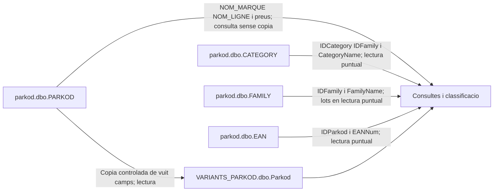

# Gestionnaire de Variantes — Model de dades

Actualització: 2026-10-22. Acords consolidats fins a D228 de [DECISIONS.md](DECISIONS.md).

## 1. Estat i lectura del document

Aquest document acompanya el [funcional Parkod](Parkod.md) i el [registre de decisions](DECISIONS.md). Recull el diagrama, els camps, les relacions i els arguments tractats amb l'usuari.

**No és DDL executable ni una estructura desplegada.** El document distingeix camps/claus de disseny aprovats, regles confirmades i controls SQL/proves pendents. L'etapa 0 continua oberta.

- **Ubicació confirmada:** base exclusiva `VARIANTS_PARKOD`, esquema `dbo`, a la instància existent SQL Server 2017 Express sobre Windows Server 2019. Catorze taules, camps, claus i regles comercials preservats. La base de treball `parkod` només admet lectures controlades del projecte (§1.1/§5); no s'hi crea cap esquema ni objecte.
- **Grup i pertinença confirmats:** es conserven ProductGroup i ProductGroupId. La PK del grup és `(BrandCode, CategoryCode, ProductGroupId)`; ProductGroupId és INT positiu, NOT NULL, generat automàticament des d'1 dins de cada parella marca–categoria, no global. ProductGroup i ProductVariant tenen LineCode NOT NULL, heretat de Parkod.CLIGNE; una FK composta amb LineCode impedeix barrejar línies en un grup. L'anterior cas NULL–NULL queda substituït per la constatació i decisió sobre la font actual.
- **Marca i unicitat confirmades:** VariantType incorpora BrandCode nullable per a qualsevol Type, estructurat o `open_type`. NULL significa global; una marca informada limita l'ús als seus grups. Type + Characteristics és únic globalment, sense incloure BrandCode. El canvi ordinari de BrandCode es bloqueja si hi ha assignacions, incloses les dels SKU retirats.
- **Representació confirmada (D156–D159/D170):** els tipus estructurats poden ser numèrics o textuals. VariantType.ValueKind NVARCHAR(7) NOT NULL declara `numeric` o `text`, homogeni per VariantTypeId; `open_type` exigeix `text`. Cada VariantTypeValue informa exactament un dels camps NumericValue/TextValue. No es replica ValueKind al valor ni s'afegeix a la unicitat. El canvi ordinari queda bloquejat amb qualsevol valor de catàleg o associació aprovada, també de fase 2 sense codi.
- **Principal confirmat:** ProductGroup incorpora PrimaryVariantTypeId, comú per a qualsevol ús. Només compten les associacions ProductGroupVariantType amb IsValidated=1 i ParkodVariantCode no nul: 0 → NULL, 1 → aquell tipus, més d'1 → selecció tècnica. No es compten SKU ni valors.
- **Associacions i rèpliques confirmades:** ProductGroupVariantType conté ProductGroupId, BrandCode, CategoryCode i VariantTypeId, amb PK en aquest ordre; no replica Type ni Characteristics. ProductVariantValue incorpora BrandCode i CategoryCode per referenciar el grup complet, sense canviar la seva PK `(ProductVariantId, VariantTypeId)`. Es conserven VariantTypeValue.Type, ProductVariantValue.VariantTypeId i ProductVariantValue.ProductGroupId per als controls de forma, unicitat i habilitació al grup.
- **Textos confirmats:** normalització automàtica dels blancs de TextValue, Characteristics, ProductGroupName i Type abans de validar i desar: qualsevol seqüència de blancs, incloent tabulacions, salts de línia i espais especials, es converteix en un únic espai ordinari U+0020, amb trim als extrems. S'admeten i es conserven accents i majúscules; la comparació és CI_AI. TextValue no nul és únic dins del seu VariantTypeId, però pot repetir-se entre tipus diferents. La collation s'ha de declarar als camps nous afectats, sense alterar la configuració general de parkod ni les columnes legacy.
- **Textos i codis confirmats:** tots els camps textuals nous són NVARCHAR; els codis són BrandCode, CategoryCode i LineCode, no BrandId, CategoryId o LineId. No es canvien els tipus ni les dades legacy. El nou grup hereta marca, categoria i línia del primer SKU que el crea quan no té un grup comercial corresponent.
- **Confirmat posteriorment:** IDs de catàleg INT IDENTITY(1,1), comptador local ProductGroupCounter, longituds de text i collation concretades, funció de blancs i CHECK binari/longitud, `SourceIsPresent`, nom inicial i escriptura protegida amb `sp_getapplock`. Les FK compostes i claus candidates indicades a la secció 4 han rebut confirmació de disseny; el DDL i les proves encara no existeixen.
- **Camps posteriors confirmats:** EstimatedRiskPercent/IsValidated als quatre àmbits; OriginalSourcesJson/OriginalProposalJson a ProductGroupVariantType i ProductVariantValue; ParkodVariantCode NVARCHAR(3) NULL, immutable un cop assignat al final de fase 3. L'aprovació de fase 2 permet IsValidated=1 amb codi NULL, sense habilitació final.
- **Taules tècniques confirmades:** ParkodVariantCodeRegistry, ParkodVariantCodeBlock, EvaluationAuditEvent, AppAccount, AppSession amb reserva opcional i SynchronizationStatus global de cinc camps. No s'han aprovat taules de versions de classificació, snapshots, propostes de pertinença o estats per marca.
- **Operativa confirmada:** conciliació completa o per diverses marques, controls de completesa externs, recàrrega coordinada amb batch, correu urgent agrupat i lectura inicial SNAPSHOT dels programes Parkod. Els dos indicadors globals no són vetos del generador de fitxers.
- **JSON i revisió confirmats (D143–D155/D159–D169):** contractes de fonts, propostes, resultats, claus i snapshots a §3.11; autoritat dels originals i context esperat per operació a §6.8. SQL compara l'estat revisat, no les correccions del formulari. La creació conjunta de grup/associacions/trasllats conserva valors i exigeix decisions explícites (§6.9).
- **Catàlegs i substitució confirmats (D171–D193):** claus d'auditoria sense context anterior a §3.11.3; reutilització/altes automàtiques i manuals a §6.10; substitució expressa A → B, retirades individuals auditades, JSON transitoris, dos procediments, SNAPSHOT de context, resposta post-COMMIT i resultat incert a §6.11. No noves taules ni columnes.
- **Desplegament/autenticació confirmats (D194–D200):** RDS/RemoteApp amb compte Windows propi i instància d'app per usuari, compte funcional propi, connexió directa i model intern de confiança; Argon2id en Python, token de 32 bytes i dos procediments de login a §6.13. No servei central ni autenticació Windows automàtica. SQL conserva els controls compartits; dependències comentades en anglès i inventariades a §6.12.
- **Catàleg manual i editorial confirmat (D201–D217):** finestra permanent de conjunt, preparació independent de tipus globals/valors, altes i auditories atòmiques, confirmació humana editorial, contextos SNAPSHOT reduïts, bloqueig per tipus, signatures/respostes i reversió editorial a §6.14. No noves columnes ni extensió de l'alta independent a tipus exclusius.
- **Fonts de proves i equivalències confirmades (D223–D228):** la nova `parkod` presentada és una còpia de producció per a proves. Inventari i correspondències documentals a §5: PARKOD, CATEGORY, FAMILY i EAN són les dependències funcionals de lectura; BRAND/LINE es conserven sense ser necessàries per obtenir els noms. Denominacions directes NOM_MARQUE/NOM_LIGNE de PARKOD, fórmules IDParkod/IDLine i exclusió d'IDCountry, sense canviar les 14 taules ni els 98 camps. Noms físics de producció, ubicació de la còpia i metadades SQL desplegades encara per contrastar.
- **Pendent:** metadades reals, controls executables dels contractes JSON, detalls SQL de procediments/bloquejos/permisos, índexs/CHECK/FK, integracions i proves de les regles confirmades. Els casos no concretats es distingeixen a §7; no es consideren tots els procediments ni tots els formats possibles tancats. La FK SKU/còpia de quatre camps continua retirada. No avançar a l'etapa 1 abans de validar l'etapa 0.

Els vuit camps copiats conserven noms, tipus i collation de `parkod.dbo.PARKOD`; `docs/parkod.sql` és una referència antiga discrepant, no el contracte de còpia. Les fonts romanen a `parkod.dbo`; tots els objectes del projecte són a `VARIANTS_PARKOD.dbo`. Els noms nous de §5 descriuen la còpia de proves aportada, no acrediten els noms físics de producció. El destí a la mateixa instància de D219 es manté; la ubicació exacta de la còpia respecte del futur destí de proves no està confirmada. En aquest document, `dbo.<objecte del projecte>` és abreviatura dins de **VARIANTS_PARKOD**, mai una autorització per crear-lo a parkod. Cap script SQL de referència modificat ni objecte desplegat.

### 1.1 Frontera permanent: cap intervenció a `parkod`

**D218–D222 substitueixen l'antiga ubicació de D01/D65.** El projecte no executa a `parkod` cap escriptura de dades, DDL, manteniment, creació d'objectes, índexs, triggers, vistes, sinònims, usuaris o concessions de permisos, ni canvis de compatibilitat, collation o opcions d'aïllament. Només lectures controlades i ja autoritzades per alimentar la còpia i consultar les fonts funcionals inventariades a §5, actualitzades per D223–D228 per a proves. Diagnòstics de metadades només en lectura. Que la font aportada sigui de proves no autoritza executar-ne els scripts de càrrega ni modificar-la en aquesta tasca. Si una implementació requereix alterar l'original, s'ha de redissenyar; no s'hi aplica automàticament cap solució o permís nou.

Totes les escriptures, FK, procediments, comptes, sessions, bloquejos lògics, auditoria i SynchronizationStatus són a **VARIANTS_PARKOD.dbo**. Les FK inclouen la còpia local de PARKOD i no travessen bases. Fer servir dbo no implica concedir db_owner al compte de l'app. Els programes legacy continuen operant l'original fora del projecte; aquesta regla no posa la base sencera en READ_ONLY.

| Element | `parkod` original, observat i no modificable pel projecte | `VARIANTS_PARKOD`, configuració aprovada pendent de crear/provar |
|---|---|---|
| Motor/instància | SQL Server 2017 Express 14.x, mateixa instància de destí | SQL Server 2017 Express, sense migració prevista |
| Compatibilitat | 100 | 140; permet OPENJSON, que exigeix almenys 130 |
| Collation general | French_CI_AS | French_CI_AS |
| ALLOW_SNAPSHOT_ISOLATION | OFF | ON, per transaccions explicitament SNAPSHOT |
| READ_COMMITTED_SNAPSHOT | No contrastat; cap canvi autoritzat | OFF |

L'usuari ha aportat resultats de consultes de metadades: versió 14.0.2110.2 i, a parkod, 80,25 MiB de dades assignats/41,44 MiB ocupats. Són una observació puntual, no una previsió de creixement ni una prova de rendiment. Express 2017 limita les dades a 10 GB per base; les dues bases comparteixen recursos del servidor. No es promet impacte nul de les lectures: controls d'abast, bloquejos ordinaris i càrrega s'han de provar sense NOLOCK ni bloqueig deliberat de taules senceres.

La collation Latin1_General_100_CI_AI_SC es manté **només** als quatre textos nous acordats i la rèplica Type; els vuit camps de la còpia conserven la collation real de cada columna original, encara per contrastar. El valor general French_CI_AS no demostra la collation individual de totes les columnes.

**Integracions entre bases encara pendents:** les lectures SNAPSHOT coherents es restringeixen a VARIANTS_PARKOD. No incloure indiscriminadament l'original, que té SNAPSHOT OFF; cal detallar el protocol de lectures de fonts, les relectures de CLIGNE i la integració del generador sense activar-hi opcions ni prometre un punt coherent únic entre les dues bases. Coordinació amb el carregador legacy i senyals de fiabilitat es revaliden a §6.7, només amb estat/bloquejos del projecte a la nova base. No s'aproven mecanismes de permisos entre bases, còpies de mestres o estructures auxiliars per resoldre-ho.

**Correspondència de codis (sense reanomenar la còpia):** `VARIANTS_PARKOD.dbo.Parkod.CMARQ → ProductVariant.BrandCode`, `CCATEG → CategoryCode`, `CPROD → ProductCode` i `CLIGNE → LineCode`. A la còpia de proves, les denominacions de marca/línia es consulten directament a `PARKOD.NOM_MARQUE`/`PARKOD.NOM_LIGNE`; la categoria a `CATEGORY.CategoryName` per `PARKOD.CCATEG = CATEGORY.IDCategory`, i la família a `CATEGORY.IDFamily = FAMILY.IDFamily → FAMILY.FamilyName`. Equivalències antigues/noves i destinacions a §5.3; no s'afegeixen denominacions ni FK a la còpia o a les fonts.

## 2. Diagrama entitat–relació

Totes les entitats del diagrama són a **VARIANTS_PARKOD.dbo**, inclosa Parkod, que és la còpia, no la font original. `PK` identifica una clau primària i `FK` una clau forana; diverses columnes marcades poden formar una sola clau composta. Es representen acords de disseny, no DDL validat ni desplegat.

**Abast del diagrama:** catorze taules i 98 camps preservats fins a D228, inclòs ValueKind únicament a VariantType. Els acords de signatures/JSON, ubicació i equivalències de fonts no afegeixen camps ni entitats. Les condicions d'habilitació final, caducitat, unicitat filtrada, JSON, marca, homogeneïtat i principal no s'imposen només per les fletxes. ProductGroupCounter té relació d'ús transaccional, no FK al grup. No hi ha FK a les fonts originals; LineCode amb la còpia es controla als procediments protegits.

```mermaid
erDiagram
    Parkod ||--o| ProductVariant : "identifica el SKU"
    ProductGroup ||--o{ ProductVariant : "mateixa marca categoria i linia"
    ProductGroup ||--o{ ProductGroupVariantType : "utilitza"
    ProductGroupVariantType |o--o| ProductGroup : "es principal del mateix grup"
    VariantType ||--o{ ProductGroupVariantType : "pot compartir-se"
    VariantType ||--o{ VariantTypeValue : "defineix valors"
    ProductVariant ||--o{ ProductVariantValue : "te assignacions"
    VariantTypeValue ||--o{ ProductVariantValue : "es assignat"
    ProductGroupVariantType ||--o{ ProductVariantValue : "associacio revisada per preparar valors"
    ProductGroupCounter ||--o{ ProductGroup : "numera per marca categoria via procediment"
    ProductGroup ||--o{ ParkodVariantCodeRegistry : "conserva reserves del grup"
    VariantType ||--o{ ParkodVariantCodeRegistry : "conserva reserves del tipus"
    ParkodVariantCodeRegistry |o--o| ProductGroupVariantType : "reserva el codi final"
    AppAccount ||--o| AppSession : "una sessio activa"
    AppAccount |o--o{ EvaluationAuditEvent : "autor huma opcional"
    ProductGroup |o--o| AppSession : "reserva opcional exclusiva"

    Parkod {
        nvarchar CMARQ PK "3 caracters"
        nvarchar CCATEG PK "2 caracters"
        nvarchar CPROD PK "3 caracters"
        nvarchar CLIGNE "2 caracters; NOT NULL"
        nvarchar DESIGN1 "30 caracters; NOT NULL"
        nvarchar DESIGN2 "30 caracters; NULL"
        nvarchar code1 "7 caracters; NULL; quantitat original"
        nvarchar code2 "1 caracter; NULL; unitat original"
        bit SourceIsPresent "NOT NULL; DEFAULT 1"
    }

    ProductGroup {
        int ProductGroupId PK, FK "positiu; des d 1 per marca-categoria"
        nvarchar ProductGroupName "150; nullable; blancs normalitzats; CI_AI"
        nvarchar BrandCode PK, FK "CMARQ; 3 caracters; NOT NULL"
        nvarchar CategoryCode PK, FK "CCATEG; 2 caracters; NOT NULL"
        nvarchar LineCode FK "CLIGNE; 2 caracters; NOT NULL; heretat del primer SKU"
        int PrimaryVariantTypeId FK "NULL amb 0 habilitacions finals"
        decimal EstimatedRiskPercent "DECIMAL(5,2); NULL si no estimable"
        bit IsValidated "NOT NULL; DEFAULT 0"
    }

    ProductVariant {
        bigint ProductVariantId PK "IDENTITY(1,1)"
        int ProductGroupId FK "NOT NULL; grup amb marca i categoria"
        nvarchar BrandCode FK "CMARQ; 3 caracters; NOT NULL"
        nvarchar CategoryCode FK "CCATEG; 2 caracters; NOT NULL"
        nvarchar ProductCode FK "CPROD; 3 caracters; NOT NULL"
        nvarchar LineCode FK "CLIGNE; 2 caracters; NOT NULL; FK al grup; control al SKU"
        decimal EstimatedRiskPercent "DECIMAL(5,2); risc de pertinenca; nullable"
        bit IsValidated "NOT NULL; DEFAULT 0; pertinenca"
    }

    VariantType {
        int VariantTypeId PK "IDENTITY(1,1); U2 amb Type"
        nvarchar Type "20; NOT NULL; CI_AI; U1 amb Characteristics; U2 amb VariantTypeId"
        nvarchar Characteristics "80; NOT NULL; CI_AI; U1 amb Type"
        nvarchar BrandCode "nullable; NULL global"
        nvarchar ValueKind "7; NOT NULL; numeric o text; no replicat"
    }

    VariantTypeValue {
        int VariantTypeValueId PK "IDENTITY(1,1)"
        int VariantTypeId FK
        nvarchar Type FK "20; NOT NULL; CI_AI; replica conservada"
        decimal NumericValue "DECIMAL(18,3); nullable"
        nvarchar TextValue "80; CI_AI; nullable; unic per tipus si no NULL"
    }

    ProductGroupVariantType {
        int ProductGroupId PK, FK
        nvarchar BrandCode PK, FK "3 caracters; NOT NULL; marca del grup"
        nvarchar CategoryCode PK, FK "2 caracters; NOT NULL; categoria del grup"
        int VariantTypeId PK, FK
        nvarchar ParkodVariantCode FK "3; nullable; assignat al final de fase 3"
        decimal EstimatedRiskPercent "DECIMAL(5,2); nullable"
        bit IsValidated "NOT NULL; DEFAULT 0; aprovacio de fase 2"
        nvarchar OriginalSourcesJson "MAX; nullable"
        nvarchar OriginalProposalJson "MAX; nullable"
    }

    ProductVariantValue {
        bigint ProductVariantId PK, FK
        int VariantTypeId PK, FK
        int ProductGroupId FK "NOT NULL; replica conservada; FK proposada"
        nvarchar BrandCode FK "3 caracters; NOT NULL; replica del grup real"
        nvarchar CategoryCode FK "2 caracters; NOT NULL; replica del grup real"
        int VariantTypeValueId FK
        decimal EstimatedRiskPercent "DECIMAL(5,2); nullable"
        bit IsValidated "NOT NULL; DEFAULT 0"
        nvarchar OriginalSourcesJson "MAX; nullable"
        nvarchar OriginalProposalJson "MAX; nullable"
    }

    ProductGroupCounter {
        nvarchar BrandCode PK "3 caracters; NOT NULL"
        nvarchar CategoryCode PK "2 caracters; NOT NULL"
        int LastAllocatedId "NOT NULL; inicial 0"
    }

    ParkodVariantCodeRegistry {
        nvarchar BrandCode PK, FK "3; NOT NULL"
        nvarchar CategoryCode PK, FK "2; NOT NULL"
        nvarchar ParkodVariantCode PK "3; NOT NULL; permanent"
        int ProductGroupId FK "NOT NULL"
        int VariantTypeId FK "NOT NULL"
    }

    ParkodVariantCodeBlock {
        int BlockOrder PK "NOT NULL; des d 1; immutable"
        nvarchar FirstCode "3; NOT NULL; prefix unic"
    }

    EvaluationAuditEvent {
        bigint EvaluationAuditEventId PK "IDENTITY(1,1)"
        uniqueidentifier OperationId "NOT NULL"
        datetime2 OccurredAtUtc "3; NOT NULL; SYSUTCDATETIME"
        nvarchar EventKind "32; NOT NULL"
        nvarchar ActionName "64; NOT NULL; controlat"
        nvarchar DecisionOutcome "16; nullable"
        nvarchar ActorKind "16; NOT NULL"
        int ActorAppAccountId FK "nullable"
        nvarchar ActorProcessName "128; nullable"
        nvarchar TargetScope "32; NOT NULL"
        nvarchar TargetKeyJson "MAX; NOT NULL"
        decimal OriginalEstimatedRiskPercent "DECIMAL(5,2); nullable"
        nvarchar OriginalSourcesJson "MAX; nullable"
        nvarchar OriginalProposalJson "MAX; nullable"
        nvarchar DecisionResultJson "MAX; nullable"
        nvarchar BeforeStateJson "MAX; nullable"
        nvarchar AfterStateJson "MAX; nullable"
    }

    AppAccount {
        int AppAccountId PK "IDENTITY(1,1)"
        nvarchar LoginName "80; NOT NULL; unic CI_AI"
        nvarchar PasswordHash "255; NOT NULL; Argon2id"
        bit IsActive "NOT NULL; DEFAULT 0"
        bit IsAdmin "NOT NULL; DEFAULT 0"
    }

    AppSession {
        uniqueidentifier AppSessionId PK
        int AppAccountId FK "NOT NULL; UNIQUE"
        varbinary SessionTokenHash "32; NOT NULL; UNIQUE; SHA-256"
        datetime2 LastActivityAtUtc "3; NOT NULL; SYSUTCDATETIME"
        nvarchar ReservedBrandCode FK "3; nullable"
        nvarchar ReservedCategoryCode FK "2; nullable"
        int ReservedProductGroupId FK "nullable"
    }

    SynchronizationStatus {
        tinyint SynchronizationStatusId PK "unica fila; valor 1"
        datetime2 ParkodLastCompletedAtUtc "3; nullable"
        bit ParkodRefreshSucceeded "NOT NULL; DEFAULT 0"
        datetime2 VariantsLastCompletedAtUtc "3; nullable; nomes batch complet"
        bit VariantsReconciliationSucceeded "NOT NULL; DEFAULT 0; nomes batch complet"
    }
```



La correspondència funcional Parkod–variant és 1:1 per als SKU vàlids incorporats. El `0..1` mostra que una FK/UNIQUE no imposa per si sola aquesta cobertura: l'alta protegida crea còpia, grup propi, variant i auditoria atòmicament. La fletxa del comptador expressa ús transaccional, no FK. Els blocs i l'estat global no tenen una FK addicional inventada al diagrama.

**Claus de VariantType en el diagrama:** `PK (VariantTypeId)`; `U1 = UNIQUE (Type, Characteristics)` és la unicitat funcional global sobre text normalitzat amb `Latin1_General_100_CI_AI_SC`, sense BrandCode ni ValueKind; `U2 = UNIQUE (VariantTypeId, Type)` és una clau candidata tècnica per a la FK de `VariantTypeValue(VariantTypeId, Type)`. U1/U2 identifiquen **parelles** de columnes, no la unicitat individual de Type o Characteristics. Són acords de disseny, encara sense DDL desplegat.

L'ordre acordat de les PK és `(BrandCode, CategoryCode, ProductGroupId)` per a ProductGroup i `(ProductGroupId, BrandCode, CategoryCode, VariantTypeId)` per a ProductGroupVariantType; les marques PK del diagrama indiquen els components, no l'ordre dels índexs. ProductGroupId sol no identifica el grup. LineCode no entra en cap d'aquestes PK; la igualtat de línia es comprova amb una FK composta cap a una clau candidata que sí l'inclou.

La relació de principal és un subconjunt de les associacions habilitades: cada grup selecciona `0..1` associació i cada associació només pot ser principal del seu propi grup. El `0..1` del diagrama no implica opcionalitat general: amb un o més tipus habilitats, el principal és obligatori. La mateixa VariantType pot ser principal de molts grups a través d'associacions diferents; PrimaryVariantTypeId no és únic entre grups.

### Fonts de la còpia de proves, sense persistència local excepte vuit camps de PARKOD



Aquests accessos són només de lectura, sense FK, vista ni cap altre objecte nou a l'origen. BRAND/LINE es conserven a la còpia de proves, però no són dependències necessàries per als noms de marca/línia. L'inventari canònic i la separació respecte de producció són a §5; cal verificar els permisos de lectura ja disponibles i l'impacte, sense concedir permisos ni configurar parkod des del projecte.

## 3. Diccionari de taules i camps

### 3.1 `dbo.Parkod`

**Finalitat:** còpia de treball a `VARIANTS_PARKOD.dbo.Parkod` de `parkod.dbo.PARKOD`, amb clau única, que permet ancorar les FK internes sense afectar les aplicacions antigues.

| Camp | Tipus de referència | Nul·litat | Funció i argument |
|---|---|---|---|
| `CMARQ` | NVARCHAR(3) | No | Marca i primer component de la PK. Tres caràcters exactes. |
| `CCATEG` | NVARCHAR(2) | No | Categoria i segon component de la PK. Dos caràcters exactes. |
| `CPROD` | NVARCHAR(3) | No | Producte i tercer component de la PK. Tres caràcters exactes. |
| `CLIGNE` | NVARCHAR(2) | No | Codi de línia original, preservat; informat a la font actual. |
| `DESIGN1` | NVARCHAR(30) | No | Denominació original del SKU. |
| `DESIGN2` | NVARCHAR(30) | Sí | Denominació complementària original. |
| `code1` | NVARCHAR(7) | Sí | Quantitat original com a text; mai truncar ni convertir en copiar. |
| `code2` | NVARCHAR(1) | Sí | Unitat original com a text; els NULL es rebutgen en processar. |
| `SourceIsPresent` | BIT NOT NULL DEFAULT(1), confirmat | No | 1: present segons la conciliació; 0: retirada contrastada en lectura completa i fiable. No expressa qualitat ni validació. Duplicats SKU preserven el marcador anterior segons D121. |

La PK és `(CMARQ, CCATEG, CPROD)` i la FK des de ProductVariant utilitza aquests tres camps. La U1 de quatre camps proposada anteriorment per incloure CLIGNE queda **retirada**: SQL Server valida les FK en cada instrucció, i aquella referència impediria canviar atòmicament la línia de la còpia i de la variant en qualsevol ordre. La igualtat de línia entre còpia i variant és una regla confirmada controlada al procediment protegit i revalidada abans del COMMIT; no es renuncia a la FK composta amb el grup. El codi Parkod complet es deriva per concatenació, amb vuit caràcters exactes `A–Z` i `0–9`, sense perdre zeros inicials. La validació no ha de confiar en una comparació que admeti lletres accentuades com a equivalents.

Les files rebutjades no substitueixen una còpia anterior vàlida. Les retirades es marquen lògicament només després d'una lectura fiable. El nou marcador no modifica els camps ni el model original. `PRIX_ACHAT`, `PRIX_VENTE`, `DECCONT`, `LIBELLE_COURT` (antic LIBCOURT), `NUM_UPD` i `CSSCATEG` no es copien; els preus segueixen consultables a l'origen. Per generar el nom inicial en proves es consulten en lectura `PARKOD.NOM_MARQUE`, `PARKOD.NOM_LIGNE` i `CATEGORY.CategoryName`, sense afegir-los a la còpia. Només es copien els vuit camps d'origen indicats, més SourceIsPresent local. Els tipus/longituds/nul·litats de la taula anterior són el contracte documentat: les exportacions i els scripts aportats no acrediten les metadades SQL desplegades; qualsevol discrepància s'ha de revisar abans del DDL, sense adaptar ni truncar silenciosament.

### 3.2 `dbo.ProductGroup`

**Finalitat:** identificar i anomenar el producte comercial que agrupa els SKU.

| Camp | Tipus/estat | Funció i argument |
|---|---|---|
| `ProductGroupId` | INT NOT NULL, positiu; part de la PK composta, confirmat | Identificador local dins de BrandCode + CategoryCode, des d'1; comptador i bloqueig aprovats, DDL pendent. |
| `ProductGroupName` | NVARCHAR(150) NULL COLLATE Latin1_General_100_CI_AI_SC | Nom comercial visible, no únic. Informat inicialment amb noms/codis i editable; blancs normalitzats, cap buit informat. |
| `BrandCode` | NVARCHAR(3) NOT NULL; part de la PK composta, confirmat | Identificador CMARQ de la marca, heretat del primer SKU; tots els membres comparteixen la marca. |
| `CategoryCode` | NVARCHAR(2) NOT NULL; part de la PK composta, confirmat | Codi CCATEG, heretat del primer SKU; tots els membres comparteixen la categoria. |
| `LineCode` | NVARCHAR(2) NOT NULL, confirmat | Heretat de CLIGNE del primer SKU; una FK composta impedeix membres d'una altra línia. No forma part de la PK. |
| `PrimaryVariantTypeId` | INT NULL | VariantType principal per a qualsevol ús, no un SKU ni un valor. Ha de correspondre a una associació del mateix grup a ProductGroupVariantType; FK composta confirmada conceptualment. |
| `EstimatedRiskPercent` | DECIMAL(5,2) NULL | Risc inicial/vigent de creació/configuració, 0–100; NULL si no estimable. |
| `IsValidated` | BIT NOT NULL DEFAULT(0) | Validació tècnica del grup, independent de les pertinences dels SKU. |

El nom visible de marca es consulta a `PARKOD.NOM_MARQUE` de la còpia de proves, no en una columna nova de marca ni en una còpia de BRAND. CMARQ continua sent el codi funcional de marca; `BRAND.IDBrand` n'és l'equivalent documental. La disponibilitat i coherència de les denominacions s'han de contrastar sense seleccionar noms arbitraris si hi ha anomalies (§5).

Els camps de risc/validació estan confirmats per D107. Un grup propi provisional comença IsValidated=0 i risc sustentat o NULL; la PK i el nom no autoritzen ús als clients. DDL/proves pendents.

PK confirmada: `(BrandCode, CategoryCode, ProductGroupId)`. ProductGroupId és un enter positiu, no global ni equivalent a ProductVariant.ProductCode, que continua representant CPROD del SKU. Es conserven els noms ProductGroup, ProductGroupId i ProductGroupName; es retiren únicament les denominacions Product/ProductId que s'havien proposat, no els altres canvis acordats.

Quan el primer SKU a assignar no troba el grup comercial al qual pertany, es crea un grup propi amb BrandCode, CategoryCode i LineCode heretats d'aquell ProductVariant. La font actual informa sempre CLIGNE; no s'inventa una línia quan l'origen sigui invàlid. No hi ha un grup genèric compartit. Compartir marca, categoria i línia és necessari, però no identifica per si sol el producte comercial ni autoritza agrupar arbitràriament SKU; poden existir diversos grups amb els mateixos codis.

Els noms poden repetir-se, fins i tot dins d'una marca i categoria; la PK completa distingeix les identitats. La importació repetida no crea nous grups per al mateix SKU. Els grups buits es conserven per auditoria i reversibilitat.

La numeració comença a 1 per BrandCode + CategoryCode, **no** per línia. Dos grups de línies diferents dins de la mateixa marca–categoria obtenen números diferents. `dbo.ProductGroupCounter` i `sp_getapplock` per marca–categoria estan aprovats a VARIANTS_PARKOD per assignar-los atòmicament amb la creació; vegeu la secció 6. El DDL concret i les proves resten pendents.

#### Compatibilitat de marca, categoria i línia

Cada ProductVariant té un únic grup de la mateixa marca, categoria i línia informada. ProductGroup i ProductVariant tenen LineCode NOT NULL; els NULL antics del model general no s'admeten en aquest contracte de la font actual. NULL no és un comodí ni és equivalent a una cadena buida.

| ProductGroup.LineCode | ProductVariant.LineCode | Compatible, amb marca i categoria iguals |
|---|---|---|
| NULL | NULL | No; no s'admeten NULL |
| NULL | Informat | No |
| Informat | NULL | No |
| Informat | Mateix codi | Sí |
| Informat | Codi diferent | No |

La clau primària del grup no inclou LineCode: la línia restringeix la pertinença, no crea una altra identitat. Una clau candidata `UNIQUE (BrandCode, CategoryCode, ProductGroupId, LineCode)` i una FK de ProductVariant sobre aquests quatre camps NOT NULL impedeixen barrejar línies fins i tot sense assignacions de valors. La igualtat de ProductVariant.LineCode amb Parkod.CLIGNE del mateix SKU es comprova en totes les vies d'escriptura protegides amb bloqueig exclusiu per SKU i control final; la FK de tres camps preserva l'existència del SKU. El tractament d'un canvi posterior de CLIGNE consta a §6.3.

#### Tipus principal del grup

El principal és una propietat comuna del grup, independent d'eCommerce, connectors o destinacions. Pot ser estructurat o `open_type`, global o exclusiu d'una marca, sempre que estigui habilitat al mateix grup i respecti BrandCode.

| Nombre de VariantType habilitats a ProductGroupVariantType | PrimaryVariantTypeId requerit |
|---|---|
| 0 | NULL; no hi ha cap tipus a seleccionar. |
| 1 | Obligatori i igual a l'únic VariantTypeId habilitat. No hi ha una tria alternativa. |
| Més d'1 | Obligatori; el personal tècnic selecciona un dels tipus habilitats. |

Només compten les associacions amb **IsValidated=1 i ParkodVariantCode IS NOT NULL**. Les candidates i les aprovades a fase 2 encara sense codi no alteren el principal. El recompte no és un recompte de SKU ni valors; la completesa dels valors es comprova abans de donar el codi final. Grups d'un sol SKU i grups buits conservats segueixen la mateixa regla segons les habilitacions que mantinguin.

El recompte és per VariantTypeId: Size/letter i Size/cms compten com dos tipus si tots dos estan finalment habilitats, encara que comparteixin el text Type=Size.

Si el principal obligatori falta o no és vàlid, es bloqueja l'exportació del grup i es rebutgen els canvis ordinaris que deixin un estat final invàlid. Es permeten les operacions correctives necessàries per definir-lo, amb revalidació atòmica en una transacció curta. Afegir o retirar tipus, canviar el principal o traslladar SKU requereix revalidar la regla. Amb més d'un tipus no s'escull arbitràriament el primer ni se substitueix silenciosament una decisió tècnica vàlida.

El principal no elimina altres tipus, valors o SKU, ni els fusiona. Un grup amb diversos SKU però sense tipus definits continua pendent de classificació: un principal NULL coherent amb zero tipus no autoritza l'exportació. Un principal vàlid tampoc garanteix, per si sol, que tots els SKU tinguin valor o que els valors diferenciïn tots els SKU en una destinació limitada a una sola característica; els controls específics d'exportació s'hauran de concretar al connector, sense alterar la classificació interna.

La columna admet NULL físicament per al cas de zero habilitacions finals, però és obligatòria quan n'hi ha una o més. Les associacions candidates o aprovades sense codi no imposen un principal. Un NOT NULL incondicional no serveix i la FK composta confirmada només comprova la pertinença al grup, no la validesa final, el recompte ni l'elecció tècnica. La materialització SQL i el control transaccional continuen pendents; no s'afegeixen camps d'estat o marques IsPrimary.

### 3.3 `dbo.ProductVariant`

**Finalitat:** donar a cada SKU una identitat independent del seu Parkod i relacionar-lo amb el grup actual.

| Camp | Tipus/estat | Funció i argument |
|---|---|---|
| `ProductVariantId` | BIGINT IDENTITY(1,1), PK confirmada | Codi propi de variant. La PK impedeix duplicats i SQL Server el genera per a múltiples usuaris. |
| `ProductGroupId` | INT NOT NULL; FK composta proposada | Grup actual dins de BrandCode + CategoryCode; no determina la identitat de la variant. |
| `BrandCode` | NVARCHAR(3) NOT NULL; FK composta proposada | Component CMARQ del SKU i de la referència al grup; ha de coincidir amb la marca del grup. |
| `CategoryCode` | NVARCHAR(2) NOT NULL; FK composta proposada | Component CCATEG del SKU i de la referència al grup; ha de coincidir amb la categoria del grup. |
| `ProductCode` | NVARCHAR(3) NOT NULL; FK composta proposada | Component CPROD del SKU, independent de ProductGroupId. |
| `LineCode` | NVARCHAR(2) NOT NULL, confirmat | Heretat de Parkod.CLIGNE del mateix SKU; la FK composta comprova igualtat amb el grup. |
| `EstimatedRiskPercent` | DECIMAL(5,2) NULL | Risc de la pertinença SKU→grup actual, rang 0–100. |
| `IsValidated` | BIT NOT NULL DEFAULT(0) | Decisió tècnica individual de pertinença. |

La combinació `(BrandCode, CategoryCode, ProductCode)` és única i identifica el SKU amb la PK de `VARIANTS_PARKOD.dbo.Parkod`; la FK confirmada utilitza exactament aquests tres camps. La coincidència de LineCode amb Parkod.CLIGNE es verifica transaccionalment als procediments protegits, no amb una FK de quatre camps. No cal `ParkodVariantLink` ni una altra clau UNIQUE de quatre camps a la còpia.

Cada pertinença té els camps físics de D107, independents dels de ProductVariantValue. Una aprovació conjunta conserva una decisió per SKU. Una proposta automàtica de trasllat no canvia ProductGroupId abans de validar; el SKU nou manté grup propi provisional i el rebuig no el deixa orfe.

La referència al grup utilitza `(BrandCode, CategoryCode, ProductGroupId, LineCode)` cap a la clau candidata, no ProductGroupId sol. LineCode no forma part de la identitat SKU ni de la PK del grup; és obligatori i part de la comprovació de pertinença. Cap valor CLIGNE es transforma per encaixar un grup.

La identitat es conserva en trasllats de grup o canvi només de CLIGNE. Una recodificació que canvia CPROD o CCATEG crea un ProductVariant nou i grup propi provisional, sense herència automàtica; l'antic es conserva i no es retira si encara és a l'origen. EAN/descripció no són ordres de recodificació. BIGINT supera les `36^8` combinacions teòriques de l'alfabet general; comença per 1, amb salts acceptats, sense reciclatge ni MAX+1.

### 3.4 `dbo.VariantType`

**Finalitat:** definir què varia i amb quina unitat o denominació comercial.

| Camp | Tipus/estat | Funció i argument |
|---|---|---|
| `VariantTypeId` | INT IDENTITY(1,1) NOT NULL, PK | Identificador de l'única definició d'una parella Type + Characteristics. |
| `Type` | NVARCHAR(20) NOT NULL COLLATE Latin1_General_100_CI_AI_SC | Naturalesa de la característica: `volume`, `weight`, `Size`, `%alcool` o `open_type`. Ja no determina tot sol la representació numèrica/textual. Parella única amb Characteristics. |
| `Characteristics` | NVARCHAR(80) NOT NULL COLLATE Latin1_General_100_CI_AI_SC | Unitat, escala o denominació comercial; `unitless` només per a magnituds adimensionals confirmades. |
| `BrandCode` | NVARCHAR(3) NULL, compatible amb CMARQ; camp i nul·litat confirmats | NULL: tipus global. CMARQ informat: exclusiu d'aquella marca. Independent de Type; no forma part de la unicitat i no té FK a cap mestre font. |
| `ValueKind` | NVARCHAR(7) NOT NULL, confirmat | `numeric` o `text`; representació única per a tots els valors del mateix VariantTypeId. `open_type` exigeix `text`. No forma part de cap nova clau ni es replica a VariantTypeValue. |

Exemples: `volume/ml` amb ValueKind=`numeric`, `weight/gr`, `weight/oz`, `Size/letter` amb ValueKind=`text`, `Size/cms` amb ValueKind=`numeric`, `open_type/color SpringViews` amb ValueKind=`text`. Els noms i unitats es conserven, sense conversió.

- `(Type, Characteristics)` és una clau única global per a tots els tipus, estructurats i `open_type`, després de normalitzar els blancs i amb comparació CI_AI. La restricció acordada és `UNIQUE (Type, Characteristics)`; BrandCode no s'hi inclou i VariantTypeId continua sent la PK.
- Una parella existeix en una sola fila de VariantType. No es permet una segona definició amb un altre ID, sigui amb el mateix BrandCode, amb una altra marca o amb NULL.
- BrandCode és opcional per a qualsevol Type. Type determina la naturalesa de la característica; ValueKind, la representació dels valors; BrandCode, l'abast d'ús.
- Amb BrandCode NULL, el tipus és global i es pot associar a grups de qualsevol marca. L'ús actual per una sola marca no el converteix en exclusiu.
- Amb BrandCode informat, el tipus només es pot associar a grups d'aquella marca. Això també és possible per als tipus estructurats.
- La mateixa definició es reutilitza mitjançant ProductGroupVariantType: `VariantType.BrandCode IS NULL` o `VariantType.BrandCode = ProductGroup.BrandCode`.
- TextValue té una unicitat pròpia a VariantTypeValue: no es pot repetir dins del mateix VariantTypeId després de normalitzar els blancs i segons CI_AI, però sí entre VariantTypeId diferents. Reutilitzar un valor en diversos SKU no crea files noves al catàleg.
- Les unitats no es converteixen; unitats diferents identifiquen tipus diferents. No s'ha de confondre ounce de pes amb fluid ounce de volum.
- Canviar una definició compartida pot afectar diversos grups: requereix control i auditoria, no una modificació silenciosa del significat.

La fila única de VariantType conté el seu abast de marca; no cal un registre addicional de propietat de configuracions. El camp BrandCode està aprovat, però la materialització SQL de la compatibilitat amb els grups i del bloqueig de canvis continua pendent.

#### Representació homogènia i canvis de ValueKind

L'homogeneïtat és per **VariantTypeId**, no pel text de Type sol ni per ProductGroup. Un grup pot associar-se a `Size/letter` (M, L, XL, XXL textuals) i `Size/cms` (33, 34, 35 numèrics) mitjançant dos VariantType diferents. Cada SKU pot tenir un valor de cadascun; no se'n dedueixen equivalències, ordre comercial ni conversions. Una etiqueta numèrica textual no es converteix automàticament a NumericValue.

La parella Type + Characteristics continua sent única globalment: ValueKind no permet duplicar la mateixa parella amb una altra representació, marca o ID. `open_type` continua exclusivament textual, però ja no és l'únic Type que pot utilitzar TextValue. No s'ha aprovat cap valor per defecte ni extensió de la collation CI_AI a ValueKind.

**Bloqueig ordinari confirmat (D158/D170):** rebutjar un canvi de ValueKind si existeix **qualsevol VariantTypeValue del tipus, encara no assignat a cap SKU, o qualsevol ProductGroupVariantType del tipus amb IsValidated=1**. N'hi ha prou amb una de les dues condicions. El control abasta tots els grups que comparteixen el tipus, inclosos els aprovats a fase 2 amb codi NULL i encara sense valors. No es desvaliden associacions ni s'eliminen dades per permetre el canvi. Sense aquests usos continuen exigits la resta de controls, l'auditoria i `open_type → text`; no es reescriuen els originals de candidates.

Comprovació i canvi han de ser atòmics respecte de la creació de valors i l'aprovació de fase 2, amb la coordinació per tipus prevista a §6.2. La materialització, les curses i els permisos s'han de provar. La via administrativa excepcional de BrandCode (D142) **no s'estén a ValueKind**.

#### Casos de marca i reutilització

| Cas | Permès? | Motiu |
|---|---|---|
| `volume/ml` estructurat amb BrandCode NULL utilitzat per grups ABC i XYZ. | Sí | La definició és global. |
| `weight/gr` estructurat amb BrandCode ABC associat a un grup XYZ. | No | L'abast exclusiu també s'aplica als estructurats. |
| `open_type/color SpringViews`, ID 101, amb BrandCode NULL, utilitzat per ABC i XYZ. | Sí | Un `open_type` també pot ser global. |
| `open_type/color SummerViews`, ID 205, amb BrandCode ABC, utilitzat per dos grups ABC. | Sí | Reutilització d'una mateixa definició dins del seu abast. |
| El tipus 205 associat a un grup XYZ. | No | El grup és incompatible amb BrandCode ABC. |
| Crear un altre ID amb `open_type/color SpringViews`, amb ABC, XYZ o NULL, existint el 101. | No | La definició global no es duplica ni es privatitza amb una altra fila. |
| Crear un altre ID amb `open_type/color SummerViews`, amb ABC, XYZ o NULL, existint el 205. | No | La parella tampoc es repeteix dins d'una mateixa marca. |
| Repetir l'associació del mateix tipus al mateix grup. | No | Ho impedeix la PK de ProductGroupVariantType. |

#### Canvis de BrandCode

Un canvi de BrandCode és un canvi major d'abast, independent del Type. La unicitat global evita duplicar la definició, però no bloqueja per si sola l'edició d'aquest camp.

| Situació | Canvi ordinari de BrandCode | Condició |
|---|---|---|
| Sense assignacions ni associacions a grups. | Permès | No hi ha usos que es puguin tornar incompatibles. |
| Sense assignacions, amb associacions a grups compatibles amb el nou abast. | Permès | Revalidar totes les associacions ProductGroupVariantType. |
| Sense assignacions, amb alguna associació incompatible. | Bloquejat | No eliminar ni alterar associacions silenciosament. |
| Amb alguna assignació a ProductVariantValue. | Bloquejat | El tipus ja s'utilitza en un SKU. |
| Amb assignacions només a SKU retirats conservats. | Bloquejat | Els usos preservats també compten. |

Per exemple, NULL → ABC sense assignacions es rebutja si el tipus està associat a un grup XYZ. La comprovació i el canvi són atòmics, en transacció curta, segurs davant assignacions/associacions concurrents.

**Via excepcional confirmada (D142):** un canvi de VariantType.BrandCode amb assignacions existents s'executa fora de la GUI mitjançant un procediment protegit accessible només a una identitat SQL d'administració autoritzada, mai al compte ordinari de variants. Requereix anàlisi d'impacte i autorització prèvies. Comprova que totes les associacions grup–tipus continuen compatibles; qualsevol incompatibilitat rebutja el canvi. No elimina associacions o valors ni modifica codis per forçar la compatibilitat. El canvi i l'auditoria abans/després es confirmen en una mateixa transacció curta. El bloqueig ordinari, inclosos usos retirats, continua vigent. La via està acordada; procediment SQL, permisos efectius i proves encara pendents.

### 3.5 `dbo.VariantTypeValue`

**Finalitat:** contenir els valors disponibles de cada tipus.

| Camp | Tipus/estat | Funció i argument |
|---|---|---|
| `VariantTypeValueId` | INT IDENTITY(1,1) NOT NULL, PK | Identificador del valor. |
| `VariantTypeId` | INT NOT NULL, FK | Definició a la qual pertany el valor. |
| `Type` | NVARCHAR(20) NOT NULL COLLATE Latin1_General_100_CI_AI_SC | Rèplica controlada del pare; no declara independentment la representació ni substitueix ValueKind. |
| `NumericValue` | DECIMAL(18,3), nullable | Valor exacte si ValueKind=`numeric`; únic dins del tipus quan no és NULL. |
| `TextValue` | NVARCHAR(80) NULL COLLATE Latin1_General_100_CI_AI_SC | Valor si ValueKind=`text`, estructurat o `open_type`; únic dins del tipus quan no és NULL. |

Regles:

- Es conserva Type i la FK composta proposada `(VariantTypeId, Type)`. No és una naturalesa independent editable. L'antiga deducció `Type <> open_type → numèric` queda substituïda: la rèplica no basta per garantir l'homogeneïtat respecte de ValueKind.
- Cada fila informa **exactament un** dels camps NumericValue/TextValue: rebutjar tots dos informats o tots dos NULL. Un CHECK local controla aquesta exclusió i la regla `open_type → text`; els procediments protegits comproven la correspondència amb VariantType.ValueKind sota coordinació per tipus. No s'aprova una rèplica ValueKind, FK nova ni trigger per aquest canvi.
- ValueKind=`numeric`: NumericValue obligatori i TextValue NULL. ValueKind=`text`: TextValue obligatori, normalitzat i no buit, i NumericValue NULL. La mateixa regla s'aplica a tots els valors del VariantTypeId.
- Unicitat de `(VariantTypeId, TextValue)` només quan `TextValue IS NOT NULL`, després de normalitzar els blancs i segons CI_AI. No poden existir dues files del mateix tipus amb textos equivalents en aquesta comparació. Els NULL dels valors numèrics queden fora d'aquesta unicitat.
- Unicitat de `(VariantTypeId, NumericValue)` per als valors numèrics presents.
- Rebuig, sense arrodoniment silenciós, de valors que requereixin més de tres decimals o surtin del rang. Els zeros decimals finals no requereixen més precisió: `50.0000` es pot representar exactament, però `50.0001` no. DECIMAL(18,3) admet quinze dígits enters i tres decimals.
- `50`, `50.0` i `50.000` representen el mateix número dins del mateix tipus. No cal conservar el format original d'aquest número.
- `weight/gr/50` i `weight/oz/50` són entrades independents: no hi ha conversió.
- A la pantalla es poden eliminar zeros decimals finals.
- Diversos SKU poden reutilitzar el mateix VariantTypeValueId a ProductVariantValue; això no duplica TextValue a VariantTypeValue ni modifica la identitat de les variants.

La unicitat global afecta VariantType `(Type, Characteristics)`; la de TextValue es limita al seu VariantTypeId. VariantTypeValue és el catàleg de valors, no una taula de variants SKU. Un valor només s'assigna a través del seu tipus, a grups compatibles amb el seu abast: qualsevol marca si BrandCode és NULL, o només la marca informada. El mateix text pot existir en tipus diferents, però no en dues files del mateix tipus.

Les edicions sobre la mateixa fila de `VariantType.Type`, `VariantType.Characteristics` i `VariantTypeValue.TextValue` només poden ser **editorials sense canvi de significat**. Normalitzar/comprovar unicitat, preservar validacions i avaluar usos compartits amb auditoria. Canvi semàntic del tipus: nova VariantType/associació/codi i revalidació dels valors SKU; canvi semàntic només del valor: nou VariantTypeValue del mateix tipus i reassignació/revalidació, mai reescriure sentit d'una fila compartida. Confirmació humana, contextos i procediments editorials/reversió ja acordats a §6.14; seqüència SQL i cascada editorial D101 encara per implementar/provar, inclosa propagació exacta amb CI_AI.

El número no evita duplicats per naturalesa: ho fa la restricció d'unicitat. S'utilitza DECIMAL, no FLOAT, perquè cal igualtat numèrica exacta.

### 3.6 `dbo.ProductGroupVariantType`

**Finalitat:** reutilitzar una mateixa definició en grups compatibles amb el seu abast, tant per als tipus estructurats com per als `open_type`.

| Camp | Tipus/estat | Funció i argument |
|---|---|---|
| `ProductGroupId` | INT NOT NULL; FK, part de la PK composta | Identificador local del grup que utilitza el tipus. |
| `BrandCode` | NVARCHAR(3) NOT NULL; FK, part de la PK composta | Marca del grup, no una definició independent de l'abast del tipus. |
| `CategoryCode` | NVARCHAR(2) NOT NULL; FK, part de la PK composta | Categoria del grup; completa la identitat juntament amb BrandCode i ProductGroupId. |
| `VariantTypeId` | INT NOT NULL, FK, part de la PK composta | Definició utilitzada. |
| `ParkodVariantCode` | NVARCHAR(3) NULL | Codi extern immutable assignat al final de fase 3, després dels valors requerits validats; únic per marca–categoria incloent reserves històriques. No és PK. |
| `EstimatedRiskPercent` | DECIMAL(5,2) NULL | Risc de l'associació, 0–100; NULL si no estimable. |
| `IsValidated` | BIT NOT NULL DEFAULT(0) | Aprovació tècnica de fase 2; no és habilitació final sense codi. |
| `OriginalSourcesJson` | NVARCHAR(MAX) NULL | Evidències/fonts originals de la candidata i del risc; JSON vàlid si informat. |
| `OriginalProposalJson` | NVARCHAR(MAX) NULL | Proposta automàtica original abans de la correcció humana; JSON vàlid si informat. |

PK confirmada, en aquest ordre: `(ProductGroupId, BrandCode, CategoryCode, VariantTypeId)`.

La unicitat global de `(Type, Characteristics)` a VariantType, juntament amb aquesta PK, ja impedeix repetir la mateixa configuració dins d'un grup. No cal una unicitat local filtrada per `open_type` per aconseguir-ho.

La identitat i PK es mantenen. BrandCode/CategoryCode identifiquen el grup, no l'abast del tipus. Type/Characteristics es consulten a VariantType, sense rèplica ni nova clau candidata de textos. Els camps posteriors estan aprovats, no desplegats.

La FK proposada `(BrandCode, CategoryCode, ProductGroupId)` referencia la PK de ProductGroup. Una associació és vàlida si `VariantType.BrandCode IS NULL` o coincideix amb `ProductGroup.BrandCode`; el BrandCode de l'associació sempre és el de la identitat del grup, fins i tot quan el tipus és global. Les columnes i FK proposades no garanteixen encara aquesta comprovació condicional d'abast. La materialització SQL queda pendent.

PrimaryVariantTypeId selecciona una d'aquestes associacions, no una definició aliena al grup. Retirar l'associació seleccionada requereix deixar un principal coherent amb les associacions resultants dins de la mateixa operació atòmica; no s'esborren assignacions silenciosament ni s'aplica una cascada per evitar el conflicte. La substitució completa de §6.11 permet retirar relacions SKU–valor només amb decisió explícita i auditoria individual, preservant catàlegs i historial.

L'associació grup–tipus de §3.6 pot passar pels estats següents:

| Estat | IsValidated | ParkodVariantCode | Compta per al principal i la lectura Parkod? |
|---|---|---|---|
| Candidata de fase 2 | 0 | NULL | No |
| Aprovada a fase 2, valors en preparació | 1 | NULL | No |
| Completa al final de fase 3 | 1 | Assignat | Sí, sense substituir els altres controls per SKU |

Les candidates automàtiques són files persistents visibles amb risc i evidències. En rebutjar una candidata no validada, sense codi ni ProductVariantValue, s'elimina només aquesta fila i s'audita en la mateixa transacció; grup i VariantType es conserven. Les dues columnes JSON preserven originals fins a decidir i es copien a auditoria, també en rebutjos. No són esborranys manuals. La retirada d'una associació habilitada segueix els controls de referències/principal i conserva la reserva permanent del codi.

Crear/reutilitzar el tipus abans de persistir la candidata segueix §6.10. Corregir VariantTypeId implica una associació diferent: els casos d'A/B candidata, aprovada o amb assignacions i les seves auditories estan concretats a §6.11, no són una edició silenciosa de la PK. Dos tipus complementaris poden conservar-se i aprovar-se tots dos.

### 3.7 `dbo.ProductVariantValue`

**Finalitat:** assignar un valor de tipus a un SKU sense afegir columnes per cada atribut.

| Camp | Tipus/estat | Funció i argument |
|---|---|---|
| `ProductVariantId` | FK, part de la PK composta | Variant que rep el valor. |
| `VariantTypeId` | Conservació confirmada; FK composta, part de la PK | Tot i ser derivable del valor, es manté per limitar una assignació per tipus i SKU; ha de coincidir amb el VariantTypeId del valor referenciat. |
| `ProductGroupId` | INT NOT NULL; rèplica tècnica conservada per acord | Identificador local del grup actual real de la variant; requereix BrandCode i CategoryCode per identificar-lo. |
| `BrandCode` | NVARCHAR(3) NOT NULL; rèplica confirmada | Marca del SKU i del grup real; component de les FK compostes de coherència i habilitació. |
| `CategoryCode` | NVARCHAR(2) NOT NULL; rèplica confirmada | Categoria del SKU i del grup real; component de les FK compostes de coherència i habilitació. |
| `VariantTypeValueId` | FK composta | Valor concret, que ha de pertànyer al tipus indicat. |
| `EstimatedRiskPercent` | DECIMAL(5,2) NULL | Risc propi de la proposta d'assignació per SKU, rang 0–100. |
| `IsValidated` | BIT NOT NULL DEFAULT(0) | Validació humana d'aquesta assignació individual. |
| `OriginalSourcesJson` | NVARCHAR(MAX) NULL | Fonts/evidències originals del valor i del risc, JSON vàlid si informat. |
| `OriginalProposalJson` | NVARCHAR(MAX) NULL | Assignació automàtica original abans de correcció humana, JSON vàlid si informat. |

PK: `(ProductVariantId, VariantTypeId)`.

Els quatre camps addicionals estan aprovats per D107/D137. La seva informació pertany a l'assignació SKU–tipus, no al catàleg compartit ni a l'associació grup–tipus. Els controls de forma, coherència i unicitat continuen obligatoris.

Les FK comproven grup real, associació existent i valor del mateix tipus. El procediment exigeix aprovació de fase 2 abans de crear candidates de valor, però permet codi encara NULL per preparar la fase 3. Exigir codi final abans de preparar valors crearia una dependència impossible; la lectura Parkod sí exigeix habilitació final. Una variant pot tenir valors de dues unitats perquè són VariantType diferents.

La conservació de VariantTypeId i ProductGroupId, i la incorporació de BrandCode i CategoryCode, estan confirmades. VariantTypeId forma part de la PK `(ProductVariantId, VariantTypeId)` i de la FK composta amb el valor. Una clau només de ProductVariantId + VariantTypeValueId permetria assignar dos valors diferents del mateix tipus al mateix SKU i no equival a la regla acordada.

ProductGroupId, BrandCode i CategoryCode combinen les FK proposades `(ProductVariantId, ProductGroupId, BrandCode, CategoryCode)` cap al grup real del SKU i `(ProductGroupId, BrandCode, CategoryCode, VariantTypeId)` cap al tipus habilitat. No són una segona pertinença a grup independent ni representen l'abast de VariantType.BrandCode. Els trasllats han de mantenir-ne la coherència dins de l'operació atòmica, fins i tot si dos grups d'àmbits diferents comparteixen el mateix ProductGroupId.

Les rèpliques conservades no s'omplen automàticament per una FK: l'operació les ha de proporcionar coherentment i SQL les haurà de verificar. **Dues excepcions confirmades:** ProductVariantValue → ProductVariant amb `ON UPDATE CASCADE` manté les tres rèpliques de grup en trasllats; VariantTypeValue(VariantTypeId, Type) → VariantType(VariantTypeId, Type) amb `ON UPDATE CASCADE` manté la rèplica Type en una correcció editorial. No es propaguen esborrats ni canvis semàntics. Claus candidates i proves del DDL pendents.

En rebutjar un valor pendent IsValidated=0, només s'elimina la fila ProductVariantValue d'aquell SKU/tipus. Primer es preserven proposta, fonts, risc i decisió a EvaluationAuditEvent, en la mateixa transacció que l'eliminació; si alguna operació falla, rollback complet. ProductVariant i VariantTypeValue es conserven. Un valor obligatori absent impedeix completar una associació nova i donar-li codi. Les correccions reassignen a un valor correcte existent o nou, sense canviar el significat d'una fila compartida; una assignació ja validada no es reemplaça abans de confirmació explícita.

La retirada funcional explícita dins d'una substitució completa de tipus (§6.11) també pot afectar una assignació validada o d'un SKU retirat, amb auditoria individual i catàleg conservat. No s'assimila automàticament a rejected ni autoritza esborrats per SourceIsPresent=0. El moment d'alta d'un valor nou automàtic/manual es defineix a §6.10.

### 3.8 Textos nous: normalització dels blancs, comparació i unicitat

- **Camps afectats:** VariantType.Type, VariantType.Characteristics, ProductGroup.ProductGroupName i VariantTypeValue.TextValue. La mateixa regla s'aplica a VariantTypeValue.Type, rèplica conservada del Type del pare.
- **Normalització automàtica confirmada:** abans de validar i enregistrar, es converteix qualsevol seqüència d'un o més caràcters blancs en un únic espai ordinari U+0020. Inclou espais ordinaris, tabulacions, salts de línia i espais especials Unicode, com els espais no separables. Un blanc especial aïllat també es converteix, no només les seqüències repetides.
- Després de la conversió es fa trim dels extrems. El text desat no conté blancs inicials/finals, dos blancs consecutius, tabulacions, salts de línia ni espais especials: qualsevol separació interior queda representada per un únic U+0020. Es conserva la separació entre paraules, no es concatenen en eliminar els blancs.
- L'ordre és normalitzar blancs i fer trim, validar el resultat —inclosa la unicitat segons CI_AI— i desar aquell mateix text normalitzat. S'aplica a les insercions i edicions, tant interactives com batch, sense rebutjar una entrada només perquè contenia blancs que es poden normalitzar. Si el resultat provoca un duplicat prohibit, es rebutja l'operació; no es fusionen files ni es canvien IDs automàticament.
- Els quatre camps admeten accents i majúscules, que no es modifiquen amb la normalització dels blancs. La collation CI_AI és insensible a majúscules/minúscules i accents en la comparació, no en l'emmagatzematge: `Écru` i `ECRU` es comparen com a iguals, però es conserva la grafia de les lletres desada.
- La collation explícita acordada és `Latin1_General_100_CI_AI_SC` en els cinc camps (comptant la rèplica Type); no s'estén a codis ni camps originals. VariantType.Type i VariantTypeValue.Type comparteixen collation.
- No es modifica la collation general de la base existent parkod, les columnes originals ni els camps legacy de la còpia PARKOD amb aquest acord. Les regles del SKU `A–Z` i `0–9` continuen exigint validació exacta; CI_AI no autoritza codis amb accents.
- ProductGroupName no adquireix cap restricció d'unicitat. La parella `(Type, Characteristics)` sí que és una clau única global i `(VariantTypeId, TextValue)` és única només per als textos no nuls.
- Aquestes garanties s'han de materialitzar també a SQL. S'ha autoritzat `dbo.NormalizeWhitespace` a VARIANTS_PARKOD (NULL roman NULL) per als camins oficials interactiu/batch abans de validar longitud, buit i unicitat; sense truncament previ. CHECKs SQL compararan bytes exactes **i longitud** amb el resultat normalitzat, no igualtat CI_AI. Unicitats filtrades `(VariantTypeId, TextValue) WHERE TextValue IS NOT NULL` i `(VariantTypeId, NumericValue) WHERE NumericValue IS NOT NULL`: materialització i proves pendents. Excloure els NULL numèrics evita impedir múltiples valors textuals; una collation no compacta blancs.

En els exemples següents, `\t` indica una tabulació, `\r\n` un salt de línia, `\u00A0` un espai no separable i `\u202F` un espai no separable estret; representen els caràcters reals, no les barres i lletres literals.

| Entrada en qualsevol dels camps afectats | Text normalitzat abans de validar i desar |
|---|---|
| `"  Eau  de   parfum  "` | `"Eau de parfum"` |
| `"ÉCRU\t \r\nclair"` | `"ÉCRU clair"` |
| `"Écru\u00A0\u202Fclair"` | `"Écru clair"` |
| `"Écru\u00A0clair"` | `"Écru clair"`; un únic blanc especial també es converteix. |

| Cas, després de normalitzar els blancs i segons CI_AI | Resultat requerit |
|---|---|
| Crear una segona VariantType amb la mateixa parella Type + Characteristics, encara que variïn majúscules, accents o BrandCode. | Rebutjar; reutilitzar la definició existent quan sigui compatible. |
| Crear una segona parella Type + Characteristics que només difereixi en blancs interiors, tabulacions o salts de línia. | Rebutjar si la normalització produeix la parella existent. |
| Crear `Écru` i `ECRU` com dues files de VariantTypeValue del mateix VariantTypeId. | Rebutjar la segona fila; els textos són equivalents per a la unicitat. |
| Crear `"Écru  clair"` i `"Écru clair"` com dues files de VariantTypeValue del mateix VariantTypeId. | Rebutjar la segona fila; totes dues produeixen el mateix text normalitzat. |
| Crear `Écru` en dos VariantTypeId diferents. | Permès; cada valor pertany al seu propi tipus. |
| Assignar el mateix VariantTypeValueId a diversos SKU. | Permès; és reutilització del valor, no duplicació del catàleg. |
| Diversos valors numèrics amb TextValue NULL. | Permès per la unicitat textual; NumericValue continua sent únic per tipus. |
| Diversos valors textuals estructurats amb NumericValue NULL. | Permès per la unicitat numèrica filtrada; TextValue continua sent únic per tipus. |
| Dos grups amb el mateix ProductGroupName. | Permès; el nom no identifica el grup. |

S'entén per blancs exactament Unicode `White_Space` (no U+200B ni U+FEFF). Es rebutja el resultat buit dels camps obligatoris Type i Characteristics i de qualsevol TextValue informat, estructurat o `open_type`; ProductGroupName pot ser NULL, però si és informat no pot normalitzar-se a buit. No convertir automàticament buit a NULL. La grafia es conserva; Type estructurat continua obert a noms de característica, sense enum tancat. Els CHECKs de text normalitzat han de comparar bytes i longitud, no CI_AI. Aquest acord no amplia la normalització a ValueKind.

### 3.9 Indicadors de risc i validació confirmats

| Àmbit de la decisió | Risc previ i validació binària | Unitat de revisió |
|---|---|---|
| ProductGroup | Propis de la creació/configuració del grup. | Grup complet, diferent de la pertinença dels seus SKU. |
| ProductVariant → ProductGroup | Propis de cada SKU i la seva pertinença comercial. | Una decisió per SKU, fins i tot si es confirma un lot. |
| ProductGroupVariantType | Propis de cada associació grup–tipus. | Una proposta per parella; no s'hereta la validació d'altres grups que usen el mateix VariantType. |
| ProductVariantValue | Propis de cada assignació tipus/valor a un SKU. | No són atributs del VariantTypeValue de catàleg compartit. |

Als quatre àmbits hi ha **EstimatedRiskPercent DECIMAL(5,2) NULL**, rang 0–100, i **IsValidated BIT NOT NULL DEFAULT(0)**. El risc i la validació no són un únic camp: 0% no valida; NULL és no estimable. A ProductVariant corresponen a la pertinença al grup actual. Per a l'associació grup–tipus la validesa final també exigeix codi no nul (§3.6).

L'alta batch de SKU vàlid crea còpia, variant i grup propi atòmicament. Grup/pertinença comencen IsValidated=0 amb estimació inicial sustentada o NULL; no es reescriuen només per obrir una pantalla. Recalcular una proposta d'un objecte ja validat no modifica encara risc/IsValidated/estat vigent. Rebuig conserva l'estat validat anterior i audita la decisió; acceptació/correcció confirma canvis i risc presentat amb traça original. No s'aproven fórmules predictives ni nous camps auxiliars de fase/publicació.

### 3.10 Codi final, registre permanent i blocs

ParkodVariantCode NVARCHAR(3) NULL identifica una **habilitació grup–tipus**, no un grup, SKU ni nova PK. S'assigna al final de fase 3 quan els valors requerits dels SKU presents pertinents estan validats. Reserva nova, assignació i coherència del principal es confirmen atòmicament. Sense codi disponible es rebutja la finalització sense assignació parcial, amb GUI francesa/log anglès. Un cop assignat és immutable; retirar/recrear la mateixa parella grup–tipus consumeix un codi nou. La regla d'assignació anticipada de D93 queda substituïda per D133.

`dbo.ParkodVariantCodeRegistry` conserva el codi i l'habilitació sense mantenir falsament el tipus actiu. La PK de tres camps, la candidata de cinc camps i les FK al grup/tipus estan aprovades; la FK de l'associació apunta al registre, no a l'inrevés. La retirada es rebutja amb valors referenciats o principal invàlid; la reserva roman per sempre.

`dbo.ParkodVariantCodeBlock` és global, de lectura per l'app i append-only externament a VARIANTS_PARKOD. Cada marca–categoria consumeix independentment fins a xZZ i després el bloc següent. Els codis són ASCII `0–9`, `A–N`, `P–Z` (48–57, 65–78, 80–90). Parkod prohibeix també O en els quatre codis originals, però l'app no hi afegeix una comprovació específica ni altera la font. L'equip Parkod comprova CPROD abans d'afegir blocs; conflictes amb blocs reservats generen incidència urgent (§6.7).

#### `dbo.ParkodVariantCodeRegistry`

| Camp | Tipus confirmat | Funció |
|---|---|---|
| BrandCode | NVARCHAR(3) NOT NULL | Marca de reserva; part de PK i FK al grup. |
| CategoryCode | NVARCHAR(2) NOT NULL | Categoria de reserva; part de PK i FK al grup. |
| ParkodVariantCode | NVARCHAR(3) NOT NULL | Codi permanent; part de PK. |
| ProductGroupId | INT NOT NULL | Grup local, conservat després de retirada. |
| VariantTypeId | INT NOT NULL | Tipus, conservat després de retirada. |

PK `(BrandCode, CategoryCode, ParkodVariantCode)`, clau candidata dels cinc camps per a la FK d'identitat completa des de ProductGroupVariantType. FK al grup complet i a VariantType, sense DELETE CASCADE. L'app reserva mitjançant procediment protegit i sp_getapplock exclusiu per marca–categoria; sense DML directe ni reciclatge. Ordre físic d'índexs, controls i DDL pendents.

#### `dbo.ParkodVariantCodeBlock`

| Camp | Tipus confirmat | Funció |
|---|---|---|
| BlockOrder | INT NOT NULL, PK | Ordre des d'1, immutable; afegir només al final. |
| FirstCode | NVARCHAR(3) NOT NULL | Primer codi assignable; prefix únic per bloc. |

Files inicials `(1,'V70')`, `(2,'Z00')`. Sense límit final configurable: cada bloc acaba a xZZ. Sense següent bloc, finalització rebutjada atòmicament. No s'inventen camps auxiliars de prefix ni comptador de codis.

### 3.11 `dbo.EvaluationAuditEvent`

Taula única append-only. Camps i contractes JSON següents confirmats; controls SQL, procediments executables i proves pendents:

| Camp | Tipus confirmat | Significat |
|---|---|---|
| EvaluationAuditEventId | BIGINT IDENTITY(1,1), PK | Identitat estable de l'esdeveniment. |
| OperationId | UNIQUEIDENTIFIER NOT NULL | Generat pel procediment SQL per operació atòmica; agrupa les seves entrades, no tot un batch de transaccions independents. |
| OccurredAtUtc | DATETIME2(3) NOT NULL DEFAULT SYSUTCDATETIME() | Moment segons SQL Server. |
| EventKind | NVARCHAR(32) NOT NULL | proposal_decision o confirmed_change. |
| ActionName | NVARCHAR(64) NOT NULL | proposal_review, create, update, retire, password_reset; assignat pel procediment. |
| DecisionOutcome | NVARCHAR(16) NULL | accepted, rejected, corrected per propostes; NULL per canvis sense proposta. |
| ActorKind | NVARCHAR(16) NOT NULL | user o process; decisions de proposta exigeixen user. |
| ActorAppAccountId | INT NULL, FK a AppAccount | Informat només per autor user. |
| ActorProcessName | NVARCHAR(128) NULL | Informat només per autor process, nom tècnic controlat. |
| TargetScope | NVARCHAR(32) NOT NULL | Àmbit acordat segons taula inferior. |
| TargetKeyJson | NVARCHAR(MAX) NOT NULL | Clau estable o SKU/context si una proposta rebutjada no ha creat fila. |
| OriginalEstimatedRiskPercent | DECIMAL(5,2) NULL | Risc presentat, rang 0–100; NULL si no estimable o sense proposta. |
| OriginalSourcesJson | NVARCHAR(MAX) NULL | Fonts/evidències originals; array segons §3.11.1. SQL NULL significa no registrat/no aplicable; [] significa absència expressa de fonts. |
| OriginalProposalJson | NVARCHAR(MAX) NULL | Proposta original, també en rebutjos/correccions. |
| DecisionResultJson | NVARCHAR(MAX) NULL | Resultat acceptat/corregit; NULL en rebuig. |
| BeforeStateJson | NVARCHAR(MAX) NULL | Snapshot complet anterior, amb exclusions de secrets. |
| AfterStateJson | NVARCHAR(MAX) NULL | Snapshot complet posterior, amb exclusions de secrets. |

| TargetScope | Identitat/context de referència |
|---|---|
| product_group | BrandCode, CategoryCode, ProductGroupId; context especial si el grup rebutjat no s'ha creat. |
| group_membership | ProductVariantId i grup complet anterior a la decisió; ProductGroupId JSON null només sense pertinença anterior. |
| group_variant_type | ProductGroupId, BrandCode, CategoryCode, VariantTypeId. |
| variant_value | ProductVariantId, VariantTypeId, VariantTypeValueId anterior com a context; JSON null només sense assignació anterior, no nova PK. |
| variant_type | VariantTypeId. |
| variant_type_value | VariantTypeValueId. |
| parkod_copy | CMARQ, CCATEG, CPROD. |
| app_account | AppAccountId. |

Sense fila/ID creat, una proposta rebutjada identifica el context aprovat a §3.11.3, sense inventar IDs ni utilitzar noms com a claus. SQL exigeix JSON vàlid i el procediment comprova contingut, autor, àmbit, acció i resultat. No hi ha FK des de TargetKeyJson que impedeixi traçar candidates eliminades. Aquestes propietats JSON no canvien PK, FK ni nul·litat de columnes.

Una entrada per objecte afectat i decisió individual, OperationId compartit per confirmació conjunta. Cada altra confirmació rep un ID nou; un batch amb transaccions independents no comparteix un únic OperationId global. Snapshots de tota la fila variants amb noms del model: alta només posterior, eliminació només anterior; rebuig sense canvi, cap snapshot. Rebutjar i eliminar una candidata produeix una sola entrada `proposal_decision / proposal_review / rejected` amb BeforeStateJson complet i AfterStateJson/DecisionResultJson SQL NULL, abans del DELETE i en la mateixa transacció; no una entrada addicional d'eliminació. Dades i auditoria sempre atòmiques. No contrasenyes, PasswordHash, tokens, altres secrets ni dades EAN gestionades fora de l'app. Excepció exclusiva: confirmed_change/password_reset permet ambdós snapshots NULL, mantenint compte, actor, moment i acció. No lectures, inicis/finals batch, errors sense canvi, SKU intactes o edicions descartades. Sense purga automàtica; reversió com a nova operació revalidada/auditada.

#### 3.11.1 Fonts originals

OriginalSourcesJson és una llista amb la forma següent. Exemple fictici d'una lectura de la còpia:

```json
[
  {
    "source": "VARIANTS_PARKOD.dbo.Parkod",
    "records": [
      {
        "source_identifier": {"CMARQ": "ABC", "CCATEG": "01", "CPROD": "001"},
        "raw_value": {"CLIGNE": "01", "code1": "50", "code2": "L"}
      }
    ]
  }
]
```

- `source` identifica la taula realment consultada: `parkod.dbo.PARKOD` si s'ha llegit l'original, `VARIANTS_PARKOD.dbo.Parkod` si s'ha llegit la còpia. No atribuir una lectura de la còpia a l'original, encara que totes dues siguin dbo.
- `records` conserva els registres utilitzats; `source_identifier` els identifica segons la font i `raw_value` conserva les dades observades amb els seus noms originals. Les claus de dades depenen de la font; no són columnes noves del model.
- `[]` expressa que no s'han utilitzat fonts. SQL NULL significa informació no registrada o no aplicable; no són equivalents.
- No s'afegeixen automàticament propietats de recursos externs encara no definits, ni es reconstrueixen les evidències consultant la versió actual de la font en confirmar.

#### 3.11.2 Propostes originals i resultats

Els objectes tenen les propietats previstes següents, amb els noms exactes. Els textos de catàleg són evidència històrica de la proposta, no rèpliques físiques noves. L'original no s'actualitza amb les correccions manuals ni amb els identificadors generats després.

| Cas | Propietats de OriginalProposalJson | Condicions confirmades |
|---|---|---|
| Grup–tipus | BrandCode, CategoryCode, ProductGroupId, LineCode, VariantTypeId, Type, Characteristics, ValueKind, ProductVariants | LineCode superior és el destí proposat; ProductVariants conté objectes amb ProductVariantId i LineCode original de cada SKU. ID de grup real si existeix; JSON null només dins de la creació conjunta d'un grup nou. |
| SKU–valor | ProductVariantId, BrandCode, CategoryCode, ProductGroupId, VariantTypeId, VariantTypeValueId, Type, Characteristics, ValueKind, NumericValue, TextValue | NumericValue/TextValue respecten ValueKind; un és JSON null. Aquest format no autoritza inventar IDs de tipus/valors encara no creats. |
| Pertinença a grup existent | ProductVariantId, BrandCode, CategoryCode, ProductGroupId, LineCode | Identifica el destí proposat, no el grup anterior. |
| Pertinença a grup nou | ProductVariantId, BrandCode, CategoryCode, ProductGroupId, LineCode; ProductGroupName si proposat | ProductGroupId és JSON null; el nom només és descriptiu i no identifica el grup. No es crea ni es trasllada abans de validar. |
| Creació de grup | BrandCode, CategoryCode, ProductGroupId, LineCode, ProductGroupName, ProductVariantIds | ProductGroupId és JSON null; ProductVariantIds conté almenys un ID de SKU real, sense repeticions. |

**Les dues línies de context de la proposta grup–tipus (D166):** LineCode superior és la línia del grup proposat. Cada `ProductVariants[].LineCode` és el `ProductVariant.LineCode` que tenia el SKU en preparar l'original, **no** un possible CLIGNE nou de parkod.dbo.PARKOD. La llista contextual no substitueix les decisions individuals de pertinença. En una correcció tècnica de línia, actual i destí poden diferir durant la proposta, mai a l'estat final confirmat. No s'amplien per aquest acord els JSON de pertinença o creació amb noves propietats ProductVariants.

Exemple fictici de grup–tipus dins d'una creació amb correcció tècnica de línia; no és autorització per barrejar línies:

```json
{
  "BrandCode": "ABC",
  "CategoryCode": "01",
  "ProductGroupId": null,
  "LineCode": "02",
  "VariantTypeId": 101,
  "Type": "Size",
  "Characteristics": "letter",
  "ValueKind": "text",
  "ProductVariants": [
    {"ProductVariantId": 1001, "LineCode": "01"},
    {"ProductVariantId": 1002, "LineCode": "01"}
  ]
}
```

DecisionResultJson reutilitza l'estructura corresponent amb el contingut final aprovat; SQL NULL en rebuig. En crear el grup inclou l'ID real i els membres aprovats. En grup–tipus inclou també el LineCode de destí final i ProductVariants amb els membres aprovats i les seves línies finals. Els originals conserven els valors previs.

ProductVariantIds representa un conjunt: rebutjar repeticions, no deduplicar; l'ordre és irrellevant i reordenar-lo no és una correcció. Una proposta/confirmació de creació exigeix almenys un membre; si no se n'aprova cap, no es crea grup i la creació és rebutjada, no corregida amb zero membres. Això no impedeix conservar grups existents buits.

Assignar l'ID real no és una correcció del grup ni de les associacions confirmades amb ell. Modificar l'agrupació proposada sí que ho és. Executar un canvi de línia que ja estava proposat i s'aprova tal qual és una acceptació, encara que la línia final difereixi del context original per SKU. Per això no es classifica accepted/corrected comparant mecànicament tots els bytes de proposta i resultat. Tampoc es compara amb l'estat SQL anterior: una proposta nova de valor 302 sobre una assignació vigent 301 és accepted si s'aprova 302 sense corregir la proposta.

#### 3.11.3 Claus d'auditoria

| TargetScope / cas | Propietats exactes de TargetKeyJson |
|---|---|
| product_group existent o creat | BrandCode, CategoryCode, ProductGroupId |
| product_group rebutjat abans de crear | BrandCode, CategoryCode, LineCode de destí proposat, ProductGroupId: null, ProductVariantIds originals |
| group_membership amb pertinença anterior | ProductVariantId, BrandCode, CategoryCode, ProductGroupId del grup **anterior** |
| group_membership en alta inicial, sense pertinença anterior (D172) | ProductVariantId real, BrandCode, CategoryCode, ProductGroupId: null |
| group_variant_type amb grup existent o creat | ProductGroupId, BrandCode, CategoryCode, VariantTypeId |
| group_variant_type rebutjat abans de crear el grup | ProductGroupId: null, BrandCode, CategoryCode, LineCode de destí proposat, ProductVariantIds originals, VariantTypeId |
| variant_value amb assignació anterior | ProductVariantId, VariantTypeId, VariantTypeValueId **anterior** a la decisió |
| variant_value sense assignació anterior (D171) | ProductVariantId real, VariantTypeId real, VariantTypeValueId: null |
| variant_type | VariantTypeId |
| variant_type_value | VariantTypeValueId |
| parkod_copy | CMARQ, CCATEG, CPROD |
| app_account | AppAccountId |

VariantTypeValueId és context anterior de variant_value; no esdevé part de la PK SQL `(ProductVariantId, VariantTypeId)`. Destins proposats/finals d'una pertinença van als JSON de proposta/resultat, no substitueixen el grup anterior de TargetKeyJson. Per a associacions confirmades amb un grup nou, la clau usa l'ID real encara que l'original conservi JSON null; OperationId vincula les entrades conjuntes.

**Absència de context anterior (D171–D172):** una candidata SKU–valor existent, encara no validada, aporta el seu VariantTypeValueId anterior real; no s'utilitza null perquè sigui pendent. En l'alta inicial d'una ProductVariant, SQL obté ProductVariantId real abans de generar l'auditoria de pertinença: ProductGroupId null a la clau significa que no hi havia pertinença anterior, mentre que AfterStateJson conté la fila completa amb el grup propi real. En ambdues altes BeforeStateJson és SQL NULL i AfterStateJson complet. Cap d'aquests null autoritza IDs/FK SQL nuls ni una variant sense grup. No s'extrapolen a catàlegs sense ID creat.

Les excepcions de grup no creat només identifiquen un context, no una nova clau física ni un grup pel nom. Un rebuig explícit d'una associació sense grup creat té ambdós snapshots i resultat SQL NULL, perquè no existia fila. Rebutjar el grup no genera rebutjos automàtics dels tipus no decidits individualment. Un error tècnic no es registra com a rebuig humà.

#### 3.11.4 Coherència d'esdeveniments i snapshots

| Cas | EventKind / ActionName / DecisionOutcome | Originals i resultat | Snapshots |
|---|---|---|---|
| Acceptar o corregir proposta | proposal_decision / proposal_review / accepted o corrected | OriginalProposalJson i DecisionResultJson obligatoris; risc/fonts originals poden ser NULL segons el cas. | Del canvi real produït. |
| Rebutjar sense modificar dades | proposal_decision / proposal_review / rejected | Original obligatori; resultat SQL NULL. | Tots dos SQL NULL; estat validat vigent preservat. |
| Rebutjar i eliminar candidata admissible | proposal_decision / proposal_review / rejected, una sola entrada | Original obligatori, fonts/risc preservats; resultat SQL NULL. | Before complet; After SQL NULL. Auditoria abans del DELETE, mateixa transacció. |
| Corregir A candidata admissible cap a una altra associació B (§6.11) | proposal_decision / proposal_review / corrected per A | Originals d'A preservats; resultat amb B aprovada. | Before d'A complet; After SQL NULL perquè s'elimina A. Auditories de B segons si és nova, candidata o ja aprovada. |
| Retirada funcional expressa d'associació/assignació (§6.11) | confirmed_change / retire / DecisionOutcome NULL | Camps de proposta de l'esdeveniment SQL NULL; risc/originals de la fila preservats dins de Before. | Before complet; After SQL NULL, abans del DELETE i mateixa transacció. No rebuig de predicció implícit. |
| Canvi confirmat sense proposta prèvia | confirmed_change / acció controlada / DecisionOutcome NULL | Risc/fonts originals, proposta i resultat SQL NULL. | Documenten el canvi; només password_reset admet tots dos SQL NULL. |

Eliminar per rebuig només és admissible per a una candidata grup–tipus IsValidated=0, codi NULL i sense ProductVariantValue, o una assignació SKU–valor IsValidated=0. Una associació aprovada a fase 2, encara sense codi, ja no entra en aquest circuit de candidata rebutjable. Catàlegs, SKU i grups no s'eliminen. Una proposta nova sobre estat validat rebutjada conserva l'estat vigent.

Els snapshots contenen tots els camps auditables reals de la fila, amb els noms del model i camps NULL explícits, excloent secrets. Per exemple, VariantType inclou ara ValueKind. Quan es documenten altes/eliminacions, SQL NULL per al snapshot corresponent significa absència de fila; un camp JSON null significa que la fila existeix i té aquell camp nul. Això no converteix els dos snapshots NULL d'un rebuig sense canvi en una afirmació que la fila no existeixi: en aquell cas no es registra cap snapshot. Les columnes JSON s'inclouen com a objectes/arrays imbricats, no com a strings escapats. Es preserva el contingut, no necessàriament indentació o espais de formatació.

#### 3.11.5 Validació i autoritat de generació

- Cap objecte JSON, ni interior, admet propietats duplicades, encara que els valors siguin idèntics. No escollir primer/últim ni reparar silenciosament.
- TargetKeyJson, OriginalProposalJson i DecisionResultJson només admeten propietats previstes per al cas, amb noms exactes sensibles a majúscules; desconegudes o mal escrites es rebutgen. Això no converteix els camps originals de raw_value en un esquema global fix.
- Els procediments SQL generen TargetKeyJson, snapshots i DecisionResultJson a partir de files/context verificats i del resultat real. La GUI no imposa aquests JSON com a text lliure. SQL genera també OperationId per operació atòmica.
- Per a candidates persistents pendents, els originals/risc autoritatius es rellegeixen de la fila SQL sota bloqueig i es contrasta que sigui el context revisat. Per a propostes no persistents, els conserva el backend separadament de les correccions manuals.
- En una proposta nova sobre una fila ja validada, els JSON guardats poden correspondre a una decisió antiga: no s'utilitzen com a originals de la proposta nova ni se sobreescriu l'estat vigent abans de confirmar. El backend conserva separadament els originals nous fins a decidir.
- SQL valida estructura, referències i coherència, però no pot demostrar tot sol què es va mostrar al tècnic ni quina resposta externa va observar el backend. Si es perd el context temporal, cal nova revisió; no es reconstrueix silenciosament per confirmar. No s'afegeixen taules de propostes, versions o snapshots persistents per aquest acord.

Els contractes d'aquests casos estan confirmats. Les validacions executables, les signatures exactes i els casos addicionals encara no detallats resten a §7; ISJSON sol no garanteix aquests controls. Els dos noms/responsabilitats de procediment de substitució sí que estan confirmats a §6.11.2.

### 3.12 `dbo.AppAccount`

| Camp | Tipus confirmat | Significat |
|---|---|---|
| AppAccountId | INT IDENTITY(1,1), PK | Identitat pròpia de l'app. |
| LoginName | NVARCHAR(80) NOT NULL, UNIQUE | Blancs Unicode normalitzats i comparació CI_AI, també entre desactivats. |
| PasswordHash | NVARCHAR(255) NOT NULL | Hash autodescriptiu Argon2id, no contrasenya reversible. |
| IsActive | BIT NOT NULL DEFAULT(0) | Permet login; desactivar no expulsa sessió oberta. |
| IsAdmin | BIT NOT NULL DEFAULT(0) | Permisos administratius vigents; també té permisos de tècnic. |

Retirar IsAdmin elimina permisos administratius immediatament, amb sessió conservada com a tècnic; IsAdminAtLogin descartat. Rebutjar atòmicament desactivar/retirar IsAdmin a l'últim administrador actiu. Només administrador restableix contrasenyes, sense canvi propi per tècnic. Qualsevol restabliment revoca sessió/reserva i descarta edicions no validades, sense tocar decisions confirmades; auditoria password_reset sense secrets.

Bootstrap fora GUI només amb AppAccount buit i identitat SQL d'administració autoritzada, mai compte ordinari variants: crea primer compte actiu/administrador sense contrasenya predeterminada, hash Argon2id, alta i auditoria process/bootstrap atòmiques. Recuperació excepcional fora GUI amb identitat SQL d'administració autoritzada: restableix administrador existent, revoca sessió/reserva, no modifica IsActive/IsAdmin ni crea comptes; auditoria process/admin_recovery/password_reset. Cap compte/contrasenya permanent de reserva. Permisos concrets, procediments i proves pendents.

### 3.13 `dbo.AppSession`

| Camp | Tipus confirmat | Significat |
|---|---|---|
| AppSessionId | UNIQUEIDENTIFIER, PK | Identitat de sessió. |
| AppAccountId | INT NOT NULL, FK/UNIQUE | Una sola sessió per compte. |
| SessionTokenHash | VARBINARY(32) NOT NULL, UNIQUE | SHA-256 d'un token aleatori; no token en clar. |
| LastActivityAtUtc | DATETIME2(3) NOT NULL DEFAULT SYSUTCDATETIME() | Última interacció real de l'usuari. |
| ReservedBrandCode | NVARCHAR(3) NULL | Marca del grup reservat. |
| ReservedCategoryCode | NVARCHAR(2) NULL | Categoria del grup reservat. |
| ReservedProductGroupId | INT NULL | Grup local reservat. |

Reserva: els tres camps NULL o tots informats, FK al grup complet, índex únic filtrat per impedir dues reserves del mateix grup. Una sola pantalla/grup per usuari, sense transacció oberta durant formulari. Consultes/generador Parkod no bloquejats. Neteja per demanda en login, reserva, inici batch o acció de sessió; caducitat global configurable fora GUI, 30 minuts per defecte. Només interacció real renova activitat, no heartbeat ni auditoria de clics. Segon login rebutjat sense expulsar; expiració/logout/restabliment alliberen reserva i descarten edicions pendents.

### 3.14 `dbo.SynchronizationStatus`

| Camp | Tipus confirmat | Significat |
|---|---|---|
| SynchronizationStatusId | TINYINT, PK restringida a 1 | Una sola fila global. |
| ParkodLastCompletedAtUtc | DATETIME2(3) NULL | Final de l'última recàrrega completa/verificada; conserva data anterior en fallada. |
| ParkodRefreshSucceeded | BIT NOT NULL DEFAULT(0) | Fiabilitat actual per conciliar: 0 abans de tocar fonts, 1 després de verificació. |
| VariantsLastCompletedAtUtc | DATETIME2(3) NULL | Final de l'última conciliació completa acabada; no parcials. |
| VariantsReconciliationSucceeded | BIT NOT NULL DEFAULT(0) | 0 abans de modificacions del batch complet; 1 en acabar lectura/processament complets. |

Només cinc camps a VARIANTS_PARKOD, sense versions BIGINT ni estats per marca. Senyals del carregador extern actualitzen només els dos camps Parkod per procediments protegits d'inici/final; batch complet només els dos variants. La integració externa s'ha de revalidar segons §6.7 sense intervenir a parkod. Omissions no alteren dates/indicadors. Parcials consulten fiabilitat de font però no actualitzen els camps variants. Una execució completa amb errors individuals/retirades suspeses pot tenir indicador 1; infraestructura/lectura incompleta no. SMTP fallit no canvia èxit de dades però retorna error operatiu.

Omissió programada per font ja conciliada només si ambdós indicadors són 1 i VariantsLastCompletedAtUtc és posterior a ParkodLastCompletedAtUtc. Manual explícit pot repetir; parcials no declaren tota la base al dia. Estat fiable per conciliar no equival a elegibilitat comercial: cap indicador 0 és veto global del generador Parkod, que anota el fet al seu log i aplica controls per SKU.

## 4. Relacions i materialització proposada

| Relació | Cardinalitat funcional | Argument |
|---|---|---|
| Parkod → ProductVariant | 1:1 per als SKU incorporats; 0..1 durant el processament | Un SKU no es duplica; la identitat de variant és independent. |
| ProductGroup → ProductVariant | 1:N, permetent grups buits | Cada variant té un únic grup de la seva marca, categoria i línia informada igual. |
| ProductGroup ↔ VariantType | N:M | Una mateixa definició s'utilitza en qualsevol marca si BrandCode és NULL, o només en la marca informada; el criteri és independent de Type. |
| ProductGroupVariantType ↔ ProductGroup, com a principal | 0..1:0..1, només dins del mateix grup | El grup selecciona una associació pròpia; la selecció és obligatòria amb un o més tipus habilitats. No depèn del nombre de SKU. |
| VariantType → VariantTypeValue | 1:N, permetent un catàleg inicialment buit | Cada valor pertany a una definició i respecta el seu ValueKind homogeni. |
| ProductVariant → ProductVariantValue | 1:N, permetent SKU sense assignacions | Com a màxim un valor per tipus i SKU. |
| VariantTypeValue → ProductVariantValue | 1:N | Reutilització dels valors del catàleg. |
| ProductGroupVariantType → ProductVariantValue | 1:N | Preparació possible amb associació de fase 2 aprovada sense codi; ús Parkod només amb habilitació final. |

La següent disposició de FK i claus candidates ha rebut **confirmació conceptual**, no és DDL executable. Continua incompleta respecte dels controls condicionals de marca, ValueKind, selecció humana i recompte del principal:

| Taula filla | Camps FK | Taula pare / camps referenciats |
|---|---|---|
| ProductGroup | ProductGroupId, BrandCode, CategoryCode, PrimaryVariantTypeId | ProductGroupVariantType / ProductGroupId, BrandCode, CategoryCode, VariantTypeId |
| ProductVariant | BrandCode, CategoryCode, ProductCode | Parkod / CMARQ, CCATEG, CPROD (PK de la còpia; CLIGNE comprovat al procediment protegit) |
| ProductVariant | BrandCode, CategoryCode, ProductGroupId, LineCode | ProductGroup / BrandCode, CategoryCode, ProductGroupId, LineCode |
| VariantTypeValue | VariantTypeId, Type | VariantType / VariantTypeId, Type (`ON UPDATE CASCADE` només per correccions editorials de Type; cap cascada DELETE) |
| ProductGroupVariantType | BrandCode, CategoryCode, ProductGroupId | ProductGroup / BrandCode, CategoryCode, ProductGroupId |
| ProductGroupVariantType | VariantTypeId | VariantType / VariantTypeId |
| ProductVariantValue | ProductVariantId, ProductGroupId, BrandCode, CategoryCode | ProductVariant / ProductVariantId, ProductGroupId, BrandCode, CategoryCode (`ON UPDATE CASCADE` limitat a aquesta FK; sense cascada DELETE) |
| ProductVariantValue | ProductGroupId, BrandCode, CategoryCode, VariantTypeId | ProductGroupVariantType / ProductGroupId, BrandCode, CategoryCode, VariantTypeId |
| ProductVariantValue | VariantTypeValueId, VariantTypeId | VariantTypeValue / VariantTypeValueId, VariantTypeId |
| ProductGroupVariantType | BrandCode, CategoryCode, ParkodVariantCode, ProductGroupId, VariantTypeId | ParkodVariantCodeRegistry / clau candidata dels cinc camps (codi nullable durant preparació) |
| ParkodVariantCodeRegistry | BrandCode, CategoryCode, ProductGroupId | ProductGroup / PK completa |
| ParkodVariantCodeRegistry | VariantTypeId | VariantType / PK |
| AppSession | AppAccountId | AppAccount / PK |
| AppSession | ReservedBrandCode, ReservedCategoryCode, ReservedProductGroupId | ProductGroup / PK completa; reserva opcional tota NULL o informada |
| EvaluationAuditEvent | ActorAppAccountId | AppAccount / PK; autor user, NULL per process |

Claus candidates `UNIQUE` confirmades: `(BrandCode, CategoryCode, ProductGroupId, LineCode)` a ProductGroup, `(ProductVariantId, ProductGroupId, BrandCode, CategoryCode)` a ProductVariant, `(VariantTypeId, Type)` a VariantType i `(VariantTypeValueId, VariantTypeId)` a VariantTypeValue. La clau redundant `(CMARQ, CCATEG, CPROD, CLIGNE)` a la còpia Parkod s'ha **retirat**, igual que la FK que la referenciava; la PK de tres camps continua sent l'àncora del SKU. Les referències a l'associació utilitzen la seva PK completa; LineCode és NOT NULL i no s'afegeix a ProductGroupVariantType ni ProductVariantValue.

La FK composta al grup comprova la igualtat de LineCode perquè els camps són NOT NULL. L'existència del SKU es comprova amb FK a la PK de la còpia, i la igualtat amb CLIGNE es valida transaccionalment als procediments protegits. Hi ha **dues excepcions `ON UPDATE CASCADE`** acordades: ProductVariantValue → ProductVariant actualitza rèpliques de grup en trasllats i VariantTypeValue → VariantType actualitza només la rèplica Type en una correcció editorial, mai semàntica. Cap fa DELETE en cascada, perd valors o canvia IDs. Per traslladar cal habilitar al destí tots els tipus assignats i revalidar el principal; si una FK falla, es desfà tot. Provar SQL Server 2017 Express i permisos abans d'afirmar que les seqüències funcionen; vegeu §6.3/§6.14.

Per al principal s'utilitzaria la PK completa de ProductGroupVariantType; una FK només a VariantType o només amb ProductGroupId no garantiria el tipus habilitat al grup correcte. L'enllaç de retorn amb ProductGroup introdueix una dependència circular d'inserció/manteniment que s'ha de validar: per exemple, crear el grup sense tipus ni principal, habilitar els tipus i fixar el principal en una operació curta amb comprovació de l'estat final. No s'han de mantenir transaccions obertes mentre el tècnic edita un formulari.

Les regles a materialitzar inclouen els acords següents; el disseny físic concret continua sent una proposta:

- Unicitat del Parkod dins de ProductVariant.
- PK del grup `(BrandCode, CategoryCode, ProductGroupId)`, ProductGroupId INT positiu i numeració automàtica des d'1 per parella, segura en concurrència.
- Mateixa marca, categoria i línia no nul·la del grup per a tots els membres; LineCode heretat del SKU creador i FK composta al grup.
- ProductVariant.LineCode heretat de Parkod.CLIGNE sense reparació de valors invàlids; FK de tres camps a la còpia i control transaccional de línia aprovat, pendent de materialitzar i provar.
- Unicitat global de `(Type, Characteristics)` per a tots els VariantType, després de normalitzar els blancs i segons CI_AI, sense incloure BrandCode.
- Normalització automàtica dels blancs, trim i persistència dels quatre camps textuals acordats, inclosa la rèplica Type, amb collation CI_AI explícita als camps nous afectats i sense canviar el model legacy.
- PK `(ProductGroupId, BrandCode, CategoryCode, VariantTypeId)` de ProductGroupVariantType que impedeix repetir l'associació grup–tipus; amb la unicitat global no cal un índex local filtrat per als `open_type`.
- Unicitat de ParkodVariantCode per marca–categoria incloent reserves retirades; format ASCII exacte, codi immutable, blocs append-only i reserva/assignació final de fase 3 atòmiques. Només IsValidated=1 amb codi no nul habilita tipus/principal. Una FK al tipus sola no ho comprova.
- Principal pertanyent a una associació del mateix grup identificat per la seva PK completa, compatible amb la marca; el recompte també utilitza aquella identitat completa.
- Zero tipus: principal NULL; un tipus: aquell mateix ID; més d'un: selecció tècnica obligatòria. No es compten SKU ni assignacions de valors.
- Bloqueig d'exportació i de canvis que deixin un estat final invàlid si falta el principal obligatori; correccions i revalidació atòmiques, segures davant canvis concurrents d'associacions.
- Compatibilitat de marca: BrandCode del tipus nul o igual al del grup, tant per als estructurats com per als `open_type`; procediments protegits i bloquejos per tipus aprovats, implementació pendent.
- Bloqueig ordinari del canvi de BrandCode si hi ha assignacions, incloses les dels SKU retirats; sense assignacions, revalidació atòmica de totes les associacions sota bloqueig exclusiu per tipus. Proves pendents.
- Unicitat de `(VariantTypeId, NumericValue)` només per als números no nuls, sense impedir múltiples textos d'un tipus.
- Unicitat de `(VariantTypeId, TextValue)` per als textos no nuls, després de normalitzar els blancs i segons CI_AI; reutilització del mateix valor per diversos SKU permesa.
- Exactament un camp NumericValue/TextValue informat; correspondència amb ValueKind del pare i homogeneïtat per VariantTypeId mitjançant procediments protegits. `open_type → text`; Type no basta per deduir la representació dels estructurats.
- Bloqueig ordinari de ValueKind amb qualsevol valor de catàleg o associació IsValidated=1 de qualsevol grup, encara sense codi; comprovació/canvi atòmics respecte d'altes de valors i aprovacions de fase 2, sense invalidacions automàtiques.
- PK composta que limita una assignació per tipus i SKU.

No es creen FK a taules originals ni esborrats en cascada. Els trasllats de grup han de revalidar marca, categoria i línia del SKU i del destí, preparar/revalidar les associacions, el principal i l'abast de marca de tots els tipus, i mantenir les rèpliques i totes les FK amb una operació transaccional, sense fusionar conflictes automàticament ni canviar IDs. No es canvia BrandCode, CategoryCode, LineCode ni Characteristics silenciosament per permetre una associació incorrecta. El detall de les operacions, controls de línia, marca i principal, bloqueig de canvis i accions FK queda pendent del DDL i de la segona iteració d'anàlisi d'impacte.

## 5. Fonts consultables i equivalències de la còpia de proves

**Inventari tancat D221, actualitzat per D223–D228.** La nova base `parkod` presentada per l'usuari és una **còpia de producció per a proves**, no la base de treball original. Les exportacions i scripts de `data/` descriuen PARKOD, CATEGORY, FAMILY, EAN, BRAND i LINE; els noms anteriors CATEGOR, FAMILLE, GENCOD, MARQUE i LIGNE es conserven com a correspondències històriques, no com a dependències addicionals de proves. No està confirmat si els nous noms també són els de producció ni la instància/ubicació exacta de la còpia respecte de la futura VARIANTS_PARKOD de proves. Les metadades observades anteriorment a l'original (§1.1) no s'atribueixen automàticament a la còpia.

A totes les files s'aplica la frontera de §1.1: producció intocable, fonts només en lectura controlada/autoritzada i cap execució dels scripts de càrrega en aquesta tasca. Abast, permisos i impacte resten per provar; qualsevol altra font funcional requereix validació prèvia. Les consultes de metadades no amplien les fonts comercials.

| Font de la còpia de proves | Camps rellevants | Modalitat permesa | Finalitat i límit |
|---|---|---|---|
| `parkod.dbo.PARKOD` | CMARQ, CCATEG, CPROD, CLIGNE, DESIGN1, DESIGN2, code1, code2; NOM_MARQUE, NOM_LIGNE; preus consultables | Còpia controlada de vuit camps i consultes puntuals sense persistència addicional | Només els vuit camps alimenten `VARIANTS_PARKOD.dbo.Parkod`; SourceIsPresent és local. Noms de marca/línia directes per visualització/nom inicial; preus i noms no es copien. |
| `parkod.dbo.CATEGORY` | IDCategory, IDFamily, CategoryName | Consulta puntual, sense còpia | `PARKOD.CCATEG = CATEGORY.IDCategory`; nom de categoria i navegació per família. Unicitat efectiva sense país pendent de contrastar. |
| `parkod.dbo.FAMILY` | IDFamily, FamilyName | Consulta puntual, sense còpia | `CATEGORY.IDFamily = FAMILY.IDFamily`; només navegació i lots marca–família, no identitat comercial del grup. |
| `parkod.dbo.EAN` | IDParkod, EANNum | Consulta puntual, sense còpia | `EAN.IDParkod = PARKOD.CMARQ + PARKOD.CCATEG + PARKOD.CPROD`; EAN d'ajuda, sense gestió de vigència/històric ni unicitat suposada d'EANNum. |
| `parkod.dbo.BRAND` | IDBrand, BrandName | Mestre conservat; correspondència de referència | Equivalent de MARQUE; no necessari per obtenir la denominació, disponible a PARKOD.NOM_MARQUE. Cap nova dependència automàtica ni còpia. |
| `parkod.dbo.LINE` | IDLine, IDBrand, LineCode, LineName | Mestre conservat; correspondència de referència | Equivalent de LIGNE; no necessari per obtenir el nom, disponible a PARKOD.NOM_LIGNE. IDLine és compost, no el codi local LineCode. |

Les dependències funcionals de lectura necessàries són **PARKOD, CATEGORY, FAMILY i EAN**. BRAND/LINE es conserven a la font de proves, però no es consulten automàticament com a alternativa als noms directes de PARKOD. Cap mestre ni EAN es copia, ni rep FK des del model nou. DEPARTEM i la resta de fonts no aprovades continuen excloses. `docs/EAN.sql` és la referència legacy de GENCOD; `data/EAN.sql` descriu EAN de proves. Cap d'aquests scripts prova el desplegament físic ni s'executa o modifica aquí.

**País exclòs (D228):** IDCountry no es filtra, agrupa, copia ni utilitza per identificar/classificar productes; el producte és independent del país. No s'introdueix tampoc un filtre de país equivalent amb CODE_PAYS. Aquesta exclusió no demostra que IDCategory, IDFamily o altres codis siguin claus globals úniques: cal contrastar les files i relacions sense país. Una correspondència ambigua exigeix incidència/revisió, mai triar la primera fila, fusionar dades ni inventar una regla de desambiguació. No es declaren PK, tipus, nul·litats o collations de font a partir dels XML/CSV o dels scripts preparatoris.

Els JOIN documentals no creen FK a l'origen. Si falta una denominació, es mostra el codi i la incidència sense inventar noms ni rebutjar un SKU només per això; fallada d'accés o ambigüitat no equivalen a nom absent. La clau SKU continua sent `(CMARQ, CCATEG, CPROD)` amb el control de duplicats ja acordat, no una clau amb país.

### 5.1 Nom inicial del grup

En crear un grup propi per a un SKU, `ProductGroupName` s'informa una sola vegada amb `PARKOD.NOM_MARQUE + '_' + PARKOD.NOM_LIGNE + '_' + CATEGORY.CategoryName + '_' + ProductGroupId` (guions baixos literals). Marca i línia es prenen del SKU creador; categoria es consulta per `CATEGORY.IDCategory = PARKOD.CCATEG`. Això substitueix només l'origen dels noms de D77 per a la còpia de proves, no l'ordre ni les regles de generació. Si falta la fila o el nom és NULL, buit o només blancs, s'utilitza respectivament CMARQ, CLIGNE o CCATEG; no es busca un nom a BRAND/LINE ni es tria un altre SKU arbitràriament. Si el resultat normalitzat supera NVARCHAR(150), s'usa `CMARQ_CLIGNE_CCATEG_ProductGroupId`. No s'aplica truncament ni es rebutja un SKU només per nom absent; la sincronització no sobreescriu el nom editable. Una indisponibilitat de font o correspondència ambigua no és un nom absent. Cap columna de denominació s'afegeix a la còpia; només el nom de grup resultant ja aprovat es desa.

### 5.2 Quantitats i unitats originals

`code1` (quantitat) i `code2` (unitat) es copien com a text original sense corregir; la interpretació estructurada és una operació separada. `code1` només admet dígits ASCII, amb punt decimal opcional i dígits als dos costats (`50`, `0.04`, `50.0000`); no s'accepten signes, comes, blancs, notació científica, valor absent, precisió o rang no representables exactament a DECIMAL(18,3). Zeros decimals sobrants no alteren el valor; `50.0001` es rebutja. No utilitzar FLOAT, truncament ni arrodoniment. Quantitat > 0 per als codis admesos i enter per U; això no imposa positivitat global a tots els valors del catàleg.

`code2` és exactament `L → volume/ml`, `G → weight/gr`, `U → count/unit` (L indica mil·lilitres, G grams i U peces comercials); `unitless` només per a mesures adimensionals confirmades. Es rebutgen NULL, buit i codis no aprovats, inclosa `l` minúscula, sense substituir-los per U/1. La regla funcional de defecte U/1 no repara dades històriques incorrectes. Un inventari anterior incloïa 77.777 files, 122 unitats NULL i 11 codis informats prohibits, amb 115 quantitats zero observades; són comptes històrics, no el perfil de la nova exportació de 78.220 files (§5.4), ni totals sumables sense mesurar-ne el solapament. Cal auditar comptes U fraccionaris i impacte per SKU. Els errors es registren sense substituir la còpia anterior ni deduir retirada.

### 5.3 Taula documental d'equivalències origen → VARIANTS_PARKOD

**És documentació, no una nova taula SQL, vista, sinònim o migració de noms.** Només recull els camps font utilitzats i les correspondències dels mestres conservats ja acordades. Totes les destinacions internes s'entenen dins de `VARIANTS_PARKOD.dbo`; «sense columna» significa consulta/derivació, no persistència addicional.

| Origen de proves | Referència anterior | Destinació o ús intern | Modalitat | Regla |
|---|---|---|---|---|
| `PARKOD.CMARQ` | Mateix camp | `Parkod.CMARQ → ProductVariant.BrandCode`; BrandCode del grup heretat del primer SKU | Còpia literal + correspondència | Codi textual de marca de 3 caràcters; no BrandId. |
| `PARKOD.CCATEG` | Mateix camp | `Parkod.CCATEG → ProductVariant.CategoryCode`; CategoryCode del grup heretat del primer SKU | Còpia literal + correspondència | Codi textual de categoria de 2 caràcters; no CategoryId. |
| `PARKOD.CPROD` | Mateix camp | `Parkod.CPROD → ProductVariant.ProductCode` | Còpia literal + correspondència | Component SKU de 3 caràcters, no ProductGroupId. |
| `PARKOD.CLIGNE` | Mateix camp | `Parkod.CLIGNE → ProductVariant.LineCode`; LineCode del grup heretat del primer SKU | Còpia literal + correspondència | Codi local de 2 caràcters informat; no IDLine compost. |
| `PARKOD.DESIGN1` | Mateix camp | `Parkod.DESIGN1` | Còpia literal | Text original, sense normalització ni truncament de còpia. |
| `PARKOD.DESIGN2` | Mateix camp | `Parkod.DESIGN2` | Còpia literal | Text original i NULL preservats. |
| `PARKOD.code1` | Mateix camp | `Parkod.code1` | Còpia literal | Quantitat textual; interpretació separada segons §5.2. |
| `PARKOD.code2` | Mateix camp | `Parkod.code2` | Còpia literal | Unitat textual; cap reparació automàtica. |
| `PARKOD.NOM_MARQUE` | Nom abans consultat a MARQUE.NOMMARQ | Sense columna pròpia; marca visible i component del nom inicial | Consulta; derivació del nom de grup | Dada del SKU, sense còpia de denominació ni dependència de BRAND. |
| `PARKOD.NOM_LIGNE` | Nom abans consultat a LIGNE.LIBLIGNE | Sense columna pròpia; línia visible i component del nom inicial | Consulta; derivació del nom de grup | Dada del SKU; fallback CLIGNE segons §5.1, sense dependència de LINE. |
| `PARKOD.PRIX_ACHAT`, `PARKOD.PRIX_VENTE` | Mateixos camps | Sense columna | Consulta sense persistència | Preus només consultables; no ampliar la còpia. |
| `CATEGORY.IDCategory` | `CATEGOR.CCATEG` | Correspondència amb `Parkod.CCATEG` / CategoryCode | Consulta sense persistència | Unió per CCATEG, sense país; unicitat efectiva a verificar. |
| `CATEGORY.IDFamily` | `CATEGOR.CFAM` | Sense columna; enllaç amb FAMILY.IDFamily | Consulta sense persistència | Només navegació/lots, cap FamilyCode nou. |
| `CATEGORY.CategoryName` | `CATEGOR.LIBCATEG` | Sense columna pròpia; categoria visible i component del nom inicial | Consulta; derivació del nom de grup | No es copia el mestre; fallback CCATEG segons §5.1. |
| `FAMILY.IDFamily` | `FAMILLE.CFAM` | Sense columna; família de navegació | Consulta sense persistència | Unió amb CATEGORY.IDFamily, no amb un grup comercial. |
| `FAMILY.FamilyName` | `FAMILLE.LIBFAM` | Sense columna; denominació de família | Consulta sense persistència | Només navegació/lots marca–família. |
| `EAN.IDParkod` | `GENCOD.PARKOD` | Sense columna; SKU derivat de BrandCode + CategoryCode + ProductCode | Correspondència + derivació | Vuit caràcters 3+2+3; mai ProductVariantId. |
| `EAN.EANNum` | `GENCOD.GENCOD` | Sense columna; ajuda a identificar variants | Consulta sense persistència | Ni EAN únic suposat, ni nova gestió de vigència/històric. |
| `BRAND.IDBrand` | `MARQUE.CMARQ` | Correspondència de referència amb CMARQ / BrandCode | Correspondència de mestre conservat | Cap nou identificador intern ni dependència necessària. |
| `BRAND.BrandName` | `MARQUE.NOMMARQ` | Sense columna; denominació de referència | Correspondència de mestre conservat | El nom utilitzat prové de PARKOD.NOM_MARQUE, no d'un fallback automàtic. |
| `LINE.IDBrand` | `LIGNE.CMARQ` | Correspondència de referència amb CMARQ / BrandCode | Correspondència de mestre conservat | Component de marca d'IDLine. |
| `LINE.LineCode` | `LIGNE.CLIGNE` | Correspondència de referència amb CLIGNE / LineCode | Correspondència de mestre conservat | Codi local de 2 caràcters quan informat; no IDLine complet. |
| `LINE.LineName` | `LIGNE.LIBLIGNE` | Sense columna; denominació de referència | Correspondència de mestre conservat | El nom utilitzat prové de PARKOD.NOM_LIGNE. |
| `LINE.IDLine` | Parella `LIGNE.(CMARQ, CLIGNE)` | Sense columna; identitat marca–línia derivada | Correspondència + derivació | IDBrand + LineCode = BrandCode + LineCode; 3+2 quan la línia està informada. |

**Fórmules confirmades (D227):** `IDParkod = BrandCode + CategoryCode + ProductCode = PARKOD.CMARQ + PARKOD.CCATEG + PARKOD.CPROD`; `IDLine = IDBrand + LineCode = BrandCode + LineCode = PARKOD.CMARQ + PARKOD.CLIGNE`. Són concatenacions **textuals**, sense separadors ni conversió numèrica, preservant zeros inicials. Un SKU vàlid té exactament 8 caràcters (3+2+3); la identitat marca–línia informada en té 5 (3+2). Ni IDParkod ni IDLine s'afegeixen com a columnes noves. IDLine no substitueix LineCode ni la identitat completa del grup; IDParkod no substitueix el BIGINT ProductVariantId.

**Propis de l'app, sense equivalent font:** SourceIsPresent, ProductVariantId, ProductGroupId i la resta de configuració/validació del grup; catàlegs VariantType/VariantTypeValue, associacions/assignacions, comptadors, registre/blocs de codis, auditoria, comptes/sessions i SynchronizationStatus. Els codis heretats o rèpliques controlades no són noves fonts independents. La taula anterior no constitueix una ordre d'importació de catàlegs ni d'assignació automàtica de BrandCode als tipus; el model intern conserva els noms, les claus, 14 taules i 98 camps.

### 5.4 Evidència disponible i límits de validació

- `data/parkod.CSV`: 28 camps i 78.220 files/SKU únics en el perfil revisat; cap SKU duplicat o mal format ni fila amb nombre de camps incorrecte. NOM_MARQUE sempre informat i NOM_LIGNE buit en 12 files, sense noms múltiples observats per marca/parella marca–línia en aquesta exportació. Són observacions del fitxer, no garanties de totes les càrregues ni nul·litats SQL. Els altres camps exportats no s'incorporen automàticament al model.
- Les longituds màximes observades i els tipus suggerits a `data/Parkod_bulk_load.png` no acrediten tipus, longituds, nul·litats, collations, PK o índexs desplegats. XML de CATEGORY/FAMILY contenen IDCountry absent dels scripts de creació; no inferir-ne les claus globals sense verificar-les en lectura.
- A `data/Line.XML`, els 22.403 registres revisats compleixen IDLine = IDBrand + LineCode, però hi ha línies buides i identificadors més curts. No canvia el contracte NOT NULL de ProductVariant.LineCode/ProductGroup.LineCode ni autoritza inventar/completar codis invàlids; cal contrastar els enllaços efectivament utilitzats.
- Els scripts `data/*.sql` contenen càrregues i escriptures sobre parkod: són referència llegida, no executada ni modificada. La còpia font de proves aportada no significa que VARIANTS_PARKOD, el DDL, els permisos, les integracions o les proves de domini estiguin preparats. Noms de producció, ubicació de proves i metadades SQL reals continuen pendents (§7).

## 6. Importació, concurrència i preservació

La conciliació és completa o parcial per una/diverses CMARQ en una mateixa execució. La parcial aplica les mateixes altes, canvis, incidències i SourceIsPresent només dins de les marques seleccionades; cap canvi/retirada fora de l'abast. Només una conciliació simultània, amb exclusió global de sessions també en parcial. S'accepta latència elevada; diferència de font no autoritza sobreescriure decisions humanes.

- Només una sincronització simultània, sense bloquejar deliberadament taules senceres.
- Idempotència: no recrear grups ni variants d'un SKU ja incorporat.
- Transaccions curtes i tractament atòmic per registre; no mantenir transaccions durant l'edició de formularis.
- Errors de registre: desfer l'operació, ometre el registre, log en anglès i continuar amb els altres.
- Qualsevol clau SKU duplicada, fins i tot files idèntiques: rebutjar totes les files, conservar còpia/decisions vàlides anteriors i presència, continuar i avisar urgentment.
- Registres observats però rebutjats: no considerar-los desapareguts.
- Retirades només amb lectura completa/fiable de l'abast. SKU inidentificable suspèn retirades de la marca afectada; marca inidentificable, de totes les marques de l'execució. Continuar amb els SKU vàlids i registrar marques sense control de retirades.
- Fallada d'infraestructura: execució incompleta, registrada i pendent de reprendre; mai fals èxit ni supressions d'una lectura incompleta.
- Logs amb identificació disponible del SKU, operació i causa; resum de llegits, importats i omesos.
- Preservació d'identificadors, grups buits, registres retirats, classificacions i decisions humanes. No sobreescriure-les ni esborrar-les en cascada.

La conciliació distingeix nous vàlids, actualitzats, intactes, rebutjats/pendents i retirats. Nous: còpia/variant/grup propi provisionals i auditoria atòmics, sense fusió comercial automàtica. Canvis amb impacte/registre invàlid preserven estat anterior i passen a revisió. CPROD en bloc reservat no incorpora un SKU nou i preserva l'existent; també genera correu urgent. L'antic SKU recodificat no desapareix per similitud d'EAN/descripció. Lectura fiable coordinada amb carregador a §6.7, encara pendent de proves.

No es creen triggers DML a l'origen ni vistes indexades en aquesta primera versió. Una vista indexada requereix opcions SET compatibles, SCHEMABINDING i manteniment sincrònic que pot afectar les aplicacions antigues, i no pot ser destí de FK.

### 6.1 Comptador i numeració concurrent

`dbo.ProductGroupCounter` a VARIANTS_PARKOD és una taula tècnica aprovada amb PK `(BrandCode NVARCHAR(3), CategoryCode NVARCHAR(2))`, ambdós NOT NULL, i `LastAllocatedId INT NOT NULL` inicial 0. `ProductGroupId` comença a 1 per parella marca–categoria; **no** es reinicia per línia ni és IDENTITY global. El procediment de creació pren `sp_getapplock` exclusiu per parella, inicialitza la fila si falta, incrementa el comptador, genera el nom inicial i insereix el grup dins de la mateixa transacció curta. Un error desfà comptador i grup; no es consulta MAX+1. Les parelles diferents no comparteixen el recurs de bloqueig d'aplicació. Cal comprovar l'overflow d'INT i l'efecte d'errors/timeout abans del DDL definitiu.

### 6.2 Contracte de bloquejos i vies d'escriptura

Backend interactiu i batch comparteixen una identitat SQL tècnica nova i limitada, separada del carregador i del lector Parkod. El compte de l'app rep EXECUTE autoritzat, no DML directe ni escriptura a l'origen. Procediments d'usuari comproven token, sessió, caducitat i reserva; deriven l'actor d'AppSession, no d'un ID del client, i consulten IsAdmin vigent per a administració. Bootstrap, recuperació i canvi excepcional de marca requereixen permisos SQL administratius fora del compte ordinari. Restriccions SQL són defensa addicional. Bloquejos per mutació són Transaction en transaccions curtes; els de coordinació d'execució es mantenen per connexió dedicada (§6.7), sense transacció oberta de tota la durada del batch. Noms, esperes, propietat SQL efectiva i deadlocks resten per materialitzar/provar.

| Recurs lògic | Mode | Operació protegida | Abast |
|---|---|---|---|
| `VariantTypeId` | Compartit | Associar/aprovar un tipus, crear valors de catàleg, assignar-ne valor o seleccionar-lo com a principal; coordinar BrandCode i ValueKind amb els usos que es validen. | Tots els grups que comparteixen el tipus. |
| `VariantTypeId` | Exclusiu | Canvi ordinari de BrandCode amb els seus controls; canvi de ValueKind només sense valors de catàleg ni associacions aprovades; correccions editorials de tipus/valor i comparació del context (§6.14). | Totes les vies que alteren usos, associacions o dades del context respecten aquesta coordinació; no bloqueig durant el formulari ni reserva de tots els grups. |
| `(CMARQ, CCATEG, CPROD)` | Exclusiu | Sincronització del SKU, correcció de CLIGNE i trasllat de grup; revalidació de còpia i línia dins la transacció. | Un SKU Parkod complet. |
| `(BrandCode, CategoryCode, ProductGroupId)` | Exclusiu | Mutacions d'associacions/principal/composició i validació de l'estat final 0/1/més d'1. | Un grup comercial complet. |
| `(BrandCode, CategoryCode)` | Exclusiu | Assignació de ProductGroupId i inserció de ProductGroupCounter/ProductGroup. | Una parella marca–categoria. |

Ordre global: **tipus per ID → SKU per codi → comptadors marca–categoria → grups per clau completa**, cadascun ordenat. Planificar recursos abans d'adquirir; si en cal un d'anterior nou, rollback i reinici, mai fora d'ordre. Revalidar sota bloqueig. Mutacions/principal compten només habilitacions finals IsValidated=1 amb codi: 0 → NULL, 1 → únic tipus, més d'1 → decisió tècnica explícita, sense substituir una elecció vàlida. La FK del principal apunta a la PK completa de l'associació, però el procediment comprova també l'habilitació. No s'esborren assignacions per evitar conflictes.

**Límit que cal resoldre abans del DDL:** l'ordre aprovat redueix però no elimina possibles interbloquejos SQL ordinaris, canvis entre grups o conversió de bloqueig; cal planificar recursos i provar concurrència/timeout/deadlock amb rollback. Lectures/relectures de `parkod.dbo.PARKOD` només en lectura controlada; applock de SKU coordina **només l'app nova**, no legacy. Es conserva l'exigència de reconsultar CLIGNE en executar la correcció i just abans del COMMIT, amb rollback/nova revisió si difereix del revisat. Protocol concret entre bases encara pendent, fora de lectures SNAPSHOT que exigirien configurar l'original. Canvis posteriors a l'última lectura/COMMIT es detecten en conciliació següent; no coherència instantània ni bloqueig deliberat de taula/formulari. Permisos dels procediments són part de la garantia.

### 6.3 Canvi de CLIGNE a l'origen en un SKU ja classificat

Si la lectura detecta que `parkod.dbo.PARKOD.CLIGNE` d'un SKU ja classificat ha passat, per exemple, de `L1` a `L2`, la sincronització **no** actualitza només `VARIANTS_PARKOD.dbo.Parkod.CLIGNE` ni trasllada automàticament la variant. No existeix la FK SKU/còpia amb CLIGNE (retirada per les comprovacions immediates de SQL Server), però la FK SKU/grup encara impedeix assignar LineCode L2 a un grup L1; el procediment exigeix igualtat de línia còpia–variant a l'estat final. Es rebutja l'operació d'aquell registre i es preserven l'última còpia vàlida, la identitat de variant, el grup, les assignacions i les decisions humanes. Es registra la discrepància en un log tècnic en anglès amb el SKU i els codis de línia disponibles; el processament dels altres registres continua.

El SKU identificable continua **present a l'origen**: no es marca com a retirat (`SourceIsPresent` continua sent 1 si ja existia còpia), ni es dedueix absència a partir del registre rebutjat. Queda pendent de revisió tècnica mitjançant l'operativa i els logs, sense aprovar un camp nou d'estat. El tècnic confirma la pertinença comercial al grup de destí de la nova línia: selecciona un grup existent de la mateixa marca/categoria/línia només si hi pertany realment, o crea un grup propi; compartir codis no és motiu de fusió. Si al destí falten tipus ja assignats al SKU, el trasllat es bloqueja fins que es resolgui l'habilitació compatible amb marca i es revalidi el principal; **no** esborra assignacions per avançar. Després de la revisió, amb bloquejos i una transacció curta, es revalida l'origen i es preparen les associacions/decisions, s'actualitzen còpia i variant/grup de forma coherent i la cascada limitada manté les rèpliques de ProductVariantValue sense canviar IDs/valors. Revalidació final de línia, tipus, principal i assignacions abans del COMMIT, o ROLLBACK complet. Els detalls executables, auditoria i proves encara són pendents; no es modifica l'origen.

### 6.4 Lots de revisió i risc orientatiu

Tota proposta de classificació requereix **revisió humana abans de ser definitiva**; cap percentatge, inclòs 0% estimat, autoritza aprovació automàtica. La conciliació pot crear còpia/variant/grup propi inicial, però no n'aprova la classificació. La pertinença al grup es decideix **per SKU**, fins i tot quan una única acció aprova tots els membres; grup i SKU tenen camps de risc/validació separats segons D107. Les propostes ja validades i intactes no requereixen nova revisió diària. La pantalla permet veure tots els SKU del grup i corregir-ne o excloure'n cadascun. Normalment hi haurà menys de 40 variants per tipus i grup; és una mesura empírica d'ergonomia, **no** un límit de dades.

La creació segueix tres fases amb validació humana per grup: **(1)** grup/configuració i cada pertinença SKU; **(2)** associacions grup–tipus amb candidates persistents i aprovació IsValidated; **(3)** valors per SKU només per associacions aprovades, seguida d'assignació final atòmica del codi i principal coherent. Un grup pot avançar sense esperar totes les marques. La IA pot proposar, mai confirmar; desenvolupament amb fonts externes/IA en etapes posteriors, després d'etapa 0. Cada assignació té risc/validació propis, sense herència. La pantalla mostra tots els SKU/valors pertinents i permet correccions individuals. Associacions amb codi NULL, incloses IsValidated=1, no són habilitacions Parkod.

Per calibrar estimacions es registra **tota proposta amb decisió definitiva**: acceptada, rebutjada o corregida, amb risc original i totes les fonts utilitzades; la correcció conserva la proposta inicial i el resultat aprovat. Quan intervenen diverses fonts, es calcula per combinació sense atribuir arbitràriament l'error a una de sola. Es pot observar `rebutjades o corregides / total de propostes decidides`, per àmbit i combinació, amb denominador i nombre de casos visibles. Aquest quocient posterior no és el risc previ ni substitueix la revisió. Sense dades suficients: «risc no estimable»; **0% calculat és admissible, però no prova correcció ni valida**. Camps i contractes JSON dels casos de §3.11 aprovats; fórmula predictiva, fonts externes concretes, calibratge, controls executables i implementació pendents.

El botó «Validar» confirma decisions individuals quan pertoqui. Tancar sense validar descarta edicions manuals, no recuperables. Això no elimina candidates automàtiques persistents grup–tipus/SKU–valor amb risc i JSON originals. Propostes no persistents, inclosa pertinença a grup candidat, poden recalcular-se en reobrir; el SKU manté grup provisional fins a validar. L'auditoria conserva decisions i canvis confirmats, no esborranys de pantalla.

Els tècnics poden preparar lots per marca–categoria o **marca–família**, a partir de `PARKOD.CCATEG = CATEGORY.IDCategory` i `CATEGORY.IDFamily = FAMILY.IDFamily`, per començar i acabar feina en sessions acotades; diverses persones poden treballar en marques diferents. Família és un filtre de navegació, no PK de grup, àmbit de numeració o atribut nou de ProductGroup; IDCountry no intervé. Cap transacció de SQL no roman oberta mentre es revisa un lot; es revalida abans de desar. La futura pantalla del grup, identificat per `(BrandCode, CategoryCode, ProductGroupId)`, mostra **tots** els SKU calculats d'aquell grup, amb els seus codis i DESIGN1/DESIGN2, el nom del grup, la marca (CMARQ + PARKOD.NOM_MARQUE), la categoria (CCATEG + CATEGORY.CategoryName), la família (CATEGORY.IDFamily + FAMILY.FamilyName) i la línia (CLIGNE + PARKOD.NOM_LIGNE). Els noms directes es consulten pels SKU corresponents; el nom inicial segueix el SKU creador (§5.1), sense seleccionar arbitràriament un nom comú davant discrepàncies. Si falta una denominació es mostra el codi i la incidència, sense rebutjar un SKU només per això. BRAND/LINE no són necessàries per obtenir aquests noms. La GUI i missatges externs seran en francès, els logs tècnics en anglès.

### 6.5 Lectura externa de l'estat validat

La **primera** exportació d'un ProductGroup exigeix: creació/configuració validada, almenys un SKU present i aprovat, principal informat i vàlid, totes les associacions ProductGroupVariantType habilitades validades i un VariantTypeValue **assignat i validat per cadascun dels tipus habilitats** a cada SKU incorporat que s'exporti. Validar el tipus és independent d'acabar-ne els valors; només el principal no basta. Si el grup és buit o tots els seus SKU són retirats, es conserva però no s'exporta. `SourceIsPresent=0` exclou el SKU de la sortida i del control de valors; no exigeix valors per a SKU que ja no existeixen.

Un SKU **desconegut** o candidat encara no incorporat no fa incomplet un grup anteriorment exportable: es continuen exportant els membres presents i ja validats, sense el candidat, mentre no n'estiguin aprovades la pertinença i les assignacions necessàries. Un SKU classificat que continua present però té un canvi de CLIGNE a l'origen pendent de revisió **continua exportant-se amb la darrera classificació validada de la còpia**. La consulta no fa servir directament les novetats de l'origen ni edicions manuals encara no confirmades. Una modificació no validada després de la primera aprovació no reemplaça l'estat anterior exportable.

El generador manual existent de Parkod treballa principalment amb l'original i llegirà `VARIANTS_PARKOD.dbo` per ParkodVariantCode, Type, Characteristics i NumericValue/TextValue. No replica assignacions a `parkod.dbo.PARKOD` ni és un procés nou de l'app. Lectura inicial coherent de les dades **de VARIANTS_PARKOD** en SNAPSHOT curt, tancat abans de generar/enviar fitxers; ALLOW_SNAPSHOT_ISOLATION ON només a la nova base. Les lectures originals queden fora d'aquest SNAPSHOT: protocol concret pendent, sense canviar parkod ni prometre coherència conjunta entre bases. No NOLOCK ni taula de snapshots. Només habilitacions IsValidated=1 amb codi i SKU elegibles. Pot coincidir amb recàrrega, conciliació o validació; cap indicador global 0 és veto, però el generador ho registra al seu log. Estat coherent de variants no vol dir font completament conciliada; controls originals i adaptació del lector extern pendents de validar.

Amb ValueKind, el lector ha de respectar la representació i el camp informat; no deduir forma numèrica només de Type diferent d'open_type. Aquesta adaptació encara no s'ha desenvolupat/provat i no redefineix el format legacy ni afegeix un exportador.

### 6.6 Identitat, sessions, reserva i exclusió batch

La identitat funcional dels tècnics prové de **comptes propis de l'app**, gestionats per un administrador de l'app (creació, desactivació i permisos), no de comptes Windows; Linux és una possibilitat futura, no l'entorn obligatori actual. **Un sol inici de sessió actiu per compte**: un segon intent es rebutja, sense expulsar el primer. La sessió caduca als **30 minuts d'inactivitat per defecte**, valor parametritzable. Cada usuari pot editar una sola pantalla i un únic grup a la vegada; la sessió pot portar una **reserva opcional** d'aquell ProductGroup. Un altre tècnic pot consultar-lo, però no editar-lo; exportació permesa. Caducar o tancar la sessió allibera la reserva i descarta els canvis manuals no validats. No es manté cap transacció SQL oberta durant la pantalla.

AppAccount/AppSession i els camps/claus de §3.12–3.13 estan aprovats. Cal materialitzar i provar login/reserva/caducitat, permisos administratius vigents i cursa amb batch; la reserva de pantalla no substitueix controls transaccionals. Argon2id autentica contrasenya; SHA-256 protegeix token. Només interacció real renova activitat; neteja per demanda, sense heartbeat ni planificador propi.

**Desplegament RDS i tokens (D194):** una instal·lació al servidor, compte Windows propi per persona i una instància d'app a cada sessió RDS/RemoteApp. Després de Windows, el tècnic s'identifica amb AppAccount; no s'ha acordat autenticació automàtica Windows. La instància conserva el token només en memòria mentre la sessió de l'app és vigent; SQL només en conserva el hash. Token i hash s'exclouen de contextos, snapshots, auditoria i logs. AppSessionId sol és identificador, no prova d'autenticació.

**Model intern de confiança confirmat (D196–D200):** connexió directa als procediments, sense servei central. Python verifica Argon2id i SQL confia en aquesta verificació per emetre sessió; després verifica token i deriva l'actor de la sessió, mai d'un autor lliure del formulari. Finalitat principal: atribuir/auditar treball ordinari. S'accepta explícitament que no resisteix manipulació intencionada del programa o de la credencial SQL comuna; ni token ni hash esperat de contrasenya proven per si sols una autenticació honesta. No es presenta com una frontera de seguretat demostrada. Credencials/connexió s'han de protegir segons desplegament, sense reobrir com a pendent la decisió de confiança. Login/signatures exactes a §6.13; permisos efectius i proves encara pendents.

Desconnectar Remote Desktop no equival a logout de l'app ni prova rollback d'una operació en curs. Windows obert no renova activitat; batch consulta sessions de l'app, no tots els usuaris Windows. Token criptogràfic de **32 bytes exactes**, @AppSessionId UNIQUEIDENTIFIER i @SessionToken VARBINARY(MAX) confirmats; SQL comprova longitud abans de qualsevol conversió, desa només SHA-256. Token només en memòria de la instància i cap secret a traces, contextos o auditoria.

La conciliació global (normalment tasca del **Planificador de tasques de Windows**, o llançament manual) **no comença si existeix cap sessió d'usuari activa**, no només una sessió editant; durant el batch no s'obren sessions noves. Si s'omet per aquest motiu, finalitza amb codi **0** i un log tècnic en anglès que diu inequívocament que **no s'ha executat** i per què, diferent d'èxit després de processar i de fallada real. L'app no inclou planificador ni reintents propis. Les consultes/exportacions als clients no es bloquegen per aquesta exclusió; l'aïllament coherent d'exportació es concreta a §6.5.

### 6.7 Recàrrega, coordinació, logs i avisos urgents

**Frontera D221–D222:** el manteniment/recarregador legacy de parkod continua fora del projecte. L'app i els scripts nous no recarreguen ni modifiquen fonts. L'antiga coordinació dins d'una sola base s'ha de revalidar entre bases; tots els senyals, procediments i bloquejos lògics nous es mantenen a VARIANTS_PARKOD. La seqüència externa recàrrega → conciliació sense instàncies simultànies és l'objectiu operatiu, no una integració provada ni autorització per intervenir a parkod. Durant incorporació inicial, completa desactivada al Planificador extern i marques principalment manuals; després completa. Conciliació acabada no valida classificacions.

La garantia de fiabilitat conservada exigeix senyal extern d'inici **a la nova base** (ParkodRefreshSucceeded=0), i final 1/data nova només després de verificar generació/transferència/càrrega, recompte i multiconjunt de SKU CSV/font, inclosos errors/rebutjos/multiplicitats. Fallada conserva data anterior/0. Integració concreta amb el carregador existent pendent de validar sense alterar l'original; no es pot inferir font fiable d'un indicador no alimentat/coordinat ni considerar un senyal de fi com a barrera contra una recàrrega concurrent. Scripts SQL legacy intactes.

Tres recursos lògics, tots a VARIANTS_PARKOD i amb noms/modes executables pendents: **batch exclusiu**, **global batch/login** i **recàrrega/batch**. Després de netejar caducades, sessió activa o altre batch ometen batch amb codi 0/log NOT RUN i motius diferenciats. Mateixa connexió dedicada conserva bloquejos de coordinació i escriu en transaccions curtes; perdre-la atura batch incomplet. El protocol recàrrega/batch encara ha de demostrar que el carregador extern respecta la mateixa coordinació abans d'iniciar manteniment i que batch comprova font fiable després d'obtenir-la. sp_getapplock no coordina per si sol l'escriptor legacy ni és global automàticament entre bases. No declarar segura la conciliació sense resoldre-ho; no substituir-ho per NOLOCK, configuració a parkod o bloquejos deliberats de taula. Recàrrega externa pot coincidir amb tècnics: només decisions dependents de font fiable s'ajornen, no administració/edició només variants. Generador independent.

Cada invocació té log anglès amb hora UTC, invocació/inici efectiu, abast i marques, completed/not_run/failed, durada, motius i recomptes quan pertoqui. No registrar execució com completed si s'ha omès. Parcials no canvien estat global variants; tots els canvis efectius són auditats, però errors sense canvi/intactes/inici/final només al log. Amb font no fiable no es processa; lectura incompleta o infraestructura fallida produeixen error, no fals èxit. Lectura/processament acabats amb errors individuals o retirades suspeses poden deixar èxit global 1 amb incidències explícites.

Qualsevol duplicat SKU i CPROD en bloc reservat s'inclouen en **un únic correu urgent per execució**, apartats separats amb claus i nombre de files; al final o, en interrupció, amb les deteccions disponibles. Compte/connexió al correu disponibles, adreces/credencials en configuració protegida, mai documents/logs/MEMORY. Missatge francès, logs anglesos; repetit en futures execucions mentre persisteixi. Sense reintents interns. Error SMTP no desfà canvis ni posa èxit de dades a 0, però retorna codi no zero i log inequívoc d'urgent notification not delivered.

### 6.8 Context revisat i confirmació concurrent

#### 6.8.1 Tres estats diferents

El backend conserva separadament **l'estat SQL revisat**, **els originals de la proposta** (§3.11.5) i **les correccions del formulari**. En confirmar, SQL rellegeix les dades rellevants sota bloqueig i les compara amb l'estat revisat, no amb el resultat desitjat. Una assignació revisada M es pot corregir a XL si encara és M; si SQL troba L, cal rollback i nova revisió, no sobreescriure L silenciosament. No es reescriu un valor compartit de catàleg per canviar la talla: es modifica l'assignació.

Després de comprovar el context, SQL valida les correccions i l'estat final i confirma dades/auditoria en una transacció curta. No es manté una transacció durant el formulari, ni s'afegeixen rowversion, versions, taules de snapshots o de propostes. Si es perd el context del backend, cal tornar a revisar. Un conflicte no es registra com una decisió humana confirmada; els errors sense canvi corresponen al log tècnic.

**Comparació confirmada (D160):** identitats, codis, números, indicadors i NULL han de coincidir; els textos revisats es comparen exactament, distingint accents i majúscules, no amb la igualtat CI_AI d'unicitat. Una correcció editorial pot conservar aprovacions ja existents i, alhora, invalidar el context d'una revisió que encara estava oberta. JSON segons contingut i contracte, no indentació; membres segons conjunts, no ordre visual. Altes/baixes de files o relacions rellevants també es detecten. No es compara tota la base ni es reconstrueixen les fonts originals.

Els abasts següents són els contextos de disseny confirmats; encara no són signatures ni noms físics de procediments SQL. La materialització haurà d'explicitar lectures, absències, comparacions i bloquejos sense ampliar-los silenciosament.

#### 6.8.2 Candidata SKU–valor (D161)

| Dades | Context esperat |
|---|---|
| ProductVariantValue | Fila completa, inclosos valor, grup, risc, validació i originals JSON. |
| SKU | Identitat, grup actual complet, LineCode i validació de pertinença. |
| ProductGroup | Identitat completa, LineCode i IsValidated. |
| VariantType | Identitat, Type, Characteristics, BrandCode i ValueKind. |
| VariantTypeValue implicats | Identitat, tipus i contingut del valor revisat i del valor final seleccionat, si ja existeix. |
| ProductGroupVariantType | Existència, IsValidated i ParkodVariantCode. |
| VARIANTS_PARKOD.dbo.Parkod | CLIGNE i SourceIsPresent del SKU. |

No bloquejar la decisió individual per un canvi d'un altre SKU que no afecti aquestes dependències. Aquest cas no inclou encara finalització de fase 3 ni una correcció de línia. Una operació només variants no exigeix consultar parkod.dbo.PARKOD; es mantenen les regles de font fiable quan sí que en depèn.

#### 6.8.3 Candidata grup–tipus de fase 2 (D162)

| Dades | Context esperat |
|---|---|
| ProductGroupVariantType | Fila completa, inclosos risc, validació, codi i originals JSON. |
| ProductGroup | Fila completa. |
| VariantType | Identitat, Type, Characteristics, BrandCode i ValueKind. |
| Membres del grup | Conjunt de SKU, identitat, grup, línia, validació de pertinença, SourceIsPresent i CLIGNE de la còpia. |

Incorporar o traslladar un membre durant la revisió és un canvi de context; reordenar visualment no. No s'exigeix crear candidates de valor abans d'aprovar fase 2. El rebuig amb eliminació comprova també les condicions de §3.11.4. Canvis en altres grups del mateix tipus no invaliden la revisió si no afecten la definició compartida o aquest context.

#### 6.8.4 Trasllat a grup existent (D163)

| Dades | Context esperat |
|---|---|
| SKU traslladat i còpia | ProductVariant complet; CLIGNE i SourceIsPresent de VARIANTS_PARKOD.dbo.Parkod. |
| Grups actual i de destí | Files completes dels dos grups. |
| Membres dels dos grups | Conjunts de SKU, identitat, pertinença, línia, presència i validació. |
| Associacions dels dos grups | Conjunts complets, inclosos validació i codis, per a habilitacions i principals. |
| Assignacions del SKU traslladat | Totes les files ProductVariantValue, sense perdre'n cap. |
| Catàlegs implicats | Definicions dels tipus i valors referenciats, inclòs ValueKind. |

La decisió comercial es pren sobre aquella composició; un canvi en els membres exigeix revisió, no la seva reordenació. Després de comparar, revalidar marca–categoria–línia, associacions, assignacions i principals; trasllat i rèpliques atòmics. La proposta no persisteix el trasllat abans de validar. Crear un grup o corregir un canvi de línia de dbo requereix el context addicional corresponent.

#### 6.8.5 Creació de grup amb SKU ja incorporats (D168)

| Dades existents | Context esperat |
|---|---|
| SKU implicats i còpia | ProductVariant complets; CLIGNE i SourceIsPresent de la còpia. |
| Grups actuals dels SKU abans del trasllat | Files completes i composició, amb línia, presència i validació dels membres. |
| Associacions d'aquests grups actuals | Conjunts complets, inclosos validació i codis. |
| Assignacions dels SKU implicats | Totes les files ProductVariantValue que s'han de preservar. |
| Catàlegs implicats | Tipus i valors referenciats, inclòs ValueKind, de les assignacions conservades i les associacions proposades. |

Els «grups actuals dels SKU abans del trasllat» poden ser grups propis provisionals o comercials validats. Només es traslladen els SKU aprovats, no tots els membres d'aquests grups; la resta roman i els grups que quedin buits es conserven. Això és diferent de l'alta inicial batch d'un SKU nou, que encara no té grup anterior.

No existeix encara una fila de grup de destí per comparar: el backend conserva proposta/configuració i SQL les valida. **L'avanç del comptador ProductGroupCounter no és un conflicte de revisió:** l'ID no s'ha reservat durant la pantalla; SQL assigna el següent disponible sota coordinació i en la mateixa transacció. No és una proposta corregida per aquest sol fet. Un canvi d'altre context rellevant exigeix nova revisió abans de crear/traslladar. Si hi ha correcció de línia, afegir les relectures de parkod.dbo.PARKOD.CLIGNE de §6.3 amb protocol entre bases pendent.

#### 6.8.6 Finalització de fase 3 de classificació (D169)

| Dades | Context esperat |
|---|---|
| ProductGroup | Fila completa, inclòs PrimaryVariantTypeId. |
| Membres | Conjunt complet de SKU, pertinences, línies, presència i validacions. |
| Associacions grup–tipus | Conjunt complet, amb validació, codis i originals. |
| Assignacions SKU–valor | Les necessàries per completar els tipus que es finalitzen, inclosa qualsevol absència. |
| Catàlegs implicats | Definicions dels tipus i valors, inclòs ValueKind. |

Canvis del conjunt de SKU presents o d'altres dades rellevants exigeixen revisar abans de confirmar. Els retirats segueixen exclosos de l'exigència de valors. **No es congela el pròxim ParkodVariantCode durant la revisió:** registre/blocs es consulten i el codi disponible es reserva atòmicament en confirmar; que una altra operació hagi consumit un codi no és un conflicte de revisió.

Després de comparar el context, comprovar valors requerits i principal segons les habilitacions finals. Reserva, assignació de codi i ajust necessari del principal formen la mateixa transacció curta, sense substituir una selecció tècnica vàlida ni triar arbitràriament entre diversos tipus. Qualsevol error desfà aquesta finalització. No és l'etapa 3 de desenvolupament amb IA, sinó la fase 3 del circuit de classificació.

### 6.9 Creació conjunta de grup, associacions i trasllats

**Circuit confirmat (D164):** un grup nou pot necessitar SKU que ja tenen ProductVariantValue. No es traslladen a un destí sense les associacions compatibles necessàries ni s'eliminen valors per fer-ho possible.

1. Durant la revisió, preparar el grup nou, els membres i les associacions necessàries per conservar les assignacions.
2. Aprovar explícitament les associacions del destí; no hereten la validació dels grups actuals dels SKU.
3. En confirmar, comparar els contextos esperats i crear el grup, incorporar les associacions aprovades i traslladar els SKU amb els valors en **una mateixa transacció curta**, amb auditoria individual i OperationId comú.
4. Revalidar línies, marca/categoria, assignacions, associacions i principals finals; si no es pot deixar un estat coherent, rollback complet, sense crear el grup ni traslladar cap SKU.

No es persisteix un grup preparatori buit ni es trasllada abans de validar. Això no impedeix passos intermedis dins la transacció ni conservar després grups existents buits. Les fases lògiques requereixen revisió explícita, no aprovació automàtica ni herència de decisions. No es traslladen ni reciclen codis Parkod dels grups anteriors; qualsevol codi nou continua subjecte a la finalització de fase 3. JSON de grup/associacions abans i després, membres i contextos de rebuig es defineixen a §3.11. Les seqüències SQL amb FK immediates, cascades, reserves de sessió i permisos encara s'han de materialitzar i provar.

### 6.10 Reutilització i moment d'alta dels catàlegs

**Acords D173–D176:** VariantType i VariantTypeValue són catàlegs compartits. Reutilitzar una definició compatible de Type + Characteristics i el valor existent del mateix tipus; no crear tipus/valors per cada SKU ni duplicar-los en reprocessar. Si la parella existent és incompatible amb BrandCode o ValueKind necessaris, revisar el conflicte, no duplicar-la ni canviar-ne silenciosament el significat. Crear catàleg no valida associacions ni assignacions; els catàlegs no tenen IsValidated/ParkodVariantCode.

| Situació | Moment d'alta si falta el catàleg | Persistència i atomicitat |
|---|---|---|
| Proposta automàtica de tipus sobre grup existent | Fase 2: crear VariantType i obtenir ID real abans de crear ProductGroupVariantType candidata. | Mateixa transacció curta; candidata encara IsValidated=0/codi NULL. |
| Proposta automàtica de valor | Fase 3, només després d'aprovar l'associació: crear VariantTypeValue i candidata ProductVariantValue. | Mateixa transacció curta; valor real referenciat, sense validació humana implícita. |
| Proposta automàtica per grup encara no creat | Reutilitzar o crear VariantType compatible prèviament, amb auditoria, en una transacció curta. | Proposta de grup/associacions al backend, amb tipus real i ProductGroupId JSON null; no grup, associació persistent ni trasllat anticipats. Confirmació conjunta segons §6.9. |
| Correcció manual que requereix valor nou del mateix tipus | Durant edició només al backend; crear en validar juntament amb la correcció de l'assignació. | Auditoria d'alta de catàleg i de proposta corregida, OperationId comú, una transacció curta. |
| Correcció manual que requereix tipus nou | Seleccionar explícitament l'existent compatible o preparar Type, Characteristics, BrandCode i ValueKind al backend; crear tipus/associació en validar. | Alta i auditoria atòmiques amb la decisió; substitució de candidata original segons §6.11. No correcció editorial del tipus anterior. |
| Preparació manual independent d'un tipus global amb els seus valors | Preparació en memòria, creació conjunta només en confirmar, BrandCode fixat a NULL. Admet tipus sense valors. | D202–D205, §6.14: totes les altes/auditories atòmiques, sense grup, assignació, validació ni codi implícits. |
| Valors nous en un tipus encara global | Confirmació d'un lot no buit contra context actual de catàleg revisat. | D207, §6.14: només files noves, totes o cap, sense substituir la llista sencera ni auditar intactes. |

Les altes tenen IDs reals, camps obligatoris normalitzats i no buits, abast/representació coherents i les unicitats del diccionari; VariantTypeValue.Type replica el pare i exactament un dels dos camps de valor està informat. No es replica ValueKind al fill. SQL comprova les regles i coordina les altes amb els canvis de representació/abast.

Si es rebutja una candidata automàtica, es conserva el catàleg. En grup nou, rebuig o rollback posterior de creació/trasllats no desfà una alta de catàleg prèvia ja confirmada ni genera rebutjos de tipus no decidits. Tampoc autoritza assignacions noves abans de fase 2.

Cancel·lar una edició manual no crea catàleg ni modifica l'assignació/associació; la candidata automàtica persistent es conserva. En validar una alta manual, si ha aparegut un duplicat o hi ha conflicte concurrent, rebutjar la confirmació i exigir nova revisió: no substituir silenciosament el nou valor/tipus per un altre ID. Els originals conserven la proposta anterior; el resultat i AfterStateJson incorporen els IDs reals aprovats. El valor/tipus anterior i els seus usos compartits es preserven.

La preparació manual independent de tipus **globals** i valors ja està aprovada (§6.14); no continua pendent com a concepte ni necessita una proposta automàtica prèvia. No s'extrapola a altes independents de tipus exclusius ni a propostes rebutjades amb ID de catàleg absent/inventat: aquests casos no detallats continuen a §7.

### 6.11 Substitució expressa d'una associació grup–tipus A per B

**Acords D177–D193:** A i B són associacions de tipus diferents del mateix grup existent. La substitució requereix decisió humana expressa; no es dedueix de coexistència, noms semblants o selecció del principal. Si les dues propostes són bones i complementàries, conservar/aprovar totes dues amb les seves decisions, valors i codis propis; quan hi ha diverses habilitacions finals, selecció tècnica del principal.

#### 6.11.1 Casos i auditories de substitució

| Estat revisat | Tractament confirmat | Auditoria |
|---|---|---|
| A candidata IsValidated=0, codi NULL i sense assignacions; B encara no associada | Eliminar A i crear B aprovada a fase 2, codi NULL. B conserva risc i JSON originals d'A sense reescriure'ls amb el nou tipus. | A: proposal_decision/proposal_review/corrected, clau d'A, Before complet, After SQL NULL, resultat amb B. B: confirmed_change/create, Before SQL NULL i After complet, sense segona decisió de la mateixa proposta. Alta del tipus B si cal, auditada amb OperationId comú. |
| A candidata admissible; B del mateix grup ja aprovada i revisada explícitament | Eliminar A; conservar B intacta, amb risc/originals/codi existents. | Només decisió corrected d'A, Before complet, After SQL NULL, resultat B. No entrada per B intacta ni còpia d'originals sobre B. Si no tenia codi, continua sense codi. |
| A i B candidates IsValidated=0, codi NULL i sense assignacions | Revisar explícitament ambdós originals; eliminar A i aprovar B a fase 2 si s'accepta tal com estava proposada. | A corrected, Before complet/After SQL NULL/resultat B; B accepted, Before/After complets, originals propis. Dues decisions, OperationId comú. Sense aprovació explícita de B no hi ha substitució. |
| A aprovada a fase 2, codi NULL i sense assignacions; B candidata | Retirada expressa d'A i aprovació explícita de B; no rebuig de candidata A ni eliminació per la sola aprovació de B. | A confirmed_change/retire, Before complet/After SQL NULL; historial d'aprovació preservat. B proposal_decision/proposal_review/accepted si no corregida, originals propis; OperationId comú. B encara sense codi. |
| A amb qualsevol assignació | Preparar i aprovar B a fase 2, revisar-ne els valors propis; conservar A i assignacions fins a transició final. | No retirada anticipada ni còpia/conversió/validació automàtica d'A com a B. Transició final i auditories individuals segons apartats següents. |

L'auditoria precedeix cada eliminació i comparteix transacció amb els canvis. Catàlegs A/B i totes les auditories prèvies es conserven. En B nova, els IDs dels JSON originals d'A són evidència històrica: no s'exigeix que es reescriguin per coincidir amb la fila final B. Les claus i resultats generats per SQL identifiquen els objectes reals corresponents. En B existent no es fusionen ni sobreescriuen originals/riscos. Qualsevol canvi rellevant de B després de revisar-la exigeix nova revisió.

**Retirada d'assignacions d'A (D182):** decisió individual explícita per cada ProductVariantValue, encara que es confirmi un lot. Inclou pendents, validades i les de SKU SourceIsPresent=0; no s'eliminen pel sol fet d'estar retirats. Es retira la relació, no el VariantTypeValue compartit. Si alguna s'ha de conservar com a fila, bloquejar la retirada completa d'A. Sense DELETE CASCADE ni excepcions de FK.

- Retirada funcional: confirmed_change/retire, DecisionOutcome i camps de proposta de l'esdeveniment SQL NULL; Before complet amb risc/JSON originals de la fila, After SQL NULL.
- Rebuig exprés de proposta pendent: proposal_decision/proposal_review/rejected, original disponible, una sola entrada segons §3.11.4.
- No convertir automàticament retirada en rejected: una substitució funcional no prova que la proposta original fos errònia, ni reescriu una aprovació històrica.

**Transició final (D183):** revalidar context revisat, sessió/reserva, decisions sobre totes les assignacions d'A, aprovació de B i valors requerits validats. En una mateixa transacció curta coordinar finalització de B, codi, principal, retirades i auditoria individual amb OperationId comú:

1. B conserva el codi propi si ja en té, o en reserva/rep un de nou només amb les condicions de fase 3. Mai transferir/reciclar el d'A; la reserva d'A continua al registre permanent.
2. Calcular les habilitacions finals: un sol tipus → aquell ID; múltiples → conservar tria tècnica encara vàlida o exigir tria explícita entre els restants si A era principal. La seqüència SQL ha de deixar de referenciar A abans d'eliminar-la quan la FK l'apunti.
3. Retirar les assignacions d'A decidides individualment i l'associació A, amb auditories abans dels DELETE i comprovacions finals de coherència.
4. Qualsevol error amb rollback, inclòs esgotament de codis, desfà tota la transició: A es conserva; les preparacions de B ja confirmades abans no desapareixen. Les lectures SNAPSHOT observen estat coherent anterior o posterior, no substitució parcial.

És una seqüència funcional, no un script SQL provat ni una excepció a l'ordre de bloquejos de §6.2. La regla de rollback no permet afirmar que una operació s'hagi desfet si se n'ha perdut la resposta final (§6.11.6).

#### 6.11.2 Procediments i contingut d'entrada

| Nom confirmat | Responsabilitat |
|---|---|
| dbo.GetGroupVariantTypeReplacementContext | A VARIANTS_PARKOD, verificar sessió/reserva/àmbit, llegir context coherent amb SNAPSHOT curt i retornar-lo; tancar transacció abans de revisar. |
| dbo.ConfirmGroupVariantTypeReplacement | A VARIANTS_PARKOD, verificar sessió, rellegir/comparar context actual sota bloqueig, validar decisions i confirmar transició/auditoria atòmiques; resposta d'èxit només després del COMMIT. |

Només cobreixen substitució completa en un grup existent. La lectura no crea catàlegs/grups/candidates ni reserva codis. Cap dels dos executa trasllats de SKU, correccions de línia, canvis globals de catàlegs o exportacions. Preparació de B per circuits ja acordats; no substitueixen els contractes reduïts d'altres operacions.

El contracte de transició final rep A/B amb IDs reals i B preparada prèviament. Això no força una alta manual anticipada per obtenir-los: les altes/correccions conjuntes de §6.10 i els casos parcials de §6.11.1 mantenen els seus circuits atòmics, amb procediments concrets encara per detallar.

Contingut confirmat d'entrada de la confirmació (D184), amb noms exactes de paràmetres/signatures encara pendents:

| Contingut | Representació acordada |
|---|---|
| Sessió autenticada | @AppSessionId UNIQUEIDENTIFIER i @SessionToken VARBINARY(MAX), token de 32 bytes exactes, segons §6.13; l'ID sol no basta. |
| Grup complet, IDs reals d'A/B i eventual selecció nova del principal | Paràmetres SQL tipats segons camps existents. |
| Context SQL revisat | NVARCHAR(MAX), objecte JSON de §6.11.4. Separat d'originals i resultat desitjat. |
| Decisions individuals de totes les assignacions revisades d'A | NVARCHAR(MAX), array JSON de §6.11.3. |

Els JSON són peticions transitòries, no OriginalProposalJson/DecisionResultJson ni columnes, taules o versions noves. SQL valida estructura, propietats exactes/duplicades, tipus, identitats i referències. La llista d'A ha de coincidir exactament amb la revisada; alta/baixa/canvi rellevant exigeix rollback i nova revisió, no ampliació automàtica de la retirada. SQL genera codi quan pertoqui, OperationId, claus, snapshots i resultats des de les files reals verificades.

OPENJSON s'executarà a VARIANTS_PARKOD amb compatibilitat 140 aprovada; cal verificar-ho quan es creï la base i provar el parser en SQL Server 2017 Express. `parkod` conserva nivell 100, no utilitza aquest parser ni rep canvis de configuració. Controls executables JSON pendents.

#### 6.11.3 JSON de decisions sobre assignacions d'A

Exemple fictici:

```json
[
  {"ProductVariantId": 1001, "Decision": "retire"},
  {"ProductVariantId": 1002, "Decision": "reject"}
]
```

- Només aquestes dues propietats, obligatòries, amb noms exactes; Decision és exclusivament retire/reject.
- Una entrada per cada assignació d'A revisada, incloses les de SKU retirats. Cap ProductVariantId repetit, encara amb decisió idèntica; ordre irrellevant.
- VariantTypeId no es repeteix: A ja està identificada al paràmetre tipat. El valor anterior es contrasta amb el context i la fila SQL, no s'imposa amb aquest array.
- retire és retirada funcional expressa, pendent o validada. reject exigeix IsValidated=0 i proposta original disponible; si no és admissible, rebutjar la petició, no transformar-la en retire.
- [] només si A no té assignacions. No deduir decisions d'IsValidated o SourceIsPresent.

#### 6.11.4 JSON de context revisat de substitució

Aquest context complet s'utilitza per confirmar la substitució A → B, no per cada SKU del batch, una exportació, una alta simple de catàleg o una validació individual amb context més petit. Té exactament aquests set blocs obligatoris (D186–D189):

| Propietat | Forma i abast |
|---|---|
| ProductGroup | Objecte amb fila completa del grup, inclòs PrimaryVariantTypeId. |
| ProductVariants | Array de tots els membres reals, també retirats o amb pertinença pendent; estructura concreta inferior. |
| ProductGroupVariantTypes | Array de totes les associacions del grup, files completes amb codi, validació, risc i originals. |
| VariantTypes | Array amb files completes d'A, B i dels altres tipus que quedaran finalment habilitats, necessaris per comprovar el principal. |
| VariantTypeValues | Array amb files completes dels valors referenciats per les assignacions d'A i les requerides de B incloses en aquest context; cada ID una sola vegada. |
| RetiredTypeAssignments | Array amb totes les files completes ProductVariantValue d'A, incloses pendents, validades i de SKU retirats. |
| ReplacementTypeAssignments | Array amb una entrada per SKU que requereix valor de B: ProductVariantId i ProductVariantValue complet, o null si falta. |

**Membres — ProductVariants:** exactament les propietats de l'exemple fictici següent, totes obligatòries:

```json
{
  "ProductVariantId": 1001,
  "BrandCode": "ABC",
  "CategoryCode": "01",
  "ProductCode": "001",
  "ProductGroupId": 7,
  "LineCode": "01",
  "IsValidated": true,
  "Parkod": {
    "CLIGNE": "01",
    "SourceIsPresent": true
  }
}
```

Els camps exteriors provenen de ProductVariant; els dos interiors de VARIANTS_PARKOD.dbo.Parkod, identificada pels tres codis del SKU. No propietats addicionals ni membres duplicats. EstimatedRiskPercent de pertinença queda expressament fora: la substitució no la modifica ni reavalua, i el risc es conserva intacte a SQL. Una alta, baixa o canvi dels camps inclosos exigeix revisió; ordre irrellevant.

LineCode i Parkod.CLIGNE representen el mateix codi de línia en files diferents. En estat coherent: ProductVariant.LineCode = VARIANTS_PARKOD.dbo.Parkod.CLIGNE = ProductGroup.LineCode. Si parkod.dbo.PARKOD.CLIGNE ha canviat i espera revisió, aquestes dades continuen reflectint la classificació coherent conservada, no el nou CLIGNE original. No cal llegir l'original per aquest contracte.

**Assignació B absent — ReplacementTypeAssignments:** exemple fictici d'una entrada sense fila revisada:

```json
{
  "ProductVariantId": 1001,
  "ProductVariantValue": null
}
```

Si la fila existeix, incloure-la completa encara IsValidated=0; pendent no és absent. ProductVariantValue null és obligatori quan falta: ometre la propietat o enviar {} és invàlid. Una fila inclosa ha de correspondre al mateix SKU exterior i al tipus B identificat pel paràmetre. Cap SKU repetit; ordre irrellevant. Retirats exclosos de l'exigència de valors de B; l'abast dels requerits segueix les regles de fase 3/exportació, no s'amplia a SKU desconeguts o candidats no incorporats.

Registrar una absència no autoritza a finalitzar: qualsevol valor requerit absent o encara no validat rebutja la transició, sense completar-lo automàticament. El null indica absència de tota la fila, no permet IDs/FK nuls dins d'una assignació existent.

**Regles comunes de context:**

- Files completes amb tots els camps reals del diccionari; null explícit quan correspongui. No inventar rèpliques/propietats. Les columnes JSON s'inclouen com a objectes/arrays imbricats, no strings escapats; es distingeix SQL NULL de [].
- ValueKind és camp físic només de VariantType, encara que també consti dins de JSON originals històrics. No carregar altres grups ni tot el catàleg.
- Referències/identitats coherents i conjunts sense duplicats; comparar altes/baixes i contingut amb §6.8.1, sense dependre de l'ordre. No congelar pròxim codi disponible.
- Aquest és l'estat esperat del backend, no snapshots d'auditoria imposats per GUI. SQL genera l'auditoria des de les files actuals verificades. Cap propietat transitòria es converteix en camp SQL.

#### 6.11.5 Lectura inicial coherent i confirmació

**SNAPSHOT curt confirmat (D190):** verificar sessió i controls de reserva, obtenir tots els blocs d'un mateix estat de variants en una transacció SNAPSHOT curta i tancar-la abans de mostrar la revisió. El backend conserva aquest context separat de les edicions. No auditoria de lectura, transacció de formulari ni taules de versions/snapshots persistents.

En confirmar, nova transacció curta sobre estat actual sota els bloquejos acordats: comparar el context, validar decisions/estat final i confirmar. No reutilitzar l'antic SNAPSHOT per validar les escriptures. Configuració ALLOW_SNAPSHOT_ISOLATION, permisos i impacte s'han de provar; aquesta ampliació al context no modifica l'acord independent del generador Parkod.

#### 6.11.6 Resultat, errors i resposta d'èxit

| Situació | Tractament confirmat |
|---|---|
| Error abans del COMMIT amb rollback executat | Transició no confirmada; cap fila d'èxit. |
| COMMIT i resposta completa rebuda | Èxit confirmat. |
| Timeout, pèrdua de connexió o resposta incompleta sense resultat final fiable | Resultat potencialment desconegut; SQL podria haver confirmat abans de perdre la resposta. |

En resultat incert (D191), no repetir automàticament, afirmar rollback ni registrar rebuig humà. Informar de la incidència tècnica i impedir confirmar de nou amb context antic. Recuperar connexió i contrastar estat vigent/auditoria; si no es pot determinar, incidència pendent d'aclariment. És estat transitori de petició, no columna/estat persistent nou. La resposta perduda podria no haver lliurat OperationId; aquest acord no promet un mecanisme encara no definit d'identificació unívoca o idempotència de reenviament.

**Resposta mínima d'èxit (D192):** una única fila, exclusivament després del COMMIT:

| Camp de resultat | Tipus | Contingut |
|---|---|---|
| OperationId | UNIQUEIDENTIFIER | Generat per SQL, comú a les auditories de la transició. |
| ParkodVariantCode | NVARCHAR(3) | Codi final de B, nou o existent conservat. |
| PrimaryVariantTypeId | INT | Principal final del grup; pot ser un altre tipus habilitat si la tria és vàlida. |

Tots tres han d'estar informats en aquesta substitució completa: B queda finalment habilitada i hi ha principal obligatori. No secrets ni tots els snapshots a la resposta. No columnes noves ni exportació Parkod. Una resposta incompleta segueix el circuit de resultat incert, no es considera èxit per haver rebut una part.

### 6.12 SQL estàndard i dependències de SQL Server

**Criteri D195:** SQL tan estàndard com sigui possible, sense prometre portabilitat ANSI/ISO completa ni substituir mecanismes aprovats. Python conserva GUI, flux de revisió i preparació de propostes/contextos; SQL conserva integritat, controls compartits de sessió/permisos/reserva, coordinació concurrent i confirmació atòmica de dades/auditoria. No traslladar garanties crítiques a Python només per fer aparentment portable el SQL.

Prioritzar operacions relacionals i restriccions declaratives, procediments acotats, transaccions curtes i responsabilitat clara de COMMIT/ROLLBACK i errors. Evitar SQL dinàmic, complexitat innecessària i duplicació dispersa de regles.

**Comentaris al punt d'ús, en anglès:** identificar cada instrucció/bloc o dependència de comportament específica de SQL Server, el motiu i la garantia que caldria preservar en substituir-la. No només paraules clau: també collations, tipus/sintaxi concrets, índexs i semàntica d'aïllament. Exemple orientatiu abans de l'ús acordat de sp_getapplock, no codi executable:

```sql
-- SQL Server-specific (T-SQL): application-level locking.
-- Purpose: serialize ProductGroupId allocation within one brand/category.
-- Portability: any replacement must preserve atomic allocation.
```

Inventari inicial de dependències de disseny, a contrastar amb els punts d'ús del futur DDL/procediments:

| Característica específica | Ús previst | Justificació i estat |
|---|---|---|
| sys.sp_getapplock i propietat de bloquejos d'aplicació SQL Server | Comptador local, coordinació de tipus/SKU/grup/codis i d'execucions (§6.1–6.2/6.7). | Atomicitat i exclusió entre instàncies; disseny acordat, recursos/modes executables i proves pendents. |
| SNAPSHOT de SQL Server / ALLOW_SNAPSHOT_ISOLATION | Dades de VARIANTS_PARKOD per generador (§6.5), substitució (§6.11.5), catàleg/contextos editorials (§6.14). | ON aprovat només a la nova base; READ_COMMITTED_SNAPSHOT OFF. No incloure l'original SNAPSHOT OFF; protocol entre bases/permisos/impacte pendents de provar. |
| Latin1_General_100_CI_AI_SC i controls SQL exactes de bytes/longitud | Textos normalitzats i rèplica Type (§3.8). | Unicitat CI_AI sense perdre grafia; controls no equivalents a igualtat CI_AI. No canviar collation general ni legacy. |
| Índexs únics filtrats de SQL Server | Unicitats de valors no NULL i reserva opcional completa d'AppSession. | Excloure els NULL segons regles acordades; DDL i proves pendents. |
| Sintaxi IDENTITY(1,1), tipus SQL Server UNIQUEIDENTIFIER/DATETIME2 i SYSUTCDATETIME() | Identitats, OperationId/sessions i temps UTC del diccionari. | Conservar camps i generació/precisió acordats; no declarar portable la sintaxi concreta ni canviar-la per aquest criteri. |
| ISJSON i OPENJSON | Contractes JSON persistents/transitoris i validació SQL a VARIANTS_PARKOD. | ISJSON sol no valida el contracte. OPENJSON disponible amb nivell 140 aprovat per la nova base (mínim 130); cap canvi a parkod/100. Parser, detecció de propietats duplicades i controls executables pendents. |
| Sintaxi de procediments, gestió d'errors i transaccions T-SQL | Procediments protegits i resposta post-COMMIT. | Mantenir atomicitat i errors explícits; sintaxi i patrons executables encara per detallar/provar. |
| Noms de tres parts i permisos/lectures entre bases SQL Server | Fonts parkod.dbo en lectura; tots els objectes nous a VARIANTS_PARKOD.dbo. | Cap FK entre bases ni canvi de permisos/configuració a parkod. Accés existent i protocol d'aïllament s'han de provar; no aprovació implícita de TRUSTWORTHY, DB_CHAINING o altres mecanismes. |
| VARBINARY(MAX), DATALENGTH i SHA-256 SQL Server | @SessionToken de 32 bytes, longitud verificada abans de convertir; SessionTokenHash de 32 bytes. | No confondre token/hash; disseny confirmat, implementació/proves pendents. Cap secret a logs/contextos/auditoria. |
| Cascada FK ON UPDATE i comparació CI_AI versus bytes exactes | Rèpliques Type i grup (§4/§6.14). | Comprovar propagació exacta de majúscules/accents i auditoria de cada fila realment modificada; no confiar sense prova en una cascada sobre clau CI_AI. Rollback si no es garanteix. |

Aquest inventari no aprova noves dependències ni garanteix que qualsevol SQL sense marca sigui portable. Es mantindrà amb el codi; els arguments són a DECISIONS.md i la convenció permanent a AGENTS.md. Els scripts SQL legacy es preserven: no s'hi afegeixen comentaris ni canvis en aquesta consolidació.

### 6.13 Contractes de sessió i login confirmats

**D196–D200; ubicació de tots els procediments: VARIANTS_PARKOD.dbo.** Són contractes de disseny, no SQL implementat ni provat. No camps nous d'AppAccount/AppSession.

#### 6.13.1 Paràmetres comuns i límit de confiança

Els procediments autenticats reben `@AppSessionId UNIQUEIDENTIFIER` i `@SessionToken VARBINARY(MAX)`. Token criptogràfic de **32 bytes exactes**, conservat només en memòria de la instància; SQL comprova la longitud exacta abans de convertir i només desa SHA-256 a SessionTokenHash. Rebutjar longituds incorrectes, mai truncar/omplir silenciosament. SQL verifica sessió/token/caducitat, permisos vigents i reserva quan l'operació la requereix; actor derivat de la sessió, no paràmetre lliure d'autor. PasswordHash, hash esperat, token i hash de token no es registren en logs, auditoria, snapshots o contextos de revisió.

El login no té encara sessió: dos passos SQL amb verificació **Argon2id en Python entremig**, sense transacció oberta durant el càlcul. SQL confia en la verificació de l'app segons el model intern acceptat (§6.6). La coincidència del hash esperat detecta un restabliment concurrent; no és prova autònoma que el client hagi verificat una contrasenya. No servei central ni autenticació Windows automàtica. No prometre resistència a manipulació intencionada de l'app/credencial comuna.

#### 6.13.2 GetAppAccountAuthenticationData

`dbo.GetAppAccountAuthenticationData(@LoginName NVARCHAR(MAX))`

- Lectura inicial limitada d'AppAccount actiu, amb les regles de LoginName del diccionari; zero o una fila amb exactament `AppAccountId INT` i `PasswordHash NVARCHAR(255)`.
- Només EXECUTE autoritzat a l'app, no SELECT directe general a AppAccount. El hash és dada transitòria d'autenticació en memòria, no un context funcional ni una dada que es mostri a la GUI.
- L'app verifica Argon2id; si falla o no hi ha compte actiu, no sol·licita alta de sessió. La lectura inicial no reserva sessió ni exclou batch durant el càlcul.

#### 6.13.3 CreateAppSession

`dbo.CreateAppSession(@AppAccountId INT, @ExpectedPasswordHash NVARCHAR(MAX), @SessionToken VARBINARY(MAX))`

- SQL revalida atòmicament compte actiu i hash exacte encara vigent, neteja caducades, comprova sessió única i exclusió global amb batch. Revalidar hash/longitud sense truncament, no comparar secrets amb igualtat CI_AI.
- Token de 32 bytes verificat abans de convertir; persistir només SHA-256. SQL genera AppSessionId UNIQUEIDENTIFIER i desa l'activitat segons el diccionari. Segon login rebutjat sense expulsar la sessió vigent.
- Resposta d'èxit: una fila amb `AppSessionId UNIQUEIDENTIFIER`, només després del COMMIT. Cap ID d'èxit abans de confirmar ni hash/token retornat. Errors/resultat incert segueixen §6.11.6; no reenviament automàtic.

### 6.14 Catàleg permanent, preparació global i correccions editorials

**D201–D217; tots els procediments a VARIANTS_PARKOD.dbo.** Paràmetres de sessió de §6.13.1 obligatoris a totes les signatures següents. Les signatures no són DDL ni aprovació de desplegament; no taules/columnes noves.

#### 6.14.1 Finestra permanent i regles comunes

Consulta/edició del catàleg sempre disponible per tipus globals o exclusius, usats en un o múltiples grups, i valors encara no assignats. Mostrar definició, **tots** els valors, consulta d'usos i motius dels bloquejos ordinaris BrandCode/ValueKind. No bloquejar tota la finestra perquè hi hagi usos ni substituir la llista sencera en desar; cada operació té abast propi. No límit artificial de 40 valors.

Preparació independent anticipada aprovada **només per tipus globals i els seus valors**: BrandCode=NULL, sense associacions, assignacions, validacions o reserves de codis implícites. Durant preparació inicial tot és en memòria. Confirmar crea tipus/valors i una auditoria `confirmed_change/create` per fila, snapshots complets, OperationId comú, en una sola transacció curta; cancel·lació/error no deixa altes parcials. Els catàlegs no tenen IsValidated ni hereten aprovacions. No confondre aquest circuit amb les correccions/altes conjuntes de §6.10.

Entrades de text NVARCHAR(MAX): normalitzar abans de validar longitud/buit/unicitat i desar en les longituds del diccionari; cap truncament. L'entrada ampla no amplia les columnes. Rebutjar col·lisions normalitzades sense fusió, deduplicació ni reutilització silenciosa d'un altre ID. Auditoria SQL sobre files verificades i resposta capturada per l'operació, no relectura posterior vulnerable a canvis d'una altra sessió.

#### 6.14.2 ValuesJson per a valors nous

`@ValuesJson NVARCHAR(MAX)` és un array d'objectes amb **exactament** `NumericValue` i `TextValue`, totes dues propietats obligatòries, una sola informada segons ValueKind; l'altra JSON null. No IDs, Type, ValueKind ni altres rèpliques dins de cada entrada. Rebutjar propietats duplicades també als interiors, absències o tipus JSON incorrectes.

NumericValue és un número representable exactament en DECIMAL(18,3), sense FLOAT ni arrodoniment; TextValue és text normalitzat no buit. Unicitat dins del lot i respecte del catàleg segons §3.5; formats numèrics equivalents no creen files diferents. No s'aplica automàticament a tots els valors la positivitat específica de les quantitats font. Regles funcionals confirmades; gramàtica/validació executable i proves de límits encara pendents.

#### 6.14.3 CreateGlobalVariantTypeWithValues

`dbo.CreateGlobalVariantTypeWithValues(@AppSessionId UNIQUEIDENTIFIER, @SessionToken VARBINARY(MAX), @Type NVARCHAR(MAX), @Characteristics NVARCHAR(MAX), @ValueKind NVARCHAR(MAX), @ValuesJson NVARCHAR(MAX))`

Fixa BrandCode=NULL; rebutja parella Type + Characteristics ja existent, global **o exclusiva**, encara que ValueKind coincideixi. Comprova representació, `open_type → text`, normalització/unicitat i tots els valors; `[]` admès per crear un tipus buit. Tipus, tots els valors i auditories es creen atòmicament, amb OperationId comú.

Èxit només post-COMMIT, **dos conjunts**:

1. Una fila amb `OperationId UNIQUEIDENTIFIER` i VariantType complet: VariantTypeId, Type, Characteristics, BrandCode, ValueKind.
2. Totes les files VariantTypeValue creades: VariantTypeValueId, VariantTypeId, Type, NumericValue, TextValue; conjunt buit si entrada `[]`.

Resultats capturats dins de l'operació, no una consulta independent posterior. Qualsevol error desfà tot el lot.

#### 6.14.4 GetVariantTypeCatalog

`dbo.GetVariantTypeCatalog(@AppSessionId UNIQUEIDENTIFIER, @SessionToken VARBINARY(MAX), @VariantTypeId INT)`

Tipus global o exclusiu; error si inexistent. Lectura SNAPSHOT curta **només a VARIANTS_PARKOD**, tancada abans de revisar, sense reserva de grup ni auditoria de lectura. Una fila `CatalogJson NVARCHAR(MAX)` amb exactament:

- `VariantType`: fila completa del pare.
- `VariantTypeValues`: array de totes les files completes del catàleg, també no utilitzades; `[]` si buit.

No Usages en aquest contracte de dos blocs. No text SQL JSON escapant JSON imbricats, ni propietats duplicades/desconegudes; null explícit segons diccionari. La consulta d'usos i la revisió editorial tenen contextos específics següents.

#### 6.14.5 AddGlobalVariantTypeValues

`dbo.AddGlobalVariantTypeValues(@AppSessionId UNIQUEIDENTIFIER, @SessionToken VARBINARY(MAX), @VariantTypeId INT, @ExpectedCatalogJson NVARCHAR(MAX), @ValuesJson NVARCHAR(MAX))`

Tipus encara global (BrandCode NULL). ExpectedCatalogJson conté exactament VariantType complet i VariantTypeValues complets segons §6.14.4. Nova transacció curta amb coordinació per tipus, rellegir/contrastar estat actual abans d'afegir; context alterat exigeix nova revisió. Només valors nous, `[]` rebutjat. Validar lot/col·lisions i crear tots o cap; auditar només files noves, OperationId comú. Cap canvi a valors existents, associacions o assignacions.

Resposta de dos conjunts només post-COMMIT: primer OperationId i tipus complet verificat, segon **només valors nous**, amb els mateixos camps de §6.14.3. Resultat capturat, no relectura posterior.

#### 6.14.6 Revisió editorial: confirmació i contextos

Només redacció **sense canvi de significat**, amb decisió humana expressa:

> Je confirme que cette correction ne change pas la signification.

`@ConfirmsUnchangedMeaning BIT` ha de ser 1; NULL/0 rebutjats. No converteix una modificació semàntica/quantitativa en editorial ni autoritza canviar NumericValue. SQL comprova context, regles i unicitat, però no pot demostrar tot sol equivalència semàntica. IDs, assignacions, validacions, codis i JSON històrics es preserven.

| Procediment i signatura completa | Resposta: una fila ContextJson NVARCHAR(MAX), propietats exactes |
|---|---|
| `dbo.GetVariantTypeValueEditorialContext(@AppSessionId UNIQUEIDENTIFIER, @SessionToken VARBINARY(MAX), @VariantTypeValueId INT)` | VariantType complet, VariantTypeValue complet, Usages del valor concret. |
| `dbo.GetVariantTypeEditorialContext(@AppSessionId UNIQUEIDENTIFIER, @SessionToken VARBINARY(MAX), @VariantTypeId INT)` | VariantType complet, VariantTypeValues complets (també no assignats), ProductGroupVariantTypes complets (candidates/aprovades), Usages de tot el tipus. |

Error si objecte inexistent. Tots els blocs d'un mateix estat SNAPSHOT curt, tancat abans del formulari; cap reserva de tots els grups ni auditoria de lectura. Arrays `[]` si absents. Dades de la còpia local, sense consulta dbo original obligatòria. Són contextos de **tres/quatre blocs**, diferents del catàleg de dos blocs i de substitució de set blocs.

**Usages compartit (D211):** array de tots els usos pendents/validats, també SKU retirats. Cada entrada té exactament:

- `ProductVariantValue`: fila completa del diccionari, amb originals JSON imbricats i null explícits.
- `ProductVariant`: objecte amb exactament `ProductVariantId`, `BrandCode`, `CategoryCode`, `ProductCode`, `ProductGroupId`, `Parkod`; aquest últim objecte conté **només SourceIsPresent**, de VARIANTS_PARKOD.dbo.Parkod.

ProductVariantValue i ProductVariant han de correspondre al mateix SKU/tipus/grup complet coherent. Filtre pel valor concret o per tot el tipus segons procediment; sense entrades null/incompletes ni duplicats de `(ProductVariantId, VariantTypeId)`, ordre irrellevant, `[]` si cap ús. Risc/validació de pertinença, LineCode, CLIGNE i noms de grup **no** s'afegeixen a aquest ProductVariant reduït; no confondre'l amb membres de substitució de §6.11.4.

#### 6.14.7 Coordinació, comparació i correcció de TextValue

Confirmació en **nova transacció curta sobre estat actual** sota bloqueig exclusiu per VariantTypeId, mai amb l'antic SNAPSHOT. Totes les vies que alteren usos/dades del context, inclosos trasllats, retirades, associacions, altes de valors i presència, han de respectar la coordinació compatible amb §6.2; ordre global de bloquejos preservat. Sense bloqueig durant el formulari ni reserva de tots els grups. Comparar propietats/conjunts/absències i textos exactes (§6.8.1), no només CI_AI; qualsevol canvi rellevant exigeix nova revisió.

`dbo.CorrectVariantTypeValueText(@AppSessionId UNIQUEIDENTIFIER, @SessionToken VARBINARY(MAX), @VariantTypeValueId INT, @ExpectedContextJson NVARCHAR(MAX), @TextValue NVARCHAR(MAX), @ConfirmsUnchangedMeaning BIT)`

ExpectedContextJson és el context del valor de §6.14.6. Exigeix tipus textual, confirmació=1 i context coincident; normalitza/comprova longitud/no buit/unicitat. Modifica **només TextValue**, mai NumericValue, IDs ni tipus pare. Una entrada confirmed_change/update amb Before/After complets i OperationId SQL, atòmica amb el canvi; no auditar SKU intactes.

Resposta: una fila només post-COMMIT amb `OperationId UNIQUEIDENTIFIER` i valor complet resultant (VariantTypeValueId, VariantTypeId, Type, NumericValue, TextValue). Si després de comprovar context i normalitzar no hi ha canvi exacte: cap UPDATE ni auditoria, `OperationId=NULL` a la resposta, valor complet verificat. Aquesta nul·litat és del resultat, no d'EvaluationAuditEvent.OperationId.

#### 6.14.8 Correcció del tipus i propagació exacta

`dbo.CorrectVariantTypeText(@AppSessionId UNIQUEIDENTIFIER, @SessionToken VARBINARY(MAX), @VariantTypeId INT, @ExpectedContextJson NVARCHAR(MAX), @Type NVARCHAR(MAX), @Characteristics NVARCHAR(MAX), @ConfirmsUnchangedMeaning BIT)`

ExpectedContextJson és el context de quatre blocs del tipus. Dos textos finals obligatoris: NULL **no** vol dir conservar. Confirmació=1, context actual coincident, normalització/longitud/no buit/unicitat. Modifica només Type/Characteristics i les rèpliques VariantTypeValue.Type que realment canviïn; cap canvi BrandCode/ValueKind/valors ni associacions/assignacions intactes.

Audita una entrada confirmed_change/update per **cada fila realment modificada**, inclosa cada rèplica Type, amb snapshots complets i OperationId comú. Propagar exactament majúscules/accents malgrat CI_AI; no suposar que la FK/cascada farà un canvi que la seva comparació considera equivalent. Garantia pendent de prova SQL Server 2017: si no es pot preservar propagació exacta i auditoria atòmica, rollback íntegre, no èxit parcial ni nova dependència implícita.

Resposta de **dos conjunts** només post-COMMIT:

1. Una fila OperationId UNIQUEIDENTIFIER i VariantType complet resultant.
2. Només VariantTypeValue realment modificats, complets; no tot el catàleg.

Sense canvi efectiu exacte després de normalitzar i contrastar context: cap UPDATE/auditoria, OperationId=NULL al primer conjunt i segon buit. Una correcció només de Characteristics no produeix auditories de rèpliques Type intactes. Resultats capturats dins de l'operació, no relectura posterior.

#### 6.14.9 Reversió editorial i resultat incert

Reutilitzar CorrectVariantTypeText o CorrectVariantTypeValueText, amb **context actual nou**, textos anteriors proposats, nova comprovació d'impacte/unicitat i nova confirmació humana. Si hi ha canvi, nova operació/auditoria/OperationId; historial antic intacte. No restaurar snapshots sencers, eliminar catàlegs, recuperar assignacions retirades o desfer classificacions amb aquest circuit. Altres reversions encara no detallades romanen pendents.

Timeout/connexió perduda/resposta incompleta segueixen §6.11.6 també en aquests circuits: no reenviar automàticament, afirmar rollback ni registrar rebuig humà; invalidar context antic i contrastar estat/auditoria, sense prometre idempotència no definida. Cancel·lar preparació manual abans de confirmar no crea files ni auditoria d'una decisió inexistent.

## 7. Temes no tancats i proves pendents

1. Materialitzar i provar FK de tres camps a la còpia, FK de quatre camps al grup, control protegit de CLIGNE sense FK de línia a la còpia i les dues cascades limitades D67/D101. Política de §6.3 aprovada; la seqüència SQL, els casos encara no classificats i l'impacte de canvis futurs en dimensions de font resten pendents.
2. Materialitzar ProductGroupCounter, funció de blancs, índexs, CHECKs, procediments, permisos i `sp_getapplock`; provar l'ordre tipus → SKU → comptador → grup, concurrència, rollback, timeout, interbloquejos, límit d'INT i transicions de principal. No hi ha DDL ni proves executades.
3. Provar la retirada fiable de §6.7 i contrastar metadades SQL reals de la còpia: vuit camps, PARKOD.NOM_MARQUE/NOM_LIGNE, CATEGORY.IDCategory/IDFamily/CategoryName, FAMILY.IDFamily/FamilyName i EAN.IDParkod/EANNum. Verificar tipus, longituds, nul·litat, collations, claus, unicitat i unions sense país; IDParkod/IDLine segons §5.3, sense atribuir una PK als nous mestres a partir dels scripts. Aclarir noms físics de producció i ubicació/instància de la còpia. Fonts/equivalències funcionals confirmades, metadades físiques no demostrades; scripts intactes.
4. Verificar la gramàtica decimal de code1, les unitats i els casos límit en codificacions humanament validades; comprovar superposició d'anomalies i U fraccionàries sense reparar l'origen.
5. Materialitzar i provar els contractes JSON de §3.11 i els contextos de §6.8: duplicitats de propietats, noms exactes, NULL/[], imbricació de JSON als snapshots, autoritat dels originals, rebuig amb una sola entrada i eliminació atòmica, operacions conjuntes i reversions. Aquests casos ja estan confirmats; no presentar-ne tot el format com a pendent funcional. Preservar estat anterior validat; no esborranys manuals.
6. AppAccount/AppSession aprovats: materialitzar/provar autenticació, caducitat/reserva, IsAdmin vigent, últim administrador, restabliments i permisos bootstrap/recuperació fora GUI. Provar exclusió atòmica sessions/altre batch/recàrrega i pèrdua de connexió, omissions 0 i logs inequívocs. Tasques externes, sense reintents interns.
7. Via excepcional de canvi de BrandCode D142 confirmada a §3.4: resten procediment protegit, permisos SQL específics, comprovacions d'impacte/autorització i proves, no una nova aprovació de la regla funcional.
8. Provar principal segons habilitació final, dependència circular/fase 3. Configurar/provar SNAPSHOT **només a VARIANTS_PARKOD** per generador, substitució, catàleg i editorials; confirmar en transacció actual nova. Protocol de lectura original separat encara pendent. Permisos de lectura/indicadors 0 no bloquejants, sense procés/vista d'exportació ni taules de snapshots a l'app.
9. Validar el DDL i les regles amb codificacions humanament validades abans de passar a l'etapa 1. Incloure unicitat amb BrandCode igual, diferent o NULL, compatibilitat per a tots els Type, bloqueig amb assignacions actives/retirades i concurrència entre assignació, associació i canvi de marca. Provar també el rebuig de rèpliques Type/VariantTypeId/ProductGroupId/BrandCode/CategoryCode discrepants, dos valors del mateix tipus per SKU i tipus no habilitats al grup real. Per al principal: 0/1/més d'1 tipus, grup d'un sol SKU amb tipus, absència de valors assignats, grups buits conservats, tipus aliè al grup, addició/retirada del principal i transicions entre recomptes, sense pèrdua d'assignacions ni seleccions tècniques arbitràries. El recompte i la selecció no han de barrejar grups amb el mateix ProductGroupId en marques/categories diferents.
10. Codis/registre/blocs aprovats: provar candidata de cinc camps, format ASCII, no-col·lisió CPROD, consum V70…VZZ/Z00…ZZZ, canvi de bloc només a xZZ, esgotament, immutabilitat, concurrència i reactivació amb codi nou. Finalització només al final de fase 3 i sense reciclatge; retirada sense violar assignacions/principal. Provar integració externa carregador/SynchronizationStatus, logs/SMTP i generador, sense secrets ni canvis a fonts.
11. Materialitzar ValueKind NVARCHAR(7) NOT NULL, valors admesos, `open_type → text`, XOR local i correspondència al pare sense rèplica nova; unicitats filtrades numèrica/textual. Provar tipus estructurats textuals, prohibició de barreja per VariantTypeId, valors sense assignacions i bloqueig amb associació aprovada sense codi/valors, incloses curses entre canvi de representació, alta de catàleg i aprovació. No s'han aprovat default, collation específica ni via excepcional de ValueKind.
12. Completar signatures exactes de substitució §6.11.2 i altres operacions no cobertes; comparador JSON executable, classificació accepted/corrected i reversions no editorials encara no detallades. §6.13–6.14 ja resolen login/token, alta global independent, contextos/signatures/correccions/reversió editorial: implementar/provar, no reobrir-los com a indecidits. No IDs null extrapolats a catàlegs ni excepció ValueKind.
13. Materialitzar/provar altes/candidates conjuntes §6.10 i preparació global §6.14: cancel·lació, lot buit inicial admès/addició buida rebutjada, col·lisions dins/fora lot, cap ID substituït silenciosament, auditoria de nous/resultats capturats. Altes independents de tipus exclusius i propostes de catàleg sense ID no aprovades per extrapolació; detalls addicionals pendents si es requereixen.
14. Materialitzar/provar §6.11: A/B nova/candidata/aprovada, retire versus reject, tipus complementaris conservats, decisions individuals incloses validades/de retirats, codis propis/principal/FK/auditoria atòmics. Provar canvis de context, absències B, duplicats, conjunts, risc exclòs, originals històrics preservats. Verificar OPENJSON al nivell 140 aprovat de VARIANTS_PARKOD, mai canviar parkod/100; representació executable SQL/JSON, límits i comparacions pendents.
15. Distingir error amb rollback de timeout/connexió perduda després d'un possible COMMIT; provar resposta única completa post-COMMIT, invalidació de context antic i recuperació/contrast d'estat/auditoria sense repetició automàtica. Detallar el protocol executable si no es rep OperationId, sense afegir identificadors/taules ni prometre idempotència de reenviament no aprovats.
16. Implementar/provar login §6.13 dins del model intern de confiança acceptat: token 32 bytes, longitud abans de convertir, actiu/hash exacte, restabliment concurrent, sessió única/caducades/exclusió batch i resposta només post-COMMIT. Provar EXECUTE limitat, cap SELECT general d'AppAccount ni secrets a traces. No prometre protecció contra manipulació intencionada ni exigir servei central.
17. Aplicar comentaris D195 en anglès al futur SQL i mantenir inventari §6.12 concordant amb els punts d'ús. Justificar extensions de sintaxi i comportament, preservant garanties SQL, sense canviar scripts legacy ni introduir dependències per documentar-les.
18. Completar l'entorn de proves a partir de la còpia font aportada i, només amb validació/autorització corresponent, crear/provar VARIANTS_PARKOD/140/French_CI_AS/SNAPSHOT ON/RCSI OFF, sense executar canvis a parkod. La còpia existent no acredita el desplegament del model nou. Contrastar metadades de columnes font, permisos de lectura ja disponibles, integracions del carregador/lector, relectures CLIGNE entre bases i impacte/rendiment/creixement d'auditoria en Express 2017. Mecanismes de seguretat/coherència entre bases encara no aprovats; qualsevol necessitat de modificar l'original exigeix redisseny, no alteració.
19. Provar §6.14: contextos 2/3/4 blocs exactes, Usages complet sense duplicats/retirats omesos, confirmació humana=1, no-op normalitzat amb context coincident, majúscules/accents versus CI_AI, auditoria de rèpliques Type realment modificades i rollback íntegre si propagació exacta impossible. Provar cursa amb alta/assignació/rebuig/retirada/trasllat/presència/canvi de catàleg respectant bloqueig per tipus, i reversió editorial amb context nou, sense restaurar snapshots sencers.

Per a la identitat del grup i la línia: provar creació a partir de CLIGNE informat, herència Parkod → ProductVariant → ProductGroup amb FK SKU de tres camps, FK al grup amb línia i validació SQL protegida, rebuig de CLIGNE NULL, línies o marca/categoria diferents. Provar canvi a l'origen de L1 a L2 sobre SKU classificat: preservar còpia/classificació, registrar error, continuar, mantenir SourceIsPresent=1 i no inferir retirada; revisió tècnica amb relectura de l'origen abans de COMMIT, grup existent confirmat o nou grup propi, associacions/principal compatibles i cascada d'actualització de les rèpliques d'assignació, o rollback complet. Verificar que compartir codis no força fusió comercial; IDs locals repetits en àmbits diferents, concurrència i idempotència no poden creuar associacions ni perdre valors.

Per als textos: provar conversió Unicode White_Space (inclòs CRLF), exclusió de U+200B/U+FEFF, límits 20/80/150, blanc aïllat, preservació d'accents, idempotència, comprovació per bytes i longitud, NULL de la forma numèrica/textual i rebuig de qualsevol TextValue informat buit o de nom informat buit. Provar unicitat CI_AI i comparació exacta diferenciades, noms repetits, reutilització de valors i SKUs sense accents; cap fusió o truncament silenciós.

Per a validació/exportació: provar risc previ 0% **sense** aprovació, risc no estimable, aprovació per SKU dins d'un lot i aprovació independent de grup, tipus–grup i valor–SKU; associació de tipus aprovada abans de completar valors que no permet exportar. Provar primera aprovació, grup buit, només retirats, retirats barrejats amb actius sense valors, nou candidat pendent sense aturar l'exportació prèvia i SKU present amb CLIGNE discrepant que continua amb l'últim estat validat. Provar sortida sense validar (canvis descartats) i propostes recalculades, canvis confirmats entre l'inici i el final d'una exportació, traça de propostes acceptades/rebutjades/corregides i reversió com a nova operació. La dada empírica de 40 no ha de fer rebutjar cap grup superior.

Per a comptes/sessions/batch: provar segon login rebutjat sense expulsió, reserva opcional amb dues persones editant grups diferents o intentant editar-ne un de sol, consulta/exportació no bloquejades, caducitat per inactivitat i alliberament de reserva, paràmetre 30 minuts configurable, batch omès amb sessió activa i exit 0 + log «no executat», login rebutjat durant batch, absència de curses entre inici de batch i alta de sessió i fallada real distingida d'omissió. No retenir transaccions durant formularis ni introduir planificador intern.

Per a textos compartits i codis externs: provar matisació editorial de Type amb `ON UPDATE CASCADE` a la rèplica Type i aprovacions conservades, correcció de Characteristics/TextValue sense canvi semàntic, col·lisió CI_AI i auditoria; canvi semàntic de tipus amb nova definició, associació i codi, canvi semàntic només de valor amb nou VariantTypeValue del mateix tipus i revalidació de SKU. Provar que els programes lectors no emeten codis d'associacions aprovades sense valors complets ni canvis no validats, i que l'anterior estat validat continua disponible fins a la confirmació nova.

**Revisió documental de coherència — 2026-10-22:** acords fins a D228 contrastats amb funcional i instruccions; 14 taules/98 camps, claus i formats preservats. Fonts de la còpia de proves i equivalències documentals actualitzades, noms directes de PARKOD i país exclòs; això no demostra les metadades SQL ni equivalència física amb producció. Ubicació vigent VARIANTS_PARKOD.dbo, fonts només en lectura controlada; configuració nova aprovada, cap canvi original. Login/confiança/token, catàleg global, contextos/correccions/reversió editorial ja confirmats, no DDL/proves. Historial dels acords substituïts a DECISIONS.md, no regles operatives alternatives.

ProcessingRun, AssignmentProposal, ValidationDecision i ChangeAudit són noms històrics no adoptats. Contractes vigents a §3.11/§6.8/§6.10–6.14; només els casos indicats aquí romanen pendents. Contrast documental no és prova de domini/permisos/concurrència ni desplegament. Etapa 0 oberta; etapes 1–4 no desenvolupades/verificades.

Proves addicionals dels acords recents: fase 2 IsValidated=1/codi NULL sense alterar principal ni fitxers; creació de valors només després de fase 2; rebuig de candidates amb originals auditats abans d'eliminar i catàlegs preservats; finalització de fase 3 amb codi/principal atòmics. Comparar completa/parcial multimarques, absències dins/fora d'abast, duplicats idèntics/conflictius, SKU/marca inidentificables i retirades suspeses. Provar èxit de dades amb errors individuals, SMTP fallit amb sortida no zero i generació independent amb indicadors 0. No reprendre batch descoordinat després de perdre connexió.

No s'ha executat cap prova SQL de domini ni implementat cap algoritme, importador, API o GUI. Les consultes de diagnòstic aportades per l'usuari només descriuen l'entorn; no bases creades/modificades ni cap SQL executat en aquesta consolidació documental.
