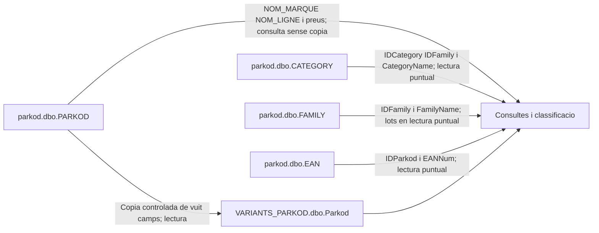

# Gestionnaire de Variantes — Model de dades

Actualització documental **2026-11-14, registre mantingut fins a D446**. Repàs conceptual de les13taules i controls entre taules a **§6.55 — Repàs conceptual d'integritat i punt de represa**; no decisions duplicades, SQL implementat o proves superades. Model **13 taules/92 camps**, **76 signatures actives + NormalizeWhitespace**, quatre correctors retirats i33índexs de disseny intactes. Categoria alfanumèrica/reserva externa/mecanismeDATALENGTH+UNICODE confirmats§6.54. **E08: proposta d'una entrada per objecte i motiu encara pendent de confirmació**, sense camps/signatura nous. Represa§6.55.6/§7 i funcional§33; etapa0 oberta, connector al final. Només documentació, sense SQL, DDL, dades/font/configuració, instal·lació, commit o push.

## 1. Estat i lectura del document

Aquest document acompanya el [funcional Parkod](Parkod.md) i el [registre de decisions](DECISIONS.md). Recull el diagrama, els camps, les relacions i els arguments tractats amb l'usuari.

**No és DDL executable ni una estructura desplegada.** El document distingeix camps/claus de disseny aprovats, regles confirmades i controls SQL/proves pendents. L'etapa 0 continua oberta.

- **Ubicació:** VARIANTS_PARKOD.dbo, SQL Server 2017 Express/Windows Server 2019. Tretze taules/92 camps després de D415–D416: substituir LineCode per ReviewedSourceJson no canvia el nombre de camps. Original parkod només amb lectures controlades (§1.1/§5).
- **Grup i pertinença — D380/D415:** PK `(BrandCode, ProductGroupId)`, INT positiu per marca amb comptador/coordinació SQL. Únic grup de la mateixa marca per SKU, categories/línies font diverses admeses. Categoria del SKU conservada; cap LineCode a ProductGroup o ProductVariant. No pertinences alternatives per client o agrupació automàtica per coincidència d'atributs.
- **Marca i unicitat confirmades:** VariantType incorpora BrandCode nullable per a qualsevol Type, estructurat o `open_type`. NULL significa global; una marca informada limita l'ús als seus grups. Type + Characteristics és únic globalment, sense incloure BrandCode. El canvi ordinari de BrandCode es bloqueja si hi ha assignacions, incloses les dels SKU retirats.
- **Representació confirmada (D156–D159/D170):** els tipus estructurats poden ser numèrics o textuals. VariantType.ValueKind NVARCHAR(7) NOT NULL declara `numeric` o `text`, homogeni per VariantTypeId; `open_type` exigeix `text`. Cada VariantTypeValue informa exactament un dels camps NumericValue/TextValue. No es replica ValueKind al valor ni s'afegeix a la unicitat. El canvi ordinari queda bloquejat amb qualsevol valor de catàleg o associació aprovada, també de fase 2 sense codi.
- **Principal confirmat:** ProductGroup incorpora PrimaryVariantTypeId, comú per a qualsevol ús. Només compten les associacions ProductGroupVariantType amb IsValidated=1 i ParkodVariantCode no nul: 0 → NULL, 1 → aquell tipus, més d'1 → selecció tècnica. No es compten SKU ni valors.
- **Associacions/rèpliques — D380:** PK ProductGroupVariantType `(ProductGroupId, BrandCode, VariantTypeId)`; ProductVariantValue conserva PK `(ProductVariantId, VariantTypeId)` i rèpliques BrandCode/ProductGroupId, però retira CategoryCode. VariantTypeValue.Type i els altres controls compartits es conserven. FK i cascades adaptades a §4.
- **Textos confirmats:** normalització automàtica dels blancs de TextValue, Characteristics, ProductGroupName i Type abans de validar i desar: qualsevol seqüència de blancs, incloent tabulacions, salts de línia i espais especials, es converteix en un únic espai ordinari U+0020, amb trim als extrems. S'admeten i es conserven accents i majúscules; la comparació és CI_AI. TextValue no nul és únic dins del seu VariantTypeId, però pot repetir-se entre tipus diferents. La collation s'ha de declarar als camps nous afectats, sense alterar la configuració general de parkod ni les columnes legacy.
- **Textos/codis — D444:** NVARCHAR i sufix Code conservats; CCATEG/CategoryCode són dos caràcters ASCII A–Z/0–9, no només dígits, amb zeros i NVARCHAR(2) preservats. Substitueix la limitació de D388, no dades legacy o claus. Categoria/línia del creador poden contribuir al nom descriptiu, no són atributs comuns de grup.
- **Confirmat posteriorment:** IDs de catàleg INT IDENTITY(1,1), comptador local ProductGroupCounter, longituds de text i collation concretades, funció de blancs i CHECK binari/longitud, `SourceIsPresent`, nom inicial i escriptura protegida amb `sp_getapplock`. Les FK compostes i claus candidates indicades a la secció 4 han rebut confirmació de disseny; el DDL i les proves encara no existeixen.
- **Codi — D381–D383/D387:** ParkodVariantCode NVARCHAR(5) NULL, ASCII 0–9/A–N/P–Z, immutable i únic per marca incloent l'històric. DE000…ZZZZZ, sense retorn a 00000, màxim ordenat del registre i assignació SQL atòmica. Blocs retirats. Codi al final de fase 3, principal coherent; fase 2 admet 1/NULL. Identificador extern BrandCode(3)+codi(5), no substitució del SKU.
- **Taules tècniques:** ProductGroupCounter per marca, ParkodVariantCodeRegistry, EvaluationAuditEvent, AppAccount, AppSession amb reserva marca–grup i SynchronizationStatus cinc camps. Sense taules de versions/tasques o substitut de blocs.
- **Operativa:** conciliació completa/per marques, càrrega externa sempre completa D379, generador independent amb SNAPSHOT local. D389 retira només el rebuig CPROD d'antics blocs i el correu urgent corresponent; la resta de controls/logs intactes.
- **JSON i revisió confirmats (D143–D155/D159–D169):** contractes de fonts, propostes, resultats, claus i snapshots a §3.11; autoritat dels originals i context esperat per operació a §6.8. SQL compara l'estat revisat, no les correccions del formulari. La creació conjunta de grup/associacions/trasllats conserva valors i exigeix decisions explícites (§6.9).
- **Catàlegs i substitució confirmats (D171–D193):** claus d'auditoria sense context anterior a §3.11.3; reutilització/altes automàtiques i manuals a §6.10; substitució expressa A → B, retirades individuals auditades, JSON transitoris, dos procediments, SNAPSHOT de context, resposta post-COMMIT i resultat incert a §6.11. No noves taules ni columnes.
- **Desplegament/autenticació confirmats (D194–D200):** RDS/RemoteApp amb compte Windows propi i instància d'app per usuari, compte funcional propi, connexió directa i model intern de confiança; Argon2id en Python, token de 32 bytes i dos procediments de login a §6.13. No servei central ni autenticació Windows automàtica. SQL conserva els controls compartits; dependències comentades en anglès i inventariades a §6.12.
- **Catàleg manual i editorial confirmat (D201–D217):** finestra permanent de conjunt, preparació independent de tipus globals/valors, altes i auditories atòmiques, confirmació humana editorial, contextos SNAPSHOT reduïts, bloqueig per tipus, signatures/respostes i reversió editorial a §6.14. No noves columnes ni extensió de l'alta independent a tipus exclusius.
- **Fonts i entorn confirmats (D223–D232):** `parkod` local poblada i `VARIANTS_PARKOD` existent sense taules a `.\SQLEXPRESS`, SQL Server 2019 Express de proves. Producció continua en 2017 Express; l'usuari confirma l'estructura font com a referència i French_CI_AS a totes les columnes textuals de producció. Inventari/equivalències a §5, diagnòstics previs de lectura a §5.5. DESIGN1/DESIGN2 passen a NVARCHAR(18), code1 a NVARCHAR(13) NOT NULL; només s'ajusten aquests detalls físics, sense taules ni camps nous.
- **Precisió recent dels contractes (D233–D240):** tasques Windows en seqüència recàrrega → conciliació nocturna, ja acordades (§6.7); signatures completes A → B validades (§6.11.2); recuperació manual de resultats incerts només per administradors (§6.11.6), no comprovació automàtica. Entrada existent/nova de valor SKU i resposta de candidata en dos conjunts aprovades (§6.10.1–6.10.2), amb gramàtica D236 de ValuesJson reutilitzada expressament a NewValueJson. No canvia code1 ni originals històrics.
- **Candidates existents (D241–D248):** sis signatures i contractes de candidates a §6.15, preservats; quatre blocs grup–tipus D246 i set propietats SKU–valor D248 íntegrament confirmats. D243 només confirmava Parkod, no s'amplia retroactivament. Els altres circuits es concreten expressament a §6.16–6.24, no per extrapolació.
- **Contractes addicionals (D249–D284):** vint signatures de disseny per consulta administrativa, finalització, trasllats, creació/rebutjos, alta manual de tipus, principal i valors SKU. Absència/candidata/validada tenen circuits diferenciats; nous valors de catàleg només en confirmar, amb atomicitat/auditoria. Cap nova entitat/camp/PK/FK ni SQL desplegat; etapa 0 oberta.
- **Rebutjos conjunts i correccions de fase 2 (D285–D294):** quatre signatures addicionals a §6.25–6.26 i el lector GetGroupVariantTypeProposalCorrectionContext ara confirmat expressament per D294. D293 n'aprovava només el context, no s'amplia retroactivament. Cap assignació SKU s'elimina per fer admissible una candidata.
- **Substitució d'associació ja aprovada de fase 2 (D295–D296):** confirmador i lector de §6.27 per A 1/codi NULL i B candidata 0/codi NULL, totes dues sense assignacions al grup. Retirada expressa d'A/aprovació de B atòmiques, sense fase 3. Contractes preservats, amb l'adaptació d'activitat de grup D326–D330.
- **Sessions, comptes i abast de catàlegs (D297–D320):** cicle de sessió/reserva i tancament administratiu auditat, comptes/bootstrap/recuperació, BrandCode/ValueKind, signatura de NormalizeWhitespace i edició descriptiva del nom a §6.28–6.32. AppAccount.IsActive i ProductGroup.IsActive són independents. Cap servei central, compte de reserva o recuperació nova del tancament forçat.
- **Activitat:** IsActive/default1, controls d'inactius i zero SKU/cap reserva per desactivar intactes. D386 retira marca–categoria dels selectors administratius de buits/inactius: marca o totalitat. Grup actual de set camps; història de grups antics de nou camps intacta (§6.42).
- **Validació sense trasllat (D331–D337):** dos lectors i dos confirmadors per validar grup existent o pertinença actual, decisions independents; grup actiu buit, grup provisional i SKU retirat segons cada contracte (§6.36–6.37). Risc conservat, no-op només després de tots els controls.
- **Línia només font — D415:** canvi de CLIGNE es tracta com code1: data font avança/pendent de revisió general, sense línia anterior operativa a ProductVariant. Quatre correctors de §6.38 retirats; trasllats/creacions/validació de pertinença pels circuits propis, no aprovació implícita per revisar font. No font/còpia escrites o nova API substitutiva.
- **Càrrega externa versus conciliació (D361–D367/D379/D409):** únic carregador extern complet/allbrands de `parkod.dbo.PARKOD` → `VARIANTS_PARKOD.dbo.Parkod`. Deu camps locals de només lectura per a l'app, incloent presència i nova data de font externament mantingudes; els vuit originals intactes. Conciliació completa/per marques sobre entrada estable, sense escriptura de còpia; GUI permesa durant càrrega amb controls de disponibilitat. Contracte extern §6.35/§6.47.3/Parkod.md §23, no carregador implementat.
- **Cicle batch i balanç — D418–D420:** mateixa connexió started, abast fixat i còpia estable; ReconcileSku de quatre arguments/una fila de quatre columnes. Complete de sis arguments sense UpdatedCount; Read=Inserted+Unchanged+RejectedOrPending, JSON obligatori només sense variant i resposta de cinc columnes intacta. D407 memòria completa, D371–D373 cobertura exacta i COMMIT previs preservats; ni sumes ni Reason proven completesa (§6.39/§6.49).
- **Visibilitat i correcció de valors (D368–D370/D374–D378):** llista a cada login, incidències i quatre àmbits independents. Inclou assignacions candidates, valors no assignats i associacions aprovades sense codi com a finalització diferenciada. Retirats: validacions existents admissibles sí, assignacions absents no. Consulta a còpia durant càrrega o després de fallada: avís de llista no disponible fins a publicació correcta, no llista buida/completa fictícia o veto global de GUI. D369/no camp de pendent intactes (§6.41); consulta/resposta/GUI/SQL encara per materialitzar.
- **Controls després de D415:** matriu específica de discrepància retirada, inclosos vetos D390/D392. Cada circuit conserva permisos/reserva/grup actiu/habilitacions/valors/principal/integritat/context/auditoria propis; no permissió universal de retirades/no-op ni veto general nou de font pendent (§6.48).
- **Disponibilitat — D396/D402/D406:** dependència real de còpia i indicador0 comprovat coordinadament impedeixen context revisable/confirmació/rebuig formal. Error51001 amb THROW; transport estructurat/mapping/ROLLBACK/proves encara pendents, sense interpretar missatges o alterar signatures/respostes d'èxit. Sense dependència real no nou veto; buit verificable, GUI francesa/logs anglesos/D238 intactes (§6.44.2/§6.46.3).
- **Coordinació — D425–D434:** RunX/Session0ms→CopyX/Session60s→GateX/Session5s per batch; GateShared/Transaction0ms nomésCreateAppSession, còpia interactiva5s/lectura abansSNAPSHOT. AppAdministratorSetX/Transaction5s només tres vies de comptes, diversos admins conservats. Dependències condicionals i protecció actual de sessió/ordre de comptes-sessions a §6.50–§6.51; errors51001–51005 acotats, alliberament invers i neteja fallida sense Undo o reenviament. SQL/permisos/proves pendents.
- **Interfície:**76signatures actives+funció/quatre retirades; només Complete anterior canvia arguments, ReconcileSku afegit. MembresParkod7 de finalització/substitució i reutilitzacions confirmats; Usages nomésSourceIsPresent. Context de revisió exacte7blocs, forma i CHECKs fotografia-marca aprovats, parser/proves pendents. §6.49–§6.53 prevalen sobre pendents antics; història literal intacta.
- **Disseny físic — D435–D446:**13PKCLUSTERED/33índexs§6.52 intactes. D446 confirma DATALENGTH+UNICODE per codis, abans de conversions curtes i en CHECKs corresponents; D444 rectifica categoria alfanumèrica, D445 reserva/O controlats externament (§6.54). SQL/proves2017 pendents; constants2019 no tanquen E01/E06 o etapa0.
- **Pendent:** completar evidència de metadades/permisos i impacte, controls executables JSON, detalls SQL de procediments/bloquejos, índexs/CHECK/FK, integracions i proves de les regles confirmades. Els casos no concretats es distingeixen a §7; no es consideren tots els procediments ni tots els formats possibles tancats. La FK SKU/còpia de quatre camps continua retirada. No avançar a l'etapa 1 abans de validar l'etapa 0.

Els vuit camps copiats conserven noms, tipus i nul·litat font acceptats (D230–D231), amb French_CI_AS al destí segons la producció confirmada (D232); no hereten SQL_Latin1 de la còpia de proves. `docs/parkod.sql` és una referència antiga discrepant, no el contracte de còpia. Fonts a `parkod.dbo`, objectes del projecte a `VARIANTS_PARKOD.dbo`; totes dues bases locals ja identificades a la mateixa instància de proves. L'equivalència estructural de la còpia amb producció és confirmació de l'usuari, no verificació directa de producció. En aquest document, `dbo.<objecte del projecte>` és abreviatura dins de **VARIANTS_PARKOD**, mai autorització per crear-lo a parkod. Cap script SQL de referència modificat ni objecte del model desplegat.

### 1.1 Frontera permanent: cap intervenció a `parkod`

**D218–D222 substitueixen l'antiga ubicació de D01/D65; D361–D367 precisen el límit de càrrega.** El projecte no executa a `parkod` cap escriptura, DDL, manteniment, objecte, permís o canvi de configuració. Tampoc implementa la càrrega de la còpia local. Per a aquell flux l'únic origen és `parkod.dbo.PARKOD`, consumit pel procés extern; no hi ha CSV, base intermèdia o recàrrega prèvia de l'original obligatoris afegits pel projecte. Les lectures auxiliars controlades ja autoritzades de §5 es conserven, sense ampliar-ne fonts ni permisos. Diagnòstics previs només de lectura, no autorització per executar scripts. Qualsevol necessitat d'alterar l'original exigeix redisseny.

Totes les escriptures, FK, procediments, comptes, sessions, bloquejos lògics, auditoria i SynchronizationStatus són a **VARIANTS_PARKOD.dbo**. Les FK inclouen la còpia local de PARKOD i no travessen bases. Fer servir dbo no implica concedir db_owner al compte de l'app. Els programes legacy continuen operant l'original fora del projecte; aquesta regla no posa la base sencera en READ_ONLY.

| Element | `parkod` original, observat i no modificable pel projecte | `VARIANTS_PARKOD`, configuració aprovada pendent d'aplicar/provar |
|---|---|---|
| Motor/instància | SQL Server 2017 Express 14.x, mateixa instància de destí | SQL Server 2017 Express, sense migració prevista |
| Compatibilitat | 100 | 140; permet OPENJSON, que exigeix almenys 130 |
| Collation general | French_CI_AS | French_CI_AS |
| ALLOW_SNAPSHOT_ISOLATION | OFF | ON, per transaccions explicitament SNAPSHOT |
| READ_COMMITTED_SNAPSHOT | No contrastat; cap canvi autoritzat | OFF |

L'usuari ha aportat resultats de consultes de metadades: versió 14.0.2110.2 i, a parkod, 80,25 MiB de dades assignats/41,44 MiB ocupats. Són una observació puntual, no una previsió de creixement ni una prova de rendiment. Express 2017 limita les dades a 10 GB per base; les dues bases comparteixen recursos del servidor. No es promet impacte nul de les lectures: controls d'abast, bloquejos ordinaris i càrrega s'han de provar sense NOLOCK ni bloqueig deliberat de taules senceres.

La collation Latin1_General_100_CI_AI_SC es manté als quatre textos nous acordats i la rèplica Type; LoginName conserva la seva unicitat CI_AI ja aprovada (§3.12). L'usuari confirma ara French_CI_AS general i a totes les columnes textuals de producció. Els vuit camps de còpia i els codis relacionats a VARIANTS_PARKOD es defineixen amb French_CI_AS (D232). La coincidència s'ha de garantir a cada costat de les FK textuals, encara amb codis ASCII. Les comparacions amb la font local SQL_Latin1 poden requerir COLLATE explícit, sense modificar-la; copiar NVARCHAR no normalitza ni canvia la grafia.

**Separació de proves i producció (D229):** la taula anterior és el destí aprovat i l'observació històrica de producció, no la configuració local actual. A `.\SQLEXPRESS`/2019 les dues bases s'han observat a compatibilitat 150, SQL_Latin1_General_CP1_CI_AS, SNAPSHOT OFF i RCSI OFF; VARIANTS_PARKOD existeix sense taules (§5.5). Cap canvi d'opcions executat. El disseny i el futur T-SQL continuen limitats a SQL Server 2017; proves en 2019 no acrediten per si soles compatibilitat/rendiment en 2017.

**Integracions encara pendents:** SNAPSHOT només a VARIANTS_PARKOD. Conciliació i revisió consumeixen còpia local; D415 retira correctors i línia pròpia, no introdueix relectura original de classificació. Noms/EAN/fonts auxiliars i generador conserven protocols autoritzats pendents, sense SNAPSHOT original o coherència interbases presumpta. Integració del carregador segons §6.35/§6.7, no implementació o permisos nous a l'origen.

**Correspondència de codis:** `CMARQ → BrandCode`, `CCATEG → CategoryCode`, `CPROD → ProductCode`; CLIGNE es conserva només com a dada font actual a Parkod i, després de revisió, a la fotografia informativa ReviewedSourceJson. No camp/àlies LineCode del SKU o línia de grup. Fonts de noms PARKOD.NOM_MARQUE/NOM_LIGNE, CATEGORY.CategoryName i FAMILY.FamilyName segons §5.3, sense còpia de denominacions o FK noves.

## 2. Diagrama entitat–relació

Totes les entitats del diagrama són a **VARIANTS_PARKOD.dbo**, inclosa Parkod, que és la còpia, no la font original. `PK` identifica una clau primària i `FK` una clau forana; diverses columnes marcades poden formar una sola clau composta. Es representen acords de disseny, no DDL validat ni desplegat.

**Abast vigent:**13taules/92camps. D380/D383:14/99→13/90; D409:13/90→13/92; D415–D416:retirar LineCode i afegir ReviewedSourceJson→mateixos13/92. Les altres91columnes i totes les PK/FK es conserven. Dates DATETIME2(3) UTC/sense DEFAULT confirmades en conversa, sense DDL aplicat; fontNOTNULL/revisadaNULL. JSON nou NVARCHAR(MAX) NULL, només sis camps revisats (§3.3/§6.48).

```mermaid
erDiagram
    Parkod ||--o| ProductVariant : "identifica el SKU"
    ProductGroup ||--o{ ProductVariant : "mateixa marca; categories i linies lliures"
    ProductGroup ||--o{ ProductGroupVariantType : "utilitza"
    ProductGroupVariantType |o--o| ProductGroup : "es principal del mateix grup"
    VariantType ||--o{ ProductGroupVariantType : "pot compartir-se"
    VariantType ||--o{ VariantTypeValue : "defineix valors"
    ProductVariant ||--o{ ProductVariantValue : "te assignacions"
    VariantTypeValue ||--o{ ProductVariantValue : "es assignat"
    ProductGroupVariantType ||--o{ ProductVariantValue : "associacio revisada per preparar valors"
    ProductGroupCounter ||--o{ ProductGroup : "numera per marca via procediment"
    ProductGroup ||--o{ ParkodVariantCodeRegistry : "conserva reserves del grup"
    VariantType ||--o{ ParkodVariantCodeRegistry : "conserva reserves del tipus"
    ParkodVariantCodeRegistry |o--o| ProductGroupVariantType : "reserva el codi final"
    AppAccount ||--o| AppSession : "una sessio activa"
    AppAccount |o--o{ EvaluationAuditEvent : "autor huma opcional"
    ProductGroup |o--o| AppSession : "reserva opcional exclusiva"

    Parkod {
        nvarchar CMARQ PK "3 caracters"
        nvarchar CCATEG PK "2 alphanumeric ASCII; zeros preservats"
        nvarchar CPROD PK "3 caracters"
        nvarchar CLIGNE "2 caracters; NOT NULL"
        nvarchar DESIGN1 "18 caracters; NOT NULL"
        nvarchar DESIGN2 "18 caracters; NULL"
        nvarchar code1 "13 caracters; NOT NULL; quantitat original"
        nvarchar code2 "1 caracter; NULL; unitat original"
        bit SourceIsPresent "NOT NULL; DEFAULT 1"
        datetime2 SourceUpdatedAtUtc "UTC; precision 3; NOT NULL; external changes"
    }

    ProductGroup {
        int ProductGroupId PK, FK "positiu; des d 1 per marca"
        nvarchar ProductGroupName "150; nullable; blancs normalitzats; CI_AI"
        nvarchar BrandCode PK, FK "CMARQ; 3 caracters; NOT NULL"
        int PrimaryVariantTypeId FK "NULL amb 0 habilitacions finals"
        decimal EstimatedRiskPercent "DECIMAL(5,2); NULL si no estimable"
        bit IsValidated "NOT NULL; DEFAULT 0"
        bit IsActive "NOT NULL; DEFAULT 1; inactiu nomes sense SKU ni reserva vigent"
    }

    ProductVariant {
        bigint ProductVariantId PK "IDENTITY(1,1)"
        int ProductGroupId FK "NOT NULL; grup de la mateixa marca"
        nvarchar BrandCode FK "CMARQ; 3 caracters; NOT NULL"
        nvarchar CategoryCode FK "CCATEG; 2 alphanumeric ASCII; NOT NULL"
        nvarchar ProductCode FK "CPROD; 3 caracters; NOT NULL"
        decimal EstimatedRiskPercent "DECIMAL(5,2); risc de pertinenca; nullable"
        bit IsValidated "NOT NULL; DEFAULT 0; pertinenca"
        datetime2 ReviewedSourceUpdatedAtUtc "UTC; precision 3; NULL never reviewed; source mark not click time"
        nvarchar ReviewedSourceJson "MAX; NULL never reviewed; six source fields; informational"
    }

    VariantType {
        int VariantTypeId PK "IDENTITY(1,1); U2 amb Type"
        nvarchar Type "20; NOT NULL; CI_AI; U1 amb Characteristics; U2 amb VariantTypeId"
        nvarchar Characteristics "80; NOT NULL; CI_AI; U1 amb Type"
        nvarchar BrandCode "nullable; NULL global"
        nvarchar ValueKind "7; NOT NULL; numeric o text; no replicat"
    }

    VariantTypeValue {
        int VariantTypeValueId PK "IDENTITY(1,1)"
        int VariantTypeId FK
        nvarchar Type FK "20; NOT NULL; CI_AI; replica conservada"
        decimal NumericValue "DECIMAL(18,3); nullable"
        nvarchar TextValue "80; CI_AI; nullable; unic per tipus si no NULL"
    }

    ProductGroupVariantType {
        int ProductGroupId PK, FK
        nvarchar BrandCode PK, FK "3 caracters; NOT NULL; marca del grup"
        int VariantTypeId PK, FK
        nvarchar ParkodVariantCode FK "5; nullable; assignat al final de fase 3"
        decimal EstimatedRiskPercent "DECIMAL(5,2); nullable"
        bit IsValidated "NOT NULL; DEFAULT 0; aprovacio de fase 2"
        nvarchar OriginalSourcesJson "MAX; nullable"
        nvarchar OriginalProposalJson "MAX; nullable"
    }

    ProductVariantValue {
        bigint ProductVariantId PK, FK
        int VariantTypeId PK, FK
        int ProductGroupId FK "NOT NULL; replica conservada; FK proposada"
        nvarchar BrandCode FK "3 caracters; NOT NULL; replica del grup real"
        int VariantTypeValueId FK
        decimal EstimatedRiskPercent "DECIMAL(5,2); nullable"
        bit IsValidated "NOT NULL; DEFAULT 0"
        nvarchar OriginalSourcesJson "MAX; nullable"
        nvarchar OriginalProposalJson "MAX; nullable"
    }

    ProductGroupCounter {
        nvarchar BrandCode PK "3 caracters; NOT NULL"
        int LastAllocatedId "NOT NULL; inicial 0"
    }

    ParkodVariantCodeRegistry {
        nvarchar BrandCode PK, FK "3; NOT NULL"
        nvarchar ParkodVariantCode PK "5; NOT NULL; permanent; DE000 a ZZZZZ"
        int ProductGroupId FK "NOT NULL"
        int VariantTypeId FK "NOT NULL"
    }

    EvaluationAuditEvent {
        bigint EvaluationAuditEventId PK "IDENTITY(1,1)"
        uniqueidentifier OperationId "NOT NULL"
        datetime2 OccurredAtUtc "3; NOT NULL; SYSUTCDATETIME"
        nvarchar EventKind "32; NOT NULL"
        nvarchar ActionName "64; NOT NULL; controlat"
        nvarchar DecisionOutcome "16; nullable"
        nvarchar ActorKind "16; NOT NULL"
        int ActorAppAccountId FK "nullable"
        nvarchar ActorProcessName "128; nullable"
        nvarchar TargetScope "32; NOT NULL"
        nvarchar TargetKeyJson "MAX; NOT NULL"
        decimal OriginalEstimatedRiskPercent "DECIMAL(5,2); nullable"
        nvarchar OriginalSourcesJson "MAX; nullable"
        nvarchar OriginalProposalJson "MAX; nullable"
        nvarchar DecisionResultJson "MAX; nullable"
        nvarchar BeforeStateJson "MAX; nullable"
        nvarchar AfterStateJson "MAX; nullable"
    }

    AppAccount {
        int AppAccountId PK "IDENTITY(1,1)"
        nvarchar LoginName "80; NOT NULL; unic CI_AI"
        nvarchar PasswordHash "255; NOT NULL; Argon2id"
        bit IsActive "NOT NULL; DEFAULT 0"
        bit IsAdmin "NOT NULL; DEFAULT 0"
    }

    AppSession {
        uniqueidentifier AppSessionId PK
        int AppAccountId FK "NOT NULL; UNIQUE"
        varbinary SessionTokenHash "32; NOT NULL; UNIQUE; SHA-256"
        datetime2 LastActivityAtUtc "3; NOT NULL; SYSUTCDATETIME"
        nvarchar ReservedBrandCode FK "3; nullable"
        int ReservedProductGroupId FK "nullable"
    }

    SynchronizationStatus {
        tinyint SynchronizationStatusId PK "unica fila; valor 1"
        datetime2 ParkodLastCompletedAtUtc "3; nullable"
        bit ParkodRefreshSucceeded "NOT NULL; DEFAULT 0"
        datetime2 VariantsLastCompletedAtUtc "3; nullable; nomes batch complet"
        bit VariantsReconciliationSucceeded "NOT NULL; DEFAULT 0; nomes batch complet"
    }
```



La correspondència Parkod–variant és 1:1 per als SKU vàlids incorporats. El `0..1` és també un estat normal d'entrada: la càrrega externa pot haver creat una còpia encara sense ProductVariant. L'alta de l'app crea variant, grup propi i auditories atòmicament, però no la còpia. D371–D373: cobertura final amb justificació individual des dels SKU sense variant i JSON d'incidències de Complete (§6.39.6–6.39.7), no igualtat inicial/final incondicional dels totals. Comptador: ús transaccional, no FK; cap relació física afegida.

**Claus de VariantType en el diagrama:** `PK (VariantTypeId)`; `U1 = UNIQUE (Type, Characteristics)` és la unicitat funcional global sobre text normalitzat amb `Latin1_General_100_CI_AI_SC`, sense BrandCode ni ValueKind; `U2 = UNIQUE (VariantTypeId, Type)` és una clau candidata tècnica per a la FK de `VariantTypeValue(VariantTypeId, Type)`. U1/U2 identifiquen **parelles** de columnes, no la unicitat individual de Type o Characteristics. Són acords de disseny, encara sense DDL desplegat.

PK vigents: ProductGroup `(BrandCode, ProductGroupId)`; ProductGroupVariantType `(ProductGroupId, BrandCode, VariantTypeId)`. ProductGroupId sol no identifica el grup. CategoryCode i LineCode són del SKU, no components de la referència al grup; no clau candidata de grup amb línia. Ordre físic d'índexs encara pendent.

La relació de principal és un subconjunt de les associacions habilitades: cada grup selecciona `0..1` associació i cada associació només pot ser principal del seu propi grup. El `0..1` del diagrama no implica opcionalitat general: amb un o més tipus habilitats, el principal és obligatori. La mateixa VariantType pot ser principal de molts grups a través d'associacions diferents; PrimaryVariantTypeId no és únic entre grups.

### Fonts de la còpia de proves, sense persistència local excepte vuit camps de PARKOD



Aquests accessos són només de lectura, sense FK, vista ni cap altre objecte nou a l'origen. BRAND/LINE es conserven a la còpia de proves, però no són dependències necessàries per als noms de marca/línia. L'inventari canònic i la separació respecte de producció són a §5; cal verificar els permisos de lectura ja disponibles i l'impacte, sense concedir permisos ni configurar parkod des del projecte.

## 3. Diccionari de taules i camps

**Organització física D435–D443:** totes les PK seran CLUSTERED; unicitats/accessos segons§6.52, no camps nous o DDL desplegat. D444 rectifica només l'alfabet de categoria; CHECKs fotografia-marca/JSOND423 i mecanisme DATALENGTH+UNICODED446 confirmats en disseny, SQL/proves pendents (§6.54).

### 3.1 `dbo.Parkod`

**Finalitat:** còpia de treball a `VARIANTS_PARKOD.dbo.Parkod` de `parkod.dbo.PARKOD`, amb clau única, que permet ancorar les FK internes sense afectar les aplicacions antigues.

| Camp | Tipus de referència | Nul·litat | Funció i argument |
|---|---|---|---|
| `CMARQ` | NVARCHAR(3) | No | Marca i primer component de la PK. Tres caràcters exactes. |
| `CCATEG` | NVARCHAR(2) | No | Categoria i segon component de la PK. Dos caràcters ASCII A–Z/0–9 (D444 substitueix D388); zeros preservats, sense conversió numèrica. Reserva < 'DE' i absència d'O validades externamentD445, no nous controls específics al gestor. |
| `CPROD` | NVARCHAR(3) | No | Producte i tercer component de la PK. Tres caràcters exactes. |
| `CLIGNE` | NVARCHAR(2) | No | Línia actual publicada externament, només font; ProductVariant.LineCode retiratD415. Fotografia de darrera revisió només informativa. |
| `DESIGN1` | NVARCHAR(18) | No | Denominació original del SKU; metadades acceptades D231. |
| `DESIGN2` | NVARCHAR(18) | Sí | Denominació complementària original; metadades acceptades D231. |
| `code1` | NVARCHAR(13) | No | Quantitat original com a text; mai truncar ni convertir en copiar. NOT NULL no implica quantitat vàlida. |
| `code2` | NVARCHAR(1) | Sí | Unitat original com a text; els NULL es rebutgen en processar. |
| `SourceIsPresent` | BIT NOT NULL DEFAULT(1), confirmat | No | Mantingut només pel procés extern: 1 present segons la càrrega, 0 absència contrastada globalment amb càrrega completa fiable (D379). No expressa antiguitat, qualitat o validació; l'app no el modifica. |
| `SourceUpdatedAtUtc` | DATETIME2(3) NOT NULL, UTC, confirmat en conversa | Informada en alta/inicialització; sense DEFAULT | Propietat exclusiva del procés extern; avança en canvi literal de DESIGN1/DESIGN2/code1/code2/CLIGNE/SourceIsPresent, inclosa retirada/reaparició, no en recàrrega idèntica. Avanç segur i distinció de revisió §6.48; no data històrica fictícia o canvi de font original. DDL/proves pendents. |

PK/FK SKU `(CMARQ, CCATEG, CPROD)` i FK de grup marca–grup conservades. D415 retiraLineCode, no CLIGNE o claus. SKU textual3+2+3 amb tres components ASCII A–Z/0–9 (D444), zeros intactes; controls externsO/reservaD445 no es traslladen al gestor. Càrrega no reclassifica grups/assignacions/validacions; font canviada pendent per dates.

Còpia acumulativa de totes les referències, antigues i actuals: no DELETE/buidatge/recreació. D379 manté càrrega completa global fiable; app no controla duplicats originals ni modifica cap dels **deu camps locals**. Els vuit originals, presència i nova data de font són propietat del procés extern. No afegir PRIX_ACHAT/PRIX_VENTE/DECCONT/LIBELLE_COURT/NUM_UPD/CSSCATEG/noms/mestres, ni normalitzar/truncar font. D409 amplia només metadata local, no l'original; contracte funcional §23/D411 preservats.

### 3.2 `dbo.ProductGroup`

**Finalitat:** identificar i anomenar el producte comercial que agrupa els SKU.

| Camp | Tipus/estat | Funció i argument |
|---|---|---|
| `ProductGroupId` | INT NOT NULL, positiu; part de la PK composta, confirmat | Identificador des d'1 dins de BrandCode; comptador/coordinació per marca, DDL pendent. |
| `ProductGroupName` | NVARCHAR(150) NULL COLLATE Latin1_General_100_CI_AI_SC | Nom comercial visible, no únic. Informat inicialment amb noms/codis i editable; blancs normalitzats, cap buit informat. |
| `BrandCode` | NVARCHAR(3) NOT NULL; part de la PK composta, confirmat | Identificador CMARQ de la marca, heretat del primer SKU; tots els membres comparteixen la marca. |
| `PrimaryVariantTypeId` | INT NULL | VariantType principal per a qualsevol ús, no un SKU ni un valor. Ha de correspondre a una associació del mateix grup a ProductGroupVariantType; FK composta confirmada conceptualment. |
| `EstimatedRiskPercent` | DECIMAL(5,2) NULL | Risc inicial/vigent de creació/configuració, 0–100; NULL si no estimable. |
| `IsValidated` | BIT NOT NULL DEFAULT(0) | Validació tècnica del grup, independent de les pertinences dels SKU. |
| `IsActive` | BIT NOT NULL DEFAULT(1), confirmat D321 | Activitat operativa del grup, independent de IsValidated/risc. Només administració pot passar 1 → 0 amb zero SKU assignats i cap reserva vigent; consulta històrica conservada. |

El nom visible de marca es consulta a `PARKOD.NOM_MARQUE` de la còpia de proves, no en una columna nova de marca ni en una còpia de BRAND. CMARQ continua sent el codi funcional de marca; `BRAND.IDBrand` n'és l'equivalent documental. La disponibilitat i coherència de les denominacions s'han de contrastar sense seleccionar noms arbitraris si hi ha anomalies (§5).

Els camps de risc/validació estan confirmats per D107. Un grup propi provisional comença IsValidated=0 i risc sustentat o NULL; la PK i el nom no autoritzen ús als clients. DDL/proves pendents.

PK D380: `(BrandCode, ProductGroupId)`. ProductGroupId positiu/INT, no global ni equivalent a CPROD. Set camps de grup: ProductGroupId, ProductGroupName, BrandCode, PrimaryVariantTypeId, EstimatedRiskPercent, IsValidated, IsActive. Categoria/línia retirades del grup; no substituïdes per una categoria/línia principal o del creador.

SKU sense grup comercial conegut: grup propi provisional de la mateixa marca, no grup genèric. ProductVariant conserva categoria identificadora; D415 retira línia pròpia, actual nomésParkod.CLIGNE. Marca comuna no prova equivalència comercial ni dispensa permisos/activitat/habilitacions/valors/principal. Noms repetits i grups buits conservats; nom del creador només descriptiu (§5.1/D421).

Els noms poden repetir-se, fins i tot dins d'una marca i categoria; la PK completa distingeix les identitats. La importació repetida no crea nous grups per al mateix SKU. Els grups buits es conserven per auditoria i reversibilitat.

Activitat D321–D330 conservada: nous grups actius, buit = zero ProductVariant de la identitat marca–grup, retirats/pendents inclosos. Desactivar no modifica risc/validació, exigeix zero SKU i cap reserva vigent, també pròpia, sense moure/esborrar SKU o expulsar sessions. D386: selectors administratius només marca/totalitat. No DELETE o reactivació aprovada; caducades no són reserves vigents.

Un grup inactiu no es mostra ni s'utilitza en cerques, selectors, propostes, destinacions, reserves o modificacions ordinàries, també si l'actor és administrador o aporta una clau coneguda. SQL ho comprova transaccionalment, inclosos els no-op. L'operativa filtra **IsActive=1**, no IsValidated=1 ni «té SKU»: un grup actiu buit segueix operatiu fins a desactivació expressa. Cap reactivació automàtica per conciliació ni contracte de reactivació aprovat. Administració consulta els inactius per les vies explícites de §6.33–6.34.

Es conserven principal, associacions, codis, identificadors i auditoria. Les associacions històriques continuen comptant per compatibilitat de marca i bloqueig de ValueKind; no s'ignoren FK ni es reciclen comptadors/codis. Desactivar redueix el soroll operatiu, no l'emmagatzematge; persisteixen fila/índexs/dependències dins del límit d'Express. No es manté una transacció o bloqueig SQL obert pel fet que un grup sigui buit/inactiu. Contractes de nom/desactivació a §6.32–6.33 i matriu d'impacte a §6.34.6.

Numeració des d'1 per BrandCode; no per categoria/línia ni IDENTITY global. Comptador existent adaptat a marca, sp_getapplock/coordinació transaccional amb creació, sense MAX+1 de grups. No reiniciar/reciclar en desactivar. DDL/proves pendents.

#### Compatibilitat i línia pròpia del SKU

Un únic grup actual de la mateixa marca, categories i línies font diverses admeses. D415 retira la línia pròpia del SKU i la discrepància, no la FK de tres camps a còpia ni la FK marca–grup. Cap línia comuna, relectura original de classificació, còpia escrita o reagrupació automàtica. Regles de cada circuit intactes excepte controls específics retirats (§6.48).

#### Tipus principal del grup

El principal és una propietat comuna del grup, independent d'eCommerce, connectors o destinacions. Pot ser estructurat o `open_type`, global o exclusiu d'una marca, sempre que estigui habilitat al mateix grup i respecti BrandCode.

| Nombre de VariantType habilitats a ProductGroupVariantType | PrimaryVariantTypeId requerit |
|---|---|
| 0 | NULL; no hi ha cap tipus a seleccionar. |
| 1 | Obligatori i igual a l'únic VariantTypeId habilitat. No hi ha una tria alternativa. |
| Més d'1 | Obligatori; el personal tècnic selecciona un dels tipus habilitats. |

Només compten les associacions amb **IsValidated=1 i ParkodVariantCode IS NOT NULL**. Les candidates i les aprovades a fase 2 encara sense codi no alteren el principal. El recompte no és un recompte de SKU ni valors; la completesa dels valors es comprova abans de donar el codi final. Grups d'un sol SKU i grups buits conservats segueixen la mateixa regla segons les habilitacions que mantinguin.

El recompte és per VariantTypeId: Size/letter i Size/cms compten com dos tipus si tots dos estan finalment habilitats, encara que comparteixin el text Type=Size.

Si el principal obligatori falta o no és vàlid, es bloqueja l'exportació del grup i es rebutgen els canvis ordinaris que deixin un estat final invàlid. Es permeten les operacions correctives necessàries per definir-lo, amb revalidació atòmica en una transacció curta. Afegir o retirar tipus, canviar el principal o traslladar SKU requereix revalidar la regla. Amb més d'un tipus no s'escull arbitràriament el primer ni se substitueix silenciosament una decisió tècnica vàlida.

El principal no elimina altres tipus, valors o SKU, ni els fusiona. Un grup amb diversos SKU però sense tipus definits continua pendent de classificació: un principal NULL coherent amb zero tipus no autoritza l'exportació. Un principal vàlid tampoc garanteix, per si sol, que tots els SKU tinguin valor o que els valors diferenciïn tots els SKU en una destinació limitada a una sola característica; els controls específics d'exportació s'hauran de concretar al connector, sense alterar la classificació interna.

La columna admet NULL físicament per al cas de zero habilitacions finals, però és obligatòria quan n'hi ha una o més. Les associacions candidates o aprovades sense codi no imposen un principal. Un NOT NULL incondicional no serveix i la FK composta confirmada només comprova la pertinença al grup, no la validesa final, el recompte ni l'elecció tècnica. La materialització SQL i el control transaccional continuen pendents; no s'afegeixen camps d'estat o marques IsPrimary.

### 3.3 `dbo.ProductVariant`

**Finalitat:** donar a cada SKU una identitat independent del seu Parkod i relacionar-lo amb el grup actual.

| Camp | Tipus/estat | Funció i argument |
|---|---|---|
| `ProductVariantId` | BIGINT IDENTITY(1,1), PK confirmada | Codi propi de variant. La PK impedeix duplicats i SQL Server el genera per a múltiples usuaris. |
| `ProductGroupId` | INT NOT NULL; FK composta de disseny | Grup actual dins de BrandCode; no determina la identitat de la variant. |
| `BrandCode` | NVARCHAR(3) NOT NULL; FK composta de disseny confirmada | Component CMARQ del SKU i de la referència al grup; ha de coincidir amb la marca del grup. |
| `CategoryCode` | NVARCHAR(2) NOT NULL; FK composta a còpia | Component CCATEG del SKU, dos caràcters ASCII A–Z/0–9D444; no component de la referència al grup. |
| `ProductCode` | NVARCHAR(3) NOT NULL; FK composta de disseny confirmada | Component CPROD del SKU, independent de ProductGroupId. |
| `EstimatedRiskPercent` | DECIMAL(5,2) NULL | Risc de la pertinença SKU→grup actual, rang 0–100. |
| `IsValidated` | BIT NOT NULL DEFAULT(0) | Decisió tècnica individual de pertinença. |
| `ReviewedSourceUpdatedAtUtc` | DATETIME2(3) NULL, UTC, sense DEFAULT, confirmat en conversa | NULL=mai revisat. Només ConfirmSkuSourceReview la renova amb la marca font revisada, no hora del clic/batch; conjuntament amb ReviewedSourceJson i auditoria. |
| `ReviewedSourceJson` | NVARCHAR(MAX) NULL, confirmat D416 | Fotografia informativa de DESIGN1/DESIGN2/code1/code2/CLIGNE/SourceIsPresent de l'última revisió expressa. SQL NULL=cap referència anterior; no objecte buit o sis cadenes buides fabricades. Valors anteriors buits a GUI si absent. Només ConfirmSkuSourceReview la captura de la còpia protegida; cap ús com a classificació, font de càlcul o veto. Forma exacta i atomicitat §6.48. |

La combinació `(BrandCode, CategoryCode, ProductCode)` és única i referencia la PK de còpia. FK de grup `(BrandCode, ProductGroupId)` i clau candidata per a assignacions intactes; no ParkodVariantLink, FK amb CLIGNE o segona pertinença. D415 retira la igualtat entre línies de files diferents i els seus correctors; actualitzar còpia no modifica aquesta fila. ReviewedSourceJson és evidència informativa, no rèplica operativa actualitzada pel carregador.

Cada pertinença té els camps físics de D107, independents dels de ProductVariantValue. Una aprovació conjunta conserva una decisió per SKU. Una proposta automàtica de trasllat no canvia ProductGroupId abans de validar; el SKU nou manté grup propi provisional i el rebuig no el deixa orfe.

Referència al grup `(BrandCode, ProductGroupId)`, no ID sol. Categoria continua part de la identitat SKU; CLIGNE és dada font actual, conservada a la fotografia només amb finalitat comparativa. Canvi de CLIGNE conserva SKU; canvi de CCATEG continua nou SKU/recodificació, no edició de categoria sobre el mateix SKU.

La identitat es conserva en trasllats de grup o canvi només de CLIGNE. Recodificació CPROD/CCATEG crea un SKU nou/grup propi provisional sense herència automàtica; l'antic es conserva i no es retira si encara és a l'origen. EAN/descripció no són ordres de recodificació. BIGINT IDENTITY des d'1, salts acceptats, sense reciclatge ni MAX+1. D415–D416 mantenen nou camps a ProductVariant per substitució, no una compatibilitat silenciosa dels antics contextos.

### 3.4 `dbo.VariantType`

**Finalitat:** definir què varia i amb quina unitat o denominació comercial.

| Camp | Tipus/estat | Funció i argument |
|---|---|---|
| `VariantTypeId` | INT IDENTITY(1,1) NOT NULL, PK | Identificador de l'única definició d'una parella Type + Characteristics. |
| `Type` | NVARCHAR(20) NOT NULL COLLATE Latin1_General_100_CI_AI_SC | Naturalesa de la característica: `volume`, `weight`, `Size`, `%alcool` o `open_type`. Ja no determina tot sol la representació numèrica/textual. Parella única amb Characteristics. |
| `Characteristics` | NVARCHAR(80) NOT NULL COLLATE Latin1_General_100_CI_AI_SC | Unitat, escala o denominació comercial; `unitless` només per a magnituds adimensionals confirmades. |
| `BrandCode` | NVARCHAR(3) NULL, compatible amb CMARQ; camp i nul·litat confirmats | NULL: tipus global. CMARQ informat: exclusiu d'aquella marca. Independent de Type; no forma part de la unicitat i no té FK a cap mestre font. |
| `ValueKind` | NVARCHAR(7) NOT NULL, confirmat | `numeric` o `text`; representació única per a tots els valors del mateix VariantTypeId. `open_type` exigeix `text`. No forma part de cap nova clau ni es replica a VariantTypeValue. |

Exemples: `volume/ml` amb ValueKind=`numeric`, `weight/gr`, `weight/oz`, `Size/letter` amb ValueKind=`text`, `Size/cms` amb ValueKind=`numeric`, `open_type/color SpringViews` amb ValueKind=`text`. Els noms i unitats es conserven, sense conversió.

- `(Type, Characteristics)` és una clau única global per a tots els tipus, estructurats i `open_type`, després de normalitzar els blancs i amb comparació CI_AI. La restricció acordada és `UNIQUE (Type, Characteristics)`; BrandCode no s'hi inclou i VariantTypeId continua sent la PK.
- Una parella existeix en una sola fila de VariantType. No es permet una segona definició amb un altre ID, sigui amb el mateix BrandCode, amb una altra marca o amb NULL.
- BrandCode és opcional per a qualsevol Type. Type determina la naturalesa de la característica; ValueKind, la representació dels valors; BrandCode, l'abast d'ús.
- Amb BrandCode NULL, el tipus és global i es pot associar a grups de qualsevol marca. L'ús actual per una sola marca no el converteix en exclusiu.
- Amb BrandCode informat, el tipus només es pot associar a grups d'aquella marca. Això també és possible per als tipus estructurats.
- La mateixa definició es reutilitza mitjançant ProductGroupVariantType: `VariantType.BrandCode IS NULL` o `VariantType.BrandCode = ProductGroup.BrandCode`.
- TextValue té una unicitat pròpia a VariantTypeValue: no es pot repetir dins del mateix VariantTypeId després de normalitzar els blancs i segons CI_AI, però sí entre VariantTypeId diferents. Reutilitzar un valor en diversos SKU no crea files noves al catàleg.
- Les unitats no es converteixen; unitats diferents identifiquen tipus diferents. No s'ha de confondre ounce de pes amb fluid ounce de volum.
- Canviar una definició compartida pot afectar diversos grups: requereix control i auditoria, no una modificació silenciosa del significat.

La fila única de VariantType conté el seu abast de marca; no cal un registre addicional de propietat de configuracions. El camp BrandCode està aprovat, però la materialització SQL de la compatibilitat amb els grups i del bloqueig de canvis continua pendent.

#### Representació homogènia i canvis de ValueKind

L'homogeneïtat és per **VariantTypeId**, no pel text de Type sol ni per ProductGroup. Un grup pot associar-se a `Size/letter` (M, L, XL, XXL textuals) i `Size/cms` (33, 34, 35 numèrics) mitjançant dos VariantType diferents. Cada SKU pot tenir un valor de cadascun; no se'n dedueixen equivalències, ordre comercial ni conversions. Una etiqueta numèrica textual no es converteix automàticament a NumericValue.

La parella Type + Characteristics continua sent única globalment: ValueKind no permet duplicar la mateixa parella amb una altra representació, marca o ID. `open_type` continua exclusivament textual, però ja no és l'únic Type que pot utilitzar TextValue. No s'ha aprovat cap valor per defecte ni extensió de la collation CI_AI a ValueKind.

**Bloqueig ordinari confirmat (D158/D170):** rebutjar un canvi de ValueKind si existeix **qualsevol VariantTypeValue del tipus, encara no assignat a cap SKU, o qualsevol ProductGroupVariantType del tipus amb IsValidated=1**. N'hi ha prou amb una de les dues condicions. El control abasta tots els grups que comparteixen el tipus, inclosos els aprovats a fase 2 amb codi NULL i encara sense valors. No es desvaliden associacions ni s'eliminen dades per permetre el canvi. Sense aquests usos continuen exigits la resta de controls, l'auditoria i `open_type → text`; no es reescriuen els originals de candidates.

Comprovació i canvi han de ser atòmics respecte de la creació de valors i l'aprovació de fase 2, amb la coordinació per tipus prevista a §6.2. La materialització, les curses i els permisos s'han de provar. La via administrativa excepcional de BrandCode (D142) **no s'estén a ValueKind**.

#### Casos de marca i reutilització

| Cas | Permès? | Motiu |
|---|---|---|
| `volume/ml` estructurat amb BrandCode NULL utilitzat per grups ABC i XYZ. | Sí | La definició és global. |
| `weight/gr` estructurat amb BrandCode ABC associat a un grup XYZ. | No | L'abast exclusiu també s'aplica als estructurats. |
| `open_type/color SpringViews`, ID 101, amb BrandCode NULL, utilitzat per ABC i XYZ. | Sí | Un `open_type` també pot ser global. |
| `open_type/color SummerViews`, ID 205, amb BrandCode ABC, utilitzat per dos grups ABC. | Sí | Reutilització d'una mateixa definició dins del seu abast. |
| El tipus 205 associat a un grup XYZ. | No | El grup és incompatible amb BrandCode ABC. |
| Crear un altre ID amb `open_type/color SpringViews`, amb ABC, XYZ o NULL, existint el 101. | No | La definició global no es duplica ni es privatitza amb una altra fila. |
| Crear un altre ID amb `open_type/color SummerViews`, amb ABC, XYZ o NULL, existint el 205. | No | La parella tampoc es repeteix dins d'una mateixa marca. |
| Repetir l'associació del mateix tipus al mateix grup. | No | Ho impedeix la PK de ProductGroupVariantType. |

#### Canvis de BrandCode

Un canvi de BrandCode és un canvi major d'abast, independent del Type. La unicitat global evita duplicar la definició, però no bloqueja per si sola l'edició d'aquest camp.

| Situació | Canvi ordinari de BrandCode | Condició |
|---|---|---|
| Sense assignacions ni associacions a grups. | Permès | No hi ha usos que es puguin tornar incompatibles. |
| Sense assignacions, amb associacions a grups compatibles amb el nou abast. | Permès | Revalidar totes les associacions ProductGroupVariantType. |
| Sense assignacions, amb alguna associació incompatible. | Bloquejat | No eliminar ni alterar associacions silenciosament. |
| Amb alguna assignació a ProductVariantValue. | Bloquejat | El tipus ja s'utilitza en un SKU. |
| Amb assignacions només a SKU retirats conservats. | Bloquejat | Els usos preservats també compten. |

Per exemple, NULL → ABC sense assignacions es rebutja si el tipus està associat a un grup XYZ. La comprovació i el canvi són atòmics, en transacció curta, segurs davant assignacions/associacions concurrents.

**Via excepcional confirmada (D142):** un canvi de VariantType.BrandCode amb assignacions existents s'executa fora de la GUI mitjançant un procediment protegit accessible només a una identitat SQL d'administració autoritzada, mai al compte ordinari de variants. Requereix anàlisi d'impacte i autorització prèvies. Comprova que totes les associacions grup–tipus continuen compatibles; qualsevol incompatibilitat rebutja el canvi. No elimina associacions o valors ni modifica codis per forçar la compatibilitat. El canvi i l'auditoria abans/després es confirmen en una mateixa transacció curta. El bloqueig ordinari, inclosos usos retirats, continua vigent. La via està acordada; procediment SQL, permisos efectius i proves encara pendents.

### 3.5 `dbo.VariantTypeValue`

**Finalitat:** contenir els valors disponibles de cada tipus.

| Camp | Tipus/estat | Funció i argument |
|---|---|---|
| `VariantTypeValueId` | INT IDENTITY(1,1) NOT NULL, PK | Identificador del valor. |
| `VariantTypeId` | INT NOT NULL, FK | Definició a la qual pertany el valor. |
| `Type` | NVARCHAR(20) NOT NULL COLLATE Latin1_General_100_CI_AI_SC | Rèplica controlada del pare; no declara independentment la representació ni substitueix ValueKind. |
| `NumericValue` | DECIMAL(18,3), nullable | Valor exacte si ValueKind=`numeric`; únic dins del tipus quan no és NULL. |
| `TextValue` | NVARCHAR(80) NULL COLLATE Latin1_General_100_CI_AI_SC | Valor si ValueKind=`text`, estructurat o `open_type`; únic dins del tipus quan no és NULL. |

Regles:

- Es conserva Type i la FK composta de disseny confirmada `(VariantTypeId, Type)` (D31/D101); DDL/proves pendents. No és una naturalesa independent editable. L'antiga deducció `Type <> open_type → numèric` queda substituïda: la rèplica no basta per garantir l'homogeneïtat respecte de ValueKind.
- Cada fila informa **exactament un** dels camps NumericValue/TextValue: rebutjar tots dos informats o tots dos NULL. Un CHECK local controla aquesta exclusió i la regla `open_type → text`; els procediments protegits comproven la correspondència amb VariantType.ValueKind sota coordinació per tipus. No s'aprova una rèplica ValueKind, FK nova ni trigger per aquest canvi.
- ValueKind=`numeric`: NumericValue obligatori i TextValue NULL. ValueKind=`text`: TextValue obligatori, normalitzat i no buit, i NumericValue NULL. La mateixa regla s'aplica a tots els valors del VariantTypeId.
- Unicitat de `(VariantTypeId, TextValue)` només quan `TextValue IS NOT NULL`, després de normalitzar els blancs i segons CI_AI. No poden existir dues files del mateix tipus amb textos equivalents en aquesta comparació. Els NULL dels valors numèrics queden fora d'aquesta unicitat.
- Unicitat de `(VariantTypeId, NumericValue)` per als valors numèrics presents.
- Rebuig, sense arrodoniment silenciós, de valors que requereixin més de tres decimals o surtin del rang. Els zeros decimals finals no requereixen més precisió: `50.0000` es pot representar exactament, però `50.0001` no. DECIMAL(18,3) admet quinze dígits enters i tres decimals.
- `50`, `50.0` i `50.000` representen el mateix número dins del mateix tipus. No cal conservar el format original d'aquest número.
- `weight/gr/50` i `weight/oz/50` són entrades independents: no hi ha conversió.
- A la pantalla es poden eliminar zeros decimals finals.
- Diversos SKU poden reutilitzar el mateix VariantTypeValueId a ProductVariantValue; això no duplica TextValue a VariantTypeValue ni modifica la identitat de les variants.

La unicitat global afecta VariantType `(Type, Characteristics)`; la de TextValue es limita al seu VariantTypeId. VariantTypeValue és el catàleg de valors, no una taula de variants SKU. Un valor només s'assigna a través del seu tipus, a grups compatibles amb el seu abast: qualsevol marca si BrandCode és NULL, o només la marca informada. El mateix text pot existir en tipus diferents, però no en dues files del mateix tipus.

Les edicions sobre la mateixa fila de `VariantType.Type`, `VariantType.Characteristics` i `VariantTypeValue.TextValue` només poden ser **editorials sense canvi de significat**. Normalitzar/comprovar unicitat, preservar validacions i avaluar usos compartits amb auditoria. Canvi semàntic del tipus: nova VariantType/associació/codi i revalidació dels valors SKU; canvi semàntic només del valor: nou VariantTypeValue del mateix tipus i reassignació/revalidació, mai reescriure sentit d'una fila compartida. Confirmació humana, contextos i procediments editorials/reversió ja acordats a §6.14; seqüència SQL i cascada editorial D101 encara per implementar/provar, inclosa propagació exacta amb CI_AI.

El número no evita duplicats per naturalesa: ho fa la restricció d'unicitat. S'utilitza DECIMAL, no FLOAT, perquè cal igualtat numèrica exacta.

### 3.6 `dbo.ProductGroupVariantType`

**Finalitat:** reutilitzar una mateixa definició en grups compatibles amb el seu abast, tant per als tipus estructurats com per als `open_type`.

| Camp | Tipus/estat | Funció i argument |
|---|---|---|
| `ProductGroupId` | INT NOT NULL; FK, part de la PK composta | Identificador local del grup que utilitza el tipus. |
| `BrandCode` | NVARCHAR(3) NOT NULL; FK, part de la PK composta | Marca del grup, no una definició independent de l'abast del tipus. |
| `VariantTypeId` | INT NOT NULL, FK, part de la PK composta | Definició utilitzada. |
| `ParkodVariantCode` | NVARCHAR(5) NULL | Codi immutable final de fase 3, únic per marca incloent històric; DE000…ZZZZZ sense retorn. No és PK. |
| `EstimatedRiskPercent` | DECIMAL(5,2) NULL | Risc de l'associació, 0–100; NULL si no estimable. |
| `IsValidated` | BIT NOT NULL DEFAULT(0) | Aprovació tècnica de fase 2; no és habilitació final sense codi. |
| `OriginalSourcesJson` | NVARCHAR(MAX) NULL | Evidències/fonts originals de la candidata i del risc; JSON vàlid si informat. |
| `OriginalProposalJson` | NVARCHAR(MAX) NULL | Proposta automàtica original abans de la correcció humana; JSON vàlid si informat. |

PK D380, amb l'ordre anterior conservat després de retirar categoria: `(ProductGroupId, BrandCode, VariantTypeId)`.

La unicitat global de `(Type, Characteristics)` a VariantType, juntament amb aquesta PK, ja impedeix repetir la mateixa configuració dins d'un grup. No cal una unicitat local filtrada per `open_type` per aconseguir-ho.

BrandCode/ProductGroupId identifiquen el grup; no l'abast del tipus. CategoryCode retirada, Type/Characteristics no replicats. No particionar la mateixa associació per les categories dels seus SKU.

FK `(BrandCode, ProductGroupId)` a ProductGroup. Compatibilitat VariantType.BrandCode NULL o igual a marca del grup conservada; SQL/proves pendents. D415 substitueix l'excepció de línia de D393: no discrepància o veto de línia vigents. Aprovar fase2 no aprova valors/codi/principal o pertinences implícitament, ni introdueix veto general de font pendent.

PrimaryVariantTypeId selecciona una d'aquestes associacions, no una definició aliena al grup. Retirar l'associació seleccionada requereix deixar un principal coherent amb les associacions resultants dins de la mateixa operació atòmica; no s'esborren assignacions silenciosament ni s'aplica una cascada per evitar el conflicte. La substitució completa de §6.11 permet retirar relacions SKU–valor només amb decisió explícita i auditoria individual, preservant catàlegs i historial.

L'associació grup–tipus de §3.6 pot passar pels estats següents:

| Estat | IsValidated | ParkodVariantCode | Compta per al principal i la lectura Parkod? |
|---|---|---|---|
| Candidata de fase 2 | 0 | NULL | No |
| Aprovada a fase 2, valors en preparació | 1 | NULL | No |
| Completa al final de fase 3 | 1 | Assignat | Sí, sense substituir els altres controls per SKU |

Les candidates automàtiques són files persistents visibles amb risc i evidències. En rebutjar una candidata no validada, sense codi ni ProductVariantValue, s'elimina només aquesta fila i s'audita en la mateixa transacció; grup i VariantType es conserven. Les dues columnes JSON preserven originals fins a decidir i es copien a auditoria, també en rebutjos. No són esborranys manuals. La retirada d'una associació habilitada segueix els controls de referències/principal i conserva la reserva permanent del codi.

Crear/reutilitzar el tipus abans de persistir la candidata segueix §6.10. Corregir VariantTypeId implica una associació diferent: els casos d'A/B candidata, aprovada o amb assignacions i les seves auditories estan concretats a §6.11, no són una edició silenciosa de la PK. Dos tipus complementaris poden conservar-se i aprovar-se tots dos.

### 3.7 `dbo.ProductVariantValue`

**Finalitat:** assignar un valor de tipus a un SKU sense afegir columnes per cada atribut.

| Camp | Tipus/estat | Funció i argument |
|---|---|---|
| `ProductVariantId` | FK, part de la PK composta | Variant que rep el valor. |
| `VariantTypeId` | Conservació confirmada; FK composta, part de la PK | Tot i ser derivable del valor, es manté per limitar una assignació per tipus i SKU; ha de coincidir amb el VariantTypeId del valor referenciat. |
| `ProductGroupId` | INT NOT NULL; rèplica tècnica conservada | Grup actual real de la variant, identificat amb BrandCode. |
| `BrandCode` | NVARCHAR(3) NOT NULL; rèplica confirmada | Marca del SKU i del grup real; component de les FK compostes de coherència i habilitació. |
| `VariantTypeValueId` | FK composta | Valor concret, que ha de pertànyer al tipus indicat. |
| `EstimatedRiskPercent` | DECIMAL(5,2) NULL | Risc propi de la proposta d'assignació per SKU, rang 0–100. |
| `IsValidated` | BIT NOT NULL DEFAULT(0) | Validació humana d'aquesta assignació individual. |
| `OriginalSourcesJson` | NVARCHAR(MAX) NULL | Fonts/evidències originals del valor i del risc, JSON vàlid si informat. |
| `OriginalProposalJson` | NVARCHAR(MAX) NULL | Assignació automàtica original abans de correcció humana, JSON vàlid si informat. |

PK: `(ProductVariantId, VariantTypeId)`.

Els quatre camps addicionals estan aprovats per D107/D137. La seva informació pertany a l'assignació SKU–tipus, no al catàleg compartit ni a l'associació grup–tipus. Els controls de forma, coherència i unicitat continuen obligatoris.

Les FK comproven grup real, associació existent i valor del mateix tipus. El procediment exigeix aprovació de fase 2 abans de crear candidates de valor, però permet codi encara NULL per preparar la fase 3. Exigir codi final abans de preparar valors crearia una dependència impossible; la lectura Parkod sí exigeix habilitació final. Una variant pot tenir valors de dues unitats perquè són VariantType diferents.

VariantTypeId/ProductGroupId/BrandCode conservats; CategoryCode retirada D380. PK `(ProductVariantId, VariantTypeId)` intacta, com a màxim un valor per tipus/SKU. Categoria del SKU es consulta a ProductVariant, no s'elimina de la seva identitat o de les evidències font.

FK adaptades `(ProductVariantId, ProductGroupId, BrandCode)` al grup real del SKU i `(ProductGroupId, BrandCode, VariantTypeId)` a l'associació. No segona pertinença independent; trasllat atòmic manté grup/marca reals i totes les assignacions. Mateix número de grup pot repetir-se entre marques, no dins d'una marca.

Rèpliques coherents verificades aSQL. Dues cascades limitades conservades: ProductVariant→ProductVariantValue per grup/marca en trasllats, i VariantType(VariantTypeId, Type)→VariantTypeValue per Type editorial. No DELETE CASCADE o canvi semàntic; DDL/proves pendents. D415 substitueix l'excepció de líniaD394: candidata/primera alta manual segueixen controls propis, sense línia classificada a corregir, validació de pertinença heretada o veto general de font pendent.

En rebutjar un valor pendent IsValidated=0, només s'elimina la fila ProductVariantValue d'aquell SKU/tipus. Primer es preserven proposta, fonts, risc i decisió a EvaluationAuditEvent, en la mateixa transacció que l'eliminació; si alguna operació falla, rollback complet. ProductVariant i VariantTypeValue es conserven. Un valor obligatori absent impedeix completar una associació nova i donar-li codi. Les correccions reassignen a un valor correcte existent o nou, sense canviar el significat d'una fila compartida; una assignació ja validada no es reemplaça abans de confirmació explícita.

La retirada funcional explícita dins d'una substitució completa de tipus (§6.11) també pot afectar una assignació validada o d'un SKU retirat, amb auditoria individual i catàleg conservat. No s'assimila automàticament a rejected ni autoritza esborrats per SourceIsPresent=0. El moment d'alta d'un valor nou automàtic/manual es defineix a §6.10.

### 3.8 Textos nous: normalització dels blancs, comparació i unicitat

- **Camps afectats:** VariantType.Type, VariantType.Characteristics, ProductGroup.ProductGroupName i VariantTypeValue.TextValue. La mateixa regla s'aplica a VariantTypeValue.Type, rèplica conservada del Type del pare.
- **Normalització automàtica confirmada:** abans de validar i enregistrar, es converteix qualsevol seqüència d'un o més caràcters blancs en un únic espai ordinari U+0020. Inclou espais ordinaris, tabulacions, salts de línia i espais especials Unicode, com els espais no separables. Un blanc especial aïllat també es converteix, no només les seqüències repetides.
- Després de la conversió es fa trim dels extrems. El text desat no conté blancs inicials/finals, dos blancs consecutius, tabulacions, salts de línia ni espais especials: qualsevol separació interior queda representada per un únic U+0020. Es conserva la separació entre paraules, no es concatenen en eliminar els blancs.
- L'ordre és normalitzar blancs i fer trim, validar el resultat —inclosa la unicitat segons CI_AI— i desar aquell mateix text normalitzat. S'aplica a les insercions i edicions, tant interactives com batch, sense rebutjar una entrada només perquè contenia blancs que es poden normalitzar. Si el resultat provoca un duplicat prohibit, es rebutja l'operació; no es fusionen files ni es canvien IDs automàticament.
- Els quatre camps admeten accents i majúscules, que no es modifiquen amb la normalització dels blancs. La collation CI_AI és insensible a majúscules/minúscules i accents en la comparació, no en l'emmagatzematge: `Écru` i `ECRU` es comparen com a iguals, però es conserva la grafia de les lletres desada.
- La collation explícita acordada és `Latin1_General_100_CI_AI_SC` en els cinc camps (comptant la rèplica Type); no s'estén a codis ni camps originals. VariantType.Type i VariantTypeValue.Type comparteixen collation.
- No es modifica la collation general de la base existent parkod, les columnes originals ni els camps legacy de la còpia PARKOD amb aquest acord. Les regles del SKU `A–Z` i `0–9` continuen exigint validació exacta; CI_AI no autoritza codis amb accents.
- ProductGroupName no adquireix cap restricció d'unicitat. La parella `(Type, Characteristics)` sí que és una clau única global i `(VariantTypeId, TextValue)` és única només per als textos no nuls.
- Aquestes garanties s'han de materialitzar també a SQL. S'ha autoritzat `dbo.NormalizeWhitespace` a VARIANTS_PARKOD (NULL roman NULL) per als camins oficials interactiu/batch abans de validar longitud, buit i unicitat; sense truncament previ. CHECKs SQL compararan bytes exactes **i longitud** amb el resultat normalitzat, no igualtat CI_AI. Unicitats filtrades `(VariantTypeId, TextValue) WHERE TextValue IS NOT NULL` i `(VariantTypeId, NumericValue) WHERE NumericValue IS NOT NULL`: materialització i proves pendents. Excloure els NULL numèrics evita impedir múltiples valors textuals; una collation no compacta blancs.

En els exemples següents, `\t` indica una tabulació, `\r\n` un salt de línia, `\u00A0` un espai no separable i `\u202F` un espai no separable estret; representen els caràcters reals, no les barres i lletres literals.

| Entrada en qualsevol dels camps afectats | Text normalitzat abans de validar i desar |
|---|---|
| `"  Eau  de   parfum  "` | `"Eau de parfum"` |
| `"ÉCRU\t \r\nclair"` | `"ÉCRU clair"` |
| `"Écru\u00A0\u202Fclair"` | `"Écru clair"` |
| `"Écru\u00A0clair"` | `"Écru clair"`; un únic blanc especial també es converteix. |

| Cas, després de normalitzar els blancs i segons CI_AI | Resultat requerit |
|---|---|
| Crear una segona VariantType amb la mateixa parella Type + Characteristics, encara que variïn majúscules, accents o BrandCode. | Rebutjar; reutilitzar la definició existent quan sigui compatible. |
| Crear una segona parella Type + Characteristics que només difereixi en blancs interiors, tabulacions o salts de línia. | Rebutjar si la normalització produeix la parella existent. |
| Crear `Écru` i `ECRU` com dues files de VariantTypeValue del mateix VariantTypeId. | Rebutjar la segona fila; els textos són equivalents per a la unicitat. |
| Crear `"Écru  clair"` i `"Écru clair"` com dues files de VariantTypeValue del mateix VariantTypeId. | Rebutjar la segona fila; totes dues produeixen el mateix text normalitzat. |
| Crear `Écru` en dos VariantTypeId diferents. | Permès; cada valor pertany al seu propi tipus. |
| Assignar el mateix VariantTypeValueId a diversos SKU. | Permès; és reutilització del valor, no duplicació del catàleg. |
| Diversos valors numèrics amb TextValue NULL. | Permès per la unicitat textual; NumericValue continua sent únic per tipus. |
| Diversos valors textuals estructurats amb NumericValue NULL. | Permès per la unicitat numèrica filtrada; TextValue continua sent únic per tipus. |
| Dos grups amb el mateix ProductGroupName. | Permès; el nom no identifica el grup. |

S'entén per blancs exactament Unicode `White_Space` (no U+200B ni U+FEFF). Es rebutja el resultat buit dels camps obligatoris Type i Characteristics i de qualsevol TextValue informat, estructurat o `open_type`; ProductGroupName pot ser NULL, però si és informat no pot normalitzar-se a buit. No convertir automàticament buit a NULL. La grafia es conserva; Type estructurat continua obert a noms de característica, sense enum tancat. Els CHECKs de text normalitzat han de comparar bytes i longitud, no CI_AI. Aquest acord no amplia la normalització a ValueKind.

### 3.9 Indicadors de risc i validació confirmats

| Àmbit de la decisió | Risc previ i validació binària | Unitat de revisió |
|---|---|---|
| ProductGroup | Propis de la creació/configuració del grup. | Grup complet, diferent de la pertinença dels seus SKU. |
| ProductVariant → ProductGroup | Propis de cada SKU i la seva pertinença comercial. | Una decisió per SKU, fins i tot si es confirma un lot. |
| ProductGroupVariantType | Propis de cada associació grup–tipus. | Una proposta per parella; no s'hereta la validació d'altres grups que usen el mateix VariantType. |
| ProductVariantValue | Propis de cada assignació tipus/valor a un SKU. | No són atributs del VariantTypeValue de catàleg compartit. |

Als quatre àmbits hi ha **EstimatedRiskPercent DECIMAL(5,2) NULL**, rang 0–100, i **IsValidated BIT NOT NULL DEFAULT(0)**. El risc i la validació no són un únic camp: 0% no valida; NULL és no estimable. A ProductVariant corresponen a la pertinença al grup actual. Per a l'associació grup–tipus la validesa final també exigeix codi no nul (§3.6).

L'alta batch d'un SKU vàlid ja carregat a la còpia crea **variant, grup propi i auditories atòmicament**, sense escriure la còpia externa. Grup actiu, grup/pertinença IsValidated=0, risc sustentat o NULL; no aprovació comercial implícita ni recreació d'un SKU ja incorporat, també històric. Recalcular no sobreescriu decisions vigents. No fórmules predictives o camps de fase/publicació nous; validacions manuals sense trasllat a §6.36–6.37.

### 3.10 Codi final i registre permanent — D381–D383/D387–D389

ParkodVariantCode NVARCHAR(5) NULL identifica una habilitació grup–tipus. Cinc caràcters ASCII `0–9`, `A–N`, `P–Z`, sense O, accents, minúscules, blancs o conversió numèrica. NULL en preparació; codi només al final de fase3 amb valors requerits/principal vàlids i almenys un SKU requerit present amb pertinença validada. **D415 retira el veto de líniaD392**, sense substituir-lo per font pendent com a veto general. Immutable, permanent, sense reciclatge; actuals i retirats compten. Un tipus pot tenir codis diferents en grups diferents.

Per cada marca: primera assignació **DE000**, després següent en l'ordre de l'alfabet fins a **ZZZZZ**. Sense retorn a00000 ni blocs prohibits. En esgotament, error sense registre/associació/principal/auditoria parcials. Màxim alfabètic del registre complet de marca + increment determinista, amb coordinació SQL exclusiva per marca, restricció única i mateixa transacció de finalització. No MAX+1 desprotegit; el comptador d'IDs de grup continua separat. Ordre SQL coherent, successor, límits, concurrència i resposta incerta encara per materialitzar/provar; no camp de comptador de codis afegit.

Identificador extern **BrandCode(3)+ParkodVariantCode(5)=8**, exemple fictici ABCDE000; no substitueix SKU3+2+3. **D444–D445:** categoria alfanumèrica; separació basada en reserva externa/categoria < 'DE', no en categoria numèrica. DE inclòs al rang reservat, detectat com a anomalia al carregador amb avisos als tècnics. Sense respecte de reserva, ABC+DE+000 pot coincidir amb ABC+DE000. No filtre de col·lisió o validador específic d'O dels originals nou al gestor, ni escriptura de font; D389rebuigCPROD/correu retirats intacte (§6.54).

#### `dbo.ParkodVariantCodeRegistry`

| Camp | Tipus confirmat | Funció |
|---|---|---|
| BrandCode | NVARCHAR(3) NOT NULL | Marca de reserva; part de PK i FK al grup. |
| ParkodVariantCode | NVARCHAR(5) NOT NULL | Codi permanent únic dins de la marca; part de PK. |
| ProductGroupId | INT NOT NULL | Grup local, conservat després de retirada. |
| VariantTypeId | INT NOT NULL | Tipus, conservat després de retirada. |

PK `(BrandCode, ParkodVariantCode)`, candidata `(BrandCode, ParkodVariantCode, ProductGroupId, VariantTypeId)` per a la FK de l'associació. FK al grup `(BrandCode, ProductGroupId)` i al tipus, sense DELETE CASCADE. App sense DML directe; procediment protegit i coordinació per marca. Taula de blocs retirada sense substitut. DDL/índexs/proves pendents.

### 3.11 `dbo.EvaluationAuditEvent`

Taula única append-only. Camps i contractes JSON següents confirmats; controls SQL, procediments executables i proves pendents:

| Camp | Tipus confirmat | Significat |
|---|---|---|
| EvaluationAuditEventId | BIGINT IDENTITY(1,1), PK | Identitat estable de l'esdeveniment. |
| OperationId | UNIQUEIDENTIFIER NOT NULL | Generat pel procediment SQL per operació atòmica; agrupa les seves entrades, no tot un batch de transaccions independents. |
| OccurredAtUtc | DATETIME2(3) NOT NULL DEFAULT SYSUTCDATETIME() | Moment segons SQL Server. |
| EventKind | NVARCHAR(32) NOT NULL | proposal_decision o confirmed_change. |
| ActionName | NVARCHAR(64) NOT NULL | proposal_review, create, update, retire, password_reset; assignat pel procediment. |
| DecisionOutcome | NVARCHAR(16) NULL | accepted, rejected, corrected per propostes; NULL per canvis sense proposta. |
| ActorKind | NVARCHAR(16) NOT NULL | user o process; decisions de proposta exigeixen user. |
| ActorAppAccountId | INT NULL, FK a AppAccount | Informat només per autor user. |
| ActorProcessName | NVARCHAR(128) NULL | Informat només per autor process, nom tècnic controlat. |
| TargetScope | NVARCHAR(32) NOT NULL | Àmbit acordat segons taula inferior. |
| TargetKeyJson | NVARCHAR(MAX) NOT NULL | Clau estable o SKU/context si una proposta rebutjada no ha creat fila. |
| OriginalEstimatedRiskPercent | DECIMAL(5,2) NULL | Risc presentat, rang 0–100; NULL si no estimable o sense proposta. |
| OriginalSourcesJson | NVARCHAR(MAX) NULL | Fonts/evidències originals; array segons §3.11.1. SQL NULL significa no registrat/no aplicable; [] significa absència expressa de fonts. |
| OriginalProposalJson | NVARCHAR(MAX) NULL | Proposta original, també en rebutjos/correccions. |
| DecisionResultJson | NVARCHAR(MAX) NULL | Resultat acceptat/corregit; NULL en rebuig. |
| BeforeStateJson | NVARCHAR(MAX) NULL | Snapshot complet anterior, amb exclusions de secrets. |
| AfterStateJson | NVARCHAR(MAX) NULL | Snapshot complet posterior, amb exclusions de secrets. |

| TargetScope | Identitat/context de referència |
|---|---|
| product_group | BrandCode, ProductGroupId; context especial si el grup rebutjat no s'ha creat. |
| group_membership | ProductVariantId i grup complet anterior a la decisió; ProductGroupId JSON null només sense pertinença anterior. |
| group_variant_type | ProductGroupId, BrandCode, VariantTypeId. |
| variant_value | ProductVariantId, VariantTypeId, VariantTypeValueId anterior com a context; JSON null només sense assignació anterior, no nova PK. |
| variant_type | VariantTypeId. |
| variant_type_value | VariantTypeValueId. |
| source_review | D412: ProductVariantId; nou àmbit tècnic per actualitzar la marca de font revisada, no validació de pertinença o còpia escrita. |
| parkod_copy | CMARQ, CCATEG, CPROD. |
| app_account | AppAccountId. |
| app_session | AppSessionId de la sessió destinatària; exclusivament tancament administratiu forçat D302. |

Sense fila/ID creat, una proposta rebutjada identifica el context aprovat a §3.11.3, sense inventar IDs ni utilitzar noms com a claus. SQL exigeix JSON vàlid i el procediment comprova contingut, autor, àmbit, acció i resultat. No hi ha FK des de TargetKeyJson que impedeixi traçar candidates eliminades. Aquestes propietats JSON no canvien PK, FK ni nul·litat de columnes.

Una entrada per objecte afectat i decisió individual, OperationId compartit per confirmació conjunta. Cada altra confirmació rep un ID nou; un batch amb transaccions independents no comparteix un únic OperationId global. Snapshots de tota la fila variants amb noms del model: alta només posterior, eliminació només anterior; rebuig sense canvi, cap snapshot. Rebutjar i eliminar una candidata produeix una sola entrada `proposal_decision / proposal_review / rejected` amb BeforeStateJson complet i AfterStateJson/DecisionResultJson SQL NULL, abans del DELETE i en la mateixa transacció; no una entrada addicional d'eliminació. Dades i auditoria sempre atòmiques. No contrasenyes, PasswordHash, tokens, altres secrets ni dades EAN gestionades fora de l'app. Excepció exclusiva: confirmed_change/password_reset permet ambdós snapshots NULL, mantenint compte, actor, moment i acció. No lectures, inicis/finals batch, errors sense canvi, SKU intactes sense nova decisió expressa de proposta o edicions descartades. D280 concreta una decisió de proposta amb fila intacta a §6.23.3, no una lectura rutinària. Sense purga automàtica; reversió com a nova operació revalidada/auditada.

#### 3.11.1 Fonts originals

OriginalSourcesJson és una llista amb la forma següent. Exemple fictici d'una lectura de la còpia:

```json
[
  {
    "source": "VARIANTS_PARKOD.dbo.Parkod",
    "records": [
      {
        "source_identifier": {"CMARQ": "ABC", "CCATEG": "01", "CPROD": "001"},
        "raw_value": {"CLIGNE": "01", "code1": "50", "code2": "L"}
      }
    ]
  }
]
```

- `source` identifica la taula realment consultada: `parkod.dbo.PARKOD` si s'ha llegit l'original, `VARIANTS_PARKOD.dbo.Parkod` si s'ha llegit la còpia. No atribuir una lectura de la còpia a l'original, encara que totes dues siguin dbo.
- `records` conserva els registres utilitzats; `source_identifier` els identifica segons la font i `raw_value` conserva les dades observades amb els seus noms originals. Les claus de dades depenen de la font; no són columnes noves del model.
- `[]` expressa que no s'han utilitzat fonts. SQL NULL significa informació no registrada o no aplicable; no són equivalents.
- No s'afegeixen automàticament propietats de recursos externs encara no definits, ni es reconstrueixen les evidències consultant la versió actual de la font en confirmar.

#### 3.11.2 Propostes originals i resultats

Els textos de catàleg són evidència històrica. **Plantilles noves D415:** retirar LineCode sense afegir fotografia o CLIGNE al seu lloc. D405 queda històric pel significat d'aquella propietat retirada; SKU/categoria/raw_value/identitats i resta de cada contracte conservats. Originals persistits/snapshots/fonts no es reescriuen. Exemple inferior històric, no payload actual. Autoritat dels originals/accepted-corrected/JSONnull/decisions individuals/no-generació anticipada intactes (§6.48.6).

| Cas | Propietats de OriginalProposalJson | Condicions confirmades |
|---|---|---|
| Grup–tipus | BrandCode, ProductGroupId, VariantTypeId, Type, Characteristics, ValueKind, ProductVariants | Set propietats; cada objecte ProductVariants té exactament ProductVariantId, sense LineCode. Grup real si existeix; IDnull només dins de creació conjunta de grup nou, sense membres/font/fotografia afegits per analogia. |
| SKU–valor | ProductVariantId, BrandCode, CategoryCode, ProductGroupId, VariantTypeId, VariantTypeValueId, Type, Characteristics, ValueKind, NumericValue, TextValue | NumericValue/TextValue respecten ValueKind; un és JSON null. Aquest format no autoritza inventar IDs de tipus/valors encara no creats. |
| Pertinença a grup existent | ProductVariantId, BrandCode, CategoryCode, ProductGroupId | Quatre propietats; destí marca–grup, no grup anterior, CategoryCode del SKU. No línia pròpia/destí o fotografia informativa afegida. |
| Pertinença a grup nou | ProductVariantId, BrandCode, CategoryCode, ProductGroupId; ProductGroupName si proposat | Quatre propietats, cinc si es proposa nom descriptiu; ProductGroupId JSONnull i cap grup persistent/trasllat abans de validar. |
| Creació de grup | BrandCode, ProductGroupId, ProductGroupName, ProductVariantIds | Quatre propietats, sense categoria/línia comunes; ProductGroupId JSON null i almenys un ID de SKU real, sense repeticions. No afegir membres imbricats o creador nou al JSON. |

**Traçabilitat D166/D405:** els originals antics poden contenir LineCode, inclosa una línia pròpia diferent de la còpia d'aleshores. D415 no els reescriu; simplement retira aquesta propietat de propostes/resultats nous. No reinterpretar-la com CLIGNE actual o usar-la per poblar ReviewedSourceJson. Cap propietat ProductVariants nova als JSON de pertinença/creació ni decisió individual substituïda.

**Exemple fictici històric D379, conservat literalment:** inclou categoria/línia comunes ja retirades i no és un payload nou admissible. La taula anterior és la forma actual; D380 permet categories/línies pròpies diverses entre membres, no equivalència comercial automàtica:

```json
{
  "BrandCode": "ABC",
  "CategoryCode": "01",
  "ProductGroupId": null,
  "LineCode": "02",
  "VariantTypeId": 101,
  "Type": "Size",
  "Characteristics": "letter",
  "ValueKind": "text",
  "ProductVariants": [
    {"ProductVariantId": 1001, "LineCode": "01"},
    {"ProductVariantId": 1002, "LineCode": "01"}
  ]
}
```

DecisionResultJson reutilitza la plantilla actual amb contingut final aprovat; SQL NULL en rebuig. Creació: ID real i membres aprovats. Grup–tipus: ProductVariants amb només ProductVariantId per membre, segons plantillaD415. Pertinença: destí final real i categoria identificadora del SKU, sense LineCode o CLIGNE/fotografia substitutius. Originals amb valors previs preservats; assignar ID/reordenar conjunt no és per si sol corrected, sense comparar mecànicament tots els bytes.

ProductVariantIds representa un conjunt: rebutjar repeticions, no deduplicar; l'ordre és irrellevant i reordenar-lo no és una correcció. Una proposta/confirmació de creació exigeix almenys un membre; si no se n'aprova cap, no es crea grup i la creació és rebutjada, no corregida amb zero membres. Això no impedeix conservar grups existents buits.

Assignar l'ID real no és una correcció del grup ni de les associacions confirmades amb ell; modificar l'agrupació proposada sí. L'exemple anterior de correcció de línia pertany als circuits retiratsD415, no a una operació vigent. Accepted/corrected es determina respecte de la proposta real, no per tots els bytes o l'estatSQL anterior: una proposta nova de valor302 sobre assignació301 és accepted si s'aprova302 sense corregir-la. Originals/snapshots històrics intactes.

#### 3.11.3 Claus d'auditoria

| TargetScope / cas | Propietats exactes de TargetKeyJson |
|---|---|
| product_group existent o creat | BrandCode, ProductGroupId |
| product_group rebutjat abans de crear | BrandCode, ProductGroupId: null, ProductVariantIds originals |
| group_membership amb pertinença anterior | ProductVariantId, BrandCode, ProductGroupId del grup **anterior** |
| group_membership en alta inicial, sense pertinença anterior (D172) | ProductVariantId real, BrandCode, ProductGroupId: null |
| group_variant_type amb grup existent o creat | ProductGroupId, BrandCode, VariantTypeId |
| group_variant_type rebutjat abans de crear el grup | ProductGroupId: null, BrandCode, ProductVariantIds originals, VariantTypeId |
| variant_value amb assignació anterior | ProductVariantId, VariantTypeId, VariantTypeValueId **anterior** a la decisió |
| variant_value sense assignació anterior (D171) | ProductVariantId real, VariantTypeId real, VariantTypeValueId: null |
| variant_type | VariantTypeId |
| variant_type_value | VariantTypeValueId |
| source_review — D412 | ProductVariantId |
| parkod_copy | CMARQ, CCATEG, CPROD |
| app_account | AppAccountId |
| app_session — tancament administratiu forçat | AppSessionId |

Claus adaptades D380 només per esdeveniments nous, història literal intacta. D412 afegeix source_review amb clau ProductVariantId, sense canviar les altres claus. VariantTypeValueId continua context de variant_value, no PK; grup anterior real en pertinença/destí a proposta-resultat/alta inicial grupJSONnull-IDrealSKU intactes. Detall de comparadors pendent E02.

**Absència de context anterior (D171–D172):** una candidata SKU–valor existent, encara no validada, aporta el seu VariantTypeValueId anterior real; no s'utilitza null perquè sigui pendent. En l'alta inicial d'una ProductVariant, SQL obté ProductVariantId real abans de generar l'auditoria de pertinença: ProductGroupId null a la clau significa que no hi havia pertinença anterior, mentre que AfterStateJson conté la fila completa amb el grup propi real. En ambdues altes BeforeStateJson és SQL NULL i AfterStateJson complet. Cap d'aquests null autoritza IDs/FK SQL nuls ni una variant sense grup. No s'extrapolen a catàlegs sense ID creat.

Les excepcions de grup no creat només identifiquen un context, no una nova clau física ni un grup pel nom. Un rebuig explícit d'una associació sense grup creat té ambdós snapshots i resultat SQL NULL, perquè no existia fila. Rebutjar el grup no genera rebutjos automàtics dels tipus no decidits individualment. Un error tècnic no es registra com a rebuig humà.

#### 3.11.4 Coherència d'esdeveniments i snapshots

| Cas | EventKind / ActionName / DecisionOutcome | Originals i resultat | Snapshots |
|---|---|---|---|
| Acceptar o corregir proposta | proposal_decision / proposal_review / accepted o corrected | OriginalProposalJson i DecisionResultJson obligatoris; risc/fonts originals poden ser NULL segons el cas. | Del canvi real produït. |
| Rebutjar sense modificar dades | proposal_decision / proposal_review / rejected | Original obligatori; resultat SQL NULL. | Tots dos SQL NULL; estat validat vigent preservat. |
| Rebutjar i eliminar candidata admissible | proposal_decision / proposal_review / rejected, una sola entrada | Original obligatori, fonts/risc preservats; resultat SQL NULL. | Before complet; After SQL NULL. Auditoria abans del DELETE, mateixa transacció. |
| Corregir A candidata admissible cap a una altra associació B (§6.11) | proposal_decision / proposal_review / corrected per A | Originals d'A preservats; resultat amb B aprovada. | Before d'A complet; After SQL NULL perquè s'elimina A. Auditories de B segons si és nova, candidata o ja aprovada. |
| Retirada funcional expressa d'associació/assignació (§6.11) | confirmed_change / retire / DecisionOutcome NULL | Camps de proposta de l'esdeveniment SQL NULL; risc/originals de la fila preservats dins de Before. | Before complet; After SQL NULL, abans del DELETE i mateixa transacció. No rebuig de predicció implícit. |
| Canvi confirmat sense proposta prèvia | confirmed_change / acció controlada / DecisionOutcome NULL | Risc/fonts originals, proposta i resultat SQL NULL. | Documenten el canvi; només password_reset admet tots dos SQL NULL. |

Eliminar per rebuig només és admissible per a una candidata grup–tipus IsValidated=0, codi NULL i sense ProductVariantValue, o una assignació SKU–valor IsValidated=0. Una associació aprovada a fase 2, encara sense codi, ja no entra en aquest circuit de candidata rebutjable. Catàlegs, SKU i grups no s'eliminen. Una proposta nova sobre estat validat rebutjada conserva l'estat vigent.

**Precisió expressament confirmada D280:** si es revisa una proposta nova sobre assignació validada però el valor final és l'actual, registrar la decisió accepted/corrected amb originals/risc nous i resultat a l'esdeveniment, sense UPDATE de la fila ni dels seus originals/risc; ambdós snapshots SQL NULL perquè cap fila canviada. No és confirmed_change sense canvi ni una ampliació de password_reset. Un no-op manual sense proposta, en canvi, no genera auditoria i retorna OperationId SQL NULL només als circuits que ho autoritzen explícitament (§6.22–6.23).

Els snapshots contenen tots els camps auditables reals de la fila, amb els noms del model i camps NULL explícits, excloent secrets. Per exemple, VariantType inclou ara ValueKind. Quan es documenten altes/eliminacions, SQL NULL per al snapshot corresponent significa absència de fila; un camp JSON null significa que la fila existeix i té aquell camp nul. Això no converteix els dos snapshots NULL d'un rebuig sense canvi en una afirmació que la fila no existeixi: en aquell cas no es registra cap snapshot. Les columnes JSON s'inclouen com a objectes/arrays imbricats, no com a strings escapats. Es preserva el contingut, no necessàriament indentació o espais de formatació.

**Adaptació D415–D416:** ProductVariant complet continua amb nou camps, però LineCode es retira i ReviewedSourceJson s'afegeix. Nous Before/After inclouen marca revisada i fotografia imbricada, tambéNULL o intactes en altres mutacions. Source_review/confirmed_change/update renova fotografia+marca amb una auditoria de fila; DecisionOutcome/camps de risc-fonts-proposta-resultat de l'esdeveniment SQLNULL per canvi sense proposta. No auditoria de còpia/lectura o historial de totes les càrregues. Snapshots antics de vuit/nou camps amb LineCode literalment intactes; no són entrades actuals.

#### 3.11.5 Validació i autoritat de generació

- Cap objecte JSON, ni interior, admet propietats duplicades, encara que els valors siguin idèntics. No escollir primer/últim ni reparar silenciosament.
- TargetKeyJson, OriginalProposalJson i DecisionResultJson només admeten propietats previstes per al cas, amb noms exactes sensibles a majúscules; desconegudes o mal escrites es rebutgen. Això no converteix els camps originals de raw_value en un esquema global fix.
- Els procediments SQL generen TargetKeyJson, snapshots i DecisionResultJson a partir de files/context verificats i del resultat real. La GUI no imposa aquests JSON com a text lliure. SQL genera també OperationId per operació atòmica.
- Per a candidates persistents pendents, els originals/risc autoritatius es rellegeixen de la fila SQL sota bloqueig i es contrasta que sigui el context revisat. Per a propostes no persistents, els conserva el backend separadament de les correccions manuals.
- En una proposta nova sobre una fila ja validada, els JSON guardats poden correspondre a una decisió antiga: no s'utilitzen com a originals de la proposta nova ni se sobreescriu l'estat vigent abans de confirmar. El backend conserva separadament els originals nous fins a decidir.
- SQL valida estructura, referències i coherència, però no pot demostrar tot sol què es va mostrar al tècnic ni quina resposta externa va observar el backend. Si es perd el context temporal, cal nova revisió; no es reconstrueix silenciosament per confirmar. No s'afegeixen taules de propostes, versions o snapshots persistents per aquest acord.

Els contractes d'aquests casos estan confirmats. Les validacions executables, les signatures exactes i els casos addicionals encara no detallats resten a §7; ISJSON sol no garanteix aquests controls. Els dos noms/responsabilitats de procediment de substitució sí que estan confirmats a §6.11.2.

D302/D329 adaptats D380: ForceCloseAppSession conserva àmbit/acció/clau i una auditoria. Snapshot segur actual de cinc camps: AppSessionId, AppAccountId, LastActivityAtUtc, ReservedBrandCode, ReservedProductGroupId. After SQL NULL, secrets exclosos, sense auditoria extra per reset/rutina. Antics snapshots de sis camps intactes; lector/context/confirmador contrastats a §6.28/§6.45.4, SQL/proves pendents.

D321/D329 adaptats D380/D386: desactivació audita product_group amb clau marca–grup i Before/After actuals de set camps, IsActive1→0. After objecte existent, altres camps intactes, UUID només per canvi real; cap UUID global o auditoria de skips. Snapshots antics de nou camps/originals conservats literalment, no migrats o completats artificialment.

### 3.12 `dbo.AppAccount`

| Camp | Tipus confirmat | Significat |
|---|---|---|
| AppAccountId | INT IDENTITY(1,1), PK | Identitat pròpia de l'app. |
| LoginName | NVARCHAR(80) NOT NULL, UNIQUE | Blancs Unicode normalitzats i comparació CI_AI, també entre desactivats. |
| PasswordHash | NVARCHAR(255) NOT NULL | Hash autodescriptiu Argon2id, no contrasenya reversible. |
| IsActive | BIT NOT NULL DEFAULT(0) | Permet login; desactivar no expulsa sessió oberta. |
| IsAdmin | BIT NOT NULL DEFAULT(0) | Permisos administratius vigents; també té permisos de tècnic. |

Retirar IsAdmin elimina permisos administratius immediatament, amb sessió conservada com a tècnic; IsAdminAtLogin descartat. Rebutjar atòmicament desactivar/retirar IsAdmin a l'últim administrador actiu. Només administrador restableix contrasenyes, sense canvi propi per tècnic. Qualsevol restabliment revoca sessió/reserva i descarta edicions no validades, sense tocar decisions confirmades; auditoria password_reset sense secrets.

Bootstrap fora GUI només amb AppAccount buit i identitat SQL d'administració autoritzada, mai compte ordinari variants: crea primer compte actiu/administrador sense contrasenya predeterminada, hash Argon2id, alta i auditoria process/bootstrap atòmiques. Recuperació excepcional fora GUI amb identitat SQL d'administració autoritzada: restableix administrador existent, revoca sessió/reserva, no modifica IsActive/IsAdmin ni crea comptes; auditoria process/admin_recovery/password_reset. Cap compte/contrasenya permanent de reserva. Permisos concrets, procediments i proves pendents.

### 3.13 `dbo.AppSession`

| Camp | Tipus confirmat | Significat |
|---|---|---|
| AppSessionId | UNIQUEIDENTIFIER, PK | Identitat de sessió. |
| AppAccountId | INT NOT NULL, FK/UNIQUE | Una sola sessió per compte. |
| SessionTokenHash | VARBINARY(32) NOT NULL, UNIQUE | SHA-256 d'un token aleatori; no token en clar. |
| LastActivityAtUtc | DATETIME2(3) NOT NULL DEFAULT SYSUTCDATETIME() | Última interacció real de l'usuari. |
| ReservedBrandCode | NVARCHAR(3) NULL | Marca del grup reservat. |
| ReservedProductGroupId | INT NULL | Grup local reservat. |

Reserva D380: els dos camps ReservedBrandCode/ReservedProductGroupId NULL o tots dos informats, FK a marca–grup, índex únic filtrat per impedir dues reserves del mateix grup. ReservedCategoryCode retirada com a derivació de la nova identitat, no reserva d'un subconjunt de categories. Una pantalla/grup per usuari; caducitat30min configurable, renovació només per interacció real, neteja per demanda/login/batch, sense heartbeat o transacció de formulari. Regles de logout/reset/reserves vigents conservades.

### 3.14 `dbo.SynchronizationStatus`

| Camp | Tipus confirmat | Significat |
|---|---|---|
| SynchronizationStatusId | TINYINT, PK restringida a 1 | Una sola fila global. |
| ParkodLastCompletedAtUtc | DATETIME2(3) NULL | Final de l'última càrrega externa **completa** correcta de la còpia (D379); no data de recàrrega de producció. Conservada en fallada. |
| ParkodRefreshSucceeded | BIT NOT NULL DEFAULT(0) | Disponibilitat global de la còpia: procés extern posa 0 abans de carregar, 1 només després de verificar/publicar la càrrega completa correctament; 0 si falla (D379). |
| VariantsLastCompletedAtUtc | DATETIME2(3) NULL | Final de l'última conciliació completa acabada; no parcials. |
| VariantsReconciliationSucceeded | BIT NOT NULL DEFAULT(0) | 0 abans de modificacions del batch complet; 1 en acabar lectura/processament complets. |

Només cinc camps, sense versions/estats per marca. **D379 substitueix el vessant parcial de D364:** procés extern manté els dos camps Parkod només per a càrregues completes; una parcial reeixida no pot certificar recuperació global després d'una completa fallida i deixa de ser una modalitat admesa. La data continua sent de publicació de **còpia**, no de recàrrega original. L'app manté només els dos variants en conciliació completa; conciliacions per marques i omissions no alteren estat global variants ni senyals Parkod. No carregador desenvolupat, nou estat per marca o camp afegit. Completa amb incidències individuals controlades pot acabar 1; infraestructura/lectura incompleta no. SMTP fallit no rebaixa èxit de dades confirmat. Integració/autoritzacions pendents (§6.7/§6.39, Parkod.md §23).

Omissió programada per font ja conciliada només si ambdós indicadors són 1 i VariantsLastCompletedAtUtc és posterior a ParkodLastCompletedAtUtc. Manual explícit pot repetir; parcials no declaren tota la base al dia. Estat fiable per conciliar no equival a elegibilitat comercial: cap indicador 0 és veto global del generador Parkod, que anota el fet al seu log i aplica controls per SKU.

## 4. Relacions i materialització proposada

| Relació | Cardinalitat funcional | Argument |
|---|---|---|
| Parkod → ProductVariant | 1:1 per als SKU incorporats; 0..1 durant el processament | Un SKU no es duplica; la identitat de variant és independent. |
| ProductGroup → ProductVariant | 1:N, permetent grups buits | Cada variant té un únic grup de la mateixa marca; categories i línies dels membres poden diferir. |
| ProductGroup ↔ VariantType | N:M | Una mateixa definició s'utilitza en qualsevol marca si BrandCode és NULL, o només en la marca informada; el criteri és independent de Type. |
| ProductGroupVariantType ↔ ProductGroup, com a principal | 0..1:0..1, només dins del mateix grup | El grup selecciona una associació pròpia; la selecció és obligatòria amb un o més tipus habilitats. No depèn del nombre de SKU. |
| VariantType → VariantTypeValue | 1:N, permetent un catàleg inicialment buit | Cada valor pertany a una definició i respecta el seu ValueKind homogeni. |
| ProductVariant → ProductVariantValue | 1:N, permetent SKU sense assignacions | Com a màxim un valor per tipus i SKU. |
| VariantTypeValue → ProductVariantValue | 1:N | Reutilització dels valors del catàleg. |
| ProductGroupVariantType → ProductVariantValue | 1:N | Preparació possible amb associació de fase 2 aprovada sense codi; ús Parkod només amb habilitació final. |

La següent disposició de FK i claus candidates ha rebut **confirmació conceptual**, no és DDL executable. Continua incompleta respecte dels controls condicionals de marca, ValueKind, selecció humana i recompte del principal:

| Taula filla | Camps FK | Taula pare / camps referenciats |
|---|---|---|
| ProductGroup | ProductGroupId, BrandCode, PrimaryVariantTypeId | ProductGroupVariantType / ProductGroupId, BrandCode, VariantTypeId |
| ProductVariant | BrandCode, CategoryCode, ProductCode | Parkod / CMARQ, CCATEG, CPROD (PK de la còpia; context de font revalidat quan el circuit ho exigeix, no FK CLIGNE o línia pròpiaD415) |
| ProductVariant | BrandCode, ProductGroupId | ProductGroup / BrandCode, ProductGroupId |
| VariantTypeValue | VariantTypeId, Type | VariantType / VariantTypeId, Type (`ON UPDATE CASCADE` només per correccions editorials de Type; cap cascada DELETE) |
| ProductGroupVariantType | BrandCode, ProductGroupId | ProductGroup / BrandCode, ProductGroupId |
| ProductGroupVariantType | VariantTypeId | VariantType / VariantTypeId |
| ProductVariantValue | ProductVariantId, ProductGroupId, BrandCode | ProductVariant / ProductVariantId, ProductGroupId, BrandCode (`ON UPDATE CASCADE` limitat a aquesta FK; sense cascada DELETE) |
| ProductVariantValue | ProductGroupId, BrandCode, VariantTypeId | ProductGroupVariantType / ProductGroupId, BrandCode, VariantTypeId |
| ProductVariantValue | VariantTypeValueId, VariantTypeId | VariantTypeValue / VariantTypeValueId, VariantTypeId |
| ProductGroupVariantType | BrandCode, ParkodVariantCode, ProductGroupId, VariantTypeId | ParkodVariantCodeRegistry / clau candidata dels quatre camps (codi nullable durant preparació) |
| ParkodVariantCodeRegistry | BrandCode, ProductGroupId | ProductGroup / PK completa |
| ParkodVariantCodeRegistry | VariantTypeId | VariantType / PK |
| AppSession | AppAccountId | AppAccount / PK |
| AppSession | ReservedBrandCode, ReservedProductGroupId | ProductGroup / PK completa; reserva opcional tota NULL o informada |
| EvaluationAuditEvent | ActorAppAccountId | AppAccount / PK; autor user, NULL per process |

Clau candidata de grup amb línia retirada D380. UNIQUE tècnica ProductVariant `(ProductVariantId, ProductGroupId, BrandCode)`; les de VariantType `(VariantTypeId, Type)` i VariantTypeValue `(VariantTypeValueId, VariantTypeId)` intactes. Ni categoria/línia al grup o a PVV, ni FK de quatre camps a còpia. Tipus/collations coincidents a cada costat de FK, DDL i proves pendents.

FK de grup: mateixa marca i existència. Dues cascades limitades de grup/marca i Type editorial conservades; cap DELETE CASCADE o pèrdua de valors/IDs. D415 retira correctors i matriu específica de línia§6.42.3: circuits vigents revaliden context/font si realment dependents, sense font escrita o veto general de font pendent. Regles actuals§6.48/§6.55, SQL2017/permisos/proves pendents.

D321/D326 no afegeixen IsActive a cap PK/FK ni a les seves rèpliques. La regla «grup inactiu sense SKU ni reserva vigent» i la prohibició de noves incorporacions/reserves es comproven a les vies SQL protegides sota coordinació compartida; aquestes FK, que continuen iguals, no imposen per si soles l'activitat. Registre permanent, associacions i reserves caducades poden referenciar la fila conservada inactiva. No DELETE CASCADE, nou índex o mecanisme de bloqueig concret aprovat implícitament per afegir el camp.

Per al principal s'utilitzaria la PK completa de ProductGroupVariantType; una FK només a VariantType o només amb ProductGroupId no garantiria el tipus habilitat al grup correcte. L'enllaç de retorn amb ProductGroup introdueix una dependència circular d'inserció/manteniment que s'ha de validar: per exemple, crear el grup sense tipus ni principal, habilitar els tipus i fixar el principal en una operació curta amb comprovació de l'estat final. No s'han de mantenir transaccions obertes mentre el tècnic edita un formulari.

Les regles a materialitzar inclouen els acords següents; el disseny físic concret continua pendent de DDL/proves, amb D415–D416 com a precedència de camps:

- Unicitat del Parkod dins de ProductVariant.
- PK grup `(BrandCode, ProductGroupId)`, numeració INT positiva des d'1 per marca, segura en concurrència.
- Mateixa marca per membres; categories/línies diferents permeses, sense aquests camps al grup.
- ProductVariant sense LineCode; ReviewedSourceJson/ReviewedSourceUpdatedAtUtc inicialmentNULL i renovats només per revisió humana expressa/coherent. CLIGNE només a còpia actual, fotografia informativa; cap corrector de línia/veto nou per font pendent. FK SKU3/marca–grup i CCATEG textual intactes.
- Unicitat global de `(Type, Characteristics)` per a tots els VariantType, després de normalitzar els blancs i segons CI_AI, sense incloure BrandCode.
- Normalització automàtica dels blancs, trim i persistència dels quatre camps textuals acordats, inclosa la rèplica Type, amb collation CI_AI explícita als camps nous afectats i sense canviar el model legacy.
- PK `(ProductGroupId, BrandCode, VariantTypeId)` de ProductGroupVariantType, sense duplicar associacions o tipus.
- ParkodVariantCode únic per marca incloent retirats, NVARCHAR(5)/ASCII sense O/DE000…ZZZZZ/sense retorn, registre permanent, sense blocs o rebuigCPROD reservat. Reserva/codi/principal/auditoria atòmics al final de fase3, amb requerits presents-pertinença validada/valors/principal i mínim un requerit segons circuit; veto de líniaD392 retiratD415. Només1/codi informat és final.
- Principal pertanyent a una associació del mateix grup identificat per la seva PK completa, compatible amb la marca; el recompte també utilitza aquella identitat completa.
- Zero tipus: principal NULL; un tipus: aquell mateix ID; més d'un: selecció tècnica obligatòria. No es compten SKU ni assignacions de valors.
- Bloqueig d'exportació i de canvis que deixin un estat final invàlid si falta el principal obligatori; correccions i revalidació atòmiques, segures davant canvis concurrents d'associacions.
- Compatibilitat de marca: BrandCode del tipus nul o igual al del grup, tant per als estructurats com per als `open_type`; procediments protegits i bloquejos per tipus aprovats, implementació pendent.
- Bloqueig ordinari del canvi de BrandCode si hi ha assignacions, incloses les dels SKU retirats; sense assignacions, revalidació atòmica de totes les associacions sota bloqueig exclusiu per tipus. Proves pendents.
- Unicitat de `(VariantTypeId, NumericValue)` només per als números no nuls, sense impedir múltiples textos d'un tipus.
- Unicitat de `(VariantTypeId, TextValue)` per als textos no nuls, després de normalitzar els blancs i segons CI_AI; reutilització del mateix valor per diversos SKU permesa.
- Exactament un camp NumericValue/TextValue informat; correspondència amb ValueKind del pare i homogeneïtat per VariantTypeId mitjançant procediments protegits. `open_type → text`; Type no basta per deduir la representació dels estructurats.
- Bloqueig ordinari de ValueKind amb qualsevol valor de catàleg o associació IsValidated=1 de qualsevol grup, encara sense codi; comprovació/canvi atòmics respecte d'altes de valors i aprovacions de fase 2, sense invalidacions automàtiques.
- PK composta que limita una assignació per tipus i SKU.

No FK a taules originals ni DELETE CASCADE. Trasllats ordinarisD257–D260/D380/D415 exigeixen marca comuna, associacions/assignacions/principal/context i abast de tipus coherents, amb rèpliques i totes les assignacions preservades atòmicament. **No categoria o línia comuna de destí ni corrector de línia**. No fusió, pèrdua de valors, canvi deSKU/IDs o significat editorial per forçar admissibilitat. Contractes vigents§6.18–§6.19/§6.48 i resum§6.55; DDL/seqüènciaSQL/bloquejos/proves pendents, no via nova per semblança.

## 5. Fonts consultables i equivalències de la còpia de proves

**Inventari tancat D221, actualitzat per D223–D232.** La base `parkod` local és una **còpia de producció per a proves**, no la base de treball original. PARKOD, CATEGORY, FAMILY, EAN, BRAND i LINE són els noms font adoptats; CATEGOR, FAMILLE, GENCOD, MARQUE i LIGNE es conserven com a correspondències històriques, no com a dependències addicionals. L'usuari confirma l'estructura de la còpia com a referència de producció, excepte la collation local aclarida separadament: producció French_CI_AS, proves SQL_Latin1_General_CP1_CI_AS. Font poblada i VARIANTS_PARKOD sense taules són a la mateixa instància local .\SQLEXPRESS/2019; destí de producció 2017 preservat. Diagnòstics previs a §5.5, no verificació directa de producció ni desplegament del model.

A totes les files s'aplica la frontera de §1.1: producció intocable, fonts només en lectura controlada/autoritzada i cap execució dels scripts de càrrega en aquesta tasca. Abast, permisos i impacte resten per provar; qualsevol altra font funcional requereix validació prèvia. Les consultes de metadades no amplien les fonts comercials.

| Font de la còpia de proves | Camps rellevants | Modalitat permesa | Finalitat i límit |
|---|---|---|---|
| `parkod.dbo.PARKOD` | CMARQ, CCATEG, CPROD, CLIGNE, DESIGN1, DESIGN2, code1, code2; NOM_MARQUE, NOM_LIGNE; preus consultables | Única font de la càrrega **externa** dels vuit camps; app només consultes auxiliars autoritzades | Còpia i SourceIsPresent mantinguts fora del projecte. L'app concilia des de la còpia, sense lector original de conciliació/CLIGNE. Noms/preus consultables, no copiats. |
| `parkod.dbo.CATEGORY` | IDCategory, IDFamily, CategoryName | Consulta puntual, sense còpia | `PARKOD.CCATEG = CATEGORY.IDCategory`; nom de categoria i navegació per família. PK i unions sense mancances observades en proves (§5.5), no garantia de càrregues futures. |
| `parkod.dbo.FAMILY` | IDFamily, FamilyName | Consulta puntual, sense còpia | `CATEGORY.IDFamily = FAMILY.IDFamily`; només navegació i lots marca–família, no identitat comercial del grup. |
| `parkod.dbo.EAN` | IDParkod, EANNum | Consulta puntual, sense còpia | `EAN.IDParkod = PARKOD.CMARQ + PARKOD.CCATEG + PARKOD.CPROD`; EAN d'ajuda, sense gestió de vigència/històric ni unicitat suposada d'EANNum. |
| `parkod.dbo.BRAND` | IDBrand, BrandName | Mestre conservat; correspondència de referència | Equivalent de MARQUE; no necessari per obtenir la denominació, disponible a PARKOD.NOM_MARQUE. Cap nova dependència automàtica ni còpia. |
| `parkod.dbo.LINE` | IDLine, IDBrand, LineCode, LineName | Mestre conservat; correspondència de referència | Equivalent de LIGNE; no necessari per obtenir el nom, disponible a PARKOD.NOM_LIGNE. IDLine és compost, no el codi local LineCode. |

Les dependències funcionals de lectura necessàries són **PARKOD, CATEGORY, FAMILY i EAN**. BRAND/LINE es conserven a la font de proves, però no es consulten automàticament com a alternativa als noms directes de PARKOD. Cap mestre ni EAN es copia, ni rep FK des del model nou. DEPARTEM i la resta de fonts no aprovades continuen excloses. `docs/EAN.sql` és la referència legacy de GENCOD; `data/EAN.sql` descriu EAN de proves. Cap d'aquests scripts prova el desplegament físic ni s'executa o modifica aquí.

**País exclòs (D228):** IDCountry no es filtra, agrupa, copia ni utilitza per identificar/classificar productes; el producte és independent del país. No s'introdueix tampoc un filtre de país equivalent amb CODE_PAYS. Aquesta exclusió no demostra que IDCategory, IDFamily o altres codis siguin claus globals úniques: cal contrastar les files i relacions sense país. Una correspondència ambigua exigeix incidència/revisió, mai triar la primera fila, fusionar dades ni inventar una regla de desambiguació. No es declaren PK, tipus, nul·litats o collations de font a partir dels XML/CSV o dels scripts preparatoris.

Els JOIN documentals no creen FK a l'origen. Nom absent permet codi/fallback acordat, no inventar denominacions; error d'accés/ambigüitat no són nom absent. Clau SKU `(CMARQ, CCATEG, CPROD)`, sense país. D360: integritat/duplicats originals són responsabilitat externa; no convertir observacions diagnòstiques en escàner periòdic del projecte. PK de còpia i unicitat de variant intactes.

### 5.1 Nom inicial del grup

En crear un grup propi per a un SKU, `ProductGroupName` s'informa una sola vegada amb `PARKOD.NOM_MARQUE + '_' + PARKOD.NOM_LIGNE + '_' + CATEGORY.CategoryName + '_' + ProductGroupId` (guions baixos literals). D225 conserva fonts del creador i correspondència de categoria; D421 concreta la lectura puntual dins de la transacció de creació, després d'assignarID/un únicCOMMIT. **No llegir/comparar CLIGNE original per generar el nom**: prendre directament NOM_LIGNE disponible, sense veto per diferència de línia o immutabilitat dels noms finsCOMMIT. Si falta nom/fila/NULL/buit/blancs, fallback CMARQ/**CLIGNE de còpia**/CCATEG segons el component; no BRAND/LINE o SKU arbitrari. Resultat normalitzat>150→CMARQ_CLIGNE_CCATEG_ProductGroupId, sense truncament. Nom absent no rebutja per si sol elSKU; error d'accés/ambigüitat no són absència. Nom manual sense fonts auxiliars, editable/no classificant/no regenerat per càrregues, sense denominacions copiades com a camps (§6.49.6).

### 5.2 Quantitats i unitats originals

`code1` (quantitat) i `code2` (unitat) es copien com a text original sense corregir; la interpretació estructurada és una operació separada. `code1` només admet dígits ASCII, amb punt decimal opcional i dígits als dos costats (`50`, `0.04`, `50.0000`); no s'accepten signes, comes, blancs, notació científica, valor absent, precisió o rang no representables exactament a DECIMAL(18,3). Zeros decimals sobrants no alteren el valor; `50.0001` es rebutja. No utilitzar FLOAT, truncament ni arrodoniment. Quantitat > 0 per als codis admesos i enter per U; això no imposa positivitat global a tots els valors del catàleg.

`code2` és exactament `L → volume/ml`, `G → weight/gr`, `U → count/unit` (L indica mil·lilitres, G grams i U peces comercials); `unitless` només per a mesures adimensionals confirmades. Es rebutgen NULL, buit i codis no aprovats, inclosa `l` minúscula, sense substituir-los per U/1. La regla funcional de defecte U/1 no repara dades històriques incorrectes. Un inventari anterior incloïa 77.777 files, 122 unitats NULL i 11 codis informats prohibits, amb 115 quantitats zero observades; són comptes històrics, no el perfil de la nova exportació de 78.220 files (§5.4), ni totals sumables sense mesurar-ne el solapament. Cal auditar comptes U fraccionaris i impacte per SKU. L'app registra l'error de tractament i preserva classificacions anteriors, però no repara/restaura la còpia externa ni dedueix absències.

### 5.3 Taula documental d'equivalències origen → VARIANTS_PARKOD

**És documentació, no una nova taula SQL, vista, sinònim o migració de noms.** Només recull els camps font utilitzats i les correspondències dels mestres conservats ja acordades. Totes les destinacions internes s'entenen dins de `VARIANTS_PARKOD.dbo`; «sense columna» significa consulta/derivació, no persistència addicional.

| Origen de proves | Referència anterior | Destinació o ús intern | Modalitat | Regla |
|---|---|---|---|---|
| `PARKOD.CMARQ` | Mateix camp | `Parkod.CMARQ → ProductVariant.BrandCode`; BrandCode del grup heretat del primer SKU | Còpia literal + correspondència | Codi textual de marca de 3 caràcters; no BrandId. |
| `PARKOD.CCATEG` | Mateix camp | `Parkod.CCATEG → ProductVariant.CategoryCode`; CategoryCode del grup heretat del primer SKU | Còpia literal + correspondència | Codi textual de categoria de 2 caràcters; no CategoryId. |
| `PARKOD.CPROD` | Mateix camp | `Parkod.CPROD → ProductVariant.ProductCode` | Còpia literal + correspondència | Component SKU de 3 caràcters, no ProductGroupId. |
| `PARKOD.CLIGNE` | Mateix camp | `Parkod.CLIGNE` actual; ReviewedSourceJson.CLIGNE només com a referència informativa de revisió D416 | Càrrega externa literal + comparació informativa | Codi de dos caràcters, no ProductVariant.LineCode o IDLine compost. Canvi activa pendent de font, no reclassifica grup o valors. |
| `PARKOD.DESIGN1` | Mateix camp | `Parkod.DESIGN1` | Còpia literal | Text original, sense normalització ni truncament de còpia. |
| `PARKOD.DESIGN2` | Mateix camp | `Parkod.DESIGN2` | Còpia literal | Text original i NULL preservats. |
| `PARKOD.code1` | Mateix camp | `Parkod.code1` | Còpia literal | Quantitat textual; interpretació separada segons §5.2. |
| `PARKOD.code2` | Mateix camp | `Parkod.code2` | Còpia literal | Unitat textual; cap reparació automàtica. |
| `PARKOD.NOM_MARQUE` | Nom abans consultat a MARQUE.NOMMARQ | Sense columna pròpia; marca visible i component del nom inicial | Consulta; derivació del nom de grup | Dada del SKU, sense còpia de denominació ni dependència de BRAND. |
| `PARKOD.NOM_LIGNE` | Nom abans consultat a LIGNE.LIBLIGNE | Sense columna pròpia; línia visible i component del nom inicial | Consulta; derivació del nom de grup | Dada del SKU; fallback CLIGNE segons §5.1, sense dependència de LINE. |
| `PARKOD.PRIX_ACHAT`, `PARKOD.PRIX_VENTE` | Mateixos camps | Sense columna | Consulta sense persistència | Preus només consultables; no ampliar la còpia. |
| `CATEGORY.IDCategory` | `CATEGOR.CCATEG` | Correspondència amb `Parkod.CCATEG` / CategoryCode | Consulta sense persistència | Unió per CCATEG, sense país; PK observada a §5.5, no inferida de l'XML. |
| `CATEGORY.IDFamily` | `CATEGOR.CFAM` | Sense columna; enllaç amb FAMILY.IDFamily | Consulta sense persistència | Només navegació/lots, cap FamilyCode nou. |
| `CATEGORY.CategoryName` | `CATEGOR.LIBCATEG` | Sense columna pròpia; categoria visible i component del nom inicial | Consulta; derivació del nom de grup | No es copia el mestre; fallback CCATEG segons §5.1. |
| `FAMILY.IDFamily` | `FAMILLE.CFAM` | Sense columna; família de navegació | Consulta sense persistència | Unió amb CATEGORY.IDFamily, no amb un grup comercial. |
| `FAMILY.FamilyName` | `FAMILLE.LIBFAM` | Sense columna; denominació de família | Consulta sense persistència | Només navegació/lots marca–família. |
| `EAN.IDParkod` | `GENCOD.PARKOD` | Sense columna; SKU derivat de BrandCode + CategoryCode + ProductCode | Correspondència + derivació | Vuit caràcters 3+2+3; mai ProductVariantId. |
| `EAN.EANNum` | `GENCOD.GENCOD` | Sense columna; ajuda a identificar variants | Consulta sense persistència | Ni EAN únic suposat, ni nova gestió de vigència/històric. |
| `BRAND.IDBrand` | `MARQUE.CMARQ` | Correspondència de referència amb CMARQ / BrandCode | Correspondència de mestre conservat | Cap nou identificador intern ni dependència necessària. |
| `BRAND.BrandName` | `MARQUE.NOMMARQ` | Sense columna; denominació de referència | Correspondència de mestre conservat | El nom utilitzat prové de PARKOD.NOM_MARQUE, no d'un fallback automàtic. |
| `LINE.IDBrand` | `LIGNE.CMARQ` | Correspondència de referència amb CMARQ / BrandCode | Correspondència de mestre conservat | Component de marca d'IDLine. |
| `LINE.LineCode` | `LIGNE.CLIGNE` | Correspondència de referència amb CLIGNE / LineCode | Correspondència de mestre conservat | Codi local de 2 caràcters quan informat; no IDLine complet. |
| `LINE.LineName` | `LIGNE.LIBLIGNE` | Sense columna; denominació de referència | Correspondència de mestre conservat | El nom utilitzat prové de PARKOD.NOM_LIGNE. |
| `LINE.IDLine` | Parella `LIGNE.(CMARQ, CLIGNE)` | Sense columna; identitat marca–línia derivada | Correspondència + derivació | IDBrand + LineCode = BrandCode + LineCode; 3+2 quan la línia està informada. |

**Fórmules confirmades (D227):** `IDParkod = BrandCode + CategoryCode + ProductCode = PARKOD.CMARQ + PARKOD.CCATEG + PARKOD.CPROD`; `IDLine = IDBrand + LineCode = BrandCode + LineCode = PARKOD.CMARQ + PARKOD.CLIGNE`. Són concatenacions **textuals**, sense separadors ni conversió numèrica, preservant zeros inicials. Un SKU vàlid té exactament 8 caràcters (3+2+3); la identitat marca–línia informada en té 5 (3+2). Ni IDParkod ni IDLine s'afegeixen com a columnes noves. IDLine no substitueix LineCode ni la identitat completa del grup; IDParkod no substitueix el BIGINT ProductVariantId.

**Propis de l'app, sense equivalent font:** SourceIsPresent, ProductVariantId, ProductGroupId i la resta de configuració/validació del grup; catàlegs VariantType/VariantTypeValue, associacions/assignacions, comptadors, registre/blocs de codis, auditoria, comptes/sessions i SynchronizationStatus. Els codis heretats o rèpliques controlades no són noves fonts independents. La taula anterior no constitueix una ordre d'importació de catàlegs ni d'assignació automàtica de BrandCode als tipus; el model intern conserva els noms i les claus, amb 14 taules i 99 camps després d'afegir ProductGroup.IsActive local (D321).

D415 substitueix la derivació de línia de classificació: el projecte només obté IDLine actual de font/còpia com CMARQ+CLIGNE textual3+2. Les equivalències amb IDBrand/LineCode del mestre legacy són documentals i no es modifiquen; no ProductVariant.LineCode, columna nova, conversió numèrica o línia operativa derivada de la fotografia.

### 5.4 Evidència disponible i límits de validació

- `data/parkod.CSV`: 28 camps i 78.220 files/SKU únics en el perfil revisat; cap SKU duplicat o mal format ni fila amb nombre de camps incorrecte. NOM_MARQUE sempre informat i NOM_LIGNE buit en 12 files, sense noms múltiples observats per marca/parella marca–línia en aquesta exportació. Són observacions del fitxer, no garanties de totes les càrregues ni nul·litats SQL. Els altres camps exportats no s'incorporen automàticament al model.
- Les longituds màximes observades i els tipus suggerits a `data/Parkod_bulk_load.png` no acrediten tipus, longituds, nul·litats, collations, PK o índexs desplegats. XML de CATEGORY/FAMILY contenen IDCountry absent dels scripts de creació; no inferir-ne les claus globals sense verificar-les en lectura.
- A `data/Line.XML`, els 22.403 registres revisats compleixen IDLine = IDBrand + LineCode, però hi ha línies buides i identificadors més curts. No canvia el contracte NOT NULL de ProductVariant.LineCode/ProductGroup.LineCode ni autoritza inventar/completar codis invàlids; cal contrastar els enllaços efectivament utilitzats.
- Els scripts `data/*.sql` contenen càrregues i escriptures sobre parkod: són referència llegida, no executada ni modificada. D229–D232 i §5.5 resolen ubicació local, existència del destí buit i contracte font acceptat; això no desplega el model ni acredita permisos del futur compte d'app, integracions o proves de domini. Les observacions SQL prèvies es distingeixen dels perfils de fitxer.

### 5.5 Diagnòstics previs de només lectura i confirmacions d'entorn

**Evidència de la conversa consolidada el 2026-10-23; no consultes executades en aquesta actualització documental.** Connexió Windows a `.\SQLEXPRESS` amb accés observat a totes dues bases. Motor retornat: 15.0.2200.2, Express Edition (64-bit), RTM. parkod ONLINE amb 9 taules visibles; VARIANTS_PARKOD ONLINE amb 0 taules visibles, d'acord amb la confirmació expressa de l'usuari que no hi ha taules. Totes dues: compatibilitat 150, collation SQL_Latin1_General_CP1_CI_AS, SNAPSHOT OFF, READ_COMMITTED_SNAPSHOT OFF. La identitat de diagnòstic disposava de VIEW DEFINITION a parkod i SELECT a les sis fonts inventariades; no prova permisos del futur compte tècnic limitat ni autoritza concessions.

Els vuit camps de PARKOD s'han contrastat amb les definicions de §3.1 i acceptat per l'usuari, inclosos els tres ajustos D231. A la font de proves, les columnes textuals consultades tenen SQL_Latin1_General_CP1_CI_AS. Metadades rellevants dels altres enllaços llegits, **només de font, no nous camps interns**:

| Font i camp | Tipus SQL observat | Nul·litat |
|---|---|---|
| CATEGORY.IDCategory | VARCHAR(2) | NOT NULL |
| CATEGORY.IDFamily | VARCHAR(2) | NULL |
| CATEGORY.CategoryName | NVARCHAR(20) | NULL |
| FAMILY.IDFamily | VARCHAR(2) | NOT NULL |
| FAMILY.FamilyName | NVARCHAR(20) | NULL |
| EAN.IDParkod | VARCHAR(8) | NULL |
| EAN.EANNum | VARCHAR(13) | NULL |

CATEGORY, FAMILY, BRAND i LINE tenen PK declarades observades; PARKOD i EAN sense índexs declarats en la consulta de catàleg. La clau única de la còpia Parkod és una restricció pròpia aprovada, no una PK que el projecte afegeixi a la font. El detall complet dels camps consultables no transcrit aquí, i en especial la configuració dels futurs accessos de l'app, continua pendent de verificació executable abans del DDL.

| Comprovació sobre les dades locals | Resultat observat |
|---|---|
| Files PARKOD / claus SKU diferents | 78.220 / 78.220 |
| Claus SKU duplicades / files amb forma SKU invàlida | 0 / 0 |
| CLIGNE sense longitud exacta de dos caràcters | 0 |
| Files PARKOD sense CATEGORY corresponent | 0 |
| Categories sense família informada/corresponent | 0 sobre 106 categories; FAMILY amb 11 files al recompte de metadades |
| Files EAN | 588.261 |
| EAN.IDParkod NULL / amb format SKU incorrecte | 0 / 14 |
| EANNum NULL o buit després de trim ordinari | 1 |
| Files EAN sense correspondència amb PARKOD actual | 502.035 |

Unions sense país. La consulta de correspondència EAN ha utilitzat la igualtat textual ordinària de la font local, no una prova separada d'identitat binària. Els comptes són puntuals i poden superposar-se; no se sumen com a anomalies independents. No s'infereix vigència, historial, correcció d'EAN o retirada de SKU. Les lectures no formaven un SNAPSHOT comú ni acrediten el futur protocol de recàrrega/completesa; format vàlid no és classificació humanament validada. Cap font o configuració modificada.

**Producció:** 2017 Express i French_CI_AS general/a totes les columnes textuals confirmats per l'usuari, que accepta l'estructura de la còpia com a contracte font. No s'han rellegit metadades de producció. Es manté French_CI_AS al destí, sense convertir parkod local, i no s'utilitzen característiques exclusives de 2019. Resta configurar/provar el destí i contrastar rendiment/compatibilitat 2017 amb les autoritzacions corresponents.

## 6. Càrrega externa, conciliació i preservació

**Lectura vigent D414:** model13/92/79signatures de disseny a §2–§4/§6.47/§8.8, detall físic de dues dates i ReconcileSku encara proposats.29retirades de categoria/signatures76prèvies/funció intactes; formes afectades E02 obertes. Talls G9/R5/13-90/76/Parkod2 llegits amb precedència D409–D411, sense completar-los silenciosament. D405/D406 i errors/incertesa preservats, cap SQL executable/prova de domini o etapa0 tancada.

Frontera D361–D379 conservada: càrrega sempre completa externa, app només llegeix la còpia, conciliació completa/per marques cap a dades pròpies; cap absència original inferida o escriptura de font/còpia. §6.35/Parkod.md §23.

- Una conciliació simultània; completa i parcial exigeixen absència de sessions vigents, mateixos controls SQL i transaccions curtes. No bloqueig deliberat de taules senceres o transacció oberta durant formularis/tot el batch.
- Càrrega externa compatible amb usuaris, però no amb conciliació. Contextos afectats per canvis d'entrada exigeixen revisió; confirmació estable durant càrrega pendent de contrast (§6.40).
- Idempotència: SKU ja incorporat conserva ProductVariantId i classificació. Referència nova admissible a la còpia genera variant, grup propi actiu/provisional i auditories atòmicament, sense crear/modificar la còpia o fusionar comercialment SKU.
- Errors individuals coneguts: rollback només de l'operació, log anglès i continuar quan sigui segur. Infraestructura/lectura incompleta: aturada, sense èxit fictici ni rollback dels COMMIT previs. Resposta perduda manté incertesa, sense reenviament automàtic.
- Duplicats originals/comprovació periòdica de producció i absències són responsabilitat externa. Còpia amb PK de tres camps; no lector original amb SourceSkuOccurrenceCount ni càrrega de fitxers implementats per l'app.
- SourceIsPresent només llegit; càrrega global fiable D379/història/reaparició/protecció d'origen buit són externes, no retirades per conciliació de marques.
- D389: cap rebuig d'admissió o correu específic perquè CPROD sigui dins d'antics blocs reservats. Resta d'admissió/cobertura D371–D373 intacta, sense esborrar còpia per quadrar recomptes.
- Preservar grups buits, variants retirades, valors, decisions i historial. Absència o recodificació no autoritzen DELETE, reciclatge o fusió per EAN/descripció.

Nous/actualitzats/intactes/rebutjats-pendents són resultats de l'app. Retirades/restabliment de presència són dades rebudes, no actuacions del batch. Unitats i fórmules antigues/vigents diferenciades a §6.39.6; no exigir igualtat inicial entre còpia carregada i variants.

D321/D330: cada nou grup propi és IsActive=1/IsValidated=0; no es reutilitza un grup inactiu pel nom/codis ni es reactiva en reapareixences o recàlculs. La conciliació manté l'exclusió global de sessions i no executa el lot administratiu de desactivació. La nova regla només afecta dades del projecte, sense tocar la còpia dels vuit camps ni la font original.

No es creen triggers DML a l'origen ni vistes indexades en aquesta primera versió. Una vista indexada requereix opcions SET compatibles, SCHEMABINDING i manteniment sincrònic que pot afectar les aplicacions antigues, i no pot ser destí de FK.

### 6.1 Comptador i numeració concurrent

ProductGroupCounter adaptat D380: **BrandCode NVARCHAR(3) NOT NULL PK** i **LastAllocatedId INT NOT NULL inicial0**. Dos camps, CategoryCode retirada. ProductGroupId des d'1 per marca; no IDENTITY global, MAX+1 o reinici per línia/categoria. Coordinació exclusiva per marca, increment/nom/grup atòmics en transacció curta, rollback conegut del conjunt. Ordre amb tipus/SKU/grup, overflowINT i concurrència encara per provar. Aquest comptador no genera ParkodVariantCode: el codi segueix el registre i la seqüència D382.

### 6.2 Contracte de bloquejos i vies d'escriptura

Backend interactiu i batch comparteixen una identitat SQL tècnica nova i limitada, separada del carregador i del lector Parkod. El compte de l'app rep EXECUTE autoritzat, no DML directe ni escriptura a l'origen. Procediments d'usuari comproven token, sessió, caducitat i reserva; deriven l'actor d'AppSession, no d'un ID del client, i consulten IsAdmin vigent per a administració. Bootstrap, recuperació i canvi excepcional de marca requereixen permisos SQL administratius fora del compte ordinari. Restriccions SQL són defensa addicional. Bloquejos per mutació són Transaction en transaccions curtes; els de coordinació d'execució es mantenen per connexió dedicada (§6.7), sense transacció oberta de tota la durada del batch. Noms, esperes, propietat SQL efectiva i deadlocks resten per materialitzar/provar.

| Recurs lògic | Mode | Operació protegida | Abast |
|---|---|---|---|
| `VariantTypeId` | Compartit | Associar/aprovar un tipus, crear valors de catàleg, assignar-ne valor o seleccionar-lo com a principal; coordinar BrandCode i ValueKind amb els usos que es validen. | Tots els grups que comparteixen el tipus. |
| `VariantTypeId` | Exclusiu | Canvi ordinari de BrandCode amb els seus controls; canvi de ValueKind només sense valors de catàleg ni associacions aprovades; correccions editorials de tipus/valor i comparació del context (§6.14). | Totes les vies que alteren usos, associacions o dades del context respecten aquesta coordinació; no bloqueig durant el formulari ni reserva de tots els grups. |
| `(CMARQ, CCATEG, CPROD)` | Exclusiu | Incorporació/revisió, correcció de línia classificada i trasllat; revalidació local, sense escriptura de còpia. | Un SKU complet; no coordina per si sol el carregador extern. |
| `(BrandCode, ProductGroupId)` | Exclusiu | Mutacions d'associacions/principal/composició i estat final. | Grup complet, no subconjunt de categories. |
| `BrandCode` | Exclusiu | Comptador d'IDs de grup i coordinació d'assignació de codis D382; no recursos executables nous fixats aquí. | Marca; ordre/recursos concrets a provar. |

Ordre de base: tipus → SKU → coordinació/comptadors de marques → grups marca–ID, cadascun ordenat. Assignació de codi per marca a integrar/provar amb la resta, sense reintents automàtics o garantia d'absència d'interbloquejos. Cap MAX alfabètic fora de coordinació D382. Principal només amb 1/codi informat, selecció expressa si múltiples; no assignacions esborrades o tria tècnica substituïda.

**Límit abans del DDL:** ordre i garanties pendents de tests de concurrència/timeout/deadlock. D363 substitueix les relectures originals: la correcció contrasta i protegeix la fila **local** de Parkod dins de l'operació; si canvia el context, error/nova revisió. L'app no hi escriu. Cal provar confirmació estable davant d'un carregador extern compatible amb GUI; no suposar que respecta els applocks de SKU. Coordinació càrrega/conciliació a §6.7; lectures auxiliars originals separades i autoritzades. No coherència instantània, locks de formulari o canvis a l'original.

### 6.3 CLIGNE actual i revisió de font — D415–D416

D415 retira ProductVariant.LineCode. El procés extern publica la darrera CLIGNE a la còpia, com code1, i n'avança la marca quan canvia literalment. L'app només llegeix aquesta font, no l'escriu ni rellegeix l'original per classificar. Grup/assignacions/IDs/riscs/validacions/codis no canvien automàticament en una càrrega; SourceIsPresent continua extern.

D416 permet mostrar diferències entre fotografia de l'última revisió i sis valors actuals de còpia. Sense fotografia, anteriors buits/no canvis inventats. Pendent per dates, no comparació de línies/flag nou. Corregir valors/traslladar/crear no dona font per revisada; confirmació separada i expressa (§6.48).

Les alternatives de mantenir grup, traslladar o crear grup segueixen disponibles pels circuits propis de revisió/pertinença/trasllat/creació, amb contextos i decisions corresponents. Retirar els quatre correctors de §6.38 no aprova una API nova o controls relaxats; D384–D385/D395 queden com a història del tractament de línia anterior.

FK de grup només marca–ID. Vetos D390/D392 per línia pendent retirats, sense substitució per font pendent com a veto general. La resta d'integritat/sessió/permisos/reserva/activitat/context/principal/valors/auditoria s'aplica segons cada circuit. Condicions comercials i codis antics conservats; cap línia anterior operativa al generador (§6.48.7).

### 6.4 Lots de revisió i risc orientatiu

Tota proposta de classificació requereix **revisió humana abans de ser definitiva**; cap percentatge, inclòs 0% estimat, autoritza aprovació automàtica. La conciliació crea variant/grup propi inicial a partir de còpia **ja carregada externament**, sense aprovar classificació. Pertinença decidida **per SKU**, també en confirmació conjunta; grup/SKU amb risc/validació independents. Files ja validades intactes no requereixen nova revisió diària. Pantalla mostra tots els SKU i permet corregir/excloure'ls individualment. Menys de 40 variants és dada empírica d'ergonomia, **no** límit funcional.

La creació segueix tres fases amb validació humana per grup: **(1)** grup/configuració i cada pertinença SKU; **(2)** associacions grup–tipus amb candidates persistents i aprovació IsValidated; **(3)** valors per SKU només per associacions aprovades, seguida d'assignació final atòmica del codi i principal coherent. Un grup pot avançar sense esperar totes les marques. La IA pot proposar, mai confirmar; desenvolupament amb fonts externes/IA en etapes posteriors, després d'etapa 0. Cada assignació té risc/validació propis, sense herència. La pantalla mostra tots els SKU/valors pertinents i permet correccions individuals. Associacions amb codi NULL, incloses IsValidated=1, no són habilitacions Parkod.

Per calibrar estimacions es registra **tota proposta amb decisió definitiva**: acceptada, rebutjada o corregida, amb risc original i totes les fonts utilitzades; la correcció conserva la proposta inicial i el resultat aprovat. Quan intervenen diverses fonts, es calcula per combinació sense atribuir arbitràriament l'error a una de sola. Es pot observar `rebutjades o corregides / total de propostes decidides`, per àmbit i combinació, amb denominador i nombre de casos visibles. Aquest quocient posterior no és el risc previ ni substitueix la revisió. Sense dades suficients: «risc no estimable»; **0% calculat és admissible, però no prova correcció ni valida**. Camps i contractes JSON dels casos de §3.11 aprovats; fórmula predictiva, fonts externes concretes, calibratge, controls executables i implementació pendents.

El botó «Validar» confirma decisions individuals quan pertoqui. Tancar sense validar descarta edicions manuals, no recuperables. Això no elimina candidates automàtiques persistents grup–tipus/SKU–valor amb risc i JSON originals. Propostes no persistents, inclosa pertinença a grup candidat, poden recalcular-se en reobrir; el SKU manté grup provisional fins a validar. L'auditoria conserva decisions i canvis confirmats, no esborranys de pantalla.

Els tècnics poden preparar lots per marca–categoria o **marca–família**, a partir de `PARKOD.CCATEG = CATEGORY.IDCategory` i `CATEGORY.IDFamily = FAMILY.IDFamily`, per començar i acabar feina en sessions acotades; diverses persones poden treballar en marques diferents. Família és un filtre de navegació, no PK de grup, àmbit de numeració o atribut nou de ProductGroup; IDCountry no intervé. Cap transacció de SQL no roman oberta mentre es revisa un lot; es revalida abans de desar. La futura pantalla del grup, identificat per `(BrandCode, CategoryCode, ProductGroupId)`, mostra **tots** els SKU calculats d'aquell grup, amb els seus codis i DESIGN1/DESIGN2, el nom del grup, la marca (CMARQ + PARKOD.NOM_MARQUE), la categoria (CCATEG + CATEGORY.CategoryName), la família (CATEGORY.IDFamily + FAMILY.FamilyName) i la línia (CLIGNE + PARKOD.NOM_LIGNE). Els noms directes es consulten pels SKU corresponents; el nom inicial segueix el SKU creador (§5.1), sense seleccionar arbitràriament un nom comú davant discrepàncies. Si falta una denominació es mostra el codi i la incidència, sense rebutjar un SKU només per això. BRAND/LINE no són necessàries per obtenir aquests noms. La GUI i missatges externs seran en francès, els logs tècnics en anglès.

### 6.5 Lectura externa de l'estat validat

La **primera** exportació d'un ProductGroup exigeix: creació/configuració validada, almenys un SKU present i aprovat, principal informat i vàlid, totes les associacions ProductGroupVariantType habilitades validades i un VariantTypeValue **assignat i validat per cadascun dels tipus habilitats** a cada SKU incorporat que s'exporti. Validar el tipus és independent d'acabar-ne els valors; només el principal no basta. Si el grup és buit o tots els seus SKU són retirats, es conserva però no s'exporta. `SourceIsPresent=0` exclou el SKU de la sortida i del control de valors; no exigeix valors per a SKU que ja no existeixen.

D330 explicita també ProductGroup.IsActive=1 en la lectura de variants del generador existent. No és un veto global nou de SynchronizationStatus, ni autoritza implementar un exportador/vista nous o modificar ara SQL legacy/font. Integració i proves pendents; grup actiu no significa grup validat o exportable.

Un SKU desconegut o candidat no incorporat no fa incomplet un grup anteriorment exportable: els membres presents i validats continuen elegibles sense ell. D415 conserva grups, habilitacions, codis i valors comercials validats durant un pendent de font, **però no una línia anterior independent**: si el consumidor necessita línia actual local, és Parkod.CLIGNE, mai ReviewedSourceJson o un snapshot antic. Font pendent no revoca codis ni crea un veto nou; edicions comercials no confirmades no substitueixen l'estat comercial validat. Integració del lector existent pendent, sense modificar ara legacy.

El generador manual existent de Parkod treballa principalment amb l'original i llegirà `VARIANTS_PARKOD.dbo` per ParkodVariantCode, Type, Characteristics i NumericValue/TextValue. No replica assignacions a `parkod.dbo.PARKOD` ni és un procés nou de l'app. Lectura inicial coherent de les dades **de VARIANTS_PARKOD** en SNAPSHOT curt, tancat abans de generar/enviar fitxers; ALLOW_SNAPSHOT_ISOLATION ON només a la nova base. Les lectures originals queden fora d'aquest SNAPSHOT: protocol concret pendent, sense canviar parkod ni prometre coherència conjunta entre bases. No NOLOCK ni taula de snapshots. Només habilitacions IsValidated=1 amb codi i SKU elegibles. Pot coincidir amb recàrrega, conciliació o validació; cap indicador global 0 és veto, però el generador ho registra al seu log. Estat coherent de variants no vol dir font completament conciliada; controls originals i adaptació del lector extern pendents de validar.

Amb ValueKind, el lector ha de respectar la representació i el camp informat; no deduir forma numèrica només de Type diferent d'open_type. Aquesta adaptació encara no s'ha desenvolupat/provat i no redefineix el format legacy ni afegeix un exportador.

### 6.6 Identitat, sessions, reserva i exclusió batch

La identitat funcional dels tècnics prové de **comptes propis de l'app**, gestionats per un administrador de l'app (creació, desactivació i permisos), no de comptes Windows; Linux és una possibilitat futura, no l'entorn obligatori actual. **Un sol inici de sessió actiu per compte**: un segon intent es rebutja, sense expulsar el primer. La sessió caduca als **30 minuts d'inactivitat per defecte**, valor parametritzable. Cada usuari pot editar una sola pantalla i un únic grup a la vegada; la sessió pot portar una **reserva opcional** d'aquell ProductGroup. Un altre tècnic pot consultar-lo, però no editar-lo; exportació permesa. Caducar o tancar la sessió allibera la reserva i descarta els canvis manuals no validats. No es manté cap transacció SQL oberta durant la pantalla.

AppAccount/AppSession i els camps/claus de §3.12–3.13 estan aprovats. Cal materialitzar i provar login/reserva/caducitat, permisos administratius vigents i cursa amb batch; la reserva de pantalla no substitueix controls transaccionals. Argon2id autentica contrasenya; SHA-256 protegeix token. Només interacció real renova activitat; neteja per demanda, sense heartbeat ni planificador propi.

**Desplegament RDS i tokens (D194):** una instal·lació al servidor, compte Windows propi per persona i una instància d'app a cada sessió RDS/RemoteApp. Després de Windows, el tècnic s'identifica amb AppAccount; no s'ha acordat autenticació automàtica Windows. La instància conserva el token només en memòria mentre la sessió de l'app és vigent; SQL només en conserva el hash. Token i hash s'exclouen de contextos, snapshots, auditoria i logs. AppSessionId sol és identificador, no prova d'autenticació.

**Model intern de confiança confirmat (D196–D200):** connexió directa als procediments, sense servei central. Python verifica Argon2id i SQL confia en aquesta verificació per emetre sessió; després verifica token i deriva l'actor de la sessió, mai d'un autor lliure del formulari. Finalitat principal: atribuir/auditar treball ordinari. S'accepta explícitament que no resisteix manipulació intencionada del programa o de la credencial SQL comuna; ni token ni hash esperat de contrasenya proven per si sols una autenticació honesta. No es presenta com una frontera de seguretat demostrada. Credencials/connexió s'han de protegir segons desplegament, sense reobrir com a pendent la decisió de confiança. Login/signatures exactes a §6.13; permisos efectius i proves encara pendents.

Desconnectar Remote Desktop no equival a logout de l'app ni prova rollback d'una operació en curs. Windows obert no renova activitat; batch consulta sessions de l'app, no tots els usuaris Windows. Token criptogràfic de **32 bytes exactes**, @AppSessionId UNIQUEIDENTIFIER i @SessionToken VARBINARY(MAX) confirmats; SQL comprova longitud abans de qualsevol conversió, desa només SHA-256. Token només en memòria de la instància i cap secret a traces, contextos o auditoria.

La conciliació global (normalment tasca del **Planificador de tasques de Windows**, o llançament manual) **no comença si existeix cap sessió d'usuari activa**, no només una sessió editant; durant el batch no s'obren sessions noves. Si s'omet per aquest motiu, finalitza amb codi **0** i un log tècnic en anglès que diu inequívocament que **no s'ha executat** i per què, diferent d'èxit després de processar i de fallada real. L'app no inclou planificador ni reintents propis. Les consultes/exportacions als clients no es bloquegen per aquesta exclusió; l'aïllament coherent d'exportació es concreta a §6.5.

### 6.7 Càrrega externa, dos batch seqüencials i coordinació

**Frontera D361–D367, precisada D379:** primer `.bat` extern carrega **completament** `parkod.dbo.PARKOD` → `VARIANTS_PARKOD.dbo.Parkod`; segon `.bat` concilia còpia → ProductVariant/grups, completament o per marques. Planificador Windows en seqüència després de final correcte, sense planificador/reintents interns. Cap CSV, intermediari o recàrrega d'original exigits. Càrrega i manteniment de producció externs, no desenvolupats ni executats aquí. Incorporació inicial **de variants per conciliacions de marques**, amb conciliació completa programada desactivada fins acabar-la; això no permet carregar parcialment la còpia. Conciliació no és validació comercial. Capítol extern consolidat a Parkod.md §23.

**Pauta operativa D233, terminologia corregida per D367:** completa nocturna diària després de càrrega externa correcta; no buidar/recrear taules ni perdre classificacions. Incidència extraordinària nocturna: intervenció manual, suspenent/aturant els procediments el temps necessari. No demanar estabilitat tècnica universal de tots els escriptors de producció ni afegir un vigilant nocturn. Tasca interrompuda incompleta, COMMIT anteriors conservats, no èxit fictici. L'horari no substitueix disponibilitat/coordinació reals de la còpia ni el control atòmic de sessions de conciliació.

**Acord ja pres, recordat en conversa:** tasques planificades **en seqüència, primer recàrrega i després conciliació**. No és una nova decisió pendent ni cal escollir un altre mecanisme d'orquestració. Detallar/provar senyals, permisos i coordinació per materialitzar aquest circuit no reobre D233 ni autoritza modificar el carregador/font legacy des del projecte.

El procés extern manté SourceIsPresent i només els dos camps Parkod de SynchronizationStatus: indicador 0 abans de modificar la còpia, 1/data nova només després de verificar i publicar correctament la càrrega **completa**; fallada 0/data anterior. Cap recuperació parcial per marques que torni a posar l'indicador global a 1 (D379). La comprovació interna de càrrega/producció és externa; no traslladar a l'app els antics controls CSV/font. Senyals de disponibilitat, no prova automàtica de tots els escriptors originals. Contracte i permisos a integrar/provar, sense tocar producció.

Tres recursos lògics conservats a VARIANTS_PARKOD: **batch exclusiu**, **global batch/login** i **càrrega de còpia/batch**. D403 concreta exclusiu del carregador/compartit de revisions dependents sobre aquest últim recurs, sense quart recurs; noms i detalls executables pendents. Sessions caducades netejades; sessió vigent o altre batch ometen conciliació amb0/log NOT RUN. Durant conciliació no nous logins o expulsió/alliberament forçat. Connexió dedicada conserva coordinació sense transacció global; perdre-la atura execució, no desfà COMMIT previs.

D365: publicador extern i conciliació s'exclouen amb la mateixa coordinació, abans de modificar/llegir i durant cada execució, sense locks de taula/transacció global. Senyals publicats abans d'alliberar, participació externa efectiva necessària. D367: GUI possible durant càrrega/no veto global login; D403 concreta Shared curt/Exclusive carregador, detalls SQL/proves pendents, mai locks de formulari. Conciliació zero sessions vigents/còpia coherent-disponible-estable; no Single_User, control Windows/RDS o canvi original. Generador independent.

**Precisió D403:** publicador obligat a obtenir sp_getapplock exclusiu abans de marcar inici/tocar còpia, mantenir-lo per connexió durant tota la càrrega i publicar resultat abans d'alliberar. Lectors/confirmadors/rebutjos realment dependents obtenen compartit durant operació curta, no formulari; esquema §6.44.3 i obligació externa §6.35.5/Parkod.md §23.6. SQL coneix el resultat de la petició lògica, no dedueix TABLOCK/càrrega en curs. D365/D367/exclusió de conciliació intactes, materialització/proves pendents.

Cada invocació té log anglès amb hora UTC, invocació/inici efectiu, abast/marques, completed/not_run/failed, durada, motius i balanç. Omissió no és èxit de processament; parcials no canvien estat global variants. Canvis reals de l'app auditats; errors sense canvi/intactes/inici/final només al log. Còpia no disponible/coherent, lectura incompleta o infraestructura fallida no són èxit. Incidències individuals controlades poden permetre completar amb avisos; no atribuir al batch retirades externes. Fórmules afectades pel canvi de frontera a §6.39.6.

D389 retira l'antic motiu CPROD reservat i el seu correu urgent; cap substitut de notificació aprovat. Altres controls d'admissió/logs i no-intervenció a font intactes. El control de duplicats originals ja era extern D360, no es recupera com a nou correu periòdic. Notes SMTP històriques no creen un circuit nou ni autoritzen FailReconciliation després de Complete.

### 6.8 Context revisat i confirmació concurrent

**Base contractual a llegir amb D415–D416:** grups segons D380 i SKU segons §6.48: sense LineCode, complets9 amb ReviewedSourceJson, reduïts sense fotografia/marca afegits. Les taules d'abast següents no amplien les formes exactes de cada família. G9/R5 i classificació de línia anteriors són història, no formularis actuals o autorització per reconstruir originals.

**Traçabilitat D326–D330:** G9/R5 eren les formes anteriors a D380. Ara grup complet7/reduït SKU–valor3 i associació reduïda5 segons §6.15.3/§6.45, sense IsActive afegit als reduïts. Activitat SQL abans de no-op/secret-història intactes/excepcions d'admin-catàleg-alliberaments conservades. §6.34 és matriu històrica de referència, no totes les seves formes actuals contrastades; cap filtre global de referències.

#### 6.8.1 Tres estats diferents

El backend conserva separadament **l'estat SQL revisat**, **els originals de la proposta** (§3.11.5) i **les correccions del formulari**. En confirmar, SQL rellegeix les dades rellevants sota bloqueig i les compara amb l'estat revisat, no amb el resultat desitjat. Una assignació revisada M es pot corregir a XL si encara és M; si SQL troba L, cal rollback i nova revisió, no sobreescriure L silenciosament. No es reescriu un valor compartit de catàleg per canviar la talla: es modifica l'assignació.

Després de comprovar el context, SQL valida les correccions i l'estat final i confirma dades/auditoria en una transacció curta. No es manté una transacció durant el formulari, ni s'afegeixen rowversion, versions, taules de snapshots o de propostes. Si es perd el context del backend, cal tornar a revisar. Un conflicte no es registra com una decisió humana confirmada; els errors sense canvi corresponen al log tècnic.

**Comparació confirmada (D160):** identitats, codis, números, indicadors i NULL han de coincidir; els textos revisats es comparen exactament, distingint accents i majúscules, no amb la igualtat CI_AI d'unicitat. Una correcció editorial pot conservar aprovacions ja existents i, alhora, invalidar el context d'una revisió que encara estava oberta. JSON segons contingut i contracte, no indentació; membres segons conjunts, no ordre visual. Altes/baixes de files o relacions rellevants també es detecten. No es compara tota la base ni es reconstrueixen les fonts originals.

Els abasts següents són els contextos de disseny confirmats, no defineixen per si sols signatures ni representacions JSON exactes. D241–D247 concreten els procediments de candidates de §6.8.2–6.8.3 a §6.15; la resta continua segons l'estat de cada contracte. La materialització haurà d'explicitar lectures, absències, comparacions i bloquejos sense ampliar-los silenciosament.

#### 6.8.2 Candidata SKU–valor (D161)

| Dades | Context esperat |
|---|---|
| ProductVariantValue | Fila completa, inclosos valor, grup, risc, validació i originals JSON. |
| SKU | Identitat, grup actual i validació de pertinença; forma reduïda de sis propietats, no LineCode/fotografia. |
| ProductGroup | Identitat marca–grup i IsValidated segons el reduït de §6.15.3, no línia de grup. |
| VariantType | Identitat, Type, Characteristics, BrandCode i ValueKind. |
| VariantTypeValue implicats | Identitat, tipus i contingut del valor revisat i del valor final seleccionat, si ja existeix. |
| ProductGroupVariantType | Existència, IsValidated i ParkodVariantCode. |
| VARIANTS_PARKOD.dbo.Parkod | Set dades actuals del SKU de §6.15.3/D411, inclosa marca font; no font original. |

No bloquejar la decisió individual per canvis d'altres SKU aliens a les dependències. No finalització de fase3 o revisió general de font implícites. Corrector de línia retirat; cap lectura original exigida per aquest circuit, disponibilitat real de còpia preservada.

Entrada de selecció/alta i resposta concretades per D239–D240 a §6.10.1–6.10.2. Noms/signatures de confirmació/lectura/rebuig i propietat Parkod confirmats per D241–D244; representació completa confirmada posteriorment per D248 a §6.15.3, sense ampliar aquest abast. Reutilitzacions expressament confirmades per a assignació validada/absent a §6.23–6.24.

#### 6.8.3 Candidata grup–tipus de fase 2 (D162)

| Dades | Context esperat |
|---|---|
| ProductGroupVariantType | Fila completa, inclosos risc, validació, codi i originals JSON. |
| ProductGroup | Fila completa. |
| VariantType | Identitat, Type, Characteristics, BrandCode i ValueKind. |
| Membres del grup | Conjunt de SKU, identitat/grup/validació i Parkod actual de §6.15.6; sense LineCode/risc/fotografia al reduït. |

Incorporar o traslladar un membre durant la revisió és un canvi de context; reordenar visualment no. No s'exigeix crear candidates de valor abans d'aprovar fase 2. El rebuig amb eliminació comprova també les condicions de §3.11.4. Canvis en altres grups del mateix tipus no invaliden la revisió si no afecten la definició compartida o aquest context.

D245–D247 concreten aprovació, lectura i rebuig a §6.15.5–6.15.7. D246 confirma expressament el JSON de quatre blocs i l'estructura reduïda de membres, sense confondre'l amb els quatre blocs editorials o el context de substitució.

#### 6.8.4 Trasllat a grup existent (D163)

| Dades | Context esperat |
|---|---|
| SKU traslladat i còpia | ProductVariant complet; CLIGNE i SourceIsPresent de VARIANTS_PARKOD.dbo.Parkod. |
| Grups actual i de destí | Files completes dels dos grups. |
| Membres dels dos grups | Conjunts de SKU, identitat, pertinença, línia, presència i validació. |
| Associacions dels dos grups | Conjunts complets, inclosos validació i codis, per a habilitacions i principals. |
| Assignacions del SKU traslladat | Totes les files ProductVariantValue, sense perdre'n cap. |
| Catàlegs implicats | Definicions dels tipus i valors referenciats, inclòs ValueKind. |

La decisió comercial es pren sobre composició actual; canvi rellevant exigeix revisió, reordenació no. Revalidar marca comuna/identitats/associacions/assignacions/principals i controls propis; trasllat/rèpliques/auditoria atòmics, no trasllat anticipat. No línia/categoria comunes al destí o corrector de línia. Crear grup té el seu context/circuit addicional.

Signatures, forma exacta i resposta del trasllat ordinari concretades per D257–D260 a §6.18; rebuig no persistent sense trasllat a §6.20.4. No són el circuit de correcció de CLIGNE.

#### 6.8.5 Creació de grup amb SKU ja incorporats (D168)

| Dades existents | Context esperat |
|---|---|
| SKU implicats i còpia | ProductVariant complets; CLIGNE i SourceIsPresent de la còpia. |
| Grups actuals dels SKU abans del trasllat | Files completes i composició, amb línia, presència i validació dels membres. |
| Associacions d'aquests grups actuals | Conjunts complets, inclosos validació i codis. |
| Assignacions dels SKU implicats | Totes les files ProductVariantValue que s'han de preservar. |
| Catàlegs implicats | Tipus i valors referenciats, inclòs ValueKind, de les assignacions conservades i les associacions proposades. |

Els «grups actuals dels SKU abans del trasllat» poden ser grups propis provisionals o comercials validats. Només es traslladen els SKU aprovats, no tots els membres d'aquests grups; la resta roman i els grups que quedin buits es conserven. Això és diferent de l'alta inicial batch d'un SKU nou, que encara no té grup anterior.

No grup de destí existent per comparar: proposta/configuració separades i SQL les valida. **Avanç del comptador no és conflicte:** ID no reservat durant pantalla, assignació segura en la mateixa transacció. No corrected per aquest sol fet. Altres canvis rellevants exigeixen revisió. D415 retira corrector de línia, no amplia controls/abast d'aquesta creació o autoritza relectura original; fotografia/marca es conserven fins a revisió de font separada.

D261–D268 concreten la creació ordinària amb creador explícit, context de cinc propietats i decisions individuals a §6.19. SourceGroups són els grups actuals, potencialment diferents, no grups declarats equivalents ni destinacions noves ja persistides.

#### 6.8.6 Finalització de fase 3 de classificació (D169)

| Dades | Context esperat |
|---|---|
| ProductGroup | Fila completa, inclòs PrimaryVariantTypeId. |
| Membres | Conjunt complet de SKU, pertinences, línies, presència i validacions. |
| Associacions grup–tipus | Conjunt complet, amb validació, codis i originals. |
| Assignacions SKU–valor | Les necessàries per completar els tipus que es finalitzen, inclosa qualsevol absència. |
| Catàlegs implicats | Definicions dels tipus i valors, inclòs ValueKind. |

Canvis del conjunt de SKU presents o d'altres dades rellevants exigeixen revisar abans de confirmar. Els retirats segueixen exclosos de l'exigència de valors. **No es congela el pròxim ParkodVariantCode durant la revisió:** registre/blocs es consulten i el codi disponible es reserva atòmicament en confirmar; que una altra operació hagi consumit un codi no és un conflicte de revisió.

Després de comparar el context, comprovar valors requerits i principal segons les habilitacions finals. Reserva, assignació de codi i ajust necessari del principal formen la mateixa transacció curta, sense substituir una selecció tècnica vàlida ni triar arbitràriament entre diversos tipus. Qualsevol error desfà aquesta finalització. No és l'etapa 3 de desenvolupament amb IA, sinó la fase 3 del circuit de classificació.

D253–D256 concreten el circuit individual de §6.17. D255 exigeix almenys un SKU present amb pertinença validada per donar **un codi nou**; no revoca habilitacions/codis conservats si després el grup queda buit o només amb retirats.

#### 6.8.7 Reversions pels circuits ordinaris: acord ja existent

Una reversió no editorial es fa com una **nova operació del circuit ordinari**, amb context actual, revisió, validació i auditoria noves. Recuperar el valor anterior d'un SKU és una nova correcció d'assignació; tornar un SKU al grup anterior és un nou trasllat subjecte a la compatibilitat i als controls vigents. Historial i canvis posteriors d'altres usuaris no es sobreescriuen. No hi ha ordre genèrica «Desfer OperationId» ni restauració automàtica de snapshots; l'auditoria és referència de revisió, no una instrucció executable.

L'usuari ha recordat que aquest criteri ja estava acordat: no es numera com a decisió funcional nova ni es torna a sotmetre a validació. La reversió editorial té els procediments específics de §6.14.9. Resten la materialització i proves dels circuits, no l'aprovació d'un «Desfer» nou. La restricció d'administrador de §6.11.6 és per investigar resultats incerts i no es trasllada automàticament a les correccions ordinàries.

### 6.9 Creació conjunta de grup, associacions i trasllats

**Circuit confirmat (D164):** un grup nou pot necessitar SKU que ja tenen ProductVariantValue. No es traslladen a un destí sense les associacions compatibles necessàries ni s'eliminen valors per fer-ho possible.

1. Durant la revisió, preparar el grup nou, els membres i les associacions necessàries per conservar les assignacions.
2. Aprovar explícitament les associacions del destí; no hereten la validació dels grups actuals dels SKU.
3. En confirmar, comparar els contextos esperats i crear el grup, incorporar les associacions aprovades i traslladar els SKU amb els valors en **una mateixa transacció curta**, amb auditoria individual i OperationId comú.
4. Revalidar línies, marca/categoria, assignacions, associacions i principals finals; si no es pot deixar un estat coherent, rollback complet, sense crear el grup ni traslladar cap SKU.

No es persisteix un grup preparatori buit ni es trasllada abans de validar. Això no impedeix passos intermedis dins la transacció ni conservar després grups existents buits. Les fases lògiques requereixen revisió explícita, no aprovació automàtica ni herència de decisions. No es traslladen ni reciclen codis Parkod dels grups anteriors; qualsevol codi nou continua subjecte a la finalització de fase 3. JSON de grup/associacions abans i després, membres i contextos de rebuig es defineixen a §3.11. Les seqüències SQL amb FK immediates, cascades, reserves de sessió i permisos encara s'han de materialitzar i provar.

### 6.10 Reutilització i moment d'alta dels catàlegs

**Acords D173–D176:** VariantType i VariantTypeValue són catàlegs compartits. Reutilitzar una definició compatible de Type + Characteristics i el valor existent del mateix tipus; no crear tipus/valors per cada SKU ni duplicar-los en reprocessar. Si la parella existent és incompatible amb BrandCode o ValueKind necessaris, revisar el conflicte, no duplicar-la ni canviar-ne silenciosament el significat. Crear catàleg no valida associacions ni assignacions; els catàlegs no tenen IsValidated/ParkodVariantCode.

| Situació | Moment d'alta si falta el catàleg | Persistència i atomicitat |
|---|---|---|
| Proposta automàtica de tipus sobre grup existent | Fase 2: crear VariantType i obtenir ID real abans de crear ProductGroupVariantType candidata. | Mateixa transacció curta; candidata encara IsValidated=0/codi NULL. |
| Proposta automàtica de valor | Fase 3, només després d'aprovar l'associació: crear VariantTypeValue i candidata ProductVariantValue. | Mateixa transacció curta; valor real referenciat, sense validació humana implícita. |
| Proposta automàtica per grup encara no creat | Reutilitzar o crear VariantType compatible prèviament, amb auditoria, en una transacció curta. | Proposta de grup/associacions al backend, amb tipus real i ProductGroupId JSON null; no grup, associació persistent ni trasllat anticipats. Confirmació conjunta segons §6.9. |
| Correcció manual que requereix valor nou del mateix tipus | Durant edició només al backend; crear en validar juntament amb la correcció de l'assignació. | Auditoria d'alta de catàleg i de proposta corregida, OperationId comú, una transacció curta. |
| Correcció manual que requereix tipus nou | Seleccionar explícitament l'existent compatible o preparar Type, Characteristics, BrandCode i ValueKind al backend; crear tipus/associació en validar. | Alta i auditoria atòmiques amb la decisió; substitució de candidata original segons §6.11. No correcció editorial del tipus anterior. |
| Preparació manual independent d'un tipus global amb els seus valors | Preparació en memòria, creació conjunta només en confirmar, BrandCode fixat a NULL. Admet tipus sense valors. | D202–D205, §6.14: totes les altes/auditories atòmiques, sense grup, assignació, validació ni codi implícits. |
| Valors nous en un tipus encara global | Confirmació d'un lot no buit contra context actual de catàleg revisat. | D207, §6.14: només files noves, totes o cap, sense substituir la llista sencera ni auditar intactes. |

Les altes tenen IDs reals, camps obligatoris normalitzats i no buits, abast/representació coherents i les unicitats del diccionari; VariantTypeValue.Type replica el pare i exactament un dels dos camps de valor està informat. No es replica ValueKind al fill. SQL comprova les regles i coordina les altes amb els canvis de representació/abast.

Si es rebutja una candidata automàtica, es conserva el catàleg. En grup nou, rebuig o rollback posterior de creació/trasllats no desfà una alta de catàleg prèvia ja confirmada ni genera rebutjos de tipus no decidits. Tampoc autoritza assignacions noves abans de fase 2.

Cancel·lar una edició manual no crea catàleg ni modifica l'assignació/associació; la candidata automàtica persistent es conserva. En validar una alta manual, si ha aparegut un duplicat o hi ha conflicte concurrent, rebutjar la confirmació i exigir nova revisió: no substituir silenciosament el nou valor/tipus per un altre ID. Els originals conserven la proposta anterior; el resultat i AfterStateJson incorporen els IDs reals aprovats. El valor/tipus anterior i els seus usos compartits es preserven.

La preparació manual independent de tipus **globals** i valors ja està aprovada (§6.14); no continua pendent com a concepte ni necessita una proposta automàtica prèvia. No s'extrapola a altes independents de tipus exclusius ni a propostes rebutjades amb ID de catàleg absent/inventat: aquests casos no detallats continuen a §7.

#### 6.10.1 Entrada transitòria de selecció o alta d'un valor SKU

**D239:** per indicar el valor desitjat en confirmar una correcció SKU–valor s'aproven aquests arguments, sense canviar el tipus al qual pertany l'assignació:

| Via | @SelectedVariantTypeValueId INT | @NewValueJson NVARCHAR(MAX) |
|---|---|---|
| Valor de catàleg existent del mateix tipus | ID real informat | SQL NULL |
| Valor nou del mateix tipus | SQL NULL | Objecte JSON informat |

Exactament una via: rebutjar totes dues informades o totes dues SQL NULL. NewValueJson és **un objecte**, no l'array ValuesJson: exactament `NumericValue` i `TextValue`, totes dues propietats obligatòries, una informada segons VariantType.ValueKind i l'altra JSON null. Sense IDs inventats ni rèpliques Type/ValueKind; noms exactes i duplicats/propietats desconegudes rebutjats segons controls JSON ja acordats. Exemple fictici d'un valor textual nou:

```json
{"NumericValue": null, "TextValue": "XL"}
```

S'aplica **expressament** la gramàtica decimal D236 de §6.14.2 a NumericValue de NewValueJson: número JSON sense cometes/+/coma/exponents, representació exacta DECIMAL(18,3), decimals posteriors a la tercera només zeros; zero/negatius no rebutjats per si sols. TextValue conserva normalització, límits, XOR segons el pare i unicitat de §3.5; no és correcció editorial d'un valor compartit existent.

Els dos arguments són transitoris: la nul·litat dels paràmetres no amplia cap columna, PK/FK, OriginalProposalJson o clau d'auditoria. El context SQL revisat continua separat del valor desitjat (§6.8.2), i els originals no es reescriuen. En la via nova, SQL genera l'ID real i crea el valor en confirmar; l'alta de catàleg, la confirmació de l'assignació i les auditories són atòmiques amb OperationId comú, segons el circuit ja acordat. No es duplica una assignació existent. Col·lisió concurrent exigeix revisió, no reutilització silenciosa. D241 confirma posteriorment nom/signatura/defaults de confirmació (§6.15.1); no aprova nous casos de proposta sense ID.

#### 6.10.2 Resposta de confirmació d'una candidata SKU–valor

**D240:** quan una candidata SKU–valor s'accepta o es corregeix, la confirmació retorna **dos conjunts**, exclusivament després del COMMIT:

| Ordre | Files | Contingut exacte |
|---|---|---|
| 1 | Una | OperationId UNIQUEIDENTIFIER i ProductVariantValue complet resultant de nou camps: ProductVariantId, VariantTypeId, ProductGroupId, BrandCode, VariantTypeValueId, EstimatedRiskPercent, IsValidated, OriginalSourcesJson, OriginalProposalJson. |
| 2 | Una | VariantTypeValue final complet, existent o nou: VariantTypeValueId, VariantTypeId, Type, NumericValue, TextValue. |

Tipus, nul·litat, grafia i camps segons §3.7/§3.5; no columnes de base noves. El segon conjunt retorna l'ID real i el contingut definitiu del valor, inclosa la normalització efectuada per SQL. Capturar tots dos resultats **dins de l'operació**, no rellegir-los després del COMMIT quan una altra sessió podria haver-los canviat. L'emissió d'èxit és sempre posterior al COMMIT; una resposta incompleta aplica el circuit manual de resultat incert de §6.11.6.

Aquesta resposta correspon a l'aprovació/correcció de candidata individual de §6.8.2: **no finalitza automàticament fase 3 ni assigna ParkodVariantCode**. No substitueix la resposta A → B de §6.11.6, no modifica els procediments editorials/globals i no s'extrapola al rebuig, als no-op o a altres circuits. Nom/signatura complets confirmats per D241 a §6.15.1; implementació/proves encara pendents.

### 6.11 Substitució expressa d'una associació grup–tipus A per B

**D415 aplicat a D380/D381/D404:** signatures marca–grup, grup7/associacions8/assignacions9/resposta codi5 i set blocs/decisions individuals conservats. Sense LineCode/discrepància/vetoD392. Cada retirada/rebuig exprés d'A conserva admissibilitat pròpia, valors requeritsB/principal/permisos/context/integritat/auditoria atòmiques i disponibilitat. B conserva codi propi o obté nou segons controls finals; A permanent/no transferit. No retirada universal o equivalència amb cas reduït §6.27.

**Acords D177–D193:** A i B són associacions de tipus diferents del mateix grup existent. La substitució requereix decisió humana expressa; no es dedueix de coexistència, noms semblants o selecció del principal. Si les dues propostes són bones i complementàries, conservar/aprovar totes dues amb les seves decisions, valors i codis propis; quan hi ha diverses habilitacions finals, selecció tècnica del principal.

#### 6.11.1 Casos i auditories de substitució

| Estat revisat | Tractament confirmat | Auditoria |
|---|---|---|
| A candidata IsValidated=0, codi NULL i sense assignacions; B encara no associada | Eliminar A i crear B aprovada a fase 2, codi NULL. B conserva risc i JSON originals d'A sense reescriure'ls amb el nou tipus. | A: proposal_decision/proposal_review/corrected, clau d'A, Before complet, After SQL NULL, resultat amb B. B: confirmed_change/create, Before SQL NULL i After complet, sense segona decisió de la mateixa proposta. Alta del tipus B si cal, auditada amb OperationId comú. |
| A candidata admissible; B del mateix grup ja aprovada i revisada explícitament | Eliminar A; conservar B intacta, amb risc/originals/codi existents. | Només decisió corrected d'A, Before complet, After SQL NULL, resultat B. No entrada per B intacta ni còpia d'originals sobre B. Si no tenia codi, continua sense codi. |
| A i B candidates IsValidated=0, codi NULL i sense assignacions | Revisar explícitament ambdós originals; eliminar A i aprovar B a fase 2 si s'accepta tal com estava proposada. | A corrected, Before complet/After SQL NULL/resultat B; B accepted, Before/After complets, originals propis. Dues decisions, OperationId comú. Sense aprovació explícita de B no hi ha substitució. |
| A aprovada a fase 2, codi NULL i sense assignacions; B candidata | Retirada expressa d'A i aprovació explícita de B; no rebuig de candidata A ni eliminació per la sola aprovació de B. | A confirmed_change/retire, Before complet/After SQL NULL; historial d'aprovació preservat. B proposal_decision/proposal_review/accepted si no corregida, originals propis; OperationId comú. B encara sense codi. |
| A amb qualsevol assignació | Preparar i aprovar B a fase 2, revisar-ne els valors propis; conservar A i assignacions fins a transició final. | No retirada anticipada ni còpia/conversió/validació automàtica d'A com a B. Transició final i auditories individuals segons apartats següents. |

L'auditoria precedeix cada eliminació i comparteix transacció amb els canvis. Catàlegs A/B i totes les auditories prèvies es conserven. En B nova, els IDs dels JSON originals d'A són evidència històrica: no s'exigeix que es reescriguin per coincidir amb la fila final B. Les claus i resultats generats per SQL identifiquen els objectes reals corresponents. En B existent no es fusionen ni sobreescriuen originals/riscos. Qualsevol canvi rellevant de B després de revisar-la exigeix nova revisió.

**Retirada d'assignacions d'A (D182):** decisió individual explícita per cada ProductVariantValue, encara que es confirmi un lot. Inclou pendents, validades i les de SKU SourceIsPresent=0; no s'eliminen pel sol fet d'estar retirats. Es retira la relació, no el VariantTypeValue compartit. Si alguna s'ha de conservar com a fila, bloquejar la retirada completa d'A. Sense DELETE CASCADE ni excepcions de FK.

- Retirada funcional: confirmed_change/retire, DecisionOutcome i camps de proposta de l'esdeveniment SQL NULL; Before complet amb risc/JSON originals de la fila, After SQL NULL.
- Rebuig exprés de proposta pendent: proposal_decision/proposal_review/rejected, original disponible, una sola entrada segons §3.11.4.
- No convertir automàticament retirada en rejected: una substitució funcional no prova que la proposta original fos errònia, ni reescriu una aprovació històrica.

**Transició final (D183):** revalidar context revisat, sessió/reserva, decisions sobre totes les assignacions d'A, aprovació de B i valors requerits validats. En una mateixa transacció curta coordinar finalització de B, codi, principal, retirades i auditoria individual amb OperationId comú:

1. B conserva el codi propi si ja en té, o en reserva/rep un de nou només amb les condicions de fase 3. Mai transferir/reciclar el d'A; la reserva d'A continua al registre permanent.
2. Calcular les habilitacions finals: un sol tipus → aquell ID; múltiples → conservar tria tècnica encara vàlida o exigir tria explícita entre els restants si A era principal. La seqüència SQL ha de deixar de referenciar A abans d'eliminar-la quan la FK l'apunti.
3. Retirar les assignacions d'A decidides individualment i l'associació A, amb auditories abans dels DELETE i comprovacions finals de coherència.
4. Qualsevol error amb rollback, inclòs esgotament de codis, desfà tota la transició: A es conserva; les preparacions de B ja confirmades abans no desapareixen. Les lectures SNAPSHOT observen estat coherent anterior o posterior, no substitució parcial.

És una seqüència funcional, no un script SQL provat ni una excepció a l'ordre de bloquejos de §6.2. La regla de rollback no permet afirmar que una operació s'hagi desfet si se n'ha perdut la resposta final (§6.11.6).

#### 6.11.2 Procediments i contingut d'entrada

| Nom confirmat | Responsabilitat |
|---|---|
| dbo.GetGroupVariantTypeReplacementContext | A VARIANTS_PARKOD, verificar sessió/reserva/àmbit, llegir context coherent amb SNAPSHOT curt i retornar-lo; tancar transacció abans de revisar. |
| dbo.ConfirmGroupVariantTypeReplacement | A VARIANTS_PARKOD, verificar sessió, rellegir/comparar context actual sota bloqueig, validar decisions i confirmar transició/auditoria atòmiques; resposta d'èxit només després del COMMIT. |

Només cobreixen substitució completa en un grup existent. La lectura no crea catàlegs/grups/candidates ni reserva codis. Cap dels dos executa trasllats de SKU, correccions de línia, canvis globals de catàlegs o exportacions. Preparació de B per circuits ja acordats; no substitueixen els contractes reduïts d'altres operacions.

El contracte de transició final rep A/B amb IDs reals i B preparada prèviament. Això no força una alta manual anticipada per obtenir-los: les altes/correccions conjuntes de §6.10 i els casos parcials de §6.11.1 mantenen els seus circuits atòmics. D291–D294 concreten la correcció de candidata a §6.26 i D295–D296 el cas A ja aprovada sense codi/assignacions amb B candidata a §6.27; els altres procediments encara no coberts continuen pendents.

Contingut confirmat d'entrada (D184), precisat per D234–D235. **Validat:** A = `@VariantTypeIdToReplace INT`, B = `@ReplacementVariantTypeId INT` als dos procediments; lectura per substitució concreta amb A/B ja seleccionats, sense retirar A ni aprovar B. A no ha de ser el principal. Es descarta el nom provisional `@RetiredVariantTypeId`.

| Contingut | Representació acordada |
|---|---|
| Sessió autenticada | @AppSessionId UNIQUEIDENTIFIER i @SessionToken VARBINARY(MAX), token de 32 bytes exactes, segons §6.13; l'ID sol no basta. |
| Grup complet, IDs reals d'A/B i eventual selecció nova del principal | Paràmetres SQL tipats segons camps existents. |
| Context SQL revisat | NVARCHAR(MAX), objecte JSON de §6.11.4. Separat d'originals i resultat desitjat. |
| Decisions individuals de totes les assignacions revisades d'A | NVARCHAR(MAX), array JSON de §6.11.3. |

Els JSON són peticions transitòries, no OriginalProposalJson/DecisionResultJson ni columnes, taules o versions noves. SQL valida estructura, propietats exactes/duplicades, tipus, identitats i referències. La llista d'A ha de coincidir exactament amb la revisada; alta/baixa/canvi rellevant exigeix rollback i nova revisió, no ampliació automàtica de la retirada. SQL genera codi quan pertoqui, OperationId, claus, snapshots i resultats des de les files reals verificades.

**Paràmetre del principal validat (D235):** `@SelectedPrimaryVariantTypeId INT = NULL`. NULL vol dir «sense selecció nova», mai esborrar el principal. Aplicació segons les habilitacions finals IsValidated=1/codi no nul:

| Estat final / entrada | Resultat |
|---|---|
| Un únic tipus habilitat, sense selecció nova o amb aquell ID | Aquell ID és principal obligatori. |
| Diversos tipus, NULL i principal actual encara vàlid | Conservar el principal actual. |
| Diversos tipus, NULL i principal actual absent o invàlid | Rebutjar i exigir selecció explícita; cap tria arbitrària. |
| ID informat i habilitat en l'estat final | Aplicar la selecció humana explícita. |
| ID informat no habilitat en l'estat final | Rebutjar tota la transició, sense canvis parcials. |

B no és principal automàticament pel fet de substituir A. En la substitució completa B queda habilitada, per tant el principal final no pot ser NULL encara que el paràmetre ho sigui.

**Signatures D237 adaptades directament per D380:** retirar únicament @CategoryCode als dos procediments; marca NVARCHAR(MAX), grup INT, A/B/context/decisions/principal i defaults conserven tipus/ordre. D237 continua sent l'acord històric, no una signatura nova per semblança. No DDL implementat o desplegament autoritzat:

```text
dbo.GetGroupVariantTypeReplacementContext(
    @AppSessionId UNIQUEIDENTIFIER,
    @SessionToken VARBINARY(MAX),
    @BrandCode NVARCHAR(MAX),
    @ProductGroupId INT,
    @VariantTypeIdToReplace INT,
    @ReplacementVariantTypeId INT
)

dbo.ConfirmGroupVariantTypeReplacement(
    @AppSessionId UNIQUEIDENTIFIER,
    @SessionToken VARBINARY(MAX),
    @BrandCode NVARCHAR(MAX),
    @ProductGroupId INT,
    @VariantTypeIdToReplace INT,
    @ReplacementVariantTypeId INT,
    @ExpectedContextJson NVARCHAR(MAX),
    @AssignmentDecisionsJson NVARCHAR(MAX),
    @SelectedPrimaryVariantTypeId INT = NULL
)
```

**Resposta de lectura:** una fila ContextJson NVARCHAR(MAX)/set blocs de §6.11.4; BrandCode exactament3 abans de convertir sense retallar/normalitzar/columna ampliada, grup positiu. CategoryCode pròpia conservada, LineCode retirat D415. Resposta post-COMMIT/codiNVARCHAR5/resultsets conservats, SQL/proves pendents.

OPENJSON s'executarà a VARIANTS_PARKOD amb compatibilitat 140 aprovada; la base local existeix però està a 150 sense model. Cal autorització separada per aplicar/verificar la configuració i provar el parser compatible amb SQL Server 2017 Express. `parkod` original conserva configuració; la còpia de proves observada a 150 tampoc rep canvis. Controls executables JSON pendents.

#### 6.11.3 JSON de decisions sobre assignacions d'A

Exemple fictici:

```json
[
  {"ProductVariantId": 1001, "Decision": "retire"},
  {"ProductVariantId": 1002, "Decision": "reject"}
]
```

- Només aquestes dues propietats, obligatòries, amb noms exactes; Decision és exclusivament retire/reject.
- Una entrada per cada assignació d'A revisada, incloses les de SKU retirats. Cap ProductVariantId repetit, encara amb decisió idèntica; ordre irrellevant.
- VariantTypeId no es repeteix: A ja està identificada al paràmetre tipat. El valor anterior es contrasta amb el context i la fila SQL, no s'imposa amb aquest array.
- retire és retirada funcional expressa, pendent o validada. reject exigeix IsValidated=0 i proposta original disponible; si no és admissible, rebutjar la petició, no transformar-la en retire.
- [] només si A no té assignacions. No deduir decisions d'IsValidated o SourceIsPresent.

#### 6.11.4 JSON de context revisat de substitució

Aquest context complet s'utilitza per confirmar la substitució A → B, no per cada SKU del batch, una exportació, una alta simple de catàleg o una validació individual amb context més petit. Té exactament aquests set blocs obligatoris (D186–D189):

| Propietat | Forma i abast |
|---|---|
| ProductGroup | Objecte amb fila completa del grup, inclòs PrimaryVariantTypeId. |
| ProductVariants | Array de tots els membres reals, també retirats o amb pertinença pendent; estructura concreta inferior. |
| ProductGroupVariantTypes | Array de totes les associacions del grup, files completes amb codi, validació, risc i originals. |
| VariantTypes | Array amb files completes d'A, B i dels altres tipus que quedaran finalment habilitats, necessaris per comprovar el principal. |
| VariantTypeValues | Array amb files completes dels valors referenciats per les assignacions d'A i les requerides de B incloses en aquest context; cada ID una sola vegada. |
| RetiredTypeAssignments | Array amb totes les files completes ProductVariantValue d'A, incloses pendents, validades i de SKU retirats. |
| ReplacementTypeAssignments | Array amb una entrada per SKU que requereix valor de B: ProductVariantId i ProductVariantValue complet, o null si falta. |

**Membres actuals D415/D424:** exactament ProductVariantId, BrandCode, CategoryCode, ProductCode, ProductGroupId, IsValidated i Parkod. Aquest últim conté les set dades actuals DESIGN1/DESIGN2/code1/code2/CLIGNE/SourceIsPresent/SourceUpdatedAtUtc confirmades expressament. Sense risc/fotografia/marca revisada afegits al reduït; set blocs superiors intactes. **Exemple següent històric D379/D404**, conservat literalment amb LineCode i font reduïda antics, no context actual admissible:

```json
{
  "ProductVariantId": 1001,
  "BrandCode": "ABC",
  "CategoryCode": "01",
  "ProductCode": "001",
  "ProductGroupId": 7,
  "LineCode": "01",
  "IsValidated": true,
  "Parkod": {
    "CLIGNE": "01",
    "SourceIsPresent": true
  }
}
```

Els camps exteriors actuals provenen de ProductVariant sense LineCode; Parkod prové de còpia pels tres codis del SKU. No propietats addicionals o membres duplicats; EstimatedRiskPercent i ReviewedSourceJson queden fora del membre reduït. La substitució no reavalua el risc de pertinença. Alta/baixa o canvi dels camps inclosos exigeix revisió; ordre irrellevant. L'exemple anterior no es transforma silenciosament en un context nou.

D415 elimina línia pròpia/discrepància i vetoD392, no afegeix línia comuna de grup o lectura original. Substitució completa conserva decisions expresses/assignacions/valors requerits/principal/codi propiB/codiApermanent i atomicitat. Font pendent o diferències informatives no són vetos nous; tampoc aproven pertinença o escriuen còpia.

**Assignació B absent — ReplacementTypeAssignments:** exemple fictici d'una entrada sense fila revisada:

```json
{
  "ProductVariantId": 1001,
  "ProductVariantValue": null
}
```

Si la fila existeix, incloure-la completa encara IsValidated=0; pendent no és absent. ProductVariantValue null és obligatori quan falta: ometre la propietat o enviar {} és invàlid. Una fila inclosa ha de correspondre al mateix SKU exterior i al tipus B identificat pel paràmetre. Cap SKU repetit; ordre irrellevant. Retirats exclosos de l'exigència de valors de B; l'abast dels requerits segueix les regles de fase 3/exportació, no s'amplia a SKU desconeguts o candidats no incorporats.

Registrar una absència no autoritza a finalitzar: qualsevol valor requerit absent o encara no validat rebutja la transició, sense completar-lo automàticament. El null indica absència de tota la fila, no permet IDs/FK nuls dins d'una assignació existent.

**Regles comunes de context:**

- Files completes amb tots els camps reals del diccionari; null explícit quan correspongui. No inventar rèpliques/propietats. Les columnes JSON s'inclouen com a objectes/arrays imbricats, no strings escapats; es distingeix SQL NULL de [].
- ValueKind és camp físic només de VariantType, encara que també consti dins de JSON originals històrics. No carregar altres grups ni tot el catàleg.
- Referències/identitats coherents i conjunts sense duplicats; comparar altes/baixes i contingut amb §6.8.1, sense dependre de l'ordre. No congelar pròxim codi disponible.
- Aquest és l'estat esperat del backend, no snapshots d'auditoria imposats per GUI. SQL genera l'auditoria des de les files actuals verificades. Cap propietat transitòria es converteix en camp SQL.

#### 6.11.5 Lectura inicial coherent i confirmació

**SNAPSHOT curt confirmat (D190):** verificar sessió i controls de reserva, obtenir tots els blocs d'un mateix estat de variants en una transacció SNAPSHOT curta i tancar-la abans de mostrar la revisió. El backend conserva aquest context separat de les edicions. No auditoria de lectura, transacció de formulari ni taules de versions/snapshots persistents.

En confirmar, nova transacció curta sobre estat actual sota els bloquejos acordats: comparar el context, validar decisions/estat final i confirmar. No reutilitzar l'antic SNAPSHOT per validar les escriptures. Configuració ALLOW_SNAPSHOT_ISOLATION, permisos i impacte s'han de provar; aquesta ampliació al context no modifica l'acord independent del generador Parkod.

#### 6.11.6 Resultat, errors i resposta d'èxit

| Situació | Tractament confirmat |
|---|---|
| Error abans del COMMIT amb rollback executat | Transició no confirmada; cap fila d'èxit. |
| COMMIT i resposta completa rebuda | Èxit confirmat. |
| Timeout, pèrdua de connexió o resposta incompleta sense resultat final fiable | Resultat potencialment desconegut; SQL podria haver confirmat abans de perdre la resposta. |

En resultat incert (D191), no repetir automàticament, afirmar rollback ni registrar rebuig humà. Informar de la incidència tècnica i impedir confirmar de nou amb context antic. És estat transitori de petició, no columna/estat persistent nou. La resposta perduda podria no haver lliurat OperationId; no es promet identificació unívoca garantida ni idempotència de reenviament.

**Recuperació manual confirmada (D238):** substitueix la proposta intermèdia de comprovació automàtica, que no és un circuit vigent:

1. L'usuari rep avís de resultat desconegut; l'app no reenvia l'operació ni intenta reconstruir-ne automàticament el resultat.
2. Només un **administrador de l'aplicació amb IsAdmin=1 vigent**, amb els controls de sessió existents, consulta l'auditoria per investigar-lo. Pot revisar operacions d'altres usuaris, no només les seves. No és la identitat SQL administrativa de bootstrap/recuperació de compte ni s'afegeix un model de permisos nou.
3. Consulta per OperationId si es coneix; en la substitució sense aquest ID, pel grup complet i A/B afectats. Contrasta les operacions registrades amb l'estat actual. Trobar simplement l'estat desitjat no basta per atribuir-lo inequívocament a aquella petició; si no s'aclareix, la incidència continua pendent de revisió tècnica.
4. **Absència de registre no prova rollback:** la petició original encara podria estar executant-se. La consulta no modifica classificacions, no desfà dades ni registra una decisió humana fictícia.

Circuit deliberadament simple: sense taules/camps/identificadors nous de petició, reconstrucció automàtica o garanties addicionals d'identificació. No aplicar la restricció admin a les correccions ordinàries ni a les reversions pels circuits normals (§6.8.7). Nom/signatura i dos conjunts de consulta confirmats posteriorment per D249–D252 a §6.16.2–6.16.3; execució, permisos i proves encara pendents.

**Resposta mínima d'èxit (D192):** una única fila, exclusivament després del COMMIT:

| Camp de resultat | Tipus | Contingut |
|---|---|---|
| OperationId | UNIQUEIDENTIFIER | Generat per SQL, comú a les auditories de la transició. |
| ParkodVariantCode | NVARCHAR(5) | Codi final de B, nou o existent conservat; D381. |
| PrimaryVariantTypeId | INT | Principal final del grup; pot ser un altre tipus habilitat si la tria és vàlida. |

Tots tres han d'estar informats en aquesta substitució completa: B queda finalment habilitada i hi ha principal obligatori. No secrets ni tots els snapshots a la resposta. No columnes noves ni exportació Parkod. Una resposta incompleta segueix el circuit de resultat incert, no es considera èxit per haver rebut una part.

### 6.12 SQL estàndard i dependències de SQL Server

**Criteri D195:** SQL tan estàndard com sigui possible, sense prometre portabilitat ANSI/ISO completa ni substituir mecanismes aprovats. Python conserva GUI, flux de revisió i preparació de propostes/contextos; SQL conserva integritat, controls compartits de sessió/permisos/reserva, coordinació concurrent i confirmació atòmica de dades/auditoria. No traslladar garanties crítiques a Python només per fer aparentment portable el SQL.

Prioritzar operacions relacionals i restriccions declaratives, procediments acotats, transaccions curtes i responsabilitat clara de COMMIT/ROLLBACK i errors. Evitar SQL dinàmic, complexitat innecessària i duplicació dispersa de regles.

**Comentaris al punt d'ús, en anglès:** identificar cada instrucció/bloc o dependència de comportament específica de SQL Server, el motiu i la garantia que caldria preservar en substituir-la. No només paraules clau: també collations, tipus/sintaxi concrets, índexs i semàntica d'aïllament. Exemple orientatiu abans de l'ús acordat de sp_getapplock, no codi executable:

```sql
-- SQL Server-specific (T-SQL): application-level locking.
-- Purpose: serialize ProductGroupId allocation within one brand.
-- Portability: any replacement must preserve atomic allocation.
```

Inventari inicial de dependències de disseny, a contrastar amb els punts d'ús del futur DDL/procediments:

| Característica específica | Ús previst | Justificació i estat |
|---|---|---|
| sys.sp_getapplock/sp_releaseapplock i propietat Session/Transaction | D425–D434: Run/Copy/Gate/AppAdministratorSet, a més dels recursos de dades ja aprovats; noms, base/principal, modes, esperes, ordre i alliberament a §6.50–§6.51. | Conservar exclusió cooperativa/protecció abansSNAPSHOT, propietat que sobreviuCOMMIT en Session, alliberament equilibrat i classificació acotada de retorns. No TABLOCK, recursos per marca de còpia o garantia sobre no participants. SQL/permisos/proves pendents, comentaris anglesos al punt d'ús. |
| SNAPSHOT de SQL Server / ALLOW_SNAPSHOT_ISOLATION | Dades de VARIANTS_PARKOD per generador (§6.5), substitució (§6.11.5), catàleg/editorials (§6.14), candidates (§6.15), lectors §6.16–6.27 i lectures administratives/contextos §6.28–6.34; dues columnes editorials D328 del mateix estat. | ON aprovat només a la nova base; READ_COMMITTED_SNAPSHOT OFF. Lectures curtes/tancades abans de revisar, confirmació en transacció actual nova (§8), cap transacció global del lot D322. No incloure original SNAPSHOT OFF ni noms font presumptament coherents; permisos/impacte/proves pendents. |
| Latin1_General_100_CI_AI_SC i controls SQL exactes de bytes/longitud | Textos normalitzats i rèplica Type (§3.8). | Unicitat CI_AI sense perdre grafia; controls no equivalents a igualtat CI_AI. No canviar collation general ni legacy. |
| Collations French_CI_AS / SQL_Latin1_General_CP1_CI_AS i COLLATE | French_CI_AS general/còpia/codis interns; comparacions amb font local diferent (§1.1/§5.5). | D232 manté producció; columnes textuals referenciades per FK han de coincidir en collation encara amb ASCII. Comparació entre bases pot requerir COLLATE explícit; no alterar font, no confondre collation amb normalització ni perdre grafia NVARCHAR. Implementació/impacte pendents. |
| Ordre NVARCHAR amb French_CI_AS en MAX/índexs | D382/D397: màxim permanent per marca i successor; C09 agrupat per marca-codiD435. | Proves anteriors de constants2019 parcials§6.53, no ordre/plans/rendiment2017 o índex real provats. NoBIN2, MAXgrups, sort complet obligatori o concurrència garantida perMAX. Conservar alfabet5ASCII i coordenació, comentari anglès al futur SQL. |
| CLUSTERED/NONCLUSTERED i localitzador agrupat implícit SQL Server | TretzePKagrupades i unicitats/accessos secundarisD435–D443, inventari33§6.52. | Organització física no canvia identitats/ordrePK/FK/columnes. Conservar unicitats i patrons d'accés, pressupostExpress i cost de manteniment; no índexs addicionals implícits, INCLUDEJSON o garantia de pla/rendiment. Comentaris anglesos de característica/motiu/substitució al futurDDL. |
| Índexs filtrats de SQL Server, únics i no únics | U07/U08 per representació noNULL, U12 reserva completa, N08 TargetScope=group_variant_type (§6.52). | NULL de representació contrària fora d'unicitat, reserva sense filtre temporal i netejaSQL coordinada, subconjunt complet d'auditoria sense retall per dates. No nova unicitatIsAdmin o índexJSON; DDL i proves2017 pendents, comentaris anglesos al punt d'ús. |
| Sintaxi IDENTITY(1,1), tipus SQL Server UNIQUEIDENTIFIER/DATETIME2/BIT/NVARCHAR(MAX) i SYSUTCDATETIME() | Identitats, OperationId/sessions/temps UTC, indicadors inclòs ProductGroup.IsActive DEFAULT(1) i signatura Unicode de NormalizeWhitespace. | Conservar generació, precisió, nul·litat, defaults i text acordats; tipus ja utilitzats, no dependència de 2019 ni justificació per alterar camps. Documentar al futur punt d'ús la sintaxi/comportament i garantia equivalent, sense declarar-los portables. |
| NVARCHAR(MAX)/JSON per ReviewedSourceJson — D416 | Mateix mecanisme de text Unicode/JSON ja aprovat; fotografia informativa de sis camps, no native JSON de versions posteriors o taula històrica nova. | SQL NULL versus objecte amb sis propietats/nulls explícits/booleà i text literal; JSON imbricat en contextos/snapshots, captura juntament amb marca i auditoria. Parser/CHECK/comparador compatibles2017 a materialitzar/provar, comentaris anglesos al futur SQL; cap nova collation/normalització o font de classificació adoptada. |
| DATETIME2(3), UTC i avanç d'un mil·lisegon — D417 | Dates font/revisada senseDEFAULT, fontNOTNULL/revisadaNULL; formatJSON .fffZ i avanç segur§6.49.2. | Detall físic confirmat, SQL/proves pendents. Preservar canvi literal/marca atòmics i monotonia encara amb rellotge no posterior; no confiar només en tipusUTC o inventar història/versió. Documentar sintaxi temporal, overflow i conversió al futurSQL amb comentaris anglesos. |
| ISJSON i OPENJSON | Contractes JSON persistents/transitoris i validació SQL a VARIANTS_PARKOD, inclòs UnincorporatedSkuIncidentsJson de CompleteReconciliation (§6.39.7, D373). | ISJSON sol no valida array/forma exacta/duplicats ni cobertura individual de claus. OPENJSON disponible amb nivell 140 aprovat (mínim 130), cap opció exclusiva de 2019 o canvi a parkod/100. Parser/controls executables pendents; el JSON es rep com a paràmetre, no com a estat persistent o valor SESSION_CONTEXT MAX. |
| Procediments, transaccions T-SQL i THROW | D406/D426/D428/D434:51001–51005 amb condicions exclusives§6.50, sense interpretar missatges. | Preservar número natiu, error original més neteja, signatures i dades-auditoria atòmiques; cap remapping genèric o missatgeglobalSQL. COMMIT intern no tanca transacció ambiental pendent; encara cap wrapper/driver/transacció exterior adoptats. Tancament conegut diferent d'incertD238, transport/mapping/SQL/proves pendents, comentaris anglesos. |
| Noms de tres parts i permisos/lectures entre bases SQL Server | Fonts parkod.dbo en lectura; tots els objectes nous a VARIANTS_PARKOD.dbo. | Cap FK entre bases ni canvi de permisos/configuració a parkod. Accés existent i protocol d'aïllament s'han de provar; no aprovació implícita de TRUSTWORTHY, DB_CHAINING o altres mecanismes. |
| VARBINARY(MAX), DATALENGTH i SHA-256 SQL Server | @SessionToken de 32 bytes, longitud verificada abans de convertir; SessionTokenHash de 32 bytes. | No confondre token/hash; disseny confirmat, implementació/proves pendents. Cap secret a logs/contextos/auditoria. |
| DATALENGTH de NVARCHAR i UNICODE per posició — D446 | Longitud exacta i alfabet dels codis en entrades àmplies abans de conversió i CHECKs de columnes del projecte (§6.54.3). | Preservar bytes/longitud exactes, inclosos espais finals, i punts de codi ASCII admesos; no comparar només per collation, normalitzar o truncar. No nova collation/funció pròpia ni control de reserva/O dels originals traslladat al gestor. Dependència de sintaxi/comportament SQL Server a comentar en anglès al futur punt d'ús, amb motiu i garantia de substitució; SQL/proves2017 pendents. |
| SESSION_CONTEXT i sp_set_session_context de SQL Server (disponibles al destí 2017) | Cicle Begin/Complete/FailReconciliation: tipus de llançament, completa/parcial i recomptes inicials petits de la connexió dedicada (§6.39). | Dependència aprovada D356, sense taula/camp/RunId o HASH d'abast. Valors <=8 KB; no desar directament un JSON MAX llarg, cap secret. Neteja només en tancament segur; connexió perduda no implica rollback dels COMMIT anteriors. Controls de propietat de bloquejos independents, claus/tipus/neteja executables pendents. Comentar en anglès al punt d'ús; substitució ha de preservar vinculació al mateix inici admès sense transacció llarga. |
| Cascada FK ON UPDATE i comparació CI_AI versus bytes exactes | Rèpliques Type i grup (§4/§6.14). | Comprovar propagació exacta de majúscules/accents i auditoria de cada fila realment modificada; no confiar sense prova en una cascada sobre clau CI_AI. Rollback si no es garanteix. |

Aquest inventari no aprova noves dependències ni garanteix que qualsevol SQL sense marca sigui portable. Es mantindrà amb el codi; els arguments són a DECISIONS.md i la convenció permanent a AGENTS.md. Els scripts SQL legacy es preserven: no s'hi afegeixen comentaris ni canvis en aquesta consolidació.

### 6.13 Contractes de sessió i login confirmats

**D196–D200; ubicació de tots els procediments: VARIANTS_PARKOD.dbo.** Són contractes de disseny, no SQL implementat ni provat. No camps nous d'AppAccount/AppSession.

#### 6.13.1 Paràmetres comuns i límit de confiança

Els procediments autenticats reben `@AppSessionId UNIQUEIDENTIFIER` i `@SessionToken VARBINARY(MAX)`. Token criptogràfic de **32 bytes exactes**, conservat només en memòria de la instància; SQL comprova la longitud exacta abans de convertir i només desa SHA-256 a SessionTokenHash. Rebutjar longituds incorrectes, mai truncar/omplir silenciosament. SQL verifica sessió/token/caducitat, permisos vigents i reserva quan l'operació la requereix; actor derivat de la sessió, no paràmetre lliure d'autor. PasswordHash, hash esperat, token i hash de token no es registren en logs, auditoria, snapshots o contextos de revisió.

El login no té encara sessió: dos passos SQL amb verificació **Argon2id en Python entremig**, sense transacció oberta durant el càlcul. SQL confia en la verificació de l'app segons el model intern acceptat (§6.6). La coincidència del hash esperat detecta un restabliment concurrent; no és prova autònoma que el client hagi verificat una contrasenya. No servei central ni autenticació Windows automàtica. No prometre resistència a manipulació intencionada de l'app/credencial comuna.

#### 6.13.2 GetAppAccountAuthenticationData

`dbo.GetAppAccountAuthenticationData(@LoginName NVARCHAR(MAX))`

- Lectura inicial limitada d'AppAccount actiu, amb les regles de LoginName del diccionari; zero o una fila amb exactament `AppAccountId INT` i `PasswordHash NVARCHAR(255)`.
- Només EXECUTE autoritzat a l'app, no SELECT directe general a AppAccount. El hash és dada transitòria d'autenticació en memòria, no un context funcional ni una dada que es mostri a la GUI.
- L'app verifica Argon2id; si falla o no hi ha compte actiu, no sol·licita alta de sessió. La lectura inicial no reserva sessió ni exclou batch durant el càlcul.

#### 6.13.3 CreateAppSession

`dbo.CreateAppSession(@AppAccountId INT, @ExpectedPasswordHash NVARCHAR(MAX), @SessionToken VARBINARY(MAX))`

- SQL revalida atòmicament compte actiu i hash exacte encara vigent, neteja caducades, comprova sessió única i exclusió global amb batch. Revalidar hash/longitud sense truncament, no comparar secrets amb igualtat CI_AI.
- Token de 32 bytes verificat abans de convertir; persistir només SHA-256. SQL genera AppSessionId UNIQUEIDENTIFIER i desa l'activitat segons el diccionari. Segon login rebutjat sense expulsar la sessió vigent.
- Resposta d'èxit: una fila amb `AppSessionId UNIQUEIDENTIFIER`, només després del COMMIT. Cap ID d'èxit abans de confirmar ni hash/token retornat. Errors/resultat incert segueixen §6.11.6; no reenviament automàtic.

### 6.14 Catàleg permanent, preparació global i correccions editorials

**Contrast post-D404 de D380/D211/D328:** signatures intactes; catàleg dos blocs, editorial de valor tres i editorial de tipus quatre, amb associacions completes8 i Usages següent. Metadata d'inactius marca–grup de dos camps, no cinquè bloc/paràmetre. CategoryCode del SKU/evidència font conservats, no catàleg nou o tancament global d'E02 (§6.46.4).

**D201–D217; tots els procediments a VARIANTS_PARKOD.dbo.** Paràmetres de sessió de §6.13.1 obligatoris a totes les signatures següents. Les signatures no són DDL ni aprovació de desplegament; no taules/columnes noves.

#### 6.14.1 Finestra permanent i regles comunes

Consulta/edició del catàleg sempre disponible per tipus globals o exclusius, usats en un o múltiples grups, i valors encara no assignats. Mostrar definició, **tots** els valors, consulta d'usos i motius dels bloquejos ordinaris BrandCode/ValueKind. No bloquejar tota la finestra perquè hi hagi usos ni substituir la llista sencera en desar; cada operació té abast propi. No límit artificial de 40 valors.

Preparació independent anticipada aprovada **només per tipus globals i els seus valors**: BrandCode=NULL, sense associacions, assignacions, validacions o reserves de codis implícites. Durant preparació inicial tot és en memòria. Confirmar crea tipus/valors i una auditoria `confirmed_change/create` per fila, snapshots complets, OperationId comú, en una sola transacció curta; cancel·lació/error no deixa altes parcials. Els catàlegs no tenen IsValidated ni hereten aprovacions. No confondre aquest circuit amb les correccions/altes conjuntes de §6.10.

Entrades de text NVARCHAR(MAX): normalitzar abans de validar longitud/buit/unicitat i desar en les longituds del diccionari; cap truncament. L'entrada ampla no amplia les columnes. Rebutjar col·lisions normalitzades sense fusió, deduplicació ni reutilització silenciosa d'un altre ID. Auditoria SQL sobre files verificades i resposta capturada per l'operació, no relectura posterior vulnerable a canvis d'una altra sessió.

#### 6.14.2 ValuesJson per a valors nous

`@ValuesJson NVARCHAR(MAX)` és un array d'objectes amb **exactament** `NumericValue` i `TextValue`, totes dues propietats obligatòries, una sola informada segons ValueKind; l'altra JSON null. No IDs, Type, ValueKind ni altres rèpliques dins de cada entrada. Rebutjar propietats duplicades també als interiors, absències o tipus JSON incorrectes.

NumericValue és un número representable exactament en DECIMAL(18,3), sense FLOAT ni arrodoniment; TextValue és text normalitzat no buit. Unicitat dins del lot i respecte del catàleg segons §3.5; formats numèrics equivalents no creen files diferents. No s'aplica automàticament a tots els valors la positivitat específica de les quantitats font. Regles funcionals i gramàtica d'entrada confirmades; validació executable i proves de límits encara pendents.

**Gramàtica d'entrada confirmada (D236):** quan està informat, NumericValue és un número JSON, no una cadena; part entera obligatòria, punt decimal opcional amb dígits després i signe negatiu opcional, segons sintaxi numèrica JSON. Sense signe `+`, coma decimal ni notació científica. Valor exactament representable en DECIMAL(18,3): com a màxim 15 dígits enters i escala 3; si s'informen més de tres posicions decimals, totes les posteriors a la tercera han de ser zero. La comprovació ha d'evitar que una conversió arrodoneixi abans de detectar l'error. Zero i negatius no es rebutgen pel signe/zero per si sols; NumericValue JSON null continua sent obligatori per a ValueKind=text segons XOR.

| Token proposat per a NumericValue | Tractament confirmat |
|---|---|
| `50`, `50.125`, `50.0000` | Admesos si la resta del contracte és coherent; 50 i 50.0000 són el mateix valor. |
| `50.0001` | Rebutjat: no representable exactament a escala 3. |
| `"50"` | Rebutjat com a NumericValue: cadena, no número JSON. |
| `5e1` | Rebutjat: notació científica encara que sigui equivalent a 50. |
| `0`, `-2.5` | No rebutjats per positivitat global inexistent al catàleg. |

Abast inicial: ValuesJson de nous valors de catàleg de §6.14.3/§6.14.5. **D239 aprova expressament reutilitzar aquesta gramàtica per NumericValue de NewValueJson (§6.10.1)**; és un objecte individual, no un array. No reescriu originals/JSON històrics ni amplia automàticament altres contractes. `code1` segueix §5.2, sense signe i amb quantitats positives/unitats vàlides; TextValue pot ser `"50"` quan ValueKind=text. Gramàtica decidida, parser i proves executables encara pendents; ni canvis de precisió ni camps nous.

#### 6.14.3 CreateGlobalVariantTypeWithValues

`dbo.CreateGlobalVariantTypeWithValues(@AppSessionId UNIQUEIDENTIFIER, @SessionToken VARBINARY(MAX), @Type NVARCHAR(MAX), @Characteristics NVARCHAR(MAX), @ValueKind NVARCHAR(MAX), @ValuesJson NVARCHAR(MAX))`

Fixa BrandCode=NULL; rebutja parella Type + Characteristics ja existent, global **o exclusiva**, encara que ValueKind coincideixi. Comprova representació, `open_type → text`, normalització/unicitat i tots els valors; `[]` admès per crear un tipus buit. Tipus, tots els valors i auditories es creen atòmicament, amb OperationId comú.

Èxit només post-COMMIT, **dos conjunts**:

1. Una fila amb `OperationId UNIQUEIDENTIFIER` i VariantType complet: VariantTypeId, Type, Characteristics, BrandCode, ValueKind.
2. Totes les files VariantTypeValue creades: VariantTypeValueId, VariantTypeId, Type, NumericValue, TextValue; conjunt buit si entrada `[]`.

Resultats capturats dins de l'operació, no una consulta independent posterior. Qualsevol error desfà tot el lot.

#### 6.14.4 GetVariantTypeCatalog

`dbo.GetVariantTypeCatalog(@AppSessionId UNIQUEIDENTIFIER, @SessionToken VARBINARY(MAX), @VariantTypeId INT)`

Tipus global o exclusiu; error si inexistent. Lectura SNAPSHOT curta **només a VARIANTS_PARKOD**, tancada abans de revisar, sense reserva de grup ni auditoria de lectura. Una fila `CatalogJson NVARCHAR(MAX)` amb exactament:

- `VariantType`: fila completa del pare.
- `VariantTypeValues`: array de totes les files completes del catàleg, també no utilitzades; `[]` si buit.

No Usages en aquest contracte de dos blocs. No text SQL JSON escapant JSON imbricats, ni propietats duplicades/desconegudes; null explícit segons diccionari. La consulta d'usos i la revisió editorial tenen contextos específics següents.

#### 6.14.5 AddGlobalVariantTypeValues

`dbo.AddGlobalVariantTypeValues(@AppSessionId UNIQUEIDENTIFIER, @SessionToken VARBINARY(MAX), @VariantTypeId INT, @ExpectedCatalogJson NVARCHAR(MAX), @ValuesJson NVARCHAR(MAX))`

Tipus encara global (BrandCode NULL). ExpectedCatalogJson conté exactament VariantType complet i VariantTypeValues complets segons §6.14.4. Nova transacció curta amb coordinació per tipus, rellegir/contrastar estat actual abans d'afegir; context alterat exigeix nova revisió. Només valors nous, `[]` rebutjat. Validar lot/col·lisions i crear tots o cap; auditar només files noves, OperationId comú. Cap canvi a valors existents, associacions o assignacions.

Resposta de dos conjunts només post-COMMIT: primer OperationId i tipus complet verificat, segon **només valors nous**, amb els mateixos camps de §6.14.3. Resultat capturat, no relectura posterior.

#### 6.14.6 Revisió editorial: confirmació i contextos

Només redacció **sense canvi de significat**, amb decisió humana expressa:

> Je confirme que cette correction ne change pas la signification.

`@ConfirmsUnchangedMeaning BIT` ha de ser 1; NULL/0 rebutjats. No converteix una modificació semàntica/quantitativa en editorial ni autoritza canviar NumericValue. SQL comprova context, regles i unicitat, però no pot demostrar tot sol equivalència semàntica. IDs, assignacions, validacions, codis i JSON històrics es preserven.

| Procediment i signatura completa | Resposta; propietats exactes del ContextJson |
|---|---|
| `dbo.GetVariantTypeValueEditorialContext(@AppSessionId UNIQUEIDENTIFIER, @SessionToken VARBINARY(MAX), @VariantTypeValueId INT)` | VariantType complet, VariantTypeValue complet, Usages del valor concret. |
| `dbo.GetVariantTypeEditorialContext(@AppSessionId UNIQUEIDENTIFIER, @SessionToken VARBINARY(MAX), @VariantTypeId INT)` | D328: una fila amb ContextJson NVARCHAR(MAX) i InactiveProductGroupsJson NVARCHAR(MAX). ContextJson conserva exactament VariantType complet, VariantTypeValues complets (també no assignats), ProductGroupVariantTypes complets (candidates/aprovades, també de grups inactius), Usages de tot el tipus. |

Error si objecte inexistent. Tots els blocs d'un mateix estat SNAPSHOT curt, tancat abans del formulari; cap reserva de tots els grups ni auditoria de lectura. Arrays `[]` si absents. Dades de la còpia local, sense consulta dbo original obligatòria. Són contextos de **tres/quatre blocs**, diferents del catàleg de dos blocs i de substitució de set blocs.

**D328 adaptat directament D380:** només GetVariantTypeEditorialContext retorna **dues columnes d'una mateixa fila**, no dos conjunts. InactiveProductGroupsJson és array amb exactament **BrandCode i ProductGroupId** per cada grup IsActive0 referenciat per les associacions del ContextJson; identitats úniques/[] si cap, mai SQL NULL/omissió/nom/permisos o categoria deduïda. Mateix SNAPSHOT per a les dues columnes. Metadata de presentació, no camp físic/cinquè bloc/rèplica o paràmetre als confirmadors.

La GUI ordinària no mostra aquests grups com a usos operatius/enllaços/destinacions. Pot explicar un bloqueig per ús històric conservat sense llistar-los. SQL conserva **totes** les associacions al context i als controls BrandCode/ValueKind. Tipus i valors compartits no desapareixen per tenir referències inactives. CorrectVariantTypeText i els confirmadors ordinaris §6.30 continuen rebent només el ContextJson de quatre blocs; la metadata no s'envia com a estat desitjat ni els autoritza a operar sobre grups inactius. GetVariantTypeBrandScopeChangeContext protegit (§6.30.1) manté una sola columna ContextJson amb la mateixa forma de quatre blocs. GetVariantTypeValueEditorialContext conserva una sola columna i tres blocs; no s'hi afegeix metadata, perquè un grup inactiu és necessàriament sense SKU. Resposta editorial incompleta: no inventar [], grup actiu o camps absents (§6.34.5).

**Usages compartit (D211):** array de tots els usos pendents/validats, també SKU retirats. Cada entrada té exactament:

- `ProductVariantValue`: exactament els nou camps de §3.7, sense rèplica CategoryCode, amb originals JSON imbricats i null explícits.
- `ProductVariant`: objecte amb exactament `ProductVariantId`, `BrandCode`, `CategoryCode`, `ProductCode`, `ProductGroupId`, `Parkod`; aquest últim objecte conté **només SourceIsPresent**, de VARIANTS_PARKOD.dbo.Parkod.

ProductVariantValue i ProductVariant han de correspondre al mateix SKU/tipus/grup complet coherent. Filtre pel valor concret o per tot el tipus segons procediment; sense entrades null/incompletes ni duplicats de `(ProductVariantId, VariantTypeId)`, ordre irrellevant, `[]` si cap ús. Risc/validació de pertinença, LineCode, CLIGNE i noms de grup **no** s'afegeixen a aquest ProductVariant reduït; no confondre'l amb membres de substitució de §6.11.4.

#### 6.14.7 Coordinació, comparació i correcció de TextValue

Confirmació en **nova transacció curta sobre estat actual** sota bloqueig exclusiu per VariantTypeId, mai amb l'antic SNAPSHOT. Totes les vies que alteren usos/dades del context, inclosos trasllats, retirades, associacions, altes de valors i presència, han de respectar la coordinació compatible amb §6.2; ordre global de bloquejos preservat. Sense bloqueig durant el formulari ni reserva de tots els grups. Comparar propietats/conjunts/absències i textos exactes (§6.8.1), no només CI_AI; qualsevol canvi rellevant exigeix nova revisió.

`dbo.CorrectVariantTypeValueText(@AppSessionId UNIQUEIDENTIFIER, @SessionToken VARBINARY(MAX), @VariantTypeValueId INT, @ExpectedContextJson NVARCHAR(MAX), @TextValue NVARCHAR(MAX), @ConfirmsUnchangedMeaning BIT)`

ExpectedContextJson és el context del valor de §6.14.6. Exigeix tipus textual, confirmació=1 i context coincident; normalitza/comprova longitud/no buit/unicitat. Modifica **només TextValue**, mai NumericValue, IDs ni tipus pare. Una entrada confirmed_change/update amb Before/After complets i OperationId SQL, atòmica amb el canvi; no auditar SKU intactes.

Resposta: una fila només post-COMMIT amb `OperationId UNIQUEIDENTIFIER` i valor complet resultant (VariantTypeValueId, VariantTypeId, Type, NumericValue, TextValue). Si després de comprovar context i normalitzar no hi ha canvi exacte: cap UPDATE ni auditoria, `OperationId=NULL` a la resposta, valor complet verificat. Aquesta nul·litat és del resultat, no d'EvaluationAuditEvent.OperationId.

#### 6.14.8 Correcció del tipus i propagació exacta

`dbo.CorrectVariantTypeText(@AppSessionId UNIQUEIDENTIFIER, @SessionToken VARBINARY(MAX), @VariantTypeId INT, @ExpectedContextJson NVARCHAR(MAX), @Type NVARCHAR(MAX), @Characteristics NVARCHAR(MAX), @ConfirmsUnchangedMeaning BIT)`

ExpectedContextJson és el context de quatre blocs del tipus. Dos textos finals obligatoris: NULL **no** vol dir conservar. Confirmació=1, context actual coincident, normalització/longitud/no buit/unicitat. Modifica només Type/Characteristics i les rèpliques VariantTypeValue.Type que realment canviïn; cap canvi BrandCode/ValueKind/valors ni associacions/assignacions intactes.

Audita una entrada confirmed_change/update per **cada fila realment modificada**, inclosa cada rèplica Type, amb snapshots complets i OperationId comú. Propagar exactament majúscules/accents malgrat CI_AI; no suposar que la FK/cascada farà un canvi que la seva comparació considera equivalent. Garantia pendent de prova SQL Server 2017: si no es pot preservar propagació exacta i auditoria atòmica, rollback íntegre, no èxit parcial ni nova dependència implícita.

Resposta de **dos conjunts** només post-COMMIT:

1. Una fila OperationId UNIQUEIDENTIFIER i VariantType complet resultant.
2. Només VariantTypeValue realment modificats, complets; no tot el catàleg.

Sense canvi efectiu exacte després de normalitzar i contrastar context: cap UPDATE/auditoria, OperationId=NULL al primer conjunt i segon buit. Una correcció només de Characteristics no produeix auditories de rèpliques Type intactes. Resultats capturats dins de l'operació, no relectura posterior.

#### 6.14.9 Reversió editorial i resultat incert

Reutilitzar CorrectVariantTypeText o CorrectVariantTypeValueText, amb **context actual nou**, textos anteriors proposats, nova comprovació d'impacte/unicitat i nova confirmació humana. Si hi ha canvi, nova operació/auditoria/OperationId; historial antic intacte. No restaurar snapshots sencers, eliminar catàlegs, recuperar assignacions retirades o desfer classificacions amb aquest circuit editorial. Les reversions no editorials segueixen els circuits ordinaris de §6.8.7, criteri funcional ja acordat; no «Desfer OperationId» nou. Materialització/proves pendents.

Timeout/connexió perduda/resposta incompleta segueixen §6.11.6 també en aquests circuits: no reenviar automàticament, afirmar rollback ni registrar rebuig humà; invalidar context antic i recuperació manual d'estat/auditoria només per administrador segons D238, sense prometre idempotència no definida. Cancel·lar preparació manual abans de confirmar no crea files ni auditoria d'una decisió inexistent.

### 6.15 Contractes de revisió de candidates existents

**Adaptació directa D380:** tres signatures grup–tipus sense categoria; context de quatre blocs amb grup7/associació8, set blocs SKU–valor amb reduïts grup3/associació5 (§6.45.2–§6.45.4). Signatures SKU–valor intactes. D393/D394/D369/D400, originals, XOR, auditories i disponibilitat D396/D402–D403 conservats; cap E02 global tancat.

**D241–D247; tots els procediments a VARIANTS_PARKOD.dbo.** Signatures de disseny, no DDL executable ni objectes desplegats. Paràmetres comuns de sessió/token i controls existents de §6.13.1; integritat, permisos/reserva quan correspongui, ordre de bloquejos i auditoria continuen en SQL. Confirmacions/rebutjos rellegeixen i contrasten context en una transacció curta sobre estat actual; no reutilitzen el SNAPSHOT de lectura. Errors/resultats incerts segueixen §6.11.6/D238, sense reenviament automàtic ni rebuig humà fictici. Cap secret dins dels JSON de context.

#### 6.15.1 ConfirmVariantValueProposal

**D241, signatura confirmada:**

```text
dbo.ConfirmVariantValueProposal(
    @AppSessionId UNIQUEIDENTIFIER,
    @SessionToken VARBINARY(MAX),
    @ProductVariantId BIGINT,
    @VariantTypeId INT,
    @ExpectedContextJson NVARCHAR(MAX),
    @SelectedVariantTypeValueId INT = NULL,
    @NewValueJson NVARCHAR(MAX) = NULL
)
```

Acceptar o corregir **una candidata pendent persistent** identificada per `(ProductVariantId, VariantTypeId)`, no rebutjar-la ni decidir una proposta nova sobre assignació ja validada. SQL obté el grup de l'assignació real i el contrasta amb el context revisat de §6.8.2 i els controls de sessió/reserva. Originals/risc autoritatius de la fila SQL segons §3.11.5; el context esperat no és el resultat desitjat.

Defaults NULL confirmats, però no són acceptació implícita: exactament una via D239 (§6.10.1), tots dos NULL invàlids. Alta de valor si cal, confirmació d'assignació i auditories atòmiques; no canvi de significat d'un valor de catàleg compartit. Resposta D240 de §6.10.2 intacta: dos conjunts d'una fila només post-COMMIT, capturats dins de l'operació. No fase 3/codi automàtics. Forma exacta completa del context aprovada posteriorment per D248 a §6.15.3, no per extrapolació d'aquesta signatura.

#### 6.15.2 GetVariantValueProposalContext

**D242, signatura i lectura confirmades:**

```text
dbo.GetVariantValueProposalContext(
    @AppSessionId UNIQUEIDENTIFIER,
    @SessionToken VARBINARY(MAX),
    @ProductVariantId BIGINT,
    @VariantTypeId INT,
    @SelectedVariantTypeValueId INT = NULL
)
```

Una fila `ContextJson NVARCHAR(MAX)` amb l'abast de §6.8.2 i la representació de §6.15.3 confirmada posteriorment per D248. Incloure sempre candidata pendent i valor original; si el seleccionat existent està informat, incloure'l també i exigir que sigui del mateix tipus. **NULL significa que no s'ha indicat un valor final existent addicional**, no elimina l'original ni crea un valor nou. El contingut desitjat d'un valor nou es conserva separat al backend per NewValueJson; no s'injecta a l'estat SQL revisat.

Error si candidata absent/ja validada o seleccionat incompatible. Sessió verificada, tots els blocs d'un **SNAPSHOT curt només de VARIANTS_PARKOD**, transacció tancada abans de revisar. No modifica assignacions, crea catàlegs, reserva codis ni audita lectura. No consulta parkod original. D242 n'aprovava nom/signatura/resposta/abast; D248 n'aprova després la representació íntegra, sense modificar-los.

#### 6.15.3 Context SKU–valor de set propietats confirmat

**D243/D248/D411 adaptats D415:** set blocs/signatures SKU–valor intactes, Parkod set dades actuals; SKU reduït passa7→6 en retirar LineCode, sense afegir ReviewedSourceJson, marca revisada o IsActive. Grup3/associació5 intactes; context actual/altres controls i separació correcció de valor–revisió de font conservats. Cap FK amb CLIGNE o veto específic de línia.

SourceIsPresent conserva la situació local de presència revisada, relacionada amb exportació/exigència de valors, no amb el contingut del catàleg. **Un 0 no elimina l'assignació ni prohibeix corregir retirats.** D411 amplia ara les dades font del SKU revisat, sense escriure-les a ProductVariant. Exclusió batch–sessions, altres controls i signatures intactes.

**Representació completa confirmada D248:** aprovació expressa posterior a D243, no ampliació retroactiva de la resposta sobre Parkod. Totes les propietats són obligatòries, objectes excepte l'array VariantTypeValues, sense propietats addicionals o duplicats ni context parcial si falta una dada requerida:

| Propietat | Contingut confirmat |
|---|---|
| ProductVariantValue | Fila completa segons §3.7. |
| ProductVariant | ProductVariantId, BrandCode, CategoryCode, ProductCode, ProductGroupId, IsValidated. Sis propietats D415; no fotografia/marca revisada afegides al reduït. |
| ProductGroup | Exactament BrandCode, ProductGroupId, IsValidated; activitat comprovada a SQL, no IsActive afegit al JSON. |
| VariantType | Fila completa segons §3.4. |
| VariantTypeValues | Array de files completes segons §3.5: original i seleccionat existent si informat; mateix ID només una vegada, només original sense seleccionat. |
| ProductGroupVariantType | Exactament ProductGroupId, BrandCode, VariantTypeId, IsValidated, ParkodVariantCode; codi NVARCHAR(5) nullable, no risc/originals afegits al reduït. |
| Parkod | D411: CLIGNE, SourceIsPresent, DESIGN1, DESIGN2, code1, code2, SourceUpdatedAtUtc de la còpia local del SKU revisat. Set dades font, sense codis duplicats o nova propietat superior; estat no desitjat. Representació temporal exacta/comparador pendents E02. |

JSON null explícit en camps nullable i originals JSON imbricats, no cadenes escapades; cap altre SKU del grup ni valor nou desitjat dins del context. És el context de candidata, no el JSON de substitució A → B malgrat tenir també set propietats. Reutilització expressament confirmada amb fila validada a §6.23 i fila absent a §6.24; les diferències d'estat/absència s'hi declaren, no són un context universal implícit.

#### 6.15.4 RejectVariantValueProposal

**D400:** discrepància de línia coneguda no bloqueja aquest rebuig; només candidata pendent eliminada segons D244, catàleg/SKU conservats. Incidència pendent, D396/D402–D403 i altres controls intactes (§6.44).

**D244, signatura i resposta confirmades:**

```text
dbo.RejectVariantValueProposal(
    @AppSessionId UNIQUEIDENTIFIER,
    @SessionToken VARBINARY(MAX),
    @ProductVariantId BIGINT,
    @VariantTypeId INT,
    @ExpectedContextJson NVARCHAR(MAX)
)
```

Context de lectura de candidata **sense valor final existent addicional**. Només IsValidated=0 amb proposta original disponible; context, sessió, permisos/reserva quan correspongui comprovats. Una única auditoria `proposal_decision / proposal_review / rejected`, originals/risc i Before complets preservats, After/DecisionResult SQL NULL; abans d'eliminar només la candidata, mateixa transacció (§3.11.4). SKU, catàleg de valor, tipus, grup i historial preservats.

Conflicte de context no elimina ni registra rebuig confirmat; nova revisió. Èxit: **una fila amb exactament OperationId UNIQUEIDENTIFIER, només després del COMMIT**. No assignació resultant perquè s'ha eliminat, ni dos conjunts D240. Aquesta via no retira una assignació validada ni rebutja una proposta nova no persistent sobre estat validat.

#### 6.15.5 ApproveGroupVariantTypeProposal

**D245, signatura i resposta confirmades:**

```text
dbo.ApproveGroupVariantTypeProposal(
    @AppSessionId UNIQUEIDENTIFIER,
    @SessionToken VARBINARY(MAX),
    @BrandCode NVARCHAR(MAX),
    @ProductGroupId INT,
    @VariantTypeId INT,
    @ExpectedContextJson NVARCHAR(MAX)
)
```

Acceptar **la candidata existent tal com està proposada, sense canviar-ne el tipus**. Marca exactament3 abans de convertir, ID de grup positiu/marca–ID, sense categoria de grup. Contrastar§6.8.3/§6.15.6 i controls de sessió/reserva/activitat; IsValidated=1/codiNULL, risc/originals conservats i auditoria atòmica. D415 substitueix la distinció de líniaD393; no s'ignoren context canviat o dades necessàries indisponibles.

No crea valors SKU, assigna codis ni modifica el principal. Canviar VariantTypeId segueix el circuit de substitució que correspongui, no aquest procediment; no és una correcció editorial del catàleg. Èxit: **una fila OperationId UNIQUEIDENTIFIER + ProductGroupVariantType complet resultant** segons §3.6, capturada dins de l'operació i retornada només post-COMMIT. No extrapolar a no-op o associació ja aprovada.

#### 6.15.6 GetGroupVariantTypeProposalContext

**D246, signatura, lectura i estructura JSON confirmades:**

```text
dbo.GetGroupVariantTypeProposalContext(
    @AppSessionId UNIQUEIDENTIFIER,
    @SessionToken VARBINARY(MAX),
    @BrandCode NVARCHAR(MAX),
    @ProductGroupId INT,
    @VariantTypeId INT
)
```

Validar longitud dels codis abans de convertir, sense truncament. Sessió comprovada, una fila `ContextJson NVARCHAR(MAX)` amb **exactament quatre propietats obligatòries**, dades del mateix SNAPSHOT curt només a VARIANTS_PARKOD, tancat abans de revisar:

| Propietat | Forma i contingut confirmats |
|---|---|
| ProductGroupVariantType | Objecte amb fila completa de la candidata, §3.6. |
| ProductGroup | Objecte amb fila completa del grup, §3.2. |
| VariantType | Objecte amb fila completa del tipus, §3.4. |
| ProductVariants | Array de tots els membres reals, amb la forma reduïda inferior. |

Cada membre té exactament ProductVariantId, BrandCode, CategoryCode, ProductCode, ProductGroupId, IsValidated i Parkod. Retirar LineCode D415; no risc/fotografia/marca revisada afegits. Parkod conserva les set dades font CLIGNE/SourceIsPresent/DESIGN1/DESIGN2/code1/code2/SourceUpdatedAtUtc de la forma ampliada confirmada en conversa. Incloure tots els membres reals, retirats i pertinences pendents, sense duplicats; [] només si grup buit. Nullable explícits/originals imbricats; la proposta de pertinença no incorporada no és membre real. Mateixos quatre blocs i signatures, no lectura original o revisió de font implícita en aprovar/rebutjar candidata.

Error si candidata absent o ja aprovada. No modifica dades, crea valors ni reserva codis; lectura no auditada segons la regla general. El contracte és el de fase 2 de §6.8.3, no l'editorial de quatre blocs, la proposta completa SKU–valor de §6.15.3 ni la substitució de set blocs. La forma JSON d'aquest apartat sí està explícitament confirmada.

#### 6.15.7 RejectGroupVariantTypeProposal

**D400:** discrepàncies de línia conegudes dels membres no bloquegen per si soles el rebuig admissible D247. Associació0/codiNULL/sense assignacions/original exigits, no retirada d'una aprovada. Incidència pendent, D396/D402–D403/context actual/altres controls intactes (§6.44).

**D247, signatura i resposta confirmades:**

```text
dbo.RejectGroupVariantTypeProposal(
    @AppSessionId UNIQUEIDENTIFIER,
    @SessionToken VARBINARY(MAX),
    @BrandCode NVARCHAR(MAX),
    @ProductGroupId INT,
    @VariantTypeId INT,
    @ExpectedContextJson NVARCHAR(MAX)
)
```

Context de quatre blocs de §6.15.6, marca exacta abans de convertir i controls existents de sessió/permisos/reserva/activitat. Només candidata0/codiNULL/original disponible i cap ProductVariantValue que referenciï l'associació **marca–grup–tipus**, també pendent/validada/de retirat. Condicions/context verificats atòmicament, no filtre per categoria dels membres.

Una única auditoria de rebuig segons §3.11.4, seguida de l'eliminació només de l'associació en la mateixa transacció; originals/risc/Before complets preservats, After/resultat SQL NULL. Conservar grup, SKU, catàlegs i historial. Una associació ja aprovada a fase 2 no es pot rebutjar per aquesta via, encara que no tingui codi. Conflicte o condició invàlida no elimina ni registra rebuig confirmat.

Èxit: **una fila amb exactament OperationId UNIQUEIDENTIFIER, només després del COMMIT**. No fila d'associació resultant ni resposta d'aprovació D245 per extrapolació; no és retirada funcional de validats ni substitució A → B.

**D247 revisat inclòs el 2026-10-28:** signatura/condicions/resposta preservades. «Conflicte sense rebuig confirmat» significa conflicte detectat amb rollback d'aquest intent i log tècnic, no un error de connexió després d'un possible COMMIT; §6.16.1 i D238 mantenen el tractament incert. L'auditoria d'altres operacions confirmades no es desfà.

### 6.16 Convencions addicionals i consulta administrativa de resultat incert

#### 6.16.1 Abast i verificació retrospectiva

**D248–D284; vint signatures noves de disseny, no implementació.** Tots els objectes són a VARIANTS_PARKOD.dbo i utilitzen els arguments comuns de §6.13.1; token de longitud exacta abans de convertir, actor derivat de sessió, cap secret a contextos/logs/auditoria. Es mantenen integritat, permisos, reserva quan correspongui, coordinació de tipus/SKU/grup i atomicitat en SQL. Els vuit lectors addicionals fan SNAPSHOT curt només sobre aquesta base, tancat abans d'analitzar o editar. Les escriptures/auditories contrasten el context en una transacció actual nova, curta; mai durant un formulari ni reutilitzant el SNAPSHOT per escriure.

Totes les respostes d'escriptura s'emeten només després del COMMIT, capturades dins de l'operació; no relectura posterior. Un conflicte detectat i amb rollback no insereix una decisió humana definitiva d'aquell intent ni elimina dades per rebuig. Exemple: es revisa M, es vol rebutjar XL i una altra persona ha confirmat L; cal nova revisió, conservar L i la seva auditoria, log tècnic anglès, no una rejected fictícia basada en context caducat. Timeout/connexió perduda/resposta incompleta **no proven rollback** i segueixen D238: avís, context antic invalidat, cap reenviament automàtic i investigació manual admin.

Els noms de propietats/columnes de resposta són transitoris: no afegeixen camps físics. Full row significa tots els camps del diccionari auditable corresponent, amb null explícit i JSON imbricats dins de JSON; mai PasswordHash/token/secrets. Mateixes regles d'exactitud, conjunts, noms exactes i rebuig de propietats/IDs duplicats, sense truncament, deduplicació o reutilització silenciosa.

**Control D240–D248 adaptat D380:** dos conjunts de confirmació assignació9/valor5/captura interna/post-COMMIT/sense fase3. Sis noms de §6.15, tres signatures grup–tipus retiren categoria i tres SKU intactes; resta d'arguments/ordre/tipus/defaults conservats. D245: IsValidated1/codiNULL; D246: quatre blocs/grup7/associació8; D247: candidata0/codiNULL/sense assignacions/original/audit+DELETE/resposta OperationId. Set blocs SKU de D248 amb grup reduït3/associació5, no IsActive afegit. Reutilitzacions per circuit expressament aprovades, D328 editorial amb dues columnes no extrapolat. Altres formes E02 pendents.

#### 6.16.2 GetUncertainOperationContext

**D249–D252:**

```text
dbo.GetUncertainOperationContext(
    @AppSessionId UNIQUEIDENTIFIER,
    @SessionToken VARBINARY(MAX),
    @OperationId UNIQUEIDENTIFIER = NULL,
    @BrandCode NVARCHAR(MAX) = NULL,
    @ProductGroupId INT = NULL,
    @VariantTypeIdToReplace INT = NULL,
    @ReplacementVariantTypeId INT = NULL
)
```

Exactament una via: OperationId informat i els **quatre** arguments BrandCode/ProductGroupId/VariantTypeIdToReplace/ReplacementVariantTypeId SQL NULL; o OperationId SQL NULL i tots quatre informats, només per substitució sense ID. Marca exactament3 abans de convertir, grup marca–ID. Sessió i **IsAdmin vigent**, també operacions d'altres usuaris, no identitat SQL de bootstrap. Mateix SNAPSHOT curt per auditoria/estat actual, absències explícites, A pot haver estat retirada correctament. Sense reserva, modificació, reenvio o auditoria de lectura; estat observat no prova autoria, si ambigu incidència pendent. D238/D305 i fallback acotat intactes. Dependències exactes de consulta administrativa encara E05, no veto de confirmació/rebuig extrapolat.

#### 6.16.3 Dos conjunts administratius

Primer conjunt: files completes EvaluationAuditEvent (§3.11). Per ID conegut, totes les seves entrades; per grup/A/B, trobar OperationId amb una entrada TargetScope=group_variant_type de la identitat completa del grup i VariantTypeId igual a **A o B**, després recuperar totes les entrades de cada operació trobada, també d'altres àmbits. No exigir A i B tots dos auditats: B pot quedar intacta. Sense duplicats, ordre OccurredAtUtc/EvaluationAuditEventId per presentació; no tria automàtica de l'última operació. Buit no prova rollback/petició acabada.

Segon conjunt, exactament aquestes columnes:

| Columna | Tipus/contingut |
|---|---|
| TargetScope | NVARCHAR(32), àmbit existent de l'objecte. |
| ObjectKeyJson | NVARCHAR(MAX), clau primària real de l'objecte identificable, no el TargetKeyJson històric. |
| CurrentStateJson | NVARCHAR(MAX) NULL, fila actual auditable completa o SQL NULL si absent. |

Objectes identificables de les auditories retornades, una vegada per àmbit/clau real. En cerca grup/A/B, afegir també grup, definicions A/B i dues associacions, encara que no s'hagi trobat auditoria. Identificació per PK ja definida, no pel contingut desitjat ni restauració de snapshots:

| Àmbit | Clau real de consulta |
|---|---|
| product_group | BrandCode, ProductGroupId. |
| group_membership | ProductVariantId; es consulta la pertinença actual encara que hagi canviat de grup. |
| source_review | ProductVariantId; estat actual ProductVariant complet9, amb marca/fotografia revisades D416, sense reconstruir la referència o llegir còpia només perquè hi hagi font dins del JSON. |
| group_variant_type | ProductGroupId, BrandCode, VariantTypeId. |
| variant_value | ProductVariantId, VariantTypeId; no incloure el valor anterior com a condició de cerca. |
| variant_type | VariantTypeId. |
| variant_type_value | VariantTypeValueId. |
| parkod_copy | CMARQ, CCATEG, CPROD de la còpia local. |
| app_account | AppAccountId, només camps auditables, sense PasswordHash. |

D329/D380: CurrentStateJson de product_group té set camps també amb IsActive=0, no SQL NULL per inactivitat. Claus reals actuals marca–grup/associació de tres camps; cap IsActive afegit a claus. Primer conjunt amb claus/originals/snapshots històrics literals, sense reescriure'ls per simular la PK nova. D305: ForceCloseAppSession continua fora de recuperació GUI, sense ampliar consulta/fallback.

Un grup rebutjat abans de crear-se, sense ID real, no genera un objecte inventat: evidència només al primer conjunt. No modificar TargetKeyJson antic ni atribuir automàticament èxit/rollback a l'estat actual. Aquesta resposta no reconstrueix el formulari o el resultat perdut.

### 6.17 Finalització individual de fase 3

**D415 aplicat a D380/D381:** dues signatures/sis blocs/grup7-associacions8-assignacions9/resposta codi5 conservats. D382 DE000…ZZZZZ per marca/sense retorn-blocs, cap revocació antiga; vetoD392 retirat, no font pendent com a veto general. D253–D256/valors requerits/principal/disponibilitat/context/atomicitat intactes, E06/SQL/proves pendents.

#### 6.17.1 Signatures de finalització i lectura

**D253–D254:**

```text
dbo.FinalizeGroupVariantType(
    @AppSessionId UNIQUEIDENTIFIER,
    @SessionToken VARBINARY(MAX),
    @BrandCode NVARCHAR(MAX),
    @ProductGroupId INT,
    @VariantTypeId INT,
    @ExpectedContextJson NVARCHAR(MAX),
    @SelectedPrimaryVariantTypeId INT = NULL
)

dbo.GetGroupVariantTypeFinalizationContext(
    @AppSessionId UNIQUEIDENTIFIER,
    @SessionToken VARBINARY(MAX),
    @BrandCode NVARCHAR(MAX),
    @ProductGroupId INT,
    @VariantTypeId INT
)
```

Associació existent1/codiNULL, altrament error; marca exactament3 abans de convertir/grup positiu, actiu i controls de sessió/reserva. Lector: una fila ContextJson/SNAPSHOT curt local, sense alta de valors/reserva anticipada de codi; principal desitjat separat. Finalitzador: nova transacció actual/context-valors-compatibilitat-principal comprovats, registre+codi+associació+principal+auditories atòmics. SelectedPrimary NULL significa sense nova tria, no esborrar: únic final aquell ID, múltiples conservar principal vàlid o exigir tria; ID invàlid rebutja tot. Sense aprovar valors pendents o rebre codi del formulari.

#### 6.17.2 Context exacte i mínim per a codi nou

**D255–D256:** exactament sis propietats obligatòries:

| Propietat | Contingut |
|---|---|
| ProductGroup | Fila completa, inclòs principal actual. |
| ProductVariants | Tots els membres reals, també retirats/pertinences pendents, amb forma reduïda inferior. |
| ProductGroupVariantTypes | Totes les associacions actuals del grup, files completes. |
| VariantTypes | Tipus objectiu i altres actualment habilitats definitivament (1/codi informat), files completes sense IDs repetits. |
| RequiredTypeAssignments | Una entrada per membre SourceIsPresent=1 i pertinença IsValidated=1, per al tipus objectiu. |
| VariantTypeValues | Files completes dels valors referenciats per aquestes assignacions, una vegada per ID. |

Cada membre té exactament ProductVariantId, BrandCode, CategoryCode, ProductCode, ProductGroupId, IsValidated i Parkod. D424 confirma les set dades actuals del bloc Parkod: DESIGN1/DESIGN2/code1/code2/CLIGNE/SourceIsPresent/SourceUpdatedAtUtc. Sense ReviewedSourceJson/marca revisada/risc al reduït; sis blocs i requerits intactes. Reutilitzacions expresses de la forma inclouen aquesta ampliació (§6.49.9).

Cada RequiredTypeAssignments té exactament ProductVariantId i ProductVariantValue: fila completa del mateix SKU/tipus o JSON null explícit si falta. Una pendent és fila existent, no absència; pendent/absent requerida impedeix finalitzar. Arrays sense duplicats/[] quan pertoqui, nullable explícits/originals imbricats, sense principal desitjat ni pròxim codi disponible.

Un lector pot retornar zero requerits per mostrar la situació, però **una nova assignació de codi exigeix almenys un SKU present amb pertinença validada**. Altrament, cap consum/reserva ni canvi de principal: associació continua 1/NULL. No revocar ni alterar codis/habilitacions assignats anteriorment si el grup després queda buit o només amb retirats. La regla no converteix aquests grups en exportables.

#### 6.17.3 Resposta de finalització

Una fila amb exactament OperationId UNIQUEIDENTIFIER, ParkodVariantCode **NVARCHAR(5)**, PrimaryVariantTypeId INT, tots informats. Principal final del grup, no necessàriament tipus finalitzat. Captura interna/post-COMMIT/D238, esgotament sense parcial/reciclatge, valors requerits validats i almenys un requerit intactes. D415 retira vetoD392 de línia, sense veto general de font pendent. Ordre/seqüència French_CI_AS encara E06.

### 6.18 Trasllat ordinari a grup existent

**Adaptació directa D380/D390:** signatures següents sense DestinationCategoryCode; destí de la mateixa marca, no categoria/línia comunes. Resoldre línia del SKU que s'aprova abans de validar ordinàriament la pertinença; no inserir corrector implícit o veto nou per incidències d'altres membres. Set blocs i dos conjunts de resposta conservats, grup complet7/associació8/assignació9 segons diccionari. D396 s'aplica perquè el context necessita Parkod (§6.43.1); resta d'E02/E04 no tancada globalment.

#### 6.18.1 GetGroupMembershipMoveContext

**D257:**

```text
dbo.GetGroupMembershipMoveContext(
    @AppSessionId UNIQUEIDENTIFIER,
    @SessionToken VARBINARY(MAX),
    @ProductVariantId BIGINT,
    @DestinationBrandCode NVARCHAR(MAX),
    @DestinationProductGroupId INT
)
```

Grup origen derivat del SKU, no imposat pel formulari. Marca de destí de tres caràcters validada abans de convertir; arguments obligatoris sense defaults, IDs positius, controls sessió/reserva. Una fila ContextJson NVARCHAR(MAX) de SNAPSHOT curt local. Categoria del SKU conservada, no argument de destí. No trasllada/valida, crea associacions/reserves/codis o corregeix CLIGNE; destí existent compatible per marca.

#### 6.18.2 Set propietats exactes del trasllat

**D258:**

| Propietat | Contingut |
|---|---|
| ProductVariant | Fila completa del SKU que es vol traslladar. |
| Parkod | D411: les set dades font del mateix SKU revisat definides a §6.47.5, només còpia local. |
| SourceGroup | Bloc del grup actual de tres propietats, definit inferiorment. |
| DestinationGroup | Mateixa forma per al grup de destí. |
| ProductVariantValues | Totes les assignacions del SKU, files completes pendents/validades. |
| VariantTypes | Files completes dels tipus referenciats per associacions dels dos grups o assignacions del SKU, IDs únics. |
| VariantTypeValues | Files completes dels valors referenciats per assignacions del SKU, IDs únics. |

SourceGroup/DestinationGroup contenen exactament ProductGroup (set camps de §3.2, inclosos principal/activitat), ProductVariants (tots els membres reals reduïts de §6.15.6, amb categoria/línia pròpies i Parkod local) i ProductGroupVariantTypes (vuit camps de §3.6). Arrays sense duplicats/[] reals, null explícit/originals imbricats; no valors d'altres SKU o context parcial. Estat revisat, no configuració desitjada o moviment anticipat; no habilita associacions que faltin.

#### 6.18.3 ConfirmGroupMembershipMove

**D259:**

```text
dbo.ConfirmGroupMembershipMove(
    @AppSessionId UNIQUEIDENTIFIER,
    @SessionToken VARBINARY(MAX),
    @ProductVariantId BIGINT,
    @DestinationBrandCode NVARCHAR(MAX),
    @DestinationProductGroupId INT,
    @ExpectedContextJson NVARCHAR(MAX),
    @OriginalProposalJson NVARCHAR(MAX) = NULL,
    @OriginalSourcesJson NVARCHAR(MAX) = NULL,
    @OriginalEstimatedRiskPercent DECIMAL(5,2) = NULL
)
```

Manual: tres originalsNULL/confirmed_change-update/risc nouNULL; proposta no persistent: originals nous/fonts-risc nullable/accepted-corrected SQL/risc presentat, no reescriptura dels originals. Pertinença final1/Before complet; revalidar marca/context/associacions/principals/rèpliques/controls propis. D415 retira D390/línia pròpia, no modifica categoria o exigeix categoria/línia comuna al destí. Grups buits/assignacions/catàlegs conservats; cap grup/associació/codi nou-transferit. Referència/marca revisades conservades.

#### 6.18.4 Resposta del trasllat

**D260:** dos conjunts post-COMMIT, capturats dins de l'operació:

| Ordre | Files | Camps |
|---|---|---|
| 1 | Una | OperationId UNIQUEIDENTIFIER + ProductVariant complet9 de §3.3/§6.48.6, sense LineCode i amb marca/fotografia revisades conservades. |
| 2 | Zero o més | ProductVariantValue completes del SKU amb rèpliques de grup actualitzades; segon buit si cap, no omès. |

Tipus/nul·litats segons diccionari; valors, risc, validacions i originals d'assignacions preservats. Cap resposta d'èxit amb rollback; incert segons D238. Rebuig separat a §6.20.4.

### 6.19 Creació ordinària conjunta de grup i decisions individuals

**Contrast post-D404 de D380/D261–D268:** signatures intactes/cinc blocs amb grups7-associacions8-assignacions9 i resposta de quatre conjunts. Grup nou de la marca del creador, membres de categories/línies pròpies diferents admesos, no camps comuns heretats. Decisions expresses/preservació de valors/fórmula del nom intactes; D390 per cada pertinença aprovada (§6.46.5), no tots els contextos d'E02 tancats.

#### 6.19.1 Creador i GetProductGroupCreationContext

**D261–D262:** @CreatorProductVariantId BIGINT és explícit, membre seleccionat i finalment aprovat. No primer element d'array o ID mínim arbitrari; herència/fórmula/fonts del nom prèvies intactes. Paràmetre transitori, no nova columna ni propietat afegida als originals establerts.

```text
dbo.GetProductGroupCreationContext(
    @AppSessionId UNIQUEIDENTIFIER,
    @SessionToken VARBINARY(MAX),
    @CreatorProductVariantId BIGINT,
    @ProductVariantIdsJson NVARCHAR(MAX),
    @VariantTypeIdsJson NVARCHAR(MAX)
)
```

ProductVariantIdsJson: array no buit d'IDs BIGINT reals; VariantTypeIdsJson: IDs INT existents ([] admès, cap herència implícita). Sense duplicats/ordre significatiu; creador inclòs i marca comuna, categories/línies dels SKU poden diferir. Sessió/reserva, SNAPSHOT curt local, una fila ContextJson NVARCHAR(MAX), amb disponibilitat D396. No grup/associació/trasllat/ID reservat/comptador consumit; nom/configuració/originals desitjats separats al backend. No resol tipus sense ID o correccions de CLIGNE.

#### 6.19.2 Cinc propietats del context de creació

**D263:**

| Propietat | Contingut |
|---|---|
| ProductVariants | Seleccionats; cada entrada té exactament ProductVariant complet9 actual i Parkod amb les set dades font D411/D424 de §6.49.9. |
| SourceGroups | Grups actuals dels seleccionats, una entrada per identitat marca–grup, amb tres propietats inferiors. |
| ProductVariantValues | Totes les assignacions dels seleccionats, files completes incloses pendents i de retirats. |
| VariantTypes | Definicions completes referenciades per associacions dels grups actuals, assignacions seleccionades o VariantTypeIdsJson, IDs únics. |
| VariantTypeValues | Valors complets referenciats per assignacions seleccionades, IDs únics. |

SourceGroups: exactament ProductGroup complet7, ProductVariants amb tots els membres reals reduïts de §6.15.6 (categoria pròpia i Parkod7 actuals, sense LineCode), ProductGroupVariantTypes completes8. Tots els seleccionats/creador representats, sense parcial/duplicats/valors de no seleccionats. Assignacions9/[] reals/null explícit/originals imbricats; no destí creat/ID futur/comptador congelat.

Els seleccionats poden provenir d'un o diversos grups provisionals o comercials: una incorporació inicial dona grup propi a cada SKU, abans d'identificar el grup comercial. No declara equivalents els grups d'origen sencers ni els fusiona; membres no aprovats romanen al lloc actual i grups buits es conserven. Un seleccionat apareix també dins la composició del seu grup actual: solapament deliberat de representació completa/reduïda, no duplicació SQL. Si ja hi ha un grup comercial correcte, no cal crear-ne un altre; el trasllat a existent té el seu circuit.

#### 6.19.3 Nom inicial i associacions aprovades

**D264/D421:** nomNULL demana generació després d'assignarID, creador explícit/fórmula-fallback§5.1/lectura puntual dins de la mateixa transacció de creació/unCOMMIT. No comprovació deCLIGNE original o congelació de denominacions; nommanual sense consulta auxiliar. No alta amb nomNULL, nul·litat física/edició posterior intactes; text normalitzat/no buit/<=150/sense sufix o truncament, compacte nomésautomàtic. SQL/permisos/impacte de lectura pendents, capSNAPSHOT original (§6.49.6).

**D265:** GroupVariantTypeDecisionsJson és array amb exactament quatre propietats obligatòries per entrada:

| Propietat | Forma |
|---|---|
| VariantTypeId | ID real de tipus existent. |
| OriginalProposalJson | Objecte original o JSON null per alta manual sense proposta. |
| OriginalSourcesJson | Array de fonts originals o JSON null segons contracte. |
| OriginalEstimatedRiskPercent | Número exactament representable DECIMAL(5,2), 0–100, o JSON null. |

Cada entrada aprova explícitament una associació nova 1/codi NULL, no hereta aprovació/codi/risc. Sense proposta, fonts/risc també null i risc de fila NULL; amb proposta, preservar originals/risc, inclòs ProductGroupId JSON null, no substituir-lo per ID generat. Tots els tipus per conservar assignacions dels SKU aprovats inclosos; si falta algun, rebutjar confirmació, no completar automàticament. [] només sense associacions necessàries. Omissió no és rebuig; sense IDs/propietats duplicats o addicionals ni JSON escapats. No catàleg nou ni substitució de tipus per aquesta entrada.

#### 6.19.4 Decisions de pertinença

**D266:** MembershipDecisionsJson és array amb exactament cinc propietats obligatòries per entrada:

| Propietat | Forma |
|---|---|
| ProductVariantId | ID real del SKU revisat. |
| Decision | Exclusivament approve o reject. |
| OriginalProposalJson | Objecte original de pertinença o JSON null per decisió manual sense proposta. |
| OriginalSourcesJson | Array de fonts originals o JSON null. |
| OriginalEstimatedRiskPercent | Número DECIMAL(5,2) exacte, 0–100, o JSON null. |

Una entrada per SKU del context revisat, sense IDs repetits. Approve incorpora al grup nou amb IsValidated=1: amb proposta, SQL determina accepted/corrected i conserva risc presentat; manual directe exigeix tres originals null, risc nou NULL i confirmed_change/update. Reject exigeix original i audita rebuig conservant íntegrament grup, pertinença, risc/validació i assignacions actuals. Rebuig no persistent sense canvi: ambdós snapshots i resultat SQL NULL, clau de pertinença del grup anterior real.

Una exclusió d'esborrany manual sense proposta no és reject: retirar de selecció i renovar context, no auditoria fictícia. Per confirmar alta, almenys un approve i creador aprovat; només aquests SKU es traslladen i determinen les associacions necessàries. Zero aprovats no crea grup ni una creació «corregida buida»; el circuit de rebuig corresponent és separat, concretat després a §6.25, sense rebutjos implícits. Originals mai reescrits amb ID de grup final.

**D261–D268 adaptats D415:** cada approve valida una pertinença amb controls propis, no línia resolta/vetoD390. Creador explícit seleccionat/admissible/aprovat, no substitució silenciosa. Rebutjos expressos amb originals i canvi de selecció manual segons contracte; cap veto nou per font pendent o pels altres membres no traslladats. Riscos/assignacions/context/auditoria intactes, fotografia/marca no renovades per crear/moure.

#### 6.19.5 ConfirmProductGroupCreation

**D267:**

```text
dbo.ConfirmProductGroupCreation(
    @AppSessionId UNIQUEIDENTIFIER,
    @SessionToken VARBINARY(MAX),
    @CreatorProductVariantId BIGINT,
    @ExpectedContextJson NVARCHAR(MAX),
    @MembershipDecisionsJson NVARCHAR(MAX),
    @GroupVariantTypeDecisionsJson NVARCHAR(MAX),
    @ProductGroupName NVARCHAR(MAX) = NULL,
    @OriginalProposalJson NVARCHAR(MAX) = NULL,
    @OriginalSourcesJson NVARCHAR(MAX) = NULL,
    @OriginalEstimatedRiskPercent DECIMAL(5,2) = NULL
)
```

Els tres arguments Original finals són **només del grup**; evidències/riscos de membres/associacions als arrays propis. Manual: tres SQL NULL/risc nouNULL/confirmed_change-create; amb proposta: original del grup obligatori, fonts/risc nullable i accepted/corrected SQL. IDs derivats dels arrays, sense arguments redundants. Crear grup validat/actiu de la marca del creador, ID per comptador de marca; sense categoria/línia al grup. Associacions aprovades sense codi, trasllats/rèpliques preservant assignacions i rebutjos individuals explícits; transacció curta amb auditories/UUID comú. Error conegut desfà només l'intent, incertesa D238 intacta. Cap catàleg/fase3 nova, principalNULL amb zero finals, grups origen/codis conservats.

#### 6.19.6 Quatre conjunts de resposta

**D268:** capturats dins de l'operació, retornats només post-COMMIT:

| Ordre | Files | Contingut |
|---|---|---|
| 1 | Una | OperationId UNIQUEIDENTIFIER + ProductGroup complet7: ProductGroupId, ProductGroupName, BrandCode, PrimaryVariantTypeId, EstimatedRiskPercent, IsValidated, IsActive=1. |
| 2 | Una o més | ProductVariant complets dels SKU aprovats i traslladats. |
| 3 | Zero o més | ProductGroupVariantType completes creades i aprovades. |
| 4 | Zero o més | ProductVariantValue completes dels traslladats amb rèpliques actualitzades. |

Una mateixa alta de grup pot associar un o més tipus existents, N tipus produeixen N files al tercer conjunt, no N grups ni operacions separades. Zero tipus només si no hi ha valors conservats que els exigeixin. Buits retornats, no omesos. Rebutjats no als conjunts 2/4 però amb decisió auditada al mateix OperationId; catàlegs no retornats perquè no canviats. Cap èxit amb rollback; resultat incert segons D238.

### 6.20 Rebutjos no persistents de grup i pertinença

**D400:** els quatre rebutjos següents admeten discrepàncies de línia conegudes. D269–D272 conserven abasts/originals/claus/auditoria/resposta, sense crear/eliminar classificacions vigents o aprovar pertinences. No rebutjos implícits/cancel·lació manual auditada/excepció D390 per aprovar. Incidència pendent, D396/D402–D403 i altres controls intactes (§6.44).

#### 6.20.1 RejectProductGroupProposal

**D269:**

```text
dbo.RejectProductGroupProposal(
    @AppSessionId UNIQUEIDENTIFIER,
    @SessionToken VARBINARY(MAX),
    @ExpectedContextJson NVARCHAR(MAX),
    @OriginalProposalJson NVARCHAR(MAX),
    @OriginalSourcesJson NVARCHAR(MAX) = NULL,
    @OriginalEstimatedRiskPercent DECIMAL(5,2) = NULL
)
```

Només decisió del grup proposat encara no creat. Original obligatori amb ProductGroupId JSON null; context revisat dels SKU originals, no donar per suficient una selecció corregida que n'hagi exclòs algun. Controls de sessió/permisos/reserva i context actual; única proposal_decision/proposal_review/rejected, originals/risc preservats, resultat i ambdós snapshots SQL NULL. Clau product_group no creat de §3.11.3, sense inventar ID. No grups creats/eliminats, SKU traslladats, valors canviats, comptadors/codis consumits. No rebutjos individuals implícits de membres o tipus; contracte conjunt separat definit posteriorment a §6.25. Cancel·lar preparació manual sense proposta no invoca aquest procediment. Èxit: una fila exactament OperationId UNIQUEIDENTIFIER post-COMMIT; conflicte/rollback sense decisió confirmada.

#### 6.20.2 RejectNewGroupVariantTypeProposal

**D270:**

```text
dbo.RejectNewGroupVariantTypeProposal(
    @AppSessionId UNIQUEIDENTIFIER,
    @SessionToken VARBINARY(MAX),
    @VariantTypeId INT,
    @ExpectedContextJson NVARCHAR(MAX),
    @OriginalProposalJson NVARCHAR(MAX),
    @OriginalSourcesJson NVARCHAR(MAX) = NULL,
    @OriginalEstimatedRiskPercent DECIMAL(5,2) = NULL
)
```

Rebutjar només proposta d'associació amb grup nou, no tipus de catàleg. Original obligatori amb ProductGroupId JSON null i tipus real coincident; context de creació amb membres originals proposats i tipus implicat, controls actuals contrastats. Única rejected amb clau group_variant_type no creat de §3.11.3, originals/risc conservats i snapshots/resultat SQL NULL. No cap alta/eliminació/trasllat/consum de codis o comptadors; no rebuig del grup/altres propostes. Si el tipus continua necessari per preservar assignacions, creació posterior bloquejada fins resolució, no eliminació de valors. Una fila exactament OperationId UNIQUEIDENTIFIER post-COMMIT. No és RejectGroupVariantTypeProposal de candidata persistent ni cobreix catàlegs sense ID.

#### 6.20.3 RejectNewGroupMembershipProposal

**D271:**

```text
dbo.RejectNewGroupMembershipProposal(
    @AppSessionId UNIQUEIDENTIFIER,
    @SessionToken VARBINARY(MAX),
    @ProductVariantId BIGINT,
    @ExpectedContextJson NVARCHAR(MAX),
    @OriginalProposalJson NVARCHAR(MAX),
    @OriginalSourcesJson NVARCHAR(MAX) = NULL,
    @OriginalEstimatedRiskPercent DECIMAL(5,2) = NULL
)
```

Proposta no persistent, original obligatori amb mateix SKU/destí ProductGroupId JSON null; context de creació de cinc propietats amb SKU inclòs. Controls actuals abans d'una única rejected; originals/risc conservats i snapshots/resultat SQL NULL. SKU conserva grup/risc/validació/assignacions, mai esborra variant ni la deixa òrfena. Clau d'auditoria de pertinença identifica grup anterior real; null només destí a original, no PK/FK. No rebuig implícit de grup/tipus ni auditoria de descart manual. Una fila exactament OperationId UNIQUEIDENTIFIER post-COMMIT.

#### 6.20.4 RejectGroupMembershipMoveProposal

**D272:**

```text
dbo.RejectGroupMembershipMoveProposal(
    @AppSessionId UNIQUEIDENTIFIER,
    @SessionToken VARBINARY(MAX),
    @ProductVariantId BIGINT,
    @ExpectedContextJson NVARCHAR(MAX),
    @OriginalProposalJson NVARCHAR(MAX),
    @OriginalSourcesJson NVARCHAR(MAX) = NULL,
    @OriginalEstimatedRiskPercent DECIMAL(5,2) = NULL
)
```

Proposta no persistent amb mateix SKU i destí existent complet. Context de set propietats de GetGroupMembershipMoveContext per al destí **original**, no un altre introduït com a correcció manual. Controls actuals i una única rejected amb originals/risc i snapshots/resultat SQL NULL; clau de grup anterior real i original preservant destí rebutjat. Sense trasllat, eliminació, desvalidació o canvi del risc/assignacions vigents. Una fila exactament OperationId UNIQUEIDENTIFIER post-COMMIT; conflicte/rollback sense rebuig confirmat, incert segons §6.16.1. Èxit significa rebuig registrat: no associar tipus ni desfer trasllat confirmat. Cancel·lació manual sense proposta no és aquest circuit.

### 6.21 Alta manual múltiple de tipus a un grup existent

**D401 i adaptació D380:** AddGroupVariantTypes admet línia coneguda sense resoldre-la. Dues signatures marca–grup, quatre blocs grup7/associacions8/membres/tipus seleccionats i resposta dues parts. Només tipus existents compatibles/grup existent, lot no buit/tot o res/cap associació existent ignorada. D273–D275, originals/riscs/D396/D402–D403 intactes; no SKU/valors/línies/principal/codis nous (§6.44/§6.45.4).

#### 6.21.1 AddGroupVariantTypes

**D273:**

```text
dbo.AddGroupVariantTypes(
    @AppSessionId UNIQUEIDENTIFIER,
    @SessionToken VARBINARY(MAX),
    @BrandCode NVARCHAR(MAX),
    @ProductGroupId INT,
    @VariantTypeIdsJson NVARCHAR(MAX),
    @ExpectedContextJson NVARCHAR(MAX)
)
```

Manual directe sense proposta: grup existent actiu, array no buit de tipus existents globals/marca compatibles/sense duplicats; marca exactament3 abans de convertir/grup positiu. Qualsevol associació existent, també candidata, invalida tot el lot i exigeix revisió, no ignorar/aprovar silenciosament; candidates pel seu circuit. Cada nova associació1/codi-risc-originalsNULL, una confirmed_change/create per fila/OperationId comú/totes o cap. Sense catàleg/valors SKU/codis/principal nous; fase2 no compta pel principal, zero finals mantéNULL/amb finals conserva tria vàlida. No exportables només per aquesta aprovació.

#### 6.21.2 GetGroupVariantTypeAdditionsContext

**D274:**

```text
dbo.GetGroupVariantTypeAdditionsContext(
    @AppSessionId UNIQUEIDENTIFIER,
    @SessionToken VARBINARY(MAX),
    @BrandCode NVARCHAR(MAX),
    @ProductGroupId INT,
    @VariantTypeIdsJson NVARCHAR(MAX)
)
```

Mateixes condicions de grup/tipus existents compatibles, llista no buida/sense duplicats/associacions absents i validació de codis; error si incomplertes. Sessió/reserva, SNAPSHOT curt local i una fila ContextJson NVARCHAR(MAX) amb exactament quatre propietats:

| Propietat | Contingut |
|---|---|
| ProductGroup | Fila completa del grup existent. |
| ProductVariants | Tots els membres reals reduïts §6.17.2, inclosos retirats/pertinences pendents; [] si buit. |
| ProductGroupVariantTypes | Totes les associacions actuals completes; [] si cap. |
| VariantTypes | Definicions seleccionades completes sense repetir IDs. |

Nullable explícits/originals imbricats, sense assignacions SKU o catàleg de valors; no escriptura/codi/auditoria de lectura. No és el lector de candidata singular D246 malgrat tenir també quatre blocs.

#### 6.21.3 Resposta de l'alta múltiple

**D275 adaptat D380:** dos conjunts post-COMMIT capturats internament: una fila exactament OperationId UNIQUEIDENTIFIER; després1+ associacions completes creades, una per tipus. Vuit camps exactes: ProductGroupId, BrandCode, VariantTypeId, ParkodVariantCode, EstimatedRiskPercent, IsValidated, OriginalSourcesJson, OriginalProposalJson. Codi/risc/originalsNULL/indicador1. No èxit parcial/zero altes o grup-SKU-catàleg intactes retornats. Resposta incompleta D238; codi final només pel circuit FinalizeGroupVariantType.

### 6.22 Selecció o correcció del principal existent

#### 6.22.1 GetProductGroupPrimaryVariantTypeContext

**D276:**

```text
dbo.GetProductGroupPrimaryVariantTypeContext(
    @AppSessionId UNIQUEIDENTIFIER,
    @SessionToken VARBINARY(MAX),
    @BrandCode NVARCHAR(MAX),
    @ProductGroupId INT
)
```

Grup existent actiu, marca exactament3 abans de convertir/grup positiu, sessió/reserva i SNAPSHOT curt local. Una fila ContextJson NVARCHAR(MAX), exactament tres propietats; ProductGroup7/ProductGroupVariantTypes8 per D380, sense membres/valors o dependència nova de Parkod:

| Propietat | Contingut |
|---|---|
| ProductGroup | Fila completa, inclòs principal actual. |
| ProductGroupVariantTypes | Totes les associacions actuals completes. |
| VariantTypes | Definicions completes referenciades per les associacions, sense IDs duplicats. |

[] si cap associació, null explícit/originals imbricats. Sense SKU/valors, principal depèn d'habilitacions, també amb grup buit. Lectura permesa encara que principal falti o sigui invàlid per preparar correcció; no canvi/codi/auditoria de lectura. Selecció desitjada separada.

#### 6.22.2 SetProductGroupPrimaryVariantType

**D277:**

```text
dbo.SetProductGroupPrimaryVariantType(
    @AppSessionId UNIQUEIDENTIFIER,
    @SessionToken VARBINARY(MAX),
    @BrandCode NVARCHAR(MAX),
    @ProductGroupId INT,
    @PrimaryVariantTypeId INT,
    @ExpectedContextJson NVARCHAR(MAX)
)
```

PrimaryVariantTypeId és argument obligatori **sense default**: SQL NULL només admissible amb zero habilitacions finals; amb una, aquell ID; amb diverses, un final compatible. Aquí NULL no significa conservar com el SelectedPrimary opcional de substitució/finalització. Verificar controls/codis/context i revalidar habilitacions/principal atòmicament; únic camp de negoci modificat ProductGroup.PrimaryVariantTypeId, risc/IsValidated intactes. Si canvi, una confirmed_change/update del grup, Before/After complets; sense associacions/codis/SKU/valors alterats.

Una fila OperationId + ProductGroup complet resultant, capturada dins de l'operació/post-COMMIT. Si després de **totes** les comprovacions és el mateix principal vàlid: cap UPDATE/auditoria, OperationId de resposta SQL NULL i grup intacte. Canvi real: UUID informat. Això no canvia EvaluationAuditEvent.OperationId NOT NULL: no existeix fila d'auditoria en no-op. Un context caducat o principal invàlid no es converteix en no-op correcte.

### 6.23 Correcció de valor d'una assignació ja validada

**Contrast E02 D380/D248/D278–D282:** signatures/ordre/tipus/defaults intactes. Set blocs de §6.15.3 amb assignació9/grup reduït3/associació reduïda5, no files completes7/8 en lloc dels reduïts. Mateixes respostes de dues parts i no-op/proposta sense canvi ja decidits; tots els procediments SKU–valor continuen depenent de Parkod (§6.45.3).

#### 6.23.1 GetVariantValueCorrectionContext

**D278:**

```text
dbo.GetVariantValueCorrectionContext(
    @AppSessionId UNIQUEIDENTIFIER,
    @SessionToken VARBINARY(MAX),
    @ProductVariantId BIGINT,
    @VariantTypeId INT,
    @SelectedVariantTypeValueId INT = NULL
)
```

Exigir assignació existent IsValidated=1; error absent/pendent, aquestes tenen altres circuits. Valor **actual** sempre inclòs, seleccionat addicional si informat i mateix tipus, sense repetir ID. NULL només sense seleccionat addicional; valor nou desitjat separat. Una fila ContextJson NVARCHAR(MAX), reutilització expressa i exacta de les set propietats/camps de §6.15.3 però fila validada. JSON històrics de fila no esdevenen originals nous. Sessió/reserva/SNAPSHOT curt local, cap escriptura/auditoria de lectura ni exigència de codi final o prohibició nova de retirats. Correcció d'assignació, no reescriptura de significat del catàleg compartit; reversions ordinàries ja acordades, no un nou Desfer.

#### 6.23.2 Risc i originals en canvi efectiu

**D279:** només quan realment canvia el valor assignat: amb proposta nova acceptada/corregida, EstimatedRiskPercent/OriginalSourcesJson/OriginalProposalJson de la fila passen a risc/originals nous del backend; manual directe sense proposta, tots tres SQL NULL, no antic risc ni 0 inventat. IsValidated=1 després de confirmació/comprovacions. BeforeStateJson complet preserva tots els antics, After complet reflecteix la nova fila; auditoria anterior append-only intacta. No reescriure originals nous amb correccions/IDs generats, ni modificar camps físics. No aplicar aquesta substitució de metadades automàticament al cas sense canvi.

#### 6.23.3 Mateix valor final que l'actual

**D280:** després de contrastar context i validar l'operació, si l'ID existent seleccionat és el mateix actual:

| Cas | Fila vigent | Auditoria i OperationId de resposta |
|---|---|---|
| Manual sense proposta | Intacta, inclosos risc i originals antics. | Cap UPDATE/auditoria; OperationId SQL NULL. |
| Proposta nova expressament revisada | També intacta, sense sobreescriure risc/originals de fila. | Una proposal_decision/proposal_review accepted o corrected segons correspongui, originals/risc nous i DecisionResultJson real; snapshots ambdós SQL NULL; UUID informat. |

En el segon cas hi ha una nova decisió humana real, no lectura/intacte rutinari auditat. SQL NULL dels snapshots significa cap fila modificada, no absència d'assignació; no és confirmed_change sense canvi ni amplia l'excepció password_reset. Els nous originals només a l'esdeveniment, no sobre la fila intacta. NewValueJson duplicant valor existent continua conflicte/revisió, no reutilització silenciosa ni no-op per contingut.

#### 6.23.4 ConfirmVariantValueCorrection i dos conjunts

**D281:**

```text
dbo.ConfirmVariantValueCorrection(
    @AppSessionId UNIQUEIDENTIFIER,
    @SessionToken VARBINARY(MAX),
    @ProductVariantId BIGINT,
    @VariantTypeId INT,
    @ExpectedContextJson NVARCHAR(MAX),
    @SelectedVariantTypeValueId INT = NULL,
    @NewValueJson NVARCHAR(MAX) = NULL,
    @OriginalProposalJson NVARCHAR(MAX) = NULL,
    @OriginalSourcesJson NVARCHAR(MAX) = NULL,
    @OriginalEstimatedRiskPercent DECIMAL(5,2) = NULL
)
```

Fila existent IsValidated=1 i grup real derivat, context/estat final verificats abans de canvis/no-op. **Exactament una via** ID existent del mateix tipus o NewValueJson: defaults no són acceptació implícita, tots dos NULL o informats invàlids. S'aplica expressament tot §6.10.1/D239/D236: objecte NumericValue/TextValue obligatoris, XOR segons ValueKind, normalització/unicitats/gramàtica decimal exacta, sense arrodonir, exponents o conversions d'unitats ni IDs inventats. No extrapolar a code1/TextValue legítim/història.

**D369 adaptat D415–D416:** cap corrector o incidència separada de línia. Corregir un valor conserva grup, referència i marca de font revisada; no confirma per herència tota la font. Sessió/permisos/reserva/grup actiu/habilitació/compatibilitat/context actual/atomicitat/auditoria intactes. Una font pendent no és veto nou, però un canvi concurrent de dades rellevants exigeix nova revisió. Mateixos arguments/respostes/set blocs de context, sense completar o transformar contextos antics silenciosament.

OriginalProposalJson SQL NULL significa manual directe, fonts/risc originals també NULL; amb proposta nova els originals del backend són obligatoris segons §3.11.2, no els antics de la fila. Canvi efectiu segons §6.23.2: manual confirmed_change/update o proposta accepted/corrected; valor nou de catàleg si cal amb ID real i auditoria create, correcció/auditories atòmiques amb OperationId comú. Mentre s'edita, nou valor només al backend; cancel·lar no crea cap fila. Col·lisió exigeix revisió i selecció de l'ID existent, mai reutilització silenciosa. Valor anterior compartit preservat; no tipus/grup/codi/principal canviats ni fase 3 implícita.

Dos conjunts d'una fila, capturats dins de l'operació/post-COMMIT: primer OperationId + ProductVariantValue complet resultant; segon VariantTypeValue final complet existent/nou. Mateixos camps/tipus de §6.10.2 expressament reutilitzats, però OperationId de resposta pot ser SQL NULL **només** en no-op manual. Amb decisió de proposta sense canvi és UUID i fila de negoci intacta amb metadades antigues; amb canvi, UUID i metadades segons nova decisió. Resposta incompleta segons D238.

#### 6.23.5 RejectVariantValueCorrectionProposal

**D400:** discrepància de línia coneguda no bloqueja aquest rebuig sobre validada. D282 conserva íntegres assignació/risc/originals/catàlegs; no DELETE de candidata pendent. Incidència pendent, originals nous obligatoris, D396/D402–D403 i altres controls intactes (§6.44).

**D282:**

```text
dbo.RejectVariantValueCorrectionProposal(
    @AppSessionId UNIQUEIDENTIFIER,
    @SessionToken VARBINARY(MAX),
    @ProductVariantId BIGINT,
    @VariantTypeId INT,
    @ExpectedContextJson NVARCHAR(MAX),
    @OriginalProposalJson NVARCHAR(MAX),
    @OriginalSourcesJson NVARCHAR(MAX) = NULL,
    @OriginalEstimatedRiskPercent DECIMAL(5,2) = NULL
)
```

Fila existent IsValidated=1; error absent/pendent. Original nou obligatori del backend amb format/IDs reals ja acordats, no històrics guardats. Context de GetVariantValueCorrectionContext sense seleccionat addicional, actual sempre inclòs; controls/context actuals abans d'auditar. Única proposal_decision/proposal_review/rejected amb nous originals/risc preservats, resultat i ambdós snapshots SQL NULL. Assignació/risc/validació/originals vigents intactes, cap catàleg creat/eliminat. Clau usa VariantTypeValueId actual real de la fila, no proposat/null; no DELETE com a candidata pendent de §6.15.4. Cancel·lació manual no és aquesta decisió. Una fila exactament OperationId UNIQUEIDENTIFIER post-COMMIT; conflicte versus incert segons §6.16.1.

### 6.24 Primera assignació manual de valor SKU

**Contrast E02 D380/D283–D284:** signatures intactes; set blocs adaptats de §6.15.3, ProductVariantValue JSON null obligatori i valors seleccionat o [] segons contracte. Context no admet reemplaçar grup3/associació5 per files completes. Dos conjunts OperationId+assignació9/valor5, sempre alta real; cap upsert/no-op nou (§6.45.3).

#### 6.24.1 GetNewVariantValueAssignmentContext

**D283:**

```text
dbo.GetNewVariantValueAssignmentContext(
    @AppSessionId UNIQUEIDENTIFIER,
    @SessionToken VARBINARY(MAX),
    @ProductVariantId BIGINT,
    @VariantTypeId INT,
    @SelectedVariantTypeValueId INT = NULL
)
```

SKU/tipus existents, associació del grup real aprovada i compatible (pot tenir codi NULL). Exigir absència de ProductVariantValue per parella SKU–tipus; error si pendent o validada existent. Seleccionat existent opcional del mateix tipus. Sessió/reserva i SNAPSHOT curt local, sense escriptures/auditoria de lectura; una fila ContextJson NVARCHAR(MAX). Mateixos set noms/camps §6.15.3 expressament reutilitzats, amb dues diferències exactes: ProductVariantValue és JSON null obligatori (no omès/{}), VariantTypeValues només seleccionat existent o [] si no indicat. Resta de blocs intacta; valor nou desitjat separat al backend, no al context.

És una absència revisada, no IDs/FK nuls dins de fila SQL ni autorització d'upsert. Si una altra operació crea la fila abans de confirmar, nova revisió sense sobreescriure-la. El lector no crea el valor de catàleg; [] no impedeix preparar un valor nou per confirmar.

#### 6.24.2 ConfirmNewVariantValueAssignment i resposta

**D284:**

```text
dbo.ConfirmNewVariantValueAssignment(
    @AppSessionId UNIQUEIDENTIFIER,
    @SessionToken VARBINARY(MAX),
    @ProductVariantId BIGINT,
    @VariantTypeId INT,
    @ExpectedContextJson NVARCHAR(MAX),
    @SelectedVariantTypeValueId INT = NULL,
    @NewValueJson NVARCHAR(MAX) = NULL
)
```

Primera alta manual directa sense proposta: fila encara absent, associació aprovada/compatible, context actual contrastat. Exactament ID existent del mateix tipus **o** NewValueJson, tots dos NULL o informats invàlids; reutilització expressa completa de §6.10.1/D239/D236, inclosa gramàtica decimal exacta, normalització i duplicats. Pot crear el VariantTypeValue nou en aquesta mateixa actuació, no cal alta a priori; Type sí existent. Cancel·lar formulari no crea res, alta concurrent de valor o assignació exigeix revisió/selecció explícita, sense reutilització/sobreescriptura silenciosa.

Crear ProductVariantValue amb IsValidated=1, risc/originals SQL NULL, grup real i valor amb ID real. Una confirmed_change/create per alta real, valor de catàleg si cal + assignació + auditories atòmics amb OperationId comú. Before SQL NULL/After complet de l'assignació, clau amb VariantTypeValueId JSON null només per absència anterior (§3.11.3), After/filera real amb FK no nul·la; no extrapolar null a ID de catàleg nou, que té identificador real. No modifica pertinença/associació/codi/principal ni finalitza fase 3.

Dos conjunts d'una fila, capturats internament/post-COMMIT: OperationId UNIQUEIDENTIFIER informat + ProductVariantValue complet creat; després VariantTypeValue final complet existent/nou (mateixos camps de §6.10.2, reutilització expressa). Sempre alta real i UUID, mai no-op. Fila pendent pels procediments de candidates; fila validada per correcció; no dues assignacions del mateix tipus/SKU ni correcció automàtica si l'absència ja no és vigent. Que el valor de catàleg sigui existent o nou és independent d'aquests tres estats de l'assignació.

### 6.25 Rebuig conjunt de propostes d'un grup encara no creat

**D400 i formes contrastades post-D404:** signatures/payloads3-4-4/cinc blocs conservats, SourceGroups amb grup7-associacions8 i assignacions9. Només rebutjos expressos/tot o res/una auditoria per decisió/UUID comú/sense DML de negoci o aprovació de pertinences. Línia coneguda permesa/incidència pendent/context original complet/D396/D402–D403 conservats, no rebuig de fills/esborranys implícit (§6.46.5).

#### 6.25.1 Abast, signatura i resposta de rebuig

**D285–D286 confirmats.** Una mateixa revisió pot confirmar conjuntament només els rebutjos marcats expressament: grup nou, pertinences i/o associacions grup–tipus proposades. Cada decisió conserva originals/risc propis, una auditoria per decisió i un OperationId comú. Tot o res, sense crear grups o associacions ni modificar classificacions vigents. No rebuig implícit del grup o dels fills, ni auditoria de descart d'esborrany manual. Aquest circuit cobreix el cas sense membres aprovats sense convertir-lo en una creació buida; no aprova membres ni tipus.

```text
dbo.RejectProductGroupCreationProposals(
    @AppSessionId UNIQUEIDENTIFIER,
    @SessionToken VARBINARY(MAX),
    @ExpectedContextJson NVARCHAR(MAX),
    @MembershipRejectionsJson NVARCHAR(MAX),
    @GroupVariantTypeRejectionsJson NVARCHAR(MAX),
    @GroupRejectionJson NVARCHAR(MAX) = NULL
)
```

Els dos arrays són obligatoris, [] admès per l'àmbit sense rebutjos; GroupRejectionJson SQL NULL vol dir que no es rebutja el grup. **Almenys una decisió entre les tres entrades**, sense èxit buit o no-op. Controls de sessió/permisos/reserves aplicables i context actual contrastat en una transacció nova curta, segons §6.16.1. Originals no persistents autoritatius del backend, separats del context SQL; mai reconstruïts a partir de les fonts actuals.

Per cada decisió expressa, una proposal_decision/proposal_review/rejected amb originals/risc propis, DecisionResultJson/BeforeStateJson/AfterStateJson SQL NULL. Claus canòniques §3.11.3: grup/associació nous amb context original i ProductGroupId JSON null; pertinença amb ProductVariantId i grup anterior real. Ometre una proposta no és rebutjar-la. No consum de comptador/codi, trasllats, eliminació de candidates persistents o de catàlegs. Auditories atòmiques amb UUID comú; conflicte detectat desfà tot el lot, sense decisions parcials ni rejected humana fictícia.

Èxit: **una única fila amb exactament OperationId UNIQUEIDENTIFIER informat**, capturada dins de l'operació i emesa només post-COMMIT. Timeout/connexió perduda segueixen D238, no rollback presumptiu ni reenviament automàtic. Els quatre rebutjos individuals de §6.20 es conserven; no comparteixen un OperationId entre crides independents per aquest sol fet.

#### 6.25.2 Tres entrades JSON de rebuig

**D287 confirmat:** propietats exactes i obligatòries en cada objecte:

| Entrada | Forma | Propietats exactes |
|---|---|---|
| GroupRejectionJson | SQL NULL si no es rebutja el grup; altrament objecte JSON. | OriginalProposalJson, OriginalSourcesJson, OriginalEstimatedRiskPercent. |
| MembershipRejectionsJson | Array, [] si cap rebuig exprés de pertinença. | ProductVariantId, OriginalProposalJson, OriginalSourcesJson, OriginalEstimatedRiskPercent. |
| GroupVariantTypeRejectionsJson | Array, [] si cap rebuig exprés d'associació. | VariantTypeId, OriginalProposalJson, OriginalSourcesJson, OriginalEstimatedRiskPercent. |

- OriginalProposalJson és **objecte obligatori no nul** segons §3.11.2, no una cadena JSON escapada ni un esborrany manual.
- OriginalSourcesJson és array de §3.11.1 o JSON null; [] i null conserven significats diferents.
- OriginalEstimatedRiskPercent és número JSON exactament representable en DECIMAL(5,2), entre 0 i 100, o JSON null, sense arrodoniment.
- ProductVariantId/VariantTypeId són IDs reals coincidents amb els originals; ProductGroupId del destí no creat continua JSON null dins de l'original. No inventar IDs de catàleg ni ampliar aquesta excepció.
- Sense propietats addicionals/repetides, IDs repetits dins de cada array o propietat Decision: totes les entrades són rebutjos expressos. La reiteració contextual d'un SKU entre originals independents no és una segona decisió de pertinença.
- Metadades individuals, no heretades de les del grup, ni originals reescrits amb una selecció corregida. Cap taula/columna o nul·litat física nova.

#### 6.25.3 Context conjunt de cinc propietats

**D288 confirmat:** mateixa forma de cinc propietats que §6.19.2, amb abast específic de rebuig, no les precondicions d'aprovació d'una creació:

| Propietat | Contingut |
|---|---|
| ProductVariants | SKU implicats; cada entrada té exactament ProductVariant complet9 actual i Parkod7 de §6.49.9; no source original o fotografia com a classificació. |
| SourceGroups | Grups actuals d'aquests SKU, un per marca–ID: ProductGroup complet7, ProductVariants amb tots els membres reduïts de §6.15.6 i ProductGroupVariantTypes completes8. |
| ProductVariantValues | Totes les assignacions dels SKU implicats, pendents/validades i de retirats incloses. |
| VariantTypes | Definicions completes dels tipus rebutjats i dels referenciats per associacions dels grups actuals o assignacions incloses. |
| VariantTypeValues | Files completes referenciades per les assignacions incloses. |

SKU implicats = unió dels ProductVariantIds originals del grup si es rebutja, dels ProductVariantId amb rebuig de pertinença i dels ProductVariants originals de les propostes grup–tipus rebutjades. No limitar-se a una selecció manual corregida que exclogui membres originals. Una referència compartida entre originals apareix una vegada al conjunt corresponent; això no autoritza deduplicar entrades de decisió invàlides. SourceGroups una vegada per identitat completa, tipus/valors una vegada per ID; [] on poden ser buits, nullable explícits/originals imbricats, sense valors de SKU no implicats ni context parcial.

Tot l'estat actual en un SNAPSHOT curt només de VARIANTS_PARKOD, sense fonts originals/ID futur/comptador congelat. **No exigir creador aprovat ni que l'agrupació proposada sigui acceptable per crear-se:** s'està rebutjant, no aprovant. Els originals de rebuig d'entrada no s'injecten al context SQL; originals històrics de les files completes sí s'hi conserven com a estat actual.

#### 6.25.4 GetProductGroupCreationRejectionContext

**D289, signatura/resposta confirmades:**

```text
dbo.GetProductGroupCreationRejectionContext(
    @AppSessionId UNIQUEIDENTIFIER,
    @SessionToken VARBINARY(MAX),
    @MembershipRejectionsJson NVARCHAR(MAX),
    @GroupVariantTypeRejectionsJson NVARCHAR(MAX),
    @GroupRejectionJson NVARCHAR(MAX) = NULL
)
```

Validar D287/almenys una decisió, derivar SKU/tipus dels originals sense arrays redundants o argument creador. Controls de sessió/permisos/reserves aplicables; una fila **ContextJson NVARCHAR(MAX)** amb exactament §6.25.3, tots els blocs del mateix SNAPSHOT curt local i transacció tancada abans de revisar. Fila requerida absent o format invàlid: error, mai context parcial. No canvi de negoci, associacions/catàlegs creats, identificadors/codis consumits o auditoria de lectura. La confirmació posterior contrasta estat actual nou, no escriu sobre aquest SNAPSHOT.

### 6.26 Correcció d'una candidata de fase 2 canviant el tipus

**D399, formes adaptades D380:** dos correctors i lector existent sense categoria, grup7/associacions8. B nou reutilitza quatre blocs D246, B existent cinc blocs D293; NewVariantTypeJson quatre propietats intactes. A0/codiNULL/original/sense assignacions al grup també pendents/validades/de retirats. Estats/metadades/auditories de B D177–D179 conservats; B ja aprovada intacta, sense copiar-hi les condicions diferents de §6.27. Incidència pendent, no SKU/valors/línies/pertinences/principal canviats o codi nou. D396/D402–D403 intactes; no A aprovada/amb assignacions (§6.44/§6.45.4).

#### 6.26.1 Abast i NewVariantTypeJson

**D290 confirmat, concretant D176–D177:** primer circuit limitat a candidata grup–tipus A d'un grup existent, substituïda expressament per un tipus B nou. NewVariantTypeJson NVARCHAR(MAX) és objecte amb exactament quatre propietats obligatòries:

| Propietat | Contingut |
|---|---|
| Type | Text, normalitzat/no buit, límit 20 i comparació d'unicitat acordats. |
| Characteristics | Text, normalitzat/no buit, límit 80 acordat. |
| ValueKind | Text numeric o text, sense default; open_type exigeix text. |
| BrandCode | JSON null per global o marca del grup per exclusiu compatible. |

Sense ID, risc, validació, codi o valors inicials de catàleg dins d'aquest objecte; sense propietats addicionals/repetides. La parella normalitzada Type + Characteristics continua única globalment, sense BrandCode/ValueKind a la clau. Definició només en memòria mentre s'edita; SQL crea ID real en confirmar. Col·lisió concurrent exigeix revisió, no reutilització silenciosa d'un altre tipus. No amplia altres circuits automàtics/manuals, l'alta independent exclusiva o originals sense ID no definits.

**A admissible en els dos correctors:** associació existent del grup complet, IsValidated=0/ParkodVariantCode NULL, cap ProductVariantValue que la referenciï i original disponible. Compartir Type o codis no implica substitució; selecció expressa A → B. A aprovada o amb assignacions requereix el circuit corresponent de §6.11, no aquest de candidata. Les assignacions d'A en altres grups no s'eliminen ni impedeixen per si soles corregir aquesta associació admissible.

#### 6.26.2 CorrectGroupVariantTypeProposalWithNewType

**D291, signatura/context/resposta confirmats:**

```text
dbo.CorrectGroupVariantTypeProposalWithNewType(
    @AppSessionId UNIQUEIDENTIFIER,
    @SessionToken VARBINARY(MAX),
    @BrandCode NVARCHAR(MAX),
    @ProductGroupId INT,
    @VariantTypeIdToReplace INT,
    @ExpectedContextJson NVARCHAR(MAX),
    @NewVariantTypeJson NVARCHAR(MAX)
)
```

Marca MAX validada a longitud3 abans de convertir/grup marca–ID positiu i actiu, sessió/permisos/reserva/context actual contrastats. **Quatre blocs de GetGroupVariantTypeProposalContext de §6.15.6 per A**, no cinc del cas B existent. B nova desitjada separada al backend, sense ID futur al context.

Una transacció curta crea VariantType B amb ID real, elimina només l'associació candidata A i crea associació B IsValidated=1/codi NULL, conservant risc i JSON originals d'A sense reescriure'ls. D177: auditoria d'alta del tipus B confirmed_change/create; una decisió corrected d'A amb Before complet/After SQL NULL/resultat B; alta d'associació B confirmed_change/create amb After complet, no una segona decisió sobre la mateixa proposta. OperationId comú per als tres esdeveniments. Catàleg A/usos/historial preservats. Cap valor SKU, codi nou o principal canviat; coherència final revalidada sense reparar-la silenciosament.

Dos conjunts d'una fila, capturats internament/post-COMMIT: **OperationId informat + ProductGroupVariantType B complet**, després **VariantType B complet amb ID real nou**. Sempre canvi real/UUID; no no-op. Col·lisió/context caducat: rollback/nova revisió, sense reutilització silenciosa. Qualsevol alta parcial d'aquest intent es desfà; un COMMIT aliè/anterior no.

#### 6.26.3 CorrectGroupVariantTypeProposalWithExistingType

**D292, signatura i resposta confirmades:**

```text
dbo.CorrectGroupVariantTypeProposalWithExistingType(
    @AppSessionId UNIQUEIDENTIFIER,
    @SessionToken VARBINARY(MAX),
    @BrandCode NVARCHAR(MAX),
    @ProductGroupId INT,
    @VariantTypeIdToReplace INT,
    @ReplacementVariantTypeId INT,
    @ExpectedContextJson NVARCHAR(MAX)
)
```

A admissible de §6.26.1; B de catàleg existent, diferent/compatible. A=B no és no-op o aprovació implícita. Mateixos controls/marca exactament3/grup positiu/context actual; cinc blocs exactes de §6.26.4. Efectes D177–D179:

| Estat de l'associació B al grup | Canvi i auditoria |
|---|---|
| Absent | Crear B aprovada a fase 2/codi NULL amb risc/originals d'A; A corrected/eliminada i B confirmed_change/create. |
| Candidata pendent admissible | Revisar expressament ambdós originals; A corrected/eliminada i B aprovada segons D179, accepted si s'accepta tal com estava proposada. Originals/risc de B propis, no barrejats amb A. |
| Ja aprovada | B completament intacta, també codi/risc/originals; només A corrected/eliminada auditada, sense entrada per B intacta. |

No catàleg creat/modificat, assignació SKU, codi nou o canvi de principal. Conservar catàleg A/usos/historial; validar coherència final. En una única transacció actual curta, una decisió corrected d'A i, només quan correspon, auditoria de canvi real de B, OperationId comú. Resposta en **dos conjunts d'una fila**: OperationId informat + ProductGroupVariantType B complet resultant, després VariantType B complet existent; incloure B intacta a resposta no n'autoritza auditoria fictícia. Captura interna/post-COMMIT, no relectura posterior; sempre correcció efectiva d'A, no no-op.

#### 6.26.4 Context A/B de cinc propietats i preservació dels SKU

**D293 confirmat després de l'aclariment sobre assignacions:**

| Propietat | Contingut |
|---|---|
| ProductGroup | Fila completa del grup existent, inclòs principal actual. |
| ProductVariants | Tots els membres reals reduïts §6.17.2, amb Parkod7 actual D424; retirats/pendents inclosos, sense risc/fotografia afegits. |
| VariantTypes | Definicions completes d'A i B, una vegada per ID. |
| GroupVariantTypeToReplace | Fila completa de l'associació candidata A. |
| ReplacementGroupVariantType | Fila completa de l'associació B o JSON null explícit si encara no està associada al grup. |

A/B han d'existir al catàleg i ser diferents; l'absència admesa és només associació B, mai el tipus B. B pendent és fila completa amb els seus originals, no null/{} o propietat omesa. Membres retirats/pertinences pendents inclosos, [] si grup buit. Null explícit als camps nullable/JSON originals imbricats, sense duplicats o propietats addicionals. Sense assignacions SKU, valors de catàleg o associacions d'altres tipus: no es modifiquen en aquest circuit; SQL comprova igualment que A no tingui assignacions i revalida principal final sense canviar-lo. Mateix SNAPSHOT curt només nova base, després confirmació en transacció actual nova. No és la substitució completa de set blocs §6.11, ni el context conjunt de rebuig malgrat tenir també cinc propietats.

**Aclariment confirmat en conversa:** si qualsevol SKU del grup revisat té assignació a A, pendent/validada o d'un SKU retirat, la correcció de candidata no és admissible. No eliminar ni traslladar assignacions per fer-la possible. Rebuig tècnic amb rollback conegut conserva per aquest intent **totes les assignacions a A, també les del ProductGroup revisat**, l'associació A, B preexistent, catàlegs i historial; cap canvi parcial ni rejected humana fictícia. Altres operacions confirmades conserven els seus canvis. Resultat de connexió incert segueix D238, no aquesta garantia de rollback conegut. Si es vol substituir A amb assignacions, preparar B preservant A i utilitzar §6.11 amb decisions individuals de retirada; no canvi automàtic de tipus/valors dels SKU.

#### 6.26.5 GetGroupVariantTypeProposalCorrectionContext

**D294, nom/signatura/resposta confirmats expressament després del tall D293.** D293 aprovava les cinc propietats; la petició anterior de documentació no n'era una confirmació implícita. La proposta conservada esdevé ara contracte de disseny confirmat, no procediment desplegat:

```text
dbo.GetGroupVariantTypeProposalCorrectionContext(
    @AppSessionId UNIQUEIDENTIFIER,
    @SessionToken VARBINARY(MAX),
    @BrandCode NVARCHAR(MAX),
    @ProductGroupId INT,
    @VariantTypeIdToReplace INT,
    @ReplacementVariantTypeId INT
)
```

Sessió/permisos/reserves/activitat, marca exactament3 abans de convertir/grup positiu, A candidata sense assignacions al grup i B existent/diferent/compatible. **Una fila ContextJson NVARCHAR(MAX)** amb cinc blocs de §6.26.4 del mateix SNAPSHOT curt local, tancat abans de revisar. Associació B absent JSON null; error sense context parcial si falta dada requerida/condició invàlida. Sense canvis/altes/reserva de codis/auditoria de lectura. Només B existent; B nova manté lector D246. D294 confirmat, adaptació D380 no l'estén a A aprovada (§6.27.3); implementació/permisos/proves pendents.

### 6.27 Substitució expressa d'A aprovada a fase 2 per B candidata

**D398, adaptació D380:** dues signatures sense categoria, cinc blocs amb grup7/associacions8, dos conjunts associació8/tipus5. Línia coneguda no bloqueja aquest cas reduït, retirada conjunta d'A inclosa. Condicions D295–D296 intactes: cap assignació d'A/B al grup, cap canvi de SKU/valors/línies/principal/codis, incidència pendent/no pertinença validada. D396/D402–D403 conservats. D404 cobreix després §6.11, no converteix aquest circuit en una substitució universal.

#### 6.27.1 Abast i ConfirmGroupVariantTypePhase2Replacement

**D295 confirmat, concretant el principi D180 ja acordat.** Grup existent i tipus A/B reals, diferents i compatibles: A és associació IsValidated=1/ParkodVariantCode NULL; B és candidata IsValidated=0/ParkodVariantCode NULL amb original disponible. Totes dues del mateix grup complet i **cap de les dues amb ProductVariantValue al grup**, encara pendent/validada o d'un SKU retirat. No s'exigeix que els catàlegs siguin buits: valors no assignats i usos en altres grups es conserven. No és la correcció d'A candidata de §6.26 ni la substitució completa amb retirades/valors/codi de §6.11.

```text
dbo.ConfirmGroupVariantTypePhase2Replacement(
    @AppSessionId UNIQUEIDENTIFIER,
    @SessionToken VARBINARY(MAX),
    @BrandCode NVARCHAR(MAX),
    @ProductGroupId INT,
    @VariantTypeIdToReplace INT,
    @ReplacementVariantTypeId INT,
    @ExpectedContextJson NVARCHAR(MAX)
)
```

Marca MAX exactament3 abans de convertir/grup positiu-actiu, sessió/token/permisos/reserva verificats. Context §6.27.2 en **nova transacció actual curta**, coordinació existent/no escriptures sobre SNAPSHOT de revisió. Admissibilitat/compatibilitat/principal final revalidats sense modificar-lo: associacions sense codi no alteren recompte final. Cap SelectedPrimary, NewVariantTypeJson o decisions de retirada SKU afegits.

Operació humana expressa, tota o cap:

| Objecte | Canvi | Auditoria segons D180/§3.11 |
|---|---|---|
| Associació A ja aprovada | Retirar només ProductGroupVariantType A; catàleg A/usos/historial conservats. | confirmed_change/retire, Before complet amb antics risc/originals, After SQL NULL. DecisionOutcome i camps de proposta/resultat de l'esdeveniment SQL NULL; no rejected de candidata ni reescriptura de l'aprovació antiga. |
| Associació candidata B | Aprovar explícitament B segons revisió dels seus originals, IsValidated=1/codi NULL; conservar risc/originals propis, no copiar els d'A ni posar risc a zero. | proposal_decision/proposal_review, accepted si s'accepta tal com proposada, originals/risc de B i resultat generat per SQL, Before/After complets. |

Auditories i canvis atòmics amb un mateix OperationId generat per SQL. **No es modifiquen assignacions SKU, catàlegs, pertinences, codis o principal**, ni es creen associacions noves: B candidata ja existeix. Si apareixen assignacions d'A o B al grup, canvia el context o falla qualsevol control, error/rollback conegut sense retirada/aprovació parcials, sense rejected humana fictícia i sense tocar les assignacions. COMMIT anteriors/aliens preservats; resposta perduda segueix resultat incert D238, no rollback assumit. No eliminar valors per fer passar el procediment ni convertir-lo automàticament en el circuit complet.

**Resposta D295:** dos conjunts d'una fila, capturats dins de l'operació i emesos només post-COMMIT efectiu:

| Ordre | Camps |
|---|---|
| 1 | OperationId UNIQUEIDENTIFIER informat + ProductGroupVariantType B complet resultant segons §3.6. |
| 2 | VariantType B complet existent segons §3.4. |

Cap no-op autoritzat: la retirada expressa d'A i aprovació de B són canvis reals, UUID informat. El segon conjunt retorna el catàleg verificat, no una alta/modificació del tipus B ni una auditoria fictícia. Respostes incompletes segons §8.6.

#### 6.27.2 Context de cinc propietats per A aprovada/B candidata

**D296 confirmat:** reutilització expressa de la forma D293, però amb admissibilitat diferent. Mateixos cinc noms exactes, no un context universal d'A/B:

| Propietat | Contingut |
|---|---|
| ProductGroup | Fila completa del grup existent, inclòs principal actual. |
| ProductVariants | Tots els membres reals reduïts §6.17.2, amb Parkod7 actual D424; retirats/pendents inclosos, sense risc/fotografia afegits. |
| VariantTypes | Definicions completes d'A i B, diferents i compatibles, una vegada per ID. |
| GroupVariantTypeToReplace | Associació A completa, IsValidated=1/codi NULL. |
| ReplacementGroupVariantType | Associació B completa, IsValidated=0/codi NULL, amb original disponible. |

**B associació obligatòria: no pot ser JSON null, absent o ja aprovada en aquest circuit.** A/B han d'estar al mateix grup; les dues sense assignacions SKU al grup. El context no inclou assignacions/valors de catàleg, però SQL comprova igualment aquella absència, també en confirmar. Membres retirats/pertinences pendents inclosos, [] si grup buit; null explícit als camps nullable i originals imbricats, sense duplicats/propietats addicionals. No afegir valors d'altres SKU ni llegir la font original. Cinc blocs del mateix SNAPSHOT curt només de VARIANTS_PARKOD, tancat abans de revisar. La lectura no retira A ni aprova B.

#### 6.27.3 GetGroupVariantTypePhase2ReplacementContext

**D296, signatura/context/resposta confirmats:**

```text
dbo.GetGroupVariantTypePhase2ReplacementContext(
    @AppSessionId UNIQUEIDENTIFIER,
    @SessionToken VARBINARY(MAX),
    @BrandCode NVARCHAR(MAX),
    @ProductGroupId INT,
    @VariantTypeIdToReplace INT,
    @ReplacementVariantTypeId INT
)
```

Sessió/permisos/reserves/activitat i marca exactament3 abans de convertir/grup positiu; estats A/B i absència d'assignacions §6.27.1–§6.27.2. **Una fila ContextJson NVARCHAR(MAX)** amb cinc propietats de §6.27.2, mateix SNAPSHOT curt local/tancat abans de revisar. Condició invàlida/dada requerida absent: error/no context parcial. Sense canvi/reserva de codis/auditoria de lectura. No ampliar lector D294 d'A candidata; aquí A aprovada. D295 confirma en nova transacció actual/context contrastat. Disseny, no SQL desplegat o etapa0 tancada.

### 6.28 Cicle de sessió, reserva i tancament administratiu

**Adaptació D380 contrastada:** reserva marca–grup de dos camps, dues signatures sense categoria, resposta reserva/alliberament4, sessió segura5 i llista administrativa8. Autenticació/caducitat/privilegis/no heartbeat/tancament forçat D297–D306 conservats. No dependència nova de Parkod, secrets, auditoria rutinària o OperationId afegits (§6.45.4).

#### 6.28.1 Regles comunes de D297–D306

Tots els objectes són a VARIANTS_PARKOD.dbo, contractes de disseny pendents de SQL/permisos/proves. Sessió/token obligatoris de §6.13.1: 32 bytes exactes abans de convertir, només SHA-256 a SQL, secrets exclosos de contextos/logs/auditoria. Cap identitat lliure d'autor aportada pel client. IsAdmin, quan s'exigeix, és el vigent; un AppAccount desactivat pot conservar sessió i permisos vigents segons D112. No confondre AppAccount.IsActive amb ProductGroup.IsActive.

Operacions de sessió en transaccions curtes, coordinades amb ús de sessió/reserves i inici batch. Respostes capturades dins de l'operació i emeses només després del COMMIT efectiu; cap transacció durant formularis. Cap contrasenya/hash/token a les respostes següents. Sessions/reserves rutinàries no generen EvaluationAuditEvent ni retornen OperationId; el tancament administratiu forçat és l'excepció D302. Errors de sessió/longitud/token: cap èxit fictici. Timeout o resposta incompleta: no assumir rollback ni reenviar automàticament.

Els dos procediments de reserva/alliberament reutilitzen exactament una fila amb aquests quatre camps:

| Camp de resposta | Tipus |
|---|---|
| AppSessionId | UNIQUEIDENTIFIER informat |
| ReservedBrandCode | NVARCHAR(3) NULL |
| ReservedProductGroupId | INT NULL |
| LastActivityAtUtc | DATETIME2(3) informat |

Reserva: els dos Reserved* informats. Alliberament: tots dos SQL NULL. Acció expressa renova activitat, no crides automàtiques/clics tècnics convertits en heartbeat. Reserva lògica/no congela dades/consulta-exportació intactes. Reservar exigeix grup actiu; alliberar/revocar/netejar no. No AppAccountId afegit a aquesta resposta.

#### 6.28.2 CloseAppSession — D297

```text
dbo.CloseAppSession(
    @AppSessionId UNIQUEIDENTIFIER,
    @SessionToken VARBINARY(MAX)
)
```

Arguments obligatoris sense defaults. Sessió existent/vigent i token verificats; no exigeix administrador ni compte encara actiu. Elimina només aquella AppSession, alliberant-ne la reserva atòmicament. No busca una sessió nova pel compte, no tanca altres sessions ni desfà operacions ja confirmades. Coordinar amb operacions en curs/inici batch sense KILL o rollback remot. L'app descarta edicions manuals no validades i deixa d'utilitzar el token; candidates automàtiques persistents, dades confirmades i historial intactes. Desconnexió RDS no equival a aquesta crida.

Resposta: una fila AppSessionId UNIQUEIDENTIFIER de la sessió eliminada, capturada dins de l'operació/post-COMMIT. Sense auditoria/OperationId. Sessió absent/caducada o token incorrecte: error genèric de sessió no vàlida, no presentar-ho com a tancament confirmat per aquesta crida; neteja per demanda independent ja acordada. Resposta perduda: tancament no confirmat, no reenviament o rollback presumptiu.

#### 6.28.3 RenewAppSession — D298

```text
dbo.RenewAppSession(
    @AppSessionId UNIQUEIDENTIFIER,
    @SessionToken VARBINARY(MAX)
)
```

Arguments obligatoris sense defaults. Només per interacció real, mai temporitzador/heartbeat/activitat automàtica. SQL comprova sessió no caducada/token i actualitza únicament LastActivityAtUtc amb hora UTC SQL; client no aporta data/durada. Conserva reserva i compte/permisos. No ressuscita sessions caducades, revocades o afectades per restabliment concurrent; no exigeix IsAdmin o IsActive=1 del compte si la sessió segueix vigent.

Resposta: una fila amb exactament AppSessionId UNIQUEIDENTIFIER i LastActivityAtUtc DATETIME2(3), informats, captura interna/post-COMMIT. Sense OperationId/auditoria. Absent/caducada/token incorrecte: error genèric; resultat incert sense reenviament automàtic.

#### 6.28.4 ReserveProductGroup — D299

```text
dbo.ReserveProductGroup(
    @AppSessionId UNIQUEIDENTIFIER,
    @SessionToken VARBINARY(MAX),
    @BrandCode NVARCHAR(MAX),
    @ProductGroupId INT
)
```

Arguments obligatoris sense defaults. Sessió/token vigents, marca exactament3 abans de convertir i ID positiu/marca–grup. Grup existent **actiu**, també IsValidated0/reservar no aprova. Neteja per demanda de caducades; comprovació/reserva coordinades amb desactivació/altres reserves:

| Estat | Resultat |
|---|---|
| Sessió sense reserva i grup disponible | Reservar grup. |
| Mateixa sessió ja reserva aquest grup | Conservar reserva. |
| Sessió reserva un altre grup | Error, cal alliberament explícit; no canvi silenciós. |
| Altra sessió vigent reserva el grup | Error, no prendre/expulsar reserva aliena. |

Renova LastActivityAtUtc per acció real i retorna els quatre camps de §6.28.1, tots informats. No IsAdmin requerit, aprovació de negoci/codis/auditoria de clics o OperationId. No locks de formulari, resultat incert sense reenviament.

#### 6.28.5 ReleaseProductGroup — D300

```text
dbo.ReleaseProductGroup(
    @AppSessionId UNIQUEIDENTIFIER,
    @SessionToken VARBINARY(MAX),
    @BrandCode NVARCHAR(MAX),
    @ProductGroupId INT
)
```

Arguments obligatoris sense defaults. Sessió/token vigents, marca exactament3 abans de convertir/ID positiu/grup existent marca–ID. **No exigir ProductGroup.IsActive=1 per alliberar**. Grup explícit evita alliberar reserva actual d'un grup diferent per petició antiga, no versió/idempotència.

| Reserva actual | Resultat |
|---|---|
| Coincideix amb el grup | Posar els dos camps de reserva a SQL NULL. |
| Cap reserva | Conservar absència sense error. |
| Un altre grup | Error; conservar reserva actual. |

En els dos casos d'èxit, renovar LastActivityAtUtc per acció expressa i retornar §6.28.1 amb els dos Reserved* SQL NULL. Sense OperationId/auditoria. No logout: sessió/token vigents encara impedeixen conciliació. No confirma edicions; sortir sense validar descarta manuals/no candidates persistents-decisions-historial. Estat capturat d'aquesta operació/no immutabilitat posterior. Errors sense alliberament parcial, incertesa segons regles comunes.

#### 6.28.6 GetAppSessionForcedClosureContext — D301–D303

```text
dbo.GetAppSessionForcedClosureContext(
    @AppSessionId UNIQUEIDENTIFIER,
    @SessionToken VARBINARY(MAX),
    @TargetAppSessionId UNIQUEIDENTIFIER
)
```

Arguments obligatoris sense defaults. Els dos primers són de l'administrador; mai es demana el token de l'afectat. Sessió/token/IsAdmin vigent; destinatària existent, no caducada i diferent de la pròpia (sortida pròpia per CloseAppSession). Compte destinatari pot estar desactivat. Una fila ContextJson NVARCHAR(MAX) amb exactament:

| Propietat | Camps exactes, tots obligatoris |
|---|---|
| AppAccount | AppAccountId, LoginName, IsActive, IsAdmin del destinatari. |
| AppSession | Exactament cinc camps segurs del destinatari: AppSessionId, AppAccountId, LastActivityAtUtc, ReservedBrandCode, ReservedProductGroupId. |

Reserva absent amb JSON null explícit; compte/sessió corresponents i sense PasswordHash/SessionTokenHash/token. Un mateix SNAPSHOT curt local tancat abans de revisió. No tancament, reserva, renovació de l'activitat observada o auditoria de lectura. Fila absent/caducada: error sense context parcial ni sessió substituta del mateix compte. Canvi detectat d'activitat/reserva/context exigeix revisió nova al confirmador.

#### 6.28.7 ForceCloseAppSession — D304

```text
dbo.ForceCloseAppSession(
    @AppSessionId UNIQUEIDENTIFIER,
    @SessionToken VARBINARY(MAX),
    @TargetAppSessionId UNIQUEIDENTIFIER,
    @ExpectedContextJson NVARCHAR(MAX)
)
```

Arguments obligatoris sense defaults. Nova transacció curta actual: revalidar sessió/token/IsAdmin de l'administrador, destinatària existent/vigent/diferent de la pròpia i context exacte D303, amb identitats coincidents. Compte destinatari desactivat o sense reserva admès. Canvis detectats d'activitat, reserva o compte exigeixen revisió. Una auditoria D302 (§3.11) i eliminació exclusivament de la sessió destinatària/alliberament de la seva reserva, tot atòmic. No modificar contrasenyes, permisos, classificacions, candidates persistents, decisions confirmades o reserva d'un altre usuari; no transferir-la a l'administrador.

Coordinació amb usos de sessió en curs, sense cancel·lar transaccions alienes. Una operació pot completar-se abans del tancament; després SQL rebutja l'ús de la sessió revocada. La finestra remota pot seguir visible: no es tanca Windows/RDS ni s'esborra remotament la memòria; a la següent crida l'app detecta revocació i descarta les edicions manuals pendents. No desfà COMMIT anteriors.

Resposta: una fila amb exactament OperationId UNIQUEIDENTIFIER informat i AppSessionId UNIQUEIDENTIFIER informat **de la sessió eliminada**, captura interna/post-COMMIT. Absent/caducada/context canviat/permís insuficient: error sense auditoria fictícia o cerca d'una sessió nova del compte. Error amb rollback conegut desfà només eliminació/auditoria d'aquest intent. Resposta incerta segons §6.28.9.

#### 6.28.8 GetAppSessionsForForcedClosure — D306

```text
dbo.GetAppSessionsForForcedClosure(
    @AppSessionId UNIQUEIDENTIFIER,
    @SessionToken VARBINARY(MAX)
)
```

Arguments obligatoris sense defaults. Sessió/token/IsAdmin vigent. **Altres** sessions no caducades, amb reserva o sense/també comptes desactivats/pròpia exclosa. Exactament vuit camps: AppSessionId UNIQUEIDENTIFIER, AppAccountId INT, LoginName NVARCHAR(80), IsActive BIT, IsAdmin BIT (del compte), LastActivityAtUtc DATETIME2(3), ReservedBrandCode NVARCHAR(3) NULL, ReservedProductGroupId INT NULL. Reserva dos camps informats o tots dosNULL; zero files si cap altra sessió vigent. Signatura intacta.

SNAPSHOT curt local, sense modificació/renovació dels observats/auditoria/OperationId ni secrets. Seleccionar fila no autoritza tancament: després llegir D303 i confirmar D304. Llistat de preparació ordinària administrativa, no recuperació de peticions incertes.

#### 6.28.9 Incidències de tancament forçat — D305

Es descarta l'ampliació proposada de GetUncertainOperationContext a app_session i qualsevol lector específic GUI de recuperació de ForceCloseAppSession. Investigació d'aquest cas fora de l'app, amb accés SQL administratiu autoritzat/auditoria. App avisa de resultat incert, sense reenviament o rollback presumptiu. **GetUncertainOperationContext continua vigent per als usos prèviament aprovats**, no es retira ni se n'amplia el fallback. D302 continua auditant el tancament forçat. La idea de tancar totes les sessions/verificar inconsistències com a manteniment no aprova un procediment massiu, reparació automàtica o execució SQL nous; requeriria definir i autoritzar aquell manteniment separadament, només al destí del projecte.

### 6.29 Administració ordinària de comptes i vies SQL excepcionals

#### 6.29.1 GetAppAccounts — D307

```text
dbo.GetAppAccounts(
    @AppSessionId UNIQUEIDENTIFIER,
    @SessionToken VARBINARY(MAX)
)
```

Arguments obligatoris sense defaults. Sessió/token/IsAdmin vigent; tots els comptes actius/desactivats, també propi, sense canvis de compte/permisos/contrasenya/sessió/reserva. Un conjunt ordenat per LoginName, una fila per compte amb exactament AppAccountId INT, LoginName NVARCHAR(80), IsActive BIT i IsAdmin BIT, tots informats. SNAPSHOT curt local; cap PasswordHash/token/dada de sessió, reserva, auditoria o OperationId. Selecció no substitueix controls actuals de confirmació. Aquests **quatre camps auditables** es reutilitzen expressament a continuació; ProductGroup.IsActive no els amplia.

#### 6.29.2 CreateAppAccount — D308

```text
dbo.CreateAppAccount(
    @AppSessionId UNIQUEIDENTIFIER,
    @SessionToken VARBINARY(MAX),
    @LoginName NVARCHAR(MAX),
    @PasswordHash NVARCHAR(MAX),
    @IsActive BIT,
    @IsAdmin BIT
)
```

Tots obligatoris, sense defaults/SQL NULL. Alta ordinària per sessió/token/IsAdmin vigent, no bootstrap. LoginName: blancs normalitzats, no buit, <=80, únic CI_AI també entre desactivats; no upsert/reutilització/correcció silenciosa d'un altre compte. AppAccountId generat per IDENTITY existent. Dos indicadors explícits, sense alterar defaults físics 0.

Hash autodescriptiu Argon2id generat en Python abans de cridar, sense transacció durant càlcul. SQL valida representació/longitud admeses <=255 abans de convertir, sense truncar/normalitzar/canviar grafia del hash. No contrasenya en clar a SQL ni secrets a logs/contextos/auditoria. Detalls executables de comprovació de format pendents, no verificació de contrasenya per SQL ni dependència nova aprovada.

Alta i una auditoria confirmed_change/create de app_account atòmiques: clau AppAccountId real, actor usuari derivat de sessió, Before SQL NULL/After quatre camps auditables sense PasswordHash; DecisionOutcome/risc/fonts/proposta/resultat SQL NULL, OperationId SQL informat. No segon password_reset per la contrasenya inicial. No crea AppSession ni login automàtic.

Resposta: una fila OperationId UNIQUEIDENTIFIER + AppAccountId INT, LoginName NVARCHAR(80), IsActive BIT, IsAdmin BIT, tots informats, captura interna/post-COMMIT. Duplicat/error amb rollback no deixa alta/auditoria parcials; resultat incert sense reenviament automàtic.

#### 6.29.3 SetAppAccountAccess — D309

```text
dbo.SetAppAccountAccess(
    @AppSessionId UNIQUEIDENTIFIER,
    @SessionToken VARBINARY(MAX),
    @TargetAppAccountId INT,
    @ExpectedContextJson NVARCHAR(MAX),
    @IsActive BIT,
    @IsAdmin BIT
)
```

Obligatoris sense defaults/SQL NULL. ExpectedContextJson té exactament AppAccount amb els quatre camps de la fila seleccionada de GetAppAccounts, conservats tal com revisats i separats dels indicadors desitjats. ID ha de coincidir amb TargetAppAccountId real positiu; propietats obligatòries/exactes, cap addicional/duplicada, comparació de text exacta de §6.8.1, no només CI_AI. No nou lector redundant ni hash al context.

Sessió/token/IsAdmin vigent, compte existent i context contrastat en transacció curta actual. Modifica només IsActive/IsAdmin. Protecció atòmica de l'últim administrador actiu respecte de canvis concurrents, no recompte antic de pantalla. Es permet modificar el propi compte amb aquesta protecció. Desactivar impedeix nous logins però no revoca sessió/reserva; retirar IsAdmin elimina permisos administratius immediatament, no expulsa sessió. No canvis LoginName/contrasenya.

Canvi efectiu: una confirmed_change/update de app_account, Before/After quatre camps complets auditables, actor de sessió, clau real/OperationId SQL; camps de proposta/risc/resultat/DecisionOutcome SQL NULL. Resposta amb exactament els cinc camps/tipus de §6.29.2. Mateixos indicadors després de controls/context: cap UPDATE/auditoria, compte intacte, OperationId de resposta SQL NULL. Context canviat no és no-op; aquesta nul·litat no altera EvaluationAuditEvent.OperationId NOT NULL.

#### 6.29.4 ResetAppAccountPassword — D310–D311

```text
dbo.ResetAppAccountPassword(
    @AppSessionId UNIQUEIDENTIFIER,
    @SessionToken VARBINARY(MAX),
    @TargetAppAccountId INT,
    @ExpectedContextJson NVARCHAR(MAX),
    @NewPasswordHash NVARCHAR(MAX)
)
```

Obligatoris sense defaults/SQL NULL. Sessió/token/IsAdmin vigent; compte existent, també desactivat. Reutilitza expressament l'AppAccount de quatre camps de §6.29.3, ID coincident i context exacte. Hash nou segons §6.29.2, generat abans de la crida, sense contrasenya en clar ni hash al context. No exigeix hash/contrasenya anteriors.

Una transacció curta contrasta context, estableix hash nou, elimina la sessió existent del compte si n'hi ha/allibera reserva i audita. No modifica LoginName/IsActive/IsAdmin ni dades de negoci/candidates. **Administrador pot restablir la pròpia contrasenya**: actor verificat/capturat abans de revocar-ne també sessió/reserva; ha de tornar a entrar si el compte és actiu. No és canvi propi per tècnic ordinari. Revocar no tanca Windows/RDS ni desfà COMMIT; la següent crida del destinatari detecta sessió invàlida i descarta edicions manuals, sense reutilitzar context antic.

D310: el context no inclou hash i no promet detectar un altre restabliment que només l'hagi canviat. Si dos restabliments expressos superen els controls, SQL els serialitza, cadascun auditat i **l'últim hash confirmat és el vigent**. No és reenviament/idempotència. Cada restabliment acceptat revoca la sessió existent encara que el hash aportat coincideixi amb l'actual; no no-op que ometi aquella revocació.

Una sola confirmed_change/password_reset de app_account, clau real, actor administrador de sessió, Before/After SQL NULL segons l'excepció aprovada; DecisionOutcome i camps de risc/fonts/proposta/resultat SQL NULL, cap secret. Sense auditoria app_session addicional. Hash/revocació/auditoria atòmics. Resposta: una fila exactament OperationId UNIQUEIDENTIFIER i AppAccountId INT, informats, captura interna/post-COMMIT. Errors/incertesa segons regles vigents, sense nou fallback ni reenviament.

#### 6.29.5 BootstrapAppAccount — D312

```text
dbo.BootstrapAppAccount(
    @LoginName NVARCHAR(MAX),
    @PasswordHash NVARCHAR(MAX)
)
```

Obligatoris sense defaults/SQL NULL. **Fora GUI, només identitat SQL administrativa autoritzada**, mai compte tècnic ordinari; no rep AppSession/token perquè encara no existeix compte. Només AppAccount completament buida, inclosos desactivats: comprovar buit/inserir atòmicament perquè dues crides concurrents no creïn dos inicials. Mateixes validacions de nom/hash de §6.29.2, hash generat fora SQL sense scripts/logs de secrets. Genera AppAccountId i fixa IsActive=1/IsAdmin=1, sense contrasenya predeterminada/compte de reserva. No recupera un compte existent ni crea sessió; després login normal.

Una confirmed_change/create de app_account amb ActorKind=process/ActorProcessName=bootstrap/ActorAppAccountId SQL NULL, clau real, Before NULL/After quatre camps sense PasswordHash; camps de proposta/risc/resultat/DecisionOutcome NULL, OperationId SQL. No password_reset addicional inicial. Resposta exactament els cinc camps/tipus de §6.29.2, indicadors 1, captura interna/post-COMMIT. Alta/auditoria totes o cap; resultat incert sense reenviament o rollback presumptiu, investigació autoritzada sense procediment de recuperació nou implícit.

#### 6.29.6 RecoverAppAdministratorPassword — D313

```text
dbo.RecoverAppAdministratorPassword(
    @TargetAppAccountId INT,
    @NewPasswordHash NVARCHAR(MAX)
)
```

Obligatoris sense defaults/SQL NULL, ID positiu. Fora GUI i només identitat SQL administrativa autoritzada, no compte ordinari ni sessió de l'app. Destinatari existent amb IsAdmin=1 actual; no recupera un tècnic promovent-lo ni crea comptes. Hash segons §6.29.2, sense contrasenya anterior/compte de reserva ni login automàtic. No canvia LoginName/IsActive/IsAdmin: administrador desactivat continua sense poder iniciar sessió.

Transacció curta estableix hash, revoca sessió existent/reserva si n'hi ha i audita, respectant coordinació amb login/altres restabliments. D310 reutilitzat expressament: operacions admissibles serialitzades, cadascuna auditada, últim hash confirmat vigent. Una confirmed_change/password_reset de app_account, ActorKind=process/ActorProcessName=admin_recovery/ActorAppAccountId SQL NULL, clau real, Before/After SQL NULL, camps de proposta/risc/resultat/DecisionOutcome NULL i cap secret/app_session addicional. Resposta exactament OperationId UNIQUEIDENTIFIER + AppAccountId INT informats, captura interna/post-COMMIT. Atomicitat/error/incertesa segons §6.29.4, sense reenviament automàtic o nou fallback GUI.

### 6.30 Canvi d'abast de marca i de representació del tipus

**Contrast post-D404, adaptació D380/D328:** cinc signatures següents intactes, mateixos arguments/tipus/ordre/defaults/resultats. Els quatre blocs editorials reutilitzats inclouen associacions8/Usages de §6.14.6 adaptats, sense metadata de presentació dins del context esperat. Compatibilitat de marca i bloqueig ValueKind continuen comptant totes les associacions, també inactives. No via excepcional nova de ValueKind o salt automàtic d'ordinària a SQL admin (§6.46.4).

#### 6.30.1 GetVariantTypeBrandScopeChangeContext — D314

```text
dbo.GetVariantTypeBrandScopeChangeContext(
    @VariantTypeId INT
)
```

ID positiu obligatori, sense default. Només identitat SQL administrativa autoritzada fora GUI, mai compte ordinari; sense AppSession/token. Tipus existent. Una fila amb **únicament ContextJson NVARCHAR(MAX)** que reutilitza expressament els quatre blocs de §6.14.6: VariantType complet, VariantTypeValues complets també no assignats, ProductGroupVariantTypes completes candidates/aprovades i Usages exactes D211, pendents/validats/retirats inclosos. D328 no hi afegeix la columna de presentació del lector ordinari. Arrays []/null explícit/originals imbricats, sense context parcial. SNAPSHOT curt només nova base, tancat abans de revisar; no canvi, reserva, auditoria o lectura original.

Aquest lector prepara impacte de D142, no autoritza el canvi. L'acord D142 situa el **canvi excepcional** fora GUI pel risc sobre abast compartit i pel nivell SQL d'autorització; no prohibeix que el catàleg GUI ordinari mostri definició/usos actius. La lectura protegida conserva també les associacions de grups inactius necessàries per als controls.

#### 6.30.2 ChangeVariantTypeBrandScope — D315

```text
dbo.ChangeVariantTypeBrandScope(
    @VariantTypeId INT,
    @ExpectedContextJson NVARCHAR(MAX),
    @NewBrandCode NVARCHAR(MAX)
)
```

Arguments obligatoris sense defaults; SQL NULL admès **només NewBrandCode**, amb significat global. Via D142 per tipus amb assignacions existents, també pendents/de SKU retirats; sense assignacions correspon circuit ordinari. Només identitat SQL administrativa autoritzada, fora GUI, amb impacte/autorització previs; ser IsAdmin de l'app o haver llegit el context no és suficient. ExpectedContextJson és exactament D314. Marca informada: CMARQ vàlid de tres caràcters abans de convertir, sense truncar/corregir silenciosament.

Nova transacció curta actual sota coordinació exclusiva per tipus/ordre global: rellegir/contrastar context i totes les associacions. NULL global és compatible amb marques diverses; marca informada exigeix tots els grups d'aquella marca, **també els inactius**. Incompatibilitat rebutja, no eliminar associacions/valors o canviar codis per encaixar. Només VariantType.BrandCode canvia, no Type/Characteristics/ValueKind, IDs, pertinences, assignacions, validacions, principal, codis o originals històrics. No reserva de tots els grups o transacció durant impacte.

Canvi: una confirmed_change/update de variant_type, clau VariantTypeId, Before/After complets dels cinc camps, ActorKind=process/ActorProcessName=variant_type_brand_scope_change/ActorAppAccountId SQL NULL. Camps de proposta/risc/resultat/DecisionOutcome NULL, OperationId SQL informat. Resposta una fila OperationId UNIQUEIDENTIFIER + VariantType complet, captura interna/post-COMMIT. Mateixa marca després de **tots** els controls: cap UPDATE/auditoria, tipus intacte, OperationId resposta NULL. Context canviat no és no-op. Error/rollback conegut sense parcial ni desfer COMMIT anteriors; incert sense reenviament/rollback presumptiu.

#### 6.30.3 SetUnassignedVariantTypeBrandScope — D316

```text
dbo.SetUnassignedVariantTypeBrandScope(
    @AppSessionId UNIQUEIDENTIFIER,
    @SessionToken VARBINARY(MAX),
    @VariantTypeId INT,
    @ExpectedContextJson NVARCHAR(MAX),
    @NewBrandCode NVARCHAR(MAX)
)
```

Obligatoris sense defaults; SQL NULL només NewBrandCode/global. Tècnic ordinari amb sessió/token vigents, sense IsAdmin requerit. Tipus existent; ExpectedContextJson reutilitza exactament els quatre blocs de GetVariantTypeEditorialContext, **no** InactiveProductGroupsJson de presentació. Cap ProductVariantValue del tipus enlloc, encara pendent o de retirat. Valors de catàleg encara no assignats no bloquegen BrandCode: no confondre amb ValueKind. Marca CMARQ vàlida de tres caràcters abans de convertir.

Transacció curta/coordinació exclusiva per tipus: contrastar context i totes les associacions, actives o històriques inactives, segons compatibilitat de §6.30.2. Modifica només BrandCode. Si apareixen assignacions després de revisar, error/nova revisió; no salt automàtic a la via excepcional. Sense desvalidació/eliminació/codis/principal/originals canviats.

Canvi: una confirmed_change/update de variant_type amb actor usuari de sessió, Before/After complets, clau/OperationId SQL, camps de proposta/risc/resultat/DecisionOutcome NULL. Resposta una fila OperationId + VariantType complet, captura interna/post-COMMIT. Mateixa marca després de tots els controls de context/elegibilitat: cap UPDATE/auditoria, OperationId resposta NULL. Incert/error segons regles comunes.

#### 6.30.4 SetVariantTypeValueKind — D317

```text
dbo.SetVariantTypeValueKind(
    @AppSessionId UNIQUEIDENTIFIER,
    @SessionToken VARBINARY(MAX),
    @VariantTypeId INT,
    @ExpectedContextJson NVARCHAR(MAX),
    @NewValueKind NVARCHAR(MAX)
)
```

Obligatoris sense defaults/SQL NULL; sessió/token de tècnic ordinari, sense IsAdmin requerit. Tipus existent, context exacte de quatre blocs del lector editorial ordinari, sense la columna de presentació. numeric/text validats abans de convertir a NVARCHAR(7); open_type exigeix text. Cap default, normalització de blancs o collation específica de ValueKind aprovat.

Després de contrastar context i validar valor admès, **si ja coincideix**: no-op sense UPDATE/auditoria, OperationId resposta NULL i tipus intacte, encara que hi hagi usos. No canvi de representació ni excepció al bloqueig. Context caducat/valor invàlid no són no-op.

Si hi ha canvi efectiu, rebutjar amb qualsevol VariantTypeValue (encara no assignat) **o** qualsevol ProductGroupVariantType.IsValidated=1, en qualsevol grup també inactiu, fase 2 sense codi/valors inclosa. Comprovació/canvi atòmics respecte d'altes de catàleg/aprovacions, amb coordinació exclusiva per tipus. Només ValueKind canvia; no conversions, eliminació de catàleg, desvalidació/retirada d'associacions o reescriptura d'originals de candidates. D142 no és aplicable.

Canvi: una confirmed_change/update de variant_type, actor usuari verificat, Before/After cinc camps, clau/OperationId SQL informat i camps de proposta/risc/resultat/DecisionOutcome NULL. Resposta una fila OperationId UNIQUEIDENTIFIER + VariantType complet, captura interna/post-COMMIT. Errors/incertesa segons regles comunes, cap reenviament automàtic.

### 6.31 NormalizeWhitespace: signatura interna — D318

```text
dbo.NormalizeWhitespace(
    @Value NVARCHAR(MAX)
) RETURNS NVARCHAR(MAX)
```

Argument sense default, SQL NULL admès/retorna SQL NULL. Funció interna de controls SQL d'etapa 0, no procediment App–SQL, algoritme d'agrupació, sessió, auditoria o OperationId. Comportament D48 preservat: exactament Unicode White_Space, cada seqüència a U+0020 i trim dels extrems; un blanc especial aïllat també es converteix. U+200B/U+FEFF no són blancs i es conserven. Resta de grafia exacta, accents/majúscules/puntuació/unitats intactes, sense truncar/conversió d'unitats; idempotent. Només blancs retorna cadena buida, no NULL.

La funció no decideix obligatorietat, límits o unicitat: controls corresponents després de normalitzar i abans de desar, amb comparació per bytes exactes/longitud. Camps aprovats de §3.8, rèplica Type i LoginName de §3.12; no ampliar a ValueKind/codis/còpia Parkod/legacy. NVARCHAR(MAX) no amplia les longituds dels camps de destí. Signatura/comportament confirmats, DDL/implementació/proves compatibles 2017 pendents.

### 6.32 Edició descriptiva del nom del grup — D319–D320

**Adaptació D380 contrastada:** signatura marca–grup sense categoria, context i resposta grup7. Nom descriptiu/normalització/NULL/no-op/risc i validació D319–D320 conservats. Sense fonts consultades en editar o lector nou; D276 només aporta el bloc ProductGroup (§6.45.4).

```text
dbo.SetProductGroupName(
    @AppSessionId UNIQUEIDENTIFIER,
    @SessionToken VARBINARY(MAX),
    @BrandCode NVARCHAR(MAX),
    @ProductGroupId INT,
    @ExpectedContextJson NVARCHAR(MAX),
    @ProductGroupName NVARCHAR(MAX)
)
```

Obligatoris sense defaults; SQL NULL només ProductGroupName significa **nom sense informar**, no regeneració; NULL en creació conserva significat d'automàtic. Reutilitzar només bloc ProductGroup complet de GetProductGroupPrimaryVariantTypeContext D276, tal com revisat/separat del nom desitjat. ExpectedContextJson exactament ProductGroup de **set camps** de §3.2, claus coincidents/nullables explícits; no altres dos blocs, propietats addicionals/duplicades o desitjat injectat.

Sessió/token de tècnic ordinari; marca exactament3 abans de convertir/ID positiu/grup existent **actiu**. Reserva aliena vigent bloqueja/altre grup reservat exigeix alliberament explícit, reserva opcional/sense canvi silenciós. Nova transacció curta/context contrastat/integritat vigent: no reparar o canviar principal ni deixar estat final invàlid.

Nom informat normalitzat amb §6.31/no buit/<=150, sense truncament/unicitat/número afegit/fonts/generació automàtica. Només ProductGroupName canvia: identitat/composició/tipus/valors/codis/principal/risc/validació intactes; línies pròpies dels SKU intactes, cap línia del grup inventada. Provisional continua provisional/validat continua validat, no aprovació comercial o reagrupació.

Canvi: una product_group/confirmed_change/update, clau BrandCode/ProductGroupId i actor verificat, Before/After **set camps**, proposta/risc de decisió/resultat/DecisionOutcomeNULL/UUID informat. Resposta una fila OperationId UNIQUEIDENTIFIER + grup complet7 capturada dins/post-COMMIT. Mateix nom exacte normalitzat després de tots els controls: cap UPDATE/audit/UUID de resposta; case/accents diferents són canvi real malgrat CI_AI. Context canviat/inactiu no són no-op, error/incertesa segons regles vigents.

### 6.33 Desactivació administrativa de grups buits

**Adaptació D380/D386 contrastada:** selectors només marca/totalitat, tres signatures sense categoria, grup7/marca–ID. Candidats set camps+HasActiveReservation calculat, resposta de desactivació quatre camps, consulta d'inactius set camps; ordre marca–ID. Controls/cinc ResultCode/ordre D330/història conservats (§6.45.4).

#### 6.33.1 Camp, abast i límits — D321–D322

ProductGroup.IsActive BIT NOT NULL DEFAULT(1), independent de risc/validació/sense rèpliques o estat per marca. **No s'elimina físicament cap grup.** Només admin de l'app amb sessió/token/IsAdmin vigent, per marca o totalitat D386. Buit = zero ProductVariant de la PK marca–grup, retirats/pendents inclosos, no zero presents. No moure/esborrar SKU per forçar elegibilitat.

Sense reserva de sessió vigent, també pròpia; no alliberar-la/expulsar ningú en silenci. No buscar un altre grup o reactivar automàticament. Referències, associacions, principal, codis, risc, validació i historial conservats; controls de marca/ValueKind històrics intactes. Desactivat fora de l'operativa ordinària, consultable només pel circuit administratiu/històric; cap contracte de reactivació aprovat. No estalvi de dades ni garantia de rendiment nul: fila/índexs/dependències persisteixen.

Una transacció curta per grup amb actualització/auditoria atòmiques, sense transacció global del lot o bloqueig deliberat de taules. Grups no elegibles queden intactes amb motiu, no una rejected humana. COMMIT anteriors/aliens mai desfets per error posterior. L'app conserva el conjunt revisat de candidats per executar-lo, sense nova taula/versionat/ID de petició o UUID global del lot.

#### 6.33.2 GetEmptyProductGroupDeactivationCandidates — D323

```text
dbo.GetEmptyProductGroupDeactivationCandidates(
    @AppSessionId UNIQUEIDENTIFIER,
    @SessionToken VARBINARY(MAX),
    @BrandCode NVARCHAR(MAX) = NULL
)
```

Sessió/token obligatoris/IsAdmin vigent; únic filtre opcional BrandCode NVARCHAR(MAX)=NULL, exactament aquests abasts:

| BrandCode | Abast |
|---|---|
| SQL NULL | Totalitat de ProductGroup del projecte. |
| Informat | Marca. |

Marca informada exactament3 abans de convertir, buit no significa totalitat; cap filtre per categoria pròpia/deduïda d'un grup buit. IsActive1/cap ProductVariant/retirats-pendents inclosos. Incloure també reservats per mostrar motiu, sense alliberar-los.

Un conjunt ordenat **BrandCode/ProductGroupId**, exactament **set camps complets de ProductGroup + HasActiveReservation BIT calculat informat** de sessió no caducada. Sense camp físic/propietat de ProductGroup nova o identitat de compte/token/hash retornats. Zero files si cap candidat; SNAPSHOT curt local/tancat abans de revisar/sense canvi-reserva-auditoria-OperationId.

No congela estat o amplia lot amb candidats posteriors. Cada fila revisada proporciona ProductGroup de set camps per D324, **sense HasActiveReservation dins del bloc**; indicador de presentació, reserva actual comprovada a SQL en executar.

#### 6.33.3 DeactivateEmptyProductGroup — D324/D330

```text
dbo.DeactivateEmptyProductGroup(
    @AppSessionId UNIQUEIDENTIFIER,
    @SessionToken VARBINARY(MAX),
    @BrandCode NVARCHAR(MAX),
    @ProductGroupId INT,
    @ExpectedContextJson NVARCHAR(MAX)
)
```

Obligatoris sense defaults/SQL NULL. ExpectedContextJson exactament ProductGroup de set camps de D323, claus coincidents/nullable explícits/no propietats addicionals o duplicades. HasActiveReservation fora del bloc, no versió del context. Sessió/token/IsAdmin a cada crida, marca exactament3 abans de convertir i ID positiu/marca–grup.

**Ordre D330, no resultat nou afegit:**

| Pas | Comprovació/resultat |
|---|---|
| 1 | Autenticació, permisos, arguments i estructura del context; error si fallen. |
| 2 | Grup existent; error si falta. |
| 3 | Si ja IsActive=0: already_inactive. |
| 4 | Si context canviat: context_changed. |
| 5 | Si qualsevol ProductVariant assignada: not_empty. |
| 6 | Si reserva de sessió vigent, també pròpia: reserved. |
| 7 | Altrament, canviar només IsActive 1 → 0 i auditar: deactivated. |

Nova transacció curta/coordinació amb incorporacions, trasllats i reserves perquè no hi hagi interval desprotegit entre comprovació i canvi. Els altres camps, associacions, codis i historial intactes; no desvalidació, eliminació, alliberament o transferència. Tots els resultats controlats es capturen dins de l'operació i s'emeten després del COMMIT efectiu.

**Resposta exacta d'una fila:**

| Camp | Tipus |
|---|---|
| OperationId | UNIQUEIDENTIFIER NULL, informat només per deactivated. |
| BrandCode | NVARCHAR(3) informat |
| ProductGroupId | INT informat |
| ResultCode | NVARCHAR(32) informat |

ResultCode només deactivated, not_empty, reserved, already_inactive o context_changed. Els quatre sense canvi no fan UPDATE ni auditoria i retornen OperationId SQL NULL; already_inactive no atribueix aquella desactivació a aquesta crida ni és èxit de mutació amb context antic. Grup/context invàlids, manca de permís o error tècnic no són un codi controlat fictici.

Només deactivated: una product_group/confirmed_change/update d'admin verificat, TargetKeyJson **BrandCode/ProductGroupId**, Before/After **set camps** (IsActive1/0), OperationId SQL nou per grup. Proposta/risc de decisió/resultat/DecisionOutcomeNULL, no auditar associacions/SKU intactes o canviar nul·litat de l'UUID d'auditoria. Originals/snapshots històrics intactes.

Error amb rollback conegut no deixa canvi/auditoria parcials d'aquest intent. Timeout o resposta perduda/incompleta: resultat incert d'aquell grup i aturada del lot, cap reenviament/rollback presumptiu ni decisió humana fictícia. Conservar COMMIT anteriors, sense convertir incertesa en not_empty/reserved o altra omissió coneguda.

#### 6.33.4 GetInactiveProductGroups — D325

```text
dbo.GetInactiveProductGroups(
    @AppSessionId UNIQUEIDENTIFIER,
    @SessionToken VARBINARY(MAX),
    @BrandCode NVARCHAR(MAX) = NULL
)
```

Sessió/token/IsAdmin vigent, mateixos **dos** abasts i validació de marca D323. Un conjunt amb exactament **set camps** de ProductGroup IsActive0/sense filtre IsValidated, ordre **BrandCode/ProductGroupId**, zero files si cap. SNAPSHOT curt local/tancat abans de mostrar/sense modificació-reserva-auditoria-OperationId.

Consulta administrativa/històrica, no opció perquè un tècnic inclogui inactius als selectors normals. No reactiva ni autoritza ús ordinari. Estat actual no atribueix la desactivació a una petició concreta ni substitueix auditoria/criteris de resultat incert. Sense lector de recuperació addicional o garantia d'idempotència.

#### 6.33.5 Orquestració i informe del lot

L'app consulta D323, conserva/revisa el conjunt i executa crides individuals D324, sense afegir-hi grups nous després. Resultats controlats permeten continuar, errors no controlats de permisos/sessió/arguments/infraestructura aturen; timeout/resposta perduda també aturen amb resultat incert. Resum dels desactivats/no desactivats i motius, distingint no processats o resultat incert d'un resultat SQL conegut. OperationId de cada canvi només, cap UUID global nou. No transacció durant revisió ni COMMIT global que desfaci els anteriors. Activitat de sessió no renovada artificialment per les crides automàtiques del lot.

És un lot administratiu interactiu, **no** conciliació batch ni nou planificador/reintent intern. No requereix expulsar tots els tècnics; altres grups poden seguir en ús, amb coordinació curta pels afectats. Sessió admin activa continua excloent la conciliació batch com qualsevol sessió. Si es retira IsAdmin o caduca sessió, la següent crida falla i el lot s'atura amb els COMMIT anteriors conservats. Logs tècnics anglesos i missatges GUI francesos; materialització/rendiment/permisos i proves pendents.

### 6.34 Adaptació transversal de ProductGroup.IsActive — D326–D330

**Tall de formats D379, no diccionari vigent:** G9/R5, reserva amb categoria i claus triples següents substituïts estructuralment per D380 (§6.42.4). IsActive/risc/validació i garanties d'activitat/història conservats, snapshots antics intactes. Matriu65 com a traçabilitat, contrast actual E02/E04.

#### 6.34.1 Formats confirmats — D326

| Element | Canvi confirmat |
|---|---|
| Grup actual complet | Nou camps de §3.2; afegir IsActive també a SourceGroup.ProductGroup, DestinationGroup.ProductGroup i SourceGroups de creació/rebuig. No canviar nombre/noms dels blocs. |
| Grup reduït SKU–valor | Conservar exactament els cinc camps §6.15.3: BrandCode, CategoryCode, ProductGroupId, LineCode, IsValidated. Activitat comprovada a SQL, sense ampliar aquest JSON. |
| Altres taules/claus | No rèplica d'IsActive a ProductVariant/ProductGroupVariantType/ProductVariantValue ni canvi de PK/FK/TargetKeyJson/ObjectKeyJson. AppAccount.IsActive independent i intacte. |
| Originals/històric | No injectar IsActive als formats originals aprovats, snapshots antics o JSON de fonts. Snapshots nous de grup complet sí tenen nou camps. |
| Context actual antic de vuit camps | Error/lectura nova, no completar assumint IsActive=1. No confondre'l amb un snapshot històric immutable. |
| Signatures ordinàries | Sense paràmetre nou IsActive; les creacions el fixen a 1 i la desactivació només per circuit administratiu. |

#### 6.34.2 Operativa ordinària — D327

Cerques/lectures/selectors ordinaris exigeixen IsActive=1 al **grup objecte de l'acció**, també per clau coneguda o administrador que utilitzi el procediment ordinari. No exigir IsValidated=1 o tenir membres; actiu buit continua operatiu. Aprovacions/correccions/trasllats/incorporacions/associacions/finalitzacions/principal/nom i reserva revaliden activitat dins de transacció/coordinació juntament amb controls existents, també abans de no-op.

Si el grup s'ha desactivat mentre un formulari/proposta era obert, error de grup inactiu sense canvi/auditoria d'aquell intent. No reactivar, redirigir a un altre grup, reutilitzar revisió antiga o generar rejected humana automàtica. Tornar a consultar opcions actives. Propostes no persistents amb aquell destí perden revisió sense reescriure originals. Candidates persistents del grup es conserven i no s'aproven/corregeixen/rebutgen per vies ordinàries mentre inactiu. No grup existent/IsActive inventats en propostes de grup nou encara sense fila; els grups actuals revisats conserven el seu context corresponent.

No aplicar aquest filtre indiscriminadament a referències històriques de catàleg, auditoria o alliberament de sessió: són casos diferents, no grups de destinació utilitzables.

#### 6.34.3 Catàlegs compartits — D328

Aplicació exacta a §6.14.6 i §6.30: context editorial de tipus segueix quatre blocs amb totes les associacions, i el lector ordinari retorna a més InactiveProductGroupsJson de presentació en la mateixa fila/SNAPSHOT. No nova taula/camp físic/cinquè bloc o paràmetre als confirmadors. Aquests només reben ContextJson. Lector SQL protegit conserva només ContextJson; context de valor continua tres blocs.

La GUI no mostra grups inactius com a usos operatius, destinacions o enllaços; pot explicar bloqueig per ús històric sense llistar-los. No amagar tipus/valors compartits ni ignorar associacions inactives per compatibilitat BrandCode o bloqueig de ValueKind. Els controls SQL consulten estat actual i tots els usos pertinents; la metadata no és autorització ni reserva.

#### 6.34.4 Administració, alliberaments i auditoria — D329

GetInactiveProductGroups consulta nou camps sense activar/operar. GetUncertainOperationContext manté paràmetres/permisos/vies, grup actual amb IsActive=0 com objecte de nou camps, no SQL NULL; claus reals inalterades. Històric original retornat intacte i D305 preservat, cap fallback nou.

CloseAppSession, ReleaseProductGroup, ForceCloseAppSession, ResetAppAccountPassword i RecoverAppAdministratorPassword **no exigeixen grup actiu per alliberar/revocar**, conservant tots els altres controls. Tampoc filtrar per grup actiu la neteja de sessions caducades, inclosos login/inici de conciliació. Una reserva caducada pot seguir físicament fins a la neteja per demanda i no equival a reserva vigent. Això no permet reservar, reutilitzar o reactivar un grup inactiu.

Auditoria de desactivació D324: un confirmed_change/update per grup, Before/After nou camps 1/0, altres camps intactes, no After SQL NULL ni UUID global. Resultats sense desactivació sense auditoria/OperationId. Errors sense canvi al log tècnic, no decisions humanes fictícies. No reescriure snapshots/originals anteriors ni introduir restauració/reactivació automàtiques. Cap contracte de reactivació aprovat.

#### 6.34.5 Concurrència, integracions i respostes — D330

Exigir conjuntament «IsActive=0 implica zero ProductVariant» i «cap nova reserva vigent sobre inactiu». Desactivació, trasllats, incorporacions i reserves comparteixen coordinació per fer comprovació/canvi atòmics, respectant ordre global tipus → SKU → comptador → grup, esperes finites/transaccions curtes. No locks de formulari ni taules senceres deliberadament. Recursos/modes executables, índexs/permisos/deadlocks i proves continuen pendents: no garantia de concurrència ja demostrada.

Ordre de resultats D324 exactament §6.33.3; resultats controlats continuen, error no controlat/incertesa aturen §6.33.5. Cap ampliació automàtica del conjunt, reenviament, sessió mantinguda per heartbeat, rollback global o expulsió de tots els tècnics. Aquest lot no canvia l'exclusió global batch/sessions.

| Integració | Adaptació confirmada, no autorització d'execució |
|---|---|
| Conciliació inicial/completa/parcial | Grup nou actiu/no reutilització-reactivació d'inactius. D361–D363: només entrada local, sense escriure vuit camps o presència; càrrega/absències externes. |
| Correcció tècnica de línia | Destí existent actiu o nou actiu; D363 revalida només la CLIGNE de còpia, sense escriptura de còpia o relectura original. Altres garanties de classificació conservades, detall §6.38/§6.40. |
| Descoberta/selectors | Només grups actius com candidats; IsValidated i presència no substitueixen IsActive. |
| Generador Parkod existent | Exclusió explícita d'inactius a la lectura de variants, sense exportador nou/intervenció original o veto global de SynchronizationStatus. |
| ProductGroupCounter/registre de codis | No reduir/reiniciar/reciclar després de desactivar; referències internes conservades. |
| SynchronizationStatus | Cinc camps/tipus i cap estat de desactivació; D364 redefineix els dos Parkod com publicació externa de còpia, data també parcial. No atribuir-li una invariància antiga de significat d'origen. |

Client exigeix respostes completes: no inventar IsActive=1/camps o [] per metadata absent. Lector editorial D328 exigeix dues columnes coherents del mateix SNAPSHOT. Mutació amb resposta perduda/incompleta segueix resultat incert, no èxit per haver rebut només una part. Contextos, signatures i matriu són disseny; DDL, permisos, integracions, dades humanament validades i proves continuen pendents.

#### 6.34.6 Matriu consolidada de contractes afectats

Revisió de **65 procediments: 44 del tall D296 + 21 de D297–D325**, més NormalizeWhitespace interna separada. No canvis de nom/ordre/tipus/defaults als paràmetres ja confirmats per causa d'IsActive. G9 = grup complet nou; R5 = grup reduït SKU–valor de cinc camps. Control operatiu d'activitat al grup objecte de l'acció, no exclusió de referències històriques.

| Contracte(s) operatius amb grup complet — 27 | Context/lectura i resposta adaptats |
|---|---|
| GetGroupVariantTypeProposalContext | G9 dins dels quatre blocs. |
| ApproveGroupVariantTypeProposal, RejectGroupVariantTypeProposal | Consumir G9; respostes d'associació/OperationId intactes. |
| GetGroupVariantTypeReplacementContext, ConfirmGroupVariantTypeReplacement | G9 dins dels set blocs; resposta final de tres camps intacta. |
| GetGroupVariantTypeFinalizationContext, FinalizeGroupVariantType | G9 dins dels sis blocs; resposta final de tres camps intacta. |
| GetGroupMembershipMoveContext, ConfirmGroupMembershipMove | Origen/destí G9, comprovació activa de grups operatius; respostes SKU/assignacions intactes. |
| GetProductGroupCreationContext, ConfirmProductGroupCreation | SourceGroups G9; grup creat/primer conjunt G9 amb IsActive=1. Resta de conjunts intactes. |
| RejectProductGroupProposal, RejectNewGroupVariantTypeProposal, RejectNewGroupMembershipProposal | Estat actual dels grups existents del context actualitzat; no inventar fila de destí nou ni reescriure originals. Respostes intactes. |
| RejectGroupMembershipMoveProposal | Context de destí original G9; desactivació caduca revisió, no rejected automàtica. |
| GetGroupVariantTypeAdditionsContext, AddGroupVariantTypes | G9 dins del context de quatre blocs; respostes d'alta intactes. |
| GetProductGroupPrimaryVariantTypeContext, SetProductGroupPrimaryVariantType | G9 en context i resposta del setter. Lector segueix permetent revisar principal invàlid d'un grup actiu. |
| GetProductGroupCreationRejectionContext, RejectProductGroupCreationProposals | SourceGroups G9, originals/rebutjos/respostes intactes. |
| CorrectGroupVariantTypeProposalWithNewType | Context de candidata amb G9, dos conjunts associació/tipus intactes. |
| CorrectGroupVariantTypeProposalWithExistingType, GetGroupVariantTypeProposalCorrectionContext | G9 dins dels cinc blocs A/B; respostes intactes. |
| GetGroupVariantTypePhase2ReplacementContext, ConfirmGroupVariantTypePhase2Replacement | G9 dins dels cinc blocs; respostes d'associació/tipus intactes. |
| SetProductGroupName | Consumeix i retorna G9, reutilitzant el bloc D276. |

| Altres grups de contractes | Adaptació exacta |
|---|---|
| GetUncertainOperationContext — 1 | CurrentStateJson G9 també inactiu, mai NULL per inactivitat; historial/permisos/signatura/fallback intactes. |
| GetVariantValueProposalContext, ConfirmVariantValueProposal, RejectVariantValueProposal, GetVariantValueCorrectionContext, ConfirmVariantValueCorrection, RejectVariantValueCorrectionProposal, GetNewVariantValueAssignmentContext, ConfirmNewVariantValueAssignment — 8 | R5/respostes intactes; activitat del grup real comprovada a SQL. Retirat no implica grup buit. |
| ReserveProductGroup — 1 | Nou control actiu/coordinat; cap canvi de resposta o signatura. |
| GetVariantTypeEditorialContext — 1 | Única resposta prèvia ampliada: dues columnes ContextJson/InactiveProductGroupsJson, context intern de quatre blocs intacte. |
| CorrectVariantTypeText, GetVariantTypeBrandScopeChangeContext, ChangeVariantTypeBrandScope, SetUnassignedVariantTypeBrandScope, SetVariantTypeValueKind — 5 | No paràmetres/metadata nous als confirmadors o lector protegit; conservar referències/compatibilitat i bloquejos històrics. |
| GetEmptyProductGroupDeactivationCandidates, DeactivateEmptyProductGroup, GetInactiveProductGroups — 3 | Ja definits amb G9/IsActive; elegibilitat, metadata de reserva, codis de resultat i ordre segons §6.33. |
| CloseAppSession, ReleaseProductGroup, ForceCloseAppSession, ResetAppAccountPassword, RecoverAppAdministratorPassword — 5 | No bloquejar alliberament/revocació per grup inactiu, cap camp de grup nou als seus contextos/respostes. Neteja comuna també sense aquest filtre. |

| Sense canvi directe de contracte per IsActive — 14 | Noms |
|---|---|
| Autenticació | GetAppAccountAuthenticationData, CreateAppSession; verificar neteja de caducades sense filtre de grup. |
| Comptes | GetAppAccounts, CreateAppAccount, SetAppAccountAccess, BootstrapAppAccount. AppAccount.IsActive no canvia. |
| Sessions | RenewAppSession, GetAppSessionForcedClosureContext, GetAppSessionsForForcedClosure. |
| Catàleg independent/editorial de valor | CreateGlobalVariantTypeWithValues, GetVariantTypeCatalog, AddGlobalVariantTypeValues, GetVariantTypeValueEditorialContext, CorrectVariantTypeValueText. |

NormalizeWhitespace no canvia per activitat. Altres circuits funcionals encara sense signatures completes —conciliació, descoberta, correcció CLIGNE, lectura externa— s'adapten només com a §6.34.5, sense inventar noms/paràmetres. Reactivació fora d'abast. La nova especificació exigeix contrast complet de les etapes: aquí només etapa 0 documental; etapes 1–4 no implementades/validades, no s'afirma cap prova de programari superada.

### 6.35 Glossari vigent i contracte de la còpia externa

**Ampliació D409–D411:** les referències a nou camps del tall següent es llegeixen ara com a deu camps locals, només SourceUpdatedAtUtc afegida i sempre externa. Vuit originals/presència/PK/FK/font intactes. ProductVariant complet incorpora la marca revisada (nou camps). D380 ja retira qualsevol línia de ProductGroup; no llegir les formulacions històriques següents com una FK amb línia. Dates/contextos/tasques §6.47 i contracte extern funcional§23/§29.

#### 6.35.1 Dos processos, dues responsabilitats

**Actualització D379:** càrrega sempre completa, selecció de marques només en conciliació. El contracte documental del procés extern es reuneix a [Parkod.md](Parkod.md) §23, «Procés de carrega de VARIANTS_PARKOD.parkod». No és un carregador de l'app ni autorització d'implementació SQL.

| Terme vigent | Entrada → sortida | Responsabilitat |
|---|---|---|
| Càrrega/recàrrega externa de la còpia | parkod.dbo.PARKOD → VARIANTS_PARKOD.dbo.Parkod | Procés extern, **sempre complet**, fora del desenvolupament/manteniment de l'app. Vuit camps originals + SourceIsPresent. |
| Conciliació | VARIANTS_PARKOD.dbo.Parkod → ProductVariant, grups i altres dades pròpies autoritzades | App batch, complet o per marques, sense escriure els nou camps de còpia ni consultar l'original per aquest flux. |
| Correcció tècnica de línia | CLIGNE local revisada → LineCode/classificació del SKU | Decisió humana protegida; no recàrrega o reparació de la còpia (§6.38). |

Per carregar la còpia només hi ha la taula de producció PARKOD a parkod com a origen. No afegir CSV, transferències, bases intermèdies o una recàrrega obligatòria de producció. Els CSV/XML/SQL de §5.4–5.5 són evidències històriques de proves, no passos exigits en execució. Aquesta frontera **no elimina** consultes auxiliars ja autoritzades de noms/CATEGORY/FAMILY/EAN ni integra el generador extern dins l'app. Cap actuació a producció, nou planificador o servei central.

#### 6.35.2 Històric, presència i controls externs

Còpia acumulativa amb PK `(CMARQ, CCATEG, CPROD)`: referències antigues i actuals preservades, igual que ProductVariant, classificacions i auditoria. No DELETE o recreació de taules per igualar recomptes. L'absència d'una fila al flux recent no és absència de l'original. Un SKU antic encara present a la font continua present, independentment d'antiguitat o validació.

SourceIsPresent pertany exclusivament al procés extern. D379: presència/absència determinades per lectura completa i fiable **global**; ja no s'admet càrrega de marques seleccionades, i incremental/incomplet no prova absència. Registre observat però rebutjat no es considera desaparegut. Proteccions històriques d'inidentificables/duplicats no es transformen en algoritmes del projecte: control d'integritat de producció extern. L'app conserva PK de còpia i FK/unicitats pròpies, no implementa SourceSkuOccurrenceCount o comprovació periòdica d'originals.

D351 va confirmar reaparició amb canvi de CLIGNE: no ID o classificació nous automàtics, presència restablerta només amb lectura fiable. D362–D363 actualitzen qui ho fa i què es conserva: l'extern publica SourceIsPresent=1 i la CLIGNE carregada; l'app conserva **ProductVariant i decisions**, no congela l'antiga CLIGNE a la còpia. SourceIsPresent=0 no impedeix per si sol les correccions manuals aprovades, però exclou el SKU del generador.

D352: origen global buit amb referències encara presents no ha de causar retirada massiva automàtica ni èxit fictici. Amb la nova frontera, és condició del contracte extern; l'app no reconsulta producció per implementar-la. Una marca completament absent amb lectura fiable de la seva marca segueix el tractament d'absències acordat. No llindars arbitraris o mecanisme automàtic d'override aprovats.

#### 6.35.3 CLIGNE versus LineCode

D415 substitueix la línia classificada anterior: CLIGNE és l'única línia actual, a la còpia; cap LineCode de ProductVariant/ProductGroup. ReviewedSourceJson.CLIGNE és només referència de comparació, no línia vigent alternativa. SKU amb únic grup actual de la mateixa marca, categories/línies font diverses admeses.

Un canvi de CLIGNE no trasllada, desvalida o modifica risc/valors silenciosament. L'última classificació validada continua llegible per Parkod si compleix elegibilitat/presència/principal/valors/activitat. No afegir camp de desajust/Phase, altra PK/FK o font per resoldre'l. D368–D370: discrepància calculada visible a l'inici de sessió, correcció de valor no bloquejada per aquest sol fet (§6.41). La resta de mutacions i l'adaptació completa de controls continuen al contrast §6.40; no permissió o bloqueig universals extrapolats.

#### 6.35.4 Disponibilitat, usuaris i seqüència

Camp ParkodRefreshSucceeded i data ParkodLastCompletedAtUtc només del publicador extern: 0 durant càrrega/fallada, 1/data nova només després de **càrrega completa verificada i publicació correcta**. Data de darrera càrrega completa correcta de la còpia, no recàrrega de producció; fallada conserva data anterior. D379 substitueix expressament la publicació parcial de D364 per evitar un fals èxit global després de completa fallida. Selecció de marques només a §6.39, no via de recuperació de càrrega. Tipus/defaults/cinc camps globals intactes; cap versió, hash o estat per marca.

D377–D378: si obtenir la llista de pendents requereix consultar Parkod durant càrrega o després d'una fallada, mostrar avís de llista no disponible fins a nova publicació correcta (§6.41.5). No llista buida/resultat parcial complet fictici o veto general de l'app. L'indicador 0 no distingeix càrrega vigent de fallada; no inventar aquell diagnòstic o un camp d'estat nou.

Dos `.bat` seqüencials al Planificador de tasques de Windows, primer càrrega externa i després conciliació amb final correcte anterior verificat. No únic coordinador/planificador nou dins de l'app. No reobrir aquesta orquestració. De nit habitualment; excepcions gestionades manualment aturant/suspenent tasques, sense presumpció de rollback o garantia universal sobre escriptors legacy.

**Criteri final, posterior al tall intermedi D366:** càrrega externa compatible amb activitat GUI a VARIANTS_PARKOD, sense exclusió global de sessions/logins de tota la cadena. Controls de context, integritat i disponibilitat quan pertoqui; implementació de confirmació estable amb còpia canviant pendent, no autorització d'ometre'ls. Conciliació sí exigeix zero AppSession vigents, globals també en parcial, i entrada coherent/disponible; no activitat GUI durant conciliació. Sessió caducada als 30 minuts configurables és lògicament invàlida i no bloqueja el batch, encara que la finestra RDS/fila SQL continuï fins a neteja per demanda. Sense heartbeat o expulsió automàtica.

#### 6.35.5 Cooperació de càrrega i conciliació

Ambdós processos s'exclouen amb coordinació lògica §6.7 a la nova base, mantinguda per connexió dedicada durant cada procés, no transacció llarga. Conciliació: obtenir, comprovar disponibilitat després i mantenir fins al tancament; exclusió global de sessions intacta.

**Obligació expressa del carregador extern — D403:** obtenir bloqueig lògic **Exclusive mitjançant sp_getapplock** sobre el mateix recurs de coordinació de còpia dins de VARIANTS_PARKOD que utilitzen els procediments dependents de l'app. Abans de marcar inici i modificar còpia, mantenir-lo per connexió durant tota la càrrega completa i publicar resultat abans d'alliberar-lo. Si no l'obté, no modificar descoordinadament. Sense cooperació efectiva no hi ha exclusió garantida. No TABLOCK, objecte/permís a parkod o transacció global de càrrega.

Lectors dependents Shared durant lectura curta; confirmacions/rebutjos dependents Shared fins COMMIT/ROLLBACK (§6.44.3). Recurs/àmbit SQL efectiu coincidents entre participants; noms/permisos/esperes/propietat executable/proves pendents. Ni resultat d'adquisició ni indicador0 acrediten per si sols taula físicament bloquejada/càrrega en curs. Fallada pot alliberar coordinació deixant0/data anterior, només completa correcta recupera. Connexió perduda no autoritza continuar descoordinat/assumir rollback. Contracte també a Parkod.md §23.6, carregador extern no implementat aquí.

### 6.36 Validació manual d'un grup existent

**D380/D391, contrast E02 consolidat:** dues signatures marca–grup/quatre blocs amb grup7/associacions8. Configuració validable amb línia discrepant coneguda sense aprovar membres, risc/no-op/context actual conservats; buit actiu admès D333. D396/D402–D403 segons dependència real (§6.45.4).

#### 6.36.1 GetProductGroupValidationContext — D331–D333

```text
dbo.GetProductGroupValidationContext(
    @AppSessionId UNIQUEIDENTIFIER,
    @SessionToken VARBINARY(MAX),
    @BrandCode NVARCHAR(MAX),
    @ProductGroupId INT
)
```

Tots obligatoris sense defaults/SQL NULL; sessió/token vigents/32bytes exactes abans de convertir, marca exactament3 abans de convertir/ID positiu. Tècnic ordinari/grup existent actiu/IsValidated0 o1/reserves verificades. Una fila ContextJson NVARCHAR(MAX), mateix SNAPSHOT curt local/tancat abans de revisar, sense auditoria/OperationId/reserva nova o lectura original.

| Propietat exacta | Contingut |
|---|---|
| ProductGroup | Grup complet de set camps de §3.2, incloent risc/validació/activitat/principal, sense categoria/línia de grup. |
| ProductVariants | Tots els membres reals, pendents i retirats, amb la forma reduïda inferior; [] si buit. |
| ProductGroupVariantTypes | Totes les associacions actuals completes. |
| VariantTypes | Definicions completes referenciades per les associacions, IDs únics. |

Membre exactament els sis camps SKU+Parkod actuals de §6.15.6; reutilització expressa D246/D415, sense risc/fotografia/marca afegits al reduït. Parkod conserva l'ampliació font de la forma reutilitzada. Arrays sense duplicats/[] reals/nullable explícits/originals imbricats; sense assignacions/valors o configuració desitjada. Tipus/associacions per principal, sense exigir fases2–3 completes. Quatre blocs/signes intactes.

#### 6.36.2 ConfirmProductGroupValidation — D334

```text
dbo.ConfirmProductGroupValidation(
    @AppSessionId UNIQUEIDENTIFIER,
    @SessionToken VARBINARY(MAX),
    @BrandCode NVARCHAR(MAX),
    @ProductGroupId INT,
    @ExpectedContextJson NVARCHAR(MAX)
)
```

Arguments obligatoris sense defaults/SQL NULL; mateixos controls del lector i context exacte de quatre blocs. D363 s'aplica sense canviar paràmetres. Transacció curta actual: verificar activitat/reserva/context/composició, integritat i principal sense reparar-lo, i canviar només ProductGroup.IsValidated 0→1. **Grup actiu buit admès**, sense mínim de SKU, membres validats, tipus finalitzats o valors complets. Risc/nom/relacions intactes; cap pertinença/tipus/valor validat automàticament, cap codi/exportabilitat.

Una product_group/confirmed_change/update, actor de sessió/clau BrandCode-ProductGroupId/Before-After **set camps**; camps de proposta/risc de decisió/resultat/DecisionOutcomeNULL, risc de fila conservat als snapshots. Resposta una fila **OperationId UNIQUEIDENTIFIER NULL + ProductGroup complet7**, capturada dins/post-COMMIT. Revisat ja1/després de tots els controls: no UPDATE-audit/UUIDNULL. Canvi concurrent0→1 és context canviat, no no-op antic. Errors/incertesa segons regles comunes/sense reenvio o rejected fictícia.

### 6.37 Validació de pertinença actual sense trasllat

**D335–D337 adaptats D415–D416:** signatures/cinc blocs/grup7-associacions8 conservats; SKU complet9 amb ReviewedSourceJson sense LineCode. D390/via de corrector retirats, no veto general de font pendent. Validació només de pertinença, referència informativa conservada/riscs i no-op propis intactes (§6.48).

#### 6.37.1 GetGroupMembershipValidationContext — D335–D336

```text
dbo.GetGroupMembershipValidationContext(
    @AppSessionId UNIQUEIDENTIFIER,
    @SessionToken VARBINARY(MAX),
    @ProductVariantId BIGINT
)
```

Obligatoris sense defaults/SQL NULL, ID positiu, tècnic amb sessió/token/reserves verificats. Grup actual derivat del SKU, existent actiu, no aportat pel client. Fila pendent o validada admesa; grup IsValidated=0 admès i SourceIsPresent=0 no és veto de retirada. SNAPSHOT curt local, una fila ContextJson NVARCHAR(MAX), sense canvi/reserva/auditoria/OperationId.

| Propietat exacta | Contingut |
|---|---|
| ProductVariant | Fila completa actual de nou camps després de D409, risc i marca revisada inclosos. |
| ProductGroup | Grup actual complet de set camps de §3.2, sense categoria/línia comunes. |
| ProductVariants | Tots els membres reduïts de §6.36.1, inclòs exactament un cop l'objecte, retirats/pendents. |
| ProductGroupVariantTypes | Totes les associacions actuals completes. |
| VariantTypes | Definicions completes referenciades, IDs únics. |

Reutilització dels quatre blocs del lector de grup afegint ProductVariant complet9 amb fotografia/marca revisades. El SKU objecte apareix un cop a ProductVariants amb Parkod de la forma reutilitzada: dades font en aquell membre, no un bloc superior nou. Cinc blocs/signatura intactes; no assignacions/valors o marques comercials afegits per analogia. Mateixes regles []/null/imbricació; objecte/grup absent/inactiu error sense alternativa.

#### 6.37.2 ConfirmGroupMembershipValidation — D337

```text
dbo.ConfirmGroupMembershipValidation(
    @AppSessionId UNIQUEIDENTIFIER,
    @SessionToken VARBINARY(MAX),
    @ProductVariantId BIGINT,
    @ExpectedContextJson NVARCHAR(MAX)
)
```

Obligatoris sense defaults/NULL, manual sense originals de proposta. Transacció curta/context cinc actual/marca comuna/activitat/reserva/integritat/principal; D415 retira D390, sense font pendent com a veto nou. Només IsValidated0→1/risc conservat, no trasllat, fotografia o marca revisada canviades. Grup provisional/retirat admissibles sense valors complets/fases2–3 o aprovació d'altres àmbits. Context canviat exigeix revisió, no categoria/línia comuna de grup.

Una group_membership/confirmed_change/update, actor verificat, clau exactament **ProductVariantId/BrandCode/ProductGroupId** actuals reals, Before/After vuit camps incloent categoria pròpia. Camps de proposta/risc de decisió/resultat/DecisionOutcomeNULL; risc de fila conservat als snapshots. Cap audit de grup/assignacions intactes. Resposta una fila **OperationId UNIQUEIDENTIFIER NULL + ProductVariant complet8**, captura interna/post-COMMIT. Revisat ja1 després de tots els controls inclòs D390: no UPDATE/audit/UUIDNULL; canvi concurrent és conflicte. Cap fila/ID/grup/codi nou, incertesa D238 intacta.

### 6.38 Històric retirat D415: correcció tècnica de línia

**Quatre contractes retirats del disseny actiu per D415.** El contingut i les signatures d'aquest apartat són història, no procediments a implementar, desplegar o reconvertir silenciosament. ProductVariant ja no té LineCode; la revisió de font usa D416 i els trasllats/creacions/validació comercial els circuits propis de §6.18/§6.19/§6.37, sense assumir equivalència completa dels controls. Les formes i els recomptes següents no són els actuals de ProductVariant. Precedència §6.48.

**D395 concretat:** es reutilitza la via amb destí existent també quan és el grup actual; no tercera parella de procediments o paràmetre de mode nou. Set blocs amb SourceGroup/DestinationGroup complets encara que coincideixin. D384–D385: mateixa pertinença1/risc conservat; trasllat a altre existent o propi nou amb risc nouNULL. Marca comuna D380, sense categoria/línia comunes de grup. D396 segons dependència de còpia; disseny concretat, SQL/concurrència/proves encara pendents.

#### 6.38.1 Abast vigent i acords substituïts

D338–D347 són el tall històric de quatre noms de procediment; D361–D363 retiren relectura original i escriptura de còpia, D380 retira categoria/línia de grup, D395 concreta el resultat sense trasllat. CLIGNE només de la còpia local revisada, no @NewLineCode lliure. Correcció humana efectiva de ProductVariant.LineCode, no trasllat ordinari §6.18 o agrupació automàtica. Si CLIGNE ja coincideix amb LineCode, aquest circuit no és un no-op admès o un trasllat dissimulat; canvi concurrent de context sempre exigeix nova revisió.

ProductVariantId/BrandCode/CategoryCode/ProductCode conservats; únic grup actual de la mateixa marca. Actualitzar LineCode amb CLIGNE local revisada i posar pertinença IsValidated=1. Si identitat marca–grup no canvia, EstimatedRiskPercent de pertinença es conserva exactament, també NULL; si canvia, risc nou SQL NULL. Altres validacions/riscs/originals intactes, grup origen conservat encara buit. No línia del grup a modificar. SourceIsPresent0 no és veto nou ni exportabilitat; disponibilitat D396 diferent de presència, amb protecció concurrent pendent de prova.

**Traçabilitat de formats:** els set/sis blocs locals ja aprovats deriven de D343/D346/D363, no es reobre aquella confirmació. Ara files completes segons diccionari13/90 i PK marca–grup: ProductGroup7, ProductGroupVariantType8, ProductVariantValue9. Membres SKU conserven categoria/línia pròpies. D395 precisa SourceGroup/DestinationGroup coincidents; signatures actuals a continuació, sense procediments nous. Originals/snapshots antics literals intactes, no reconstruïts; etapa0 oberta.

#### 6.38.2 Lector amb destí existent, també actual — D343/D395

```text
dbo.GetVariantLineCorrectionToExistingGroupContext(
    @AppSessionId UNIQUEIDENTIFIER,
    @SessionToken VARBINARY(MAX),
    @ProductVariantId BIGINT,
    @DestinationBrandCode NVARCHAR(MAX),
    @DestinationProductGroupId INT
)
```

Arguments obligatoris sense defaults/SQL NULL, també per mantenir grup: el client indica marca–ID actual com a destí, no NULL o flag nou. Marca de tres caràcters validada abans de convertir, IDs positius, tècnic ordinari/sessió/token/reserves vigents. Origen derivat del SKU; origen/destí existents actius de la mateixa marca, poden ser el mateix grup. Pertinença comercial expressa, sense categoria/línia de destí comunes. Una fila ContextJson NVARCHAR(MAX), SNAPSHOT curt local tancat abans de revisar, sense creacions/reserves/codis/auditoria/OperationId de lectura. Si necessita còpia indisponible no emet context revisable D396.

| Bloc de lectura | Contracte vigent / adaptació de forma |
|---|---|
| ProductVariant | Fila completa SKU. |
| Parkod | D411: CLIGNE/SourceIsPresent/DESIGN1/DESIGN2/code1/code2/SourceUpdatedAtUtc locals del SKU revisat; no classificació desitjada. |
| SourceGroup | Exactament tres propietats: ProductGroup complet7, ProductVariants amb tots els membres reduïts §6.15.6, ProductGroupVariantTypes completes8. |
| DestinationGroup | Les mateixes tres propietats del destí. Si coincideix amb origen, mateix contingut complet en els dos blocs, no null o omès. |
| ProductVariantValues | Totes les assignacions del SKU, pendents/validades completes. |
| VariantTypes | Tots els tipus referenciats per associacions dels dos grups o assignacions, complets/IDs únics. |
| VariantTypeValues | Valors referenciats per les assignacions del SKU, complets/IDs únics. |

Exactament set noms de propietat, tots del mateix SNAPSHOT curt local. D395 conserva els dos blocs de grup encara que representin la mateixa identitat: solapament deliberat de presentació, no dues files SQL o dues pertinences/reserves. Igual contingut/conjunts, sense imposar ordre significatiu als arrays. Membres retirats/pendents inclosos; categoria/línia del SKU i Parkod:{CLIGNE, SourceIsPresent} preservats. ProductVariantValues completes9; [] reals, null explícits, originals imbricats i cap ID/propietat duplicat dins de cada conjunt/objecte. SourceParkod original continua retirat D363. No ID futur, camp nou, destí null o context vell completat silenciosament.

#### 6.38.3 Confirmador amb destí existent, també actual — D344/D395

```text
dbo.ConfirmVariantLineCorrectionToExistingGroup(
    @AppSessionId UNIQUEIDENTIFIER,
    @SessionToken VARBINARY(MAX),
    @ProductVariantId BIGINT,
    @DestinationBrandCode NVARCHAR(MAX),
    @DestinationProductGroupId INT,
    @ExpectedContextJson NVARCHAR(MAX)
)
```

Obligatoris sense defaults/SQL NULL. Context exacte del lector, CLIGNE local autoritativa revisada, no línia lliure. Nova transacció curta/coordinació: disponibilitat, entrada/context, sessió/permisos/reserves/activitat, identitats, marca comuna i assignacions/habilitacions/principals revalidats. Si falta associació necessària al destí, error/nova preparació i revisió, no crear-la silenciosament. Mateix grup: canvien només LineCode i IsValidated si cal, risc i assignacions exactament intactes. Altre grup: també ProductGroupId/risc nouNULL i rèpliques necessàries, sense pèrdua de valors/metadades. Cap grup/catàleg/codi/principal nou o canviat. Conflicte conegut desfà només l'intent; no reenvio o rejected fictícia, incertesa D238 conservada.

**Auditoria D342/D395:** una group_membership/confirmed_change/update amb clau anterior real §3.11.3 i Before/After ProductVariant8. Mateix grup: només aquesta entrada, cap audit d'assignacions intactes. Trasllat: variant_value/confirmed_change/update per cada rèplica canviada, snapshots9, valors/risc/validació/originals conservats. Actor user verificat/UUID SQL comú, camps de proposta/DecisionOutcome SQL NULL. Cap audit de grup/catàleg intactes, lectures o còpia; parkod_copy retirat D363, històric intacte.

| Conjunt post-COMMIT | Files | Resposta confirmada, captura interna |
|---|---|---|
| 1 | Una | OperationId UNIQUEIDENTIFIER informat + ProductVariant complet resultant. |
| 2 | Zero o més | Totes les ProductVariantValue completes9 del SKU: rèpliques actualitzades si trasllat, files intactes si mateix grup; conjunt de zero files si cap, no omès. |
| 3 | Una | Parkod completa, vuit camps originals + SourceIsPresent; amb el nou abast és **estat d'entrada llegit**, no fila actualitzada per l'app. |

Resposta no implica exportabilitat, UUID sempre informat en canvi efectiu; no no-op. Pèrdua/incompletesa segons D238, no assumir rollback o reenviar.

#### 6.38.4 Grup propi nou: aprovacions i lector — D345–D346

Un únic SKU existent és creador explícit, no mínim d'array, fusió de línia o límit de la creació conjunta §6.19. Altres membres intactes. Grup nou amb número del comptador per marca, sense categoria/línia, IsActive1/IsValidated1/riscNULL; LineCode final és del SKU. Nom manual/automàtic segons §6.38.5. Només associacions dels tipus assignats al SKU, cadascuna expressament aprovada1/codi-risc-originalsNULL. Cap tipus/valor nou, codi transferit o herència d'aprovació; zero finals→principalNULL, fase3 posterior.

```text
dbo.GetVariantLineCorrectionToNewGroupContext(
    @AppSessionId UNIQUEIDENTIFIER,
    @SessionToken VARBINARY(MAX),
    @ProductVariantId BIGINT
)
```

Obligatoris sense defaults/SQL NULL; IDs/sessió/token/reserves comprovats, origen existent actiu, còpia local amb nova línia. Una fila ContextJson d'un SNAPSHOT curt local, sense creació/número reservat/auditoria. SourceIsPresent=0 admès, sense confondre presència amb disponibilitat de còpia. Abans del canvi de frontera, set blocs aprovats: ProductVariant, Parkod, SourceParkod original, SourceGroup, ProductVariantValues, VariantTypes, VariantTypeValues. SourceParkod original ara retirat.

**Context local de sis blocs:** exactament ProductVariant, Parkod, SourceGroup, ProductVariantValues, VariantTypes i VariantTypeValues, formes actuals de §6.38.2 sense DestinationGroup. Mateix SNAPSHOT curt local, disponibilitat D396, sense destí null/ID futur/còpia fictícia. D346/D363/D380 com a origen de les adaptacions, no una nova aprovació pendent. Tipus de totes les associacions d'origen per revisar principal, sense associar-los tots al nou grup. Nom/aprovacions desitjats separats del context. Cap CLIGNE original rellegida; protocol auxiliar de noms encara pendent.

#### 6.38.5 Confirmador amb grup propi nou — D347

```text
dbo.ConfirmVariantLineCorrectionToNewGroup(
    @AppSessionId UNIQUEIDENTIFIER,
    @SessionToken VARBINARY(MAX),
    @ProductVariantId BIGINT,
    @ExpectedContextJson NVARCHAR(MAX),
    @ApprovedVariantTypeIdsJson NVARCHAR(MAX),
    @ProductGroupName NVARCHAR(MAX) = NULL
)
```

Obligatoris sense defaults/SQL NULL excepte el nom. ApprovedVariantTypeIdsJson és array d'IDs INT reals existents, sense duplicats/ordre significatiu; **exactament** els tipus de ProductVariantValue del SKU, [] obligatori si cap. Omissió/tipus extra/duplicat: error sense completar/ignorar. Cada entrada representa aprovació humana, no còpia automàtica de l'origen.

Nom NULL demana generació inicial segons fórmula/fallback aprovats amb nou ID/creador/línia final; text informat normalitzat, no buit/<=150, sense unicitat, truncament o número afegit. No alta amb nom NULL en aquesta creació. Protocol de noms auxiliars i coherència amb la línia local revisada pendents: error d'accés/ambigüitat no són fallback de nom absent; no ampliar fonts o copiar denominacions.

Transacció curta: controls de lector/context/revalidació local, tipus → SKU → comptador → grups. Crear grup/aprovacions necessàries, traslladar el mateix SKU amb LineCode final/IsValidated=1/risc NULL, cascada limitada de rèpliques. No escriure còpia/SourceIsPresent; altres validacions i dades conservades. Principals i FK revalidats, cap codi o finalització fase 3/no-op. Cap grup buit preparatori persistent. Si canvia entrada/context o falla un control, només rollback d'aquest intent; COMMIT anteriors conservats, incertesa sense reenviament.

Auditoria: product_group/create (Before NULL/After7), group_variant_type/create per associació (Before NULL/After8), group_membership/update (Before/After8, clau anterior real) i variant_value/update per rèplica canviada (Before/After9). Confirmed_change/actor user verificat/UUID SQL comú, DecisionOutcome/camps de proposta d'esdeveniment NULL. Cap parkod_copy D363, audit d'altres membres/grups/catàlegs intactes o reescriptura de snapshots antics.

| Conjunt post-COMMIT | Files | Resposta confirmada, captura interna |
|---|---|---|
| 1 | Una | OperationId UNIQUEIDENTIFIER informat + grup nou complet7. |
| 2 | Una | ProductVariant complet resultant. |
| 3 | Zero o més | Associacions completes creades. |
| 4 | Zero o més | Assignacions completes amb rèpliques actualitzades. |
| 5 | Una | Parkod completa de nou camps, llegida i no modificada per l'app. |

Conjunts buits retornats, no omesos. Els nou camps de Parkod són CMARQ, CCATEG, CPROD, CLIGNE, DESIGN1, DESIGN2, code1, code2, SourceIsPresent; no nova columna. Captura de resposta coherent amb l'entrada protegida a provar. Ni codi/principal nou no nul o exportabilitat per si sola.

### 6.39 Abast, balanç i cicle SQL de conciliació

#### 6.39.1 Entrada de l'abast i tipus de llançament — D353–D354

BrandCodesJson NVARCHAR(MAX)=NULL: **SQL NULL** significa completa. En parcial, array no buit de codis textuals de tres caràcters A–Z/0–9, zeros preservats, sense duplicats i ordre irrellevant. []/cadena buida/JSON null/objecte/estructura incorrecta són error, mai ampliació a completa. Marca històrica local sense files actuals admissible; cap filtre nou per categoria/línia/país o consulta obligatòria al mestre BRAND. No ampliar marques després d'iniciar. Abast transitori, no columna/estat per marca.

InvocationKind NVARCHAR(MAX) obligatori, sense default/SQL NULL, només manual o scheduled. Es declara expressament, no es dedueix de Windows/RDS o d'un clic al Planificador. Manual permet repetir sense omissió per dates; no salta controls de sessions, disponibilitat, coordinació, integritat o abast. Scheduled només omet una **completa** per dates si els dos indicadors són 1 i VariantsLastCompletedAtUtc és posterior a ParkodLastCompletedAtUtc. Dates globals no justifiquen ometre parcials. No @Force per saltar garanties.

#### 6.39.2 BeginReconciliation — D355–D356

```text
dbo.BeginReconciliation(
    @InvocationKind NVARCHAR(MAX),
    @BrandCodesJson NVARCHAR(MAX) = NULL
)
```

Identitat SQL tècnica limitada ja acordada per batch/interactiu, EXECUTE autoritzat, no sessió/token d'app o compte SQL nou implícits. Validar arguments, coordinar altre batch i login, netejar caducades; qualsevol sessió d'app vigent també administrativa impedeix iniciar, sense expulsió/alliberament forçat. Obtenir coordinació de càrrega de còpia/batch i comprovar ParkodRefreshSucceeded després d'obtenir-la. Còpia no disponible, arguments/permisos/infraestructura incorrectes són errors, no omissions fictícies. Ocupació confirmada per altre batch diferenciada d'un error/timeout tècnic.

Una fila amb exactament ResultCode NVARCHAR(32):

| Valor | Significat |
|---|---|
| started | Inici admès, no execució acabada. |
| not_run_active_session | Sessió vigent, no executat. |
| not_run_other_batch | Altra conciliació en curs, no executat. |
| not_run_up_to_date | Completa scheduled ja conciliada segons dates/indicadors. |

Els tres not_run_*: sortida batch 0/log NOT RUN, sense canviar SynchronizationStatus i alliberant els bloquejos adquirits per la crida. Neteja ordinària de caducades no es converteix en auditoria de negoci. started: completa posa VariantsReconciliationSucceeded=0/data anterior conservada, parcial no toca camps globals variants. Resposta només després de COMMIT efectiu de l'inici. Sense auditoria/OperationId, nova taula/RunId o transacció oberta de tot el batch.

**SESSION_CONTEXT aprovat:** petites metadades de la mateixa connexió dedicada: tipus de llançament, indicador completa/parcial i recomptes inicials de còpia/ProductVariant dins de l'abast, incloent històric. Preparades només per started, netejades en tancament segur. No substitueixen comprovar identitat SQL/bloquejos posseïts; connexió perduda no recrea estat ni prova rollback. No guardar un JSON MAX llarg en un valor limitat a 8 KB; claus i patró executable pendents, ús inventariat a §6.12.

#### 6.39.3 Sense HASH d'abast — D357

Proposta de fingerprint SHA-256 **retirada i descartada expressament**. No forma part de l'implementació requerida ni crea identificador/versionat/idempotència. El backend conserva el conjunt inicial fixat i l'envia a les operacions que el necessitin. SQL valida l'array rebut i que el SKU sigui dins d'aquest abast; completa/parcial es contrasta amb l'inici a la connexió. **No afirmar que SQL compara dos conjunts inicial/posterior de marques**, perquè no guarda aquella llista completa. Aquesta coherència correspon al backend sota el model intern de confiança aprovat, no prova contra manipulació intencionada. Hash/token de sessió D199 intacte; no eliminar-lo per aquest descart.

#### 6.39.4 CompleteReconciliation — contracte vigent D419

```text
dbo.CompleteReconciliation(
    @ReadCount BIGINT,
    @InsertedCount BIGINT,
    @UnchangedCount BIGINT,
    @RejectedOrPendingCount BIGINT,
    @UnincorporatedSkuIncidentsJson NVARCHAR(MAX),
    @BrandCodesJson NVARCHAR(MAX) = NULL
)
```

Recomptes obligatoris, noNULL/no negatius; InsertedCount només altes ambCOMMIT. **D419 retira UpdatedCount**, quatre recomptes i JSON obligatori abans d'abast opcional: **sis paràmetres en total**. JSOND373 exacte§6.39.7, [] explícit si no queda cap SKU sensevariant. Mateixes cinc columnes de resposta; signatura antiga7preservada com a història retirada§6.49.4, no API actual.

Mateixa connexió started/metadades i bloquejos vigents, abast vàlid/coherent amb completa/parcial. D371–D372: SQL comprova, en el tancament actual coordinat, la correspondència exacta entre claus de còpia de l'abast sense ProductVariant i claus del JSON, sense omissions, sobrants o duplicats. El backend aporta incidències identificades d'aquella execució i manté les causes al log; no n'hi ha prou amb RejectedOrPendingCount. Lectura/processament complets continuen sent precondició: sumes, coincidència de conjunts i text Reason no en són una prova suficient ni certifiquen per si sols la veracitat de la causa declarada. Incidències individuals controlades poden permetre completar amb avisos, no infraestructura incompleta o proteccions ignorades. Absències originals sota responsabilitat externa.

La seqüència històrica D358→D373→D419 és sis antics→set→**sis actuals senseUpdatedCount**, no recuperació del contracteD358 senseJSON. Cinc columnes de resposta intactes; parser/comparació SQL/protecció/proves pendents. Completa correcta publicaVariantsReconciliationSucceeded1 i data nova; parcial conserva globals/mai campsParkod. Resposta capturada dins/post-COMMIT:

| Camp | Tipus |
|---|---|
| ResultCode | NVARCHAR(32), completed |
| ParkodCountBefore | BIGINT |
| ParkodCountAfter | BIGINT |
| ProductVariantCountBefore | BIGINT |
| ProductVariantCountAfter | BIGINT |

Després de COMMIT efectiu, netejar metadades i alliberar coordinació. Sense auditoria de finalització/OperationId. Error de comprovació no és èxit ni alliberament com a completed; tancament per fallada coneguda separat. Resposta perduda/incompleta: resultat incert, no reenviar ni cridar Fail automàticament.

#### 6.39.5 FailReconciliation — D359

```text
dbo.FailReconciliation()
```

Sense arguments: no necessita llista perquè no processa/compta/retira SKU; pren completa/parcial de l'inici SQL. Abast exacte/causa/recomptes confirmats i incerts al log del backend. Mateixa connexió dedicada amb started, metadades/bloquejos vàlids i execució conegudament incompleta, sense operació en curs/transacció de treball pendent. No rollback indiscriminat o tancament des d'una connexió nova reconstruïda. No usar-lo com a prova de si Complete va confirmar.

Tancament curt: completa assegura VariantsReconciliationSucceeded=0/data anterior conservada; parcial no toca globals. Cap camp Parkod canviat ni cap reversió de còpies/variants/grups/assignacions/auditories confirmades. Després de COMMIT, netejar metadades i alliberar bloquejos propis. Una fila exactament **ResultCode NVARCHAR(32)=failed**, sense auditoria o OperationId. És «execució fallida tancada», no error SQL del tancament; backend retorna no zero.

Connexió incorrecta, inici absent, bloquejos no posseïts o execució ja tancada: error, no failed fictici/no-op. COMMIT previs intactes; rollback conegut afecta només operació que falla. Últim SKU amb resultat incert continua incert, tancar no resol aquella petició. Complete incert o SMTP fallit després d'èxit no criden Fail automàticament; SMTP no rebaixa èxit de dades. Connexió perduda: aturar, no reconnectar per simular aquest tancament. Els paràmetres d'autor no són lliures i no es creen sessions/IDs de batch.

#### 6.39.6 Balanç mínim i cobertura individual — D349–D350/D371–D372

D419 concreta categories exclusives: nous incorporats, intactes i rebutjats/pendents, sense categoria UpdatedCount. Alta correcta només inserted/COMMIT; existent fontpendent pending, revisat senseincidències unchanged; D415 sense incidència separada de línia. No doble recompte o rejected humana inventada. Balançvigent:

```text
ReadCount = InsertedCount + UnchangedCount + RejectedOrPendingCount
```

Amb la nova frontera, ReadCount es refereix a les files de còpia dins de l'abast, no a una importació original/CSV. InsertedCount és alta de ProductVariant, no de còpia. No excloure retirats/pendents per fer quadrar totals d'històric. Categories exactes d'actualització sense escriptura de còpia a contrastar amb els escriptors batch encara pendents, no generar canvis automàtics de classificació per justificar un recompte.

| Regla | Estat vigent després de D371–D373 |
|---|---|
| ParkodCountAfter = ParkodCountBefore + InsertedCount | **Substituïda:** pressuposava que l'app carregava la còpia; ara és fals. |
| ParkodCountAfter = ParkodCountBefore | Conseqüència de còpia de només lectura i exclusió efectiva de càrrega durant conciliació. No assumir estabilitat sense integrar/provar el coordinador extern. |
| ProductVariantCountAfter = ProductVariantCountBefore + InsertedCount | Mantinguda, sense DELETE ni duplicació d'IDs. |
| Igualtat inicial còpia–variant | **No exigible:** noves còpies encara sense variant són estat normal abans de conciliar. |
| Cobertura final còpia–variant | **D371 confirmat:** cada SKU de còpia de l'abast té ProductVariant o incidència d'admissió identificada per aquell SKU durant l'execució. Cap SKU sense variant i sense explicació; SQL contrasta el conjunt exacte amb el JSON de §6.39.7. No igualtat incondicional de totals, DELETE o creació de variants invàlides per quadrar-los. |
| Retirades 1→0 i presència restablerta 0→1 | Actuacions externes, no comptadors de mutacions d'app. L'app pot comptar presència actual, però no inferir transicions d'una càrrega sense evidència externa ni inventar històric nou. |

Les tres igualtats aprovades sota la frontera antiga es conserven només per traçabilitat: C_after=C_before+Inserted, V_after=V_before+Inserted, C_after=V_after. Només la regla de creixement de variants es manté; còpia estable i cobertura individual les substitueixen als altres punts. D372–D373 aproven expressament un paràmetre JSON nou de Complete, no un ResultCode, recompte de resposta o taula nous. No es desfan COMMIT previs per quadrar dades.

**Cobertura, mateix abast i estat final:** per a cada clau de còpia s'ha de complir una de les dues vies: variant existent o incidència d'admissió del SKU sense variant en l'execució. SQL obté els SKU sense variant de les dades locals actuals i els compara amb els identificats al JSON; totes dues direccions han de coincidir. Un SKU amb variant però línia pendent no és un SKU no incorporat i no entra en aquest JSON. Tampoc s'hi admet un motiu genèric sense clau individual o una clau aliena a l'abast. Incloure històric/retirats/presència 0 i pendents en els recomptes segons l'abast acordat; cap filtre nou per validació o antiguitat.

**RejectedOrPendingCount no és la diferència còpia–variant:** també inclou incidències amb variant existent. Exemple fictici: 100 còpies, 98 variants i 5 rebutjats/pendents, dels quals 2 SKU no incorporats i 3 discrepàncies de línia amb variant. El JSON té 2 entrades, no 5. Amb correspondència exacta i FK/unicitat internes, C_after=V_after+nombre d'entrades del JSON és una conseqüència de cobertura, no una prova substitutiva de la comparació de claus ni una columna física/de resposta nova.

Una omissió, clau sobrant/duplicada o absència sense incidència impedeix declarar completed. Una incidència d'admissió individual controlada pot permetre completar amb avisos; una lectura incompleta, infraestructura fallida o operació incerta no es converteix en èxit afegint un Reason. D238/D359 i els COMMIT previs intactes, sense reenviament automàtic o rebuig humà fictici. Balanç/comparació no demostren per si sols la lectura completa ni el motiu real: backend continua responsable de processament/logs. Resum de transicions de presència no inferit de l'estat actual, perquè les manté el carregador extern.

#### 6.39.7 UnincorporatedSkuIncidentsJson — forma exacta D373

Paràmetre NVARCHAR(MAX) obligatori sense default, **no SQL NULL**, exclusiu del tancament CompleteReconciliation. JSON transitori, no fila de taula, cua de tasques, auditoria, nou RunId o dades a la còpia. Array d'objectes, una entrada per SKU sense variant amb incidència d'admissió d'aquella execució; ordre irrellevant. [] explícit si el conjunt final de SKU sense variant és buit, encara que hi hagi altres incidències amb variant existent. No estendre el significat de [] a BrandCodesJson, on continua sent error.

| Propietat exacta | Tipus JSON i validació confirmada |
|---|---|
| BrandCode | String de 3 caràcters exactes ASCII A–Z/0–9, zeros preservats. |
| CategoryCode | String de 2 caràcters exactes ASCII A–Z/0–9, zeros preservats (D444 substitueix la limitacióD388). |
| ProductCode | String de 3 caràcters exactes ASCII A–Z/0–9, zeros preservats. |
| Reason | String tècnica obligatòria amb contingut, emesa pel backend en anglès, sense secrets; text descriptiu, no nou catàleg de codis d'error. |

Totes quatre propietats obligatòries i no JSON null, noms exactes sensibles a majúscules; cap propietat desconeguda/duplicada, encara idèntica, ni objecte/array imbricat en lloc d'un string. No ProductVariantId inventat: la variant no existeix. Unicitat de la clau completa BrandCode/CategoryCode/ProductCode dins de l'array, no ProductCode global. Rebutjar SQL NULL, JSON null, cadena buida, document malformat o no array, elements no objecte i estructura/codis invàlids; no retallar/convertir/omplir o passar a majúscules els codis abans d'acceptar-los. Validar longitud/ASCII abans de convertir a tipus acotats, sense confiar només en comparació de collation que admeti espais finals o equivalències.

Reason no pot ser buit ni contenir només blancs; sense truncament silenciós o normalització automàtica dels camps fora de l'abast D318. El backend garanteix redacció tècnica anglesa i absència de secrets; SQL valida l'estructura/contenidor/claus i contingut exigit, no certifica idioma, causa real o completesa del procés amb el text. No nova longitud màxima, default, collation CI_AI o vocabulari d'incidències aprovats per aquesta propietat. Es manté el motiu al log tècnic de l'execució, sense nova entrada EvaluationAuditEvent de lectura/tancament.

Exemple fictici confirmat de forma, no dada de producció ni diagnòstic executat:

```json
[
  {
    "BrandCode": "ABC",
    "CategoryCode": "01",
    "ProductCode": "V70",
    "Reason": "Product quantity is invalid."
  }
]
```

SQL comprova existència de cada clau a la còpia local, pertinença a l'abast, absència actual de ProductVariant i coincidència exacta amb tots els SKU sense variant en aquell abast. Mateixa connexió/metadades/bloquejos del cicle, comprovació de tancament en transacció curta actual. No comparar en una connexió reconstruïda o suposar que el JSON prova l'abast inicial guardat: D357 encara deixa el conjunt fix al backend, sense hash/llista inicial completa SQL. No guardar aquest JSON MAX en SESSION_CONTEXT, ni modificar fonts/còpia/validacions per fer-lo coincidir. Parser/comparador/SQL/permisos i proves humanament validades pendents, sense implementació executable.

### 6.40 Contrast transversal i límits de la consolidació

**Referència històrica D379: 76 noms i NormalizeWhitespace separada.** Taula següent d'aquell tall, no interfícies totes adaptades. D395§6.38/D396–D398§6.43/D399–D403§6.44/D404§6.45,29signatures amb categoria ja adaptades a contractes/inventari. Altres formes E02 pendents; marques antigues de línia/disponibilitat per decidir i G9/R5 no vigents. CompleteD373 setparàmetres/resposta intactes, Category/exemple actualitzatsD388–D389.

| Família | Canvi actual i pendent a contrastar |
|---|---|
| 4 validacions grup/pertinença §6.36–6.37 | Signatures/contextos 4/5/respostes confirmats. Coherència variant–grup mantinguda, no absorbir correcció de línia. Política exacta de confirmació ordinària amb CLIGNE d'entrada discrepant pendent. |
| 4 correccions de línia §6.38 | Signatures/entrades/3 o 5 conjunts confirmats; còpia de només lectura, SourceIsPresent extern, cap lectura original o auditoria parkod_copy. Contextos locals 7/6 derivats de D343/D346 amb D363, sense nova decisió pendent; controls executables/proves encara pendents. |
| 3 procediments batch §6.39 | D371–D373 tanquen el criteri individual de cobertura i JSON exacte de Complete: set paràmetres/resposta intacta, SQL compara claus sense variant amb incidències de l'execució. Begin/Fail/metadades intactes, sense hash/RunId. Parser/comparador/balanç executables, disponibilitat/coordinació i proves encara pendents; no antiga igualtat de totals o prova fictícia de completesa. |
| Lectors/mutadors SKU–valor, grup–tipus, substitucions, finalització, trasllat i creació conjunta previs | Mateixos arguments i formes G9/R5 actuals. CLIGNE d'entrada recent versus LineCode classificat, sense igualtat universal/correcció implícita. D369 resol la correcció de valor: desajust conegut no la bloqueja, context actual/altres controls intactes (§6.41.3). Resta de circuits i protecció concurrent a contrastar sense extrapolació. |
| Catàlegs/editorials, comptes, sessions, noms/principal i desactivació | No bloqueig global de GUI només per càrrega. Operacions sense dependència d'entrada no obtenen un veto nou fictici. Contextos que sí la inclouen i lectura/protecció de còpia durant càrrega a contrastar, sense canviar formats a cegues. |
| Integració de còpia | D379: càrrega externa sempre completa, marques només en conciliació; D364 parcial substituït. App sense DML a Parkod, història/presència/indicadors externs. Contracte a Parkod.md §23, no carregador desenvolupat. Configuració SQL 2017/140/French_CI_AS/SNAPSHOT només nova base encara pendent, original intocable. |
| Generador existent | Mateixa elegibilitat/última classificació validada si present, IsActive=1, indicadors informatius. Cap exportador nou o control de font original afegit. |
| Visibilitat de pendents §6.41 | D374–D376: candidates/valors absents diferenciats, fase 2 aprovada sense codi com a finalització, retirats amb validacions existents admissibles sí/assignacions absents no. D377–D378: avís de llista no disponible durant càrrega/fallada si consulta còpia. Detalls restants de consulta/resposta/GUI pendents, sense signatura/entitat nova o etapa 4 implementada. |

**No adoptat:** HASH d'abast, SourceSkuOccurrenceCount, escàner periòdic de producció, excepcions de caixes als codis compatibles, nova taula/composició de kits, batch de trasllats a destí existent, planificador intern, còpia d'intermediaris/denominacions o manteniment original. El cas d'agrupar diversos SKU compatibles en **grup nou** ja és §6.19, amb creador/decisions individuals; no el limita l'únic SKU del corrector tècnic. Agrupació massiva cap a grup existent no queda aprovada per extrapolació.

D366 va reflectir un tall intermedi de finestra global sense GUI per càrrega i conciliació. **D367 el substitueix:** GUI permesa durant càrrega; conciliació sense sessions vigents/còpia coherent; dos `.bat` en seqüència, no bloqueig de login de tota la cadena. No tornar a presentar l'orquestració o caducitat 30 minuts ja acordades com a noves decisions.

Consolidació documental de 2026-11-03, no dates inventades de confirmació. Model físic 14/99/PK/FK/tipus sense canvis, amb redefinició funcional de propietat de còpia/presència/LineCode/indicadors; obliga contrast complet de totes les etapes. Només disseny documental d'etapa 0 existeix, i continua obert; DDL, comparadors, escriptors batch, noms automàtics coherents, disponibilitat/permisos/concurrència/integracions i proves humanament validades pendents. No SQL executat, dada/font/configuració canviades o programari desplegat.

### 6.41 Visibilitat de pendents i revisió informativa de font — D415–D416

**D415–D416:** revisió de font derivada de dates, fotografia ReviewedSourceJson només informativa. No discrepància de línia o taula/assignació personal de tasques; mostrar no escriu/reserva/audita. Llista visible abans del batch i independent de B.2; revisar font no aprova els quatre àmbits comercials. Abast actual §6.48/document d'interfície.

#### 6.41.1 Detecció local i visibilitat — D368

La discrepància CLIGNE–LineCode de D368 queda retirada per D415. Canvi de CLIGNE activa pendent general de font com code1; dates determinen el pendent, fotografia disponible permet mostrar diferències informatives. Cap comparació amb línia classificada, font original, segon grup, flag o escriptura de còpia. CCATEG continua clau de SKU/recodificació.

La GUI mostra el SKU, font actual i valors de l'última revisió si disponibles, valors anteriors buits altrament. No cal separar una incidència de línia; no afirmar canvis desconeguts, ni autoria a partir d'igualtat de valors. Corregir un valor no renova fotografia/marca; canvi i revisió tenen auditories pròpies. Missatges externs en francès, logs anglesos, lectures sense auditoria.

#### 6.41.2 Llista en cada inici de sessió i categories — D368/D370

Després d'un inici de sessió d'app correcte, mostrar **cada vegada** una llista de tasques o problemes pendents, agrupada en les dues categories confirmades:

| Categoria funcional | Contingut confirmat |
|---|---|
| Incidències tècniques / revisió de font | Pendent de font de §6.48 per dataNULL/anterior. No categoria de discrepància de línia. Altres incidències requereixen definició prèvia; no incorporar tots els logs/SMTP/resultats incerts per analogia. |
| Treballs pendents de validació | Els quatre àmbits existents diferenciats: ProductGroup; pertinença ProductVariant → ProductGroup; associació ProductGroupVariantType; assignació ProductVariantValue. No validació comercial del catàleg compartit per herència. |

La llista és presentació del treball existent, no un cinquè àmbit de validació, aprovació conjunta implícita o nova fase. No crea reserves, decisions o canvis de negoci només per mostrar-se; les accions continuen pels circuits normals amb context actual i els controls d'activitat/sessió/permisos/reserva corresponents. D327/D328 no es relaxen: inactius no esdevenen destinacions/tasques operables per aparèixer en una consulta, i catàlegs/usos històrics conserven les seves regles.

No es pressuposa un gestor nou d'assignació personal de tasques, historial d'estats de tasca, noves taules/camps o escriptures de còpia. Les categories no autoritzen nous diagnòstics de producció, notificacions periòdiques, recuperació automàtica de resultats incerts o auditoria de lectures. Tampoc canvien el login de dos passos: llegir/mostrar la llista no és un nou resultat de CreateAppSession ni una transacció d'autenticació mantinguda oberta.

D374–D376 tanquen els criteris d'assignacions absents/finalització/retirats a §6.41.4; D377–D378 tanquen l'avís durant càrrega/fallada a §6.41.5. La forma exacta de consulta/resposta/agrupació i els altres criteris no definits encara s'han de concretar. No assimilar absència a candidata o associació aprovada sense codi a candidata rebutjable. No noms/signatures nous, persistència de tasques o desenvolupament GUI aprovats per aquests acords.

#### 6.41.3 Correcció de valor i revisió de font separades — D369/D415–D416

No aprovació o corrector de línia per corregir valor. Circuit §6.23/manual o proposta conserva controls propis, sense veto general de font pendent. Revisió de font és una acció expressa separada: no modificar fotografia/marca per haver corregit un valor, ni validar grup/pertinença/tipus per reconèixer font. Cada altre circuit manté la seva admissibilitat; cap permissió universal per analogia.

Es conserven permisos/sessió/token/caducitat, reserva, grup actiu i classificació variant–grup coherent, habilitació de tipus/compatibilitat de marca, representació/unicitat del valor, comparació de context i transacció/auditories. Una modificació rellevant després de la lectura exigeix nova revisió; no es pot ignorar perquè la discrepància sigui admissible. No relectura original o escriptura de còpia, ni nou camp/paràmetre per permetre-ho.

Canvia només l'assignació/catàleg autoritzats en §6.23, no pertinença/còpia o referència de font. Risc/originals/no-op/UUID i dos conjunts post-COMMIT conservats. No auditoria fictícia de línia. Font pendent continua fins a revisió expressa encara que els valors finals coincideixin; SourceIsPresent extern/retirats/elegibilitat segons controls actuals.

#### 6.41.4 Assignacions absents, finalització i SKU retirats — D374–D376

La llista inclou treball pendent més enllà de files IsValidated=0, sense crear nous àmbits de validació o estats físics:

| Situació | Presentació i circuit confirmats |
|---|---|
| ProductVariantValue existent amb IsValidated=0 | Assignació pendent de validar; candidata existent, circuit de §6.15. No absència o alta manual silenciosa. |
| ProductVariantValue absent per parella SKU–tipus d'un tipus aprovat al grup | Valor pendent d'assignar (D374); no ID/fila candidats inventats. Si es decideix l'alta manual, circuit de §6.24 amb context actual. Excepció per retirats a continuació. |
| ProductGroupVariantType existent amb IsValidated=1 i ParkodVariantCode SQL NULL | Pendent de finalització (D375), separat de candidata pendent d'aprovar; finalització §6.17, no rebuig/aprovació de fase 2 o codi automàtic. |

**D376 — SKU retirats, SourceIsPresent=0:** tot treball de validació existent que els circuits vigents permeten es mostra com a tasca i es resol mitjançant decisió humana ordinària. Inclou pertinença SKU–grup pendent admissible i assignació SKU–valor candidata existent, encara que el SKU no s'exporti. En canvi, una assignació absent continua absent i **no** es mostra com a tasca pendent d'assignar per aquell SKU. No ocultar candidates existents pel simple fet de ser retirat ni crear les mancants per omplir la llista. És un criteri de visibilitat, no DELETE, canvi de SourceIsPresent o prohibició nova d'actuacions manuals ja permeses.

Mostrar no valida/reserva/audita o obliga a resoldre tota la llista. D415 retira vetoD390/corrector/matriu de discrepància, no relaxa controls propis de grup/fase2/valors/pertinença. Revisió de font separada i informativa, no veto general nou o aprovació comercial (§6.48).

Una associació pendent de finalització no significa finalitzable immediatament. D253–D256 intactes: valors requerits presents/validats, principal coherent i almenys un SKU present amb pertinença validada per a codi nou; grup amb només retirats no n'obté un. No nous filtres implícits de finalització, camps, cues, signatures o recompte de resposta. Detalls exactes d'elegibilitat/consulta restants s'han de concretar abans d'implementar.

#### 6.41.5 Llista temporalment no disponible — D377–D378, actualitzat D379

**Durant càrrega:** si obtenir la llista requereix consultar VARIANTS_PARKOD.dbo.Parkod, mostrar avís explícit de llista temporalment no disponible, no una llista buida interpretada com a absència de feina o dades parcials presentades com a completes. D377 es va confirmar per càrregues totals o parcials; D379 substitueix després la modalitat parcial: totes les càrregues externes admeses són ara completes. No extrapolar la selecció de marques de conciliació a disponibilitat parcial de la còpia.

**Després d'una càrrega fallida:** D378 confirma mantenir no disponible la llista que depèn de Parkod fins que l'extern torni a publicar correctament la còpia. Amb D379, recuperació només amb nova càrrega completa verificada/publicada, no èxit d'una càrrega per marques. ParkodRefreshSucceeded resta 0 i data anterior conservada; ni aquella data ni COMMIT previs demostren que la còpia hagi retornat íntegrament a l'estat anterior. Cap reparació/restitució automàtica de l'app.

Avís extern en francès. Formulació orientativa durant càrrega efectivament coneguda: «La liste des tâches est temporairement indisponible : mise à jour des données Parkod en cours.» Si hi ha fallada o només indicador 0 sense causa establerta, avís neutre: «La liste des tâches est temporairement indisponible : les données Parkod ne sont pas disponibles.» No atribuir càrrega en curs només per ParkodRefreshSucceeded=0: el mateix valor també cobreix fallada. Detecció/coordinació SQL i forma de resposta encara pendents, sense nou camp o signatura inventats.

L'avís D377–D378 només tracta la llista: sense login bloquejat, expulsió, auditoria de lectura o veto general. **D396 resol després** la resta de revisions segons dependència real de còpia (§6.43.1), no per extrapolació de l'avís: sense context revisable/confirmació/rebuig formal amb0 si necessita Parkod, operacions independents conservades. Consulta separada de CreateAppSession; cap transacció de formulari, cache/snapshot persistent, reintents o auto-refresc nous.

### 6.42 Nous requeriments: acords vigents i mapa de represa — D380–D394

**Actualització D398:** el model següent continua vigent; D395 concreta el corrector a §6.38, D396 resol el criteri de disponibilitat a §6.43.1, D397 concreta la comparació del màxim i D398 el cas reduït de §6.27. Les referències antigues a E03/E05 per decidir no són pendents funcionals actuals.

**Precisió D403:** matriu ampliada amb els casos D399–D401; error identificable D402 i esquema lògic D403 a §6.44. Model13/90/signatures/respostes d'èxit intactes, detalls executables/proves no resolts pel sol acord.

#### 6.42.1 Model consolidat i derivacions

Els requisits i les eliminacions D380–D394 governen les identitats de §2–§4: grup `(BrandCode, ProductGroupId)`, associació `(ProductGroupId, BrandCode, VariantTypeId)`, assignació SKU–valor PK intacta, registre `(BrandCode, ParkodVariantCode)`. D409 afegeix posteriorment només dues dates als90camps, sense categoria/línia principal substitutiva o nova taula; inventari següent actualitzat a92.

| Entitat | Camps vigents després de D409 | Canvi respecte del tall D379 |
|---|---|---|
| Parkod | 10 | Nou previs intactes, afegir SourceUpdatedAtUtc extern D409; detall físic de la nova data pendent. |
| ProductGroup | 7 | Retirar CategoryCode/LineCode; ID per marca. |
| ProductVariant | 9 | D409 afegeix data revisada; D415–D416 substitueixen LineCode per ReviewedSourceJson, fotografia informativa. Mateix nombre, no mateix contracte. |
| VariantType | 5 | Sense canvi. |
| VariantTypeValue | 5 | Sense canvi. |
| ProductGroupVariantType | 8 | Retirar CategoryCode; codiNVARCHAR(5). |
| ProductVariantValue | 9 | Retirar CategoryCode, PK intacta. |
| ProductGroupCounter | 2 | Retirar CategoryCode, coordinació per marca. |
| ParkodVariantCodeRegistry | 4 | Retirar CategoryCode, codiNVARCHAR(5)/unicitat per marca. |
| EvaluationAuditEvent | 17 | Columnes intactes; claus/contextos de files noves adaptats. |
| AppAccount | 5 | Sense canvi. |
| AppSession | 6 | Retirar ReservedCategoryCode; reserva marca–grup. |
| SynchronizationStatus | 5 | Sense canvi D379. |
| **Total** | **92** | **13 taules**; D394=90, D409=92, D415–D416 retiren un camp/afegeixen un camp;91altrescolumnes intactes, sense taula de tasques. |

Comptador i reserva marca–grup són derivacions directes D380, no acords nous per repetir. CategoryCode del SKU conserva NVARCHAR(2)/zeros, no INT. Marca comuna no dispensa controls compartits o decisió humana. No pertinences alternatives per client. Nom del creador descriptiu segons fórmula existent, no classificació comuna de grup.

#### 6.42.2 Seqüència i compatibilitat de codis

Règim finalDE000…ZZZZZ, sense retorn/blocs previs/reciclatge. Vxxxx/V0000 i retorn a00000 substituïts. Unicitat per marca, registre permanent, màxim+successor sota coordinacióSQL/restricció única/finalització atòmica. Fase3/principal/mínim un requerit/valors exigits intactes; **D392 retirat perD415**, no nou veto de font pendent. No codi perSKU/valor o ID nou de grup.

D397 manté French_CI_AS per cercar el màxim ordenat; BIN2 proposada no adoptada. Màxim = codi més avançat ja registrat per aquella marca, inclosos retirats, no quantitat de SKU o MAX(ProductGroupId). Ordre/accés/SQL2017 encara per provar (§6.43.3), sense canvis a collations físiques o dades.

BrandCode3+codi5 = identificador extern8. D444–D445 substitueixen la justificació de D388: CCATEG alfanumèrica, separació sota reserva externa < 'DE', no per categoria només numèrica. Carregador detecta anomalies i n'informa els tècnics; no escàner/control de reserva nou al gestor. D389rebuigCPROD/correu retirats, càrrega completa/appreadonly i noDROP/neteja conservats (§6.54).

#### 6.42.3 Històric de la matriu de discrepància de línia — retirat D415

**No és una matriu actual de vetos.** D415 elimina la discrepància, els correctors i els vetos D390/D392. Les files següents conserven la traçabilitat dels acords de línia anteriors; cada circuit actual conserva la resta dels seus controls, sense font pendent com a veto substitutiu. Regla actual §6.48.5.

Desajust **conegut al context revisat** entre CLIGNE local i LineCode del SKU, no canvi concurrent ignorat o còpia indisponible. D363 preserva files/IDs/valors/decisions fins revisió, sense flags a0 automàticament. SKU al seu únic grup mentre espera, sense cinquena validació o flag nou.

| Operació | Criteri vigent | Origen |
|---|---|---|
| Validar ordinàriament pertinença SKU–grup | Bloquejada fins a resolució de línia; controls de no-op no esquiven la regla. | D390 |
| Corregir línia i confirmar continuïtat al mateix grup | Permès: CLIGNE local revisada→LineCode, pertinença1, risc anterior conservat, assignacions intactes. | D384–D385 |
| Corregir línia amb trasllat a existent o grup propi nou | Permès segons controls conservats, marca comuna, nova pertinença1/riscNULL. | D380/D384–D385 i regles no substituïdes |
| Validar configuració del ProductGroup | Permès, no valida membres/valors o línia. | D391 |
| Aprovar associació grup–tipus en fase2 | Permès, IsValidated1/codeNULL, cap aprovació de pertinences/valors/línia o principal nou. | D393 |
| Substituir A aprovada sense codi per B candidata, totes dues sense assignacions al grup | Permès amb discrepància coneguda, retirada/aprovació atòmiques; incidència de línia, SKU/valors/principal/codis intactes. Cas estricte §6.27, no qualsevol substitució. | D398/D295–D296 |
| Substitució completa amb retirades/rebutjos expressos d'assignacions d'A i retirada d'A | Permès amb discrepància coneguda segons §6.11 i admissibilitat pròpia de cada decisió; incidència pendent/LineCode-grup-pertinença intactes. D392 abans de codi nou de B, codi existent propi conservat, altres controls/atomicitat intactes. | D404/D182–D185 |
| Corregir candidata grup–tipus amb B nou o existent | Permès segons §6.26/A sense assignacions; incidència pendent, cap pertinença/línia/codi nou implícits. | D399 |
| Rebutjar candidata grup–tipus o SKU–valor, o proposta nova sobre valor validat | Permès pels tres circuits específics: només candidata admissible eliminada o validada intacta segons cas. Incidència pendent. | D400/D247/D244/D282 |
| Rebutjar propostes no persistents, individuals o conjuntes | Permès §6.20/§6.25, només auditories expresses/sense DML de negoci; no aprovació de pertinences. | D400 |
| Alta manual de tipus existents al grup existent | Permès §6.21/lot atòmic/associacions absents/1-codiNULL, sense valors/pertinences/línies/principal/codi final nous. | D401 |
| Corregir assignació de valor ja validada | Permès, risc/originals/no-op del circuit conservats. | D369 |
| Confirmar candidata SKU–valor | Permès, circuit propi, no valida pertinença/corregeix línia/finalitza codi. | D394 |
| Primera assignació manual de valor | Permès, absència revisada/tipus aprovat/controls existents; no upsert. | D394 |
| Assignar codi NOU a l'habilitació | Bloquejat si algun SKU requerit té discrepància pendent; sense consum o estat parcial. | D392 |

Requerits = SourceIsPresent1 i pertinença IsValidated1 D255–D256. Un validat amb canvi CLIGNE pendent conserva el flag però exigeix línia resolta abans de codi nou. No veto addicional pels altres membres, codi antic immutable, grup buit/només retirats no consumeix codi nou. Elegibilitat/exportació prèvia D80 intactes.

Corrector sense aprovació ordinària prèvia circular. D395 concreta §6.38: mateixos procediments d'existent, dos blocs complets encara coincidents i auditoria només de files canviades. CCATEG canviada continua essent nou SKU D04/D106, no categoria classificada mutable. La disponibilitat D396 es contrasta separadament de cada permissió de línia coneguda.

#### 6.42.4 Mapa de contractes a revisar sense inventar aprovacions

| Família | Adaptació exigida / límit |
|---|---|
| §6.8–§6.11/§6.15–§6.27 |25signatures amb categoria adaptades al lot §6.45, formes de les famílies revisades actualitzades. Vuit SKU–valor conserven signatures/grup reduït3/associació5. Altres contextos/plantilles/comparadors encara E02, membres/raw_value intactes. D404 cobreix línia en substitució completa. |
| §6.14/§6.30 | Usages, claus d'inactius i bloquejos de tipus sobre usos complets; no esborrar categoria del SKU o aprovar altes exclusives/via excepcional ValueKind. |
| §6.28/§6.29 | Sessions adaptades: reserva2/resposta4/sessió segura5/llista8, tancament/admin/auditoria/rutina intactes. Autenticació/comptes/signatures no afectades conservats. |
| §6.32–§6.34 | Nom/desactivació contrastats: grup7/resposta de desactivació4/candidat7+indicador separat/inactius7/marca-all/ordre marca–ID. §6.34 conserva matriu històrica G9/R5 com a referència, no tots els seus contextos revisats. |
| §6.36–§6.38 | D390–D391 conservats; D395 concreta via existent/sense trasllat a §6.38, set blocs i tres conjunts. Quatre signatures de destí de §6.18/§6.38 sense categoria; formes restants encara E02, no API nova. |
| §6.39 | Complete7paràmetres/resposta5columnes intactes; CCATEG dígits, motiu d'exemple actualitzat car CPROD reservat ja no és rebuig. Lectors/escriptors SKU encara per definir. |
| §8.8 |76noms,29retirades de categoria ja reflectides igual que als contractes,47altres signatures intactes. Inventari actual d'arguments, no76contextos/retorns tots contrastats o SQL executable. |

Originals/snapshots històrics immutables, context antic no acceptat afegint defaults/ignorant camps/ometent controls. No Undo genèric, versió, registre de tasques o font nova. SourceIsPresent0, discrepància de línia i ParkodRefreshSucceeded0 són diferents; D396 resol ara el criteri funcional de disponibilitat, no la protecció concurrent executable.

### 6.43 Lot consolidat del xat — D395–D398

**Tall històric en línia D415:** els correctors/discrepància/vetosD390-D392 i formes amb LineCode d'aquest lot ja no són actuals; §6.48 preval. D396/disponibilitat, D397/French_CI_AS i resta dels controls propis conservats.

#### 6.43.1 Disponibilitat segons dependència real de Parkod — D396

**Regla transversal confirmada per a les revisions de l'app:** si construir o verificar el context requereix dades de VARIANTS_PARKOD.dbo.Parkod, ParkodRefreshSucceeded=0 impedeix retornar un nou context revisable o executar confirmació/rebuig formal. El mateix0 cobreix càrrega en curs i fallada; no atribuir-ne causa només pel valor. Avís extern en francès, no context parcial, arrays buits o null ficticis per representar dades indisponibles. No s'han aprovat un camp/estat nou, signatura, columna de resposta o catàleg d'errors per aquest acord.

No modificar dades, crear catàleg/assignació anticipats, eliminar candidates o auditar una accepted/corrected/rejected/confirmed_change que no s'ha executat. Indisponibilitat és incidència tècnica, no decisió humana o prova de rollback d'una petició anterior incerta. Cancel·lar edició manual/tancar pantalla continua permès pels circuits existents; la indisponibilitat no expulsa sessions, allibera reserves o esborra edicions manuals per si sola. Resta de controls de sessió/permisos/activitat/reserva/integritat/auditoria intactes.

Després d'una fallada, només publicació externa **completa verificada i correcta** D379 acredita recuperació; data anterior/COMMIT previs o un èxit per marca no basten. Per reprendre la decisió cal nova lectura i revisió de context, no reenvio automàtic/antic context/fusió silenciosa. No cache, refresc automàtic, versió/HASH o transacció de formulari nous.

**Sense dependència de còpia:** no afegir veto només per l'indicador0 si tot el context es pot obtenir i verificar amb dades pròpies. Un grup realment buit pot ser un cas, però no una exempció automàtica: l'operació ha de continuar admissible segons el seu contracte i tots els altres controls. [] significa absència real de membres/usos, no informació que no s'ha pogut llegir. Revalidar composició/context en confirmar; alta/baixa concurrent exigeix nova revisió, no ús de l'exempció d'un grup que ja no és el revisat.

| Família contrastada | Aplicació del criteri, no excepció nova de permisos |
|---|---|
| ConfirmVariantValueCorrection, ConfirmVariantValueProposal, ConfirmNewVariantValueAssignment | Els tres contextos necessiten el Parkod del SKU; amb0 no confirmar. Fila validada/candidata/absència continuen sent circuits diferents, cap upsert. |
| GetVariantValueCorrectionContext, GetVariantValueProposalContext, GetNewVariantValueAssignmentContext | Amb0 no retornar context revisable o dades font parcials; cap buidatge de candidata, catàleg o edició per la lectura. |
| RejectVariantValueProposal, RejectVariantValueCorrectionProposal | Amb0 no executar el rebuig formal ni auditoria. La candidata es conserva; assignació validada/catàlegs intactes. Cancel·lació manual no és rebuig. |
| GetGroupVariantTypeProposalContext, ApproveGroupVariantTypeProposal, RejectGroupVariantTypeProposal | Amb membres reals, Parkod dels membres és necessari: també retirats i pertinences pendents. Amb0 no context/aprovació/rebuig; grup realment buit sense dependència conserva admissibilitat ordinària. |
| Validacions de grup/pertinença, correctors, trasllats, creacions, substitucions i finalització | Contrastar context complet per circuit; la regla transversal s'aplica a les dades Parkod realment necessàries, no només a la fila que es modifica. Corrector/trasllat d'un SKU no esdevé independent perquè el destí sigui buit. Finalitzar un codi nou continua exigint almenys un requerit; buit no permet saltar el contracte. |
| Catàleg i editorials | GetVariantTypeCatalog de dos blocs és independent. Usages editorials amb assignacions inclouen SourceIsPresent de còpia (§6.14.6): quan existeixen, cal Parkod. Sense usos reals, no inventar-ne o imposar aquest veto per mera existència d'associacions, mantenint tots els controls històrics. |
| Principal, nom descriptiu, comptes i sessions | Els contractes que no necessiten Parkod no reben veto nou; principal segueix habilitacions del grup, no SKU/valors. Autenticació, alliberament/neteja/revocació de sessió conserven les regles pròpies. |

És el criteri final que engloba les confirmacions successives del xat, no vuit decisions noves pels vuit procediments SKU–valor. D369/D394/D398 davant d'una discrepància **coneguda i disponible** es mantenen; SourceIsPresent0 no es converteix en còpia indisponible o nou veto a retirats. D377–D378 continuen aplicant-se a la llista depenent de còpia, sense llista parcial presentada com a completa.

**Límits:** generador Parkod existent independent D129, indicadors0 informatius al log, cap exportador/vista nova. El cicle batch conserva coordinació i tancament propis: D396 no és un veto que impedeixi netejar/tancar tècnicament una execució fallida o una sessió. Les consultes administratives d'incertesa no s'assimilen a una confirmació/rebuig humà per analogia; conservar D238/D249–D252/D305 i contrastar les dependències exactes que pertoquin. No excepció nova d'autenticació, atribució o recuperació automàtica.

**Precisió D402–D403 i D406 posterior:** error51001/THROW i esquema Shared/Exclusive decidits (§6.44.2–§6.44.3), no signatura/resposta d'èxit nova o lock físic. E05 manté matriu/transport/connector/error-ROLLBACK/recurs/esperes/permisos/seqüència/integració/proves pendents, no número/instrucció a reaprovar. Comprovar1 aïllat no garanteix estabilitat/cooperació externa. Sense veto global GUI/login, locks de formulari o canvi original.

#### 6.43.2 Adaptacions directes d'E02 i contrast parcial d'E04

**Tall històric D398:**29signatures afectades per categoria al tall D379, quatre de destí adaptades aleshores i25pendents. **Estat actual després del contrast §6.45:** les25CategoryCode restants també retirades,29en total i inventari §8.8 alineat; altres arguments/tipus/ordre/defaults conservats. Altres47noms sense aquesta retirada no equivalen a contextos intactes: vuit SKU–valor revisats en aquest lot, altres formes E02 pendents. No76interfícies íntegrament contrastades.

| Forma actual segons D380, no camp nou | Camps/adaptació directa |
|---|---|
| ProductGroup complet | Set: ProductGroupId, ProductGroupName, BrandCode, PrimaryVariantTypeId, EstimatedRiskPercent, IsValidated, IsActive. |
| ProductGroup reduït SKU–valor | Tres: BrandCode, ProductGroupId, IsValidated; activitat comprovada a SQL, no IsActive afegit al reduït. |
| Associació/assignació completes | ProductGroupVariantType8 i ProductVariantValue9 segons diccionari; CategoryCode retirada només d'aquestes files, no del SKU. Codi d'associacióNVARCHAR(5). |
| Sessió i respostes segures | AppSession6/snapshot segur5 sense hash, reserva-alliberament4 (AppSessionId, ReservedBrandCode, ReservedProductGroupId, LastActivityAtUtc), no AppAccountId afegit. Llista administrativa8. Formes detallades contrastades a §6.28/§6.45.4, no rutina auditada o control nou. |

**Trasllat ordinari i creació conjunta:** mateixa marca, categories/línies diferents admeses; D390 exigeix línia resolta de cada pertinença que s'aprova. No implica exigir-ho a tots els membres d'origen/destí o seleccions rebutjades que no es traslladen. Creador seleccionat/aprovat D261, almenys un approve, totes les assignacions preservades i decisions individuals D266. Manual sense proposta exclòs: canviar selecció i renovar context, no rejected fictícia. Cinc blocs/quatre conjunts de creació i set blocs/dos conjunts de trasllat conservats; només files/claus segons model.

**Substitució completa D183/D392:** si B ja té codi final propi, es conserva i D392 no introdueix un veto nou de línia per codi NOU inexistent en aquella crida. Si B necessita codi nou, tots els requerits presents/pertinença validada amb línia resolta; no veto addicional pels altres membres. Resta de controls/context/valors/principal/retirades expresses/auditoria atòmics intactes. Codi d'A mai transferit/reciclat, preparacions confirmades prèvies de B no desfetes per rollback conegut de la transició.

**D404 posterior, no extrapolació de D398:** discrepància coneguda no bloqueja per si sola les retirades/rebutjos individuals expressos d'assignacions d'A i retirada de l'associació A en el circuit complet; condicions pròpies de cada decisió/D392/altres controls intactes. Incidència de línia pendent, sense LineCode/grup/validació de pertinença canviats (§6.45.1).

Aquest contrast no aprova tots els mutadors/altes/substitucions per semblança. D398 cobreix §6.27, D399–D401 els enumerats §6.44.1 i D404 el circuit complet §6.11; altres casos E04 oberts, no permissió universal.

#### 6.43.3 Màxim ordenat dels codis i French_CI_AS — D397

Màxim = codi més avançat del registre permanent **d'una marca**, actuals/retirats inclosos, no nombre de variants ni ProductGroupId. Sense cap codi: primera assignacióDE000. Amb codis: successor en alfabet0–9/A–N/P–Z; ZZZZZ implica esgotament sense retorn o estat parcial. Exemple fictici: DE000, DE001 i DE00N → màximDE00N → següentDE00P, saltant O. No omplir forats o reciclar retirats.

Mantenir comparació French_CI_AS ja aprovada; amb longitud5 i alfabet ASCII majúscul validats és esperable l'ordre requerit, **no és una prova feta**. La proposta Latin1_General_100_BIN2 només a l'expressió es va retirar: no afegir dependència sense necessitat demostrada. Verificar ordre i pla d'accés en2017; no prometre que COLLATE acceleri el càlcul ni que MAX impliqui ordenar tota la taula. Un índex adequat pot ser aprofitable, disseny físic/proves pendents, no índex nou aprovat aquí.

Coordinació SQL exclusiva per marca, restricció única i registre/codi/associació/principal/auditoria en la mateixa transacció D382 intactes. Màxim/successor no són protecció concurrent. Comptador d'IDs de grup separat, cap MAX+1 de grups o comptador de codis nou. Collations/font/configuració/dades intactes; alternativa només amb justificació/revisió prèvies, no canvi silenciós.

### 6.44 Lot consolidat: línia coneguda, error i coordinació — D399–D403

**Lectura D415–D416:** conservar història dels casos de línia, no els seus vetos/excepcions com a controls actuals. Disponibilitat/error/coordinació i admissibilitat pròpia de cada circuit intactes; §6.48 retira només línia pròpia i afegeix referència informativa.

#### 6.44.1 Casos de línia expressament permesos, no excepció d'integritat

Desajust CLIGNE/LineCode **conegut al context revisat**, dades necessàries disponibles. Incidència pendent, cap correcció automàtica de línia/presència/pertinença o codi nou per aquests acords. Permisos/sessió/reserves/grup actiu/integritat/context/atomicitat/auditoria i estats propis intactes. Context canviat exigeix nova revisió; D396/D402–D403 separats, no []/null ficticis per manca de dades.

**D399 — dues correccions de candidata:** CorrectGroupVariantTypeProposalWithNewType i CorrectGroupVariantTypeProposalWithExistingType (§6.26). A0/codiNULL/original/sense assignacions al grup, també pendents/validades/de retirats; no eliminar assignacions per fer-la admissible. B nou amb definició4propietats/ID real en confirmar, o B existent segons D177–D179: associació absent creada amb metadades d'A, candidata amb originals/riscs propis revisats, aprovada intacta sense auditoria fictícia. Altres grups/catàlegs/usos preservats, dos conjunts/UUID i auditories originals de cada cas intactes; no convertir en substitució d'A aprovada/amb assignacions.

**D400 — vuit rebutjos enumerats:**

| Procediment | Efecte i condicions anteriors conservats |
|---|---|
| RejectGroupVariantTypeProposal | D247: candidata0/codiNULL/sense assignacions/original; una rejected amb Before complet i eliminació només d'associació atòmiques. Grup/SKU/catàlegs/historial preservats, no rebutjar fase2 aprovada per aquesta via. |
| RejectVariantValueProposal | D244: assignació candidata0/original, una rejected/Before complet/After-resultatNULL i DELETE només de candidata; SKU/catàleg/tipus/grup conservats. |
| RejectVariantValueCorrectionProposal | D282: proposta nova expressa del backend sobre fila1, una rejected/snapshots-resultatNULL; assignació/risc/originals/validació/catàlegs íntegres, clau amb valor actual real. |
| RejectProductGroupProposal | D269: només proposta de grup no creat, auditar sense crear grup o rebutjar fills implícitament. |
| RejectNewGroupVariantTypeProposal | D270: només proposta d'associació per grup nou, auditar sense eliminar catàleg o rebutjar grup/altres propostes. |
| RejectNewGroupMembershipProposal | D271: només proposta de pertinença a grup nou, auditar amb grup anterior real/estat vigent intacte. |
| RejectGroupMembershipMoveProposal | D272: només proposta no persistent de trasllat a existent, auditar amb destí original revisat/grup anterior real, cap trasllat/retirada/desfer implícits. |
| RejectProductGroupCreationProposals | D285–D289: almenys un rebuig exprés, grup/pertinences/tipus amb originals/fonts/riscs individuals, una auditoria per decisió/UUID comú/tot o res, cap DML de negoci/comptador/codi. |

Els cinc últims circuits només auditen: no creen ni eliminen classificacions vigents, snapshots/resultat SQL NULL segons contracte. Originals/fonts/riscs/identitats/contexts no s'ometen perquè hi hagi discrepància. Lector conjunt GetProductGroupCreationRejectionContext D289 conservat, no API nova. Cada resposta de rebuig continua només OperationId post-COMMIT; crides individuals no comparteixen UUID automàticament. Cancel·lació manual no és rejected, error tècnic no inventa decisió humana, incertesa D238 intacta.

**D401 — alta manual d'associacions:** AddGroupVariantTypes/GetGroupVariantTypeAdditionsContext (§6.21). Tipus de catàleg existents compatibles, grup existent, array no buit/sense duplicats; qualsevol associació existent, també candidata, invalida el lot i exigeix revisió. Associacions1/codi-risc-originalsNULL, una confirmed_change/create per fila/UUID comú i dos conjunts D275, sense catàleg/valors SKU/codis/principal nous. No aprovació de pertinences o resolució d'incidència.

Matriu §6.42.3 ampliada només en aquests casos. D390 continua bloquejant aprovació ordinària de pertinença amb línia pendent; D392 exigeix línies resoltes dels requerits abans de codi NOU. D369/D394/D398 intactes. Altres retirades/no-op/mutadors no coberts continuen E04, no tornar a consultar els casos confirmats.

#### 6.44.2 Error SQL d'indisponibilitat identificable — D402

Quan la indisponibilitat D396 impedeix una operació dependent, SQL la comunica amb **error específic identificable pel backend sense dependre del text del missatge**. No context revisable parcial/buit fictici, resposta d'èxit o OperationId que aparenti decisió executada. Signatures/conjunts/columnes d'èxit existents conservats, no camp/taula/resultset d'estat nou.

Backend diferencia aquest error explícit d'un rebuig humà, conflicte de context o resultat perdut. GUI francesa, detalls tècnics/logs anglesos/sense secrets. D396 conserva dades/candidates/edicions, altres controls i nova lectura/revisió després de publicació completa correcta; no cancel·lació/reenvio/expulsió automàtics. No auditar una decisió no executada.

**D238 intacte:** timeout/connexió perduda/resposta incompleta no es tradueixen per comoditat en aquesta indisponibilitat controlada ni proven rollback. Rebre error SQL explícit i perdre resultat són situacions diferents. No recuperació automàtica, identificador de petició/idempotència o fallback administratiu ampliat.

**D406 posterior:** número SQL **51001**, emès amb **THROW** per aquest únic cas D396, comprovat sota coordinació D403; no missatges globals nous al servidor. Número/instrucció ja decidits, sense ampliar l'abast a discrepàncies de dades, retirats, errors d'adquisició o qualsevol fallada batch. Qualsevol altre número manté el seu tractament; si una prova d'aquest cas retorna un número diferent, investigar propagació/transport, no substituir-lo silenciosament. SQLSTATE sol no identifica51001.

**Pendent E05:** transport estructurat fins a Python sense interpretar el text, missatge francès final/mapping, seqüència d'error/ROLLBACK, detalls de coordinació i proves. Cap driver/framework/adaptador, parser de missatges o catàleg general d'errors adoptats. Valoracions de versions concretes a §6.46.6; inventari T-SQL §6.12/comentari anglès al futur punt d'ús, no SQL implementat.

#### 6.44.3 Coordinació lògica de còpia, no bloqueig físic de taula — D403

Reutilitzar recurs lògic de coordinació de còpia §6.7 dins VARIANTS_PARKOD mitjançant **sp_getapplock**. Mateix recurs/àmbit SQL efectiu entre participants, no quart recurs/taula/flag/versió nou o objecte a parkod. Exclusió càrrega–conciliació D365 i sessions–conciliació D367 conservades; no modes executables addicionals de batch/login concretats per aquest acord.

| Participant dependent | Accés lògic i durada confirmats |
|---|---|
| Carregador extern complet | Exclusive obligatori abans de marcar inici/modificar còpia; mantingut per connexió durant tota la càrrega fins a publicar resultat, després alliberar. Sense transacció global oberta. |
| Lector de context que necessita Parkod | Shared només durant lectura SQL curta, abans de fixar estat llegit/SNAPSHOT i comprovar indicador; alliberat en acabar lectura. |
| Confirmació o rebuig que necessita Parkod | Shared durant operació curta, indicador/context actual comprovats sota protecció, manteniment fins COMMIT/ROLLBACK. No escriure sobre SNAPSHOT antic de revisió. |

**Per què compartit:** revisions poden coexistir, subjectes als altres controls/bloquejos. Carregador exclusiu no pot coincidir amb aquelles operacions curtes. No es bloqueja el formulari: entre lectura i confirmació no es manté aquesta protecció; en confirmar es torna a obtenir i revalidar tot el context rellevant. SNAPSHOT coherent no impedeix iniciar càrrega ni substitueix protecció de confirmació. Seqüència executable haurà d'evitar fixar SNAPSHOT antic abans d'obtenir protecció.

**Com ho coneix SQL:** procediment demana recurs lògic i comprova resultat d'adquisició; no necessita inferir taula físicament bloquejada. Si no obté accés per incompatibilitat, no pot garantir accés coordinat, però això no prova càrrega en curs, identitat d'un propietari concret o TABLOCK. Errors de permisos/adquisició/deadlock i connexió perduda no es disfressen de càrrega coneguda o indisponibilitat controlada. Mapping de resultats/esperes pendent, D238 conservat.

**Indicador igualment necessari:** després d'adquirir protecció es comprova ParkodRefreshSucceeded. Amb0 no context revisable/confirmació/rebuig dependent encara sense carregador actiu; fallada pot alliberar recurs deixant0/data anterior. Només completa verificada/publicada correcta D379 acredita recuperació. No dependre d'indicador1 observat abans de bloqueig ni applock sense comprovació d'estat.

**Cooperació obligatòria del carregador:** obtenir Exclusive sobre el mateix recurs abans de marcar inici/tocar còpia, mantenir connexió/coordinació tot el procés, publicar estat final abans d'alliberar. Sense obtenir-lo no modificar descoordinadament. Connexió perduda exigeix aturar segons protocol existent: no continuar sense protecció, assumir rollback de COMMIT previs o marcar preparada. Obligació també §6.35.5/Parkod.md §23.6; carregador extern, no implementat aquí.

**Límits:** no TABLOCK/bloqueig deliberat de taula sencera, NOLOCK, transacció de formulari o canvi original. Applock no obliga escriptors no participants, no elimina bloquejos normals del motor ni garanteix impacte nul. Operacions realment independents no reben aquest requisit per analogia; buit no exonera context/elegibilitat. Generador D129 independent, no adopció obligatòria d'aquest recurs per ell o veto global GUI/login. No SNAPSHOT a parkod, taula de locks/signatura/resposta d'èxit nova.

**Pendent E05/E09:** nom/àmbit/identitat SQL efectiva del recurs, permisos, propietat d'adquisició/alliberament i connexions, esperes finites/mapping de resultats, ordre amb tipus→SKU→marca→grup, matriu exacta per procediment, integració/proves de carreres/fallada/desconnexió. Shared/Exclusive/durades decidits, no prova SQL/integració feta. Cap fail-fast concret, reintents o planificador nous aprovats.

### 6.45 Revisió E02 consolidada i substitució completa amb línia coneguda — D404

**Tall històric D404 per línia/formes:** D415–D416 retiren LineCode/correctors/vetos i adapten les files/propostes segons §6.48; no reconstruir font operativa a partir de fotografia. Taules següents conserven traçabilitat, resta de controls D404 vigents; formats actuals al diccionari/§3.11.2/§6.48.

#### 6.45.1 Única decisió nova del lot: substitució completa — D404

Confirmació expressa després de comprovar D182–D185/D392, no derivació del cas reduït D398 ni dels vuit rebutjos D400. En ConfirmGroupVariantTypeReplacement (§6.11), discrepància CLIGNE/LineCode **coneguda al context revisat** no impedeix per si sola les retirades/rebutjos individuals expressos d'assignacions d'A ni la retirada de l'associació A.

Cada decisió conserva admissibilitat pròpia: retire funcional amb auditoria de retirada; reject només candidata pendent amb original disponible, no conversió automàtica d'una via en l'altra. Una decisió per totes i cadascuna de les assignacions revisades d'A, incloses validades/de retirats, cap conservada com a fila si es retira completament A. Catàlegs/historial preservats, sense DELETE CASCADE o eliminacions per SourceIsPresent0.

Incidència pendent, sense modificar LineCode, grup actual del SKU, validació/risc de pertinença o còpia; cap aprovació per herència. «No canviar grup» es refereix a ProductVariant.ProductGroupId, no impedeix l'ajust atòmic de ProductGroup.PrimaryVariantTypeId ja previst per D183/D235. Valors requerits de B/principal/context/sessió/permisos/reserva/grup actiu/integritat i dades–auditoria atòmics conservats. Preparacions ja confirmades de B no es desfan per rollback conegut de la transició. D238 continua distingint resultat incert, sense reenvio/rollback presumptiu/rejected fictícia.

**D392 no canvia:** si B necessita codi NOU, línies dels requerits presents/pertinença validada resoltes abans de consumir-lo; sense veto nou als altres membres. Si B ja té codi final propi, conservar-lo. El d'A queda permanentment reservat, mai transferit/reciclat. Principal final coherent segons habilitacions, no B escollida arbitràriament. D396/D402–D403 sobre dades necessàries disponibles/coordinació intactes. No retirada universal, nou no-op o ampliació automàtica del circuit reduït.

#### 6.45.2 Adaptacions de signatures, no25decisions noves

Derivació directa D380/D386; els assentiments del xat no creen una decisió nova per cada argument retirat.25signatures que encara contenien CategoryCode ara el retiren als contractes i inventari §8.8, **sense cap altre canvi de tipus/ordre/defaults**. Juntament amb quatre DestinationCategoryCode retirades D398,29signatures adaptades respecte D379. Mateixos76noms/NormalizeWhitespace separada, no lector/mode/API nou; els altres47noms conserven signatures, no necessàriament totes les formes.

| Família | Noms afectats en aquest lot | Nombre | Contracte |
|---|---|---|---|
| Sessions | ReserveProductGroup, ReleaseProductGroup |2| §6.28 |
| Principal | GetProductGroupPrimaryVariantTypeContext, SetProductGroupPrimaryVariantType |2| §6.22 |
| Nom | SetProductGroupName |1| §6.32 |
| Desactivació/inactius | GetEmptyProductGroupDeactivationCandidates, DeactivateEmptyProductGroup, GetInactiveProductGroups |3| §6.33 |
| Candidates grup–tipus | GetGroupVariantTypeProposalContext, ApproveGroupVariantTypeProposal, RejectGroupVariantTypeProposal |3| §6.15.5–§6.15.7 |
| Correctors de candidata | CorrectGroupVariantTypeProposalWithNewType, CorrectGroupVariantTypeProposalWithExistingType, GetGroupVariantTypeProposalCorrectionContext |3| §6.26 |
| Substitució reduïda | ConfirmGroupVariantTypePhase2Replacement, GetGroupVariantTypePhase2ReplacementContext |2| §6.27 |
| Alta manual | GetGroupVariantTypeAdditionsContext, AddGroupVariantTypes |2| §6.21 |
| Validació de grup | GetProductGroupValidationContext, ConfirmProductGroupValidation |2| §6.36 |
| Finalització | GetGroupVariantTypeFinalizationContext, FinalizeGroupVariantType |2| §6.17 |
| Substitució completa/incertesa | GetGroupVariantTypeReplacementContext, ConfirmGroupVariantTypeReplacement, GetUncertainOperationContext |3| §6.11/§6.16 |
| **Total** | CategoryCode retirat, no altres arguments | **25** | No tancament global d'E02 |

Marca exactament3 abans de convertir/ID positiu i clau marca–grup, sense categoria comuna deduïda. Selectors de buits/inactius: només marca opcional o totalitat. Consulta incerta: OperationId informat i quatre arguments marca–grup–A–BNULL, o OperationIdNULL i tots quatre informats, fallback només per substitució. Autenticació, comptes, token, funció de blancs i CompleteD373 intactes.

#### 6.45.3 Vuit procediments SKU–valor sense canvi de signatura

GetVariantValueProposalContext/ConfirmVariantValueProposal/RejectVariantValueProposal; GetVariantValueCorrectionContext/ConfirmVariantValueCorrection/RejectVariantValueCorrectionProposal; GetNewVariantValueAssignmentContext/ConfirmNewVariantValueAssignment. D248/D278/D283 reutilitzen expressament set blocs; adaptació D380 a §6.15.3, sense forma universal per a altres circuits.

| Bloc exacte | Forma vigent |
|---|---|
| ProductVariantValue | Fila completa9; JSON null obligatori només en alta absent. |
| ProductVariant | ProductVariantId, BrandCode, CategoryCode, ProductCode, ProductGroupId, LineCode, IsValidated: set camps reduïts, no risc afegit. |
| ProductGroup | BrandCode, ProductGroupId, IsValidated: tres camps reduïts. |
| VariantType | Cinc camps complets. |
| VariantTypeValues | Valors complets5 sense IDs repetits, segons estat/selecció. |
| ProductGroupVariantType | ProductGroupId, BrandCode, VariantTypeId, IsValidated, ParkodVariantCode: cinc camps reduïts/codiNVARCHAR(5)nullable. |
| Parkod | CLIGNE, SourceIsPresent de la còpia local. |

**No substituir grup3/associació5 per files completes7/8 ni afegir IsActive**; activitat comprovada a SQL. Conservar categoria/línia pròpies del SKU i evidències, sense còpia/source escrits. Candidata0, validada1 i absent són estats diferents/no upsert. Original/actual sempre inclòs amb fila existent; alta absent només seleccionat existent o [], valor nou desitjat separat. Rebutjos sense seleccionat addicional. Fila apareguda/context canviat exigeix revisió, no sobrescriure.

Tres confirmacions: dos conjunts d'una fila capturats internament/post-COMMIT, primer OperationId+assignació9, segon valor final5 existent/nou. Candidata/primera alta UUID informat, primera alta1/risc-originalsNULL/no no-op. Correcció manual mateix ID conserva fila/metadades i no audita/UUIDNULL; proposta nova sense canvi audita decisió amb nous originals/risc/resultat, snapshotsNULL/fila intacta. Canvi efectiu manual neteja tres metadadesNULL/amb proposta nova les reemplaça segons D279, Before antic complet. XOR/decimals/textos/duplicats/IDs reals D239/D236 intactes, codi final no requerit per preparar valors/no fase3 automàtica.

Dos rebutjos: una fila OperationId; candidata audit+DELETE només d'assignació admissible, proposta nova sobre validada només audit/fila-risc-originals intactes. Cancel·lació manual no és rejected. Tots vuit necessiten Parkod; línia coneguda permesa D369/D394/D400 sense resoldre-la, però còpia indisponible0 impedeix context/confirmació/rebuig formal D396. D402 error identificable i D403 Shared durant operació curta/mai formulari, detalls SQL/proves encara pendents.

#### 6.45.4 Formes de les famílies contrastades

| Família | Forma actual i límits conservats |
|---|---|
| Sessions/reserves | AppSession6/sessió segura5, resposta reserva-alliberament4 exactament AppSessionId/ReservedBrandCode/ReservedProductGroupId/LastActivityAtUtc, no AppAccountId afegit. Reserva dos camps informats o tots dosNULL. Context forçat AppAccount4/AppSession5, llista administrativa8. Reservar exigeix grup actiu/alliberar no, rutines sense auditoria ni UUID; tancament forçat una auditoria/snapshot segur5. |
| Principal/nom | Lector principal tres blocs grup7/associacions8/tipus5, sense membres/valors. Setter principal ID obligatori/NULL només zero finals; nom consumeix només bloc ProductGroup7 i nom desitjat separat. Resposta OperationId nullable+grup7, no-op després de tots els controls. NomNULL sense nom/no regeneració, normalitzat<=150/no buit/no unicitat/fonts no consultades. Sense nova dependència de Parkod. |
| Desactivació | Candidats grup7+HasActiveReservation calculat fora del bloc/context; esperat només ProductGroup7. Resposta quatre camps OperationId/BrandCode/ProductGroupId/ResultCode, inactius set camps. Marca/all/ordre marca–ID. Ordre auth-forma→existeix→already_inactive→context_changed→not_empty→reserved→deactivated. ZeroSKU també retirats-pendents/cap reserva vigent també pròpia, només canvi audita Before-After7/UUID, altres resultats sense canvi/audit. No dependència nova de Parkod. |
| Candidata grup–tipus | Quatre blocs amb grup7/associació8/tipus5/membres reduïts8propietats incloent Parkod2. Tots membres reals/retirats/pendents, no risc de pertinença afegit; [] només buit real. Aprovar1/codiNULL/risc-originals conservats, resposta OperationId+associació8; rebutjar només0/codiNULL/original/sense assignacions i una fila OperationId. |
| Correctors/fase2 | B nou quatre blocs D246+NewVariantTypeJson4 separat; B existent cinc blocs D293/grup7/associacions8, B absent JSONnull/pendent completa/aprovada intacta segons cas, no veto a B aprovada per copiar les condicions de §6.27. Cas reduït cinc blocs però B candidata obligatòria/no null/absent/aprovada, A1/codiNULL i cap assignació d'A-B. Tots dos conjunts OperationId+associacióB8/tipusB5. |
| Alta manual/validació de grup | Quatre blocs amb mateixos noms, no intercanviables: VariantTypes seleccionats per afegir en alta, referenciats per associacions actuals en validació. Lot manual no buit/atòmic/ni associació existent ignorada; resposta OperationId i associacions8 creades. Validació només flag/risc conservat/buit actiu admès, resposta OperationId nullable+grup7; canvi concurrent0→1 conflicte, no no-op antic. |
| Finalització | Sis blocs/grup7/associacions8/assignacions requerides9 o null explícit; membres amb categoria/línia pròpies/Parkod2. Mínim un requerit present-pertinença1, valors1 i línies resoltes D392 abans de codi nou. Resposta OperationId/codiNVARCHAR(5)/principalINT informats, principal opcionalNULL sense nova tria. No codi congelat durant pantalla, consum concurrent no conflicte, codis antics no revocats. |
| Substitució completa/incertesa | Set blocs i decisions exactament ProductVariantId/Decision retire-reject preservats, grup7/associació8/assignació9/codi5/D404. Consulta admin amb dos conjunts: auditoria històrica literal i estat actual per ObjectKeyJson/PK real, inactiu grup7 existent/absent SQLNULL, sense IsActive a claus o fallback nou. Dependències exactes del lector admin encara E05, no veto extrapolat. |

**Plantilla grup–tipus nova, derivació D380:** exactament BrandCode, ProductGroupId, VariantTypeId, Type, Characteristics, ValueKind, ProductVariants; retirar només CategoryCode/LineCode superiors de la base §3.11.2. ProductVariants conserva objectes ProductVariantId/LineCode originals, sense afegir categoria o altres propietats per semblança. DecisionResultJson segueix forma adaptada amb contingut final aprovat/IDs reals quan correspon, línies finals pròpies dels membres, mai línia comuna de grup. Casos d'IDsnull/grup no creat existents intactes. OriginalSourcesJson/raw_value i qualsevol original persistent/snapshot històric no es reescriuen, encara que B conservi originals d'A. Altres plantilles de §3.11.2 continuen E02, no totes convertides.

D393/D399–D401/D391, matriu de línia i resta de controls propis conservats. Contextos de membres reals necessiten Parkod; grup buit només sense dependència real/context complet verificable, no [] per informació indisponible. No signatura nova d'error, camp de tasques, cache/refresc, reactivació, nou càrrec d'auditoria o font addicional.

#### 6.45.5 Represa i pendents reals

**Tall històric D404:** els pendents següents eren els d'aquell lot. El contrast posterior de catàlegs/contextos/plantilles/auditoria i D405–D406 és a §6.46; número51001/THROW ja decidits, transport i resta d'E05 oberts. No llegir els pendents històrics com una nova consulta d'acords resolts.

**E02 no tancat:** les25retirades d'arguments i les formes anteriors estan revisades, no les76interfícies completes. Continuar per catàlegs/editorials/Usages i metadata d'inactius (§6.14/§6.30), altres contextos compostos/rebutjos/creacions i respostes no contrastades, plantilles restants de proposta/resultat, claus/snapshots/comparadors exactes. Referències històriques G9/R5/taules amb categoria no es completen ignorant propietats ni s'apliquen com a formes actuals. No eliminar categoria del SKU o esborrar evidència.

**E04 restant:** D404 resol només línia en substitució completa de §6.11, no totes les retirades/no-op/circuits possibles. D398/D399–D401/D390–D394 conservats, preguntar només per un cas realment no cobert. **E05:** criteri/error/esquema Shared-Exclusive decidits, però matriu exacta incloent consulta administrativa, número/transport, recurs/àmbit/permisos/propietat/alliberament/esperes/ordre SQL/integració/proves pendents. Cap nou número d'error o timeout inventats en aquest lot.

E03 definit/no SQL provat; E01/E06–E11 conservats a §7. Model13/90/76noms/funció, tres fases/quatrevalidacions, història/source/configuració intactes. Etapa0 oberta; cap SQL/DDL/app/dades/font/configuració, prova de domini-concurrència-integració, commit/push o etapa1–4 implementats.

### 6.46 Consolidació post-D404: formes revisades, errors i connectors — D405–D406

#### 6.46.1 Abast i estat de la consolidació

**Tall històric D406:** §6.47 substitueix còmputs/formes afectades per dues dates i tres signatures; D408 difereix connector al final del disseny i deixa pyodbc com a primera opció a contrastar. La prioritat provisional pymssql i els pendents històrics següents no són una adopció actual. Observacions i verificacions anteriors preservades.

Data documental 2026-11-09, no data exacta inventada de cada assentiment. **Dos acords nous:** D405 sobre LineCode en propostes noves de pertinença i D406 sobre número51001/THROW. La resta deriva de D380/D211/D328/D261–D289/D335–D347/D373 o són observacions/propostes tècniques pendents. Model13/90,76procediments/signatures/inventari i NormalizeWhitespace intactes respecte D404. No SQL/DDL/instal·lacions/app/dades/font/configuració/commit/push.

«Canvi d'identitat de grup» descrivia el canvi de clau del **disseny** antic marca–categoria–número a marca–número D380, no renumeració operativa o fusió de grups. Nom/membres/línies del SKU no transformen la identitat d'un grup. Cada ProductVariant incorporada té sempre grup actual, encara propi provisional; un grup de destí encara no creat no és absència de grup d'origen. Les assignacions són de valors als SKU, després d'aprovar l'associació tipus–grup, no assignacions de tipus a un SKU sense grup.

Un **bloc** és una propietat/secció del JSON de context, no una taula, fase o bloqueig SQL. SourceGroups = grups actuals d'origen dels SKU, no bases font. Un **snapshot d'auditoria** és la fila auditable abans/després, no una còpia de seguretat ni la modalitat d'aïllament SNAPSHOT. Aquests aclariments no afegeixen conceptes físics.

#### 6.46.2 Plantilles i snapshots contrastats — D405 i adaptacions directes

Taula canònica actual a §3.11.2: grup–tipus7propietats, creació4, SKU–valor11 (CategoryCode continua del SKU), pertinença5 o6 si es proposa nom en grup nou. En propostes **noves** de pertinença, D405 manté LineCode com la classificació pròpia del SKU **en preparar la proposta**, no línia comuna/lliure de destí. Trasllat ordinari sense canvi de línia, corrector exclusiu §6.38; categoria del SKU preservada. Resultat amb destí aprovat/ID real i línia pròpia final, originals literals intactes. No nova propietat ProductVariants/creador/versió o ID de catàleg fictici.

Claus actuals §3.11.3 contrastades: grup no creat BrandCode/ProductGroupId:null/ProductVariantIds originals; associació no creada afegeix VariantTypeId; pertinença usa ProductVariantId/BrandCode/grup **anterior real**. Alta inicial sense grup anterior conserva únicament l'excepció D172; valor anterior null només per assignació absent D171, mai candidata existent. Categoria del SKU no s'esborra de snapshots/evidència per retirar-la de la clau de grup. Cap IsActive afegit a claus o històric reescrit.

| Snapshot nou de fila auditable | Forma completa, no reduït de pantalla |
|---|---|
| ProductGroup |7camps inclòs IsActive, sense categoria/línia comunes. |
| ProductVariant / group_membership |8camps incloses categoria/línia pròpies, risc i validació. |
| ProductGroupVariantType |8camps inclosos risc/validació/originals, codiNVARCHAR(5)nullable. |
| ProductVariantValue |9camps inclosos risc/validació/originals; sense rèplica CategoryCode. |
| VariantType / VariantTypeValue |5camps cadascun, ValueKind només al pare. |
| AppSession en tancament forçat |5camps segurs D302/D380, sense SessionTokenHash. |

Alta BeforeSQLNULL/After complet; canvi Before/After complets; DELETE admissible Before complet/AfterSQLNULL. Desactivació manté objecte grup7 amb IsActive0, no AfterNULL. Rebuig sense canvi: tots dos snapshotsNULL vol dir que no s'enregistren, no fila desapareguda. D280 proposta nova decidida sense canvi de valor conserva fila/metadades i audita decisió amb snapshotsNULL; no-op manual autoritzat no audita/UUID respostaNULL. Només password_reset conserva l'excepció de confirmed_change amb tots dos snapshotsNULL. JSON imbricats/null explícits/secrets exclosos; fila retornada intacta no s'audita per aquest sol fet, inclòs corrector sense trasllat D395.

#### 6.46.3 Error natiu SQL51001 amb THROW — D406

Concreció expressament confirmada després d'aclarir identitat de grup i indisponibilitat, no deducció de la instal·lació d'un connector. **51001 amb THROW**, disponible a SQL2017, exclusiu de l'operació dependent que comprova ParkodRefreshSucceeded0 sota coordinació D403. No crear missatges globals al servidor, signatures/columnes/conjunts d'èxit o identificadors nous. Fallada de càrrega pot deixar0 fins i tot sense carregador actiu; només completa verificada/publicada correcta recupera1 i exigeix nova lectura/revisió.

No és el codi de qualsevol discrepància Parkod–ProductVariant, SourceIsPresent0, línia pendent, permisos, integritat o conflicte d'adquisició. El connector ha de preservar els números natius, no estar especialitzat només en51001. Altres números mantenen tractament propi; diagnòstic no identificat no es transforma en indisponibilitat. No deduir rollback o decisió humana d'un número inesperat. Timeout/connexió perduda/resposta incompleta mantenen D238/no reenvio; si una prova del cas51001 retorna altre número, investigar propagació/transport, no substituir-lo.

**Pendent:** número natiu com a dada estructurada a Python, mapping/missatge francès final, seqüència d'error/ROLLBACK i proves. No s'ha aprovat relaxar D402 per analitzar diagnòstics textuals, cercar «51001» dins d'un missatge, usar SQLSTATE sol o adoptar un adaptador privat/fork. Cap catàleg general d'errors o extensió automàtica del número a tots els controls batch.

#### 6.46.4 Catàlegs, editorials, comparadors i respostes

Dotze signatures de §6.14/§6.30 conservades. Catàleg2blocs/valor3/tipus4; lector editorial de tipus una fila amb **ContextJson i InactiveProductGroupsJson**, aquesta última array de claus úniques BrandCode/ProductGroupId/[] real del mateix SNAPSHOT. No camp físic/cinquè bloc/paràmetre nou. Confirmadors només ContextJson; lector protegit D314 una columna/quatre blocs, editorial de valor una columna/tres blocs.

Usages té exactament ProductVariantValue completa9 i ProductVariant reduïda amb ProductVariantId/BrandCode/CategoryCode/ProductCode/ProductGroupId/Parkod; Parkod **només SourceIsPresent**. Pendents/validats/retirats inclosos, clau SKU–tipus única, sense LineCode/CLIGNE/risc-validació de pertinença/nom afegits. Associacions completes8, també inactives, compten per compatibilitat BrandCode/bloqueig ValueKind; GUI no les converteix en operatives o amaga el catàleg compartit. Amb usos que necessiten presència cal còpia D396/D403; catàleg simple no obté veto nou, [] mai per informació indisponible.

Estat revisat separat del desitjat, comparació exacta de textos/accents/case i conjunts/absències, JSON per contingut/contracte no ordre/indentació. Canvis rellevants exigeixen revisió encara que conservin aprovacions; no comparar tota la base. Confirmació humana de significat inalterat1, normalització/unicitat CI_AI i controls actuals abans de no-op. Respostes post-COMMIT capturades: valor una fila UUID+valor5; tipus dos conjunts UUID+tipus5 i **només valors realment modificats**. Canvis de marca/ValueKind una fila UUID+tipus5, vies/permisos/no-op propis conservats. Només Characteristics no audita rèpliques Type intactes; propagació exacta/auditoria de rèpliques amb majúscules-accents encara a provar en2017, rollback íntegre si no es garanteix. Reversió amb context nou/nova decisió, no restauració genèrica.

#### 6.46.5 Contextos compostos i respostes de creació/rebuig/pertinença

Creació i rebuig conjunt mantenen cinc noms ProductVariants/SourceGroups/ProductVariantValues/VariantTypes/VariantTypeValues. Seleccionats complets8 amb Parkod2, SourceGroups grup7/membres reduïts de §6.15.6/associacions8, assignacions seleccionades9 i catàlegs pertinents5. No valors dels altres membres, destí fictici/ID reservat o duplicació de files pel solapament complet/reduït. Creació: creador explícit seleccionat/aprovat, mínim un approve/D390 per cadascun, no línies iguals entre ells o veto als no traslladats. Nom automàtic/manual/fonts segons D264, no categoria/línia de grup heretades.

Resposta de creació quatre conjunts: UUID+grup7, SKU aprovats complets8, associacions creades8, assignacions preservades9. Buits retornats/no omesos; rebutjats no com a SKU/assignacions modificats. Arrays d'associacions4propietats i pertinences5 intactes/originals-risc individuals, no herència de validacions/codis. Tot o res amb auditories/UUID comú, cap alta buida.

Quatre rebutjos individuals §6.20 i conjunt §6.25 només auditen expressos, sense DML de negoci/consum d'IDs-codis; resposta una fila UUID. Payloads conjunts3/4/4 sense Decision, almenys un rebuig, originals obligatoris; abast unió dels membres **originals**, no selecció corregida més petita o creador aprovat exigit. D400 permet línia coneguda, sense aprovació per herència/rebuig de fills/cancel·lació manual auditada. Condicions/dades indisponibles/D238 intactes; crides individuals no comparteixen UUID automàticament.

Validació de pertinença §6.37: cinc blocs, SKU complet8/grup7/membres reduïts/associacions8/tipus5, sense assignacions/valors/Parkod superior addicional. Marca comuna/grup actiu/risc conservat/seu flag únicament; retirat i grup provisional admesos. D390 també abans de no-op; resposta UUIDnullable+SKU8, clau actual de tres propietats. Corrector a grup propi nou §6.38 manté sis blocs/cinc conjunts, únic SKU ja agrupat i aprovacions **exactament dels tipus assignats**; tipus contextuals no s'associen automàticament. Còpia9 llegida/no modificada, altres assignacions/metadades/COMMIT previs preservats.

#### 6.46.6 Connectors: evidència, no adopció de dependències

Revisió de fonts públiques/metadata de paquets, amb avís d'accés anònim. Lectures locals de versions/controladors i d'API, **sense connexió SQL, instal·lació o prova de transport**. Python local observat3.14.2, pyodbc5.3.0/ODBC17 i18 disponibles. Pymssql2.4.6/FreeTDS1.5.19 i mssql-python1.17.0 són versions **comunicades per l'usuari**; no visibles als dos intèrprets consultats aleshores. No contradicció amb una instal·lació en altre entorn, ni afirmació de desplegament RDS verificat. requirements.txt i install_requirements.bat existents són treball de l'usuari, preservat/no executat, no una decisió d'adopció funcional.

| Candidat/version examinada | Evidència del camí d'errors | Altres punts a validar |
|---|---|---|
| pyodbc5.3.0 | GetErrorFromHandle llegeix nNativeError però l'incorpora al text; l'excepció d'aquest camí rep SQLSTATE i missatge, no número separat. No dona D402 per resolt. | ODBC17/18 locals no acrediten la configuració de producció. Sense parser de missatges aprovat. |
| pymssql2.4.6 / FreeTDS1.5.19 | Usa FreeTDS/DB-Library, **no ODBC**. Excepció baixa MSSQLDatabaseException.number; els errors SQL d'execució DB-API conserven número/missatge separats en arguments. Altres excepcions poden tenir forma diferent, no assumir args[0] numèric universal. | nextset disponible; callproc associa str a SQLVARCHAR: cal validar via que preservi NVARCHAR(MAX)/Unicode complet. Connexions no compartides entre fils; timeouts amb efecte global de procés. TLS/certificats/auth/Windows2019 i valors exactes pendents. |
| mssql-python1.17.0 | ErrorInfo conserva només sqlState/ddbcErrorMsg; SQLReadError llegeix nativeError però no el trasllada a aquesta estructura/excepció pública. Diagnòstic formatat no és número separat, no resol directament D402. | Binding Unicode UTF-16LE/SQL_C_WCHAR i nextset documentats; callproc no suportat, usar via execute a contrastar. Pool activat per defecte: revisar propietat/estat de connexió, sense afirmar que això sol reenviï negoci. Metadata PyPI inclou azure-identity, mssql-python-odbc18.6.2.2 i mssql-python-rs0.4.0; cap integració Azure/Rust nova adoptada. |

**Valoració provisional, no D nou:** pymssql és candidat prioritari de validació pel número estructurat, **no dependència definitiva**, prova de THROW51001 o autorització de substituir pyodbc. Mssql-python té via Unicode més explícita però no supera aquell punt d'error en la versió revisada. Cap benchmark o suport específic WindowsServer2019/SQL2017 provat per instal·lar un paquet. No modificar el funcional per adaptar-lo silenciosament a una limitació del connector.

Fonts versionades de la revisió: [pyodbc5.3.0 errors.cpp](https://github.com/mkleehammer/pyodbc/blob/5.3.0/src/errors.cpp); [pymssql2.4.6 DB-API](https://github.com/pymssql/pymssql/blob/v2.4.6/src/pymssql/_pymssql.pyx), [conversió/error natiu](https://github.com/pymssql/pymssql/blob/v2.4.6/src/pymssql/_mssql.pyx), [API i timeouts](https://pymssql.readthedocs.io/en/stable/ref/pymssql.html); [mssql-python1.17.0 ErrorInfo](https://github.com/microsoft/mssql-python/blob/v1.17.0/mssql_python/pybind/ddbc_bindings.h), [diagnòstics](https://github.com/microsoft/mssql-python/blob/v1.17.0/mssql_python/pybind/ddbc_bindings.cpp), [excepcions](https://github.com/microsoft/mssql-python/blob/v1.17.0/mssql_python/exceptions.py), [Unicode](https://github.com/microsoft/mssql-python/blob/v1.17.0/README.md#text-encoding), [metadata PyPI](https://pypi.org/project/mssql-python/1.17.0/). Fonts «stable»/PyPI són evidència consultada, no garantia d'entorn ni aprovació futura automàtica de versions.

#### 6.46.7 Conciliació completa i connexions: contrast centrat en tot el circuit

Conciliació de **VARIANTS_PARKOD.dbo.Parkod cap a VARIANTS_PARKOD.dbo.ProductVariant/dades pròpies**. Claus CMARQ/CCATEG/CPROD corresponen a BrandCode/CategoryCode/ProductCode, zeros preservats. No és la càrrega externa parkod.dbo.PARKOD→còpia, ni un comparador que sobreescrigui tota la variant. Alta nova: variant/grup propi provisional/auditories atòmics; existent: ID/grup/classificació/decisions/valors preservats, discrepància calculada. Cada SKU sense variant exigeix incidència individual d'aquella execució, no variant òrfena/invàlida per quadrar totals.

Begin2arguments/ResultCode1, Complete7arguments/resposta5 i Fail0arguments/ResultCode1 intactes (§6.39). CategoryCode del JSON d'incidències pertany al SKU i es conserva; [] si cap no incorporat, no manca d'informació. RejectedOrPendingCount també inclou variants existents. NOT RUN/sortida0 no és completed; failed significa tancament correcte d'execució fallida/backend no zero. Càrrega sempre completa/allbrands; només conciliació selecciona marques. Cap OperationId de cicle/RunId/hash/compensació o COMMIT global.

**Garantia decidida D195/D355–D359:** mateixa connexió dedicada durant cicle/locks/SESSION_CONTEXT petit, transaccions curtes SQL, mai embolcall Python de tot el procés. Per pymssql2.4.6 s'ha comprovat al codi que autocommit=False obre BEGIN TRAN; **autocommit=True és la proposta tècnica coherent a validar** per evitar aquella transacció exterior, no una configuració aplicada o nou acord d'autocommit de cada INSERT. Els BEGIN/COMMIT/ROLLBACK explícits de SQL han de mantenir atomicitat de variant/grup/auditoria i resposta només després del COMMIT real. No retornar/reassignar connexió al pool durant el cicle.

Error individual conegut: només rollback d'aquella operació/log/continuar quan segur. Infraestructura/lectura incompleta: no èxit. Connexió perduda: aturar/no reconstruir context o cridar Fail des de connexió nova; Complete incert no es reenvia ni es converteix en Fail automàtic. COMMIT previs conservats. L'error51001 no és el criteri complet per triar connector ni la numeració general d'incidències de conciliació.

**Comprovacions proposades, no executades ni autorització de proves:** (1) native51001/altres errors/fallada de connexió diferenciats; (2) Unicode inclosos blancs acordats i JSONNVARCHAR(MAX)>4000caràcters sense pèrdua/truncament; (3) DECIMAL exacte/UUID/tokens32bytes amb zeros; (4) conjunts2/3/4/5 complets també buits/NULL, sense èxit parcial; (5) COMMIT real/rollback limitat/connexió dedicada/locks/exclusió sessions i pèrdua de resposta. Proves SQL, dades de domini humanament validades i entorn2017/Windows2019 només amb autorització específica; no dependència de2019 per superar-les.

#### 6.46.8 Represa: acords ferms versus treball restant

E02: formes contrastades d'aquest lot actualitzades als punts canònics; queden revisió creuada de l'inventari/contextos/retorns encara no coberts, referències històriques i comparadors/parser executables. No certificar totes les76interfícies o esborrar història per trobar marques G9/R5. D405 no pendent de significat, snapshots/Usages/metadata anteriors ja contrastats, no repetir-ne la confirmació. E04 només circuits realment no coberts/D404 preservat.

E05: D406 fixa número/instrucció, **no transport resolt**. Tria final del connector/adaptador i configuració/compatibilitat/mapping/ROLLBACK, matriu exacta de dependències inclòs lector admin, recurs/àmbit/permisos/propietat/alliberament/esperes/ordre SQL/integració/proves oberts. No aprovació de parser textual per haver revisat pyodbc/mssql-python. E07: lectors/escriptors SKU/alta/noms/parser/balanç executables pendents, no algoritme de conciliació desenvolupat per comparar biblioteques. E01/E03/E06/E08–E11 conservats, etapa0 oberta.

### 6.47 Revisió de font per SKU i conciliació: D407–D414

**Precedència D415–D416, §6.48:** LineCode i discrepància retirats; fotografia d'última revisió afegida, marques i detecció de font conservades. Actualitzacions de punts afectats a continuació; les frases de propostes d'altres assentiments post-D414 són història de documentació, no decisions reobertes.

#### 6.47.1 Abast, precedència i connector diferit

Consolidació documental2026-11-10, no dates exactes inventades dels assentiments. D407–D414 són vuit acords confirmats en conversa; la resta són adaptacions directes o propostes marcades. Només dues columnes noves: Parkod.SourceUpdatedAtUtc i ProductVariant.ReviewedSourceUpdatedAtUtc. **13taules/92camps de disseny**, noms/funcions confirmats, detall físic nou encara proposat.79signatures confirmades (76anteriors intactes + tres), funció NormalizeWhitespace intacta. No nova taula de tasques, historial de font, rowversion/HASH/RunId o DDL.

**Precedència:** aquest apartat substitueix els còmputs i formes afectats dels talls §6.42–§6.46. Aquells talls i proves històriques es conserven, no són alternatives vigents. Còpia completa10/ProductVariant complet9 per a files actuals després de les dues incorporacions; grup7/associació8/assignació9/tipus5/valor5/sessió segura5 intactes. Camps/tipus/claus/relacions dels90previs, originals/snapshots persistits i set exemples JSON històrics no es reescriuen.

**D408:** seleccionar/validar connector al final del disseny, abans de codificar. Pyodbc primera opció a contrastar segons experiència de l'usuari; no evidència de fallada general de transport. Pymssql deixa de ser prioritat adoptada de treball; proposta execute/UTF-8/autocommit no aprovada. D402/D406/error natiu sense interpretar missatges intactes: incompatibilitat real exigirà valorar impacte/confirmar qualsevol canvi, sense prometre que sigui menor.

Inspecció addicional de [pymssql2.4.6](https://github.com/pymssql/pymssql/blob/v2.4.6/src/pymssql/_mssql.pyx) i [DB-API](https://github.com/pymssql/pymssql/blob/v2.4.6/src/pymssql/_pymssql.pyx): execute substitueix arguments al client/escapa str com N'…', no binding tipat del servidor; callproc str→SQLVARCHAR; setinputsizes no té efecte; bytearray esdevé hexadecimal, bytes ASCII sense NUL pot ser literal textual. Fonts llegides anònimament amb avís, sense instal·lació/connexió SQL/prova de transport. Evidència pendent de validació posterior, no recomanació implementada/parser nou o relaxació de contractes.

#### 6.47.2 Lectura completa a memòria i GetReconciliationSkus — D407

```text
dbo.GetReconciliationSkus(
    @BrandCodesJson NVARCHAR(MAX) = NULL
)
```

**Signatura confirmada.** Després de BeginReconciliation=started, mateixa connexió tècnica dedicada/metadades/coordinació vigents/còpia disponible. BrandCodesJson reutilitza D353/D357: SQL NULL completa/array no buit de marques3 únic parcial/[] i JSONnull invàlids; backend conserva i reenvia conjunt fixat, SQL valida argument/pertinença/mode, no compara llista inicial completa que no guarda. Sense AppSession/token, auditoria de lectura o accés original per aquest flux.

Resposta: **un únic conjunt** amb CMARQ/CCATEG/CPROD/CLIGNE/DESIGN1/DESIGN2/code1/code2/SourceIsPresent/SourceUpdatedAtUtc, en aquest ordre. Nou camps abans de D409; data desena és adaptació directa, no una nova signatura. Tipus/nul·litat del diccionari, sense conversió code1/zeros/normalització/truncament. Incloure totes les files de l'abast, amb/sense variant, retirades, sense filtre de validació/admissibilitat/grup. Buit real admès; error/informació indisponible no es transforma en conjunt buit.

Consumir correctament tota la lectura i els seus resultats a memòria **abans de processar cap SKU** o iniciar una altra operació sobre la connexió. Sense cursor amb files pendents mentre s'escriu/segona connexió/paginació/fitxer intermedi o transacció de tot el batch. Interrupció/error de lectura o memòria insuficient: no processar la part llegida/no completed fictici. Volum78220observat no és límit/garantia de memòria; mesurar amb autorització. Coordinació mantinguda per connexió durant cicle, transaccions SQL curtes/D238 intactes.

#### 6.47.3 Dates per SKU, propietat i inicialització — D409–D410

| Camp de data | Funció i propietari confirmats | Detall confirmat en conversa; DDL pendent |
|---|---|---|
| Parkod.SourceUpdatedAtUtc | Marca UTC de canvi de còpia, informada externament en alta/inicialització/canvi d'algun dels sis camps. | DATETIME2(3) NOT NULL, sense DEFAULT; avanç segur confirmat en conversa, implementació/proves pendents (§6.48.3). |
| ProductVariant.ReviewedSourceUpdatedAtUtc | Marca de **la font revisada**, no hora del clic; confirmació humana juntament amb fotografia D416. | DATETIME2(3) NULL, sense DEFAULT; alta/inicialització NULL, no hora actual automàtica. |

Noms/ubicació/propietat/funció aprovats D409–D410; tipus/precisió/nul·litat/senseDEFAULT confirmats explícitament en conversa posterior. D415–D416 afegeixen la fotografia i retiren LineCode. No s'ha executat DDL ni es dona per provat el parser/avanç/concurrència.

**Sis camps vigilats confirmats:** DESIGN1, DESIGN2, code1, code2, CLIGNE, SourceIsPresent. Alta, modificació, retirada lògica1→0 i reaparició0→1 generen marca de font; recàrrega idèntica no l'avança. CMARQ/CCATEG/CPROD continuen identificant el SKU: recodificació és una altra identitat, no modificar les claus del SKU classificat. Originals textuals/línia/presència preservats; no tallar/normalitzar dades per impedir un pendent. No és historial complet de camps anteriors o detecció exacta de quin text canvià.

**Inicialització D410/D416:** primera càrrega completa informa referència UTC d'inicialització, no data històrica inventada. Variants existents i noves comencen amb marca revisadaNULL i fotografiaNULL, totes pendents inicialment encara amb assignacions validades. Cap marca automàtica/reconstrucció de fotografia/reset comercial. Dades font a ProductVariant només com a fotografia informativa expressament aprovada, no classificació actual; desplegament/càrrega/recuperació no implementats.

**Avanç segur confirmat en conversa, a materialitzar/provar:** UTCmillis actual si és posterior a l'anterior, altrament anterior+1ms, només amb canvi real. UTC o precisió sols no garanteixen monotonia. No comptador/versió/HASH nous; Reviewed superior a Source és incoherència, no hora normal d'una revisió tardana. Overflow/recuperació d'anomalies/SQL pendents, sense normalització silenciosa.

#### 6.47.4 Llista derivada i tres temps independents — D410/D414

Condició conceptual de revisió pendent, no consulta executable:

```text
ReviewedSourceUpdatedAtUtc IS NULL
OR ReviewedSourceUpdatedAtUtc < SourceUpdatedAtUtc
```

La llista es deriva de dades persistents, **sense files/taula de tasques**. Mostrar no escriu/reserva/audita. Conciliacions successives no actualitzen la marca revisada ni eliminen o dupliquen pendents; només confirmació expressa del tècnic cobreix aquella marca. Un canvi posterior torna a deixar pendent. Fins i tot si les dades tornen al contingut previ després d'un canvi real, la marca no és una restauració automàtica de revisió. Altres incidències i les quatre validacions comercials segueixen circuits propis, no una cinquena aprovació de grup/valor.

SourceUpdatedAtUtc=canvi de còpia; ReviewedSourceUpdatedAtUtc=marca de font revisada; **VariantsLastCompletedAtUtc=final darrera conciliació completa correcta**, no revisió humana o marca per fila. Cinc camps globals i regles completa/parcial/omissions/scheduled intactes. L'última completa no serveix per fer desaparèixer una tasca antiga encara no revisada. No usar Reviewed com a filtre del lector complet.

Retirats: aquesta nova revisió de font també és visible quan hi ha canvi o NULL; D376 manté validacions existents admissibles visibles i assignacions absents sense tasca. No DELETE, nous valors forçats, exportació o codi nou per omplir la llista. SourceIsPresent0 no és ParkodRefreshSucceeded0: llista/context dependents indisponibles continuen D396/D403/D406, sense [] fictici o veto global a login/generador.

#### 6.47.5 Revisió abans de conciliació i contextos afectats — D411

Un tècnic pot revisar un **SKU ja incorporat** després de càrrega completa publicada correctament i abans del batch. Veu la còpia actual, no una versió futura conciliada. SQL desa correccions amb els circuits actuals i després pot confirmar expressament la revisió de font; la conciliació posterior conserva canvis/assignacions/IDs/grup/riscs/validacions i marca revisada. Carregador no consulta ProductVariant; no necessita detectar canvis humans: ja estan desats en dades pròpies/auditoria, no s'escriuen a parkod o a la còpia.

Exemple: font10:00/revisió10:20→Reviewed=**10:00**, fotografia dels sis camps revisats, no data10:20. Batch11:00 conserva referència/revisió; canvi12:00→pendent. No dependència amb data global variants ni revisió de font automàtica per corregir valor. D415 retira línia pròpia; reconèixer font continua sense aprovar els altres àmbits.

**Font actual:** set dades CLIGNE/SourceIsPresent/DESIGN1/DESIGN2/code1/code2/SourceUpdatedAtUtc només de còpia. ProductVariant complet9 incorpora la fotografia de D416 per a comparació, no font operativa; LineCode retirat. SKU–valor manté set blocs/grup3/associació5/SKU reduït6/Parkod7. No sourceoriginal/context universal, fotografia/marca als reduïts o Usages ampliats per analogia.

Files actuals **completes** de còpia i SKU incorporen la seva columna nova (10/9), també retorns i nous snapshots de les operacions que ja les usen completes. Històric literal intacte. E02 ha de contrastar la cobertura exacta de trasllats/creacions/rebutjos/substitucions/validacions/correctors/contextos compostos i tota representació temporal, incloent files actuals d'incertesa; no s'afirma que tots els membres reduïts o79interfícies estiguin materialitzats/adaptats. Les altres formes no canvien per semblança.

Lectura coherent curta SNAPSHOT només nova base, protecció D403 abans de fixar context/indicador, sense formulari bloquejat. Confirmació compara contingut i marca font/estat rellevant actuals en transacció curta; canvi exigeix nova lectura/revisió, no substituir context silenciosament. Carregador no participant no queda coordinat automàticament. Si s'ha corregit el valor després de llegir el context de revisió de font, obtenir-ne un de nou abans de confirmar-la.

#### 6.47.6 GetSkuSourceReviewContext i ConfirmSkuSourceReview — D412

```text
dbo.GetSkuSourceReviewContext(
    @AppSessionId UNIQUEIDENTIFIER,
    @SessionToken VARBINARY(MAX),
    @ProductVariantId BIGINT
)
```

```text
dbo.ConfirmSkuSourceReview(
    @AppSessionId UNIQUEIDENTIFIER,
    @SessionToken VARBINARY(MAX),
    @ProductVariantId BIGINT,
    @ExpectedContextJson NVARCHAR(MAX)
)
```

**Signatures intactes**, arguments obligatoris sense defaults; cap fotografia/data/autor lliures. Controls SQL vigents/sessió/token/reserva quan correspongui/grup actiu/disponibilitat/context/integritat, cap bypass admin/retirat o reserva automàtica de lectura. Source0 admès, no exportabilitat. Lector d'una fila ContextJson NVARCHAR(MAX) no nul, objecte de set propietats confirmades en conversa: ProductVariant complet9, Parkod7 actual, ProductGroup complet7, ProductGroupVariantTypes totes, ProductVariantValues totes del SKU, VariantTypes referenciats per associacions/assignacions, VariantTypeValues només referenciats per assignacions. Arrays sense duplicats/[] reals; fotografia anterior dins de ProductVariant, no bloc nou. Comparadors/SQL encara E02, lectures no auditades.

Confirmador contrasta font/marca/pertinença/assignacions i altre estat rellevant amb ExpectedContextJson. **D416 renova fotografia dels sis camps capturats de còpia i marca de font revisada**, no només la marca. Cap grup/catàleg/assignació/risc/IsValidated/principal/codi/còpia canviat o aprovació comercial implícita. Es pot confirmar «he revisat i tot continua correcte» sense corregir valors; disponibilitat/D238 intactes (§6.48.4).

**Auditoria D416:** una source_review/confirmed_change/update, actor verificat, TargetKeyJson amb ProductVariantId, Before/After SKU complets9 inclosa fotografia imbricada, no LineCode. Actualització real de marca/referència, dada-auditoria atòmiques/OperationId SQL; no nou àmbit/EventKind/ActionName/taula o lectura auditada. DecisionOutcome/camps de risc-fonts-proposta-resultat SQLNULL per canvi sense proposta. Històric literal intacte; forma/SQL a contrastar E02.

**Resposta intacta:** una fila OperationId UNIQUEIDENTIFIER nullable+SKU complet9 actual, captura interna/post-COMMIT. Mateixa marca ja revisada amb referència coherent i tots els controls/context superats: no UPDATE/audit/UUIDNULL. Correcció de valor i revisió en dues crides tenen UUID/auditories separats i context nou després de corregir. Resposta incerta no acredita revisió o autoritza reenvio/rollback presumptiu.

#### 6.47.7 Admissió, balanç i taules afectades — D413–D414

**D413 adaptat D415–D416:** primera admissió SourceIsPresent0 segons controls d'un present. Variant/grup propi actiu provisional/auditories atòmiques, sense LineCode i amb fotografia/marca revisadesNULL. Cap codi/principal/associacions/valors/exportabilitat implícits o valors forçats per retirats. Error conegut sense parcial, motiu al log/JSON només si continua sense variant.

| Situació del SKU en tractar-lo | Categoria exclusiva confirmada |
|---|---|
| Sense variant i alta correcta amb COMMIT | Nou, encara que font comenci pendent. |
| Sense variant i incidència d'admissió controlada | Rebutjat/pendent, amb clau/motiu individual i JSON Complete. |
| Variant existent amb revisió de font pendent | Rebutjat/pendent, cap data revisada/assignació modificada. |
| Variant existent, font revisada i sense altres incidències | Intacte, incloent revisió feta abans del batch. |

Diversos motius no dupliquen elSKU. RejectedOrPendingCount és categoria tècnica, no rejectedhumana; existent pendent no entra alJSON de noincorporats. Alta correcta no suma tambépending; lectura completa/processament/motiu real no provats per sumes/conjunts/textReason. **D419 retira UpdatedCount**, no mantenir-lo a0; signatura6 i balanç3categories (§6.49.4).

**B.2 = Avaluar l'estat del SKU per al balanç**, no crear/mantenir tasques. Llista derivada consulta dates independentment de l'últim batch; B.2 només explica què ha trobat l'execució al log/recompte. No una etapa obligatòria per fer visible la tasca. Vegeu [Interficie d'actualització de VARIANTS_PARKOD](INTERFICIE_ACTUALITZACIO_VARIANTS_PARKOD.md), demanat expressament per explicar les dues qüestions.

| Taula, totes a VARIANTS_PARKOD.dbo | Responsabilitat del circuit mínim d'admissió/detecció descrit |
|---|---|
| Parkod | Lectura, deu camps propietat del procés extern; mai escrits pel batch. |
| ProductVariant | Alta si absent/admissible; existent conservat, inclosa marca revisada. |
| ProductGroup | Grup propi nou actiu/provisional; existents conservats, no reagrupació automàtica. |
| ProductGroupCounter | Número segur de grup per marca en la transacció d'alta. |
| VariantType | Sense alta/edició automàtica en aquest tractament. |
| VariantTypeValue | Sense alta/edició automàtica en aquest tractament. |
| ProductGroupVariantType | Sense habilitació/aprovació/retirada automàtica aquí. |
| ProductVariantValue | Assignacions existents conservades; no canvi automàtic per code1. |
| ParkodVariantCodeRegistry | Sense assignació/reciclatge; finalització per circuit propi. |
| EvaluationAuditEvent | Altes reals amb OperationId comú per operació, no lectures/intactes/errors sense canvi. |
| AppAccount | Sense mutació ni autor funcional lliure del batch. |
| AppSession | Exclusió global/neteja ordinària de caducades a l'inici, cap sessió per SKU. |
| SynchronizationStatus | Inici/tancament de completa segons contracte, parcials intactes; no revisió humana. |

Aquest recorregut és explicació del circuit d'admissió que s'està concretant, no aprovació d'algoritmes d'agrupació ni retirada dels circuits de propostes de §6.10 o etapes futures. Quantitat/unitat admissibles no creen automàticament tipus/assignacions abans de fase2. Nom inicial segons fonts/fórmula aprovades, protocol fiable encara pendent; error d'accés/ambigüitat no és nom absent. No originals/còpia escrits, GUI/SQL de domini no implementats/provats.

#### 6.47.8 ReconcileSku confirmat — D418

Signatura formalitzada a **§6.49.3** et inventari§8.8.26: BrandCode/CategoryCode/ProductCodeNVARCHAR(MAX)obligatoris, BrandCodesJsonNVARCHAR(MAX)=NULL; nomésclau-abast, rellegir còpiaSQLprotegida dins de cicle started/mateixaconnexió. Una fila ResultCodeNVARCHAR32 NOTNULL/ProductVariantIdBIGINTNULL/OperationIdUUIDNULL/ReasonMAXNULL en aquestordre. Pendingmotiuanglèsnobuit, altresReasonNULL; UUIDnomésaltaauditada/postCOMMIT. Infraestructura/incertesa no pending fictici. D419retiraUpdatedCount deComplete6, resposta5intacta; no hiha una proposta d'escriptor oUpdatedCount0 per reaprovar. SQL/permisos/proves pendents.

#### 6.47.9 Represa i proves encara pendents

E01: confirmar detall físic/precisió/defaults/avanç temporal segur dels dos noms ja aprovats, índexs/CHECK/FK/DDL pendents. E02: cobrir formes/font7/còpia10/SKU9 i nous snapshots/source_review, JSON exacte del context/reduïts implicats/serialització/comparadors; originals literalment preservats, no afegir camps per semblança. E07: escriptor ReconcileSku encara proposat, noms/seqüència SQL/parser/balanç/cobertura/processament/memòria; no reobrir lector/primera admissió retirada/categories aprovats.

E08: llista derivada i persistència per dates decidides, consulta/agrupació/presentació/acció GUI exactes pendents, sense taula o assignació personal. E09: integració externa del timestamp/inicialització/coordinació/recuperació, no carregador implementat ni prova contra producció. E05 connector només al final del disseny abans de codi, pyodbc primera opció de contrast/transport estructurat/D402 i D406 intactes. E03/E04 restant/E06/E10/E11 preservats. No extrapolar «revisió de font pendent» a veto nou d'exportació/codis/no-op/mutadors sense confirmació de canvi funcional.

Proves a definir/autoritzar: càrrega idèntica versus canvis dels sis camps, retirada/reaparició, inicialització completa/totsNULL, revisió abans del batch i recàrregues posteriors, retard/precisió/marca repetida, canvis durant revisió/correcció de valor→nou context, dos revisors i no-op, rollback/error-51001/incertesa, consum complet/memòria insuficient, recomptes i JSON només no incorporats. Només amb dades humanament validades i compatibilitat2017/Windows2019; cap prova executada en consolidar ni etapa1–4 iniciada.

### 6.48 Línia només a còpia i fotografia de l'última revisió — D415–D416

#### 6.48.1 Precedència, abast i recompte

Consolidació específica2026-11-11 de dos assentiments expressos: eliminar ProductVariant.LineCode amb les conseqüències de l'estudi d'impacte; afegir ReviewedSourceJson per ús informatiu. No és una nova classificació ni historial de totes les càrregues. **13taules/92camps, ProductVariant9 i còpia10**: només una columna retirada i una afegida, cap altra PK/FK/tipus legacy o taula canviats. Altres91columnes de D414 intactes; detalls físics/comparadors/SQL encara per materialitzar/provar, no DDL executat.

Preval sobre les referències de línia pròpia, discrepància, correctors, vetos i formes amb LineCode de §6.3/§6.38/§6.40–§6.47 i dels talls històrics. D01–D414, signatures antigues retirades i exemples/originals/snapshots històrics es conserven literalment, no com a contractes actuals admissibles. No reanomenar LineCode a CLIGNE en payloads antics ni emplenar silenciosament ReviewedSourceJson per simular-los.

Les altres confirmacions post-D414 de la conversa no es reobren per marques antigues de pendent. Aquesta tasca no consolida per extensió tots els detalls de cicle batch/accés: [CONTROL_ACCESSOS_COORDINACIO.md](CONTROL_ACCESSOS_COORDINACIO.md) desa el mecanisme dels tres recursos; els assentiments posteriors encara requereixen consolidació pròpia. ReconcileSku ja té entrada/resposta confirmades en conversa, però la formalització global queda fora d'aquest lot. No implementar etapes1–4.

#### 6.48.2 Font actual versus referència informativa

**Actual:** CLIGNE es consulta exclusivament a Parkod del mateix SKU, com DESIGN1/DESIGN2/code1/code2/SourceIsPresent. No es conserva una línia classificada anterior independent, no hi ha corrector local de CLIGNE i l'app no escriu la còpia. El carregador actualitza el contingut font i la seva marca; no canvia grups, assignacions, riscs, flags comercials o codis.

**Referència:** ReviewedSourceJson conserva l'estat de sis camps de la darrera revisió expressa, no la càrrega immediatament anterior ni un catàleg/estat comercial alternatiu. No s'utilitza per generar codis, assignar grup/valors, reconstruir una línia vigent antiga o exigir que font i fotografia coincideixin abans d'operar.

Objecte amb **exactament sis propietats obligatòries**, noms de còpia respectats:

| Propietat | Representació de la dada revisada |
|---|---|
| DESIGN1 | Cadena Unicode literal de la còpia. |
| DESIGN2 | Cadena Unicode literal o JSON null segons la còpia. |
| code1 | Cadena Unicode literal, no número convertit o arrodonit. |
| code2 | Cadena Unicode literal o JSON null segons la còpia. |
| CLIGNE | Cadena Unicode literal de la còpia, no LineCode propi. |
| SourceIsPresent | Booleà JSON corresponent al BIT0/1 de la còpia. |

No afegir codis SKU, SourceUpdatedAtUtc, hash, versió, autor o hora del clic a l'objecte. El SKU és identificat per la fila; ReviewedSourceUpdatedAtUtc ja conserva la marca de font associada a aquesta revisió. Textos preservats, sense normalització/CI_AI o conversió d'unitats. En nous contextos/snapshots, imbricar aquest objecte, no una string JSON escapada; SQL NULL es representa amb JSON null.

Exemple fictici del contingut de ReviewedSourceJson, no una proposta o una fila completa de ProductVariant:

```json
{
  "DESIGN1": "Produit exemple",
  "DESIGN2": null,
  "code1": "50",
  "code2": "L",
  "CLIGNE": "01",
  "SourceIsPresent": true
}
```

#### 6.48.3 Inicialització, dates i comparació

Alta nova i inicialització D410: ReviewedSourceJson SQLNULL i ReviewedSourceUpdatedAtUtc SQLNULL, sense fotografia inventada. No objecte buit/sis cadenes buides/referència reconstruïda de còpia actual, originals o snapshots històrics sense revisió expressa. La mateixa acció informa fotografia+marca; coherència/controls SQL a provar, no DDL o defaults nous del JSON aprovats aquí.

Les dates DATETIME2(3) UTC/sense DEFAULT/fontNOTNULL-revisadaNULL ja s'havien confirmat en conversa després de D414. La representació dels dos camps en JSON és `YYYY-MM-DDTHH:mm:ss.fffZ`, tres decimals exactes/UTCZ, revisada JSONnull si mai revisat. El carregador fa avançar SourceUpdatedAtUtc en alta/inicialització i canvi literal de qualsevol dels sis camps: UTC actual en mil·lisegons si és posterior a la marca anterior, altrament anterior+1ms; contingut i marca conjuntament/no càrrega idèntica. Aquesta marca pot avançar el rellotge; implementació/overflow/recuperació/proves pendents, no garantia demostrada de monotonia només pel tipus.

La condició de pendent es conserva:

```text
ReviewedSourceUpdatedAtUtc IS NULL
OR ReviewedSourceUpdatedAtUtc < SourceUpdatedAtUtc
```

La GUI compara literals de la fotografia disponible amb la còpia actual per assenyalar camps diferents. Sense referència anterior, columna de valors anteriors **buida**, actuals visibles, sense afirmar que tots els camps han canviat. Distingir internament absència de fotografia i valors NULL legítims d'una fotografia existent. Quantitats com "050"/"50", majúscules, accents i espais són diferències literals, no correccions comercials automàtiques.

Una font que canvia i després torna als sis valors revisats pot conservar pendent per marca més recent i presentar zero diferències actuals. No inventar canvis intermedis, tancar tasca automàticament o substituir la condició de dates per igualtat de JSON. No s'implementa GUI en aquesta etapa.

#### 6.48.4 Revisió expressa, atomicitat, auditoria i no-op

Signatures GetSkuSourceReviewContext/ConfirmSkuSourceReview de D412 intactes. Lector coherent amb ProductVariant complet9 actual, Parkod7 actual, grup/associacions/assignacions/tipus/valors pertinents. La referència anterior és propietat de la fila, no un paràmetre desitjat. La forma de set propietats i resposta d'una fila ContextJson ja confirmades en conversa s'interpreten amb els nous camps complets, sense ampliar altres formes per analogia.

Confirmador: controls SQL de sessió/token/permisos/reserva/activitat/disponibilitat/coordinació i comparació amb ExpectedContextJson actuals. **SQL captura la font local comprovada**, no una fotografia o data lliures del client. En una sola transacció curta, escriure ReviewedSourceJson amb els sis camps revisats i ReviewedSourceUpdatedAtUtc amb la seva marca font, i inserir una única auditoria de la fila.

Auditoria: source_review/confirmed_change/update, actor user verificat, clau ProductVariantId, OperationId SQL, Before/After ProductVariant complets9 actuals. ReviewedSourceJson s'inclou imbricat i els camps NULL explícits. Camps de proposta/risc/resultat/DecisionOutcome de l'esdeveniment continuen SQLNULL per canvi sense proposta; no cal afegir-los dades font. No nou àmbit, EventKind, ActionName, taula, audit de càrrega o lectura. Retorn d'una fila OperationId nullable+ProductVariant complet9, capturat internament/post-COMMIT.

Mateixa versió font ja revisada, referència coherent i tots els controls/context superats: no UPDATE/audit, OperationIdSQLNULL. Si la referència és absent/incoherent amb una marca suposadament revisada, no inventar història o reparar-la silenciosament per fer un no-op: integritat/context s'han de verificar. Error, conflicte o resultat incert mantenen D238; no reenviament/rollback presumptiu. Una versió nova amb valors finals iguals a la referència anterior pot renovar la marca per revisió expressa i auditar el canvi real de fila.

Confirmar font no valida o modifica grup/pertinença/tipus/valors. Correcció de valors, trasllat i creació són accions autoritzades separadament, context nou després d'un canvi rellevant i UUID per crida. Càrrega/conciliació/altres mutadors conserven fotografia i marca revisades, també retirats; cap sobreescriptura de referència des del carregador.

#### 6.48.5 Controls i circuits després de retirar LineCode

- Desapareix la incidència calculada CLIGNE–LineCode i la seva categoria separada de tasques/balanç. CLIGNE activa el pendent de font com code1; un existent amb font pendent compta rebutjat/pendent, sense rejected humana, JSON de no incorporats només si no té variant. Alta correcta compta només nova amb fotografia/marca revisadesNULL.
- Vetos D390/D392 retirats: no línia a corregir abans de validació ordinària de pertinença o codi nou. **No substituir-los per un veto general de font pendent o diferències a ReviewedSourceJson.**
- La resta de cada circuit s'aplica íntegrament: grup actiu, sessió/permisos/reserva, marca/associacions compatibles, context actual, valors requerits/principal, integritat/atomicitat/auditoria, mínim d'un requerit present amb pertinença validada abans de codi nou. No s'aproven pertinences/valors per tenir font revisada o codi.
- Retirats, pendents, valors absents/candidates/validats, retirades/rebutjos/substitucions i no-op continuen amb admissibilitat pròpia. Les antigues excepcions de matriu de línia deixen de ser necessàries, no es converteixen en permisos universals.
- Sense canvi real de grup, revisar font no requereix trasllat o nova aprovació de pertinença. Si aquesta és provisional, validar-la pel circuit ordinari; la revisió de font no la posa1.
- Si cal traslladar/crear grup, usar els circuits existents §6.18/§6.19/§6.37, amb els seus contextos/decisions/riscs/assignacions/auditories propis. No reconvertir automàticament el corrector de línia retirat en un trasllat o una creació amb controls diferents.

Quatre contractes retirats: GetVariantLineCorrectionToExistingGroupContext, ConfirmVariantLineCorrectionToExistingGroup, GetVariantLineCorrectionToNewGroupContext, ConfirmVariantLineCorrectionToNewGroup. §6.38 conserva història, no APIs actuals o signatures buides. TallD416:79−4=75actives+funció; **D418 afegeix ReconcileSku→76actives+funció**. D419 només retiraUpdatedCount deComplete; cap reintroducció o reconversió dels correctors.

#### 6.48.6 Formes afectades i preservació de l'històric

| Forma actual | Adaptació directa dels dos camps |
|---|---|
| ProductVariant complet | Exactament nou camps: ProductVariantId, ProductGroupId, BrandCode, CategoryCode, ProductCode, EstimatedRiskPercent, IsValidated, ReviewedSourceUpdatedAtUtc, ReviewedSourceJson. No LineCode, encara que el nombre de camps coincideixi amb el tall anterior. |
| SKU reduït dels vuit SKU–valor | Sis propietats conservades després de retirar LineCode; no afegir fotografia/marca revisada/IsActive per semblança. Set blocs superiors i grup3/associació5 intactes; Parkod del SKU revisat conserva les set dades D411. |
| Membre reduït de grup | ProductVariantId, BrandCode, CategoryCode, ProductCode, ProductGroupId, IsValidated i Parkod. Sense risc/LineCode/fotografia/marca revisada afegits. Abast del bloc Parkod segons cada contracte/confirmacions de conversa, no expansió universal per aquests dos camps. |
| Context nou de revisió de font | ProductVariant complet inclou fotografia anterior; Parkod conserva dades actuals. Set propietats aprovades, sense bloc superior nou de referència o camps canviats persistents. |
| Noves propostes grup–tipus | Mateixes set propietats superiors; cada entrada de ProductVariants conserva només ProductVariantId, no LineCode. |
| Noves propostes de pertinença | Quatre propietats ProductVariantId/BrandCode/CategoryCode/ProductGroupId; cinquena ProductGroupName només si proposat en grup nou. No substituir LineCode per CLIGNE o fotografia. |
| Creació de grup / proposta SKU–valor | Quatre/onze propietats establertes intactes. No afegir fotografia als originals o referències de catàleg inventades. |
| Respostes i nous snapshots complets | Mateix nombre de conjunts i significats fora dels correctors retirats; ProductVariant complet9 amb nous camps. Captura interna/post-COMMIT i absències explícites intactes. |
| Usages editorials / contextos sense línia | Formes pròpies intactes, sense afegir fotografia, marca o CLIGNE per analogia. |

**D424 posterior confirma explícitament** Parkod7 de tots els membres reals en finalització/substitució completa i reutilitzacions de§6.17.2. No és aprovació per semblança del canviLineCode; sis/set blocs conservats. FamíliesD246 intactes; Usages editorial nomésSourceIsPresent, capfotografia o marca revisada afegida als reduïts (§6.49.9).

Originals persistits i snapshots històrics amb LineCode retornats literalment, sense eliminar propietats/reinterpretar línies/reconstruir ReviewedSourceJson. ExpectedContextJson actual exacte: no àlies LineCode, propietats desconegudes ignorades o fotografia omesa d'una fila completa. Parser/comparadors i tractament d'evidència històrica pendents E02, cap camp de versió nou.

#### 6.48.7 Generador, noms i proves pendents

El generador conserva els grups, habilitacions, codis i valors validats mentre no es corregeixin pels circuits normals. **No es manté una línia anterior operativa**: qualsevol línia local actual s'obté de Parkod.CLIGNE, no de ReviewedSourceJson o d'auditories antigues. Font pendent no revoca codis antics ni afegeix veto global al generador. Si el consumidor necessita línia, cal adaptar-ne el contracte de lectura per obtenir la dada actual, sense prometre equivalència temporal anterior o modificar ara SQL legacy/original. SNAPSHOT només nova base/lectures originals separades/integració i impacte pendents.

IDLine de font/còpia continua CMARQ+CLIGNE textual3+2; no IDLine de classificació pròpia, columna nova o canvi a LINE.LineCode legacy. Noms de grup continuen descriptius, generats una vegada/fonts del creador/fallback segons acords previs; no regeneració automàtica amb canvis de CLIGNE. Els tres recursos de coordinació no canvien perquè desaparegui LineCode.

Provar abans de desplegar: substitució de camp/diccionari/ER/91altrescolumnes i claus intactes; JSON exactament sis propietats/tipus/NULL/Unicode/sense truncament; primera revisió sense referència/GUIbuits/no marques de canvi falses; càrregues idèntiques/modificades/retirada-reaparició/concurrència; dues revisions/no-op/marca-fotografia atòmiques/una auditoria; font que torna als valors revisats/pendent sense diferències; source_review no comercial; valor/trasllat/creació no renoven referència; codi nou/pertinença sense veto de línia/font pendent però altres controls intactes; història literal i contexts antics rebutjats com a entrades actuals; generador sense reconstrucció de línia anterior. No proves SQL executades, totes les etapes requereixen contrast pel canvi d'especificació, etapa0 oberta.

### 6.49 Consolidació de conciliació, dates, noms i contextos — D417–D424

#### 6.49.1 Estat, precedència i límit

Consolidació documental **2026-11-12** dels assentiments explícits de la conversa, no data retrospectiva de cadascun. D417–D443 de DECISIONS.md complementen D415–D416. **13 taules/92 camps i totes les PK/FK lògiques intactes**; ProductVariant9 sense LineCode/amb ReviewedSourceJson, còpia10. No nous algoritmes, taules, columnes o procediments executables. Inventari actual: **76 signatures actives + NormalizeWhitespace**, quatre correctors de línia retirats a part;75anteriors+D418ReconcileSku. D419 retira només UpdatedCount de la signatura de CompleteReconciliation; altres arguments anteriors intactes.

§6.49–§6.53 prevalen sobre marques antigues de proposta de dates físiques, ReconcileSku, UpdatedCount=0/Complete7, contextos ampliats i coordinació. Història/originals/snapshots literals; retirar el veto deCLIGNEoriginal per nom és assentiment exprésD421. **D444–D446 posteriors (§6.54)** rectifiquen categoria alfanumèrica/reserva externa i confirmen DATALENGTH+UNICODE; les antigues marques de pendent no són vigents.

#### 6.49.2 Dates, literalitat i representació — D417

Dates confirmades: Parkod.SourceUpdatedAtUtc **DATETIME2(3) NOT NULL**, ProductVariant.ReviewedSourceUpdatedAtUtc **DATETIME2(3) NULL**, UTC i **sense DEFAULT** en tots dos casos. Són marques diferents: canvi extern de còpia versus versió de font revisada expressament, mai hora del clic. Condició de pendentNULL/anterior conservada; no comparació amb l'hora de batch.

El carregador compara literalment DESIGN1/DESIGN2/code1/code2/CLIGNE/SourceIsPresent, inclosos caixa, accents, espais i NULL versus cadena buida. code1 és text: "050" difereix de "50". Alta/inicialització i canvi real informen marca; càrrega idèntica no l'avança. Prendre UTC actual en mil·lisegons si és posterior, altrament anterior+1ms; contingut i marca conjuntament, cap publicació d'èxit després de fallada. La marca pot avançar temporalment el rellotge. No comptador, hash o versió nous. Overflow, recuperació i cooperació externa pendents deSQL/proves; UTC i tipus sols no proven monotonia.

En JSON actual d'aquests dos camps: **YYYY-MM-DDTHH:mm:ss.fffZ**, UTCZ i sempre tres decimals, també .000Z. Revisada pot ser JSON null, mai buit o string "null". No offsets locals, formats alternatius, reescriptura d'històric o ampliació automàtica a altres dates. Inicialització D410 informa referènciaUTC completa sense inventar història, fotografia/marca revisadesNULL i flags comercials conservats.

#### 6.49.3 ReconcileSku: signatura i resposta confirmades — D418

```text
dbo.ReconcileSku(
    @BrandCode NVARCHAR(MAX),
    @CategoryCode NVARCHAR(MAX),
    @ProductCode NVARCHAR(MAX),
    @BrandCodesJson NVARCHAR(MAX) = NULL
)
```

Només dins d'una conciliació **started**, mateixa connexió tècnica dedicada, metadades i recursos vigents. Entrada amb longitud/ASCII/abast validats abans de convertir; SQL rellegeix la còpia autoritativa protegida, no accepta descripcions/presència/font lliures del backend. BrandCodesJson reutilitza l'abast completNULL o parcial no buit de marques úniques; el backend conserva i reenvia la llista fixada, SQL no compara una llista inicial completa que no guarda. No AppSession/token/RunId nous.

Resposta: **un conjunt, una fila, quatre columnes en aquest ordre**:

| Columna | Tipus i nul·litat | Significat |
|---|---|---|
| ResultCode | NVARCHAR(32) NOT NULL | inserted, unchanged o rejected_or_pending. |
| ProductVariantId | BIGINT NULL | Identitat real existent/creada; SQL NULL si continua sense variant. |
| OperationId | UNIQUEIDENTIFIER NULL | Informat només en alta auditada; SQL NULL sense aquell canvi. |
| Reason | NVARCHAR(MAX) NULL | Anglès tècnic no buit per rejected_or_pending; SQL NULL en els altres dos casos. |

Absent/admissible, també SourceIsPresent0D413: crear grup propi actiu/provisional, variant, comptador i auditories en **una transacció curta/un COMMIT**; fotografia/marca revisadesNULL. No tipus/valors/codis nous per aquest sol fet, ni exportació o herència de validació. Capturar resposta internament i retornar després del COMMIT efectiu. Existent: conservar grup, IDs, flags, riscs, assignacions i referència revisada; font pendent compta pending, revisat sense altres incidències unchanged. No actualització de còpia ni classificació automàtica.

Incidència individual coneguda admissible per continuar: sense estat parcial i motiu real al log; infraestructura, pèrdua de connexió o resultat incert **no** es converteixen en pending fictici. Rejected_or_pending no és decisió humana rejected. D238/sense reenviament ni rollback presumptiu intactes. Aquesta és formalització del contracte aprovat, no implementació de conciliació o algoritmes d'agrupació.

#### 6.49.4 CompleteReconciliation i balanç sense UpdatedCount — D419

Contracte vigent a §6.39.4/inventari§8.8.25: **sis arguments** ReadCount, InsertedCount, UnchangedCount, RejectedOrPendingCount BIGINT; UnincorporatedSkuIncidentsJson NVARCHAR(MAX) obligatori; BrandCodesJson NVARCHAR(MAX)=NULL al final. UpdatedCount **retirat**, no mantingut a0.

```text
ReadCount = InsertedCount + UnchangedCount + RejectedOrPendingCount
```

Cada fila de còpia de l'abast compta una vegada. Alta correcta només inserted encara amb revisió pendent; absent amb incidència controlada pending; existent font pendent pending; existent revisat sense incidències unchanged. No omissió per retirats, doble recompte, actualització inventada o rejected humana. D371–D373: JSON de tancament només claus encara sense variant et motiu individual real, comparació exacta de conjunts a SQL. Sumes/conjunts/Reason no proven lectura completa o veracitat del procés; D407 consum complet en memòria abans de qualsevol SKU es manté.

Resposta **intacta de cinc columnes**, capturada internament/post-COMMIT: ResultCode=completed, ParkodCountBefore, ParkodCountAfter, ProductVariantCountBefore, ProductVariantCountAfter. CòpiaAfter=Before i variantAfter=Before+Inserted quan controls vigents; completa publica indicadors/data variants segons acord, parcial no els canvia. Cap audit/UUID de cicle, escriptura de còpia o reversió deCOMMIT previs. Fail conserva contracte i incertesa propis.

**Balanç històric retirat D419, no vigent:**

```text
ReadCount = InsertedCount + UpdatedCount + UnchangedCount + RejectedOrPendingCount
```

**Signatura històrica D373 retirada, preservada literalment per traçabilitat; no API activa:**

```text
dbo.CompleteReconciliation(
    @ReadCount BIGINT,
    @InsertedCount BIGINT,
    @UpdatedCount BIGINT,
    @UnchangedCount BIGINT,
    @RejectedOrPendingCount BIGINT,
    @UnincorporatedSkuIncidentsJson NVARCHAR(MAX),
    @BrandCodesJson NVARCHAR(MAX) = NULL
)
```

#### 6.49.5 Comptador de grups i esgotament — D420

ProductGroupCounter segueix amb BrandCodePK i LastAllocatedIdINT inicial0; increment SQL atòmic amb coordinació per marca. Primer ús: crear0 i assignar1 només si no existeixen grups d'aquella marca. Si falta comptador però ja hi ha grups, incoherència tècnica: no reconstrucció ambMAX, reinici, reciclatge o nou tipus. Increment, nom/grup, variant si alta i auditories comparteixen transacció i únicCOMMIT; no reservar número en un COMMIT preparatori.

Esgotament2147483647 en alta de SKU: incidència individual d'admissió, rejected_or_pending amb IDsNULL, sense grup/comptador/auditoria parcials, clau al JSON si continua sense variant i continuació només si segura. La resta del batch no es desfà per aquest incident. En creació manual és error sense alta parcial; no extrapolar-hi el ResultCode de ReconcileSku. SQL i proves de primera inserció/increment simultani/overflow/rollback pendents.

#### 6.49.6 Nom descriptiu: lectura puntual sense veto de CLIGNE — D421

Nom inicial automàtic de ReconcileSku et ConfirmProductGroupCreation quan nomNULL: NOM_MARQUE_NOM_LIGNE_CategoryName_ProductGroupId del creador segons D225/D261/D264. En creació conjunta, creador explícit seleccionat i aprovat; no primer d'array o mínim arbitrari. Denominacions originals autoritzades es capturen en lectura puntual **dins de la mateixa transacció de creació**; nom després d'assignar l'ID, un únicCOMMIT amb dades/auditoria. No consulta preparatòria de noms obligatòria, reserva separada o còpia de mestres.

**NO consultar/comparar CLIGNE original contra còpia per generar el nom.** És una retirada expressa del control intermedi de conversa. Utilitzar directament NOM_LIGNE que figura al SKU original, encara que la seva classificació de línia hagi canviat. El nom no classifica membres, no ha de romandre igual a la font o a la fotografia revisada, i no es regenera després de càrregues. No s'exigeix immobilitat de les denominacions finsCOMMIT o bloquejos prolongats deliberats a l'original; no coherència global interbases presumpta, NOLOCK o SNAPSHOT habilitat a parkod.

Fórmula/fallback/límit150D225 intactes: nom absentNULL-buit-blancs utilitza codi corresponent; **CLIGNE de còpia local per al fallback de línia**, no verificar l'original. Error d'accés o correspondència ambigua no és nom absent; no triar fila arbitrària. Normalitzar nom, compacte CMARQ_CLIGNE_CCATEG_ProductGroupId si l'automàtic supera150, no truncament. Nom manual no buit/<=150/sense número afegit i **sense consulta auxiliar**; context de creació encara necessita còpia pels SKU. Edició posteriorNULL deixa sense nom, no regeneració. Permisos/protocol executable/impacte de lectures continuen pendents; no canvi a la font.

#### 6.49.7 Context exacte de revisió de font — D422

GetSkuSourceReviewContext retorna un conjunt/una fila/única columna **ContextJson NVARCHAR(MAX) NOT NULL**. Objecte amb exactament aquestes set propietats obligatòries:

| Propietat | Forma i abast |
|---|---|
| ProductVariant | Objecte complet9 actual, inclosa marca revisada i fotografia anterior imbricada/null. |
| Parkod | Objecte de set dades actuals del mateix SKU de la còpia. |
| ProductGroup | Objecte complet7 del grup actual. |
| ProductGroupVariantTypes | Array de totes les associacions del grup, files completes8. |
| ProductVariantValues | Array de totes les assignacions del SKU, completes9, pendents/validades. |
| VariantTypes | Definicions completes5 referenciades per associacions o assignacions incloses, sense altres tipus ni duplicats. |
| VariantTypeValues | Definicions completes5 referenciades per les assignacions incloses, no tot el catàleg o altres valors no assignats. |

Mateixa lectura coherent/protegida, [] només buits reals/null explícits/originals imbricats, sense dades desitjades o propietats desconegudes. Backend mostra i conserva baseline sense superposar edicions. Confirmador signatura intacta/comparació actual D151/D160: contingut i tipus del contracte, no indentació/ordre de propietats; conjunts no ordenats per identitats, textos exactes/noCI_AI per amagar canvis, absent/null/buit diferents. Una marca font nova invalida context antic encara si els sis valors han tornat als mateixos. No camp/hash/versió/comparador universal nou aprovat; parser SQL pendent.

#### 6.49.8 Integritat local de fotografia-marca — D423

CHECKs de taula aprovats en disseny: ReviewedSourceJson/ReviewedSourceUpdatedAtUtc **tots dosNULL o tots dos informats**, i JSON vàlid si fotografia informada. No canvia NVARCHAR(MAX)NULL, dates o inicialització. ISJSON no garanteix per si sol objecte/sis propietats/tipus/unicitat de noms: el procediment SQL protegit comprova el contracte exacte i captura la referència de còpia, sense entrada lliure de fotografia/data/autor.

**Cap CHECK d'igualtat permanent amb Parkod actual o subconsulta entre files/taules** per aquest fi; una càrrega posterior pot deixar fotografia antiga legítima. Confirmació expressa fotografia+marca+una source_review atòmiques, abans/desprésSKU9 et retorn nullable D416. No-op només mateixa versió/referència coherent/totscontrols; no reconstrucció silenciosa de fotografia absent. SQL, coherència executable i proves compatibles2017 pendents; no funció, trigger o taula nous adoptats.

#### 6.49.9 Font dels membres ampliada, reduïts et història — D424

Parkod dels membres de finalització§6.17 i substitució completa§6.11 **confirmat amb set dades actuals**: DESIGN1, DESIGN2, code1, code2, CLIGNE, SourceIsPresent, SourceUpdatedAtUtc. Membres reals inclosos retirats/pertinences pendents; sis propietatsSKU+Parkod, no LineCode, risc, fotografia o marca revisada afegits. Es conserven blocs superiors6/7, signatures, decisions, assignacions requerides, principal i mínim de requerits per codi nou; font pendent no nou veto.

Reutilització expressa de §6.17.2 s'aplica també als membres de §6.21 altes manuals de tipus, §6.26 corrector amb tipus existent i §6.27 substitució reduïda fase2. FormaD246 et reutilitzacions en trasllats, SourceGroups de creació/rebuig, validació de grup i pertinença conserven l'ampliació ja confirmada. SKU objecte/seleccionat que revisa font usa les set dades actuals D411, no fotografia com a font de càlcul. **Usages editorial no s'amplia**: el seu Parkod segueix nomésSourceIsPresent. Originals/snapshots històrics amb formes anteriors literals, no convertir-los en inputs actuals o simular compatibilitat.

### 6.50 Recursos globals, esperes, errors i alliberament — D425–D428

#### 6.50.1 Recursos, participants i propietat

Els tres recursos de còpia/batch/login tenen noms exactes **ReconciliationRun**, **ParkodCopyAccess**, **BatchLoginGate** a **VARIANTS_PARKOD**, principal **public**. D434 afegeix **AppAdministratorSet** només per administració de comptes. No són taules/bloquejos físics deliberats; no substitueixen recursos per tipus/SKU/marca/grup o permisos. Public no és accés anònim. Es conserva cooperació obligatòria del carregador i cap garantia sobre escriptors no participants.

| Participant | Recurs | Mode | Propietari | Durada |
|---|---|---|---|---|
| Carregador extern | ParkodCopyAccess | Exclusive | Session | Abans de marcar inici/tocar còpia fins a publicar resultat i alliberar. |
| Conciliació | ReconciliationRun | Exclusive | Session | Torn únic des de l'admissió fins al tancament o inici descartat. |
| Conciliació completa/parcial | ParkodCopyAccess | Exclusive | Session | Procés complet, també després de llegir tota la còpia a memòria i entre COMMITsSKU. |
| Conciliació | BatchLoginGate | Exclusive | Session | Abans de comprovar sessions vigents fins al tancament/inici descartat. |
| CreateAppSession | BatchLoginGate | Shared | Transaction | Només revalidació i creacióSQL curta, no Argon2id o vida d'AppSession. |
| Lector dependent | ParkodCopyAccess | Shared | Session | Adquirit abans d'obrirSNAPSHOT, alliberat en acabar/error controlat. |
| Mutador dependent | ParkodCopyAccess | Shared | Transaction | Abans de contrastar còpia/context i finsCOMMITROLLBACK. |
| CreateAppAccount/SetAppAccountAccess/BootstrapAppAccount | AppAdministratorSet | Exclusive | Transaction | Abans de comptes-sessions finsCOMMITROLLBACK, §6.51.5. |

Ordre de l'inici batch **Run→Copy→Gate**. Mentre espera còpia encara no téGate: logins no vetats per aquell intent. AmbCopy, comprovar disponibilitat, obtenirGate et netejar/revalidar sessions; usuari vigent tambéadmin impedeixstarted sense expulsar-lo. Només després admetre/publicar inici segons completa/parcial. No transacció global, recursospermarca o alliberamentCopy després de buffer de memòria. Generador independent, cap lockformulari o accés a original afegit.

#### 6.50.2 Esperes i errors estructurats

| Adquisició | Espera màxima | Cas controlat |
|---|---|---|
| ReconciliationRun | 0ms | Espera esgotada explícita del torn→not_run_other_batch, no cua/reexecució posterior. |
| ParkodCopyAccess interactiu dependent | 5s | Espera esgotada explícita→51002THROW. |
| ParkodCopyAccess carregador/conciliació | 60s | Mateix51002 només aquest recurs/retorn explícit. |
| BatchLoginGate CreateAppSession | 0ms | Espera esgotada explícita→51003THROW, cap sessió creada. |
| BatchLoginGate inici batch | 5s | Espera esgotada explícita→51003THROW, no started/omissió fictícia. |
| AppAdministratorSet tres participants | 5s | Espera esgotada explícita→51004THROW, §6.51.5. |

Són esperes d'**adquisició**, no durada d'operació, timeout del connector o heartbeat. No reintents automàtics. Una sessió AppSession vigent comprovada sotaGate dona **not_run_active_session immediat**, alliberament i0/NOT RUN; **no esperar60s que l'usuari surti**. Unicitat batch et sesions/login segueixen atòmiques; la consulta Argon2id prèvia no crea sessió ni téGate.

| Error | Condició exclusiva |
|---|---|
| 51001 / THROW | Operació realment dependent obté protecció i comprova ParkodRefreshSucceeded0, D396/D406. |
| 51002 / THROW | Espera esgotada explícita en obtenir ParkodCopyAccess. |
| 51003 / THROW | Espera esgotada explícita en obtenir BatchLoginGate. |
| 51004 / THROW | Espera esgotada explícita en obtenir AppAdministratorSet. |
| 51005 / THROW | Retorn explícit de fallada sp_releaseapplock d'un recurs Session adquirit per l'operació; §6.50.4. |

Cap mapping per defecte de permisos, interbloqueig, cancel·lació, transport, COMMITROLLBACK o altre recurs.51004 no és intent de desactivar l'últimadmin. No missatges globalsSQL/signatures/respostes d'èxit noves o parsertextual; número natiu estructurat i missatges externs francesos, logs anglesos sense secrets. Concretar transport multierrors/ROLLBACK/pool i provarconnector al final del disseny, pyodbc primeraopció noadoptada. D238 intacte.

#### 6.50.3 Sortides normals i subconjunts adquirits

Alliberament explícit **Gate→Copy→Run**, només adquirits realment i amb comptatge equilibrat; Run l'últim. SenseRunobtingut no recursalliberable; Copyadquisiciófallida nomésRun; indisponibilitatCopy o Gatefallida alliberaCopy-Run; usuariactiu/aldiatriple. Abans de started no Fail. Complete/Fail coneguts: **COMMIT publicació→neteja metadades→alliberament invers**, mai publicar completed abans dels controls o alliberar coordinació abans de confirmar tancament.

Una fallada individualSKU recuperable **no** allibera els recursos del cicle. Els recursosTransaction et bloquejos de dades s'alliberen ambCOMMITROLLBACK; no sp_releaseapplock fictici per cadaCOMMIT. MantenirSession en cadaCOMMITcurt, no adquirir-lo repetidament perSKU per després alliberar-lo nomésuna vegada. Patró exacteSQL comptatge/captura i errorneteja pendent de proves, no novaAPI o camp de connexió proposat.

#### 6.50.4 Fallada de neteja, connexió i COMMIT conegut

Comprovar cada alliberament; si falla, **aturar la seqüència normal**, no deixar lliureRun mentre queda una protecció anterior retinguda. Connexió fora d'ús normal/no retornar-la alpool com a neta. Sol·licitar tancament físic segonsconnector, encara pendent; no KILL/permisosadministratiusnous o garantia que SQL ja hagi acabat perquè el client ho percebi. Error tècnic/log et sortidabatch nozero, sense audit de decisió humana fictícia.

51005 només per retorn explícit de fallada d'alliberamentSession d'un recurs adquirit. No s'estén a AppAdministratorSet o Gate transaccional, COMMIT/ROLLBACK, desconnexió/cancel·lació, qualsevol catch o indisponibilitat de font. Si ja existia un error i falla també la neteja, **conservar els dos incidents sense ocultar l'original**; transmissió i responsabilitat exactes pendents deconnector. Cap substitució de tots els errors per51005 o textparser.

| Punt de fallada de neteja | Resultat de dades que es conserva |
|---|---|
| Complete ja ha fetCOMMIT conegut | Èxit de dades confirmat conservat; no Fail, rollback inventat o reenviament deComplete. |
| Fail ja ha fetCOMMIT conegut | Tancament fallit confirmat conservat; no repetirFail. |
| Omissió abansstarted | No procésSKU/estat d'inici nou/Fail; registrar també fallada de neteja i no declarar una sortida operativa neta. |
| Transport/petició amb resultat realment incert | D238, no assumirCOMMITROLLBACK-alliberament/petició acabada; no reconnectar per continuar o reenviar. |

Una fallada de neteja per si sola **no fa incert unCOMMIT conegut**;51005 sol no diu quin era l'estat de negoci, cal el punt real d'execució. Cap Undo deCOMMIT previs o OperationId global de cicle.

### 6.51 Dependència condicional, sessions i administració — D429–D434

#### 6.51.1 Lectors amb dependència variable

Àmbit aprovat: GetVariantTypeEditorialContext/GetVariantTypeValueEditorialContext; GetVariantTypeBrandScopeChangeContext protegit; GetProductGroupValidationContext; lectors de les sis famílies grup–tipus §6.15/§6.17/§6.21/§6.26/§6.27/§6.11. La consulta administrativa GetUncertainOperationContext conserva el patró específic de preparació d'auditoria descrit inferiorment. No afegir aquestes comprovacions als lectors independents de catàleg per tenir un nom semblant.

1. Verificar accés aplicable abans de la lectura preparatòria (sessió/permisos normals o identitatSQLautoritzada pel lector protegit, sense convertir-lo en APIAppSession).
2. Lectura **preparatòria de dades pròpies** per detectar usosSKU/membres et necessitat de còpia. No és baseline, no retorna resultat parcial ni immobilitza usos amb un exclusiu per tipus només per llegir.
3. Si requereix còpia, obtenir Shared/Session abans d'obrirSNAPSHOT; protecció i controls actuals segons ordre§6.51.4.
4. Llegir **tot el context definitiu en un mateix SNAPSHOT curt**, amb dependència/disponibilitat verificades. La preparatòria pot haver quedat antiga: ús creat entre lectures pot aparèixer al definitiu; això no és un canvi dins delSNAPSHOT.
5. Si apareix una dependència de còpia no protegida, aturar sense context parcial, []fictici, adquisició tardana dins delSNAPSHOT o reintent automàtic. Cal nova consulta expressa.
6. Si l'estat definitiu és realment sense dependència, no llegirParkod/exigir-ne disponibilitat. Tancarlectura/alliberarrecursos abans de pantalla.

En GetUncertainOperationContext: lectura preparatòria **d'auditoria verificada** per detectar si cal retornar estat actualparkod_copy; obtenirSharedabansSNAPSHOTsi cal, després rellegir auditoria et tots els estats definitius dins delmateixSNAPSHOT. Dependència nova descoberta tard→aturar sense dosconjunts parcialment reeixits o retry. Originals/snapshots històrics font et ReviewedSourceJson informatiu **no** són per si sols lectures de còpia actual. Vies, IsAdminvigent, XORUUID/filtres et absènciesD249–D252 intactes; lector no confirma, reenvia o desfà.

#### 6.51.2 Confirmadors i rebutjos condicionals

CorrectVariantTypeText/CorrectVariantTypeValueText, validació de grup et mutadors de les sis famílies anteriors reutilitzen aquesta distribució, **sense uniformitzar admissibilitats**:

| Context esperat vàlid | Seqüència |
|---|---|
| Conté usos/membres amb font | CopyShared/Transaction abans dels bloquejos de dades, després relectura actual/context i disponibilitat. |
| Usos/membres esperats[] | Coordinació exclusiva corresponent per tipus/grup, respectant ordreglobal; verificar a les taules pròpies l'absència real, no confiar enJSONclient. Si segueix absent, resta de controls/context senseParkod. |
| Esperat[] però usos/membres actuals nous | Error de context canviat abans de canvis; no adquirir Copy tard, desvalidar o auditar rejected humana. Nova lectura expressa. |

SetUnassignedVariantTypeBrandScope exigeix **cap assignació**: aparició concurrent exigeix nova revisió, sense salt a via excepcional o consulta font per convertir-lo en admissible. ChangeVariantTypeBrandScope requereix assignacions/viaSQLadmin/impacteautoritzat et CopyabansTypeexclusiu, amb context complet vigent. SetVariantTypeValueKind usa la bifurcació; un no-op admès ambusos encara contrasta tot elcontext inclosa presència, no bypass. Canvi efectiu continua prohibit amb qualsevol valor de catàleg o associació aprovada, també grupinactiu/fase2sensecodi. Permisos excepcionals/signatures/respostes intacts.

Lectors poden mostrar zero requerits; finalització de codi nou continua exigint almenys un requerit present/pertinença validada i valors/principal coherents. Grup buit no autoritza totes les retirades/rebutjos/no-op/substitucions: A/B/candidates/assignacions/originals/decisions/auditories pròpies intactes.

#### 6.51.3 Matriu funcional de dependències

| Família | Dependència de còpia |
|---|---|
| Revisió expressa de font et vuit SKU–valor | Directa, SKU explícit/Parkod actual, encara amb assignació absent. |
| Validació de pertinença et trasllat a existent | Directa, SKU objecte sempre representat encara amb destíbuit. |
| Creació conjunta et rebutjos §6.20/§6.25 ambSKUoriginals implicats | Directa, context delsSKUreals; nommanual no elimina dependència del context. |
| Grup–tipus, finalització, altes, correctors et substitucions | Segons membres reals delcontext et criteris aprovats§6.51.1–§6.51.2. |
| Editorials et canvis de catàleg§6.30 | Segons usos; Usages nomésSourceIsPresent, no ampliació aParkod7/fotografia. |
| Principal et edició manual del nom | Sense còpia; contextos de grup-associacions-tipus o nomésgrup, no noves lectures de font. |
| GetVariantTypeCatalog, CreateGlobalVariantTypeWithValues, AddGlobalVariantTypeValues | Sense còpia; catàlegs propis, capUsages implícit. |
| Comptes, sessions, reserves, autenticació | Sense còpia; Gate noméscreaciósessió, AppAdministratorSet noméstresparticipants. |
| Desactivació de grup buit | Sense còpia: zeroProductVariant de marca–grup et capreserva vigent; no zeroSKU presents. |
| Consulta administrativa d'incertesa | Només si retorna actualparkod_copy; auditoria/font històrica sola no ho exigeix. |
| Generador Parkod existent | Independent, no nous applocks/vetos globals per aquests acords; integració pròpia pendent. |

Retirats i pertinences pendents són **membres reals**; grup amb només retirats no buit, assignació absent noSKUabsent. **Sense dependència real no nou veto de còpia.** Comptes desactivats/grups inactius no obtenen permisos per això. Durant càrrega externa les operacions independents no tenen vetoCopy; durantbatchadmes no hi haAppSessionsvigents per saltar controlsGUI. Fontpendent no és veto general ni motiu per falsejar una resposta buida.

#### 6.51.4 Protecció de sessió, comptes i ordre

Registre AppSession protegit amb **bloquejos de dades durant l'operacióSQLcurta admesa**, no nourecursglobal per sessió. Comprovar sessió/token/caducitat/permisosactuals; no només una imatge antiga enSNAPSHOT. Mantenir protecció finsCOMMITROLLBACK, respectada també per renovació/logout/revocació/neteja caducades. Sense bloqueig durantformulari/Argon2id o invenció delease/camp/heartbeat.

| Primer resultat coordinat | Conseqüència |
|---|---|
| Operació protegida et sessióvigent | Pot acabar; tancament/neteja esperen aquellaoperaciócurta et després tornen a validar context/estat abans d'actuar. |
| Revocació/tancament ja confirmat | Petició posterior rebutjada per sessióabsent; pantalla/token enmemòria no són autorització. |
| Sessió ja caducada en comprovació autoritativa | No admetre ni renovar primer per ressuscitar-la. |
| Límit30min travessat durant operació jaadmesa | Pot acabar, no cancel·lació a migCOMMIT ni renovació automàtica; següentpetició revalida. |

Neteja batch no elimina sessió a mitjaoperació; quan obté accés **recomprova caducitat**, després admissió exigeix capvigent. Un tancament forçat que ha esperat encara ha de contrastar la fotografia d'activitat/reserva/compte: pot requerir nova revisió, no tancament cec. Desactivar compte només impedeix nouslogins; retirarIsAdmin afecta autoritzacióquan confirma, noIsAdminAtLogin. Control de rolactual es protegeix amb comptes; no compteactiu exigit retroactivament a una sessió encara vàlida D112/D298.

Ordre aprovat per operacions afectades: **Copy si cal→comptes existents per AppAccountId ascendent→sessions en ordre estableAppSessionId→revalidar autorització/context→tipus→SKU→marca/comptador→grup**. Identificar sessions sota coordinació de comptes; els papers actor/destinatari no alteren l'ordre. Identitat repetida es protegeix una vegada, mode necessari previst desdelprincipi/no conversions improvisades. PrefixAppAdministratorSet abans comptes-sessions només tresparticipants§6.51.5. CreateAppSession conservaGatecompartitprimer; batchRun-Copy-Gate conservaordrepropi abans controlscomptes-sessions.

Ordre és de proteccions sol·licitades pel projecte, no promesa sobre tots els bloquejos interns deFK/índex/motor. Sintaxi, ordre detallat perprocediment, modes de dades i tractament de deadlocks/esperes no fixades continuen pendents de prova2017. No garantir granularitat física sempreperfila, absència de deadlocks, expulsióremota/KILL o reintents nous. Forçar tancament propi segueix CloseAppSession; resetpropiadmin admissible capturaactor abans de revocar, auditoriespròpies intactes.

#### 6.51.5 AppAdministratorSet i últim administrador — D434

**AppAdministratorSet** és un nou recurs lògic VARIANTS_PARKOD/public, Exclusive/Transaction, espera5s per adquirir-lo;51004THROW només retorn explícit d'espera esgotada. Abans de comptes-sessions, finsCOMMITROLLBACK; no formulari/Argon2id o releaseSession. Participants exclusius: **CreateAppAccount, SetAppAccountAccess, BootstrapAppAccount**. No afegir-lo a login/renovació/reserves/reset de contrasenya/negoci per analogia.

SetAccess comprova i canvia el conjunt d'administradorsactius enlamateixatransacció: duesautodesactivacions no poden confirmar deixantzero. La primera admissible confirma; la següent rellegeix estat et falla si eliminaria l'últim. Crearcomptes respecta lamateixacoordinació, bootstrap comprovaAppAccounttotalmentbuit et creaunúnicinicial atòmicament. Mateixmodeldeconfiança/cooperacióperprocediments, senseDMLdirecteapp, nouscomptesde reserva o concessió a l'original.

La proposta d'un administradorúnic es va estudiar i **NO s'adopta**: diversosIsAdmin1 continuen possibles. No UNIQUEsobreIsAdmin, traspàsdeGUI, novaAPI/columnes o canvi decontrassenya per substituir aquesta regla. Restabliments admissibles seguixenserialitzatsambúltimhashconfirmat i revocació segonsD310–D313, senseaquestrecursnou; revalidacióautorització i protecciósessió sí. Espera5s nomésadquisició, no51004percontrolfuncionalúltimadmin/altreserrors; senseautorretry/signaturesnoves. PermisosTSQL/mappingfrancès/proves pendents.

### 6.52 Organització física d'índexs confirmada — D435–D443

#### 6.52.1 Abast i dependències

**Disseny, noDDLexecutat:** totesles13PK com a **CLUSTERED**,12unicitatssecundàries com a NONCLUSTERED (tresfiltrades), vuitaccessosaddicionalsNONCLUSTEREDnoúnics: **33estructures** d'aquest inventari inicial. Cap camp, tipus, ordre de clau lògica, FK, collation o default alterat. EtiquetesC/U/N de les taules següents són nomésreferències documentals, no nomsSQLd'índex o camps nous. CapINCLUDEinicial alsaccessosaddicionals. No altres índexs adoptats per semblança o promesa de rendiment.

SQLServer-specific: CLUSTERED organitza la taula perclau i nomésn'hihaunpertaula; lesaltresclaus sónNONCLUSTERED. El localitzador agrupat s'incorpora als índexs secundaris segons comportamentSQLServer, motiu pernoafegirProductVariantId explícitament al nouíndexmarca-grup. Elsíndexsfiltrats imposenunicitatnomés en subconjunt o redueixen candidats, no són filtresfuncionalsd'operativa. **Documentar característica, motiu i garantia de substitució amb comentaris anglesos al puntd'ús del futurSQL** (§6.12). No propietats2019, compressió, particions, índexsJSONnatius, GUIDseqüencials o opcionsONLINE adoptats.

#### 6.52.2 PK agrupades —13

| ID | Taula | PK CLUSTERED confirmada | Motiu/garantia preservada |
|---|---|---|---|
| C01 | Parkod | CMARQ, CCATEG, CPROD | Còpia delprojecte/SKUtextual/àncoraFK, nooriginal. |
| C02 | ProductGroup | BrandCode, ProductGroupId | Identitat localpermarca, grupsbuits-inactiusconservats. |
| C03 | ProductVariant | ProductVariantId | BIGINTIDENTITYestable; trasllat no canvia clauagrupada. |
| C04 | VariantType | VariantTypeId | INTIDENTITYestable durant correccionseditorials. |
| C05 | VariantTypeValue | VariantTypeValueId | INTIDENTITYestable, no duplicarcatàlegpersKU. |
| C06 | ProductGroupVariantType | ProductGroupId, BrandCode, VariantTypeId | Ordre existentconservat/group–type. |
| C07 | ProductVariantValue | ProductVariantId, VariantTypeId | UnvalorpertipusSKU, rèpliquesgrup fora clauagrupada. |
| C08 | ProductGroupCounter | BrandCode | Comptadorpermarca; incrementsegurSQLsegueixobligatori. |
| C09 | ParkodVariantCodeRegistry | BrandCode, ParkodVariantCode | Registrepermanentpermarca/codi, possibleaccés a extrem senseíndexMAXextra. |
| C10 | EvaluationAuditEvent | EvaluationAuditEventId | BIGINTIDENTITYappend-only, no ordenacióderesultatimplícita. |
| C11 | AppAccount | AppAccountId | Identitatcompteestable. |
| C12 | AppSession | AppSessionId | Accésidentitatquesol·licitenprocediments, capcanvigeneracióUUID. |
| C13 | SynchronizationStatus | SynchronizationStatusId | Fila1/cinccamps, senseestatmarca o índexsecundari nou. |

#### 6.52.3 Unicitats secundàries —12

Lesunicitats lògiques ja existien. Es concretaNONCLUSTERED; U03 també és conseqüència directa deC09 et de la FK existent, no una unicitat addicional nova. Collations/normalització/XOR i longituds vigents preservades.

| ID | Taula | Clau UNIQUE NONCLUSTERED | Filtre |
|---|---|---|---|
| U01 | ProductVariant | BrandCode, CategoryCode, ProductCode | Sensefiltre. |
| U02 | ProductVariant | ProductVariantId, ProductGroupId, BrandCode | Sensefiltre; candidataFKassignacions. |
| U03 | ParkodVariantCodeRegistry | BrandCode, ParkodVariantCode, ProductGroupId, VariantTypeId | Sensefiltre; candidataFKcodi. |
| U04 | VariantType | Type, Characteristics | Sensefiltre; global/noBrandCode-ValueKind. |
| U05 | VariantType | VariantTypeId, Type | Sensefiltre; candidataFKeditorial. |
| U06 | VariantTypeValue | VariantTypeValueId, VariantTypeId | Sensefiltre; candidataFKvalorassignat. |
| U07 | VariantTypeValue | VariantTypeId, NumericValue | NumericValue IS NOT NULL. |
| U08 | VariantTypeValue | VariantTypeId, TextValue | TextValue IS NOT NULL. |
| U09 | AppAccount | LoginName | Sensefiltre; inclòs compteinactiu. |
| U10 | AppSession | AppAccountId | Sensefiltre; unasessiópercompte. |
| U11 | AppSession | SessionTokenHash | Sensefiltre; hash32bytes, mai tokenclar. |
| U12 | AppSession | ReservedBrandCode, ReservedProductGroupId | ReservedBrandCode IS NOT NULL AND ReservedProductGroupId IS NOT NULL. |

U12 filtra **NULL**, no temps: la fila caducada encara present pot retenir entrada física finsneteja coordinada. Conservar neteja/revalidacióSQL abansconcedirreserva; no indexambrellotge/flagcaducat o novaexigènciagrupactiu peralliberar/revocar. CapíndexúnicIsAdmin: diversosadministradorspermesosD434. Lesduesunicitatsdevalors exclouenNULLdelarepresentaciócontrària, sense fer diferents elsvalors dediversosSKU que reutilitzen elmateixcatàleg.

#### 6.52.4 Accessos addicionals —8

Tots **NONCLUSTERED, no únics, sense INCLUDE inicials**. Elsno filtrats inclouen candidates/validades i SKUretirats; no excloure associacionsd'inactius. No amplienJSON/memberforms o permisos.

| ID | Taula | Clau | Filtre | Accés previst |
|---|---|---|---|---|
| N01 | ProductVariant | BrandCode, ProductGroupId | Sensefiltre. | Totsmembres/contextos/EXISTSgrupbuit, no només presents. |
| N02 | ProductGroupVariantType | VariantTypeId | Sensefiltre. | Associacionsd'untipus/usos/controlsBrandCode-ValueKind. |
| N03 | ProductVariantValue | VariantTypeId | Sensefiltre. | Assignacionsglobals d'untipus/Usages. |
| N04 | ProductVariantValue | VariantTypeValueId, VariantTypeId | Sensefiltre. | Usosd'unvalor et suportFKcomposta. |
| N05 | ProductVariantValue | ProductGroupId, BrandCode, VariantTypeId | Sensefiltre. | Assignacionsd'unaassociacióconcreta. |
| N06 | VariantTypeValue | VariantTypeId | Sensefiltre. | Totcatàlegdetipus/controls/cascadaeditorial, sense límit40. |
| N07 | EvaluationAuditEvent | OperationId, OccurredAtUtc, EvaluationAuditEventId | Sensefiltre. | Totesentradesd'operació et campsd'ordreD250; OperationId noúnic. |
| N08 | EvaluationAuditEvent | EvaluationAuditEventId | TargetScope = N'group_variant_type'. | Subconjuntcandidat per fallbackgrup/A O B, no seekdirectealJSON. |

N08 repeteix la clau d'identitat deC10 sobre **només un subconjunt**, no tota l'auditoria. Llegir TargetKeyJson dels candidats per identificar marca–grup/A O B; després recuperar **totes les entrades de totes les operacions trobades**, també altresàmbits, amb N07. Sensefiltrede dates/últimaoperació/grupsactius, altresobjectesimplícits o conjuntbuit comaprova derollback. No columnaextreta/calculada, hash, taulaauxiliar o JSONduplicat. ORDERBY explícit a consultes; un índex no garanteix ordenació de retorn senseclàusula.

#### 6.52.5 Límits del disseny físic

Costd'espai/manteniment enaltes, canvis et trasllats, límitExpress10GB i recursos compartits conservats. CapJSONNVARCHAR(MAX) complet com a clau/INCLUDEdelsíndexsaddicionals. Índex no substitueix FK, controlsdecontext, increment/assignacióatòmics, coordinació o permisos; el motor pot triar altresplans, lookups, scans o bloquejos físics. No es promet accésnomésperfila, zerocost, sortevitat o rendiment ja provat.

RestaDDL/CHECK/parser, ordrecoordinació executable, observacióplanscardinalitats2017, dadesrepresentativeshumanamentvalidades, permisos/impacte et eventualsaccessosno coberts. ElsíndexsnomésdeVARIANTS_PARKOD; **cap proposta d'índex/objecte a parkod original**, ni executarSQLlegacy o desplegarla còpia. Úniccanvidedisseny ara és organitzaciófísicaconfirmada, no model13/92, dades, defaults o etapa1.

### 6.53 Evidència tècnica anterior i punt de represa

#### 6.53.1 Proves autoritzades2026-11-12: referència i constants

Artefactes originals, fora delprojecte: **C:\Users\joans\AppData\Local\Temp\opencode\parkod-code-sequence-probe-oyo_xmmu** (report.json, RESULTS.md, scriptdeprova, cincSELECTi stdout/stderr, metadades et hashes). Resultat **PASS159754asserccions**, sensefallades; la consolidacióactual nomésllegeix les evidències, no lesreexecuta.

| Prova | Resultat observat | Abast real |
|---|---|---|
| Successor de referència enmemòria | 53018codis diferents contraoracleposicionalindependent; tots42875DE***sufixos,157casoscarry et10000mostresdistintes ambsolapament,10casoslímit/inicial. | No implementacióapp o SQLsuccessor; no exhaustiu de totl'espaidecodis. |
| ComparacióFrench_CI_AS | 680parellesadjacents/carry,884constantsordenades et5casosMAXpermarca correctes. | SELECTconstants ambCOLLATEexplícit, no taula/registre/índexreal. |
| Entornabans/després | .\SQLEXPRESS/VARIANTS_PARKOD,SQL2019Express15.0.2210.4,150-SQL_Latin1_General_CP1_CI_AS-SNAPSHOT0-RCSI0,zerotaulesusuari; metadadesiguals. | Nomésmetadadesdestí, cap canvi configuració/dades/objectes o accés a parkod. |

Deu casos esperats inclouen capcodi→DE000,DE009→DE00A,DE00N→DE00P,DE00Z→DE010,DE0ZZ→DE100,DEZZZ→DF000,DZZZZ→E0000,ZZZZY→ZZZZZ et ZZZZZ→esgotament. Algunesconstantsd'ordre sónde sotaDE000 perexercitaralfabetcomplet: això no autoritzaemetreles o tornar00000. TransportdiagnòsticSQLCMDexistent/Windowsintegrada, noadopcióconnectorapp/configautocommit o instal·lació.78220SKUanteriors no emprats a aquestesprovesdeconstants.

#### 6.53.2 Què no prova aquest resultat

No provaSQL2017/producció/domini/dadeshumanamentvalidades/SQLsuccessor/procedimentsdesplegats/plansd'accésreal/33índexs/concurrència/applocks/atomicitatd'assignació-auditoria/rollbackreal/mappingerrorsconnector o GUI. Les53kproves no decideixen fontcommercial o agrupacióSKU. D397French_CI_AS/noBIN2 mantingut: confiança tècnicaparcial2019, **E06et etapa0oberts**. Versiólocalanterior15.0.2200.2 es conserva comobservacióhistòrica, actualobservada15.0.2210.4 no vol dir queelprojectehagiactualitzatelservidor. Fontparkod no reinspeccionada.

#### 6.53.3 Evolució de la proposta de validació de codis

En el tallD443 aquest mecanisme era proposta no confirmada. **D446 el confirma expressament després d'aclarir categoria i reservaD444–D445**: DATALENGTH per longitud exacta i UNICODE per posició abans de convertir i en CHECKs corresponents. L'acord prové del «D'acord» explícit de l'usuari, no de consolidar documents. Forma vigent i límits§6.54; cap implementació/DDL/funció pròpia/collationbinària o control específic d'O dels originals al gestor autoritzats per documentar-lo.

DATALENGTH per token32 i controls de normalització per bytes-longitud conserven l'abast anterior. RestaSQL d'índexs/FK/CHECK/parser/excepcions, coordinació/neteja-multierrors/connexió, permisos/cooperaciócarregador, consultallista/GUI, generador i proves2017. ConnectorD408 al final del disseny abans de codi, pyodbc primeraopció noadoptada. No noves signatures o vies funcionals per analogia.

### 6.54 Categoria alfanumèrica, validació externa i mecanisme SQL — D444–D446

#### 6.54.1 Format de categoria i reserva

**CCATEG/CategoryCode: exactament dos caràcters ASCII A–Z/0–9**, també lletres encara que actualment no s'utilitzin. D444 substitueix la limitació numèrica de D388; no NVARCHAR(2), nul·litat, zeros, SKUtextual3+2+3 o PK/FK. Canviar categoria segueix sent recodificació/nouSKU, no un atribut comercial mutable. Totes les entrades actuals que transporten aquest codi, inclòs UnincorporatedSkuIncidentsJson, segueixen aquest alfabet; no convertir-lo aINT ni reescriure originals/snapshots històrics.

L'usuari confirma reserva externa: **categories < 'DE'** per als codis originals. Amb DE000 com a primer codi nou i sense retorn a00000, la separació requereix respectar aquesta reserva; no es dedueix del fet que avui només hi hagi dígits. DE és al rang reservat: CCATEG >= 'DE' és anomalia externa, no només > 'DE'. La comparació prevista respecta French_CI_AS i el contracte de codis ja acordats, sense nova collation o canvi a la font. Implementació de la comparació i comprovacions reals pendents, cap prova nova de reserva o producció.

#### 6.54.2 Funcionalitats de l'aplicació externa de càrrega

Especificació funcional també a [Parkod.md](Parkod.md) §23.2.1. Durant la càrrega, l'app externa aprofitarà les dades llegides per validar **CMARQ/CCATEG/CPROD/CLIGNE**, longituds establertes3/2/3/2 i nomésASCII0–9/A–N/P–Z (A–Z senseO). Per categories comprovarà també **CCATEG < 'DE'**. Detectarà anomalies i **n'informarà els tècnics**, sense corregir automàticament els codis originals.

Responsabilitat externa: no nou escàner de producció, filtre d'admissió deSKU, CHECK de reserva/O dels codis originals, correu o llista de tasques al gestor de variants. D389 continua retirant el rebuigCPROD/correu antics; aquesta detecció és un acord nou de càrrega, no la seva reactivació. No s'ha decidit per extensió canal d'avís, freqüència addicional, bloqueig del lot, omissió de files o retirada automàtica. Les garanties ja acordades de càrrega completa fiable/publicació/SourceIsPresent/coordinació segueixen vigents: no inferir absència d'una fila invàlida omesa ni publicar èxit fictici. No carregador implementat o modificació a parkod original autoritzats per aquest lot.

#### 6.54.3 Validació SQL exacta aprovada — D446

**DATALENGTH** comprova longitud exacta de l'entrada NVARCHAR, inclosos espais finals; **UNICODE per posició** comprova els punts de codi ASCII permesos. Es valida l'entrada ampla **abans de convertir-la a tipus curts**, i els CHECKs corresponents protegeixen les columnes del projecte segons el seu contracte. Cap trim, conversió a majúscules, truncament, farciment o reparació silenciosa. No confiar només en igualtat/rangs de collation que poden admetre equivalències o ignorar espais finals; cap collation nova o funció pròpia adoptada.

| Codi del gestor | Longitud exacta | Alfabet validat |
|---|---|---|
| BrandCode/CMARQ del SKU | 3 caràcters ASCII; 6 bytes NVARCHAR | A–Z/0–9. |
| CategoryCode/CCATEG del SKU | 2 caràcters ASCII; 4 bytes NVARCHAR | A–Z/0–9, D444; no només dígits. |
| ProductCode/CPROD del SKU | 3 caràcters ASCII; 6 bytes NVARCHAR | A–Z/0–9. |
| ParkodVariantCode nou | 5 caràcters ASCII; 10 bytes NVARCHAR | 0–9/A–N/P–Z, senseO. |

Els bytes sols no proven l'alfabet: ambdues comprovacions es complementen. Nul·litat segons cada contracte, inclòs ParkodVariantCodeNULL en preparació; no convertirNULL en buit o codi fictici. El successor i rang d'assignació DE000…ZZZZZ, unicitat permanent per marca i coordinació atòmica continuen sent controls separats, no substituïts per validar format.

El mecanisme no trasllada al gestor la reserva CCATEG<'DE' o la prohibició específica d'O dels codis originals: són controls del carregadorD445. Tampoc amplia controls a tots els camps textuals o canvia normalització/token ja aprovats. DependènciesSQLServer inventariades§6.12, comentaris anglesos al futur punt d'ús. **SQL concret, CHECKs executables i proves en SQL Server2017 pendents**; no es presenten les proves de constants2019 com a evidència d'aquest mecanisme.

#### 6.54.4 Estat i represa

Consolidació documental2026-11-13. Model13/92, tipus/nul·litats/defaults/PK/FK,33índexs,76signatures actives+funció/quatre retirades intactes; només alfabet de categoria i justificació/control extern rectificats. Etiquetes ER actualitzades per reflectir-ho; històriaD01–D443 i payloads originals literals. No propostaDATALENGTH+UNICODE encara oberta: decisió confirmada, materialització/proves pendents. Etapa0 continua oberta, resta§7E01–E11; connector al final abans de codificar. Cap SQL, DDL, instal·lació, canvi de dades/font/configuració, commit o push en consolidar.

### 6.55 Repàs conceptual d'integritat i punt de represa

#### 6.55.1 Abast del repàs i traçabilitat

Desament **2026-11-14** del repàs efectuat en conversa després de D446: les13taules, la separació entre restriccions locals/relacionals i controls transaccionals, i l'operativa de SynchronizationStatus. **Són acords existents revisats, no decisions noves a numerar.** El registre continua a D446; no es creen signatures, camps, taules, índexs, dependències, nous CHECKs de negoci o permisos per resumir-los. Les respostes «d'acord» durant el repàs no autoritzen DDL, SQL, proves, desplegament o tancament de l'etapa0.

La taula següent és un mapa de responsabilitats de disseny, no un inventari executable/exhaustiu de restriccions ni una prova SQL. PK/FK/UNIQUE/CHECK són defenses de taula; no substitueixen l'autorització actual, la comparació del context, la coordinació i l'atomicitat dels procediments. El DDL exacte, ordre i modes de bloqueig, permisos efectius i proves2017 continuen pendents.

| Taula | Controls locals o relacionals confirmats | Controls del procediment/procés i referències |
|---|---|---|
| Parkod | PK CMARQ–CCATEG–CPROD; tipus/nul·litat/font literal; formatSKU3+2+3 alfanumèricD444/D446. | Carregador exclusiu dels deu camps; presència fiable/datafont atòmiques; validació externa dels quatre codis senseO/categoria<'DE'/avisosD445. No normalitzar code1 o convertir-lo en copiar (§3.1/§6.54). |
| ProductGroup | PK BrandCode–ProductGroupId, ID positiu, nomNULL o normalitzat no buit/noúnic, riscNULL o0–100; FK del principal a associació del mateix grup. | Numeració per marca; principal coherent amb associacions finals; desactivació només zeroSKU i cap reserva vigent; grup actiu obligatori en operativa ordinària (§3.2/§6.22/§6.33). |
| ProductVariant | PKIDENTITY; UNIQUE delSKU; FK a còpia i grup de mateixa marca; riscNULL o0–100; fotografia/data revisada totes duesNULL o informades/JSONvàlid. | Pertinença individual, font/referència sense herència comercial; captura protegida/forma exacta/auditoria atòmiquesD416/D423, trasllats preserven referència (§3.3/§6.49.7–§6.49.8). |
| VariantType | PKIDENTITY; Type/Characteristics normalitzats/no buits/longituds; UNIQUEglobalType–Characteristics; ValueKind numeric/text i open_type→text; BrandCodeNULLglobal. | Compatibilitat de marca; canvis de marca/ValueKind coordinats amb usos, també inactius/retirats; via excepcional només marca/outsideGUISQLadmin (§3.4/D142/D157/D316–D317). |
| VariantTypeValue | PKIDENTITY; FK VariantTypeId–Type/rèplica; XOR NumericValue/TextValue, open_type textual; text normalitzat/no buit; unicitats numèrica/textual filtradesnonnull per tipus. | Correspondència amb ValueKind del pare; nombres validats abans de convertirDECIMAL(18,3), sense arrodoniment; correccions editorials sense canvi de sentit/propagació exacta/auditoria (§3.5/§3.8/§6.14/D236/D239). |
| ProductGroupVariantType | PK GroupId–BrandCode–TypeId; FK grup/tipus/registre; riscNULL o0–100; JSONvàlid si informat; codi5senseO; codi informat només ambIsValidated1. | IsValidated1/codiNULL admès en fase2; compatibilitat de marca; assignació codi/principal/auditories atòmiques i admissibilitat pròpia de rebutjos/retirades (§3.6/D133/D381–D383). |
| ProductVariantValue | PKSKU–TypeId; FK alSKU-grup-marca reals, associació existent i valor del mateix tipus; riscNULL o0–100/JSONvàlid si informat. | Associació aprovada abans de candidates; codiNULL encara admès; validació individual/noherència/trasllats preserven assignacions i rèpliques (§3.7/§6.15/§6.18/§6.23–§6.24). |
| ProductGroupCounter | PKBrandCode; LastAllocatedIdINTNOTNULL inicial0. | Primer0→1 només si no grups; manca amb grups=error, noMAXreconstrucció. Increment/nom/grup/SKU si alta/auditories/unCOMMIT; esgotament segons circuit (§6.1/§6.49.5/D420). |
| ParkodVariantCodeRegistry | PKBrandCode–ParkodVariantCode; candidata4perFK; FK a grup i tipus; formatcodi5senseO. | Registre permanent inclòs retirats, sense reciclatge; màxim+successor coordinat per marcaDE000…ZZZZZ; esgotament sense parcial (§3.10/D381–D383/D397). |
| EvaluationAuditEvent | PKIDENTITY; OperationIdobligatori/noúnic; dataSQL; FKautorcompte; riscoriginalNULL o0–100/JSONvàlid/camps segons contracte. | Coherència autor-àmbit-acció-decisió-originals-resultat-snapshots; JSON exacte/claudecasos; dades-auditoria atòmiques, append-only/sense secrets (§3.11/D148/D280/D416). |
| AppAccount | PKIDENTITY; LoginName normalitzat/no buit/UNIQUECI_AI tambéinactius; PasswordHashobligatori; flagsdefault0. | IsAdminactual/últimadminactiu protegit/D434diversosadmins; desactivar no expulsa, resetrevoca; bootstrap-recuperació foraGUI protegits (§3.12/§6.29/§6.51.5). |
| AppSession | PKsessió; compteFKUNIQUE; hashSHA256tokenUNIQUE; reservaparellaNULL oinformada/FKgrup/UNIQUEfiltrada dosnonnull. | Token32validatabansconversió/sessióvigent/rolactual; neteja de caducades coordinada/renovacióinteraccióreal/senseheartbeat o lockformulari (§3.13/§6.13/§6.28/§6.51.4). |
| SynchronizationStatus | PK TINYINT restringida a1; dosBITNOTNULLdefault0; duesdatesUTCnullable. | Inicialització assegura fila existent; responsabilitats separades càrrega/conciliació completa, publicació coordinada, parcials/omissions intactes (§3.14/D118–D119/D125/D379). |

La PK restringida a1 de SynchronizationStatus garanteix **com a màxim una fila**, no la seva existència: la inicialització ha de deixar l'única fila acordada. Això no defineix un nou procediment de bootstrap, default o camp. Els inicis físics i les proves encara no s'han executat.

#### 6.55.2 Controls entre taules que les FK soles no resolen

**Principal del grup:** la FK comprova associació del mateix grup, però no aprovació/codi o recompte. Només IsValidated1/codiinformat compten: zero→principalNULL; un→aquellID; mésd'un→selecció tècnica vàlida. No comptarSKU/valors ni triar primer arbitrari; associacions/principal/auditories coherents dins de l'operació. Circuits propisD253–D256/D276–D277, sense retirar codis antics pel fet que un grup quedi buit.

**Assignació SKU–valor:** les tres FK comproven, alhora, SKU-grup-marca reals, associació grup–tipus i valor del tipus. El procediment comprova aprovació de fase2, activitat/sessió/permisos/reserva/context i compatibilitat, sense exigir encara codi final per preparar valors. Un valor perSKU–tipus, mateixvalor compartible entreSKU amb riscs/validacions independents. Trasllat preserva totes les assignacions/referència de font i revalida habilitacions/principal; sense categoria/línia comunes de destí, fusió o pèrdua per fer-lo admissible (D380/D415/§6.18).

**Catàleg i marca:** FK existent no resol BrandCodeNULLglobal o exclusiu compatible. Totes les associacions compten, també d'inactius. Canvi ordinari de marca bloquejat amb assignacions, inclosos retirats; sense assignacions totes les associacions compatibles. Via excepcionalD142 pròpia/SQLadmin, no salt automàtic. ValueKind té bloqueig diferent: qualsevol valor de catàleg o associació aprovada impedeix canvi efectiu. Coordinar comprovar-canviar respecte de noves altes/aprovacions; no eliminar o desvalidar per forçar canvi. No rèplicaValueKind/FK/trigger nous.

**Precisió d'entrada:** DECIMAL(18,3) emmagatzema el valor final, però no demostra que la conversió no hagi arrodonit una entrada. El procediment valida gramàtica i representabilitat exacta abans de convertirD236/D239; decimals més enllà del tercer només zeros. No prohibició general de zero/negatius, conversió d'unitats o extensió de la gramàtica a code1/història/TextValue.

#### 6.55.3 Auditoria, originals i absència de secrets

Revisió de §3.11 sense nou contracte: autoruser amb compte o process amb nom tècnic controlat, originals/resultat/clau/snapshots segons cas; procediment genera UUID i snapshots des d'estat verificat, no text lliure delclient. ISJSON no prova tipus/propietats/referències/sense duplicats. NULL/[]/absent diferents, raw_value no és esquema global fix i històric literal no payload nou.

Dades/auditoria unCOMMIT. Rebuig ambDELETE només candidata admissible i una sola entradaBeforecomplet/AfterNULL; rebuig sobrevalidada conserva fila. No-op manual admès senseaudit/UUIDNULL; proposta nova expressament decidida amb fila intacta pot auditar accepted/corrected, snapshotsNULLD280. **Només password_reset permet confirmed_change amb tots dos snapshotsNULL**; no estendre l'excepció a canvis sense fila real. Source_review escriu fotografia+marca amb una auditoriaSKU9, no còpia o aprovacions comercials. Mai PasswordHash/tokens/hashes/secrets enJSONcontext/audit/logs. No purga, lectura auditada, UndoOperationId o restauració genèrica; reversió pel circuit actual revalidat i nova auditoriaD217/D238.

#### 6.55.4 Comptes i sessions: controls actuals, no formularis bloquejats

LoginNameúnic tambédesactivats, diversosadmins permesos senseUNIQUEIsAdmin. AppAdministratorSet nomésCreateAppAccount/SetAppAccountAccess/BootstrapAppAccount/5s/Transaction, últimadmin/bootstrap atòmics. IsAdminactual, desactivarcompte impedeix nouslogins però conserva sessió; reset revoca sessió/reserva/audita sense secrets, no desfà decisions confirmades. Argon2id fora de transaccióSQL/model de confiançaD197–D198 intactes.

Token32bytesenmemòria, entradaampla validada abansconversió/hashSQLúnic. Unicitat de compte/reserva és física, no filtretemporal: sessió caducada encara present requereix neteja coordinada abans d'admetre noulogin o reserva, sense ressuscitar-la. OperacióSQLcurta admesa protegida finsCOMMITROLLBACK; revocació/neteja esperen i revaliden, pot acabar creuant límittemporal senseautorenovar. No bloqueig de formulari/heartbeat/recursglobalsessió nou. Ordre i dependènciaCopy§6.50–§6.51, no modes/esperes/driver nous per aquest repàs.

#### 6.55.5 Operativa de SynchronizationStatus

Taula global d'una fila/cinccamps, no revisióhumana o estatcomercial. **Carregador extern:** ParkodRefreshSucceeded/ParkodLastCompletedAtUtc. **App en conciliació completa:** VariantsReconciliationSucceeded/VariantsLastCompletedAtUtc. SynchronizationStatusId1 identifica la fila; un procés no publica l'èxit de l'altre.

| Moment del procés complet corresponent | Indicador propi | Data pròpia |
|---|---|---|
| Inici efectiu, abans de modificar | 0 | Conservar anterior, tambéNULL si mai completat. |
| Final complet correcte, verificat/publicat sota coordinació | 1 | Nova dataUTC de final correcte, publicada conjuntament. |
| Fallada coneguda | 0 | Conservar anterior, no avançar-la per intent incomplet. |
| Conciliació parcial per marques o omissió | Sense canvi | Sense canvi; tampoc modificar campsParkod. |

La dataParkod és final correcte de càrrega de **còpia**, no producció/CSV/revisió deSKU. Indicador0 no distingeix procés en curs de fallada, i dataantiga no prova que elsCOMMIT previs s'hagin desfet o la còpia sigui coherent. Recuperació externa només amb nova càrrega completa fiableD379; no càrrega parcial que publiqui disponibilitat global. Conciliació completa pot acabar amb incidències individuals controlades, però no infraestructura/lectura incompleta presentades com a èxit. Completar conciliació no valida grups/pertinences/tipus/valors ni renova referència revisada. Generador independent/senyals0 informatius/no veto global; revisions dependents de còpia segueixenD396. D238 per resultat realment incert, sense Fail/reenviament o rollback presumptius.

#### 6.55.6 E08: punt pendent de confirmació, no API aprovada

**Decidit prèviament:** llista en cada login, dues categories principals/quatreàmbits, fontpendent per dates, candidates existents/assignacions absents/finalització sensecodi diferenciades, retirats/inactius/disponibilitat segons§6.41 i D368/D370/D374–D378/D415–D416. Lectura no crea/reserva/audita ni canvia login; cada acció requereix context actual i circuit propi. No taula/assignació personal o historial d'estats de tasca.

**Proposta formulada en conversa però NO CONFIRMADA:** una entrada del resultat calculat per objecte i motiu pendent. Set casos de treball i unitats proposades al [document d'interfície](INTERFICIE_ACTUALITZACIO_VARIANTS_PARKOD.md), **§7 — Proposta pendent: unitat d'entrada de la llista**. Un mateixSKU podria aparèixer en diversos apartats per decisions independents. Els casosfuncionals ja decidits no es reobren; la proposta nova només concreta granularitat/organització del retorn, encara senseassentiment. Les peticions de posar al dia documentació **no equivalen a aprovar-la**.

No noms/signatures SQL, DTO/camps exactes, enum de motius, formatJSON universal o persistència aprovats per aquest text;76signatures actives+funció/quatre retirades intactes. Represa: confirmar o ajustar aquest punt abans dels camps exactes de resposta, després consulta/controls/permisos/proves. No reaprovar altres acords per falta deSQL. **Repàs conceptual acabat no significa etapa0 validada**, DDL o proves2017/concurrència/domini acabats; E01–E11 continuen segons mancances reals, connector al final del disseny abans de codificar.

## 7. Temes no tancats i proves pendents

**Represa2026-11-14, registre finsD446:** §6.55 — Repàs conceptual d'integritat i punt de represa, funcional§33/interface§7. Model13/92,76actives+funció/quatre retirades/33índexs intactes. Repàs de taules/relacions i operativaSynchronizationStatus sense noves decisions. **E08: granularitat objecte-motiu proposada, no confirmada**; camps/consulta/resposta pendents. SQL/CHECK/comparadors/permisos/integració/proves2017 continuen, etapa0oberta; aquest lot només documental.

| ID | Tipus | Treball pendent d'etapa 0 |
|---|---|---|
| E01 | Materialització física i proves pendents | Repàs conceptual13taules§6.55 desat, no nova decisió o prova. Model13/92/dates/CHECKfoto/13PKCLUSTERED/33índexs/DATALENGTH+UNICODED446 aprovats. RestenDDL/CHECK/parser/coherència executable/modes/índexs no coberts/proves2017. Controls reserva/O originals externsD445; no execució autoritzada per documentar. |
| E02 | Contractes/comparadors executables | SKU9/reduïts/propostes/JSONfoto i revisió7blocs/Parkod7membres+reutilitzacionsD424 confirmats, Usages nomésSourceIsPresent.76signatures actives/quatre retirades; altres arguments intactes tretComplete6. Resten cobertura fina no coberta/parser/comparadors/mapping-error/proves, història literal i no propietats completades silenciosament. |
| E03 | Correctors de línia retirats | D415 retira quatre contractes de §6.38, sense via nova, reanomenament automàtic o procediments buits. Conservar proves històriques com a història; funcions de trasllat/creació/validació es contrasten pels circuits propis. No redissenyar una línia classificada inexistent. |
| E04 | Contrast funcional restant per circuit | VetosD390/D392 i matriu de discrepància retirats, no font pendent com a veto nou. Resta d'admissibilitat de retirades/rebutjos/substitucions/no-op i valors-principal-integritat preservada; completar només casos no coberts, sense permissió universal. |
| E05 | SQL, integració i transport pendents | Recursos/base-public/modes-esperes-ordre/errors51001–51005/netejafallida/condicionals/sessions/adminSet confirmats§6.50–§6.51. Resten seqüències TSQL/modes de dades/retorns anòmals/multierrors/permisos-cooperació-carregador/proves. Connector al final abans de codi, pyodbc primera opció/noadoptat, captextparser o veto global nou. |
| E06 | Evidència parcial2019; SQL2017/concurrència pendents | Referència53018casos i constantsSQL680parelles/884ordenats/5màxims PASS§6.53. D397French_CI_AS/noBIN2, C09agrupat confirmat; encara no índexreal/pla-accés/SQLsuccessor/atomicitat-concurrència/2017. Registrepermanent/DE000…ZZZZZ/coordinació/codis atòmics intactes, capretorn-retry-comptadornou. |
| E07 | SQL/proves del contracte confirmat | D418ReconcileSku4args/resposta4 i D419Complete6senseUpdatedCount/resposta5 formals; D420comptador-D421nomsdirectes-senseCLIGNEoriginal confirmats. Alta referència-marcaNULL, existentconservat, D407lecturacompletamemòria/D413retirats/JSONnoméssensevariant intactes. RestenSQL/parser/consum/permisos/cobertura/proves; no èxitfictici o parcial. |
| E08 | Granularitat pendent; consulta/GUI futures | Categories/visibilitat/retirats/fontperdates decidits§6.41. **Proposta no confirmada: una entrada per objecte i motiu**, mateixSKU en diversosapartats (§6.55.6/interface§7). Sense camps/signatura/taula de tasques o aprovació inferida per consolidar; consulta/retorn/presentació/comparadors/GUI/proves pendents. Retiratsfont sí/mancancesvalors no, inactius no operables. |
| E09 | Integracions/metadades/permisos | Càrrega completa/presència-data/inicialització/validacions4codis-senseO-categoria<'DE'/avisos tècnics externsD445 a integrar/provar; no comportament d'omissió/bloqueig inventat o fotografia escrita pelcarregador. NomsD421/permisos-accés-impactependents. Generador líniaactualdecòpia/no anterior desd'històric/estatcomercialconservat. Diagnòstics2019 no acrediten compte runtime/2017/producció, capintervencióoriginal. |
| E10 | Validació i proves autoritzades | PK/FK/cascades/textos/ValueKind/decimals/JSON/principal/matriu/codis/sessions/admin/reserves/incertesa/rendiment. Dades humanament validades/compatibilitat2017. Configuració140/French_CI_AS/SNAPSHOT ON/RCSI OFF només nova base amb autorització. Cap etapa1–4 o prova SQL de domini ja superades. |
| E11 | Altres contractes no coberts | Completar només operacions encara no detallades. No altes exclusives independents/reactivació/recuperació forçada GUI/excepció ValueKind o recursos nous per semblança. Login/reversió/catàleg/editorial/decimals/quatrevalidacions ja decidits no es reobren. |

**Ordre de represa:** §6.55.6/E08, confirmar o ajustar la granularitat objecte-motiu abans del contracte de resposta. Resta de dissenyDDL/comparadors/coordinació/integracionsE07–E09 pendent segons mancances reals; E05connector al final. No reobrir acords confirmats o donar etapa0peracabada pel repàs conceptual. Blocs històrics de proves següents amb línia/correctors/formes substituïdes no són instruccions vigents a executar.

**Proves anteriors preservades:** llistes històriques D330/D379. Referències a14/99, G9/R5, clau triple, blocs/correuCPROD, categoria administrativa o línia comuna **no vigents**. Reutilitzar casos no afectats, adaptar segons E01–E11 i no executar-los com a pla aprovat. Cap SQL/DDL fet en consolidar.

**Proves addicionals D297–D330, totes pendents:**

- §6.28–6.29: longitud/token/caducitat, no renaixement, reserva/release propi/altre/absent, canvi explícit de grup, tancament forçat només altra sessió vigent/IsAdmin actual/context fresc i auditoria sense secrets. D305 sense lector incert nou. Comptes nom normalitzat/duplicat inactiu, autoedició/últim admin/no-op/canvis concurrents, reset propi/aliè/repetit/serialitzat i revocació encara hash igual, bootstrap buit concurrent i recuperació només admin existent sense reactivar-lo. Permisos SQL privilegiats separats, respostes post-COMMIT i cap auditoria app_session extra per password_reset.
- §6.30–6.32: BrandCode NULL/CMARQ, assignacions pendents/retirades, ordinari versus protegit sense salt de via, totes les associacions inactives encara compatibles. ValueKind amb qualsevol valor o aprovació fase 2, no-op amb usos/open_type; sense default/collation/excepció nova. NormalizeWhitespace NULL/buit/idempotència/no truncament; nom NULL edició versus generació en alta, risc/IsValidated intactes, exactitud de majúscules/accents, reserves i integritat/principal no esquivats.
- §6.33: abasts NULL/NULL, marca, marca–categoria; categoria sola/buits/longituds invàlids; zero SKU també retirats/pendents; reserva vigent pròpia/aliena versus caducada. Carreres amb trasllat/incorporació/reserva, ordre dels cinc resultats, UPDATE/auditoria/UUID per canvi i cap auditoria per skips. Interrupció/permisos retirats/caducitat/error no controlat/incert sense reenviament, COMMIT previs conservats, no èxit global fictici o candidats nous afegits.
- §6.34: G9 versus R5, context vell rebutjat sense assumir 1, altes actives; dues columnes editorials del mateix SNAPSHOT/context quatre blocs intacte, metadata []/claus completes úniques, inactius ocults només a presentació i bloquejos històrics preservats. Operacions/no-op ordinaris rebutgen inactiu també per admin; alliberament/neteja no bloquejats. CurrentStateJson G9/IsActive=0 no NULL, snapshots antics intactes. No reactivació/DELETE/ID o codi reciclat/FK/rèplica/font/exportador nous. Revalidar totes les etapes per l'especificació nova, sense afirmar etapes 1–4 o proves de domini superades.

**Base de proves anterior D330, preservada per traçabilitat:** els casos de catàleg, claus, JSON i decisions segueixen útils; les frases següents de còpia escrita, retirades originals/CSV, lector de CLIGNE original o contractes llavors no definits descriuen aquell tall i **no són requisits vigents**. Les prioritats anteriors i §6.35–6.40 els substitueixen en aquests punts. No executar aquesta llista antiga com un pla d'implementació sense el contrast actual.

1. Materialitzar i provar FK de tres camps a la còpia, FK de quatre camps al grup, control protegit de CLIGNE sense FK de línia a la còpia i les dues cascades limitades D67/D101. Política de §6.3 aprovada; la seqüència SQL, els casos encara no classificats i l'impacte de canvis futurs en dimensions de font resten pendents.
2. Materialitzar ProductGroupCounter, funció de blancs, índexs, CHECKs, procediments, permisos i `sp_getapplock`; provar l'ordre tipus → SKU → comptador → grup, concurrència, rollback, timeout, interbloquejos, límit d'INT i transicions de principal. No hi ha DDL ni proves executades.
3. Provar la retirada fiable de §6.7 i completar l'evidència executable de metadades/accessos dels camps consultats no transcrits a §5.5, inclosos noms/preus quan pertoqui. Vuit camps acceptats D230–D231; metadades, PK i unions sense país parcialment contrastades en diagnòstics previs, no garantia de futures càrregues ni prova de domini. Ubicació local/estructura font de referència resoltes D229–D232; IDParkod/IDLine segons §5.3. No inferir PK dels scripts ni autorització de modificar fonts.
4. Verificar la gramàtica decimal de code1, les unitats i els casos límit en codificacions humanament validades; comprovar superposició d'anomalies i U fraccionàries sense reparar l'origen.
5. Materialitzar i provar els contractes JSON de §3.11 i els contextos de §6.8: duplicitats de propietats, noms exactes, NULL/[], imbricació de JSON als snapshots, autoritat dels originals, rebuig amb una sola entrada i eliminació atòmica, operacions conjuntes i reversions. Aquests casos ja estan confirmats; no presentar-ne tot el format com a pendent funcional. Preservar estat anterior validat; no esborranys manuals.
6. AppAccount/AppSession aprovats: materialitzar/provar autenticació, caducitat/reserva, IsAdmin vigent, últim administrador, restabliments i permisos bootstrap/recuperació fora GUI. Provar exclusió atòmica sessions/altre batch/recàrrega i pèrdua de connexió, omissions 0 i logs inequívocs. Tasques externes, sense reintents interns.
7. Via excepcional de canvi de BrandCode D142 i signatures D314–D315 confirmades a §6.30.1–6.30.2: resten implementació/permisos SQL específics, impacte/autorització i proves, no nova aprovació funcional o del nom/signatura.
8. Provar principal segons habilitació final, dependència circular/fase 3. Configurar/provar SNAPSHOT **només a VARIANTS_PARKOD** per generador, substitució, catàleg i editorials; confirmar en transacció actual nova. Protocol de lectura original separat encara pendent. Permisos de lectura/indicadors 0 no bloquejants, sense procés/vista d'exportació ni taules de snapshots a l'app.
9. Validar el DDL i les regles amb codificacions humanament validades abans de passar a l'etapa 1. Incloure unicitat amb BrandCode igual, diferent o NULL, compatibilitat per a tots els Type, bloqueig amb assignacions actives/retirades i concurrència entre assignació, associació i canvi de marca. Provar també el rebuig de rèpliques Type/VariantTypeId/ProductGroupId/BrandCode/CategoryCode discrepants, dos valors del mateix tipus per SKU i tipus no habilitats al grup real. Per al principal: 0/1/més d'1 tipus, grup d'un sol SKU amb tipus, absència de valors assignats, grups buits conservats, tipus aliè al grup, addició/retirada del principal i transicions entre recomptes, sense pèrdua d'assignacions ni seleccions tècniques arbitràries. El recompte i la selecció no han de barrejar grups amb el mateix ProductGroupId en marques/categories diferents.
10. Codis/registre/blocs aprovats: provar candidata de cinc camps, format ASCII, no-col·lisió CPROD, consum V70…VZZ/Z00…ZZZ, canvi de bloc només a xZZ, esgotament, immutabilitat, concurrència i reactivació amb codi nou. Finalització només al final de fase 3 i sense reciclatge; retirada sense violar assignacions/principal. Provar integració externa carregador/SynchronizationStatus, logs/SMTP i generador, sense secrets ni canvis a fonts.
11. Materialitzar ValueKind NVARCHAR(7) NOT NULL, valors admesos, `open_type → text`, XOR local i correspondència al pare sense rèplica nova; unicitats filtrades numèrica/textual. Provar tipus estructurats textuals, prohibició de barreja per VariantTypeId, valors sense assignacions i bloqueig amb associació aprovada sense codi/valors, incloses curses entre canvi de representació, alta de catàleg i aprovació. No s'han aprovat default, collation específica ni via excepcional de ValueKind.
12. Implementar/provar signatures A → B §6.11.2, candidates §6.15 i contractes confirmats §6.16–6.34; formats/lectors ja resolts, 65 procediments inventariats. Completar només altres operacions no cobertes, comparador accepted/corrected executable, protocols de conciliació/correcció CLIGNE i propostes sense ID encara no detallades. Cap alta, validació de grup existent/pertinença sense trasllat o reactivació nova per extrapolació. Reversions/login/global/editorials/gramàtica/cicle de sessió/comptes/abast ja resolts: materialitzar/provar, no reobrir-los; no IDs null extrapolats ni excepció ValueKind.
13. Materialitzar/provar altes/candidates conjuntes §6.10 i preparació global §6.14: cancel·lació, lot buit inicial admès/addició buida rebutjada, col·lisions dins/fora lot, cap ID substituït silenciosament, auditoria de nous/resultats capturats. D239–D240: exactament una via existent/nova, NewValueJson objecte amb propietats exactes/XOR/gramàtica D236, ID real i dos conjunts d'una fila només post-COMMIT; segon també amb valor existent, cap finalització de fase 3 implícita. Altes independents exclusives i altres propostes sense ID no aprovades per extrapolació.
14. Materialitzar/provar §6.11: A/B nova/candidata/aprovada, retire versus reject, tipus complementaris conservats, decisions individuals incloses validades/de retirats, codis propis/principal/FK/auditoria atòmics. Provar canvis de context, absències B, duplicats, conjunts, risc exclòs, originals històrics preservats. Verificar OPENJSON al nivell 140 aprovat de VARIANTS_PARKOD, mai canviar parkod/100; representació executable SQL/JSON, límits i comparacions pendents.
15. Distingir conflicte detectat amb rollback de timeout/connexió perduda després d'un possible COMMIT; provar resposta completa post-COMMIT i invalidació de context antic. Implementar/provar consulta administrativa ja confirmada §6.16: IsAdmin vigent/operacions alienes, XOR d'entrades, auditoria completa per operació/grup A O B, estat per PK real/absències/secrets exclosos i mateix SNAPSHOT. Sense auditoria no provar rollback, petició pot seguir en curs; mantenir incidència si ambigu. No consulta automàtica/reenviament/taules/identificadors nous/idempotència garantida ni extrapolació del fallback a altres circuits.
16. Implementar/provar login §6.13 dins del model intern de confiança acceptat: token 32 bytes, longitud abans de convertir, actiu/hash exacte, restabliment concurrent, sessió única/caducades/exclusió batch i resposta només post-COMMIT. Provar EXECUTE limitat, cap SELECT general d'AppAccount ni secrets a traces. No prometre protecció contra manipulació intencionada ni exigir servei central.
17. Aplicar comentaris D195 en anglès al futur SQL i mantenir inventari §6.12 concordant amb els punts d'ús. Justificar extensions de sintaxi i comportament, preservant garanties SQL, sense canviar scripts legacy ni introduir dependències per documentar-les.
18. Completar l'entorn local identificat a §5.5: VARIANTS_PARKOD ja existeix sense taules però a 150/SQL_Latin1/SNAPSHOT OFF/RCSI OFF. Només amb validació/autorització específica, aplicar/provar 140/French_CI_AS/SNAPSHOT ON/RCSI OFF i desplegar el model; cap canvi a parkod. Proves compatibles amb el destí 2017, no dependències exclusives de 2019. Permisos, materialització/proves d'integracions carregador/lector, relectures CLIGNE i impacte/rendiment/creixement d'auditoria pendents. Seqüència de tasques Windows recàrrega → conciliació i pauta extraordinària D233 ja acordades, no escollir un altre mecanisme ni exigir estabilitat tècnica universal. Qualsevol necessitat d'alterar original exigeix redisseny.
19. Provar §6.14: contextos 2/3/4 blocs exactes, Usages complet sense duplicats/retirats omesos, confirmació humana=1, no-op normalitzat amb context coincident, majúscules/accents versus CI_AI, auditoria de rèpliques Type realment modificades i rollback íntegre si propagació exacta impossible. Provar cursa amb alta/assignació/rebuig/retirada/trasllat/presència/canvi de catàleg respectant bloqueig per tipus, i reversió editorial amb context nou, sense restaurar snapshots sencers.
20. Provar §6.15: diferència de NULL entre lectura/confirmació SKU, valor original sempre inclòs, seleccionat compatible, candidata absent/ja validada, SNAPSHOT dels dos lectors, exclusió d'estat desitjat. Rebuig SKU sense seleccionat addicional i grup només 0/NULL/sense assignacions; una auditoria+DELETE atòmics, conflictes sense decisió fictícia i OperationId post-COMMIT. Aprovació grup sense canvi de tipus/codi/principal i resposta completa; quatre blocs grup i set SKU confirmats exactes, membres/retirats/pendents/[]/sense duplicats. D247 revisat inclòs sense modificar-ne la regla ni ampliar-lo a validades/grups no creats.
21. Provar §6.17–6.19: mínim d'un present amb pertinença validada només per codi nou, retirats exclosos de requerits però presents al context, absències/pendents explícites, no consum concurrent com a conflicte, principal coherent i resposta de tres camps. Trasllats amb set blocs/dos grups, totes les assignacions/rèpliques preservades i dos conjunts. Creació amb cinc blocs, creador explícit seleccionat/aprovat, arrays d'IDs sense duplicats, grups actuals diferents no fusionats, nom NULL automàtic/manual normalitzat i quatre conjunts; fonts dels noms/fiabilitat entre bases encara a integrar. Decisions per SKU i associació independents, rebutjats intactes i zero aprovats sense alta.
22. Provar §6.20–6.22: rebuig de grup/pertinença/tipus no persistents amb originals del backend i auditoria sense snapshots, sense DELETE de dades vigents/rebutjos implícits; destí original versus corregit i claus anteriors reals. Alta manual 1+ tipus existents, cap ignorat si ja associat, lot atòmic/risc NULL/codi NULL, dos conjunts. Principal només habilitacions finals, NULL obligatori explícit diferent de SelectedPrimary opcional, lectura per corregir invàlid, context nou/no-op després de validar, fila intacta sense auditoria/OperationId resposta NULL.
23. Provar §6.23–6.24: absència/candidata/validada diferents, nou valor catàleg i assignació/correcció atòmics sense alta anticipada ni reutilització silenciosa; duplicats concurrents, XOR/defaults/gramàtica exacta i real ID final. Canvi efectiu amb nova proposta substitueix metadades, manual les posa a NULL preservant Before; no-op manual conserva fila/sense auditoria, proposta sense canvi conserva fila però audita decisió amb snapshots NULL. Claus de valor anterior real/NULL només absent, mai ID catàleg inventat. Primera alta sempre UUID i dos conjunts, absència canviada no és upsert; correcció pot retornar OperationId NULL només no-op manual. No tipus/grup/codi/principal ni ban nou de retirats per aquests circuits.
24. Provar §6.25: almenys una decisió, tres formats exactes amb originals no nuls/fonts/risc individuals, duplicitats dins dels arrays rebutjades/unió de referències compartides al context. Cinc blocs complets inclosos originals de membres exclosos manualment, sense exigir creador aprovat o agrupació acceptable per crear; lectura curta i rebuig atòmic només d'expressos. Una auditoria per decisió/UUID comú/snapshots-resultat NULL, claus anteriors reals, zero canvis de negoci/comptadors/codis i resposta única post-COMMIT. Rebuig del grup no inventa rebutjos de fills; crides individuals no comparteixen UUID automàticament.
25. Provar §6.26/§8: NewVariantTypeJson de quatre propietats, ID nou real/col·lisions/cancel·lació, A candidata sense assignacions/original disponible. B nou: context D246 i tres auditories; B existent: context cinc amb associació absent null/pendent completa/aprovada intacta i sense auditoria fictícia. A amb assignacions dins del grup, encara pendents o retirades, impedeix el corrector i conserva totes les assignacions amb rollback conegut; altres grups/catàlegs/SKU/principal/codis preservats. Dos conjunts capturats internament i emesos post-COMMIT, COMMIT efectiu/no transacció de formulari, pèrdua de resposta incerta/fallback no extrapolat. Lector §6.26.5 confirmat D294: mateixa signatura/context, no tornar-lo a sotmetre a aprovació ni ampliar-lo a A ja aprovada.
26. Provar D295–D296 §6.27: A 1/codi NULL i B 0/codi NULL amb original, IDs diferents/compatibles, mateix grup i les dues sense assignacions. Qualsevol assignació també pendent/retirada bloqueja sense eliminar-la, sense afectar usos en altres grups; B absent/null/aprovada és error, no conversió a un altre circuit. Context cinc de forma D293 però estats diferents, grups buits i membres retirats/pendents, originals imbricats, SNAPSHOT curt. A retire amb Before complet i camps de proposta de l'esdeveniment NULL; B revisió dels seus originals, sense copiar els d'A o posar risc a zero; dues auditories/UUID comú i dos conjunts complets només post-COMMIT. No catàlegs/SKU/codis/principal nous. Explicació §8.4.1 coherent amb quatre àmbits independents, reutilització del mateix valor per diversos SKU del mateix grup i principal només per tipus finals; no límit artificial o fase física nova.

Per a la identitat del grup i la línia: provar creació a partir de CLIGNE informat, herència Parkod → ProductVariant → ProductGroup amb FK SKU de tres camps, FK al grup amb línia i validació SQL protegida, rebuig de CLIGNE NULL, línies o marca/categoria diferents. Provar canvi a l'origen de L1 a L2 sobre SKU classificat: preservar còpia/classificació, registrar error, continuar, mantenir SourceIsPresent=1 i no inferir retirada; revisió tècnica amb relectura de l'origen abans de COMMIT, grup existent confirmat o nou grup propi, associacions/principal compatibles i cascada d'actualització de les rèpliques d'assignació, o rollback complet. Verificar que compartir codis no força fusió comercial; IDs locals repetits en àmbits diferents, concurrència i idempotència no poden creuar associacions ni perdre valors.

Per als textos: provar conversió Unicode White_Space (inclòs CRLF), exclusió de U+200B/U+FEFF, límits 20/80/150, blanc aïllat, preservació d'accents, idempotència, comprovació per bytes i longitud, NULL de la forma numèrica/textual i rebuig de qualsevol TextValue informat buit o de nom informat buit. Provar unicitat CI_AI i comparació exacta diferenciades, noms repetits, reutilització de valors i SKUs sense accents; cap fusió o truncament silenciós.

Per a validació/exportació: provar risc previ 0% **sense** aprovació, risc no estimable, aprovació per SKU dins d'un lot i aprovació independent de grup, tipus–grup i valor–SKU; associació de tipus aprovada abans de completar valors que no permet exportar. Provar primera aprovació, grup buit, només retirats, retirats barrejats amb actius sense valors, nou candidat pendent sense aturar l'exportació prèvia i SKU present amb CLIGNE discrepant que continua amb l'últim estat validat. Provar sortida sense validar (canvis descartats) i propostes recalculades, canvis confirmats entre l'inici i el final d'una exportació, traça de propostes acceptades/rebutjades/corregides i reversió com a nova operació. La dada empírica de 40 no ha de fer rebutjar cap grup superior.

Per a comptes/sessions/batch: provar segon login rebutjat sense expulsió, reserva opcional amb dues persones editant grups diferents o intentant editar-ne un de sol, consulta/exportació no bloquejades, caducitat per inactivitat i alliberament de reserva, paràmetre 30 minuts configurable, batch omès amb sessió activa i exit 0 + log «no executat», login rebutjat durant batch, absència de curses entre inici de batch i alta de sessió i fallada real distingida d'omissió. No retenir transaccions durant formularis ni introduir planificador intern.

Per a textos compartits i codis externs: provar matisació editorial de Type amb `ON UPDATE CASCADE` a la rèplica Type i aprovacions conservades, correcció de Characteristics/TextValue sense canvi semàntic, col·lisió CI_AI i auditoria; canvi semàntic de tipus amb nova definició, associació i codi, canvi semàntic només de valor amb nou VariantTypeValue del mateix tipus i revalidació de SKU. Provar que els programes lectors no emeten codis d'associacions aprovades sense valors complets ni canvis no validats, i que l'anterior estat validat continua disponible fins a la confirmació nova.

**Revisió documental de coherència — 2026-10-22:** acords fins a D228 contrastats amb funcional i instruccions; 14 taules/98 camps, claus i formats preservats. Fonts de la còpia de proves i equivalències documentals actualitzades, noms directes de PARKOD i país exclòs; això no demostra les metadades SQL ni equivalència física amb producció. Ubicació vigent VARIANTS_PARKOD.dbo, fonts només en lectura controlada; configuració nova aprovada, cap canvi original. Login/confiança/token, catàleg global, contextos/correccions/reversió editorial ja confirmats, no DDL/proves. Historial dels acords substituïts a DECISIONS.md, no regles operatives alternatives.

**Consolidació — 2026-10-23, D229–D236:** s'actualitza aquell estat amb els diagnòstics previs de §5.5 i les confirmacions de l'usuari: base local existent sense taules, separació 2019 de proves/2017 de producció, estructura font acceptada amb tres ajustos físics, French_CI_AS mantinguda, pauta nocturna/extraordinària i precisions A/B/principal/ValuesJson. Es conserven 14 taules/98 camps i totes les claus/regles comercials; només canvien les descripcions de longitud/nul·litat indicades al diagrama/diccionari. Resta de signatures aleshores proposada i separada dels acords, confirmada posteriorment per D237. No SQL executat en aquella tasca, model no desplegat, etapa 0 oberta.

**Consolidació — 2026-10-25, D237–D240:** signatures A → B ara aprovades íntegrament; recuperació de resultat incert manual només admin, substituint la comprovació automàtica intermèdia; entrada existent/nova SKU–valor i resposta de candidata en dos conjunts aprovades. Reversions ordinàries i seqüència de tasques Windows eren acords previs, no funcional pendent. Diagrama, 25 taules del diccionari, 14 entitats/98 camps i claus/tipus físics sense canvis respecte de D236. Contractes parcials SKU–valor no aproven noms/signatures/contextos exactes encara no definits; DDL, permisos, consultes/procediments i proves continuen pendents. Actualització només documental, sense SQL ni pas a etapa 1.

**Consolidació — 2026-10-27, D241–D247:** sis noms/signatures de candidates, lectors SNAPSHOT, respostes i condicions aprovats en conversa incorporats a §6.15; es resolen els pendents de noms/signatures d'aquests sis procediments que constaven a la consolidació anterior. JSON grup–tipus de quatre blocs confirmat; proposta SKU de set propietats separada dels acords, amb Parkod confirmat. Sense canvis a diagrama/diccionari/relacions, 14 taules/98 camps preservats. No DDL, SQL, dades/font/configuració o scripts modificats; etapa 0 oberta.

**Revisió de cobertura de la conversa — 2026-10-27:** els acords tècnics, arquitectònics i funcionals confirmats de la conversa disponible s'han contrastat amb el funcional i el registre; tots localitzats fins a D247, sense decisions noves a numerar. Matriu de traçabilitat a DECISIONS.md, apartat «Revisió de cobertura de la conversa». D223 conserva el fet històric de còpia de proves, però els seus pendents d'entorn/estructura es remeten a D229–D230 com a resolts. Es mantenen la recuperació manual D238, les sis signatures i els estats de validació dels contextos de §6.15; cap proposta pendent es promou a acord. Revisió només documental, sense canviar aquest model ni executar SQL.

**Consolidació — 2026-10-28, D248–D284:** estat posterior a aquella revisió històrica. Context SKU complet confirmat i vint signatures/contexts/entrades/respostes expressament aprovats en conversa incorporats a §6.16–6.24. D247 inclòs en revisió amb aclariment de conflicte detectat versus resultat incert; D240–D246 preservats, resposta D240 i sis signatures contrastades amb diccionari/conversa. No reaprovar principis de reversió, seqüència Windows, no-intervenció o principal ja resolts. Diagrama/diccionari/claus/14 taules/98 camps i contractes previs preservats; pendents resolts retirats de l'estat actual, altres límits i proves mantinguts. Només documentació, cap SQL ni algoritme.

**Consolidació posterior — 2026-10-28, D285–D293:** rebuig conjunt exprés i dues correccions de candidata a §6.25–6.26, quatre signatures confirmades; context A/B confirmat separat de la signatura/resposta del lector encara proposades. Aclariment SKU: correcció inadmissible amb assignacions al grup, sense pèrdua de cap assignació amb rollback conegut ni rejected fictícia; incert D238 intacte. Capítol 8 explicatiu sol·licitat, amb tokens/sessió/OperationId/COMMIT i 42 signatures inventariades amb estat (41 confirmades, 1 proposta). No noves definicions físiques ni dependències; s'han preservat els canvis documentals previs.

**Revisió de conversa i consolidació — 2026-10-29, D294–D296:** lector A/B de candidata ara confirmat expressament, més confirmador/lector de substitució de fase 2 amb A ja aprovada sense codi/assignacions i B candidata. Es manté el tall històric D293 anterior, però els seus pendents d'aprovació del lector ja no són vigents. Explicació de tres fases afegida a §8.4.1 segons petició de l'usuari; compartir VariantTypeValue entre SKU del mateix grup ja constava a §3.5 i no genera decisió nova. Inventari de 44 signatures confirmades amb arguments/defaults preservats, sense noms nous per a altres circuits pendents. No decisions arquitectòniques/físiques addicionals ni aprovació de DDL/proves.

**Consolidació posterior — 2026-10-31, D297–D330:** data d'incorporació documental, no data atribuïda a cada confirmació. S'incorporen 21 signatures noves, una funció interna amb signatura concretada, àmbit d'auditoria app_session i l'únic camp nou ProductGroup.IsActive BIT NOT NULL DEFAULT(1). Model 14/99, mateixos PK/FK/fonts/altres camps; matriu de 65 procediments a §6.34.6, inventari exacte a §8.8. Els quatre blocs editorials es conserven però lector ordinari retorna dues columnes D328; G9/R5 distingits, història immutable, desactivació per grup sense estat/UUID global nou. No es confirmen propostes descartades de DELETE, simple filtre de buits o recuperació GUI del tancament forçat. Altres circuits/signatures no coberts i tota materialització/prova resten pendents. No codi, SQL executable, dada, font, configuració, commit o push modificats/executats en aquesta tasca.

**Tall documental — 2026-11-03, D331–D367:** 11 signatures noves, 76 en total. Càrrega externa de còpia i SourceIsPresent, només lectura per l'app, correcció local de classificació, nous significats d'indicadors i GUI possible durant càrrega; conciliació sense sessions vigents/còpia coherent. Regles intermèdies substituïdes conservades en decisions, no executables. Aquell tall marcava contextos 7/6 i cobertura de Complete pendents; l'aclariment següent corregeix la primera marca, no valida la segona. Cap camp físic/PK/FK/tipus nou, cap SQL/dades/configuració/font, commit o push.

**Tall documental — 2026-11-03, D368–D370:** visibilitat de discrepància, llista a cada login/incidències i quatre àmbits de validació, correcció de valor permesa amb línia pendent (§6.41). Contextos 7/6 derivats, no decisió nova. Aquell tall deixava cobertura de Complete i altres controls oberts; D371–D373 resolen només el criteri/JSON de cobertura, no les proves o la resta de controls. 76 signatures/model 14/99 sense canvis físics o pas d'etapa.

**Actualització — 2026-11-03, D371–D373:** cada SKU de còpia dins de l'abast ha de tenir variant o incidència d'admissió individual de l'execució. CompleteReconciliation rep UnincorporatedSkuIncidentsJson NVARCHAR(MAX) obligatori sense default abans de BrandCodesJson, array exacte BrandCode/CategoryCode/ProductCode/Reason, [] si cap, no NULL. SQL comprova conjunt exacte de claus sense variant, resposta original de cinc columnes intacta. 75 altres signatures/funció/model 14/99/claus intactes. Parser/comparador/permisos/concurrència i altres contractes/proves encara pendents, no completesa demostrada només per JSON/sumes o Reason. Documentació només, sense SQL/dades/font/configuració, commit o push; etapa 0 oberta.

**Actualització — 2026-11-04, D374–D379:** criteris de tasques/retirats/finalització i avís de llista no disponible confirmats (§6.41.4–6.41.5); càrrega externa sempre completa, marques només en conciliació, substitució expressa del sentit parcial de D364 (§6.35). Capítol documental del procés extern a Parkod.md §23, sense implementar-lo. Diagrama/model14/99/tipus/PK/FK, 76 signatures/respostes/funció i contextos existents intactes; només arguments funcionals dels senyals/presència ajustats al nou abast de càrrega. Proposta de bloqueig de validació SKU–grup no confirmada, resta de contractes/SQL/DDL/integracions/permisos/proves pendents. Etapa0 oberta, contrast complet de la nova especificació, sense SQL/dades/font/configuració, commit o push.

ProcessingRun, AssignmentProposal, ValidationDecision i ChangeAudit continuen històrics no adoptats. Contractes a §3.11/§6.8/§6.10–6.40, inventari al capítol 8. Contrast documental no és prova de domini/permisos/concurrència o desplegament. Etapa 0 oberta; etapes 1–4 no implementades/validades.

Proves addicionals dels acords recents: fase 2 IsValidated=1/codi NULL sense alterar principal ni fitxers; creació de valors només després de fase 2; rebuig de candidates amb originals auditats abans d'eliminar i catàlegs preservats; finalització de fase 3 amb codi/principal atòmics. Comparar completa/parcial multimarques, absències dins/fora d'abast, duplicats idèntics/conflictius, SKU/marca inidentificables i retirades suspeses. Provar èxit de dades amb errors individuals, SMTP fallit amb sortida no zero i generació independent amb indicadors 0. No reprendre batch descoordinat després de perdre connexió.

No s'ha executat cap prova SQL de domini ni implementat cap algoritme, importador, API o GUI. Els diagnòstics previs de lectura de la conversa i les confirmacions de l'usuari descriuen l'entorn, no un desplegament del model. Cap base creada/modificada ni SQL executat en aquesta consolidació documental; dades/scripts font intactes.

## 8. Interficie  App - motor SQL

### 8.1 Objectiu, vocabulari i límit del capítol

Explicació App–SQL/tres fases/principis conservats. **D404:** model13/90/matriu §6.42/corrector §6.38/disponibilitat-coordinació §6.43–§6.44, formes revisades §6.45. Mateixos76noms/funció,29signatures sense categoria/vuit SKU–valor amb signatures intactes, inventari §8.8 alineat; no totes les formes d'E02 confirmades. Complete7args-resposta/auth intactes, E04 restant i E05 detalls-proves pendents; cap servei/carregador/exportador/SQL o avanç d'etapa.

**Signatura** vol dir nom del procediment i llista ordenada de paràmetres amb tipus/defaults, no signatura digital. **Resposta** és el conjunt o conjunts de files que el contracte retorna, no només «cap excepció». **Context revisat** és l'estat SQL que l'usuari ha vist; no és la configuració desitjada ni un snapshot d'auditoria a restaurar. **Operació atòmica** és la unitat curta de canvis i auditories que es confirma conjuntament; no tota una sessió, pantalla o execució batch.

El patró lectura → revisió → confirmació s'aplica als circuits que el defineixen. No lector nou obligatori per altes sense estat anterior o ContextJson universal: catàleg retorna CatalogJson, autenticació té lectura pròpia i batch metadades de connexió sense AppSession. Contractes canònics §6.11–6.40, amb adaptacions pendents explícites. IsActive no afegeix paràmetres ordinaris, metadata editorial és segona columna/no cinquè bloc. La càrrega de còpia és externa; cap escriptura de còpia o lectura original de CLIGNE presumpta dins d'aquest flux.

### 8.2 AppSessionId, SessionToken i OperationId: tres funcions diferents

| Element | Qui el proporciona i ús | Persistència i límits |
|---|---|---|
| AppSessionId UNIQUEIDENTIFIER | SQL el genera en CreateAppSession; l'app l'envia a les crides autenticades per identificar la sessió funcional. | PK d'AppSession, no ID de compte/connexió SQL/sessió RDS/transacció. Sol no autentica ni autoritza. Una mateixa sessió pot fer moltes operacions amb COMMIT independents. |
| SessionToken, argument VARBINARY(MAX) | L'app genera un secret criptogràfic de 32 bytes exactes, el conserva només en memòria i el presenta amb AppSessionId. | SQL valida longitud abans de convertir i comprova el token contra el hash de la sessió. No truncar/omplir ni conservar el token en clar a SQL, fitxers, logs, auditoria o contextos. |
| SessionTokenHash VARBINARY(32) | SQL conserva SHA-256 del token, no el secret original. | Camp intern d'AppSession, no una dada de resposta ni un token que el client pugui substituir per l'original. També exclòs de traces/contextos/snapshots. |
| OperationId UNIQUEIDENTIFIER | SQL el genera per l'operació atòmica que registra canvis o decisions; vincula els seus esdeveniments EvaluationAuditEvent. | NOT NULL a cada esdeveniment persistent. No és AppSessionId, reserva, ID de petició aportat pel client ni clau d'idempotència. No identifica tot un batch amb transaccions independents. |

El nom del paràmetre és **@SessionToken** en singular; no existeix una taula/columna SessionsTokens afegida per aquest capítol. El token de 32 bytes i el seu SHA-256 de 32 bytes són dades diferents encara que tinguin igual longitud.

Cada procediment autenticat comprova sessió/token/caducitat i permisos vigents; deriva l'actor d'AppSession, no d'un identificador d'autor lliure. IsAdmin és l'actual, no el del login. Reserva de grup opcional amb identitat completa, comprovada quan el circuit la requereix; no equival a una transacció SQL mantinguda oberta. Una sessió per compte, 30 minuts d'inactivitat per defecte configurables fora GUI; només interacció real renova, no heartbeat. Expiració/logout/restabliment alliberen reserva i invaliden edicions pendents segons §3.13/§6.6. Desactivar compte no expulsa per si sol; restablir contrasenya sí revoca sessió/reserva.

OperationId de resposta pot ser SQL NULL només en no-op expressos: editorials/principal/valor manual/accés de compte/abast i ValueKind/nom/validació manual de grup o pertinença, i resultats controlats sense desactivació D324. Sense fila d'auditoria amb UUID NULL. Proposta expressa sense canvi pot auditar D280. Lectures/sessió rutinària/cicle Begin-Complete-Fail no auditen ni retornen UUID; login retorna AppSessionId, ForceClose audita D302, reset només password_reset. Desactivació un UUID per grup canviat, no global; correccions efectives de línia sempre UUID informat.

### 8.3 Login abans de disposar de sessió

1. L'app crida GetAppAccountAuthenticationData amb LoginName. SQL retorna zero/una fila del compte actiu amb AppAccountId/PasswordHash, sense SELECT general a AppAccount.
2. Python comprova Argon2id en memòria. **Cap transacció SQL oberta durant aquest càlcul.** Si falla, no demana crear sessió. Hashes/tokens no es mostren a la GUI; contrasenya i altres secrets mai a logs/auditoria/contextos.
3. Si correcte, l'app genera el token criptogràfic i crida CreateAppSession amb AppAccountId, hash esperat i token. Aquesta crida encara no pot presentar AppSessionId.
4. SQL revalida atòmicament compte actiu/hash exacte, sessió única/caducades i exclusió batch, desa només hash del token i confirma l'alta. Hash esperat detecta restabliment concurrent; no demostra per si sol verificació honesta de contrasenya.
5. **Només post-COMMIT** retorna una fila AppSessionId; no token/hash retornat. L'app conserva AppSessionId + token en memòria per a les crides autenticades.

Model intern ja acceptat: connexió directa, sense servei central ni autenticació Windows automàtica; atribució/auditoria per ús ordinari, no garantia contra manipulació intencionada de l'app o credencial SQL comuna. Windows/RDS/connexió SQL no substitueixen AppAccount/AppSession. Un error de connexió al login tampoc prova rollback; no reenviar automàticament (§6.13).

### 8.4 Flux general d'una operació amb revisió humana

```text
App: seleccionar l'objecte i preparar la petició de lectura
  -> SQL: verificar sessió/àmbit i llegir un context coherent curt
  -> SQL: tancar la lectura i retornar els conjunts exactes
  -> App: conservar el context rebut separat del resultat desitjat
  -> Usuari: revisar, corregir si correspon i confirmar expressament
  -> App: enviar arguments finals + ExpectedContextJson revisat
  -> SQL: nova transacció actual, coordinació i contrast del context
  -> SQL: validar, aplicar dades + auditoria i capturar la resposta
  -> SQL: COMMIT efectiu de tota l'operació
  -> App: rebre i comprovar la resposta completa post-COMMIT
```

| Fase | App/backend | Motor SQL i resposta |
|---|---|---|
| 1. Preparació | Identifica grup/SKU/tipus reals i via concreta; no upsert entre absència/candidata/validada. | Signatura fixa què es pot demanar; codis MAX per validar 3/2 abans de convertir, JSON amb propietats exactes, sense IDs ficticis. |
| 2. Lectura | Envia sessió/token i arguments del lector concret. | Verifica controls aplicables, genera tots els blocs d'un mateix SNAPSHOT curt només a VARIANTS_PARKOD per als lectors que el tenen acordat; error sense context parcial. |
| 3. Retorn de lectura | Rep ContextJson/CatalogJson o els conjunts definits. | Transacció de lectura tancada abans de revisar. Ni reserva de codis/IDs futurs, ni auditoria ordinària de lectura. No incloure parkod original SNAPSHOT OFF. |
| 4. Revisió | Conserva l'estat SQL rebut, originals autoritatius i edicions desitjades separats. GUI en francès; cancel·lar descarta esborrany manual, no candidata automàtica persistent. | Cap transacció ni bloqueig de dades mantinguts mentre l'usuari pensa. Els controls de sessió/activitat/reserva ja acordats continuen aplicables; això no autoritza heartbeat. |
| 5. Confirmació | Envia sessió/token, IDs reals/arguments finals i context revisat del circuit. Si canvia un objecte seleccionat fora de l'abast llegit, obtenir el context corresponent. | No confiar en Before/After, autor, claus, codis o OperationId imposats pel client; SQL els deriva de l'estat verificat. Originals persistents de la candidata SQL bloquejada; no persistents del backend segons el contracte. |
| 6. Contrast actual | No sobreescriu el context antic amb una relectura oculta ni reenvia automàticament. | Nova transacció curta actual, ordre tipus → SKU → comptador si cal → grup; coordinació compartida aprovada. Comparar camps/conjunts/absències/textos exactes rellevants, no només CI_AI ni format/ordre JSON. |
| 7. Aplicació | Espera la resposta final, sense donar per bo un primer resultat parcial. | Revalidar compatibilitats, estats/assignacions/principal; normalitzar abans de validar/desar. Canvis i auditories atòmics, una entrada per fila/decisió real segons el circuit, UUID comú. |
| 8. Captura i COMMIT | No fa una consulta independent per reconstruir la resposta de confirmació. | Capturar files/conjunts dins de l'operació, confirmar tota la transacció real i només després emetre'ls. Preservar conjunts buits previstos i tipus/nulls exactes. |
| 9. Resultat | Èxit només amb resposta completa conforme; mostrar resultat capturat. Conflicte conegut exigeix revisió nova; incert segueix §8.6. | No retornar èxit d'una operació amb rollback, ni assumir que la pèrdua de resposta implica rollback després d'un possible COMMIT. |

Les lectures de revisió no congelen l'estat fins a confirmar. Un altre usuari pot haver fet canvis vàlids; la confirmació no els desfà. No hi ha taules de versions/contextos persistents o garantia de reconnexió/idempotència creada per aquest flux. Una reserva lògica ajuda a coordinar l'edició però no substitueix contrast, integritat ni atomicitat SQL.

#### 8.4.1 Les tres fases de classificació d'un ProductGroup

**Explicació dels acords existents**, demanada per l'usuari per entendre la construcció de les variants d'un grup. No són les etapes 0–4 de desenvolupament del projecte: l'etapa 0 continua oberta mentre definim aquests circuits. Les tres fases classifiquen SKU reals, no generen tres classes de ProductVariant ni una nova columna Phase.

**Punt de partida:** còpia carregada **abans i externament**, després conciliació de l'app que crea variant/grup propi/auditories a partir d'una entrada admissible, no la còpia en la mateixa transacció. Una còpia nova sense variant és entrada pendent normal. ProductVariant representa un SKU de vuit caràcters amb ID estable i un únic grup, inicialment provisional, no un grup genèric o una aprovació comercial. Crear un valor no crea un altre SKU; les decisions posteriors determinen amb qui s'agrupa, què varia i quin valor correspon a cadascun. Fases comercials diferents dels processos de càrrega/conciliació.

Amb N SKU vàlids nous acceptats en un destí inicialment buit, es creen N ProductVariant i N grups propis provisionals actius, no N classificacions comercials aprovades. No grup per fila rebutjada/duplicada ni recreació d'un SKU ja incorporat. Després es poden reagrupar; els grups buits es conserven físicament i només administració pot desactivar-los segons §6.33. IsValidated no és ocupació o activitat. IsActive=1 segueix obligatori per operativa ordinària/lectura Parkod, sense substituir les quatre validacions següents.

```text
SKU incorporats i classificació provisional
  -> FASE 1: grup comercial + pertinença individual de cada SKU
  -> FASE 2: tipus aplicables al grup, associacions aprovades sense codi
  -> FASE 3: valors per SKU, després codi grup-tipus i principal coherent
  -> Lectura Parkod només dels SKU i habilitacions elegibles
```

**Fase 1 — Construir i validar el grup comercial.** La descoberta proposa quins SKU formen un producte comercial; marca/categoria/línia compatibles són necessàries però no suficients per agrupar-los. El tècnic valida independentment configuració de ProductGroup i cada pertinença ProductVariant → ProductGroup, encara que la pantalla confirmi un lot. Les propostes no persistents no traslladen SKU abans de confirmar; una pertinença rebutjada conserva l'estat vigent. Un SKU sense agrupació convincent manté grup propi, i els grups buits es conserven.

En crear un grup nou s'aplica el creador explícit/seleccionat/aprovat, la identitat completa i la numeració per marca–categoria de §6.19. En incorporar a grup existent s'utilitza el circuit de trasllat de §6.18; no cal crear un grup nou si el correcte ja existeix. No moure tots els membres dels grups d'origen per haver-ne seleccionat alguns. **Resultat de fase 1:** grup i pertinences aprovats, encara sense garantir exportabilitat, valors o codis.

**Fase 2 — Determinar què varia dins del grup.** Seleccionar/reutilitzar VariantType compartits compatibles, globals o exclusius de la marca, i revisar cada associació ProductGroupVariantType. Una candidata persistent té risc/originals propis, IsValidated=0/codi NULL; aprovar-la posa IsValidated=1 però conserva el codi NULL. Aquesta validació és de l'associació amb aquell grup, no una aprovació global del tipus ni de tots els seus valors o usos.

| Estat de l'associació grup–tipus | IsValidated | ParkodVariantCode | Efecte |
|---|---|---|---|
| Candidata de fase 2 | 0 | NULL | Proposta persistent revisable; no habilitació final. |
| Aprovada a fase 2 | 1 | NULL | Permet preparar assignacions SKU; no compta per al principal ni la lectura Parkod. |
| Finalitzada a fase 3 | 1 | Informat | Compta com a habilitació final, sense substituir els controls per SKU. |

Aprovar fase 2 no assigna valors SKU, no reserva/dona codi i no modifica el principal. Crear/reutilitzar catàlegs segueix §6.10: els valors de catàleg poden existir prèviament, però les candidates/assignacions SKU–valor només es creen després d'aprovar l'associació. Els catàlegs no tenen IsValidated ni codi d'habilitació. Si cal substituir un tipus, és una decisió expressa, no perquè coexistir amb un tipus complementari sigui un error.

**Fase 3 — Assignar els valors dels SKU i finalitzar l'habilitació.** Per cada associació aprovada, preparar/revisar el valor concret de cada SKU mitjançant ProductVariantValue, seleccionant un VariantTypeValue existent o creant-lo en el moment autoritzat. Cada assignació té risc/originals/validació propis. Absència, candidata pendent i assignació validada tenen circuits diferents (§6.15/§6.23/§6.24), no upsert silenciós. La confirmació d'un valor individual no finalitza automàticament l'associació.

Quan els valors requerits són presents i validats, la finalització expressa de §6.17 revalida el context i, atòmicament, reserva/assigna ParkodVariantCode, manté un principal coherent i audita. Per codi **nou**, almenys un membre SourceIsPresent=1 amb pertinença IsValidated=1; tots aquests membres requerits han de tenir assignació validada del tipus. Una assignació absent/pendent requerida bloqueja; un membre de pertinença pendent no es converteix en aprovat per aquest fet. SourceIsPresent=0 exclou els retirats dels valors exigits i de l'exportació, però no n'elimina dades. Codis anteriors es conserven si el grup després queda buit o només amb retirats.

El codi identifica **l'habilitació del tipus en aquell grup**, no un SKU, valor o número de grup. És immutable/no reciclat. Principal és un VariantType final del mateix grup: zero finals exigeix NULL, un exigeix aquell ID, diversos conserven una tria vàlida o requereixen selecció expressa; no comptar SKU/valors ni triar arbitràriament. NULL amb zero finals no fa exportable el grup.

**Tres fases, quatre àmbits de validació independents:**

| Àmbit | Fila on es valida | Fase de la decisió |
|---|---|---|
| Configuració del grup | ProductGroup.IsValidated | 1 |
| Pertinença de cada SKU | ProductVariant.IsValidated | 1, decisió individual per SKU |
| Aplicabilitat del tipus al grup | ProductGroupVariantType.IsValidated | 2; només final amb codi després de 3 |
| Valor concret d'un SKU per tipus | ProductVariantValue.IsValidated | 3, decisió individual per assignació |

EstimatedRiskPercent és independent en els quatre àmbits; NULL és no estimable i 0 no valida. Aprovar una fila no valida les altres, no posa risc a zero i no transfereix aprovació del catàleg, d'un altre grup o d'un altre SKU.

**Dos SKU del mateix grup poden compartir valor.** És la reutilització ja acordada a §3.5, no una nova excepció: una única fila VariantTypeValue per aquell tipus/valor, referenciada per dues ProductVariantValue diferents. Per exemple, dos SKU del mateix grup poden tenir color «Noir» amb el mateix VariantTypeValueId; cap ID fictici o valor duplicat de catàleg per representar-los. Cadascun continua sent un ProductVariant diferent, amb risc/validació de la seva assignació independents. La PK ProductVariantId + VariantTypeId limita a un valor d'aquell tipus per SKU, **no exigeix valors diferents entre membres del grup**. Validar l'assignació d'un no valida automàticament la de l'altre.

**COMMIT, correccions i continuïtat:** les fases poden durar diverses revisions; no hi ha una transacció oberta des de l'inici de fase 1 fins al final de fase 3. Cada operació protegida té context/controls/COMMIT propis i auditories atòmiques. Els circuits conjunts autoritzats, com crear grup/associacions aprovades/trasllats preservant valors, poden combinar decisions de diverses fases en una transacció curta, però totes són explícites i no perden dades. Un rollback posterior no desfà operacions ja confirmades; resposta perduda segueix D238.

El circuit D295–D296 de §6.27 és **només fase 2**: A ja aprovada sense codi/assignacions i B candidata sense codi/assignacions, retirada expressa d'A i aprovació de B sense valors/codis/principal nous. El lector només informa; el confirmador aplica els canvis. Si A té assignacions, aquest circuit és inadmissible i s'utilitza el de substitució completa §6.11, preparant B mentre A i els seus valors continuen intactes fins a la transició explícita. No retirar aprovacions ni canviar tipus dels SKU silenciosament.

**Resultat llegible per Parkod:** primera exportació només de grup aprovat amb almenys un SKU present i pertinença aprovada, principal vàlid i valors validats de cada tipus finalment habilitat per cada SKU exportat (§6.5). No exportar grup buit/només retirats. Un SKU nou pendent no bloqueja els membres ja validats ni s'exporta abans d'estar preparat; un tipus B aprovat sense codi no substitueix una habilitació A anterior. Lectura dels programes Parkod existents, no exportador/vista nous ni escriptura a l'original. Classificació aprovada i conciliació acabada són garanties diferents.

### 8.5 Què confirma cada COMMIT

| Àmbit | Abast de la confirmació i del rollback |
|---|---|
| Una operació d'escriptura/decisió | Dades, reserves/codis/comptador quan pertoquin i totes les seves auditories, en la mateixa transacció curta. Error amb rollback conegut desfà només aquest intent. Rebuig no persistent pot confirmar només auditories, sense canvis de negoci. |
| Creació/correcció conjunta | Catàleg nou si està autoritzat en aquell circuit, associació/assignació/trasllat i auditories conjuntes. No donar per confirmada una peça abans que tota l'operació acabi. |
| Preparació confirmada prèviament | Un catàleg/B preparat en una operació anterior amb COMMIT continua existint si falla la transició posterior. No desfer COMMIT anteriors o aliens ni restaurar snapshots com a compensació automàtica. |
| Lectura de context | Final de la transacció de lectura significa acabar el punt coherent llegit, no aprovar una proposta ni reservar fins al formulari. No es reutilitza aquell SNAPSHOT per escriure. |
| Sessió/pantalla | AppSession pot sobreviure a moltes transaccions. Un COMMIT de negoci no fa logout; caducar/desconnectar RDS/tancar formulari no prova rollback d'una operació en curs. |
| Conciliació batch | Transaccions curtes per unitat, amb coordinació d'execució per connexió dedicada. Fallada posterior no desfà COMMIT previs: execució incompleta, no rollback global presumptiu. OperationId no és un únic ID de tot el batch. |
| Resposta i fitxers externs | COMMIT confirma l'operació SQL, no el lliurament de la resposta, la generació d'un fitxer o un correu SMTP. Un error extern posterior no desfà dades ja confirmades. |

La responsabilitat de confirmar/desfer l'operació és del circuit SQL protegit, no d'un botó GUI amb una transacció oberta durant tota la pantalla. **Cal COMMIT efectiu de tota la transacció d'operació**, no considerar suficient un COMMIT intern si un embolcall encara manté la transacció real oberta. Això delimita la garantia a preservar; no aprova un nou model de transaccions imbricades o ambientals. Detalls de gestió d'errors/connexió/COMMIT/ROLLBACK pendents d'implementació i prova SQL Server 2017.

En no-op expressament admès, SQL comprova igualment context i estat final; no UPDATE ni auditoria fictícia, OperationId de resposta NULL segons contracte. En una decisió nova de proposta sense canvi de fila, pot haver-hi auditoria i UUID reals D280. No confondre «cap canvi a la fila», «cap auditoria» i «cap decisió».

### 8.6 Èxit, cancel·lació, conflicte i resultat incert

| Resultat | Tractament |
|---|---|
| Èxit complet | Conjunts/columnes/files requerits rebuts post-COMMIT, inclosos conjunts buits previstos; utilitzar la captura retornada, no una relectura posterior com si fos la mateixa resposta. |
| Cancel·lació manual abans de confirmar | Descartar esborrany; no crear catàleg, eliminar candidata persistent o auditar rejected sense proposta/decisió. |
| Conflicte/condició invàlida detectats amb rollback conegut | Error tècnic, log anglès, cap canvi parcial d'aquest intent ni rejected humana fictícia. Conservar COMMIT d'altres operacions i exigir context/revisió nous. |
| Rebuig humà confirmat | Operació explícita de proposta amb original i auditoria rejected, no error tècnic. Només candidats persistents admissibles poden eliminar-se pels seus circuits; estat validat i catàlegs preservats. |
| Timeout, connexió perduda o resposta incompleta | Resultat incert encara que SQL sigui atòmic. Informar l'usuari, invalidar context antic, cap reenviament automàtic/rollback presumptiu. Recuperació manual només admin vigent segons D238/§6.16. |

OperationId conegut permet la ruta administrativa que el rep. Sense ID, el fallback grup/A/B de GetUncertainOperationContext està aprovat per la substitució definida a §6.11; **no extrapolar-lo automàticament a qualsevol operació de correcció de fase 2**. Absència d'auditoria no prova rollback ni fi de petició; estat desitjat observat no demostra autoria. Si no es pot aclarir, incidència pendent. Consulta d'investigació no modifica/desfà dades ni restringeix correccions ordinàries als administradors.

### 8.7 Exemple complet: candidata A corregida seleccionant B existent

**D292–D294 confirmats:** context D293 i nom/signatura/resposta del lector aprovats després per D294. L'exemple explica el circuit de disseny, no una implementació/prova ni el cas A ja aprovada de §6.27.

1. L'app selecciona grup complet/A/B i demana GetGroupVariantTypeProposalCorrectionContext amb sessió/token i aquests IDs.
2. El lector comprova A admissible/B existent compatible i retorna ContextJson amb els cinc blocs exactes §6.26.4, inclosa associació B null si absent. SNAPSHOT local tancat abans de revisar.
3. Backend conserva context sense edicions sobreposades; usuari revisa A/B/originals i confirma substitució expressa. Si B canvia, llegir el context del B nou, no reutilitzar el d'un altre ID.
4. Crida confirmada CorrectGroupVariantTypeProposalWithExistingType amb els mateixos identificadors i ExpectedContextJson revisat.
5. SQL en nova transacció actual revalida sessió/àmbit/context/condicions. Si qualsevol SKU del grup té assignació a A, **no és admissible**: amb rollback conegut no es modifica cap assignació d'A, dins o fora del grup, ni s'elimina A per fer passar la correcció. Log tècnic, no rejected humana.
6. Si admissible, eliminar només associació candidata A; crear B 1/codi NULL si absent, aprovar B candidata segons D179 o conservar B aprovada intacta. Catàleg A i tots els seus altres usos preservats; cap assignació SKU, codi nou o principal canviat.
7. Auditar A corrected i només el canvi real de B quan pertoqui, amb OperationId comú. B ja aprovada no rep auditoria fictícia. Originals/risc d'A a B només si es crea l'associació; B existent conserva els seus.
8. Capturar dins de l'operació dos conjunts d'una fila: OperationId informat + associació B completa; després VariantType B complet existent. Fer COMMIT efectiu i retornar-los.
9. App rep tots dos conjunts i mostra el resultat; resposta incompleta/timeout segons §8.6, sense garantir rollback ni reenviament. Amb assignacions que cal substituir, usar el circuit complet §6.11, mai aquest corrector reduït.

### 8.8 Inventari de signatures consolidades i retirades

**Inventari vigent D417–D443:**79contractesD414−quatre correctors retiratsD415+ReconcileSkuD418=**76signatures actives**, NormalizeWhitespace separada/intacta. §8.8.23–§8.8.24 són història retirada, fora de les76. D419 canvia nomésComplete7→6senseUpdatedCount; els altres74contractes previs actius conserven arguments. Contextos/retorns/coordinació segons§6.49–§6.51,29retirades de categoria prèvies preservades, E02/SQL/proves oberts.

**Límit:** signatures de disseny, no SQLdesplegat o inventari de totes les APIsfutures. D444–D446 no n'afegeixen/canvien: categoria alfanumèrica/controls externs/mecanismeSQL confirmats§6.54, materialització/comparadors/permisos/proves pendents§7. No lector de tasques/importador/exportador/manteniment/recuperació nou per analogia; història literal no payload actual.

#### 8.8.1 Autenticació i alta de sessió — confirmades

| Signatura completa | Funció breu i contracte |
|---|---|
| `dbo.GetAppAccountAuthenticationData(@LoginName NVARCHAR(MAX))` | Consulta limitada del compte actiu abans d'Argon2id; retorna AppAccountId/PasswordHash només per ús en memòria (§6.13.2). |
| `dbo.CreateAppSession(@AppAccountId INT, @ExpectedPasswordHash NVARCHAR(MAX), @SessionToken VARBINARY(MAX))` | Revalida autenticació/compte/sessió única/exclusió batch, desa hash del token i retorna AppSessionId post-COMMIT (§6.13.3). |

#### 8.8.2 Catàleg global i correccions editorials — confirmades

| Signatura completa | Funció breu i contracte |
|---|---|
| `dbo.CreateGlobalVariantTypeWithValues(@AppSessionId UNIQUEIDENTIFIER, @SessionToken VARBINARY(MAX), @Type NVARCHAR(MAX), @Characteristics NVARCHAR(MAX), @ValueKind NVARCHAR(MAX), @ValuesJson NVARCHAR(MAX))` | Crea tipus global i valors inicials, també tipus buit, amb auditories atòmiques; sense associacions/SKU/codis (§6.14.3). |
| `dbo.GetVariantTypeCatalog(@AppSessionId UNIQUEIDENTIFIER, @SessionToken VARBINARY(MAX), @VariantTypeId INT)` | Llegeix tipus i tots els valors en CatalogJson de dos blocs, sense Usages (§6.14.4). |
| `dbo.AddGlobalVariantTypeValues(@AppSessionId UNIQUEIDENTIFIER, @SessionToken VARBINARY(MAX), @VariantTypeId INT, @ExpectedCatalogJson NVARCHAR(MAX), @ValuesJson NVARCHAR(MAX))` | Afegeix lot no buit de valors nous a tipus encara global contra catàleg revisat; no reemplaça els existents (§6.14.5). |
| `dbo.GetVariantTypeValueEditorialContext(@AppSessionId UNIQUEIDENTIFIER, @SessionToken VARBINARY(MAX), @VariantTypeValueId INT)` | Context de tres blocs del valor textual i els seus usos per preparar correcció editorial (§6.14.6). |
| `dbo.GetVariantTypeEditorialContext(@AppSessionId UNIQUEIDENTIFIER, @SessionToken VARBINARY(MAX), @VariantTypeId INT)` | D328: una fila amb ContextJson de quatre blocs complets i InactiveProductGroupsJson de presentació, mateix SNAPSHOT; no retallar controls històrics (§6.14.6). |
| `dbo.CorrectVariantTypeValueText(@AppSessionId UNIQUEIDENTIFIER, @SessionToken VARBINARY(MAX), @VariantTypeValueId INT, @ExpectedContextJson NVARCHAR(MAX), @TextValue NVARCHAR(MAX), @ConfirmsUnchangedMeaning BIT)` | Corregeix només TextValue amb confirmació expressa de significat inalterat, auditoria o no-op exacte (§6.14.7). |
| `dbo.CorrectVariantTypeText(@AppSessionId UNIQUEIDENTIFIER, @SessionToken VARBINARY(MAX), @VariantTypeId INT, @ExpectedContextJson NVARCHAR(MAX), @Type NVARCHAR(MAX), @Characteristics NVARCHAR(MAX), @ConfirmsUnchangedMeaning BIT)` | Corregeix Type/Characteristics sense canvi semàntic, incloses rèpliques Type realment modificades, amb auditoria atòmica (§6.14.8). |

#### 8.8.3 Candidates persistents SKU–valor i grup–tipus — confirmades

| Signatura completa | Funció breu i contracte |
|---|---|
| `dbo.GetVariantValueProposalContext(@AppSessionId UNIQUEIDENTIFIER, @SessionToken VARBINARY(MAX), @ProductVariantId BIGINT, @VariantTypeId INT, @SelectedVariantTypeValueId INT = NULL)` | Llegeix candidata SKU–valor i valor original/seleccionat opcional; set propietats, no alta de valor durant lectura (§6.15.2–6.15.3). |
| `dbo.ConfirmVariantValueProposal(@AppSessionId UNIQUEIDENTIFIER, @SessionToken VARBINARY(MAX), @ProductVariantId BIGINT, @VariantTypeId INT, @ExpectedContextJson NVARCHAR(MAX), @SelectedVariantTypeValueId INT = NULL, @NewValueJson NVARCHAR(MAX) = NULL)` | Accepta/corregeix candidata amb via existent/nova XOR; possible alta de valor i dos conjunts post-COMMIT (§6.15.1). |
| `dbo.RejectVariantValueProposal(@AppSessionId UNIQUEIDENTIFIER, @SessionToken VARBINARY(MAX), @ProductVariantId BIGINT, @VariantTypeId INT, @ExpectedContextJson NVARCHAR(MAX))` | Rebutja candidata pendent amb una auditoria i DELETE només de l'assignació admissible (§6.15.4). |
| `dbo.GetGroupVariantTypeProposalContext(@AppSessionId UNIQUEIDENTIFIER, @SessionToken VARBINARY(MAX), @BrandCode NVARCHAR(MAX), @ProductGroupId INT, @VariantTypeId INT)` | Quatre blocs actuals, grup7/associació8/membres amb categoria i línia pròpies (§6.15.6). |
| `dbo.ApproveGroupVariantTypeProposal(@AppSessionId UNIQUEIDENTIFIER, @SessionToken VARBINARY(MAX), @BrandCode NVARCHAR(MAX), @ProductGroupId INT, @VariantTypeId INT, @ExpectedContextJson NVARCHAR(MAX))` | Aprova candidata tal com proposada, IsValidated=1/codi NULL; OperationId+associació8, sense fase3 (§6.15.5). |
| `dbo.RejectGroupVariantTypeProposal(@AppSessionId UNIQUEIDENTIFIER, @SessionToken VARBINARY(MAX), @BrandCode NVARCHAR(MAX), @ProductGroupId INT, @VariantTypeId INT, @ExpectedContextJson NVARCHAR(MAX))` | Només candidata0/codiNULL/sense assignacions/original, audit+DELETE atòmics; resposta OperationId (§6.15.7). |

#### 8.8.4 Substitució completa i investigació de resultat incert — confirmades

| Signatura completa | Funció breu i contracte |
|---|---|
| `dbo.GetGroupVariantTypeReplacementContext(@AppSessionId UNIQUEIDENTIFIER, @SessionToken VARBINARY(MAX), @BrandCode NVARCHAR(MAX), @ProductGroupId INT, @VariantTypeIdToReplace INT, @ReplacementVariantTypeId INT)` | Set blocs de substitució completa, grup7/associacions8/assignacions9, IDs reals i B preparada (§6.11.2–6.11.4). |
| `dbo.ConfirmGroupVariantTypeReplacement(@AppSessionId UNIQUEIDENTIFIER, @SessionToken VARBINARY(MAX), @BrandCode NVARCHAR(MAX), @ProductGroupId INT, @VariantTypeIdToReplace INT, @ReplacementVariantTypeId INT, @ExpectedContextJson NVARCHAR(MAX), @AssignmentDecisionsJson NVARCHAR(MAX), @SelectedPrimaryVariantTypeId INT = NULL)` | D404/D415: retirades/rebutjos expressos admissibles, assignacions requerides/principal/codi propiB/auditories atòmiques; vetoD392retirat, sense veto general de font pendent. Resposta codi5/principal/OperationId (§6.11). |
| `dbo.GetUncertainOperationContext(@AppSessionId UNIQUEIDENTIFIER, @SessionToken VARBINARY(MAX), @OperationId UNIQUEIDENTIFIER = NULL, @BrandCode NVARCHAR(MAX) = NULL, @ProductGroupId INT = NULL, @VariantTypeIdToReplace INT = NULL, @ReplacementVariantTypeId INT = NULL)` | Admin manual/XOR ID o quatre arguments marca–grup–A–B, dos conjunts/auditoria literal/estat actual per PK real (§6.16). |

#### 8.8.5 Finalització individual de fase 3 — confirmades

| Signatura completa | Funció breu i contracte |
|---|---|
| `dbo.GetGroupVariantTypeFinalizationContext(@AppSessionId UNIQUEIDENTIFIER, @SessionToken VARBINARY(MAX), @BrandCode NVARCHAR(MAX), @ProductGroupId INT, @VariantTypeId INT)` | Sis blocs actuals d'associació1/codiNULL i assignacions requerides9 o null explícit (§6.17). |
| `dbo.FinalizeGroupVariantType(@AppSessionId UNIQUEIDENTIFIER, @SessionToken VARBINARY(MAX), @BrandCode NVARCHAR(MAX), @ProductGroupId INT, @VariantTypeId INT, @ExpectedContextJson NVARCHAR(MAX), @SelectedPrimaryVariantTypeId INT = NULL)` | Mínim un requerit present/pertinença1 i tots els valors requerits validats; codi5/principal/auditories atòmics. D415retira veto de línia, no afegeix fontpendent com a veto (§6.17). |

#### 8.8.6 Trasllat ordinari a grup existent — confirmades

| Signatura completa | Funció breu i contracte |
|---|---|
| `dbo.GetGroupMembershipMoveContext(@AppSessionId UNIQUEIDENTIFIER, @SessionToken VARBINARY(MAX), @ProductVariantId BIGINT, @DestinationBrandCode NVARCHAR(MAX), @DestinationProductGroupId INT)` | D380 sense categoria de destí, mateixos set blocs actuals/grup7/assignació9; no correcció de línia (§6.18.1–6.18.2). |
| `dbo.ConfirmGroupMembershipMove(@AppSessionId UNIQUEIDENTIFIER, @SessionToken VARBINARY(MAX), @ProductVariantId BIGINT, @DestinationBrandCode NVARCHAR(MAX), @DestinationProductGroupId INT, @ExpectedContextJson NVARCHAR(MAX), @OriginalProposalJson NVARCHAR(MAX) = NULL, @OriginalSourcesJson NVARCHAR(MAX) = NULL, @OriginalEstimatedRiskPercent DECIMAL(5,2) = NULL)` | D380/D415: marca comuna, assignacions/rèpliques/referència de font preservades et controls propis; no categoria/línia comuna de destí o veto de líniaD390. Dos conjunts/D396 disponibilitat (§6.18.3–6.18.4). |

#### 8.8.7 Creació conjunta de grup — confirmades

| Signatura completa | Funció breu i contracte |
|---|---|
| `dbo.GetProductGroupCreationContext(@AppSessionId UNIQUEIDENTIFIER, @SessionToken VARBINARY(MAX), @CreatorProductVariantId BIGINT, @ProductVariantIdsJson NVARCHAR(MAX), @VariantTypeIdsJson NVARCHAR(MAX))` | Llegeix cinc blocs de creació amb creador explícit, seleccionats i grups actuals, sense ID futur reservat (§6.19). |
| `dbo.ConfirmProductGroupCreation(@AppSessionId UNIQUEIDENTIFIER, @SessionToken VARBINARY(MAX), @CreatorProductVariantId BIGINT, @ExpectedContextJson NVARCHAR(MAX), @MembershipDecisionsJson NVARCHAR(MAX), @GroupVariantTypeDecisionsJson NVARCHAR(MAX), @ProductGroupName NVARCHAR(MAX) = NULL, @OriginalProposalJson NVARCHAR(MAX) = NULL, @OriginalSourcesJson NVARCHAR(MAX) = NULL, @OriginalEstimatedRiskPercent DECIMAL(5,2) = NULL)` | Crea grup/associacions aprovades i trasllada només SKU aprovats amb decisions individuals, creador aprovat i quatre conjunts post-COMMIT (§6.19). |

#### 8.8.8 Rebutjos individuals de propostes no persistents — confirmades

| Signatura completa | Funció breu i contracte |
|---|---|
| `dbo.RejectProductGroupProposal(@AppSessionId UNIQUEIDENTIFIER, @SessionToken VARBINARY(MAX), @ExpectedContextJson NVARCHAR(MAX), @OriginalProposalJson NVARCHAR(MAX), @OriginalSourcesJson NVARCHAR(MAX) = NULL, @OriginalEstimatedRiskPercent DECIMAL(5,2) = NULL)` | Audita només el rebuig del grup no creat, sense rebutjos implícits de membres/tipus (§6.20.1). |
| `dbo.RejectNewGroupVariantTypeProposal(@AppSessionId UNIQUEIDENTIFIER, @SessionToken VARBINARY(MAX), @VariantTypeId INT, @ExpectedContextJson NVARCHAR(MAX), @OriginalProposalJson NVARCHAR(MAX), @OriginalSourcesJson NVARCHAR(MAX) = NULL, @OriginalEstimatedRiskPercent DECIMAL(5,2) = NULL)` | Rebutja associació proposada amb grup nou, no el tipus de catàleg (§6.20.2). |
| `dbo.RejectNewGroupMembershipProposal(@AppSessionId UNIQUEIDENTIFIER, @SessionToken VARBINARY(MAX), @ProductVariantId BIGINT, @ExpectedContextJson NVARCHAR(MAX), @OriginalProposalJson NVARCHAR(MAX), @OriginalSourcesJson NVARCHAR(MAX) = NULL, @OriginalEstimatedRiskPercent DECIMAL(5,2) = NULL)` | Rebutja pertinença proposada a grup nou preservant la classificació vigent (§6.20.3). |
| `dbo.RejectGroupMembershipMoveProposal(@AppSessionId UNIQUEIDENTIFIER, @SessionToken VARBINARY(MAX), @ProductVariantId BIGINT, @ExpectedContextJson NVARCHAR(MAX), @OriginalProposalJson NVARCHAR(MAX), @OriginalSourcesJson NVARCHAR(MAX) = NULL, @OriginalEstimatedRiskPercent DECIMAL(5,2) = NULL)` | Rebutja proposta de trasllat a destí existent original, sense moure SKU ni desfer operacions (§6.20.4). |

#### 8.8.9 Alta manual de tipus a grup existent — confirmades

| Signatura completa | Funció breu i contracte |
|---|---|
| `dbo.GetGroupVariantTypeAdditionsContext(@AppSessionId UNIQUEIDENTIFIER, @SessionToken VARBINARY(MAX), @BrandCode NVARCHAR(MAX), @ProductGroupId INT, @VariantTypeIdsJson NVARCHAR(MAX))` | Quatre blocs grup7/membres/associacions8/tipus seleccionats, no buit/compatibles/encara no associats (§6.21.2). |
| `dbo.AddGroupVariantTypes(@AppSessionId UNIQUEIDENTIFIER, @SessionToken VARBINARY(MAX), @BrandCode NVARCHAR(MAX), @ProductGroupId INT, @VariantTypeIdsJson NVARCHAR(MAX), @ExpectedContextJson NVARCHAR(MAX))` | Tot o res/1-codi-risc-originalsNULL; OperationId i associacions8 creades en dos conjunts (§6.21). |

#### 8.8.10 Principal del grup — confirmades

| Signatura completa | Funció breu i contracte |
|---|---|
| `dbo.GetProductGroupPrimaryVariantTypeContext(@AppSessionId UNIQUEIDENTIFIER, @SessionToken VARBINARY(MAX), @BrandCode NVARCHAR(MAX), @ProductGroupId INT)` | Tres blocs grup7/associacions8/tipus, principal absent/invàlid revisable, sense SKU/valors (§6.22.1). |
| `dbo.SetProductGroupPrimaryVariantType(@AppSessionId UNIQUEIDENTIFIER, @SessionToken VARBINARY(MAX), @BrandCode NVARCHAR(MAX), @ProductGroupId INT, @PrimaryVariantTypeId INT, @ExpectedContextJson NVARCHAR(MAX))` | Només principal, ID obligatori/NULL només zero finals; OperationId nullable+grup7 post-COMMIT (§6.22.2). |

#### 8.8.11 Assignació validada o primera assignació manual — confirmades

| Signatura completa | Funció breu i contracte |
|---|---|
| `dbo.GetVariantValueCorrectionContext(@AppSessionId UNIQUEIDENTIFIER, @SessionToken VARBINARY(MAX), @ProductVariantId BIGINT, @VariantTypeId INT, @SelectedVariantTypeValueId INT = NULL)` | Llegeix assignació validada i valor actual/seleccionat; error absent/pendent (§6.23.1). |
| `dbo.ConfirmVariantValueCorrection(@AppSessionId UNIQUEIDENTIFIER, @SessionToken VARBINARY(MAX), @ProductVariantId BIGINT, @VariantTypeId INT, @ExpectedContextJson NVARCHAR(MAX), @SelectedVariantTypeValueId INT = NULL, @NewValueJson NVARCHAR(MAX) = NULL, @OriginalProposalJson NVARCHAR(MAX) = NULL, @OriginalSourcesJson NVARCHAR(MAX) = NULL, @OriginalEstimatedRiskPercent DECIMAL(5,2) = NULL)` | Corregeix validada amb valor existent/nou XOR, risc/originals segons decisió; distingeix no-op manual/proposta sense canvi (§6.23). |
| `dbo.RejectVariantValueCorrectionProposal(@AppSessionId UNIQUEIDENTIFIER, @SessionToken VARBINARY(MAX), @ProductVariantId BIGINT, @VariantTypeId INT, @ExpectedContextJson NVARCHAR(MAX), @OriginalProposalJson NVARCHAR(MAX), @OriginalSourcesJson NVARCHAR(MAX) = NULL, @OriginalEstimatedRiskPercent DECIMAL(5,2) = NULL)` | Audita rebuig de proposta nova sobre validada deixant fila/risc/originals/catàleg intactes (§6.23.5). |
| `dbo.GetNewVariantValueAssignmentContext(@AppSessionId UNIQUEIDENTIFIER, @SessionToken VARBINARY(MAX), @ProductVariantId BIGINT, @VariantTypeId INT, @SelectedVariantTypeValueId INT = NULL)` | Llegeix absència revisada d'assignació amb JSON null explícit i seleccionat opcional (§6.24.1). |
| `dbo.ConfirmNewVariantValueAssignment(@AppSessionId UNIQUEIDENTIFIER, @SessionToken VARBINARY(MAX), @ProductVariantId BIGINT, @VariantTypeId INT, @ExpectedContextJson NVARCHAR(MAX), @SelectedVariantTypeValueId INT = NULL, @NewValueJson NVARCHAR(MAX) = NULL)` | Primera alta manual encara absent, valor existent/nou XOR, assignació validada/risc/originals NULL i dos conjunts; no upsert (§6.24.2). |

#### 8.8.12 Rebuig conjunt del grup nou i propostes seleccionades — confirmades D285–D289

| Signatura completa | Funció breu i contracte |
|---|---|
| `dbo.GetProductGroupCreationRejectionContext(@AppSessionId UNIQUEIDENTIFIER, @SessionToken VARBINARY(MAX), @MembershipRejectionsJson NVARCHAR(MAX), @GroupVariantTypeRejectionsJson NVARCHAR(MAX), @GroupRejectionJson NVARCHAR(MAX) = NULL)` | Llegeix cinc blocs amb unió dels SKU originals dels rebutjos seleccionats, sense creador aprovat (§6.25). |
| `dbo.RejectProductGroupCreationProposals(@AppSessionId UNIQUEIDENTIFIER, @SessionToken VARBINARY(MAX), @ExpectedContextJson NVARCHAR(MAX), @MembershipRejectionsJson NVARCHAR(MAX), @GroupVariantTypeRejectionsJson NVARCHAR(MAX), @GroupRejectionJson NVARCHAR(MAX) = NULL)` | Confirma només rebutjos expressos, almenys un, amb originals/risc individuals i auditories atòmiques/UUID comú; sense canvis de negoci (§6.25). |

#### 8.8.13 Correcció de candidata A amb tipus B nou/existent — confirmades D290–D293

| Signatura completa | Funció breu i contracte |
|---|---|
| `dbo.CorrectGroupVariantTypeProposalWithNewType(@AppSessionId UNIQUEIDENTIFIER, @SessionToken VARBINARY(MAX), @BrandCode NVARCHAR(MAX), @ProductGroupId INT, @VariantTypeIdToReplace INT, @ExpectedContextJson NVARCHAR(MAX), @NewVariantTypeJson NVARCHAR(MAX))` | Quatre blocs D246 adaptats, B nou payload4; dos conjunts associació8/tipus5 (§6.26.2). |
| `dbo.CorrectGroupVariantTypeProposalWithExistingType(@AppSessionId UNIQUEIDENTIFIER, @SessionToken VARBINARY(MAX), @BrandCode NVARCHAR(MAX), @ProductGroupId INT, @VariantTypeIdToReplace INT, @ReplacementVariantTypeId INT, @ExpectedContextJson NVARCHAR(MAX))` | A candidata sense assignacions, B existent absent/candidata/aprovada segons D177–D179; cinc blocs actuals (§6.26.3–6.26.4). |

#### 8.8.14 Lector de correcció d'A candidata amb B existent — confirmat D294

| Signatura completa | Funció breu i contracte |
|---|---|
| `dbo.GetGroupVariantTypeProposalCorrectionContext(@AppSessionId UNIQUEIDENTIFIER, @SessionToken VARBINARY(MAX), @BrandCode NVARCHAR(MAX), @ProductGroupId INT, @VariantTypeIdToReplace INT, @ReplacementVariantTypeId INT)` | Cinc blocs A/B actuals, A candidata admissible/B associació absent null/pendent/aprovada; D294 confirmat (§6.26.5). |

#### 8.8.15 Substitució d'A aprovada de fase 2 per B candidata — confirmades D295–D296

| Signatura completa | Funció breu i contracte |
|---|---|
| `dbo.ConfirmGroupVariantTypePhase2Replacement(@AppSessionId UNIQUEIDENTIFIER, @SessionToken VARBINARY(MAX), @BrandCode NVARCHAR(MAX), @ProductGroupId INT, @VariantTypeIdToReplace INT, @ReplacementVariantTypeId INT, @ExpectedContextJson NVARCHAR(MAX))` | Cas estricte A1/NULL→B0/NULL/sense assignacions d'A-B/D398; dos conjunts associació8/tipus5 (§6.27). |
| `dbo.GetGroupVariantTypePhase2ReplacementContext(@AppSessionId UNIQUEIDENTIFIER, @SessionToken VARBINARY(MAX), @BrandCode NVARCHAR(MAX), @ProductGroupId INT, @VariantTypeIdToReplace INT, @ReplacementVariantTypeId INT)` | Cinc blocs actuals/A aprovada/B candidata obligatòria amb originals, sense assignacions d'A-B (§6.27.2–6.27.3). |

#### 8.8.16 Sessions, reserves i tancament administratiu — D297–D306

| Signatura completa | Funció breu i contracte |
|---|---|
| `dbo.CloseAppSession(@AppSessionId UNIQUEIDENTIFIER, @SessionToken VARBINARY(MAX))` | Tanca només sessió vigent autenticada/allibera reserva, una fila AppSessionId post-COMMIT, sense auditoria/OperationId (§6.28.2). |
| `dbo.RenewAppSession(@AppSessionId UNIQUEIDENTIFIER, @SessionToken VARBINARY(MAX))` | Interacció real, actualitza només activitat UTC; AppSessionId/LastActivityAtUtc post-COMMIT, cap renaixement/heartbeat (§6.28.3). |
| `dbo.ReserveProductGroup(@AppSessionId UNIQUEIDENTIFIER, @SessionToken VARBINARY(MAX), @BrandCode NVARCHAR(MAX), @ProductGroupId INT)` | Grup existent actiu/marca–ID, reserva opcional exclusiva sense canvi silenciós; resposta segura4 (§6.28.4). |
| `dbo.ReleaseProductGroup(@AppSessionId UNIQUEIDENTIFIER, @SessionToken VARBINARY(MAX), @BrandCode NVARCHAR(MAX), @ProductGroupId INT)` | Coincident allibera/absent admès/altra reserva error, activitat de grup no exigida; resposta4/reserva2NULL (§6.28.5). |
| `dbo.GetAppSessionForcedClosureContext(@AppSessionId UNIQUEIDENTIFIER, @SessionToken VARBINARY(MAX), @TargetAppSessionId UNIQUEIDENTIFIER)` | Admin vigent/revisió d'altra sessió vigent, ContextJson amb AppAccount/AppSession sense hashes, SNAPSHOT curt (§6.28.6). |
| `dbo.ForceCloseAppSession(@AppSessionId UNIQUEIDENTIFIER, @SessionToken VARBINARY(MAX), @TargetAppSessionId UNIQUEIDENTIFIER, @ExpectedContextJson NVARCHAR(MAX))` | Tancament administratiu/context actual/auditoria app_session atòmics; OperationId/AppSessionId afectada post-COMMIT, incidents D305 fora GUI (§6.28.7–6.28.9). |
| `dbo.GetAppSessionsForForcedClosure(@AppSessionId UNIQUEIDENTIFIER, @SessionToken VARBINARY(MAX))` | Llista altres sessions vigents en vuit camps sense secrets, no tanca ni renova observats (§6.28.8). |

#### 8.8.17 Comptes i vies SQL administratives — D307–D313

| Signatura completa | Funció breu i contracte |
|---|---|
| `dbo.GetAppAccounts(@AppSessionId UNIQUEIDENTIFIER, @SessionToken VARBINARY(MAX))` | Admin, tots els comptes actius/inactius en quatre camps auditables; SNAPSHOT curt sense hash/sessió (§6.29.1). |
| `dbo.CreateAppAccount(@AppSessionId UNIQUEIDENTIFIER, @SessionToken VARBINARY(MAX), @LoginName NVARCHAR(MAX), @PasswordHash NVARCHAR(MAX), @IsActive BIT, @IsAdmin BIT)` | Alta ordinària/admin, indicadors explícits, Argon2id extern i auditoria create; OperationId+quatre camps post-COMMIT (§6.29.2). |
| `dbo.SetAppAccountAccess(@AppSessionId UNIQUEIDENTIFIER, @SessionToken VARBINARY(MAX), @TargetAppAccountId INT, @ExpectedContextJson NVARCHAR(MAX), @IsActive BIT, @IsAdmin BIT)` | Només activació/permisos, context de fila D307, protecció d'últim admin/autoedició; no-op OperationId NULL (§6.29.3). |
| `dbo.ResetAppAccountPassword(@AppSessionId UNIQUEIDENTIFIER, @SessionToken VARBINARY(MAX), @TargetAppAccountId INT, @ExpectedContextJson NVARCHAR(MAX), @NewPasswordHash NVARCHAR(MAX))` | Admin també propi, context quatre camps, hash+revocació+password_reset atòmics; dos camps resposta/últim reset admissible vigent (§6.29.4). |
| `dbo.BootstrapAppAccount(@LoginName NVARCHAR(MAX), @PasswordHash NVARCHAR(MAX))` | Només SQL admin fora GUI/AppAccount buit, primer compte 1/1, auditoria process/bootstrap, sense sessió automàtica (§6.29.5). |
| `dbo.RecoverAppAdministratorPassword(@TargetAppAccountId INT, @NewPasswordHash NVARCHAR(MAX))` | Només SQL admin fora GUI/admin existent, reset/revocació auditats process/admin_recovery, flags intactes (§6.29.6). |

#### 8.8.18 BrandCode i ValueKind — D314–D317

| Signatura completa | Funció breu i contracte |
|---|---|
| `dbo.GetVariantTypeBrandScopeChangeContext(@VariantTypeId INT)` | Lector SQL administratiu de quatre blocs complets, només ContextJson, sense metadata GUI (§6.30.1). |
| `dbo.ChangeVariantTypeBrandScope(@VariantTypeId INT, @ExpectedContextJson NVARCHAR(MAX), @NewBrandCode NVARCHAR(MAX))` | Excepcional SQL admin amb assignacions, marca NULL global explícita, compatibilitat històrica/impacte/autorització/auditoria, no-op autoritzat (§6.30.2). |
| `dbo.SetUnassignedVariantTypeBrandScope(@AppSessionId UNIQUEIDENTIFIER, @SessionToken VARBINARY(MAX), @VariantTypeId INT, @ExpectedContextJson NVARCHAR(MAX), @NewBrandCode NVARCHAR(MAX))` | Ordinari sense assignacions, context editorial quatre blocs, totes les associacions compatibles, no salt a excepcional (§6.30.3). |
| `dbo.SetVariantTypeValueKind(@AppSessionId UNIQUEIDENTIFIER, @SessionToken VARBINARY(MAX), @VariantTypeId INT, @ExpectedContextJson NVARCHAR(MAX), @NewValueKind NVARCHAR(MAX))` | Canvi només sense valors ni associació aprovada, també inactiva; coincidència vàlida no-op amb usos, sense excepció D142 (§6.30.4). |

#### 8.8.19 Nom descriptiu del grup — D319–D320

| Signatura completa | Funció breu i contracte |
|---|---|
| `dbo.SetProductGroupName(@AppSessionId UNIQUEIDENTIFIER, @SessionToken VARBINARY(MAX), @BrandCode NVARCHAR(MAX), @ProductGroupId INT, @ExpectedContextJson NVARCHAR(MAX), @ProductGroupName NVARCHAR(MAX))` | Grup actiu/context només ProductGroup7 de D276, NULL sense nom/no regeneració; OperationId nullable+grup7 (§6.32). |

#### 8.8.20 Desactivació de grups buits — D321–D325

| Signatura completa | Funció breu i contracte |
|---|---|
| `dbo.GetEmptyProductGroupDeactivationCandidates(@AppSessionId UNIQUEIDENTIFIER, @SessionToken VARBINARY(MAX), @BrandCode NVARCHAR(MAX) = NULL)` | Admin/marca o totalitat, grup7+HasActiveReservation calculat/ordre marca–ID; sense reserva (§6.33.2). |
| `dbo.DeactivateEmptyProductGroup(@AppSessionId UNIQUEIDENTIFIER, @SessionToken VARBINARY(MAX), @BrandCode NVARCHAR(MAX), @ProductGroupId INT, @ExpectedContextJson NVARCHAR(MAX))` | Admin/grup7/zeroSKU/cap reserva vigent, resposta4/cinc ResultCode ordre D330/audit només canvi (§6.33.3). |
| `dbo.GetInactiveProductGroups(@AppSessionId UNIQUEIDENTIFIER, @SessionToken VARBINARY(MAX), @BrandCode NVARCHAR(MAX) = NULL)` | Admin/històric/grup7 IsActive0, marca o totalitat/ordre marca–ID, no reactivació (§6.33.4). |

#### 8.8.21 Validació de grup existent — D331–D334

| Signatura completa | Funció breu i estat |
|---|---|
| `dbo.GetProductGroupValidationContext(@AppSessionId UNIQUEIDENTIFIER, @SessionToken VARBINARY(MAX), @BrandCode NVARCHAR(MAX), @ProductGroupId INT)` | Quatre blocs grup7/membres/associacions8/tipus referenciats, grup actiu també buit (§6.36.1). |
| `dbo.ConfirmProductGroupValidation(@AppSessionId UNIQUEIDENTIFIER, @SessionToken VARBINARY(MAX), @BrandCode NVARCHAR(MAX), @ProductGroupId INT, @ExpectedContextJson NVARCHAR(MAX))` | Només IsValidated/risc conservat/sense aprovació de fills; OperationId nullable+grup7 post-COMMIT (§6.36.2). |

#### 8.8.22 Validació de pertinença sense trasllat — D335–D337

| Signatura completa | Funció breu i estat |
|---|---|
| `dbo.GetGroupMembershipValidationContext(@AppSessionId UNIQUEIDENTIFIER, @SessionToken VARBINARY(MAX), @ProductVariantId BIGINT)` | Grup derivat actiu, context cinc blocs amb SKU complet i quatre blocs D332; grup provisional/retirat admès (§6.37.1). |
| `dbo.ConfirmGroupMembershipValidation(@AppSessionId UNIQUEIDENTIFIER, @SessionToken VARBINARY(MAX), @ProductVariantId BIGINT, @ExpectedContextJson NVARCHAR(MAX))` | Només flag de pertinença/risc conservat, UUID nullable+SKU complet, no correcció LineCode (§6.37.2). |

#### 8.8.23 RETIRADES D415: correcció de línia amb grup existent

Les dues signatures següents són històriques, excloses de l'inventari actiu; no desplegar o reconvertir silenciosament (§6.38/§6.48).

| Signatura completa | Funció breu i estat |
|---|---|
| `dbo.GetVariantLineCorrectionToExistingGroupContext(@AppSessionId UNIQUEIDENTIFIER, @SessionToken VARBINARY(MAX), @ProductVariantId BIGINT, @DestinationBrandCode NVARCHAR(MAX), @DestinationProductGroupId INT)` | D380/D395: sense categoria de destí; set blocs amb origen/destí complets també coincidents, no SourceParkod original (§6.38.2). |
| `dbo.ConfirmVariantLineCorrectionToExistingGroup(@AppSessionId UNIQUEIDENTIFIER, @SessionToken VARBINARY(MAX), @ProductVariantId BIGINT, @DestinationBrandCode NVARCHAR(MAX), @DestinationProductGroupId INT, @ExpectedContextJson NVARCHAR(MAX))` | Mateix grup/risc conservat/assignacions intactes o trasllat/risc nouNULL; canvi efectiu de línia/no no-op, tres conjunts i audit només de files canviades. Còpia llegida, disponibilitat D396/proves pendents (§6.38.3). |

#### 8.8.24 RETIRADES D415: correcció de línia amb grup propi nou

Les dues signatures següents són històriques, excloses de l'inventari actiu; trasllat/creació pels circuits propis, no una API substitutiva aprovada aquí.

| Signatura completa | Funció breu i estat |
|---|---|
| `dbo.GetVariantLineCorrectionToNewGroupContext(@AppSessionId UNIQUEIDENTIFIER, @SessionToken VARBINARY(MAX), @ProductVariantId BIGINT)` | SKU explícit creador, sis blocs locals derivats de D346/D363, sense SourceParkod original o destí futur; no nova aprovació pendent (§6.38.4). |
| `dbo.ConfirmVariantLineCorrectionToNewGroup(@AppSessionId UNIQUEIDENTIFIER, @SessionToken VARBINARY(MAX), @ProductVariantId BIGINT, @ExpectedContextJson NVARCHAR(MAX), @ApprovedVariantTypeIdsJson NVARCHAR(MAX), @ProductGroupName NVARCHAR(MAX) = NULL)` | Únic SKU, grup nou 1/1/risc NULL, associacions necessàries aprovades sense codi/principal NULL; nom manual/auto, cinc conjunts confirmats; còpia només llegida (§6.38.5). |

#### 8.8.25 Cicle de conciliació — D353–D359, frontera D361–D367

| Signatura completa | Funció breu i estat |
|---|---|
| `dbo.BeginReconciliation(@InvocationKind NVARCHAR(MAX), @BrandCodesJson NVARCHAR(MAX) = NULL)` | Coordinació/sessions/disponibilitat de còpia, started o tres not_run, SESSION_CONTEXT petit, sense audit/RunId (§6.39.2). |
| `dbo.CompleteReconciliation(@ReadCount BIGINT, @InsertedCount BIGINT, @UnchangedCount BIGINT, @RejectedOrPendingCount BIGINT, @UnincorporatedSkuIncidentsJson NVARCHAR(MAX), @BrandCodesJson NVARCHAR(MAX) = NULL)` | D419: sis arguments, UpdatedCount retirat; balanç de tres categories, JSON només sense variant/coberturaD373. Cinc columnes de resposta intactes/captura interna/post-COMMIT, no prova de completesa amb sumes o Reason (§6.39.4/§6.49.4). |
| `dbo.FailReconciliation()` | Tancament d'execució incompleta de la mateixa connexió, failed d'una columna/no undo/audit/UUID; error SQL no és failed fictici (§6.39.5). |

#### 8.8.26 Lectura/escriptura de conciliació i revisió de font — D407/D412/D418

| Signatura completa | Funció breu i estat |
|---|---|
| `dbo.GetReconciliationSkus(@BrandCodesJson NVARCHAR(MAX) = NULL)` | Mateixa connexió started/coordinació, un conjunt amb còpia10 de tot l'abast, lectura completa a memòria abans de tractar SKU; sense auditoria (§6.47.2). |
| `dbo.ReconcileSku(@BrandCode NVARCHAR(MAX), @CategoryCode NVARCHAR(MAX), @ProductCode NVARCHAR(MAX), @BrandCodesJson NVARCHAR(MAX) = NULL)` | D418: mateixa connexió started, clau/abast verificats i còpia rellegida; una fila ResultCode/ProductVariantId/OperationId/Reason, alta provisional atòmica o existent conservat (§6.49.3). |
| `dbo.GetSkuSourceReviewContext(@AppSessionId UNIQUEIDENTIFIER, @SessionToken VARBINARY(MAX), @ProductVariantId BIGINT)` | D422: una fila ContextJsonNVARCHAR(MAX)NOTNULL/objecte exacte7blocs, SKU9/Parkod7 i definicions referenciades; sense lectororiginal/reserva/auditdelectura (§6.49.7). |
| `dbo.ConfirmSkuSourceReview(@AppSessionId UNIQUEIDENTIFIER, @SessionToken VARBINARY(MAX), @ProductVariantId BIGINT, @ExpectedContextJson NVARCHAR(MAX))` | D416 captura fotografia informativa dels sis camps+marca font revisada+una auditoria source_review/update atòmiques; UUIDnullable+SKU complet9 sense LineCode post-COMMIT, cap aprovació comercial (§6.48.4). |
